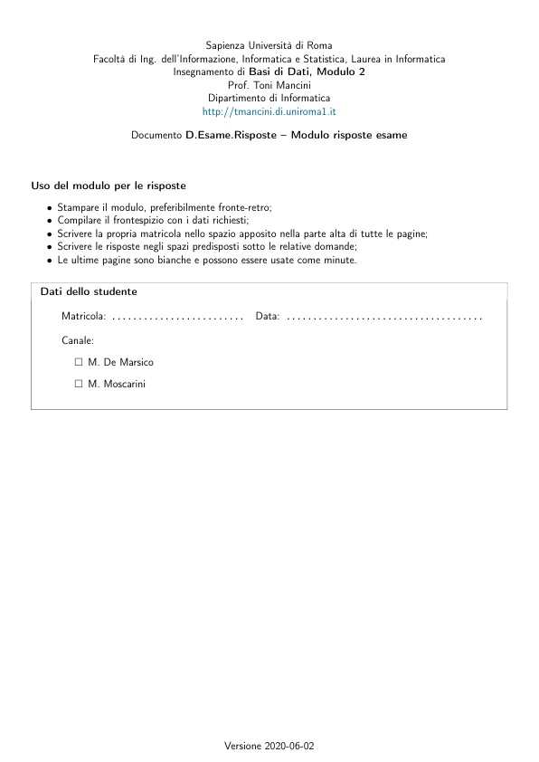
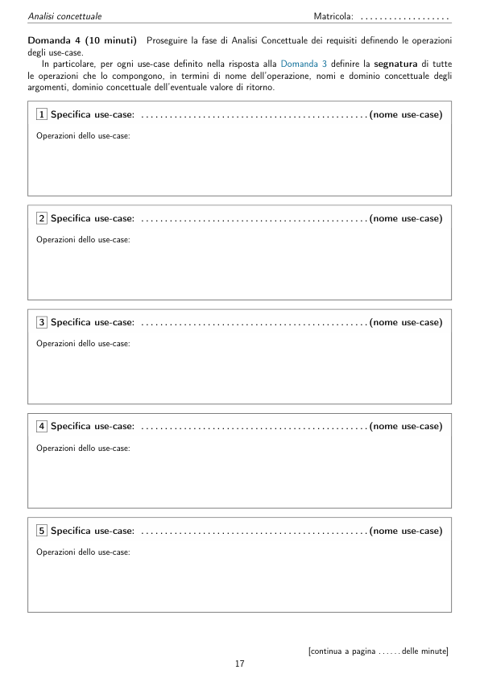

# facsimile_esame_official

> Fonte: `facsimile_esame_official.pdf`
> Estratto con PyMuPDF (conserva legature e formule); tolte le righe ripetute di intestazione e pie' di pagina e le etichette sparse dei diagrammi, che sono ritagliati in `figure/` e richiamati nel punto in cui compaiono.

---

Insegnamento di Basi di Dati, Modulo 2
                        Documento D.Esame.Risposte – Modulo risposte esame
     Uso del modulo per le risposte
        • Stampare il modulo, preferibilmente fronte-retro;
        • Compilare il frontespizio con i dati richiesti;
        • Scrivere la propria matricola nello spazio apposito nella parte alta di tutte le pagine;
        • Scrivere le risposte negli spazi predisposti sotto le relative domande;
        • Le ultime pagine sono bianche e possono essere usate come minute.
       Dati dello studente
           Matricola: . . . . . . . . . . . . . . . . . . . . . . . . .
           Data: . . . . . . . . . . . . . . . . . . . . . . . . . . . . . . . . . . . . .
           Canale:
             □M. De Marsico
             □M. Moscarini

     Istruzioni e regole d’esame
        • Non è possibile usare alcun tipo di materiale didattico.
        • In caso di necessità di ulteriori fogli (in proprio possesso), chiedere preventivamente al docente una
        nuova procedura di controllo.
        • I docenti risponderanno solo a brevi domande inerenti al testo dei quesiti. In caso, prenotarsi usando la
        chat di exam.net ed attendere un docente. Brevi domande possono essere anche espresse direttamente
        in chat.
        • È possibile assentarsi (tra la seconda e la quarta ora d’esame) per brevi pause, ma solo dopo essere
        stati identificati. A tal fine:
            1. Chiedere l’autorizzazione alla commissione d’esame via chat e attendere conferma.
            2. Lasciare tutti i fogli di lavoro sul tavolo, inquadrati dalle videocamere.
            3. Informare la commissione via chat del proprio rientro.
        • Al momento della consegna:
            1. Ordinare tutti i fogli che si vuole far valutare. Omettere dunque le pagine vuote, le minute, etc.
            2. Scansionare il frontespizio e tutti i fogli selezionati al punto precedente, usando il servizio mes-
            so a disposizione da exam.net. Assicurarsi, sullo smartphone, che ogni pagina scansionata sia
            correttamente ruotata (non sarà possibile ruotarla dopo l’invio al documento virtuale su exam.net).
            3. Ingrandire al massimo le singole pagine nel documento virtuale su exam.net, assicurandosi che
            siano tutte ben leggibili.
            4. Inviare la prova usando la piattaforma exam.net.
        • In caso si voglia rinunciare a questa prova, scrivere la parola “Rinuncio” nell’area di testo sulla piattaforma
        exam.net ed inviare la prova senza procedere alla scansione di questi fogli.

     Sommario delle domande
     Si richiede di progettare l’applicazione descritta dalla specifica dei requisiti effettuando le fasi di Analisi
     concettuale dei requisiti e di Progettazione logica della base dati e delle funzionalità, utilizzando la metodologia
     vista nel corso.
        In particolare (vengono indicati i tempi suggeriti per i diversi passi chiave):
     Parte 1: Analisi concettuale dei requisiti
     Effettuare la fase di Analisi concettuale dei requisiti produ-
     cendo lo schema concettuale per l’applicazione, che includa:
        • Analisi dei dati (45 minuti; 75 minuti al massimo):
            – un diagramma ER concettuale (*)
            – il relativo dizionario dei dati
            – le specifiche dei domini concettuali non di tipo base
            – eventuali vincoli esterni, espressi utilizzando il linguaggio della logica del primo ordine (*)
        • Analisi delle funzionalità:
            – un diagramma UML degli use-case (5 minuti; 10 minuti al massimo)
            – la segnatura di tutte le operazioni di use-case (10 minuti)
            – la specifica delle operazioni di use-case necessarie a modellare i requisiti contrassegnati dalla barra
              laterale (come quella qui a sinistra) in termini di precondizioni e postcondizioni, utilizzando il
              linguaggio della logica del primo ordine (*) (30 minuti; 60 minuti al massimo)
     Parte 2: Progettazione della base dati e delle funzionalità
     Effettuare la progettazione della base
     dati e delle funzionalità a partire dallo schema concettuale prodotto nella Parte 1, ed in particolare eseguire i
     seguenti passi:
        • Progettazione della base dati relazionale con vincoli:
            – Ristrutturazione del diagramma ER concettuale e dei vincoli esterni (20 minuti; 30 minuti al
              massimo):
                ∗scelta del DBMS da utilizzare
                ∗progettazione della corrispondenza tra i domini concettuali ed opportuni domini SQL (domini
                base o utente, oppure realizzati mediante relazioni aggiuntive) supportati dal DBMS scelto
                ∗ristrutturazione del diagramma ER concettuale e dei vincoli esterni.
            – Produzione dello schema relazionale della base dati e dei relativi vincoli (*) (30 minuti; 60 minuti
              al massimo)
        • Progettazione delle funzionalità (30 minuti; 45 minuti al massimo):
            – definizione della specifica realizzativa delle operazioni di use-case necessarie a modellare i requisiti
              contrassegnati dalla barra laterale in termini di algoritmi in pseudo-codice e comandi SQL. (*)
        (*) Una risposta soddisfacente a questa domanda è condizione necessaria (ma non sufficiente) per superare la prova.
     Le pagine seguenti contengono le domande specifiche a cui è richiesto rispondere, ulteriori delucidazioni
     per ogni singolo punto, e spazi per le risposte.
        Le pagine da 33 in poi possono essere utilizzate per scrivere minute che non verranno valutate.

                 Questa pagina è stata intenzionalmente lasciata vuota e non è necessario scansionarla

     Analisi concettuale
     Matricola: . . . . . . . . . . . . . . . . . . .
     Analisi concettuale
     Domanda 1 (10 minuti)
     Raffinare la specifica dei requisiti eliminando inconsistenze, omissioni e ridon-
     danze e producendo un elenco numerato di requisiti il meno ambiguo possibile. (La risposta a questa domanda
     non sarà valutata, ma si consiglia di svolgere accuratamente questo passo, in quanto può facilitare di molto
     le attività di progetto.)
     Risposta
                                                 [continua alla pagina seguente]

     Matricola: . . . . . . . . . . . . . . . . . . .
     Analisi concettuale
     Risposta alla Domanda 1 (segue)
                                                 [continua a pagina . . . . . . delle minute]

     Analisi concettuale
     Matricola: . . . . . . . . . . . . . . . . . . .
     Domanda 2 (45 minuti; 75 minuti al massimo)
     Proseguire la fase di Analisi Concettuale dei requisiti,
     producendo un diagramma ER concettuale per l’applicazione, il dizionario dei dati ed eventuali vincoli esterni.
     Una risposta soddisfacente a questa domanda è condizione necessaria (ma non sufficiente) per superare
     la prova.
     Diagramma ER
     Produrre un diagramma ER concettuale per l’applicazione in termini di entità, relationship, attributi, relazioni
     is-a, generalizzazioni (disgiunte) complete e non.
                                                 [continua a pagina . . . . . . delle minute]

                 Questa pagina è stata intenzionalmente lasciata vuota e non è necessario scansionarla

     Analisi concettuale
     Matricola: . . . . . . . . . . . . . . . . . . .
     Dizionario dei dati
     Per ogni entità e relationship del diagramma ER concettuale a cui siano associati
     attributi o vincoli:
        • Definire il dominio e la molteplicità degli attributi (se diversa da (1,1))
        • Definire eventuali vincoli esterni utilizzando il linguaggio della logica del primo ordine. In particolare,
        assumere il seguente vocabolario:
            – Un simbolo di predicato unario E/1 per ogni entità E.
              Semantica di E(x): x è una istanza di E.
            – Un simbolo di predicato unario D/1 per ogni dominio D.
              Semantica di D(x): x è un valore di D.
            – Un simbolo di predicato n-ario r/n per ogni relationship n-aria r.
              Semantica di r(x1, . . . , xn): x1, . . . , xn è una istanza di r.
            – Un simbolo di predicato binario a/2 per ogni attributo di entità
              Semantica di a(x, v): uno dei valori dell’attributo a dell’istanza x è v.
            – Opportuni simboli di predicato (la cui interpretazione è fissata) per gestire confronti tra valori di
              domini numerici o comunque ordinati (tra cui <, ≤, >, ≥).
            – Il predicato di uguaglianza ‘=’ (la cui interpretazione è fissata).
            – Opportuni simboli di costante (la cui interpretazione è fissata), tra cui adesso, interpretato come
              il valore del dominio ‘dataora’ che rappresenta l’istante corrente.
     Risposta
      1 Tipo: Entità | Relationship (cerchiare)
                                                   2 Tipo: Entità | Relationship (cerchiare)
      Nome: . . . . . . . . . . . . . . . . . . . . . . . . . . . . . . . . . . . . . . . . . . .
                                                   Nome: . . . . . . . . . . . . . . . . . . . . . . . . . . . . . . . . . . . . . . . . . . .
       attributo
       dominio
       moltepl. (*)
                                                    attributo
                                                    dominio
                                                    moltepl. (*)
      (*) solo se diversa da (1,1)
                                                   (*) solo se diversa da (1,1)
      Vincoli:
                                                   Vincoli:

     Matricola: . . . . . . . . . . . . . . . . . . .
     Analisi concettuale
      3 Tipo: Entità | Relationship (cerchiare)
                                                   5 Tipo: Entità | Relationship (cerchiare)
      Nome: . . . . . . . . . . . . . . . . . . . . . . . . . . . . . . . . . . . . . . . . . . .
                                                   Nome: . . . . . . . . . . . . . . . . . . . . . . . . . . . . . . . . . . . . . . . . . . .
       attributo
       dominio
       moltepl. (*)
                                                    attributo
                                                    dominio
                                                    moltepl. (*)
      (*) solo se diversa da (1,1)
                                                   (*) solo se diversa da (1,1)
      Vincoli:
                                                   Vincoli:
      4 Tipo: Entità | Relationship (cerchiare)
                                                   6 Tipo: Entità | Relationship (cerchiare)
      Nome: . . . . . . . . . . . . . . . . . . . . . . . . . . . . . . . . . . . . . . . . . . .
                                                   Nome: . . . . . . . . . . . . . . . . . . . . . . . . . . . . . . . . . . . . . . . . . . .
       attributo
       dominio
       moltepl. (*)
                                                    attributo
                                                    dominio
                                                    moltepl. (*)
      (*) solo se diversa da (1,1)
                                                   (*) solo se diversa da (1,1)
      Vincoli:
                                                   Vincoli:

     Analisi concettuale
     Matricola: . . . . . . . . . . . . . . . . . . .
      7 Tipo: Entità | Relationship (cerchiare)
                                                   9 Tipo: Entità | Relationship (cerchiare)
      Nome: . . . . . . . . . . . . . . . . . . . . . . . . . . . . . . . . . . . . . . . . . . .
                                                   Nome: . . . . . . . . . . . . . . . . . . . . . . . . . . . . . . . . . . . . . . . . . . .
       attributo
       dominio
       moltepl. (*)
                                                    attributo
                                                    dominio
                                                    moltepl. (*)
      (*) solo se diversa da (1,1)
                                                   (*) solo se diversa da (1,1)
      Vincoli:
                                                   Vincoli:
      8 Tipo: Entità | Relationship (cerchiare)
                                                   10 Tipo: Entità | Relationship (cerchiare)
      Nome: . . . . . . . . . . . . . . . . . . . . . . . . . . . . . . . . . . . . . . . . . . .
                                                   Nome: . . . . . . . . . . . . . . . . . . . . . . . . . . . . . . . . . . . . . . . . . . .
       attributo
       dominio
       moltepl. (*)
                                                    attributo
                                                    dominio
                                                    moltepl. (*)
      (*) solo se diversa da (1,1)
                                                   (*) solo se diversa da (1,1)
      Vincoli:
                                                   Vincoli:

     Matricola: . . . . . . . . . . . . . . . . . . .
     Analisi concettuale
      11 Tipo: Entità | Relationship (cerchiare)
                                                   13 Tipo: Entità | Relationship (cerchiare)
      Nome: . . . . . . . . . . . . . . . . . . . . . . . . . . . . . . . . . . . . . . . . . . .
                                                   Nome: . . . . . . . . . . . . . . . . . . . . . . . . . . . . . . . . . . . . . . . . . . .
       attributo
       dominio
       moltepl. (*)
                                                    attributo
                                                    dominio
                                                    moltepl. (*)
      (*) solo se diversa da (1,1)
                                                   (*) solo se diversa da (1,1)
      Vincoli:
                                                   Vincoli:
      12 Tipo: Entità | Relationship (cerchiare)
                                                   14 Tipo: Entità | Relationship (cerchiare)
      Nome: . . . . . . . . . . . . . . . . . . . . . . . . . . . . . . . . . . . . . . . . . . .
                                                   Nome: . . . . . . . . . . . . . . . . . . . . . . . . . . . . . . . . . . . . . . . . . . .
       attributo
       dominio
       moltepl. (*)
                                                    attributo
                                                    dominio
                                                    moltepl. (*)
      (*) solo se diversa da (1,1)
                                                   (*) solo se diversa da (1,1)
      Vincoli:
                                                   Vincoli:

     Analisi concettuale
     Matricola: . . . . . . . . . . . . . . . . . . .
      15 Tipo: Entità | Relationship (cerchiare)
                                                   17 Tipo: Entità | Relationship (cerchiare)
      Nome: . . . . . . . . . . . . . . . . . . . . . . . . . . . . . . . . . . . . . . . . . . .
                                                   Nome: . . . . . . . . . . . . . . . . . . . . . . . . . . . . . . . . . . . . . . . . . . .
       attributo
       dominio
       moltepl. (*)
                                                    attributo
                                                    dominio
                                                    moltepl. (*)
      (*) solo se diversa da (1,1)
                                                   (*) solo se diversa da (1,1)
      Vincoli:
                                                   Vincoli:
      16 Tipo: Entità | Relationship (cerchiare)
                                                   18 Tipo: Entità | Relationship (cerchiare)
      Nome: . . . . . . . . . . . . . . . . . . . . . . . . . . . . . . . . . . . . . . . . . . .
                                                   Nome: . . . . . . . . . . . . . . . . . . . . . . . . . . . . . . . . . . . . . . . . . . .
       attributo
       dominio
       moltepl. (*)
                                                    attributo
                                                    dominio
                                                    moltepl. (*)
      (*) solo se diversa da (1,1)
                                                   (*) solo se diversa da (1,1)
      Vincoli:
                                                   Vincoli:
                                                                [continua a pagina . . . . . . delle minute]

     Matricola: . . . . . . . . . . . . . . . . . . .
     Analisi concettuale
     Ulteriori vincoli esterni, specifica di eventuali operazioni ausiliarie invocate da tali vincoli, e
     specifica dei domini concettuali non di tipo base
                                                 [continua a pagina . . . . . . delle minute]

     Analisi concettuale
     Matricola: . . . . . . . . . . . . . . . . . . .
     Domanda 3 (5 minuti; 10 minuti al massimo)
     Proseguire la fase di Analisi Concettuale dei requisiti,
     producendo un diagramma UML degli use-case che definisca ad alto livello tutte le funzionalità richieste al
     sistema.
     Risposta
                                                 [continua a pagina . . . . . . delle minute]

                 Questa pagina è stata intenzionalmente lasciata vuota e non è necessario scansionarla

     Analisi concettuale
     Matricola: . . . . . . . . . . . . . . . . . . .
     Domanda 4 (10 minuti)
     Proseguire la fase di Analisi Concettuale dei requisiti definendo le operazioni
     degli use-case.
     In particolare, per ogni use-case definito nella risposta alla Domanda 3 definire la segnatura di tutte
     le operazioni che lo compongono, in termini di nome dell’operazione, nomi e dominio concettuale degli
     argomenti, dominio concettuale dell’eventuale valore di ritorno.
        1 Specifica use-case: . . . . . . . . . . . . . . . . . . . . . . . . . . . . . . . . . . . . . . . . . . . . . . . .(nome use-case)
       Operazioni dello use-case:
        2 Specifica use-case: . . . . . . . . . . . . . . . . . . . . . . . . . . . . . . . . . . . . . . . . . . . . . . . .(nome use-case)
       Operazioni dello use-case:
        3 Specifica use-case: . . . . . . . . . . . . . . . . . . . . . . . . . . . . . . . . . . . . . . . . . . . . . . . .(nome use-case)
       Operazioni dello use-case:
        4 Specifica use-case: . . . . . . . . . . . . . . . . . . . . . . . . . . . . . . . . . . . . . . . . . . . . . . . .(nome use-case)
       Operazioni dello use-case:
        5 Specifica use-case: . . . . . . . . . . . . . . . . . . . . . . . . . . . . . . . . . . . . . . . . . . . . . . . .(nome use-case)
       Operazioni dello use-case:
                                                 [continua a pagina . . . . . . delle minute]

                 Questa pagina è stata intenzionalmente lasciata vuota e non è necessario scansionarla

     Analisi concettuale
     Matricola: . . . . . . . . . . . . . . . . . . .
     Domanda 5 (30 minuti; 60 minuti al massimo)
     Proseguire la fase di Analisi Concettuale dei requisiti
     producendo le specifiche concettuali per le operazioni di use-case, limitandosi a quelle necessarie a modellare
     i requisiti contrassegnati dalla barra laterale (come quella qui a sinistra). In particolare, per ogni operazione,
     definire segnatura, precondizioni e postcondizioni utilizzando il linguaggio della logica del primo ordine. Si
     assuma lo stesso vocabolario definito alla Domanda 2.
     Una risposta soddisfacente a questa domanda è condizione necessaria (ma non sufficiente) per superare
     la prova.
     Risposta
                                                 [continua alla pagina seguente]

     Matricola: . . . . . . . . . . . . . . . . . . .
     Analisi concettuale
     Risposta alla Domanda 5 (segue)
                                                 [continua a pagina . . . . . . delle minute]

     Progettazione della base dati e delle funzionalità
     Matricola: . . . . . . . . . . . . . . . . . . .
     Progettazione della base dati e delle funzionalità
     Domanda 6 (20 minuti; 30 minuti al massimo)
     Iniziare la fase di progettazione logica della base di
     dati decidendo il DBMS da utilizzare e ristrutturando lo schema ER concettuale, il dizionario dei dati e i
     vincoli esterni. In particolare:
        • progettare una corrispondenza tra i domini concettuali ed opportuni domini SQL (domini base o utente,
        oppure realizzati mediante relazioni aggiuntive) supportati dal DBMS scelto
        • eliminare attributi multivalore o composti
        • eliminare relazioni is-a e generalizzazioni
        • definire un identificatore primario per ogni entità
        • valutare se e come aggiungere ridondanza in maniera controllata
        • ristrutturare i vincoli esterni per renderli consistenti con la struttura del nuovo diagramma.
        Descrivere brevemente le principali scelte effettuate.
     DBMS da utilizzare . . . . . . . . . . . . . . . . . . . . . . . . . . . . . . . . . . . . . . . . . . . . . . . . . . . . . . . . . . . . . . . . . . . . .
     Corrispondenza tra domini concettuali e domini supportati dal DBMS
                                                 [continua a pagina . . . . . . delle minute]

     Matricola: . . . . . . . . . . . . . . . . . . .
     Progettazione della base dati e delle funzionalità
     Diagramma ER ristrutturato
                                                 [continua a pagina . . . . . . delle minute]

     Progettazione della base dati e delle funzionalità
     Matricola: . . . . . . . . . . . . . . . . . . .
     Breve descrizione delle scelte effettuate durante la ristrutturazione
     Vincoli esterni introdotti o modificati durante la fase di ristrutturazione
     (si omettano i vincoli esterni la cui formulazione è rimasta identica a seguito della ristrutturazione)
                                                 [continua a pagina . . . . . . delle minute]
                                                                [continua a pagina . . . . . . delle minute]

                 Questa pagina è stata intenzionalmente lasciata vuota e non è necessario scansionarla

     Progettazione della base dati e delle funzionalità
     Matricola: . . . . . . . . . . . . . . . . . . .
     Domanda 7 (30 minuti; 60 minuti al massimo)
     Proseguire la fase di progettazione logica della base di
     dati producendo lo schema relazionale della base dati e i relativi vincoli a partire dallo schema ER ristrutturato.
     Una risposta soddisfacente a questa domanda è condizione necessaria (ma non sufficiente) per superare
     la prova.
      1 Relazione . . . . . . . . . . . . . . . . (nome)
      Derivante da: entità | relationship (cerchiare)
      Attributi
      Domini
      Gli attributi chiave primaria sono sottolineati, quelli i cui valori possono essere NULL sono contrassegnati con *
      Vincoli (foreign key, inclusione, altra chiave, di ennupla, di dominio):
      La relazione accorpa le relazioni che implementano le seguenti relationship: . . . . . . . . . . . . . . . . . . . . . . . . . . . . .
      2 Relazione . . . . . . . . . . . . . . . . (nome)
      Derivante da: entità | relationship (cerchiare)
      Attributi
      Domini
      Gli attributi chiave primaria sono sottolineati, quelli i cui valori possono essere NULL sono contrassegnati con *
      Vincoli (foreign key, inclusione, altra chiave, di ennupla, di dominio):
      La relazione accorpa le relazioni che implementano le seguenti relationship: . . . . . . . . . . . . . . . . . . . . . . . . . . . . .
      3 Relazione . . . . . . . . . . . . . . . . (nome)
      Derivante da: entità | relationship (cerchiare)
      Attributi
      Domini
      Gli attributi chiave primaria sono sottolineati, quelli i cui valori possono essere NULL sono contrassegnati con *
      Vincoli (foreign key, inclusione, altra chiave, di ennupla, di dominio):
      La relazione accorpa le relazioni che implementano le seguenti relationship: . . . . . . . . . . . . . . . . . . . . . . . . . . . . .
      4 Relazione . . . . . . . . . . . . . . . . (nome)
      Derivante da: entità | relationship (cerchiare)
      Attributi
      Domini
      Gli attributi chiave primaria sono sottolineati, quelli i cui valori possono essere NULL sono contrassegnati con *
      Vincoli (foreign key, inclusione, altra chiave, di ennupla, di dominio):
      La relazione accorpa le relazioni che implementano le seguenti relationship: . . . . . . . . . . . . . . . . . . . . . . . . . . . . .
      5 Relazione . . . . . . . . . . . . . . . . (nome)
      Derivante da: entità | relationship (cerchiare)
      Attributi
      Domini
      Gli attributi chiave primaria sono sottolineati, quelli i cui valori possono essere NULL sono contrassegnati con *
      Vincoli (foreign key, inclusione, altra chiave, di ennupla, di dominio):
      La relazione accorpa le relazioni che implementano le seguenti relationship: . . . . . . . . . . . . . . . . . . . . . . . . . . . . .

     Matricola: . . . . . . . . . . . . . . . . . . .
     Progettazione della base dati e delle funzionalità
      6 Relazione . . . . . . . . . . . . . . . . (nome)
      Derivante da: entità | relationship (cerchiare)
      Attributi
      Domini
      Gli attributi chiave primaria sono sottolineati, quelli i cui valori possono essere NULL sono contrassegnati con *
      Vincoli (foreign key, inclusione, altra chiave, di ennupla, di dominio):
      La relazione accorpa le relazioni che implementano le seguenti relationship: . . . . . . . . . . . . . . . . . . . . . . . . . . . . .
      7 Relazione . . . . . . . . . . . . . . . . (nome)
      Derivante da: entità | relationship (cerchiare)
      Attributi
      Domini
      Gli attributi chiave primaria sono sottolineati, quelli i cui valori possono essere NULL sono contrassegnati con *
      Vincoli (foreign key, inclusione, altra chiave, di ennupla, di dominio):
      La relazione accorpa le relazioni che implementano le seguenti relationship: . . . . . . . . . . . . . . . . . . . . . . . . . . . . .
      8 Relazione . . . . . . . . . . . . . . . . (nome)
      Derivante da: entità | relationship (cerchiare)
      Attributi
      Domini
      Gli attributi chiave primaria sono sottolineati, quelli i cui valori possono essere NULL sono contrassegnati con *
      Vincoli (foreign key, inclusione, altra chiave, di ennupla, di dominio):
      La relazione accorpa le relazioni che implementano le seguenti relationship: . . . . . . . . . . . . . . . . . . . . . . . . . . . . .
      9 Relazione . . . . . . . . . . . . . . . . (nome)
      Derivante da: entità | relationship (cerchiare)
      Attributi
      Domini
      Gli attributi chiave primaria sono sottolineati, quelli i cui valori possono essere NULL sono contrassegnati con *
      Vincoli (foreign key, inclusione, altra chiave, di ennupla, di dominio):
      La relazione accorpa le relazioni che implementano le seguenti relationship: . . . . . . . . . . . . . . . . . . . . . . . . . . . . .
      10 Relazione . . . . . . . . . . . . . . . . (nome)
      Derivante da: entità | relationship (cerchiare)
      Attributi
      Domini
      Gli attributi chiave primaria sono sottolineati, quelli i cui valori possono essere NULL sono contrassegnati con *
      Vincoli (foreign key, inclusione, altra chiave, di ennupla, di dominio):
      La relazione accorpa le relazioni che implementano le seguenti relationship: . . . . . . . . . . . . . . . . . . . . . . . . . . . . .

     Progettazione della base dati e delle funzionalità
     Matricola: . . . . . . . . . . . . . . . . . . .
      11 Relazione . . . . . . . . . . . . . . . . (nome)
      Derivante da: entità | relationship (cerchiare)
      Attributi
      Domini
      Gli attributi chiave primaria sono sottolineati, quelli i cui valori possono essere NULL sono contrassegnati con *
      Vincoli (foreign key, inclusione, altra chiave, di ennupla, di dominio):
      La relazione accorpa le relazioni che implementano le seguenti relationship: . . . . . . . . . . . . . . . . . . . . . . . . . . . . .
      12 Relazione . . . . . . . . . . . . . . . . (nome)
      Derivante da: entità | relationship (cerchiare)
      Attributi
      Domini
      Gli attributi chiave primaria sono sottolineati, quelli i cui valori possono essere NULL sono contrassegnati con *
      Vincoli (foreign key, inclusione, altra chiave, di ennupla, di dominio):
      La relazione accorpa le relazioni che implementano le seguenti relationship: . . . . . . . . . . . . . . . . . . . . . . . . . . . . .
      13 Relazione . . . . . . . . . . . . . . . . (nome)
      Derivante da: entità | relationship (cerchiare)
      Attributi
      Domini
      Gli attributi chiave primaria sono sottolineati, quelli i cui valori possono essere NULL sono contrassegnati con *
      Vincoli (foreign key, inclusione, altra chiave, di ennupla, di dominio):
      La relazione accorpa le relazioni che implementano le seguenti relationship: . . . . . . . . . . . . . . . . . . . . . . . . . . . . .
      14 Relazione . . . . . . . . . . . . . . . . (nome)
      Derivante da: entità | relationship (cerchiare)
      Attributi
      Domini
      Gli attributi chiave primaria sono sottolineati, quelli i cui valori possono essere NULL sono contrassegnati con *
      Vincoli (foreign key, inclusione, altra chiave, di ennupla, di dominio):
      La relazione accorpa le relazioni che implementano le seguenti relationship: . . . . . . . . . . . . . . . . . . . . . . . . . . . . .
      15 Relazione . . . . . . . . . . . . . . . . (nome)
      Derivante da: entità | relationship (cerchiare)
      Attributi
      Domini
      Gli attributi chiave primaria sono sottolineati, quelli i cui valori possono essere NULL sono contrassegnati con *
      Vincoli (foreign key, inclusione, altra chiave, di ennupla, di dominio):
      La relazione accorpa le relazioni che implementano le seguenti relationship: . . . . . . . . . . . . . . . . . . . . . . . . . . . . .

     Matricola: . . . . . . . . . . . . . . . . . . .
     Progettazione della base dati e delle funzionalità
      16 Relazione . . . . . . . . . . . . . . . . (nome)
      Derivante da: entità | relationship (cerchiare)
      Attributi
      Domini
      Gli attributi chiave primaria sono sottolineati, quelli i cui valori possono essere NULL sono contrassegnati con *
      Vincoli (foreign key, inclusione, altra chiave, di ennupla, di dominio):
      La relazione accorpa le relazioni che implementano le seguenti relationship: . . . . . . . . . . . . . . . . . . . . . . . . . . . . .
      17 Relazione . . . . . . . . . . . . . . . . (nome)
      Derivante da: entità | relationship (cerchiare)
      Attributi
      Domini
      Gli attributi chiave primaria sono sottolineati, quelli i cui valori possono essere NULL sono contrassegnati con *
      Vincoli (foreign key, inclusione, altra chiave, di ennupla, di dominio):
      La relazione accorpa le relazioni che implementano le seguenti relationship: . . . . . . . . . . . . . . . . . . . . . . . . . . . . .
      18 Relazione . . . . . . . . . . . . . . . . (nome)
      Derivante da: entità | relationship (cerchiare)
      Attributi
      Domini
      Gli attributi chiave primaria sono sottolineati, quelli i cui valori possono essere NULL sono contrassegnati con *
      Vincoli (foreign key, inclusione, altra chiave, di ennupla, di dominio):
      La relazione accorpa le relazioni che implementano le seguenti relationship: . . . . . . . . . . . . . . . . . . . . . . . . . . . . .
      19 Relazione . . . . . . . . . . . . . . . . (nome)
      Derivante da: entità | relationship (cerchiare)
      Attributi
      Domini
      Gli attributi chiave primaria sono sottolineati, quelli i cui valori possono essere NULL sono contrassegnati con *
      Vincoli (foreign key, inclusione, altra chiave, di ennupla, di dominio):
      La relazione accorpa le relazioni che implementano le seguenti relationship: . . . . . . . . . . . . . . . . . . . . . . . . . . . . .
      20 Relazione . . . . . . . . . . . . . . . . (nome)
      Derivante da: entità | relationship (cerchiare)
      Attributi
      Domini
      Gli attributi chiave primaria sono sottolineati, quelli i cui valori possono essere NULL sono contrassegnati con *
      Vincoli (foreign key, inclusione, altra chiave, di ennupla, di dominio):
      La relazione accorpa le relazioni che implementano le seguenti relationship: . . . . . . . . . . . . . . . . . . . . . . . . . . . . .
                                                                [continua a pagina . . . . . . delle minute]

     Progettazione della base dati e delle funzionalità
     Matricola: . . . . . . . . . . . . . . . . . . .
     Ulteriori vincoli esterni
     Per ogni ulteriore vincolo esterno (non ancora espresso perché non definibile mediante vincoli di chiave,
     foreign key, ennupla, dominio, inclusione), progettare un trigger che lo implementi, definendo: (a) gli eventi
     da intercettare (inserimento, modifica, eliminazione di ennuple); (b) quando intercettare tali eventi (appena
     prima o subito dopo l’evento intercettato); (c) la relativa funzione in pseudo-codice con SQL immerso che
     implementa il controllo del vincolo.
                                                 [continua alla pagina seguente]

     Matricola: . . . . . . . . . . . . . . . . . . .
     Progettazione della base dati e delle funzionalità
     Risposta alla Domanda 7 (segue)
                                                 [continua a pagina . . . . . . delle minute]

     Progettazione della base dati e delle funzionalità
     Matricola: . . . . . . . . . . . . . . . . . . .
     Domanda 8 (30 minuti; 45 minuti al massimo)
     Proseguire la fase di progettazione dell’applicazione
     producendo le specifiche realizzative delle operazioni di use-case definite per modellare i requisiti contrassegnati
     dalla barra laterale della specifica dei requisiti.
     In particolare, per ogni operazione definire la segnatura, in termini di nome dell’operazione, nomi e dominio
     SQL degli argomenti, dominio SQL dell’eventuale valore di ritorno, e un algoritmo in pseudo-codice con SQL
     immerso che verifichi le precondizioni e garantisca il raggiungimento delle postcondizioni definite in fase di
     Analisi.
     Una risposta soddisfacente a questa domanda è condizione necessaria (ma non sufficiente) per superare
     la prova.
     Risposta
                                                 [continua alla pagina seguente]

     Matricola: . . . . . . . . . . . . . . . . . . .
     Progettazione della base dati e delle funzionalità
     Risposta alla Domanda 8 (segue)
                                                 [continua a pagina . . . . . . delle minute]

     Minute
     Matricola: . . . . . . . . . . . . . . . . . . .
     Tempo totale stimato per svolgere questa prova: 180 minuti (tempo totale concesso: 300 minuti).
        [Spazio per minute. Questa pagina non sarà valutata a meno che non sia puntata da pagine precedenti.]

     Matricola: . . . . . . . . . . . . . . . . . . .
     Minute
        [Spazio per minute. Questa pagina non sarà valutata a meno che non sia puntata da pagine precedenti.]

     Minute
     Matricola: . . . . . . . . . . . . . . . . . . .
        [Spazio per minute. Questa pagina non sarà valutata a meno che non sia puntata da pagine precedenti.]

     Matricola: . . . . . . . . . . . . . . . . . . .
     Minute
        [Spazio per minute. Questa pagina non sarà valutata a meno che non sia puntata da pagine precedenti.]
