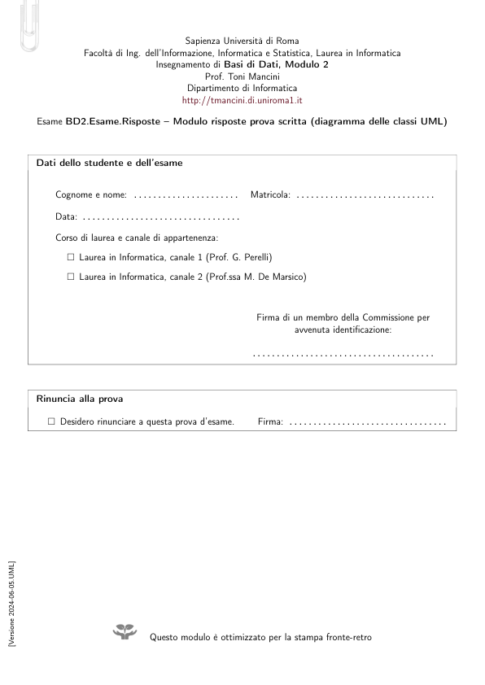

# modulo-risposte-UML-2024-06-05

> Fonte: `modulo-risposte-UML-2024-06-05.pdf`
> Estratto con PyMuPDF (conserva legature e formule); tolte le righe ripetute di intestazione e pie' di pagina e le etichette sparse dei diagrammi, che sono ritagliati in `figure/` e richiamati nel punto in cui compaiono.

---

Insegnamento di Basi di Dati, Modulo 2
       Esame BD2.Esame.Risposte – Modulo risposte prova scritta (diagramma delle classi UML)
       Dati dello studente e dell’esame
           Cognome e nome: . . . . . . . . . . . . . . . . . . . . . .
           Matricola: . . . . . . . . . . . . . . . . . . . . . . . . . . . . .
           Data: . . . . . . . . . . . . . . . . . . . . . . . . . . . . . . . . .
           Corso di laurea e canale di appartenenza:
             □Laurea in Informatica, canale 1 (Prof. G. Perelli)
             □Laurea in Informatica, canale 2 (Prof.ssa M. De Marsico)
                                                    Firma di un membro della Commissione per
                                                            avvenuta identificazione:
                                                    . . . . . . . . . . . . . . . . . . . . . . . . . . . . . . . . . . . . . .
       Rinuncia alla prova
         □Desidero rinunciare a questa prova d’esame.
         Firma: . . . . . . . . . . . . . . . . . . . . . . . . . . . . . . . . .
 [Versione 2024-06-05.UML]
                              Questo modulo è ottimizzato per la stampa fronte-retro

                                                                 Matricola: . . . . . . . . . . . . . . . . . . .
     Istruzioni e regole d’esame
     Prima dell’esame
        • Stampare questo modulo, preferibilmente fronte-retro, e rilegarlo con un fermaglio rimovibile, come
        quello disegnato in alto
        • Compilare il frontespizio con i propri dati, come richiesto
        • Scrivere la propria matricola nello spazio apposito nella parte alta di tutte le pagine
     Durante l’esame
        • La prova è dimensionata per essere svolta in circa 3 ore. Tuttavia, data la sua natura fortemente
        progettuale, la Commissione offre agli studenti la più ampia disponibilità di tempo, al fine ovviare ad
        eventuali (e limitati) errori di analisi/progettazione rilevati più a valle del ciclo di vita.
          Il tempo massimo per la consegna è quindi rilassato a 5 ore (il massimo tempo compatibile con le
          disponibilità di aule).
        • Scrivere le risposte negli spazi predisposti sotto le relative domande. Le ultime pagine sono vuote e
        possono essere usate come minute oppure, se puntate opportunamente, per contenere risposte in caso
        gli spazi appositi dovessero risultare insufficienti.
        • Non è possibile usare alcun tipo di materiale didattico.
        • In caso di necessità di ulteriori fogli (in proprio possesso), chiedere preventivamente alla Commissione
        una nuova procedura di controllo.
        • La Commissione può rispondere solo a brevi domande inerenti al testo dei quesiti.
        • Tra la seconda e la quarta ora d’esame, gli studenti possono effettuare brevi pause (uno studente alla
        volta) seguendo la seguente procedura:
            1. Alla lavagna è riportata una coda denominata ‘Coda prenotazioni pause’.
            Sia n (un intero)
            l’elemento in fondo alla coda (si assuma n = 0 in caso di coda vuota).
            2. Recarsi alla lavagna ed aggiungere l’intero n + 1 come proprio contrassegno in fondo alla coda,
            seguito da una stringa a propria scelta (ad es., le proprie iniziali).
            3. Se il proprio contrassegno non è l’elemento affiorante della coda, tornare al lavoro in attesa che
            lo diventi.
            4. Consegnare tutti i fogli di lavoro e il testo d’esame alla Commissione ed uscire.
            5. Al rientro, cancellare il proprio contrassegno dalla coda di modo da permettere al successivo
            studente prenotato di uscire, e riprendere i fogli prima consegnati.
     Al momento della consegna
        • Ordinare tutti i fogli che si vuole far valutare e rilegarli con un fermaglio rimovibile. Non includere
        fogli che la Commissione non deve valutare (ad es., requisiti, minute), ma includere ovviamente il
        frontespizio.
                                                                                                [Versione 2024-06-05.UML]
        • Consegnare i fogli ordinati nelle mani di un membro della Commissione. Non lasciare l’aula senza
        la conferma, da parte della Commissione, del buon esito delle operazioni di consegna.
     In caso di rinuncia
        • È possibile rinunciare alla consegna a partire dalla seconda ora d’esame. In caso di rinuncia, consegnare
        nelle mani della Commissione solo il frontespizio, dopo aver compilato e firmato la sezione dedicata.

      Matricola: . . . . . . . . . . . . . . . . . . .
     Sommario delle domande
     Si richiede di progettare l’applicazione descritta dalla specifica dei requisiti effettuando le fasi di Analisi
     concettuale dei requisiti e di Progettazione logica della base dati e delle funzionalità, utilizzando la metodologia
     vista nel corso.
        In particolare (vengono indicati i tempi suggeriti per i diversi passi chiave):
     Parte 1: Analisi concettuale dei requisiti
     Effettuare la fase di Analisi concettuale dei requisiti produ-
     cendo lo schema concettuale per l’applicazione, che includa:
        • Analisi dei dati (45 minuti; 75 minuti al massimo):
            – un diagramma UML concettuale delle classi (*)
            – (parte del)le specifiche formali delle classi e delle associazioni
            – le specifiche dei tipi di dato
            – la specifica formale dei vincoli esterni (*)
        • Analisi delle funzionalità:
            – un diagramma UML degli use-case (5 minuti; 10 minuti al massimo)
            – la segnatura di tutte le operazioni di use-case (10 minuti)
            – (parti del)le specifiche formali degli use-case. (30 minuti; 60 minuti al massimo)
     Si richiede esplicitamente di modellare le specifiche formali delle operazioni di clase e/o use-case necessarie
     a modellare i requisiti contrassegnati dalla barra laterale (come quella qui a sinistra), incluse tutte le eventuali
     operazioni ausiliarie, usando l’estensione della logica del primo ordine studiata nel corso. (*)
     Parte 2: Progettazione della base dati e delle funzionalità
     Effettuare la progettazione della base
     dati e delle funzionalità a partire dallo schema concettuale prodotto nella Parte 1, ed in particolare eseguire i
     seguenti passi:
        • Progettazione della base dati relazionale con vincoli:
            – Ristrutturazione del diagramma UML concttuale delle classi e delle specifiche (20 minuti; 30 minuti
              al massimo):
                ∗scelta del DBMS da utilizzare
                ∗progettazione della corrispondenza tra i tipi di dato concettuali ed opportuni domini SQL
            (domini base o utente, oppure realizzati mediante relazioni aggiuntive) supportati dal DBMS
            scelto
            ∗ristrutturazione del diagramma UML concttuale delle classi e delle specifiche dei vincoli esterni.
            – Produzione dello schema relazionale della base dati e dei relativi vincoli (*) (30 minuti; 60 minuti
              al massimo)
        • Progettazione delle funzionalità (30 minuti; 45 minuti al massimo):
            – definizione della specifica realizzativa delle operazioni necessarie a modellare i requisiti contrasse-
              gnati dalla barra laterale, in modo conforme alla loro specifica concettuale prodotta nella fase di
              Analisi, in termini di algoritmi in pseudo-codice e comandi SQL immersi. (*)
 [Versione 2024-06-05.UML]
     Le pagine seguenti contengono le domande specifiche a cui è richiesto rispondere, ulteriori delucidazioni
     per ogni singolo punto, e spazi per le risposte.
        Le pagine da 31 in poi possono essere utilizzate per scrivere minute che non verranno valutate.
        (*) Una risposta soddisfacente a questa domanda è condizione necessaria (ma non sufficiente) per superare la prova.

                             Questa pagina è stata intenzionalmente lasciata vuota
                                                                                                [Versione 2024-06-05.UML]

      Matricola: . . . . . . . . . . . . . . . . . . .
      Analisi concettuale
     Analisi concettuale
     Domanda 1 (10 minuti)
     Raffinare la specifica dei requisiti eliminando inconsistenze, omissioni e ridon-
     danze e producendo un elenco numerato di requisiti il meno ambiguo possibile. (La risposta a questa domanda
     non sarà valutata, ma si consiglia di svolgere accuratamente questo passo, in quanto può facilitare di molto
     le attività di progetto.)
     Risposta
 [Versione 2024-06-05.UML]
                                                 [continua alla pagina seguente]

      Analisi concettuale
      Matricola: . . . . . . . . . . . . . . . . . . .
     Risposta alla Domanda 1 (segue)
                                                                                                [Versione 2024-06-05.UML]

      Matricola: . . . . . . . . . . . . . . . . . . .
      Analisi concettuale
     Domanda 2 (45 minuti; 75 minuti al massimo)
     Proseguire la fase di Analisi Concettuale dei requisiti,
     producendo un diagramma UML concettuale delle classi per l’applicazione, le specifiche di classi, associazioni,
     tipi di dato e vincoli esterni.
     Una risposta soddisfacente a questa domanda è condizione necessaria (ma non sufficiente) per superare
     la prova.
     Diagramma UML concettuale delle classi
     Produrre un diagramma UML concettuale delle classi per l’applicazione in termini di classi, associazioni,
     attributi, generalizzazioni, operazioni di classe.
 [Versione 2024-06-05.UML]
                                                 [continua alla pagina seguente]

      Analisi concettuale
      Matricola: . . . . . . . . . . . . . . . . . . .
     Risposta alla Domanda 2 (segue)
                                                                                                [Versione 2024-06-05.UML]

      Matricola: . . . . . . . . . . . . . . . . . . .
      Analisi concettuale
     Specifiche delle classi o associazioni
     Per ogni classe o associazione del diagramma con operazioni
     o vincoli:
        • Definire la specifica formale di eventuali operazioni necessarie a modellare i requisiti contrassegnati
        dalla barra laterale, ed eventuali vincoli esterni. Usare la logica del primo ordine estesa con teoria degli
        insiemi e semantica di mondo reale vista nel corso, usando il seguente alfabeto:
          – Un simbolo di predicato C/1 per ogni classà C.
            Semantica di C(x): x è una istanza di C.
          – Un simbolo di predicato T/1 per ogni tipo di dato T.
            Semantica di T(x): x è un valore di T.
          – Un simbolo di predicato assoc/2 per ogni associazione binaria assoc.
            Semantica di assoc(c1, c2): (c1, c2) è una istanza di assoc.
          – Un simbolo di predicato attr/2 per ogni attributo attr di entità
            Semantica di attr(c, v): uno dei valori dell’attributo attr dell’istanza c è v.
          – Un simbolo di predicato attr/3 per ogni attributo attr di associazione binaria.
            Semantica di attr(c1, c2, v): uno dei valori dell’attr. attr del link (c1, c2) è v.
          – Un simbolo di predicato op/(n + 2) per ogni operazione di classe ad n argomenti.
            Semantica di op(c, arg1, . . . , argn, v): uno dei valori di ritorno di op, quando invocata sull’istanza c
            e con argomenti arg1, . . . , argn è v.
          – Il simbolo di =/2 (la cui interpretazione è la relazione che lega ogni elemento del dominio di inter-
            pretazione solo con se stesso) e opportuni simboli di predicato e di funzione, soggetti a semantica
            di modo reale, per relazioni e funzioni standard tra elementi dei tipi di dato, tra cui adesso/0,
            interpretato come il valore del dominio DataOra che rappresenta l’istante corrente.
     Risposta
      1 Tipo: Classe | Associazione (cerchiare)
                                                   2 Tipo: Classe | Associazione (cerchiare)
      Nome: . . . . . . . . . . . . . . . . . . . . . . . . . . . . . . . . . . . . . . . . . . .
                                                   Nome: . . . . . . . . . . . . . . . . . . . . . . . . . . . . . . . . . . . . . . . . . . .
      Operazioni, vincoli:
                                                   Operazioni, vincoli:
 [Versione 2024-06-05.UML]

      Analisi concettuale
      Matricola: . . . . . . . . . . . . . . . . . . .
      3 Tipo: Classe | Associazione (cerchiare)
                                                   6 Tipo: Classe | Associazione (cerchiare)
      Nome: . . . . . . . . . . . . . . . . . . . . . . . . . . . . . . . . . . . . . . . . . . .
                                                   Nome: . . . . . . . . . . . . . . . . . . . . . . . . . . . . . . . . . . . . . . . . . . .
      Operazioni, vincoli:
                                                   Operazioni, vincoli:
      4 Tipo: Classe | Associazione (cerchiare)
                                                   7 Tipo: Classe | Associazione (cerchiare)
      Nome: . . . . . . . . . . . . . . . . . . . . . . . . . . . . . . . . . . . . . . . . . . .
                                                   Nome: . . . . . . . . . . . . . . . . . . . . . . . . . . . . . . . . . . . . . . . . . . .
      Operazioni, vincoli:
                                                   Operazioni, vincoli:
      5 Tipo: Classe | Associazione (cerchiare)
                                                   8 Tipo: Classe | Associazione (cerchiare)
      Nome: . . . . . . . . . . . . . . . . . . . . . . . . . . . . . . . . . . . . . . . . . . .
                                                   Nome: . . . . . . . . . . . . . . . . . . . . . . . . . . . . . . . . . . . . . . . . . . .
      Operazioni, vincoli:
                                                   Operazioni, vincoli:
                                                                                                [Versione 2024-06-05.UML]
                                                                      [continua alla pagina seguente]

      Matricola: . . . . . . . . . . . . . . . . . . .
      Analisi concettuale
     Specifiche dei tipi di dato, specifiche di ulteriori vincoli esterni ed altre specifiche
 [Versione 2024-06-05.UML]
                                                [continua alla pagina seguente]

      Analisi concettuale
      Matricola: . . . . . . . . . . . . . . . . . . .
     Risposta alla Domanda 2 (segue)
                                                                                                [Versione 2024-06-05.UML]

      Matricola: . . . . . . . . . . . . . . . . . . .
      Analisi concettuale
     Domanda 3 (5 minuti; 10 minuti al massimo)
     Proseguire la fase di Analisi Concettuale dei requisiti,
     producendo un diagramma UML degli use-case che definisca ad alto livello tutte le funzionalità richieste al
     sistema.
     Risposta
 [Versione 2024-06-05.UML]

                             Questa pagina è stata intenzionalmente lasciata vuota
                                                                                                [Versione 2024-06-05.UML]

      Matricola: . . . . . . . . . . . . . . . . . . .
      Analisi concettuale
     Domanda 4 (10 minuti)
     Proseguire la fase di Analisi Concettuale dei requisiti definendo la segnatura
     delle operazioni in ogni use-case.
     Risposta
 [Versione 2024-06-05.UML]

                             Questa pagina è stata intenzionalmente lasciata vuota
                                                                                                [Versione 2024-06-05.UML]

      Matricola: . . . . . . . . . . . . . . . . . . .
      Analisi concettuale
     Domanda 5 (30 minuti; 60 minuti al massimo)
     Proseguire la fase di Analisi Concettuale dei requisiti
     producendo le specifiche concettuali per le operazioni di use-case, limitandosi a quelle necessarie a modellare
     i requisiti contrassegnati dalla barra laterale (come quella qui a sinistra), ed includendo eventuali operazioni
     ausiliarie. In particolare, per ogni operazione, definire segnatura, precondizioni e postcondizioni utilizzando il
     linguaggio della logica del primo ordine. Si assuma lo stesso vocabolario definito alla Domanda 2.
     Una risposta soddisfacente a questa domanda è condizione necessaria (ma non sufficiente) per superare
     la prova.
     Risposta
 [Versione 2024-06-05.UML]
                                                [continua alla pagina seguente]

      Analisi concettuale
      Matricola: . . . . . . . . . . . . . . . . . . .
     Risposta alla Domanda 5 (segue)
                                                                                                [Versione 2024-06-05.UML]

      Matricola: . . . . . . . . . . . . . . . . . . .
      Progettazione della base dati e delle funzionalità
     Progettazione della base dati e delle funzionalità
     Domanda 6 (20 minuti; 30 minuti al massimo)
     Iniziare la fase di progettazione logica della base di
     dati decidendo il DBMS da utilizzare e ristrutturando lo schema UML delle classi concettuale, il dizionario
     dei dati e i vincoli esterni. In particolare:
        • progettare una corrispondenza tra i tipi di dato concettuali ed opportuni domini SQL (domini base o
        utente, oppure realizzati mediante relazioni aggiuntive) supportati dal DBMS scelto
        • eliminare attributi multivalore o composti
        • eliminare relazioni is-a e generalizzazioni
        • definire un identificatore primario per ogni classe
        • ristrutturare i vincoli esterni per renderli consistenti con la struttura del nuovo diagramma.
        Descrivere brevemente le principali scelte effettuate.
     DBMS da utilizzare . . . . . . . . . . . . . . . . . . . . . . . . . . . . . . . . . . . . . . . . . . . . . . . . . . . . . . . . . . . . . . . . . . . . .
     Corrispondenza tra tipi di dato concettuali e domini supportati dal DBMS
 [Versione 2024-06-05.UML]

      Progettazione della base dati e delle funzionalità
      Matricola: . . . . . . . . . . . . . . . . . . .
     Diagramma UML delle classi ristrutturato
                                                                                                [Versione 2024-06-05.UML]

      Matricola: . . . . . . . . . . . . . . . . . . .
      Progettazione della base dati e delle funzionalità
     Breve descrizione delle scelte effettuate durante la ristrutturazione
     Vincoli esterni introdotti o modificati durante la fase di ristrutturazione
     (si omettano i vincoli esterni la cui formulazione è rimasta identica a seguito della ristrutturazione)
 [Versione 2024-06-05.UML]
                                                [continua alla pagina seguente]

      Progettazione della base dati e delle funzionalità
      Matricola: . . . . . . . . . . . . . . . . . . .
     Risposta alla Domanda 6 (segue)
                                                                                                [Versione 2024-06-05.UML]

      Matricola: . . . . . . . . . . . . . . . . . . .
      Progettazione della base dati e delle funzionalità
     Domanda 7 (30 minuti; 60 minuti al massimo)
     Proseguire la fase di progettazione logica della base
     di dati producendo lo schema relazionale della base dati e i relativi vincoli a partire dallo schema UML delle
     classi ristrutturato.
     Una risposta soddisfacente a questa domanda è condizione necessaria (ma non sufficiente) per superare
     la prova.
      1 Relazione . . . . . . . . . . . . . . . . (nome)
      Derivante da: classe | associazione (cerchiare)
      Attributi
      Domini
      Gli attributi chiave primaria sono sottolineati, quelli i cui valori possono essere NULL sono contrassegnati con *
      Vincoli (foreign key, inclusione, altra chiave, di ennupla, di dominio):
      La relazione accorpa le relazioni che implementano le seguenti associazioni: . . . . . . . . . . . . . . . . . . . . . . . . . . . .
      2 Relazione . . . . . . . . . . . . . . . . (nome)
      Derivante da: classe | associazione (cerchiare)
      Attributi
      Domini
      Gli attributi chiave primaria sono sottolineati, quelli i cui valori possono essere NULL sono contrassegnati con *
      Vincoli (foreign key, inclusione, altra chiave, di ennupla, di dominio):
      La relazione accorpa le relazioni che implementano le seguenti associazioni: . . . . . . . . . . . . . . . . . . . . . . . . . . . .
      3 Relazione . . . . . . . . . . . . . . . . (nome)
      Derivante da: classe | associazione (cerchiare)
      Attributi
      Domini
      Gli attributi chiave primaria sono sottolineati, quelli i cui valori possono essere NULL sono contrassegnati con *
      Vincoli (foreign key, inclusione, altra chiave, di ennupla, di dominio):
      La relazione accorpa le relazioni che implementano le seguenti associazioni: . . . . . . . . . . . . . . . . . . . . . . . . . . . .
      4 Relazione . . . . . . . . . . . . . . . . (nome)
      Derivante da: classe | associazione (cerchiare)
      Attributi
      Domini
      Gli attributi chiave primaria sono sottolineati, quelli i cui valori possono essere NULL sono contrassegnati con *
      Vincoli (foreign key, inclusione, altra chiave, di ennupla, di dominio):
      La relazione accorpa le relazioni che implementano le seguenti associazioni: . . . . . . . . . . . . . . . . . . . . . . . . . . . .
      5 Relazione . . . . . . . . . . . . . . . . (nome)
      Derivante da: classe | associazione (cerchiare)
      Attributi
 [Versione 2024-06-05.UML]
      Domini
      Gli attributi chiave primaria sono sottolineati, quelli i cui valori possono essere NULL sono contrassegnati con *
      Vincoli (foreign key, inclusione, altra chiave, di ennupla, di dominio):
      La relazione accorpa le relazioni che implementano le seguenti associazioni: . . . . . . . . . . . . . . . . . . . . . . . . . . . .

      Progettazione della base dati e delle funzionalità
      Matricola: . . . . . . . . . . . . . . . . . . .
      6 Relazione . . . . . . . . . . . . . . . . (nome)
      Derivante da: classe | associazione (cerchiare)
      Attributi
      Domini
      Gli attributi chiave primaria sono sottolineati, quelli i cui valori possono essere NULL sono contrassegnati con *
      Vincoli (foreign key, inclusione, altra chiave, di ennupla, di dominio):
      La relazione accorpa le relazioni che implementano le seguenti associazioni: . . . . . . . . . . . . . . . . . . . . . . . . . . . .
      7 Relazione . . . . . . . . . . . . . . . . (nome)
      Derivante da: classe | associazione (cerchiare)
      Attributi
      Domini
      Gli attributi chiave primaria sono sottolineati, quelli i cui valori possono essere NULL sono contrassegnati con *
      Vincoli (foreign key, inclusione, altra chiave, di ennupla, di dominio):
      La relazione accorpa le relazioni che implementano le seguenti associazioni: . . . . . . . . . . . . . . . . . . . . . . . . . . . .
      8 Relazione . . . . . . . . . . . . . . . . (nome)
      Derivante da: classe | associazione (cerchiare)
      Attributi
      Domini
      Gli attributi chiave primaria sono sottolineati, quelli i cui valori possono essere NULL sono contrassegnati con *
      Vincoli (foreign key, inclusione, altra chiave, di ennupla, di dominio):
      La relazione accorpa le relazioni che implementano le seguenti associazioni: . . . . . . . . . . . . . . . . . . . . . . . . . . . .
      9 Relazione . . . . . . . . . . . . . . . . (nome)
      Derivante da: classe | associazione (cerchiare)
      Attributi
      Domini
      Gli attributi chiave primaria sono sottolineati, quelli i cui valori possono essere NULL sono contrassegnati con *
      Vincoli (foreign key, inclusione, altra chiave, di ennupla, di dominio):
      La relazione accorpa le relazioni che implementano le seguenti associazioni: . . . . . . . . . . . . . . . . . . . . . . . . . . . .
      10 Relazione . . . . . . . . . . . . . . . (nome)
      Derivante da: classe | associazione (cerchiare)
      Attributi
                                                                                                [Versione 2024-06-05.UML]
      Domini
      Gli attributi chiave primaria sono sottolineati, quelli i cui valori possono essere NULL sono contrassegnati con *
      Vincoli (foreign key, inclusione, altra chiave, di ennupla, di dominio):
      La relazione accorpa le relazioni che implementano le seguenti associazioni: . . . . . . . . . . . . . . . . . . . . . . . . . . . .

      Matricola: . . . . . . . . . . . . . . . . . . .
      Progettazione della base dati e delle funzionalità
      11 Relazione . . . . . . . . . . . . . . . (nome)
      Derivante da: classe | associazione (cerchiare)
      Attributi
      Domini
      Gli attributi chiave primaria sono sottolineati, quelli i cui valori possono essere NULL sono contrassegnati con *
      Vincoli (foreign key, inclusione, altra chiave, di ennupla, di dominio):
      La relazione accorpa le relazioni che implementano le seguenti associazioni: . . . . . . . . . . . . . . . . . . . . . . . . . . . .
      12 Relazione . . . . . . . . . . . . . . . (nome)
      Derivante da: classe | associazione (cerchiare)
      Attributi
      Domini
      Gli attributi chiave primaria sono sottolineati, quelli i cui valori possono essere NULL sono contrassegnati con *
      Vincoli (foreign key, inclusione, altra chiave, di ennupla, di dominio):
      La relazione accorpa le relazioni che implementano le seguenti associazioni: . . . . . . . . . . . . . . . . . . . . . . . . . . . .
      13 Relazione . . . . . . . . . . . . . . . (nome)
      Derivante da: classe | associazione (cerchiare)
      Attributi
      Domini
      Gli attributi chiave primaria sono sottolineati, quelli i cui valori possono essere NULL sono contrassegnati con *
      Vincoli (foreign key, inclusione, altra chiave, di ennupla, di dominio):
      La relazione accorpa le relazioni che implementano le seguenti associazioni: . . . . . . . . . . . . . . . . . . . . . . . . . . . .
      14 Relazione . . . . . . . . . . . . . . . (nome)
      Derivante da: classe | associazione (cerchiare)
      Attributi
      Domini
      Gli attributi chiave primaria sono sottolineati, quelli i cui valori possono essere NULL sono contrassegnati con *
      Vincoli (foreign key, inclusione, altra chiave, di ennupla, di dominio):
      La relazione accorpa le relazioni che implementano le seguenti associazioni: . . . . . . . . . . . . . . . . . . . . . . . . . . . .
      15 Relazione . . . . . . . . . . . . . . . (nome)
      Derivante da: classe | associazione (cerchiare)
      Attributi
 [Versione 2024-06-05.UML]
      Domini
      Gli attributi chiave primaria sono sottolineati, quelli i cui valori possono essere NULL sono contrassegnati con *
      Vincoli (foreign key, inclusione, altra chiave, di ennupla, di dominio):
      La relazione accorpa le relazioni che implementano le seguenti associazioni: . . . . . . . . . . . . . . . . . . . . . . . . . . . .

      Progettazione della base dati e delle funzionalità
      Matricola: . . . . . . . . . . . . . . . . . . .
      16 Relazione . . . . . . . . . . . . . . . (nome)
      Derivante da: classe | associazione (cerchiare)
      Attributi
      Domini
      Gli attributi chiave primaria sono sottolineati, quelli i cui valori possono essere NULL sono contrassegnati con *
      Vincoli (foreign key, inclusione, altra chiave, di ennupla, di dominio):
      La relazione accorpa le relazioni che implementano le seguenti associazioni: . . . . . . . . . . . . . . . . . . . . . . . . . . . .
      17 Relazione . . . . . . . . . . . . . . . (nome)
      Derivante da: classe | associazione (cerchiare)
      Attributi
      Domini
      Gli attributi chiave primaria sono sottolineati, quelli i cui valori possono essere NULL sono contrassegnati con *
      Vincoli (foreign key, inclusione, altra chiave, di ennupla, di dominio):
      La relazione accorpa le relazioni che implementano le seguenti associazioni: . . . . . . . . . . . . . . . . . . . . . . . . . . . .
      18 Relazione . . . . . . . . . . . . . . . (nome)
      Derivante da: classe | associazione (cerchiare)
      Attributi
      Domini
      Gli attributi chiave primaria sono sottolineati, quelli i cui valori possono essere NULL sono contrassegnati con *
      Vincoli (foreign key, inclusione, altra chiave, di ennupla, di dominio):
      La relazione accorpa le relazioni che implementano le seguenti associazioni: . . . . . . . . . . . . . . . . . . . . . . . . . . . .
      19 Relazione . . . . . . . . . . . . . . . (nome)
      Derivante da: classe | associazione (cerchiare)
      Attributi
      Domini
      Gli attributi chiave primaria sono sottolineati, quelli i cui valori possono essere NULL sono contrassegnati con *
      Vincoli (foreign key, inclusione, altra chiave, di ennupla, di dominio):
      La relazione accorpa le relazioni che implementano le seguenti associazioni: . . . . . . . . . . . . . . . . . . . . . . . . . . . .
      20 Relazione . . . . . . . . . . . . . . . (nome)
      Derivante da: classe | associazione (cerchiare)
      Attributi
      Domini
      Gli attributi chiave primaria sono sottolineati, quelli i cui valori possono essere NULL sono contrassegnati con *
      Vincoli (foreign key, inclusione, altra chiave, di ennupla, di dominio):
                                                                                                [Versione 2024-06-05.UML]
      La relazione accorpa le relazioni che implementano le seguenti associazioni: . . . . . . . . . . . . . . . . . . . . . . . . . . . .
                                                                [continua a pagina . . . . . . delle minute]

      Matricola: . . . . . . . . . . . . . . . . . . .
      Progettazione della base dati e delle funzionalità
     Ulteriori vincoli esterni
     Per ogni ulteriore vincolo esterno (non ancora espresso perché non definibile mediante vincoli di chiave,
     foreign key, ennupla, dominio, inclusione), progettare un trigger che lo implementi, definendo: (a) gli eventi
     da intercettare (inserimento, modifica, eliminazione di ennuple); (b) quando intercettare tali eventi (appena
     prima o subito dopo l’evento intercettato); (c) la relativa funzione in pseudo-codice con SQL immerso che
     implementa il controllo del vincolo.
 [Versione 2024-06-05.UML]
                                                [continua alla pagina seguente]

      Progettazione della base dati e delle funzionalità
      Matricola: . . . . . . . . . . . . . . . . . . .
     Risposta alla Domanda 7 (segue)
                                                                                                [Versione 2024-06-05.UML]

      Matricola: . . . . . . . . . . . . . . . . . . .
      Progettazione della base dati e delle funzionalità
     Domanda 8 (30 minuti; 45 minuti al massimo)
     Proseguire la fase di progettazione dell’applicazione
     producendo le specifiche realizzative delle operazioni di classe e/o use-case definite per modellare i requisiti
     contrassegnati dalla barra laterale della specifica dei requisiti.
     In particolare, per ogni operazione definire la segnatura, in termini di nome dell’operazione, nomi e dominio
     SQL degli argomenti, dominio SQL dell’eventuale valore di ritorno, e un algoritmo in pseudo-codice con SQL
     immerso che verifichi le precondizioni e garantisca il raggiungimento delle postcondizioni definite in fase di
     Analisi. Specificare, per ogni operazione, se debba essere implementata nel DBMS o nel back-end.
     Una risposta soddisfacente a questa domanda è condizione necessaria (ma non sufficiente) per superare
     la prova.
     Risposta
 [Versione 2024-06-05.UML]
                                                [continua alla pagina seguente]

      Progettazione della base dati e delle funzionalità
      Matricola: . . . . . . . . . . . . . . . . . . .
     Risposta alla Domanda 8 (segue)
                                                                                                [Versione 2024-06-05.UML]

      Matricola: . . . . . . . . . . . . . . . . . . .
      Minute
     Tempo totale stimato per svolgere questa prova: 180 minuti (tempo totale concesso: 300 minuti).
        [Spazio per minute. Questa pagina non sarà valutata a meno che non sia puntata da pagine precedenti.]
 [Versione 2024-06-05.UML]

      Minute
      Matricola: . . . . . . . . . . . . . . . . . . .
        [Spazio per minute. Questa pagina non sarà valutata a meno che non sia puntata da pagine precedenti.]
                                                                                                [Versione 2024-06-05.UML]

      Matricola: . . . . . . . . . . . . . . . . . . .
      Minute
        [Spazio per minute. Questa pagina non sarà valutata a meno che non sia puntata da pagine precedenti.]
 [Versione 2024-06-05.UML]

      Minute
      Matricola: . . . . . . . . . . . . . . . . . . .
        [Spazio per minute. Questa pagina non sarà valutata a meno che non sia puntata da pagine precedenti.]
                                                                                                [Versione 2024-06-05.UML]
