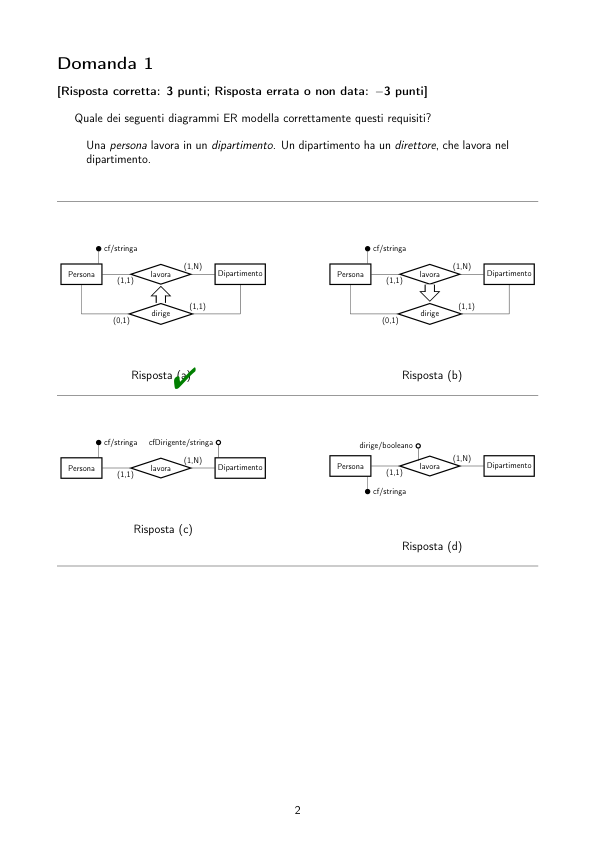
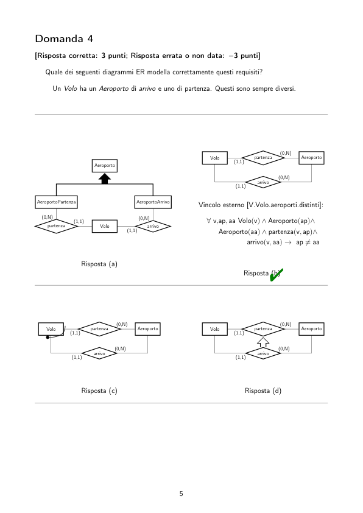
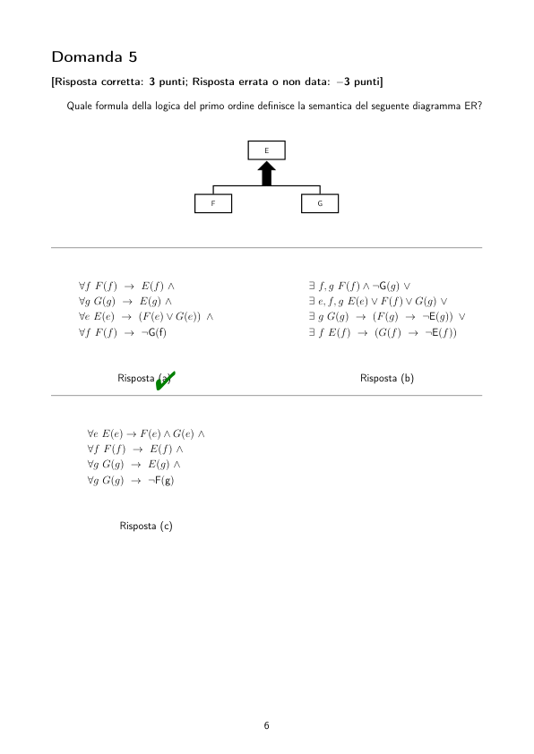

# BD2_Sbarramenti_2020-04-24

> Fonte: `BD2_Sbarramenti_2020-04-24.pdf`
> Estratto con PyMuPDF (conserva legature e formule); tolte le righe ripetute di intestazione e pie' di pagina e le etichette sparse dei diagrammi, che sono ritagliati in `figure/` e richiamati nel punto in cui compaiono.

---

Insegnamento di Basi di Dati, Modulo 2
                          Esame Es.20200424.S – Prova S del 24 aprile 2020
         Rispondi alle domande nelle pagine seguenti (una domanda per pagina) utilizzando l’area di testo
         del sistema exam.net presente nella parte bassa del tuo schermo.
            La prima riga deve riportare il codice esame che ti è stato comunicato.
            Rispondi a tutte le domande ed in ordine, aggiungendo una riga nel formato:
               d r
         dove d è il numero della domanda e r è la lettera corrispondente alla risposta da te scelta.
            Ad esempio, queste risposte:
               rJfyVo
               1 a
               2 b
               3 c
         indicano che il tuo codice esame è ‘rJfyVo’ ed hai risposto ‘a’, ‘b’ e ‘c’ rispettivamente alle domande
         1, 2 e 3.
            Le domande a scelta ultima hanno una sola risposta corretta.
            Il punteggio minimo per il superamento di questa prova è 18/30.
            Le risposte corrette sono contrassegnate con "

         Domanda 1
         [Risposta corretta: 3 punti; Risposta errata o non data: −3 punti]
            Quale dei seguenti diagrammi ER modella correttamente questi requisiti?
              Una persona lavora in un dipartimento. Un dipartimento ha un direttore, che lavora nel
              dipartimento.
                 cf/stringa
                                                              cf/stringa
                              (1,N)
                                                                            (1,N)
           Persona
                   Dipartimento
                   lavora
                   (1,1)
                                                        Persona
                                                                Dipartimento
                                                                lavora
                                                                (1,1)
                               (1,1)
                                                                            (1,1)
                  dirige
                  (0,1)
                                                                dirige
                                                                (0,1)
                      Risposta (a)"
                                                                   Risposta (b)
                 cf/stringa
                        cfDirigente/stringa
                                                            dirige/booleano
                                                                            (1,N)
                              (1,N)
                                                                      Dipartimento
                                                                      lavora
                                                        Persona
                                    Dipartimento
           Persona
                   lavora
                   (1,1)
                                                                (1,1)
                                                              cf/stringa
                      Risposta (c)
                                                                   Risposta (d)

         Domanda 2
         [Risposta corretta: 3 punti; Risposta errata o non data: −3 punti]
         Sia dato il seguente alfabeto della logica del primo ordine, in termini di insiemi di simboli di
         predicato P e di funzione F:
            • P = {Programma/1, Ricorsivo/1, Studente/1, gradisce/2}
              con il seguente significato intuitivo (X e Y sono termini):
                – Prog(X): X è un programma
                – Ric(X): X è un programma ricorsivo
                – Studente(X): X è uno studente
                – gradisce(X, Y ): X gradisce Y
            • F = ∅.
            Quale delle seguenti opzioni definisce correttamente:
              “L’insieme degli studenti che gradiscono tutti i programmi ricorsivi”?
          Risposta (a)"
                     {s | ∀p [Studente(s) ∧Programma(p) ∧Ricorsivo(p)] →gradisce(s, p)}
          Risposta (b) {s | ∃s, p Studente(s) ∧Programma(p) ∧Ricorsivo(p) ∧¬gradisce(s, p)}
          Risposta (c) {s | ∀s, p Studente(s) ∧Programma(p) ∧Ricorsivo(p) ∧gradisce(s, p)}
          Risposta (d) {s | ∃p [Studente(s) ∨Programma(p) ∨Ricorsivo(p)] →gradisce(s, p)}

         Domanda 3
         [Risposta corretta: 3 punti; Risposta errata o non data: −3 punti]
            Quale dei seguenti diagrammi ER modella correttamente questi requisiti?
              Un Hotel si trova in una Città. Una città non può ospitare due hotel con lo stesso
              nome.
                 nome/stringa
                                                               nome/stringa
                               (0,N)
                                                                            (0,N)
                    Citta
                    citHot
                    (1,1)
                                                                 Citta
                                                                 citHot
                                                                 (1,1)
            Hotel
                                                         Hotel
                      Risposta (a)
                                                                   Risposta (b)
                 nome/stringa
                                                               nome/stringa
                               (0,N)
                                                                            (0,N)
            Hotel
                    Citta
                    citHot
                    (1,1)
                                                         Hotel
                                                                 Citta
                                                                 citHot
                                                                 (1,1)
                      Risposta (c)"
                                                                   Risposta (d)

         Domanda 4
         [Risposta corretta: 3 punti; Risposta errata o non data: −3 punti]
            Quale dei seguenti diagrammi ER modella correttamente questi requisiti?
              Un Volo ha un Aeroporto di arrivo e uno di partenza. Questi sono sempre diversi.
                                                                             (0,N)
                                                         Volo
                                                         Aeroporto
                                                         partenza
                                                         (1,1)
                          Aeroporto
                                                                            (0,N)
                                                                arrivo
                                                                (1,1)
          AeroportoPartenza
          AeroportoArrivo
                                                      Vincolo esterno [V.Volo.aeroporti.distinti]:
           partenza
           (1,1)
           (0,N)
                                      (0,N)
                                                         ∀v,ap, aa Volo(v) ∧Aeroporto(ap)∧
                           Volo
                                   arrivo
                                   (1,1)
                                                            Aeroporto(aa) ∧partenza(v, ap)∧
                                                                    arrivo(v, aa) →ap̸ = aa
                      Risposta (a)
                                                                   Risposta (b)"
                                (0,N)
                                                                             (0,N)
            Volo
            Aeroporto
            partenza
            (1,1)
                                                         Volo
                                                         Aeroporto
                                                         partenza
                                                         (1,1)
                               (0,N)
                                                                            (0,N)
                   arrivo
                   (1,1)
                                                                arrivo
                                                                (1,1)
                      Risposta (c)
                                                                   Risposta (d)

         Domanda 5
         [Risposta corretta: 3 punti; Risposta errata o non data: −3 punti]
            Quale formula della logica del primo ordine definisce la semantica del seguente diagramma ER?
                                                 E
                                       F
                                       G
              ∀f F(f) →E(f) ∧
              ∀g G(g) →E(g) ∧
              ∀e E(e) →(F(e) ∨G(e)) ∧
              ∀f F(f) →¬G(f)
                                                         ∃f, g F(f) ∧¬G(g) ∨
                                                         ∃e, f, g E(e) ∨F(f) ∨G(g) ∨
                                                         ∃g G(g) →(F(g) →¬E(g)) ∨
                                                         ∃f E(f) →(G(f) →¬E(f))
                      Risposta (a)"
                                                                   Risposta (b)
                ∀e E(e) →F(e) ∧G(e) ∧
                ∀f F(f) →E(f) ∧
                ∀g G(g) →E(g) ∧
                ∀g G(g) →¬F(g)
                      Risposta (c)

         Domanda 6
         [Risposta corretta: 3 punti; Risposta errata o non data: −3 punti]
            È dato il seguente schema relazionale:
              Persona (id: integer, nome: varchar(100), cognome: varchar(100), stipendio: real)
            Quale delle seguenty query calcola correttamente il numero di persone con stipendio ≥40 000?
              select
              count (∗)
              from Persona
              where
              s t i p e n d i o >= 40000;
                                                           count
                                                           select ∗
                                                           from Persona
                                                           where
                                                           s t i p e n d i o >= 40000;
                      Risposta (a)"
                                                                   Risposta (b)
              select ∗as numero
              from Persona
              where numero=count ( s t i p e n d i o
                                                           select
                                                           numero
                                                           where numero=count (
                                                               select ∗
                                                               from persona
                                                               where
                                                               s t i p e n d i o >=
                                                               40000)
                  >= 40000) ;
                      Risposta (c)
                                                                   Risposta (d)

         Domanda 7
         [Risposta corretta: 3 punti; Risposta errata o non data: −3 punti]
            Quale traduzione del seguente diagramma ER ristrutturato in schema relazionale è corretta?
                           cf/stringa
                                                          targa/stringa
                                                           (1,1)
                                           proprietario
                                           (1,N)
                                  Cliente
                                                                   Veicolo
         Cliente (cf:char(16))
           v.
           inclusione: cf ⊆Veicolo(proprietario)
         Veicolo (targa:varchar(10), proprietario: char(16))
         v.
         foreign key: proprietario references Cliente(cf)
         La relazione accorpa la relationship proprietario.
                                          Risposta (a)"
         Cliente (cf:char(16))
         Veicolo (targa:varchar(10), proprietario: char(16))
         Proprietario (cliente:char(16), veicolo:varchar(10))
           v.
           inclusione: cliente ⊆Cliente(cf)
           v.
           foreign key: cliente references Cliente(cf)
           v.
           foreign key: veicolo references Veicolo(targa)
                                          Risposta (b)
         Cliente (cf:char(16))
           v.
           inclusione: cf ⊆proprietario(cliente)
         Veicolo (targa:varchar(10), proprietario: char(16))
         Proprietario (cliente:char(16), veicolo:varchar(10))
           v.
           foreign key: cliente references Cliente(cf)
           v.
           foreign key: veicolo references Veicolo(targa)
                                          Risposta (c)

         Domanda 8
         [Risposta corretta: 3 punti; Risposta errata o non data: −3 punti]
            Quale ristrutturazione del seguente diagramma ER concettuale è corretta?
                            codice/stringa
                                     Riparazione
                                                      Terminata
                                                            riconsegna/dataora
                  codice/varchar(32)
                                                               codice/varchar(32)
                               (1,1)
                                                                             (1,1)
          Riparazione
                                                        Riparazione
                   RTisaR
                   (0,1)
                                     Terminata
                                                                 RTisaR
                                                                 (0,1)
                                                                                   Terminata
                        riconsegna/timestamp
                                                                     riconsegna/timestamp
                      Risposta (a)
                                                                   Risposta (b)
                  codice/varchar(32)
                                                               codice/varchar(32)
                               (1,1)
                                                                             (1,1)
          Riparazione
                   RTisaR
                   (0,1)
                                     Terminata
                                                        Riparazione
                                                                 RTisaR
                                                                 (1,1)
                                                                                   Terminata
                        riconsegna/timestamp
                                                                     riconsegna/timestamp
                      Risposta (c)"
                                                                   Risposta (d)

         Domanda 9
         [Risposta corretta: 3 punti; Risposta errata o non data: −3 punti]
            Quale traduzione del seguente diagramma ER ristrutturato in schema relazionale è corretta?
               mat/varchar(10)
                                            cf/char(16)
                                             (0,1)
                                                                        (1,1)
                         Studente
                                  (1,1)
                                  DisaP
                                  (0,1)
                                        Docente
                                        SisaP
                                                    Persona
            Vincolo [V.Persona.isa.disj]: ∀p Persona(p) →[ (∃s SisaP(s, p)) →¬(∃d DisaP(d, p)) ]
         Persona(cf:char(16))
                                                    Persona(cf:char(16), docente: boolean)
                                                      v.
                                                      foreign key: studente references Studen-
                                                      te(mat))
         Studente(persona:char(16),
         mat:varchar(10))
           v.
           foreign key: persona references Perso-
           na(cf)
                                                    Studente(persona:char(16),
                                                    mat:varchar(10))
                                                      v.
                                                      foreign key: persona references Perso-
                                                      na(cf)
                                                      v.
                                                      ennupla:
                                                      Persona(persona).docente==
                                                      false
         Docente(persona:char(16))
         Più un trigger per gestire il vincolo esterno
         V.Persona.isa.disj
                                                    Docente(persona:char(16))
                                                      v.
                                                      foreign key: persona references Perso-
                                                      na(cf)
                       Risposta (a)
                                                                  Risposta (b)
         Persona(cf:char(16),
         studente*:
         var-
         char(10))
                                                    Persona(cf:char(16))
                                                    Studente(persona:char(16),
                                                    mat:varchar(10))
           v.
           foreign key: studente references Studen-
           te(matricola))
                                                      v.
                                                      foreign key: persona references Perso-
                                                      na(cf)
                                                      v.
                                                      altra chiave: matricola
         Studente(matricola:varchar(10))
           v.
           foreign key: persona references Perso-
           na(cf)
                                                    Docente(persona:char(16))
                                                      v.
                                                      foreign key: docente references Perso-
                                                      na(cf)
         Docente(persona:char(16))
           v.
           ennupla: Persona(persona). matricola==
           NULL
                                                    Più un trigger per gestire il vincolo esterno
                                                    V.Persona.isa.disj
                       Risposta (c)
                                                                  Risposta (d)"

         Domanda 10
         [Risposta corretta: 3 punti; Risposta errata o non data: −3 punti]
            Dato il seguente schema relazionale:
         Persona (id: integer, nome: varchar(100), cognome: varchar(100), sesso: enum(’M’, ’F’), stipen-
         dio: integer)
           v.
           ennupla: stipendio > 0
         Azienda (id: integer, nome: varchar(100))
           v.
           altra chiave: nome
         lavora (persona: integer, azienda: integer)
           v.
           foreign key: persona references Persona(id)
           v.
           foreign key: azienda references Azienda(id)
         scrivi una query in SQL che calcoli la media aritmetica degli stipendi delle donne che lavorano presso
         l’azienda di nome ‘Acme’.
            Cosa restituirebbe la query in caso non esistesse alcuna azienda con quel nome?
         Questa domanda è a risposta aperta. Scrivi la tua risposta in formato testo a valle di tutte le
         tue risposte precedenti.
        "
            Una possibile query è la seguente:
              select avg (p . s t i p e n d i o )
              from Persona p ,
              l a v o r a
              l ,
              Azienda a
              where
              l . persona = p . id
              and
              l . azienda = a . id
              and p . s e s s o = ’F ’
              and a . nome = ’Acme ’
         In caso non esistesse alcuna azienda di nome ‘Acme’, la query restituirebbe una sola ennupla la
         cui unica componente avrebbe valore NULL.
