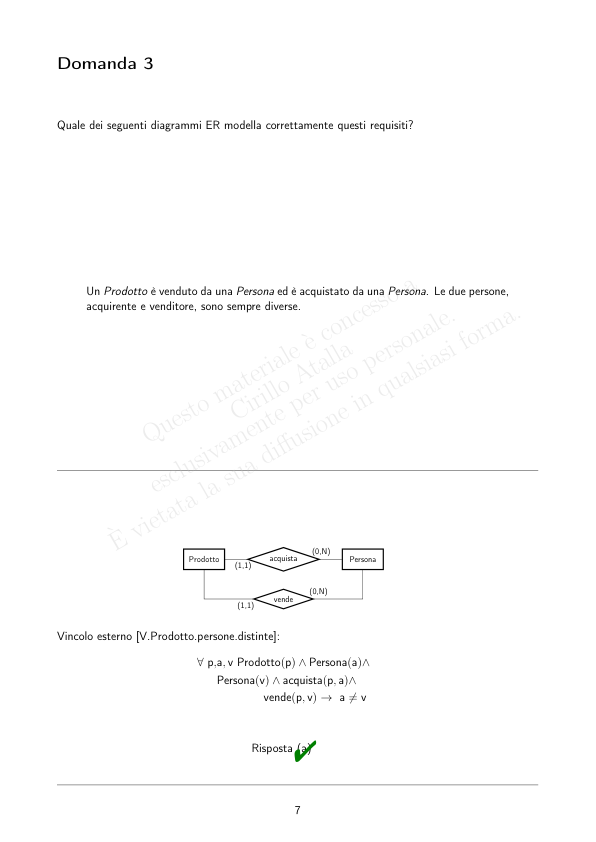
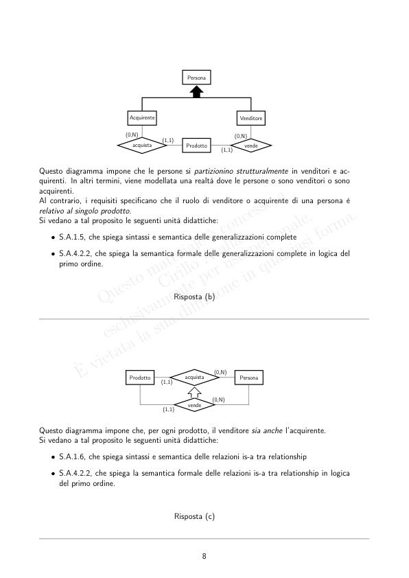
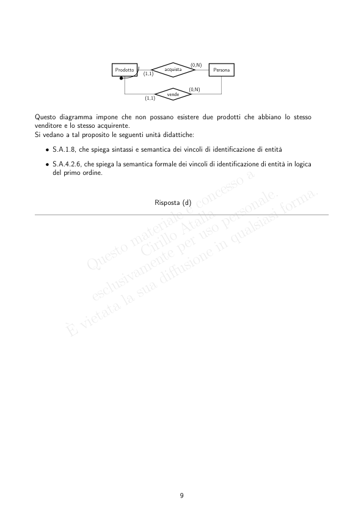
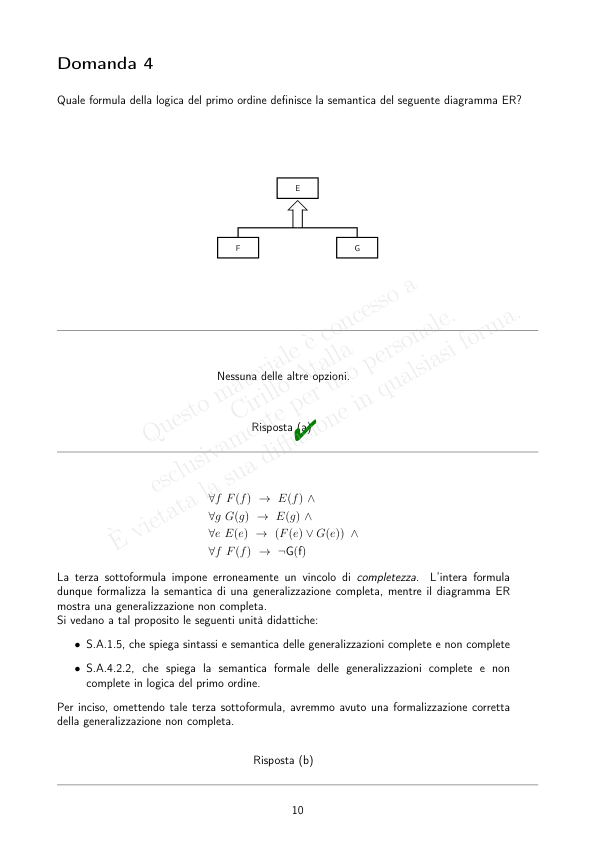

# BD2_Sbarramenti_2020-06-08

> Fonte: `BD2_Sbarramenti_2020-06-08.pdf`
> Estratto con PyMuPDF (conserva legature e formule); tolte le righe ripetute di intestazione e pie' di pagina e le etichette sparse dei diagrammi, che sono ritagliati in `figure/` e richiamati nel punto in cui compaiono.

---

Insegnamento di Basi di Dati, Modulo 2
                   Esame Es.20200608.S – Prova S dell’8 giugno 2020: analisi critica
         Si riportano di sequito le 10 domande proposte nella prova di sbarramento dell’esame dell’8
         giugno 2020, insieme alle risposte tra cui scegliere.
         Come spiegato nel testo d’esame, ogni domanda ha una sola risposta corretta.
         Data la semplicità delle domande, che avevano come obiettivo quello di certificare il possesso di
         nozioni minime del programma d’esame, per superare la prova di sbarramento e poter sostenere la
         prova scritta era richiesto di rispondere correttamente ad almeno 8 domande.
         La durata stimata per completare la prova è di circa 15 minuti. Il tempo limite per la consegna
         è stato fissato a 30 minuti per consentire il massimo comfort agli studenti.
         L’ordine delle risposte riportato qui di seguito prevede che la risposta corretta ad ogni domanda
         sia la risposta (a). Le altre sono dunque tutte errate.
         Per favorire la comprensione degli eventuali errori commessi, viene inoltre fornita una breve analisi
         critica delle risposte errate e vengono offerti puntatori alle unità didattiche dove vengono affrontati
         i concetti utilizzati da tali risposte errate.
         Domanda 1
         Quale dei seguenti diagrammi ER modella correttamente questi requisiti?
              Un utente può lasciare al più un feedback a ogni video. Un feedback ha un commento
              testuale.
                                 commento/stringa
                                                    (0,N)
                                Utente
                                             Video
                                             feedback
                                       (0,N)
                                      nome/stringa
                                          Risposta (a)"

                                 commento/stringa
                                                    (0,N)
                                Utente
                                             Video
                                             feedback
                                       (0,1)
                                      nome/stringa
         Dalla semantica dei vincoli di cardinalità suoi ruoli di relationship consegue direttamente che,
         in un livello estensionale dei dati legale per questo diagramma, una istanza dell’entità Utente
         può essere coinvolta in al più una istanza della relationship feedback.
         Dunque il diagramma impone che un utente possa esprimere feedback per al più un video.
         Il diagramma ha anche marchiani errori sintattici. In particolare, il vincolo di identificazione
         esterna per l’entità Video è sintatticamente illegale, dato che coinvolge un ruolo di relationship
         a molteplicità (0,N).
         Si vedano a tal proposito le seguenti unità didattiche:
            • S.A.1.3, che spiega la semantica del costrutto di relationship
            • S.A.4.2.5, che spiega la formalizzazione dei vincoli di cardinalità sui ruoli di relationship
            in logica del primo ordine
            • S.A.1.8, che spiega la sintassi e semantica dei vincoli di identificazione di entità.
                                          Risposta (b)
                                            Video
                                                    vidFeed
                                                    (0,N)
                                                            (1,1)
                                     nome/stringa
                                                  (1,1)
                               Utente
                                       utFeed
                                       (0,1)
                                                         Feedback
                                             commento/stringa
         Questo diagramma soffre (tra gli altri) dello stesso problema di quello alla risposta (b).
                                          Risposta (c)

                                 commento/stringa
                                                    (0,1)
                                Utente
                                             Video
                                             feedback
                                       (0,1)
                                      nome/stringa
         Questo diagramma soffre dello stesso problema di quello alla risposta (b).
         Il diagramma soffre anche di altri problemi marchiani. In particolare, impone che ogni video
         possa avere al più un feedback.
                                          Risposta (d)

         Domanda 2
         Sia dato il seguente alfabeto della logica del primo ordine, in termini di insiemi di simboli di predicato
         P e di funzione F:
            • P = {Programma/1, Ricorsivo/1, Studente/1, gradisce/2}
              con il seguente significato intuitivo (X e Y sono termini):
                – Programma(X): X è un programma
                – Ricorsivo(X): X è ricorsivo
                – Studente(X): X è uno studente
                – gradisce(X, Y ): X gradisce Y
            • F = ∅.
            Quale delle seguenti opzioni definisce correttamente:
              “L’insieme dei programmi non ricorsivi che sono graditi a tutti gli studenti”?
          Risposta (a)"
                     Nessuna delle altre opzioni.
          Risposta (b) {p | ∀s Studente(s) ∧Programma(p) ∧¬Ricorsivo(p) ∧gradisce(s, p)}
              Questa opzione definisce l’insieme vuoto, a meno di casi degeneri e fuori dai nostri interessi.
              Si vedano a tal proposito le seguenti unità didattiche:
                • A.3.3, dove si spiega la semantica di una formula in logica del primo ordine
                • A.4.4, dove si spiega la semantica della notazione usata per la definizione di insiemi in
                logica del primo ordine.
              Si ricordi infatti che, in generale, con la notazione {x1, . . . , xn | ϕ(x1, . . . , xn)}, viene definito
              l’insieme degli assegnamenti alle variabili x1, . . . , xn (le variabili a sinistra di “|”) che rendono
              vera la formula ϕ (aperta solo in tali variabili) che occorre a destra del simbolo “|”.
              In questo caso, si sta definendo l’insieme degli asssegnamenti alla variabile p che rendono vera
              la formula ϕ data da: ∀s Studente(s) ∧Programma(p) ∧¬Ricorsivo(p) ∧gradisce(s, p).
              Si noti che, in questo caso, la formula ϕ (la formula a destra di “|”) è quantificata universal-
              mente (∀s) ed è composta da un insieme di formule in and logico tra loro. Dunque, affinché
              tale formula sia vera per un certo assegnamento per p, deve essere vero che, comunque si
              assegni s ad un elemento del dominio di interpretazione, deve essere vera (tra le altre) anche
              la sottoformula Studente(s).
              Ovviamente, comunque si tenti di assegnare p ad un elemento del dominio di interpretazione, o
              questo non è un programma (e dunque non è contenuto nell’insieme perché non soddisferebbe
              la sottoformula Programma(p)), oppure non è vero che la formula a destra di “|” è vera
              per ogni s (ad esempio, la formula sarà falsa almeno quando s è assegnata dalla funzione di
              valutazione allo stesso elemento del dominio di interpretazione al quale è assegnata p, ovvero
              un programma).

              Le uniche eccezioni a questo sono casi degeneri (e chiaramente fuori dai nostri interessi) in
              cui l’interpretazione assume che tutti gli elementi del dominio di interpretazione (programmi
              compresi!) sono sicuramente (anche) studenti.
              Di conseguenza, a meno di tali casi degeneri, questa opzione è un modo inutilmente barocco
              per definire un insieme vuoto.
          Risposta (c) {p | ∃s, p Studente(s) ∧Ricorsivo(p) ∧gradisce(s, p)}
              In questa opzione, notiamo innanzitutto che la variabile s (oltre alla variabile p a destra di
              “|”) è quantificata esistenzialmente. Già questo basta a capire che non si tratta della risposta
              corretta (visto che i requisiti chiedono “l’insieme dei programmi non ricorsivi che sono graditi
              a tutti gli studenti”).
              In realtà, in questa opzione la variabile p (che occorre a sinistra di “|”), è anche quantificata
              nella formula a destra di “|”.
              Dunque, viene definito l’insieme degli assegnamenti alla variabile p (quella a sinistra di “|”) che
              rendono vera la formula a destra del simbolo “|”, che però non è aperta in p. Questo comporta
              uno strano effetto di “mascheramento” che porta ad una semantica davvero fuorviante.
              Se proprio volessimo comprendere la semantica di questa definizione di insieme mal progettata
              (ma sintatticamente legale), dovremmo ricordare che, in una formula logica, il nome di una
              variabile quantificata non è rilevante, e dunque neutralizzare l’effetto di mascheramento rino-
              minando la variabile p quantificata nella formula a destra di “|” (p.es., in p’). La definizione
              dell’insieme diventerebbe:
                             {p | ∃s, p’ Studente(s) ∧Ricorsivo(p’) ∧gradisce(s, p’)}
              A questo punto potremmo capire meglio la sua semantica. L’espressione qui sopra definisce
              l’insieme degli assegnamenti alla variabile p che rendono vera una formula (quella a destra di
              “|”) chiusa (ovvero tutte le sue variabili sono quantificate), dove dunque la variabile p non
              occorre affatto. Pertanto, la formula a destra di “|” assumerà il valore “vero” o “falso” (in
              base all’interpretazione data, p.es., quella che definisce il livello estensionale corrente dei dati),
              indipendentemente dal valore assegnato a p.
              Di conseguenza, si tratta o dell’insieme vuoto (se la formula a destra di “|” dovesse valere
              “falso”) o dell’insieme contenente tutti gli elementi del dominio di interpretazione (se la formula
              a destra di “|” dovesse valere “vero”).
          Risposta (d) {p |̸ ∃s [Studente(s) ∧Programma(p) ∧Ricorsivo(p)] →¬gradisce(s, p)}
              Considerando che una formula del tipo̸ ∃s ϕ(s) (con ϕ(s) una formula aperta in s) si riscrive
              immediatamente in ∀s ¬ϕ(s), la formula a destra di “|” si riscrive in:
                     ∀s ¬ {[Studente(s) ∧Programma(p) ∧Ricorsivo(p)] →¬gradisce(s, p)} .
              Considerando che una formula del tipo ¬(ψ →ζ) si riscrive immediatamente in ψ ∧¬ζ, la
              definizione di partenza dell’insieme diventa:
                       {p | ∀s Studente(s) ∧Programma(p) ∧Ricorsivo(p) ∧gradisce(s, p)} .
              Come per l’opzione (b), si tratta di una definizione dell’insieme vuoto.

              Una possibile definizione corretta per l’insieme richiesto è, invece:
                     {p | Programma(p) ∧¬Ricorsivo(p) ∧[∀s Studente(s) →gradisce(s, p)]} .

         Domanda 3
         Quale dei seguenti diagrammi ER modella correttamente questi requisiti?
              Un Prodotto è venduto da una Persona ed è acquistato da una Persona. Le due persone,
              acquirente e venditore, sono sempre diverse.
                                                    (0,N)
                               Prodotto
                               Persona
                               acquista
                               (1,1)
                                                   (0,N)
                                       vende
                                       (1,1)
         Vincolo esterno [V.Prodotto.persone.distinte]:
                                 ∀p,a, v Prodotto(p) ∧Persona(a)∧
                                    Persona(v) ∧acquista(p, a)∧
                                            vende(p, v) →a̸ = v
                                          Risposta (a)"

                                             Persona
                               Acquirente
                               Venditore
                              (1,1)
                              (0,N)
                                                         (0,N)
                                acquista
                                             Prodotto
                                                      vende
                                                      (1,1)
         Questo diagramma impone che le persone si partizionino strutturalmente in venditori e ac-
         quirenti. In altri termini, viene modellata una realtà dove le persone o sono venditori o sono
         acquirenti.
         Al contrario, i requisiti specificano che il ruolo di venditore o acquirente di una persona è
         relativo al singolo prodotto.
         Si vedano a tal proposito le seguenti unità didattiche:
            • S.A.1.5, che spiega sintassi e semantica delle generalizzazioni complete
            • S.A.4.2.2, che spiega la semantica formale delle generalizzazioni complete in logica del
            primo ordine.
                                          Risposta (b)
                                                    (0,N)
                               Prodotto
                               Persona
                               acquista
                               (1,1)
                                                   (0,N)
                                       vende
                                       (1,1)
         Questo diagramma impone che, per ogni prodotto, il venditore sia anche l’acquirente.
         Si vedano a tal proposito le seguenti unità didattiche:
            • S.A.1.6, che spiega sintassi e semantica delle relazioni is-a tra relationship
            • S.A.4.2.2, che spiega la semantica formale delle relazioni is-a tra relationship in logica
            del primo ordine.
                                          Risposta (c)

                                                    (0,N)
                               Prodotto
                               Persona
                               acquista
                               (1,1)
                                                   (0,N)
                                       vende
                                       (1,1)
         Questo diagramma impone che non possano esistere due prodotti che abbiano lo stesso
         venditore e lo stesso acquirente.
         Si vedano a tal proposito le seguenti unità didattiche:
            • S.A.1.8, che spiega sintassi e semantica dei vincoli di identificazione di entità
            • S.A.4.2.6, che spiega la semantica formale dei vincoli di identificazione di entità in logica
            del primo ordine.
                                          Risposta (d)

         Domanda 4
         Quale formula della logica del primo ordine definisce la semantica del seguente diagramma ER?
                                                 E
                                       F
                                       G
                                    Nessuna delle altre opzioni.
                                          Risposta (a)"
                                   ∀f F(f) →E(f) ∧
                                   ∀g G(g) →E(g) ∧
                                   ∀e E(e) →(F(e) ∨G(e)) ∧
                                   ∀f F(f) →¬G(f)
         La terza sottoformula impone erroneamente un vincolo di completezza.
         L’intera formula
         dunque formalizza la semantica di una generalizzazione completa, mentre il diagramma ER
         mostra una generalizzazione non completa.
         Si vedano a tal proposito le seguenti unità didattiche:
            • S.A.1.5, che spiega sintassi e semantica delle generalizzazioni complete e non complete
            • S.A.4.2.2, che spiega la semantica formale delle generalizzazioni complete e non
            complete in logica del primo ordine.
         Per inciso, omettendo tale terza sottoformula, avremmo avuto una formalizzazione corretta
         della generalizzazione non completa.
                                          Risposta (b)

                                    ∀e E(e) →F(e) ∧G(e) ∧
                                    ∀f F(f) →E(f) ∧
                                    ∀g G(g) →E(g) ∧
                                    ∀g G(g) →¬F(g)
         La prima sottoformula impone erroneamente che ogni istanza di E appartenga sia all’entità F
         che all’entià G.
                                          Risposta (c)
                                ∃f, g F(f) ∧¬G(g) ∨
                                ∃e, f, g E(e) ∨F(f) ∨G(g) ∨
                                ∃g G(g) →(F(g) →¬E(g)) ∨
                                ∃f E(f) →(G(f) →¬E(f))
         La formula è l’insieme di sottoformule quantificate esistenzialmente e in or logico tra loro. Il
         significato di questa formula è molto lontano da quanto inteso da una generalizzazione non
         completa.
                                          Risposta (d)

         Domanda 5
         Sia dato il seguente alfabeto della logica del primo ordine, in termini di insiemi di simboli di predicato
         P e di funzione F:
            • P = {Persona/1, Dipartimento/1, lavora/2, dirige/2}
              con il seguente significato intuitivo (X e Y sono termini):
                – Persona(X): X è una persona
                – Dipartimento(X): X è un dipartimento
                – lavora(X, Y ): X lavora in Y
                – dirige(X, Y ): X dirige Y
            • F = ∅.
            Quale delle seguenti opzioni formalizza correttamente:
              “Non ci sono persone che dirigono più di un dipartimento”?
                                 ∀p, d1, d2
                                  Persona(p) ∧Dipartimento(d1)∧
                                  Dipartimento(d2) ∧dirige(p, d1)∧
                                  dirige(p, d2) →d1 = d2
                                          Risposta (a)"
                                 ∀p, d1, d2
                                   Persona(p) ∧Dipartimento(d1)∧
                                   Dipartimento(d2) ∧dirige(p, d1)
                                    →¬dirige(p, d2)
         La formula è soddisfatta solo nei livelli estensionali dei dati dove nessuna persona dirige alcun
         dipartimento. Difatti in una qualunque interpretazione dove una persona (p.es., α) dirige
         un dipartimento (p.es., δ, con α e δ elementi del dominio di interpretazione e correttamente
         interpretati come, rispettivamente, una persona ed un dipartimento), la formula viene valutata
         a “falso” dalla funzione eval() non appena tale funzione assegna sia d1 che d2 a δ.
         Si veda, a tal proposito, la seguente unità didattica:
            • S.A.3.3.3, che introduce la semantica della logica del primo ordine
         e le relative esercitazioni E.A.3.3.3.1, E.A.3.3.3.2, E.A.3.3.3.3.
                                          Risposta (b)

                                 ∀p1, d1, d2
                                  Persona(p1) ∧Dipartimento(d1)∧
                                  Dipartimento(d2) ∧dirige(p1, d1)
                                    →dirige(p2, d2)
         La formula è aperta in p2, dunque non è valutabile data una interpretazione (p.es., il livello
         estensionale dei dati corrente), senza che sia fornito anche un assegnamento per p2.
                                          Risposta (c)
                                 ∀p, d1, d2
                                   Persona(p) ∧Dipartimento(d1)∧
                                   dirige(p, d1)
                                    →¬∃dirige(p, d2)
         La formula è sintatticamente illegale, dato che contiene un quantificatore esistenziale applicato
         ad una formula (e non ad una variabile).
         Si veda a tal proposito la seguente unità didattica:
            • S.A.3.2, che spiega la sintassi della logica del primo ordine.
                                          Risposta (d)
         Nessuna delle altre opzioni.
                                          Risposta (e)

         Domanda 6
         Quale ristrutturazione del seguente diagramma ER concettuale è corretta?
                            codice/stringa
                                                     Consegnato
                                      Ordine
                                                             consegna/dataora
                                     codice/varchar(32)
                                                   (1,1)
                                                         Consegnato
                                Ordine
                                       OCisaO
                                       (0,1)
                                            consegna/timestamp
                                          Risposta (a)"
                                     codice/varchar(32)
                                                   (1,1)
                                                         Consegnato
                                Ordine
                                       OCisaO
                                       (0,1)
                                            consegna/timestamp
         Il diagramma è sintatticamente illegale, dato che definisce un identificatore per l’entità Ordine
         che coinvolge un ruolo di relationship a molteplicità (0,1).
         Si veda a tal proposito la seguente unità didattica:
            • S.A.1.8, che spiega la sintassi e la semantica dei vincoli di identificazione di entità
            • B.3.1.2.2.3, che spiega il passo di ristrutturazione delle relazioni is-a tra entità
         oltre che le numerose esercitazioni e i numerosi progetti disponibili.
                                          Risposta (b)

                                     codice/varchar(32)
                                                   (1,1)
                                                         Consegnato
                                Ordine
                                       OCisaO
                                       (0,1)
                                            consegna/timestamp
         Il diagramma è sintatticamente illegale, dato che definisce un identificatore per l’entità Ordine
         che coinvolge un ruolo di relationship a molteplicità (0,1).
         Inoltre il diagramma ristrutturato impone un vincolo di identificazione per l’entità Consegnato
         non ⊆-minimale.
                                          Risposta (c)
                                     codice/varchar(32)
                                                   (1,1)
                                                         Consegnato
                                Ordine
                                       OCisaO
                                       (1,1)
                                            consegna/timestamp
         Il diagramma ristrutturato definisce un vincolo di molteplicità errato per la relationship OCisaO
         (il vincolo (1,1) sul ruolo Ordine) e un vincolo di identificazione per l’entità Ordine non
         ⊆-minimale.
                                          Risposta (d)
         Nessuna delle altre opzioni.
                                          Risposta (e)

         Domanda 7
         Quale traduzione del seguente diagramma ER ristrutturato in schema relazionale è corretta?
               cod/varchar(10)
                                            cf/char(16)
                                              (0,1)
                                                                         (1,1)
                                       Passeggero
                                       pilIsaP
                                                            pasIsaP
                                                            (0,1)
                          Pilota
                                                    Persona
                                 (1,1)
            Vincolo [V.Persona.isa.disj]: ∀p Persona(p) →[ (∃pil pilIsaP(pil, p)) →¬(∃pas pasIsaP(pas, p)) ]
            Nota bene: i campi contrassegnati dall’asterisco (“*”) possono essere NULL.
         Persona(cf:char(16))
         Pilota(persona:char(16), cod:varchar(10))
           v.
           foreign key: persona references Persona(cf)
           v.
           altra chiave: cod
         Passeggero(persona:char(16))
           v.
           foreign key: /////////
           docentepersona references Persona(cf) a
         Più un trigger per gestire [V.Persona.isa.disj]
         Risposta (a)"
         aMi scuso per l’errore nel testo. Un errata corrige è stato inviato via chat durante l’esame a tutti gli
         studenti. Inoltre, le risposte errate a questa domanda sono state valutate con il punteggio massimo per non
         penalizzare eventuali studenti che non avessero letto il messaggio.
         Persona(cf:char(16))
         Pilota(persona:char(16), cod:varchar(10))
           v.
           foreign key: persona references Persona(cf)
         Passeggero(persona:char(16))
         Più un trigger per gestire [V.Persona.isa.disj]
         La chiave primaria della relazione Persona include erroneamente anche l’attributo cod.
         Inoltre, nella relazione Passeggero non è definito il necessario vincolo di foreign key.
         Si veda a tal proposito la seguente unità didattica:
            • B.3.1.2.3, che spiega la tecnica di traduzione diretta da diagramma ER ristrutturato a
            schema relazionale con vincoli della base dati
         oltre che le esercitazioni e i progetti disponibili.
                                          Risposta (b)

         Persona(cf:char(16), pilota*: varchar(10))
           v.
           foreign key: pilota references Pilota(cod)
         Pilota(cod:varchar(10))
           v.
           foreign key: persona references Persona(cf)
         Passeggero(persona:char(16))
           v.
           ennupla: Persona(persona).cod==NULL
         Lo schema relazionale ha molti problemi. Ad esempio:
            • la relazione Persona contiene un attributo (a possibili valori NULL) pilota che non ha
            senso
            • la relazione Pilota definisce un vincolo di foreign key a partire dall’attributo persona
            inesistente nella relazione
            • la relazione Passeggero definisce un vincolo di ennupla su una condizione che coinvolge
            una relazione diversa da Passeggero.
                                          Risposta (c)
         Persona(cf:char(16), passeggero: boolean)
         Pilota(persona:char(16), cod:varchar(10))
           v.
           foreign key: persona references Persona(cf)
           v.
           ennupla: Persona(persona).passeggero==false
         Passeggero(persona:char(16))
           v.
           foreign key: persona references Persona(cf)
         Lo schema relazionale ha tanti problemi, di cui molti simili a quelli dello schema relazionale
         dell’opzione (c).
                                          Risposta (d)

         Domanda 8
         Dato il seguente schema relazionale:
         Persona (id: integer, nome: varchar(100), cognome: varchar(100), sesso: enum(’M’, ’F’), stipen-
         dio: integer)
           v.
           ennupla: stipendio > 0
         Azienda (id: integer, nome: varchar(100))
           v.
           altra chiave: nome
         lavora (persona: integer, azienda: integer)
           v.
           foreign key: persona references Persona(id)
           v.
           foreign key: azienda references Azienda(id)
         Quale delle seguenty query calcola correttamente la media aritmetica degli stipendi delle donne che
         lavorano presso l’azienda di nome ‘Acme’?
              select avg (p . s t i p e n d i o )
              from Persona p ,
              l a v o r a
              l ,
              Azienda a
              where
              l . persona = p . id
              and
              l . azienda = a . id
              and p . s e s s o = ’F ’
              and a . nome = ’Acme ’
                                          Risposta (a)"
              avg (p . s t i p e n d i o )
              from Persona p ,
              Azienda a
              where p . azienda = a . id
                and p . s e s s o = ’F ’
                and a . nome = ’Acme ’
         Notiamo immediatamente che la query è palesemente illegale da un punto di vista sintattico,
         dato che non menziona la keyword select.
                                          Risposta (b)

              select avg (p . s t i p e n d i o )
              from Persona p ,
              Azienda a
              where p . s e s s o = ’F ’
                and a . nome = ’Acme ’
         La query non contiene riferimenti alla relazione lavora e non contiene dunque condizioni di
         join nella clausola where.
         Pertanto, la presenza della relazione Azienda nella clausola del tutto from è irrilevante: la
         query restituisce il valore medio dell’attributo stipendio tra tutte le persone di sesso femminile,
         indipendentemente dall’azienda in cui lavorano.
                                          Risposta (c)
              select
              s t i p e n d i o
              from Persona p
              where p . s t i p e n d i o = (
                  select avg ( p1 . s t i p e n d i o )
                  from Persona p1 ,
                  l a v o r a
                  l ,
                  Azienda a
                  where
                  l . persona = p1 . id
                  and
                  l . azienda = a . id
                  and p1 . s e s s o = ’F ’
                  and a . nome = ’Acme ’ )
         La query restituisce lo stipendio delle persone (se esistono) che lo hanno esattamente uguale
         allo stipendio medio delle donne dell’azienda ‘Acme’. Il risultato dunque è quello atteso solo
         se, per puro caso, la base dati dovesse contenere persone che abbiano lo stipendio esattamente
         uguale a quello richiesto. In caso contrario, la query restituirebbe l’insieme vuoto.
                                          Risposta (d)

         Domanda 9
         Dato il seguente schema relazionale:
         Persona (id: integer, nome: varchar(100), cognome: varchar(100), sesso: enum(’M’, ’F’), stipen-
         dio: integer)
           v.
           ennupla: stipendio > 0
         Azienda (id: integer, nome: varchar(100))
           v.
           altra chiave: nome
         lavora (persona: integer, azienda: integer)
           v.
           foreign key: persona references Persona(id)
           v.
           foreign key: azienda references Azienda(id)
         Quale delle seguenty query calcola correttamente, per ogni azienda, lo stipendio minimo di un
         dipendente di quell’azienda?
              select min(p . s t i p e n d i o )
              from Persona p ,
              l a v o r a
              l ,
              Azienda a
              where
              l . persona = p . id
              and
              l . azienda = a . id
              group by a . id
                                          Risposta (a)"
              select p . s t i p e n d i o
              from Persona p ,
              Azienda a
              where p . azienda = a . id
              and min(p . s t i p e n d i o )
              group by p . azienda
         La query è sintatticamente illegale, visto che menziona una funzione aggregata nella clausola
         where.
                                          Risposta (b)

              select
              minStipendio
              from Persona p ,
              Azienda a
              where p . azienda = a . id
              group by azienda
              having
              minStipendio = min ( Persona . s t i p e n d i o )
         La query è sintatticamente illegale, visto che, tra l’altro, menziona, nella target list, un attributo
         non definito nelle relazioni presenti nella clausola from.
                                          Risposta (c)
              select a . id
              from Persona p ,
              l a v o r a
              l ,
              Azienda a
              where
              l . persona = p . id
              and
              l . azienda = a . id
              having min(p . s t i p e n d i o )
         La query è sintatticamente illegale, visto che contiene una clausola having senza contenere
         una clausola group by.
                                          Risposta (d)
         Nessuna delle altre opzioni.
                                          Risposta (e)

         Domanda 10
         È dato il seguente schema relazionale:
              Persona (id: integer, nome: varchar(100), cognome: varchar(100), sesso: enum(’M’,
              ’F’), stipendio: real)
         Quale delle seguenty query calcola correttamente i cognomi delle persone che guadagnano di
         più?
              select p . cognome
              from Persona p
              where p . s t i p e n d i o = (
              select max( p1 . s t i p e n d i o )
              from Persona p1
              ) ;
                                          Risposta (a)"
              select p . cognome
              from Persona p
              where p . s t i p e n d i o = max ( Persona . s t i p e n d i o ) ;
         La query è sintatticamente illegale, visto che menziona una funzione aggregata nella clausola
         where.
                                          Risposta (b)
              select max (p . s t i p e n d i o ) , p . cognome
              from Persona p ;
         La query è sintatticamente illegale, visto che la target list non è omogenea.
         Si veda a tal proposito la seguente unità didattica:
            • B.2.2.3.2.3, che spiega l’uso delle funzioni aggregate in SQL standard.
                                          Risposta (c)

              select p . cognome
              from Persona p
              where p . s t i p e n d i o = select max ( Persona . s t i p e n d i o ) ;
         La query è sintatticamente illegale, visto che menziona una query annidata che non contiene
         la clausola from.
                                          Risposta (d)
         Nessuna delle altre opzioni.
                                          Risposta (e)
