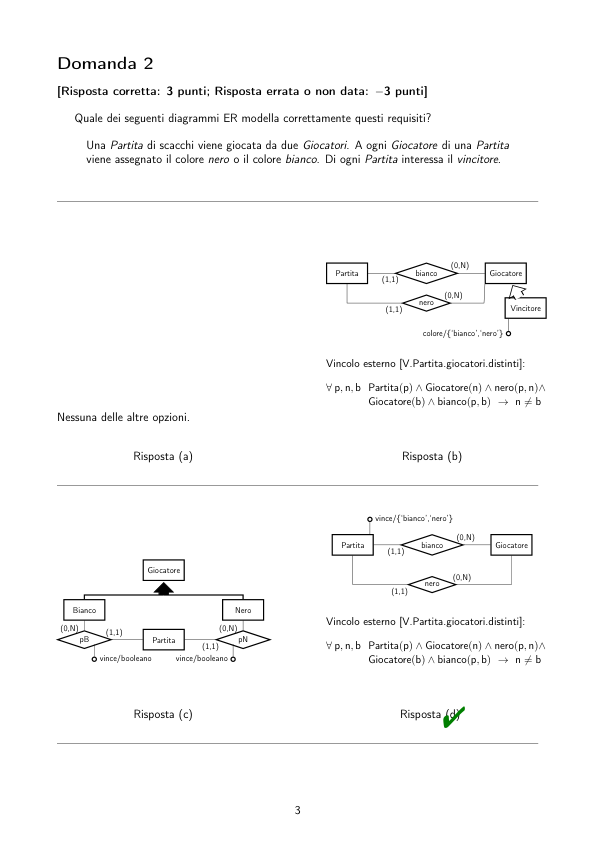

# BD2_Sbarramenti_2020-07-02

> Fonte: `BD2_Sbarramenti_2020-07-02.pdf`
> Estratto con PyMuPDF (conserva legature e formule); tolte le righe ripetute di intestazione e pie' di pagina e le etichette sparse dei diagrammi, che sono ritagliati in `figure/` e richiamati nel punto in cui compaiono.

---

Insegnamento di Basi di Dati, Modulo 2
                      Esame Es.20200702.S.4SZN7L – Prova S del 2 luglio 2020
         Utilizza l’area di testo del sistema exam.net presente nella parte bassa del tuo schermo per
         rispondere alle domande nelle pagine seguenti (una domanda per pagina), scegliendo una delle
         risposte disponibili etichettate con una lettera minuscola (a, b, c, d, . . . )
         La valutazione di questa prova sarà automatica. Dovrai quindi prestare attenzione a rispettare
         la sintassi seguente.
         In particolare, dovrai scrivere nell’area Risposte una sola stringa racchiusa tra “@(” e “)” su una
         sola riga, senza spazi e senza righe vuote.
         Il contenuto racchiuso tra parentesi indicherà, nell’ordine, il numero di ogni domanda e la risposta
         da te scelta per quella domanda (senza delimitatori di alcun tipo). Dunque, ad esempio, la seguente
         stringa per le risposte:
               @(1 a2c3d4a5b6d7a8b9b10c )
            indica che:
            • la risposta scelta per la domanda 1 è ‘a’
            • la risposta scelta per la domanda 2 è ‘c’
            • . . .
            • la risposta scelta per la domanda 10 è ‘c’.
         Per rispettare il formato, dovrai rispondere necessariamente a tutte le domande e in ordine.
         Controlla bene le tue risposte prima di inviarle. La correzione automatica sarà effettuata in tempo
         reale, dunque nessuna eccezione potrà essere ammessa.
            Le domande hanno una sola risposta corretta.
         Il punteggio minimo per il superamento di questa prova è 18/30. Risposte non corrette hanno
         un punteggio negativo.
            Le risposte corrette sono contrassegnate con "

         Domanda 1
         [Risposta corretta: 3 punti; Risposta errata o non data: −3 punti]
            Quale dei seguenti diagrammi ER modella correttamente questi requisiti?
              Una Regione si trova in uno Stato. Uno stato non può avere due regioni con lo stesso
              nome.
                 nome/stringa
                                                               nome/stringa
                                (0,N)
                                                                             (0,N)
           Regione
                   Stato
                   statReg
                   (1,1)
                                                         Regione
                                                                Stato
                                                                statReg
                                                                (1,1)
                      Risposta (a)"
                                                                   Risposta (b)
                 nome/stringa
                                                               nome/stringa
                                (0,N)
                                                                             (0,N)
           Regione
                   Stato
                   statReg
                   (1,1)
                                                         Regione
                                                                Stato
                                                                statReg
                                                                (1,1)
                      Risposta (c)
                                                                   Risposta (d)

         Domanda 2
         [Risposta corretta: 3 punti; Risposta errata o non data: −3 punti]
            Quale dei seguenti diagrammi ER modella correttamente questi requisiti?
              Una Partita di scacchi viene giocata da due Giocatori. A ogni Giocatore di una Partita
              viene assegnato il colore nero o il colore bianco. Di ogni Partita interessa il vincitore.
                                                                           (0,N)
                                                        Partita
                                                        Giocatore
                                                        bianco
                                                        (1,1)
                                                                          (0,N)
                                                                nero
                                                                (1,1)
                                                                                     Vincitore
                                                                       colore/{‘bianco’,‘nero’}
                                                      Vincolo esterno [V.Partita.giocatori.distinti]:
                                                      ∀p, n, b Partita(p) ∧Giocatore(n) ∧nero(p, n)∧
                                                             Giocatore(b) ∧bianco(p, b) →n̸ = b
         Nessuna delle altre opzioni.
                      Risposta (a)
                                                                   Risposta (b)
                                                               vince/{‘bianco’,‘nero’}
                                                                            (0,N)
                                                         Partita
                                                                 Giocatore
                                                                 bianco
                                                                 (1,1)
                        Giocatore
                                                                            (0,N)
                                                                 nero
                                                                 (1,1)
            Bianco
            Nero
                                                      Vincolo esterno [V.Partita.giocatori.distinti]:
          (1,1)
          (0,N)
                                    (0,N)
             pB
                                        pN
                         Partita
                                                      ∀p, n, b Partita(p) ∧Giocatore(n) ∧nero(p, n)∧
                                 (1,1)
                                                             Giocatore(b) ∧bianco(p, b) →n̸ = b
                vince/booleano
                             vince/booleano
                                                                   Risposta (d)"
                      Risposta (c)

         Domanda 3
         [Risposta corretta: 3 punti; Risposta errata o non data: −3 punti]
         Sia dato il seguente alfabeto della logica del primo ordine, in termini di insiemi di simboli di
         predicato P e di funzione F:
            • P = {Programma/1, Ricorsivo/1, Studente/1, gradisce/2}
              con il seguente significato intuitivo (X e Y sono termini):
                – Programma(X): X è un programma
                – Ricorsivo(X): X è ricorsivo
                – Studente(X): X è uno studente
                – gradisce(X, Y ): X gradisce Y
            • F = ∅.
            Quale delle seguenti opzioni definisce correttamente:
              “L’insieme degli studenti che non gradiscono alcun programma ricorsivo”?
          Risposta (a)"
                     {s |̸ ∃p Programma(p) ∧Ricorsivo(p) ∧gradisce(s, p)}
          Risposta (b) {s | ∃p Programma(p) ∧¬Ricorsivo(p) ∧gradisce(s, p)}
          Risposta (c) {s | Studente(s) ∧[∀p Programma(p) ∧Ricorsivo(p) ↛ ∃gradisce(s, p)]}
          Risposta (d) {s | ∀s, p Studente(s) ∧Programma(p) ∧Ricorsivo(p) ∧¬gradisce(s, p)}

         Domanda 4
         [Risposta corretta: 3 punti; Risposta errata o non data: −3 punti]
            Quale formula della logica del primo ordine definisce la semantica del seguente diagramma ER?
                                              att2
                                             att1
                                                   E
               ∀e1, e2, a1, a2
                 E(e1) ∧E(e2)∧
                 att1(e1, a1) ∧att2(e1, a2)∧
                 att1(e2, a1) ∧att2(e2, a2)
                                                  ∀e1, e2, a1, a2
                                                    E(e1) ∧E(e2) ∧e2̸ = e1 ∧att1(e1, a1)∧
                                                    att2(e1, a2) ↛ ∃att1(e2, a1)∧̸ ∃att2(e2, a2)
                 →e1 = e2
                      Risposta (a)"
                                                               Risposta (b)
         ∀e1, a1, a2
           E(e1) ∧att1(e1, a1) ∧att2(e1, a2) →
           [̸ ∃e2 E(e2) ∧( att1(e2, a1) ∨att2(e2, a2) ) ]
                                                      Nessuna delle altre opzioni.
                      Risposta (c)
                                                                   Risposta (d)

         Domanda 5
         [Risposta corretta: 3 punti; Risposta errata o non data: −3 punti]
         Sia dato il seguente alfabeto della logica del primo ordine, in termini di insiemi di simboli di
         predicato P e di funzione F:
            • P = {Persona/1, Dipartimento/1, lavora/2, dirige/2}
              con il seguente significato intuitivo (X e Y sono termini):
                – Persona(X): X è una persona
                – Dipartimento(X): X è un dipartimento
                – lavora(X, Y ): X lavora in Y
                – dirige(X, Y ): X dirige Y
            • F = ∅.
            Quale delle seguenti opzioni formalizza correttamente:
              “Non ci sono dipartimenti che sono diretti da più di una persona”?
                                                          ∀d, p1, p2
         ∀d, p1
                                                            Dipartimento(d) ∧Persona(p1)∧
                                                            Persona(p2) ∧dirige(p1, d)
           Dipartimento(d) ∧Persona(p1) ∧dirige(p1, d) ↛
              ∃p2 Persona(p2) ∧dirige(p2, d)
                                                            ↛ ∃dirige(p2, d)
                      Risposta (a)
                                                                   Risposta (b)
             ∀d, p1, p2
                                                          ∀d, p1, p2
              Dipartimento(d) ∧Persona(p1)∧
              Persona(p2) ∧dirige(p1, d)
                                                            Dipartimento(d) ∧Persona(p1)∧
                                                            Persona(p2) ∧dirige(p1, d)∧
                                                            dirige(p2, d) →p1 = p2
               →¬dirige(p2, d)
                                                                   Risposta (d)"
                      Risposta (c)

         Domanda 6
         [Risposta corretta: 3 punti; Risposta errata o non data: −3 punti]
            Quale ristrutturazione del seguente diagramma ER concettuale è corretta?
                            codice/stringa
                                     Riparazione
                                                      Terminata
                                                            riconsegna/dataora
                  codice/varchar(32)
                                                               codice/varchar(32)
                               (1,1)
                                                                             (1,1)
          Riparazione
                   RTisaR
                   (0,1)
                                     Terminata
                                                        Riparazione
                                                                 RTisaR
                                                                 (0,1)
                                                                                   Terminata
                        riconsegna/timestamp
                                                                     riconsegna/timestamp
                      Risposta (a)
                                                                   Risposta (b)
                  codice/varchar(32)
                                                               codice/varchar(32)
                               (1,1)
                                                                             (1,1)
          Riparazione
                                                        Riparazione
                   RTisaR
                   (1,1)
                                     Terminata
                                                                 RTisaR
                                                                 (0,1)
                                                                                   Terminata
                        riconsegna/timestamp
                                                                     riconsegna/timestamp
                                                                   Risposta (d)"
                      Risposta (c)

         Domanda 7
         [Risposta corretta: 3 punti; Risposta errata o non data: −3 punti]
            Quale traduzione del seguente diagramma ER ristrutturato in schema relazionale è corretta?
                          cf/char(16)
                                                       codice/varchar(10)
                                                          (1,1)
                                  Cliente
                                             cliPren
                                             (1,N)
                                                                    Prenot
         Cliente (cf:char(16))
                                                      Cliente (cf:char(16))
         Prenot (cod:varchar(10), cli: char(16))
                                                      Prenot (cod:varchar(10), cli: char(16))
         CliPren (cli:char(16), pren:varchar(10))
           v.
           inclusione: cli ⊆Cliente(cf)
           v.
           foreign key: cli ref. Cliente(cf)
           v.
           foreign key: pren ref. Prenot(cod)
                                                      CliPren (cli:char(16), pren:varchar(10))
                                                        v.
                                                        foreign key: cli ref. Cliente(cf)
                                                        v.
                                                        foreign key: pren ref. Prenot(cod)
                      Risposta (a)
                                                                   Risposta (b)
         Cliente (cf:char(16))
           v.
           inclusione: cf ⊆Prenot(cli)
         Prenot (cod:varchar(10), cli: char(16))
         v.
         foreign key: cli ref. Cliente(cf)
         La relazione accorpa la relationship cliPren.
                                                      Nessuna delle altre opzioni.
                      Risposta (c)"
                                                                   Risposta (d)

         Domanda 8
         [Risposta corretta: 3 punti; Risposta errata o non data: −3 punti]
            Quale traduzione del seguente diagramma ER ristrutturato in schema relazionale è corretta?
                             id/integer
                                                    cod/char(20)
                                                        (1,1)
                                     Utente
                                            UPisaU
                                            (0,1)
                                                             UtentePremium
            Nota bene: i campi contrassegnati dall’asterisco (“*”) possono essere NULL.
         Utente(id:integer, cod:char(20))
           v.
           altra chiave: cod
                                                      Nessuna delle altre opzioni.
                      Risposta (a)
                                                                   Risposta (b)
                                                      Utente(id:integer)
         Utente(id:integer)
                                                      UtPremium(cod:char(20))
         UtPremium(ut:integer, cod:char(20))
                                                      UPisaU(ut:integer, prem:char(20))
         v.
         foreign key: ut ref. Utente(id)
         v.
         altra chiave: cod
         La relazione accorpa la relationship UPisaU.
                                                        v.
                                                        foreign key: ut ref. Utente(id)
                                                        v.
                                                        foreign
                                                        key:
                                                        prem
                                                        ref.
                                                        UtPremium(cod)
                      Risposta (c)"
                                                                   Risposta (d)

         Domanda 9
         [Risposta corretta: 3 punti; Risposta errata o non data: −3 punti]
            Dato il seguente schema relazionale:
         Persona (id: integer, nome: varchar(100), cognome: varchar(100), sesso: enum(’M’, ’F’), stipen-
         dio: integer)
           v.
           ennupla: stipendio > 0
         Azienda (id: integer, nome: varchar(100), fondazione: date)
           v.
           altra chiave: nome
         lavora (persona: integer, azienda: integer)
           v.
           foreign key: persona references Persona(id)
           v.
           foreign key: azienda references Azienda(id)
         Quale delle seguenty query calcola correttamente, per ogni azienda, la media aritmetica degli stipendi
         delle persone di sesso femminile che vi lavorano?
                                                           select a . nome ,
                                                           x . mediaStipendio
                                                           from Azienda a ,
                                                           Persona p ,
                                                           l a v o r a
                                                           l ,
                                                           (
                                                           select avg ( s t i p e n d i o )
              select a . nome ,
              avg (p .
              s t i p e n d i o )
              from Azienda a ,
              Persona p ,
              l a v o r a
              l
              where
              l . persona = p . id
              and
              l . azienda = a . id
              group by a . nome
              having p . s e s s o = ’F ’ ;
                                                                  as
                                                                  mediaStipendio
                                                                  from Azienda a1 ,
                                                           Persona p1
                                                           where p1 . sesso = ’F ’
                                                           ) x
                                                           where
                                                           l . azienda = a . id
                                                           and
                                                           l . persona = p . id
                      Risposta (a)
                                                                   Risposta (b)
              select a . nome ,
              avg (p .
              s t i p e n d i o )
              from Azienda a ,
              Persona p ,
              l a v o r a
              l
              where p . s e s s o = ’F ’
                                                           select avg (p . s t i p e n d i o )
                                                           from Azienda a ,
                                                           Persona p ,
                                                           l a v o r a
                                                           l
                                                           where p . sesso = ’F ’
                                                           group by a . nome ;
              and
              l . persona = p . id
              and
              l . azienda = a . id
              group by a . nome ;
                      Risposta (c)"
                                                                   Risposta (d)

         Domanda 10
         [Risposta corretta: 3 punti; Risposta errata o non data: −3 punti]
            Dato il seguente schema relazionale:
         Persona (id: integer, nome: varchar(100), cognome: varchar(100), sesso: enum(’M’, ’F’), stipen-
         dio: integer)
           v.
           ennupla: stipendio > 0
         Azienda (id: integer, nome: varchar(100), fondazione: date)
           v.
           altra chiave: nome
         lavora (persona: integer, azienda: integer)
           v.
           foreign key: persona references Persona(id)
           v.
           foreign key: azienda references Azienda(id)
         Quale delle seguenty query calcola correttamente il nome delle aziende che sono state fondate per
         prime?
                                                           select a . nome
                                                           from Azienda a
                                                           where a . fondazione = min (
                                                               fondazione ) ;
         Nessuna delle altre opzioni.
                      Risposta (a)"
                                                                   Risposta (b)
                                                           select a . nome
                                                           from Azienda a
                                                           where a . fondazione = min(
              select a . nome
              from Azienda a
              where a . fondazione = select
                                                           select
                                                           a1 . fondazione
                                                           from Azienda a1
                                                           ) ;
                  min ( Azienda . fondazione )
                      Risposta (c)
                                                                   Risposta (d)
              select min ( a . fondazione ) ,
              a . nome
              from Azienda a ;
                      Risposta (e)
