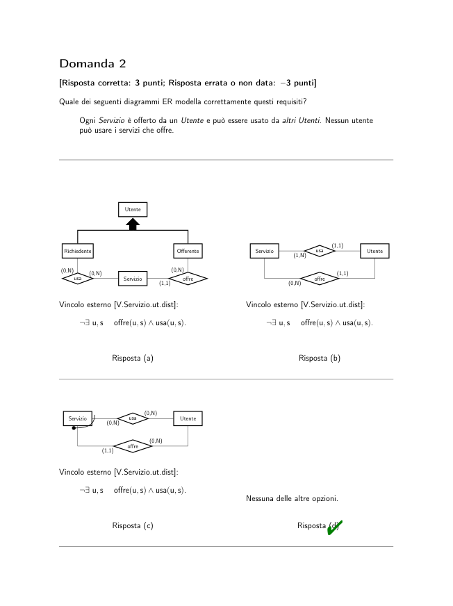
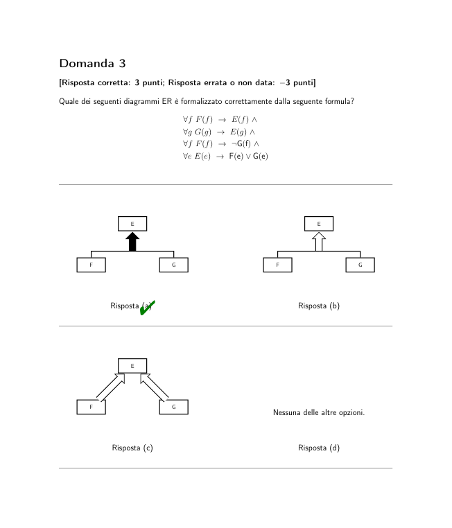

# BD2_Sbarramenti_2021-06-15

> Fonte: `BD2_Sbarramenti_2021-06-15.pdf`
> Estratto con PyMuPDF (conserva legature e formule); tolte le righe ripetute di intestazione e pie' di pagina e le etichette sparse dei diagrammi, che sono ritagliati in `figure/` e richiamati nel punto in cui compaiono.

---

Insegnamento di Basi di Dati, Modulo 2
                        Esame Es.20210615.S.iMgrZQ – Prova S del 15 giugno 2021
             Utilizza l’area di testo del sistema exam.net presente nella parte bassa del tuo schermo per rispon-
             dere alle domande nelle pagine seguenti (una domanda per pagina), scegliendo una delle risposte
             disponibili etichettate con una lettera minuscola (a, b, c, d, . . . )
             La valutazione di questa prova sarà automatica. Dovrai quindi prestare attenzione a rispettare la
             sintassi seguente.
             In particolare, dovrai scrivere nell’area Risposte una sola stringa racchiusa tra “@(” e “)” su una sola
             riga, senza spazi e senza righe vuote.
             Il contenuto racchiuso tra parentesi indicherà, nell’ordine, il numero di ogni domanda e la risposta
             da te scelta per quella domanda (senza delimitatori di alcun tipo). Dunque, ad esempio, la seguente
             stringa per le risposte:
            @(1 a2c3d4a5b6d7a8b9b10c )
             indica che:
               • la risposta scelta per la domanda 1 è ‘a’
               • la risposta scelta per la domanda 2 è ‘c’
               • . . .
               • la risposta scelta per la domanda 10 è ‘c’.
             Per rispettare il formato, dovrai rispondere necessariamente a tutte le domande e in ordine. Controlla
             bene le tue risposte prima di inviarle. La correzione automatica sarà effettuata in tempo reale, dunque
             nessuna eccezione potrà essere ammessa.
             Le domande hanno una sola risposta corretta.
             Il punteggio minimo per il superamento di questa prova è 18/30. Risposte non corrette hanno un
             punteggio negativo.
             Le risposte corrette sono contrassegnate con "

             Domanda 1
             [Risposta corretta: 3 punti; Risposta errata o non data: −3 punti]
             Quale delle seguenti opzioni è la semantica corretta del diagramma ER di seguito?
                                  istante/dataora
                                                       (0,N)
                              Utente
                              Servizio
                              abilitato
                                       (0,N)
                 Gli Utenti possono essere abi-
                 litati all’utilizzo di Servizi.
                 Di
                 ogni abilitazione interessa l’i-
                 stante in cui avviene.
                 Ogni
                 utente è abilitato all’utilizzo di
                 un servizio. Un cliente non può
                 abilitare se stesso.
                                                          Gli Utenti possono essere abi-
                                                          litati all’utilizzo di Servizi.
                                                          Di
                                                          ogni abilitazione interessa l’i-
                                                          stante in cui avviene.
                                                          Ogni
                                                          utente può essere abilitato al più
                                                          per un servizio.
                        Risposta (a)
                                                                  Risposta (b)
                 Gli Utenti possono essere abi-
                 litati all’utilizzo di Servizi.
                 Di
                 ogni abilitazione interessa co-
                 noscere l’istante in cui avvie-
                 ne. Un utente non può essere
                 abilitato allo stesso servizio più
                 di una volta, indipendentemente
                 dall’istante di abilitazione.
                                                          Gli Utenti possono essere abi-
                                                          litati all’utilizzo di Servizi.
                                                          Di
                                                          ogni abilitazione interessa l’i-
                                                          stante in cui avviene. Un uten-
                                                          te può essere abilitato più volte
                                                          per lo stesso servizio, ma solo in
                                                          istanti diversi.
                        Risposta (c)"
                                                                  Risposta (d)

             Domanda 2
             [Risposta corretta: 3 punti; Risposta errata o non data: −3 punti]
             Quale dei seguenti diagrammi ER modella correttamente questi requisiti?
                 Ogni Servizio è offerto da un Utente e può essere usato da altri Utenti. Nessun utente
                 può usare i servizi che offre.
                           Utente
                                                                         (1,1)
                                                        Servizio
                                                        Utente
                                                        usa
                                                        (1,N)
              Richiedente
              Offerente
                                     (0,N)
             (0,N)
             (0,N)
                                                                          (1,1)
                usa
                           Servizio
                                   offre
                                   (1,1)
                                                               offre
                                                               (0,N)
             Vincolo esterno [V.Servizio.ut.dist]:
                                                      Vincolo esterno [V.Servizio.ut.dist]:
                 ¬∃u, s
                 offre(u, s) ∧usa(u, s).
                                                          ¬∃u, s
                                                          offre(u, s) ∧usa(u, s).
                        Risposta (a)
                                                                  Risposta (b)
                               (0,N)
               Servizio
               Utente
               usa
               (0,N)
                                 (0,N)
                      offre
                      (1,1)
             Vincolo esterno [V.Servizio.ut.dist]:
                 ¬∃u, s
                 offre(u, s) ∧usa(u, s).
                                                      Nessuna delle altre opzioni.
                                                                 Risposta (d)"
                        Risposta (c)

             Domanda 3
             [Risposta corretta: 3 punti; Risposta errata o non data: −3 punti]
             Quale dei seguenti diagrammi ER è formalizzato correttamente dalla seguente formula?
                                        ∀f F(f) →E(f) ∧
                                        ∀g G(g) →E(g) ∧
                                        ∀f F(f) →¬G(f) ∧
                                        ∀e E(e) →F(e) ∨G(e)
                            E
                                                                      E
                   F
                   G
                                                             F
                                                             G
                        Risposta (a)"
                                                                  Risposta (b)
                            E
                   F
                   G
                                                            Nessuna delle altre opzioni.
                        Risposta (c)
                                                                  Risposta (d)

             Domanda 4
             [Risposta corretta: 3 punti; Risposta errata o non data: −3 punti]
             Sia dato il seguente alfabeto della logica del primo ordine, in termini di insiemi di simboli di predicato
             P e di funzione F:
               • P = {Titolo/1, Rischioso/1, Cliente/1, acquista/2}
                 con il seguente significato intuitivo (X e Y sono termini):
                   – Titolo(X): X è un titolo
                   – Rischioso(X): X è rischioso/a
                   – Cliente(X): X è una/un cliente
                   – acquista(X, Y ): X acquista/ha acquistato Y
               • F = ∅.
             Quale delle seguenti opzioni definisce correttamente:
                 “Non esiste alcun cliente che ha acquistato solamente titoli rischiosi”?
             Risposta (a) ∀c, r, Cliente(c) ∧Titolo(r) ∧Rischioso(r) ∧∃acquista(c, r)
             →
             ∃t Titolo(t) ∧
             ¬Rischioso(t) ∧acquista(c, t)
             Risposta (b)̸ ∃Cliente(c)∧Titolo(r)∧Rischioso(r)∧acquista(c, r)∧̸
             ∃Titolo(t)∧¬Rischioso(t)∧
             acquista(c, t)
             Risposta (c)"
             ∀c, r Cliente(c) ∧Titolo(r) ∧Rischioso(r) ∧acquista(c, r) →∃t Titolo(t) ∧¬Rischioso(t) ∧
             acquista(c, t)
             Risposta (d) Nessuna delle altre opzioni.

             Domanda 5
             [Risposta corretta: 3 punti; Risposta errata o non data: −3 punti]
             Sia dato il seguente alfabeto della logica del primo ordine, in termini di insiemi di simboli di predicato
             P e di funzione F:
               • P = {Titolo/1, Rischioso/1, Cliente/1, acquista/2}
                 con il seguente significato intuitivo (X e Y sono termini):
                   – Titolo(X): X è un titolo
                   – Rischioso(X): X è rischioso/a
                   – Cliente(X): X è una/un cliente
                   – acquista(X, Y ): X acquista/ha acquistato Y
               • F = ∅.
             Qual è la semantica del seguente insieme
                        {c | Cliente(c) ∧[∀t Titolo(t) ∧Rischioso(t) →¬acquista(c, t)]}
             in un’interpretazione per la quale i titoli non sono clienti?
             Risposta (a) L’insieme dei clienti che hanno acquistato almeno un titolo non rischioso.
             Risposta (b) L’insieme che contiene tutti i clienti.
             Risposta (c)"
                       L’insieme dei clienti che non hanno acquistato alcun titolo rischioso.
             Risposta (d) L’insieme sicuramente vuoto.
             Risposta (e) L’insieme dei clienti che non ha acquistato alcun titolo.

             Domanda 6
             [Risposta corretta: 3 punti; Risposta errata o non data: −3 punti]
             Quale ristrutturazione del seguente diagramma ER concettuale è corretta?
                                 inizio/data
                                       Riparazione
                                                       Terminata
                                                             fine/data
             inizio/date
             id/integer
                                                      inizio/date
                                                      id/integer
                                      (1,1)
                                                                               (1,1)
                   Riparazione
                                                             Riparazione
                            TisaR
                            (0,1)
                                            Terminata
                                                                     TisaR
                                                                     (0,1)
                                                                                     Terminata
                                      fine/date
                                                                                fine/date
                        Risposta (a)"
                                                                  Risposta (b)
             inizio/date
             id/integer
                                                      inizio/date
                                                      id/integer
                                      (1,1)
                                                                               (1,1)
                   Riparazione
                                                             Riparazione
                            TisaR
                            (0,1)
                                            Terminata
                                                                     TisaR
                                                                     (1,1)
                                                                                     Terminata
                                      fine/date
                                                                                fine/date
                        Risposta (c)
                                                                  Risposta (d)

             Domanda 7
             [Risposta corretta: 3 punti; Risposta errata o non data: −3 punti]
             Quale traduzione del seguente diagramma ER ristrutturato in schema relazionale è corretta?
                            cf/char(16)
                                                       nome/varchar(20)
                                                         (1,1)
                                             assegna
                                             (0,1)
                                                                  Mansione
                                    Staff
                                                      Staff(cf:char(16))
                                                      Mansione (nome:char(20))
                                                       v.
                                                       foreign key: nome ref.
                                                       assegna(mansione)
                                                      assegna (staff:char(16),
                                                      mansione:char(20))
             Nessuna delle altre opzioni.
                                                       v.
                                                       foreign key: staffref. Staff(cf)
                        Risposta (a)
                                                                  Risposta (b)
             Staff(cf:char(16))
             Mansione (staff:char(16), nome:char(20))
              v.
              foreign key: staffref. Staff(cf)
              v.
              altra chiave: nome
                                                      Staff(cf:char(16), mansione*:char(20))
                        Risposta (c)"
                                                                  Risposta (d)

             Domanda 8
             [Risposta corretta: 3 punti; Risposta errata o non data: −3 punti]
             Quale traduzione del seguente diagramma ER ristrutturato in schema relazionale è corretta?
                            id/char(15)
                                                       nome/varchar(20)
                                                         (0,N)
                                             vidTag
                                             (1,N)
                                                                   Tag
                                    Video
             Video (id:char(15), tag:char(20))
             v.
             foreign key: tag ref. Tag(nome)
             La relazione accorpa la relationship vidTag
             Tag (nome:char(20))
                                                      Nessuna delle altre opzioni.
                        Risposta (a)
                                                                  Risposta (b)
             Video (id:char(15))
                                                      Video (id:char(15))
              v.
              inclusione: id ⊆vidTag(video)
                                                       v.
                                                       foreign key: id ref. vidTag(video)
             Tag (nome:char(20))
                                                      Tag (nome:char(20))
                                                       v.
                                                       foreign key: nome ref. vidTag(tag)
             vidTag (video:char(15), tag:char(20))
              v.
              foreign key: video ref. Video(id)
              v.
              foreign key: tag ref. Tag(nome)
                                                      vidTag (video:char(15), tag:char(20))
                                                       v.
                                                       inclusione: video ⊆Video(id)
                        Risposta (c)"
                                                                  Risposta (d)

             Domanda 9
             [Risposta corretta: 3 punti; Risposta errata o non data: −3 punti]
             Sia dato il seguente schema relazionale:
             Socio (id: integer, nome: varchar(100), cognome: varchar(100), punti: integer)
              v.
              ennupla: punti ≥0
             Veicolo (targa: char(7), modello: varchar(100), cilindrata: integer, immatricolazione: date)
              v.
              ennupla: cilindrata > 0
             Noleggio (id: integer, socio: integer, veicolo: char(7), inizio: timestamp)
              v.
              foreign key: socio references socio(id)
              v.
              foreign key: veicolo references veicolo(targa)
             Terminato (noleggio: integer, fine: timestamp)
             v.
             foreign key: noleggio references noleggio(id)
             più trigger per gestire vincoli esterni (ad esempio, i soci non devono poter effettuare due noleggi
             che si sovrappongono nel tempo).
             Quale delle seguenti query calcola correttamente la durata del noleggio terminato più lungo di un
             dato veicolo?
             select
             t . f i n e −n . i n i z i o
             as
             durata
             from n o l e g g i o n ,
             terminato
             t
             where t . n o l e g g i o = n . id and
                                                      select
                                                      t . f i n e −n . i n i z i o
                                                      as
                                                      durata
                                                      from n o l e g g i o n ,
                                                      terminato
                                                      t
                                                      where t . n o l e g g i o = n . id and
                 t . f i n e −n . i n i z i o = max(
                                                          durata = (
                     select
                     t1 . f i n e −n1 .
                     i n i z i o
                     from n o l e g g i o n1 ,
                                                              select max( t1 . f i n e −n1 .
                                                              i n i z i o )
                                                              from n o l e g g i o n1 ,
                     terminato
                     t1
                     where t1 . n o l e g g i o = n1 .
                                                              terminato
                                                              t1
                                                              where t1 . n o l e g g i o = n1 .
                        id and
                                                                 id and
                         n1 . v e i c o l o = : v ) ;
                                                                  n1 . v e i c o l o = : v ) ;
                        Risposta (a)
                                                                  Risposta (b)
                                                      select
                                                      x . maxdurata
                                                      from
                                                      v e i c o l o
                                                      v ,
                                                      (
                                                      select max( t . f i n e −n . i n i z i o
             select max( t . fine −n . i n i z i o )
             from n o l e g g i o n ,
             terminato
             t
             where n . v e i c o l o = : v and
                                                      ) as maxdurata
                                                      from n o l e g g i o n ,
                                                      terminato
                                                      t
                                                      where t . n o l e g g i o = n . id ) x
                                                      where v . targa = : v ;
               t . n o l e g g i o = n . id ;
                        Risposta (c)"
                                                                  Risposta (d)

             Domanda 10
             [Risposta corretta: 3 punti; Risposta errata o non data: −3 punti]
             Sia dato il seguente schema relazionale:
             Socio (id: integer, nome: varchar(100), cognome: varchar(100), eta: integer)
              v.
              ennupla: eta ≥18
             Veicolo (targa: char(7), modello: varchar(100), cilindrata: integer, immatricolazione: date)
              v.
              ennupla: cilindrata > 0
             Noleggio (id: integer, socio: integer, veicolo: char(7), inizio: timestamp)
              v.
              foreign key: socio references socio(id)
              v.
              foreign key: veicolo references veicolo(targa)
             Terminato (noleggio: integer, fine: timestamp)
             v.
             foreign key: noleggio references noleggio(id)
             più trigger per gestire vincoli esterni (ad esempio, i soci non devono poter effettuare due noleggi
             che si sovrappongono nel tempo).
             Quale delle seguenti query calcola correttamente il numero di soci che oggi ha terminato noleggi di
             veicoli che hanno cilindrata più alta tra tutti i veicoli nel sistema?
             select
             count ( s . id )
             from
             s o c i o
             s ,
             n o l e g g i o n ,
             terminato
             t ,
             v e i c o l o
             v
             where s . id = n . s o c i o and
                                                      select
                                                      count ( d i s t i n c t
                                                      s . id )
                                                      from
                                                      s o c i o
                                                      s ,
                                                      n o l e g g i o n ,
                                                      terminato
                                                      t ,
                                                      v e i c o l o
                                                      v
                                                      where s . id = n . s o c i o and
               t . n o l e g g i o = n . id and
               v . targa = n . v e i c o l o and
               date ( t . f i n e ) = current_date
                                                        t . n o l e g g i o = n . id and
                                                        v . targa = n . v e i c o l o and
                                                        v . c i l i n d r a t a = (
               and
               v . c i l i n d r a t a = max( v .
                                                          select max( v1 . c i l i n d r a t a )
                                                          from
                                                          v e i c o l o
                                                          v1 )
                  c i l i n d r a t a )
                        Risposta (a)
                                                                  Risposta (b)
                                                      select
                                                      count ( d i s t i n c t
                                                      s . id )
                                                      from
                                                      s o c i o
                                                      s ,
                                                      n o l e g g i o n ,
                                                      terminato
                                                      t ,
                                                      v e i c o l o
                                                      v
                                                      where s . id = n . s o c i o and
             count (
             select
             s . id
             from
             s o c i o
             s ,
             n o l e g g i o n ,
             terminato
             t ,
             v e i c o l o
             v
             where s . id = n . s o c i o and
                                                        t . n o l e g g i o = n . id and
                                                        v . targa = n . v e i c o l o and
                                                        date ( t . f i n e ) = current_date
                 v . targa = n . v e i c o l o and
                 date ( t . f i n e ) = current_date
                 and
                 v . c i l i n d r a t a = (
                                                        and
                                                        v . c i l i n d r a t a = (
             select max( v . c i l i n d r a t a ) )
             )
                                                          select max( v1 . c i l i n d r a t a )
                                                          from
                                                          v e i c o l o
                                                          v1 )
                                                                 Risposta (d)"
                        Risposta (c)
