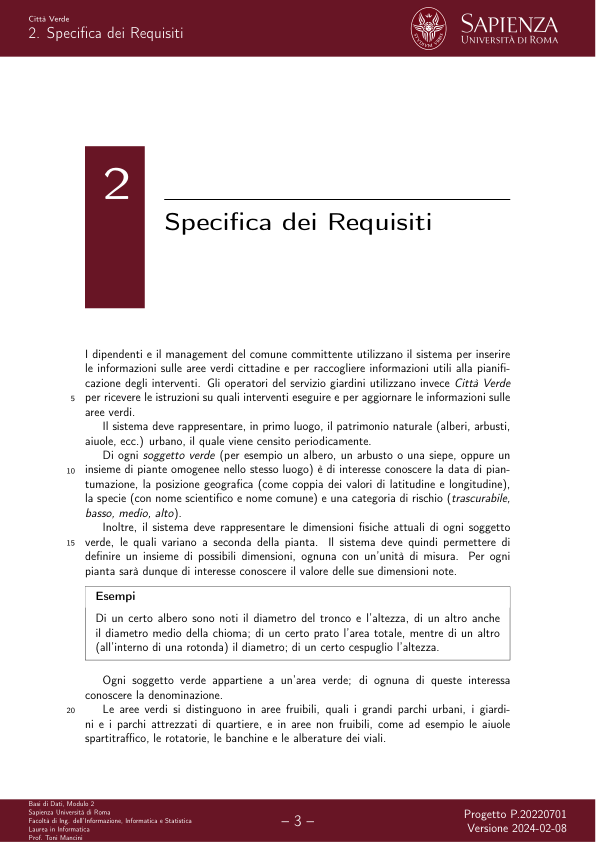

# 14 - Città Verde

> Fonte: `(14) Città Verde.pdf`
> Estratto con PyMuPDF (conserva legature e formule); tolte le righe ripetute di intestazione e pie' di pagina e le etichette sparse dei diagrammi, che sono ritagliati in `figure/` e richiamati nel punto in cui compaiono.

---

Progetto 20220701 (P.20220701)
                                  Città Verde
                                                                             Progetto P.20220701

    Città Verde
                           Indice
              Indice
              Introduzione
              Specifica dei Requisiti
                                                                             Progetto P.20220701

    Città Verde
    1. Introduzione
                 Introduzione
              Si vuole progettare e realizzare Città Verde, un sistema per la gestione delle operazioni
              di monitoraggio, controllo e manutenzione del verde pubblico urbano.
                                                                             Progetto P.20220701

    Città Verde
    2. Specifica dei Requisiti
                 Specifica dei Requisiti
           I dipendenti e il management del comune committente utilizzano il sistema per inserire
           le informazioni sulle aree verdi cittadine e per raccogliere informazioni utili alla pianifi-
           cazione degli interventi. Gli operatori del servizio giardini utilizzano invece Città Verde
           per ricevere le istruzioni su quali interventi eseguire e per aggiornare le informazioni sulle
           aree verdi.
              Il sistema deve rappresentare, in primo luogo, il patrimonio naturale (alberi, arbusti,
              aiuole, ecc.) urbano, il quale viene censito periodicamente.
           Di ogni soggetto verde (per esempio un albero, un arbusto o una siepe, oppure un
           insieme di piante omogenee nello stesso luogo) è di interesse conoscere la data di pian-
           tumazione, la posizione geografica (come coppia dei valori di latitudine e longitudine),
           la specie (con nome scientifico e nome comune) e una categoria di rischio (trascurabile,
           basso, medio, alto).
           Inoltre, il sistema deve rappresentare le dimensioni fisiche attuali di ogni soggetto
           verde, le quali variano a seconda della pianta.
           Il sistema deve quindi permettere di
           definire un insieme di possibili dimensioni, ognuna con un’unità di misura. Per ogni
           pianta sarà dunque di interesse conoscere il valore delle sue dimensioni note.
                Esempi
                Di un certo albero sono noti il diametro del tronco e l’altezza, di un altro anche
                il diametro medio della chioma; di un certo prato l’area totale, mentre di un altro
                (all’interno di una rotonda) il diametro; di un certo cespuglio l’altezza.
              Ogni soggetto verde appartiene a un’area verde; di ognuna di queste interessa
              conoscere la denominazione.
           Le aree verdi si distinguono in aree fruibili, quali i grandi parchi urbani, i giardi-
           ni e i parchi attrezzati di quartiere, e in aree non fruibili, come ad esempio le aiuole
           spartitraffico, le rotatorie, le banchine e le alberature dei viali.
                                                                             Progetto P.20220701

    Città Verde
    2. Specifica dei Requisiti
              Alcune aree fruibili sono anche sensibili, cioè necessitano di attenzioni particolari;
              queste includono i giardini delle scuole, quelli degli ospedali e le aree verdi attrezzate con
              giochi per bambini.
              Poiché il verde cittadino è continuamente in evoluzione, è importante avere informa-
              zioni anche sulle piante non più presenti. Di una pianta rimossa interessa conoscere la
              data di rimozione e la causa (completamento del ciclo di vita, sostituzione, cedimento,
              rischio alto, necessità di costruzione).
              Degli operatori, i quali effettuano tutte le operazioni di monitoraggio, controllo e
              manutenzione del verde urbano, interessa conoscere il nome, il cognome, la data di
              inizio servizio, l’eventuale data di fine servizio e il codice fiscale.
              Ogni operatore opera all’interno di squadre, le quali mutano nel tempo. Di ogni
              squadra interessa conoscere il codice identificativo, la data di formazione, la data di
              eventuale scioglimento, i membri e l’operatore che ne è a capo.
              Ogni operatore, inoltre, è autorizzato a utilizzare alcune delle attrezzature a dispo-
              sizione delle squadre. Di ogni attrezzatura interessa rappresentare il nome e la tipologia
              (strumento leggero, veicolo, veicolo speciale).
              Le squadre di operatori effettuano interventi sulle aree verdi. Tali interventi vanno
              dal semplice sfalcio delle erbacce ai margini delle strade, alla potatura di alberi, fino alle
              operazioni di cura specialistica di piante affette da fitopatologie.
              Poiché la pianificazione della cura del verde pubblico è un’operazione complicata,
              oltre che critica, si vuole che il sistema strutturi in modo intelligente le informazioni circa
              gli interventi da eseguire, in modo da rendere più efficiente il lavoro del management.
              Ogni intervento pianificato ha associati un’area verde, una data di inizio, una durata
              attesa, un insieme di tipologie di attività da svolgere (piantumazione, monitoraggio,
              potatura, abbattimento, sfalcio, cura sanitaria), una priorità (un numero intero tra 1 e
              10, dove 10 rappresenta la priorità più alta), un eventuale insieme di piante dell’area verde
              interessate dall’intervento (se non presente, significa che tutte le piante dell’area sono
              oggetto di intervento), un insieme di attrezzature necessarie per il suo completamento
              ed il numero minimo di operatori richiesti.
              Un intervento può essere assegnato a una squadra, ma solamente se quest’ultima è
              in possesso di tutte le caratteristiche necessarie per portarlo a termine (in altre paro-
              le, per ogni attrezzatura richiesta dall’intervento c’è almeno un membro della squadra
              autorizzato al suo utilizzo); di un intervento assegnato interessa conoscere la squadra
              e l’istante di acquisizione.
              Di un intervento completato interessa conoscere, inoltre,
              l’istante di completamento.
              È importante che il sistema tenga traccia delle malattie che colpiscono le piante
              della città. In particolare, di ogni malattia interessa conoscere il nome scientifico, quello
              “volgare” e la gravità (bassa, media, alta, mortale).
              Di ogni pianta interessa quindi conoscere anche lo storico delle malattie che l’hanno
              colpita: di ogni episodio di malattia interessa la data di scoperta del problema e l’even-
              tuale data di risoluzione; se il problema è risolto, interessa conoscere anche l’intervento
              in cui è stata somministrata la cura o si è verificata la guarigione.
                 Il sistema deve offrire delle funzionalità specifiche alle diverse tipologie di utenti.
                                                                             Progetto P.20220701

    Città Verde
    2. Specifica dei Requisiti
              In particolare, i dipendenti dell’ufficio comunale preposto devono poter inserire e
              modificare le aree verdi e le piante, gestire le attrezzature e le autorizzazioni per il loro
              utilizzo da parte degli operatori.
           Il management deve poter usare Città Verde per conoscere le aree della città con
           un dato livello di rischio, estrarre gli interventi relativi ad aree sensibili con un certo
           livello di priorità, calcolare la causa più comune di rimozione di piante per una data area
           verde, calcolare un piano di interventi per aree sensibili con piante che possiedono un
           certo livello di rischio, formare le squadre, nominare i capisquadra e avere lo storico degli
           interventi per ogni pianta e per ogni area verde.
           Gli operatori utilizzano il sistema per conoscere gli interventi da eseguire in un dato
           giorno, lo storico degli interventi eseguiti da loro stessi o per una certa pianta, e le
           squadre di cui sono stati membri e devono poter aggiornare le informazioni relative a
           un’area verde (ad esempio per modificare il livello di rischio in seguito ad un intervento
           oppure le dimensioni di una certa pianta).
           Inoltre:
                1. Dato un intervento non ancora assegnato, il sistema deve restituire tutte le squadre
                che hanno tutte le caratteristiche necessarie per poterlo eseguire. In particolare,
                le squadre restituite devono essere tali che
           • il numero di membri è maggiore o uguale al numero minimo di operatori
           richiesti,
                     • per ogni attrezzatura richiesta, c’è almeno un membro della squadra autoriz-
                     zato al suo utilizzo.
                2. Il management deve poter calcolare, dato un periodo di tempo, l’insieme delle aree
                verdi sensibili che non sono state oggetto di intervento nel periodo indicato.
           3. Dato un periodo di tempo e un insieme di malattie, il sistema deve calcolare un
           resoconto che associ ad ognuna delle malattie indicate il suo tasso ξ. Il tasso ξ di
           una malattia è il rapporto tra il numero di soggetti verdi che ha avuto tale malattia
           nel periodo dato e il numero di soggetti verdi che ha avuto una qualunque malattia
           nel periodo dato.
                                                                             Progetto P.20220701
