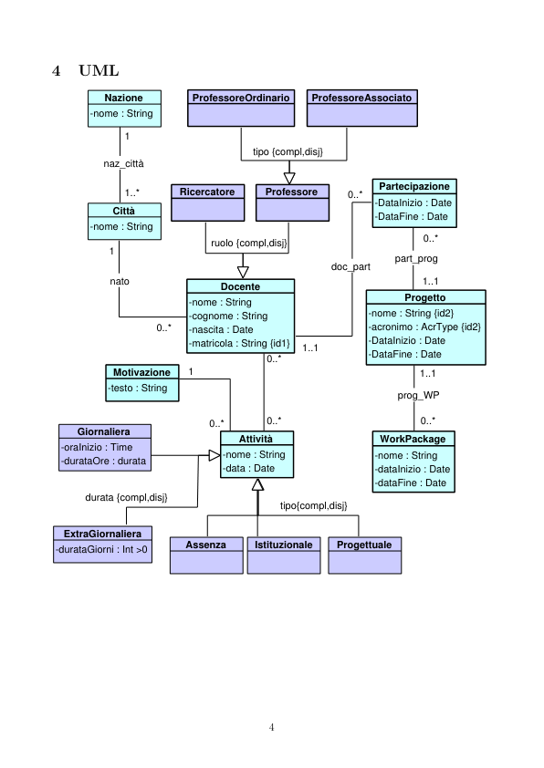

# Accademia 2

> Fonte: `Accademia 2.pdf`
> Estratto con PyMuPDF (conserva legature e formule); tolte le righe ripetute di intestazione e pie' di pagina e le etichette sparse dei diagrammi, che sono ritagliati in `figure/` e richiamati nel punto in cui compaiono.

---

Accademia 2 (gruppo 16)
         Requisiti
         I dati di interesse per il sistema sono Docenti, Progetti ed Attivit`a.
           1. Docente
               1.1 Nome
               1.2 Cognome
               1.3 Data di nascita
               1.4 Matricola
               1.5 Posizione universitaria
               1.6 Progetti alla quale partecipa
           2. Progetto
               2.1 Nome
               2.2 Acronimo
               2.3 Codice progetto
               2.4 Data inizio
               2.5 Data fine
               2.6 Docenti coinvolti
               2.7 Work Package
                 2.7.1 Nome
                 2.7.2 Data inizio
                 2.7.3 Data fine
           3. Attivit`a
               3.1 Data
               3.2 Durata in ore
               3.3 tipologia impegno
               3.4 motivazione

         Considerazioni
         Ci sar`a una classe TipologiaAttivit`a, un Attivit`a pu`o essere di pi`u tipologie.
         Un Attivit`a pu`o coinvolgere pi`u Docenti.
         Il Docente, tramite la relazione doc part, segnala che in uno specifico intervallo temporale fa
         parte di un gruppo di realizzazione di un progetto, non indica per`o, i giorni specifici in cui un
         docente sar`a assente per via di tale progetto, ci`o, sar`a dato dalla relazione dedicata nell’Attivit`a
         di tipo Progettuale.
         Un Docente pu`o prendere parte ad un Attivit`a di tipo Progettuale eslcusivamente riguardo un
         Progetto alla quale il Docente partecipa.

         Specifica tipi di dato
         durata : (ore : 0..23, minuti : 0..59)
         AcrType : Stringa che segue lo standard degli acronimi.

         UML
                                   ProfessoreOrdinario
                                   ProfessoreAssociato
                   Nazione
                -nome : String
                                              tipo {compl,disj}
                   naz_città
                                                                     Partecipazione
                      1..*
                                 Professore
                                 Ricercatore
                                                                    -DataInizio : Date
                                                                    -DataFine : Date
                    Città
                -nome : String
                                      ruolo {compl,disj}
                                                            part_prog
                                                            doc_part
                    nato
                                                                             1..1
                                        Docente
                                                                          Progetto
                                  -cognome : String
                                  -nascita : Date
                                  -matricola : String {id1}
                                                                   -nome : String {id2}
                                                                   -acronimo : AcrType {id2}
                                                                   -DataInizio : Date
                                                                   -DataFine : Date
                                                       1..1
                    Motivazione
                                                                             1..1
                   -testo : String
                                                                         prog_WP
              Giornaliera
                                           Attività
                                                                     WorkPackage
           -oraInizio : Time
           -durataOre : durata
                                        -data : Date
                                                                    -dataInizio : Date
                                                                    -dataFine : Date
               durata {compl,disj}
                                                   tipo{compl,disj}
           ExtraGiornaliera
                                  Assenza
                                  Istituzionale
                                  Progettuale
          -durataGiorni : Int >0

