# Appunti di teoria (studente-B)

> Fonte: `Appunti di teoria (studente-B).pdf`
> Estratto con PyMuPDF (conserva legature e formule); tolte le righe ripetute di intestazione e pie' di pagina e le etichette sparse dei diagrammi, che sono ritagliati in `figure/` e richiamati nel punto in cui compaiono.

---

Basi di Dati 2
                                           studente-B

         Contents
         Introduzione
         1.1
         Contesto Organizzativo . . . . . . . . . . . . . . . . . . . . . . . . . . . . . . . .
         1.2
         Ciclo di Vita del Software
         . . . . . . . . . . . . . . . . . . . . . . . . . . . . . .
         Il linguaggio UML
         2.1
         Associazioni e Link . . . . . . . . . . . . . . . . . . . . . . . . . . . . . . . . . .
         2.1.1
         Classi Ponte e Molteplicit`a . . . . . . . . . . . . . . . . . . . . . . . . . .
         2.1.2
         Associazioni con Attributi . . . . . . . . . . . . . . . . . . . . . . . . . .
         2.2
         Tipi di Dato . . . . . . . . . . . . . . . . . . . . . . . . . . . . . . . . . . . . . .
         2.3
         Vincoli . . . . . . . . . . . . . . . . . . . . . . . . . . . . . . . . . . . . . . . . .
         2.4
         Generalizzazione delle Classi . . . . . . . . . . . . . . . . . . . . . . . . . . . . .
         2.5
         Operazioni di Classe
         . . . . . . . . . . . . . . . . . . . . . . . . . . . . . . . . .
         2.6
         Documenti di Specifica . . . . . . . . . . . . . . . . . . . . . . . . . . . . . . . .
         2.6.1
         Specifica delle Classi . . . . . . . . . . . . . . . . . . . . . . . . . . . . .
         2.7
         Specializzazione . . . . . . . . . . . . . . . . . . . . . . . . . . . . . . . . . . . .
         2.8
         Specifica dei Vincoli Esterni . . . . . . . . . . . . . . . . . . . . . . . . . . . . .
         2.9
         Diagramma degli Use-Case . . . . . . . . . . . . . . . . . . . . . . . . . . . . . .
         2.9.1
         Semantica del Diagramma . . . . . . . . . . . . . . . . . . . . . . . . . .
         2.9.2
         Specifiche degli Use-Case . . . . . . . . . . . . . . . . . . . . . . . . . . .
         Logica di Primo Ordine
         3.1
         Sintassi della FOL
         . . . . . . . . . . . . . . . . . . . . . . . . . . . . . . . . . .
         3.2
         Semantica della FOL . . . . . . . . . . . . . . . . . . . . . . . . . . . . . . . . .
         3.3
         Valutazione dei Termini
         . . . . . . . . . . . . . . . . . . . . . . . . . . . . . . .
         Progettazione di Basi di Dati
         4.1
         Ristrutturazione del Diagramma delle Classi . . . . . . . . . . . . . . . . . . . .
         4.1.1
         Procedimento della Ristrutturazione
         . . . . . . . . . . . . . . . . . . . .

         Introduzione
         Questo corso non `e ristretto esclusivamente alla progettazione di basi di dati, bens`ı fornisce
         cenni sulla progettazione di software di grandi dimensioni, supportati da basi di dati reali.
         Un cliente (committente) fornisce delle specifiche riguardo un progetto che bisogna sviluppare,
         esso stesso non sa come verr`a implementato o quali sono nello specifico tutte le funzionalit`a, un
         insieme di ingegneri del software, progettisti, e programmatori si occuperanno di ”tirare su” il
         lavoro completo nel tempo, e varie figure professionali verranno necessariamente coinvolte.
         Tempi per un progetto software complesso :
            ˆ Capire il problema e cosa vuole realmente il cliente : 33% del tempo totale.
            ˆ Progettazione, capire come implementare le richieste del cliente : 50% del tempo totale.
            ˆ Effettiva realizzazione (sviluppo del codice) : 17% del tempo totale.
            ˆ Del tempo extra per i test di verifica e la manutenzione.
         1.1
         Contesto Organizzativo
         Le figure professionali chiave coinvolte nel progetto sono dette attori, generalmente sono :
            ˆ Committente ed Esperti del dominio
            ˆ Analisti e Progettisti
            ˆ Programmatori
            ˆ Utenti finali e Manutentori
         Qual’`e la differenza tra analisti e progettisti? E di cosa si occupano gli esperti del dominio?
         Il dominio dell’applicazione `e l’insieme di informazioni necessarie da conoscere per poter lavo-
         rare ad un progetto che fa riferimento ad uno specifico ambito, ad esempio, un applicazione che
         si occupa di registrare e gestire le contravvenzioni stradali, vedr`a sicuramente nel suo dominio
         il codice stradale e le informazioni legislative.
         L’esperto del dominio `e una figura, appunta esperta, del dominio inerente al progetto in ques-
         tione, viene pagata dal committente e funge da consulente durante lo sviluppo.
         1.2
         Ciclo di Vita del Software
         `E possibile suddividere lo sviluppo di un software in macro-fasi principali.
           1. Studio di fattibilit`a - Ci si approccia al progetto valutando i costi per realizzarlo ed
           i benefici, si pianificano le attivit`a e le risorse del progetto, umane ed economiche, e si
           individua l’ambiente di programmazione hardware e software.
           2. Raccolta dei requisiti - Bisogna capire cosa il sistema deve fare, scrivere in prosa
           una documentazione che descriva precisamente le usabilit`a del progetto, sintetizzando i
           requisiti, che spesso sono contraddittori, trovando i giusti compromessi.

           3. Analisi concettuale dei requisiti - Sono coinvolti gli analisti, che produrranno uno
           schema matematico del progetto, dettagliato per filo e per segno, che definir`o cosa l’applicazione
           deve fare indipendentemente dal come.
           Lo schema prima citato `e detto schema con-
           cettuale, e sar`a la base da cui partire per la progettazione.
           4. Progettazione (design) dell’applicazione - Bisogna capire come il sistema realizzer`a
           le sue funzioni, entra in gioco il progettista, che definir`a l’architettura volta ad ospitare
           il software e l’insieme delle tecnologie necessarie.
           5. Realizzazione - Una volta che si hanno le linee guida per la realizzazione, composte nelle
           fasi precedenti, si delega la scrittura del codice ai programmatori, che non sono coinvolti
           nel resto e non devono necessariamente essere a conoscenza di cosa stanno facendo, ma
           esclusivamente produrre le funzioni richieste.
           6. Verifica, esercizio e manutenzione - Le diverse componenti dell’applicazione vengono
           integrate. Una volta che il progetto `e realizzato e pronto alla messa in esercizio, si passa
           da una fase di testing ad una fase di utilizzo effettivo, l’applicazione verr`a monitorata
           durante l’esercizio ed eventuali correzzione verranno prodotte.
         Si osservi il seguente diagramma rappresentante il modello a spirale di realizzazione :
         Tutto il progetto viene costruito in maniera ”iterativa”, si dice che lo sviluppo del software sia
         agile, si comincia raccogliendo i requisiti strettamente necessari, per poi procedere all’analisi
         considerando tali requisiti, con l’andare avanti delle fasi portando alla realizzazione di una
         prima versione del software, pronta ad essere messa in esercizio, implementante esclusivamente
         le funzionalit`a di base, tale versione render`a chiare le idee al committente che potr`a fornire
         nuovi requisiti, in modo tale da ricominciare il ciclo.
         Nulla vieta alle varie fasi di essere eseguite in parallelo, ad esempio, nel tempo t0 vengono stilati
         i requisiti per la prima versione del software, nel tempo t1 gli analisti iniziano a produrre il
         modello della versione 1, ma possono essere nel mentre stilati i requisiti della versione 2, al
         tempo t3, com’`e di facile intuzione : Si raccolgono i requisiti per la versione 3, si produce il
         modello della versione 2, si progetta la versione 1.

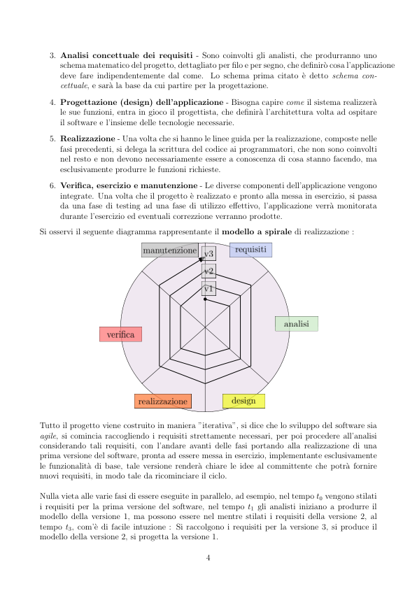

         Il linguaggio UML
         Il linguaggio UML, acronimo di Unified Modeling Language, nasce con l’intento di definire un
         linguaggio logico-matematico e formale per la progettazione del software.
         Utilizza dei dia-
         grammi con lo scopo di ”sintetizzare” un linguaggio puramente logico.
         Verr`a utilizzato l’UML per modellare il dominio applicativo ed i dati di interesse, utilizzeremo
         il cosiddetto diagramma delle classi e degli oggetti. Un oggetto modella un elemento del
         dominio di business, la cui esistenza `e ”autonoma”, e pu`o essere identificato appunto come un
         ”oggetto” del mondo reale, identifica una classe, di cui `e ”estensione”, in maniera similare ai
         linguaggi object-oriented
         Sar`a importante concentrarsi sulle classi piuttosto che sugli oggetti specifici, una classe definisce
         un nome identificativo, degli attributi e delle operazioni.
           NomeClasse
                                                                        divComm : Libro
                          esempio :
                          Libro
          attributo : tipo
                                                     titolo=”la Divina Commedia”
                                                     <<istance of>>
                                     titolo: String
           operazione()
         Una classe permette di modellare oggetti dello specifico tipo definito da essa, un oggetto ha
         un identificatore univoco (sottolineato), possono per`o esistere due oggetti identici, a patto che
         differiscano per l’identificatore.
         2.1
         Associazioni e Link
         Un associazione definisce un legame fra due oggetti istanza di due classi diverse, si denota con
         una freccia o linea che collega due classi, e deve presentare un titolo, ad esempio, un oggetto di
         tipo Libro, pu`o essere associato ad un oggetto di tipo Persona tramite un’ipotetica associazione
         autore.
                                                                    esempio
                                                                                 Persona
          NomeClasse1
                                  NomeClasse2
                       associazione
                       Libro
                                                                     autore
          attributo : tipo
                                  attributo : tipo
                                                      titolo: String
           operazione()
                                   operazione()
         Un link non `e altro che il corrispettivo delle associazioni, ma sugli oggetti istanza delle classi.
         Due oggetti identici possono esistere, ma due link identici fra due oggetti no, si immagini
         l’esempio precedente di autore, non avrebbe senso che una persona sia due volte autore dello
         stesso libro.
                                                               Persona
                                   Libro
                                                 autore
                                titolo: String
                   <<istance of>>
                   <<istance of>>
                                                  autore
                                                                Dante : Persona
                       divComm : Libro
                                                                nome=”Dante”
                                                  cognome : Alighieri
                                                  autore
                  titolo=”la Divina Commedia”
                                     SBAGLIATO : Non ha senso!

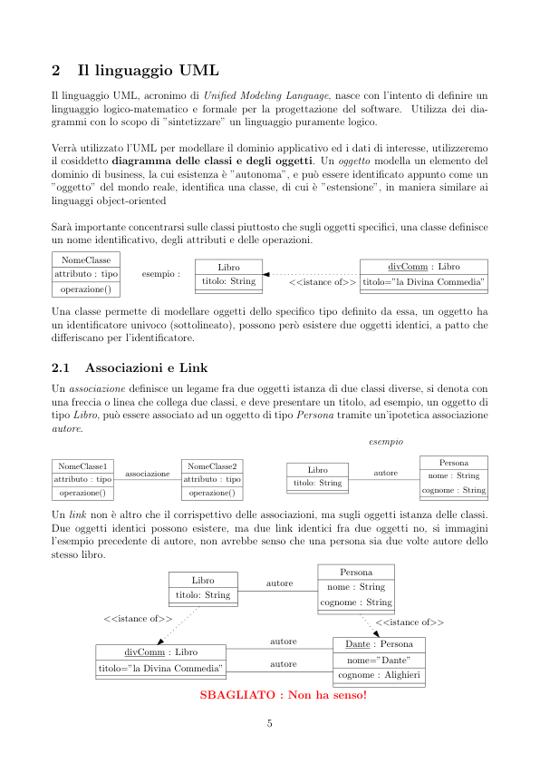

         2.1.1
         Classi Ponte e Molteplicit`a
         Si consideri adesso il seguente esempio, si vuole progettare un’applicazione che gestire le preno-
         tazioni di un hotel, e si produce il seguente modello UML, con le classi Hotel e Persona unite
         dall’associazione ”prenota”, cosa succederebbe se una persona volesse prenotare 2 volte lo stesso
         hotel?
                                                             Persona
                                  Hotel
                                               prenota
                     <<istance of>>
                     <<istance of>>
                                              prenota
                                                          alice : Persona
                                h1 : Hotel
                                                          nome=”Alice”
                                              prenota
                             nome=”Pergola”
                                                        cognome=”Bianchi”
                                        non ammesso
         Non `e giusto modellare la prenotazione come un associazione, in quanto vogliamo che le preno-
         tazioni esistano come oggetti autonomi, e che uno stesso cliente possa prenotare pi`u volte lo
         stesso hotel, si necessita di una classe prenotazione che si occupi di tale relazione, una classe
         di questo tipo `e detta classe ponte, e nel caso degli hotel, viene implementata nel seguente
         modo :
                                                                       Persona
                       Hotel
                                          Prenotazione
                               hotel prenotato
                               cliente prenotazione
                                          giorno: Date
             <<istance of>>
             <<istance of>>
             <<istance of>>
                                         p1 : Prenotazione
                              hotel prenotato
                                                      cliente prenotazione
                                                                       alice : Persona
                     h1 : Hotel
                                         giorno=12/03/2021
                                                                       nome=”Alice”
                   nome=”Pergola”
                                                                      cognome=”Bianchi”
                                         p2 : Prenotazione
                            hotel prenotato
                                         giorno=28/11/2023
                                                       cliente prenotazione
         Ovviamente, fra le stesse due classi, possono esistere pi`u associazioni diverse, ad esempio, le
         classi Libro e Persona, potrebbero essere relazionate da autore ed editore. Inoltre, un oggetto
         di una classe C1, pu`o essere collegato tramite link a due oggetti diversi di una stessa classe C2,
         ci`o `e valido, ma potrebbe causare alcuni errori logici :
                                                        rm : Citt`a
                                    Persona
                                                                     nascita
                                                      titolo=”Roma”
                                                      al : Persona
             Citt`a
                        nascita
                                              nascita
                                              istanze :
                                                                              nome=”Alice”
          nome : String
                                                        cognome=”Bianchi”
                                                        ml : Citt`a
                                                       titolo: Milano
         Nonostante lo schema relazionale permetta tali istanze, il fatto che una persona sia nata in due
         citt`a differenti non rispetta i vincoli del mondo reale, il diagramma `e quindi troppo lasco, ap-
         positamente per situazioni di questo tipo, esistono dei costrutti, detti vincoli di molteplicit`a
         sulle associazioni, che restringono il possibile numero delle istanze, imponendo delle restrizioni
         sul numero di link che possono esistere fra due classi.

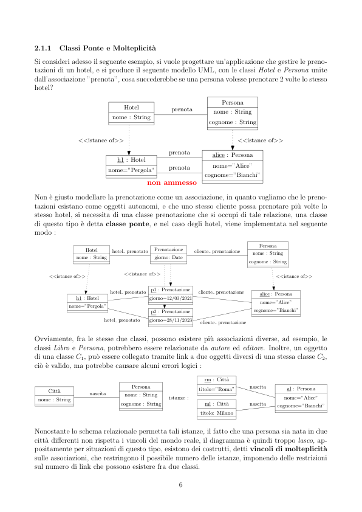

                        Istanza non pi`u ammessa!
                        vincoli
                                                        rm : Citt`a
                                    Persona
                                                                     nascita
                                                      titolo=”Roma”
                                                      al : Persona
             Citt`a
                     nascita
                     istanze :
                        nascita
                                                                              nome=”Alice”
          nome : String
                                                        cognome=”Bianchi”
                                                        ml : Citt`a
                                                       titolo: Milano
         I vincoli di molteplicit`a vengono aggiunti ai terminali della linea associazione :
            ˆ il vincolo 0..* posto al terminale della classe A, in associazione con la classe B implica che
              ogni istanza della classe A, dovr`a essere coinvolta in un numero di link dell’associazione
              in questione, che va da 0 ad un qualsiasi numero (ogni istanza di A pu`o essere legata ad
              un numero qualunque di istanze di B).
            ˆ il vincolo 1..1 posto al terminale della classe A, in associazione con la classe B implica che
              ogni istanza della classe A, dovr`a essere coinvolta in un numero di link dell’associazione
              in questione, che va da 1 ad 1 (ogni istanza di A sar`a collegata ad una sola istanza di B).
            ˆ (caso generale) il vincolo k..n posto al terminale della classe A, in associazione con la
              classe B implica che ogni istanza della classe A, dovr`a essere coinvolta in un numero di
              link dell’associazione in questione, che va da k ad n.
                                                                               a1 : Auto
                                                         al : Persona
            Persona
                                                                    possiede
                                                                             targa=”Ak198”
                                                                             a2 : Auto
                                          Auto
          nome : String
                     possiede
                                                                        possiede
                                                        nome=”Alice”
                                       targa : String
                                                                               targa=”Ak198”
                                                                               a3 : Auto
          cognome : String
                                                      cognome=”Bianchi”
                                                                    possiede
                                                                                targa=”Ak198”
         Si considerino i seguenti requisiti : Si vogliono rappresentare i sovrani di un regno, di ognuno
         di loro, `e importante considerare il predecessore ed il successore, `e possibile in UML creare un
         link fra due oggetti della stessa classe, con un associazione sulla stessa classe :
                                                    successore
                                   Sovrano
                             predecessore
                             successione
         Risulta per`o obbligatorio dare dei nominativi ai ruoli posti ai terminali dell’associazione, al-
         trimenti sarebbe impossibile quale delle due classi sta interpretando il ruolo di successore o
         predecessore. Vorremmo inoltre che ogni sovrano, eccetto il primo e l’ultimo, abbia esatta-
         mente un successore ed un predecessore, ma il diagramma in questione permette a qualunque
         sovrano di violare tali vincoli del mondo reale.
         2.1.2
         Associazioni con Attributi
         Si vuole progettare un sistema che gestisca gli esiti (voti in 30esimi) di pi`u esami sostenuti dagli
         studenti di un corso di laurea, esisteranno sicuramente le classi Studente ed Esame.
         Il problema, `e che non `e possibile utilizzare una classe ponte, in quanto deve essere impossibile
         per uno studente, superare lo stesso esame pi`u di una volta. Sarebbe naturale inserire il voto
         dell’esame in questa ipotetica classe ponte, ma sapendo che non `e utilizzabile, dove verr`a inserito
         l’attributo voto?

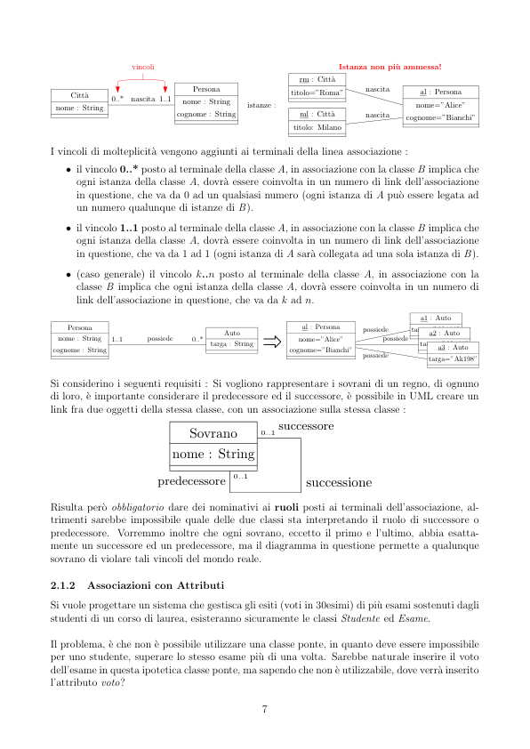

                      Studente
                                                                      Esame
                                   testSuperato
                  matricola : String
                                    dove inserisco l’attributo voto ?
         Chiaramente, non posso inserirlo nella classe Studente, in quanto ogni studente avrebbe un
         unico voto per ogni esame, e non posso inserirlo nella classe Esame, dato che tutti gli studenti
         avrebbero lo stesso voto nello stesso esame.
         `E possibile considerare degli attributi di associazione, dando ad ogni link di testSuperato,
         il corrispettivo valore del voto, risulta una soluzione naturale, in quanto il voto `e assegnato ad
         ogni superamento di un test :
                       Studente
                                                                      Esame
                  matricola : String
                                            testSuperato
                                              voto : ..
                                             data : Data
         Anche se simile, il riquadro votoSuperato non rappresenta una classe, in UML `e detta association
         class, e anche essa pu`o essere collegata ad altre classi, si supponga ad esempio che vogliamo
         associare ad ogni test superato, anche il docente che ha verbalizzato il voto, basta collegare
         l’associazione con attributi ad una classe Docente :
                      Studente
                                                              Esame
                  matricola : String
                                        testSuperato
                                                                       Docente
                                                      1..*
                                                      verbalizza
                                          voto : ..
                                         data : data
         2.2
         Tipi di Dato
         Per ogni attributo di ogni classe abbiamo visto essere necessario considerare il tipo del dato,
         esiste infatti un insieme di tipi di dato concettuali, che siano facilmente implementabili in modo
         ovvio su qualsiasi sistema o linguaggio di programmazione.
                           Intero, Reale, Booleano, Data, Ora, DataOra
         Il fatto `e che il linguaggio UML vuole modellare situazioni reali, `e quindi necessario considerare
         dei tipi di dato pi`u restrittivi ed accurati, nell’esempio precedente degli esami, che tipo di dato
         dovrebbe assumere l’attributo voto?
         Non possiamo dargli il tipo ”intero”, in quanto ci`o permetterebbe ad un voto di assumere anche

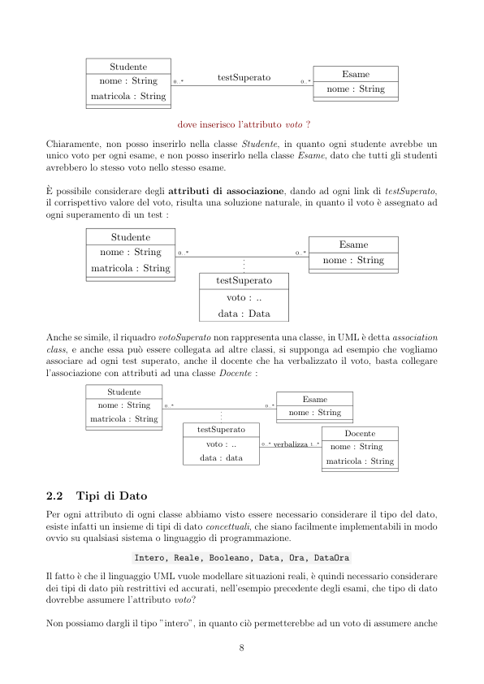

         valori come -5 o 25013, e non avrebbe alcun senso per essere un voto di un esame. `E possibile
         considerare dei vincoli con un criterio di specializzazione, allo scopo di restringere l’insieme dei
         possibili valori che pu`o assumere un determinato attributo, ad esempio :
                     Esempi :
                                                                 testSuperato
                               budget : Int ≥0
                                                                 voto : 18..30
                                                 per il voto :
                            attributo1 : Reale < π
                                                                  data : data
         In UML, il tipo k..n, indica un intervallo di numeri interi, l’attributo in questione pu`o assumere
         valori da un minimo di k ad un massimo di n, nel caso del voto, assume valori da 18 a 30.
         `E possibile anche definire esplicitamente l’insieme di valori che possono essere assunti, tramite
         il tipo enumerativo :
                 Studente
               nome : String
                                nel campo genere, ogni studente potr`a assumere il valore ”maschio” oppure ”femmina”
              matricola : String
          genere : {maschio,femmina}
         Se volessimo rappresentare un indirizzo? Si possono creare dei tipi di dato composti, costituiti
         da pi`u tipi di dato, con le eventuali restrizioni (`e possibile definire i tipi di dato in un documento
         separato) :
                   Studente
                                                         documento separato
                 nome : String
               matricola : String
                                            Mf : {maschio,femmina}
                  genere : Mf
              Indirizzo : {via : String, civico : Int>0, cap : Int>0}
              indirizzo : Indirizzo
         Possono essere definiti anche dei vincoli di molteplicit`a sugli attributi, permettendo ad un
         oggetto di avere pi`u campi di uno stesso attributo, ad esempio, una classe Utente di un social
         network, pu`o permettere ad ogni utente di avere pi`u indirizzi email, allora l’attributo si definir`a
         nel seguente modo :
                           email : String [1..*]
                           // uno o pi`u indirizzi email
         2.3
         Vincoli
         Il linguaggio UML permette di aggiungere i cosiddetti vincoli d’integrit`a, delle asserzioni
         che hanno lo scopo di restringere il possibile insieme delle istanze, ossia degli oggetti ammessi.
         Una tipologia di vincolo `e quella dell’identificazione di classe, `e un vincolo che, impone a due
         differenti istanze di una classe, di non poter avere uno o pi`u attributi coincidenti.
         Un tipico esempio pu`o essere fatto per una classe Persona , che presenta un attributo codice fiscale ,
         `e necessario un vincolo di identificazione di classe, che imponga a due differenti istanze di
          Persona di non avere lo stesso codice fiscale .

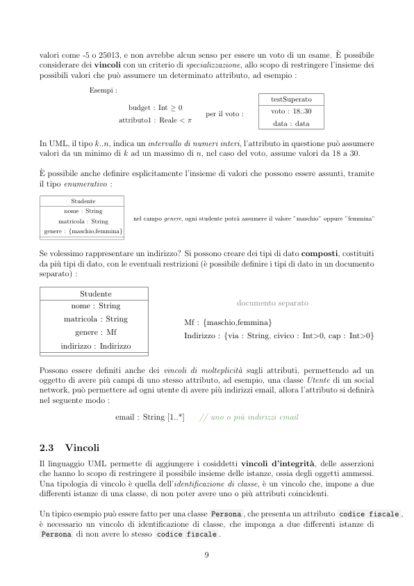

         Tale vincolo pu`o essere aggiunto anche su un insieme di attributi, se il vincolo `e su x ed y ,
         due oggetti istanza possono coincidere su x ma non su y , oppure su y ma non su x , non
         possono essere coincidenti su entrambi.
                                                      Anna: Persona
                                                 codiceFiscale=”RNA411G”
                                <<istance of>>
                Persona
                                                     nome=”Anna”
                                                     cognome=”Rossi”
         codiceFiscale : CF {id}
                                                                         NON AMMESSO!
            nome : String
            cognome : String
                                <<istance of>>
                                                     Anna2: Persona
                                                 codiceFiscale=”RNA411G”
                                                    nome=”Annarita”
                                                    cognome=”Rossini”
         Affianco all’attributo in questione, si inserisce la dicitura {id} , possono coesistere anche iden-
         tificazioni di classe differenti, di solito si usano le diciture {id1}, {id2}...,{idk} ecc.
         Un vincolo di identificazione pu`o anche coinvolgere un’associazione. Se il vincolo `e posto su
         un’associazione da x ad y , e su un attributo della classe x , vuol dire che non possono esistere
         due istanze di x con l’attributo in questione coincidente, che hanno un link verso la medesima
         istanza di y :
                                                               Due studenti con la stessa ma-
                                                               tricola possono esistere, eslcusi-
                                                               vamente se non sono in relazione
                                                               con la stessa universit`a.
               Studente
                                                  Universit`a
          Matricola : String {id}
                              iscritto
                              {id}
            nome : String
            cognome : String
         Attenzione : Un vincolo di identificazione di classe pu`o coinvolgere esclusivamente attributi a
         molteplicit`a 1..1 e associazioni in cui il ruolo della classe ha molteplicit`a 1..1.
         2.4
         Generalizzazione delle Classi
         Risultano molto comuni, situazioni in cui diverse classi condividono gli stessi attributi.
         Il
         concetto di classe e sotto-classe `e ben noto, gi`a dal corso di Metodologie di Programmazione ,
         dove si `e affrontata la programmazione orientata agli oggetti, in UML, `e possibile definire delle
         relazioni di classe e sotto-classe, che per`o risultano ben pi`u ”potenti” e flessibili del corrispettivo
         in Java.
                                                          Ogni istanza di Studente `e anche un is-
                                                          tanza di Persona, ma ogni istanza di Per-
                                                          sona non `e necessariamente un istanza di
                                                          Studente. Le istanze di Studente eredit-
                                                          eranno gli attributi della classe Persona
             Persona
                                      Studente
          nome : String
          cognome : String
                                  Matricola : String
         Tutti gli attributi, associazioni e le molteplicit`a della superclasse sono ereditati dalla sottoclasse.
         Ovviamente la relazione di classe-sottoclasse pu`o essere re-iterata, costruende un ”albero” ger-
         archico, in cui ogni livello eredita gli attributi ed associazioni del livello superiore.

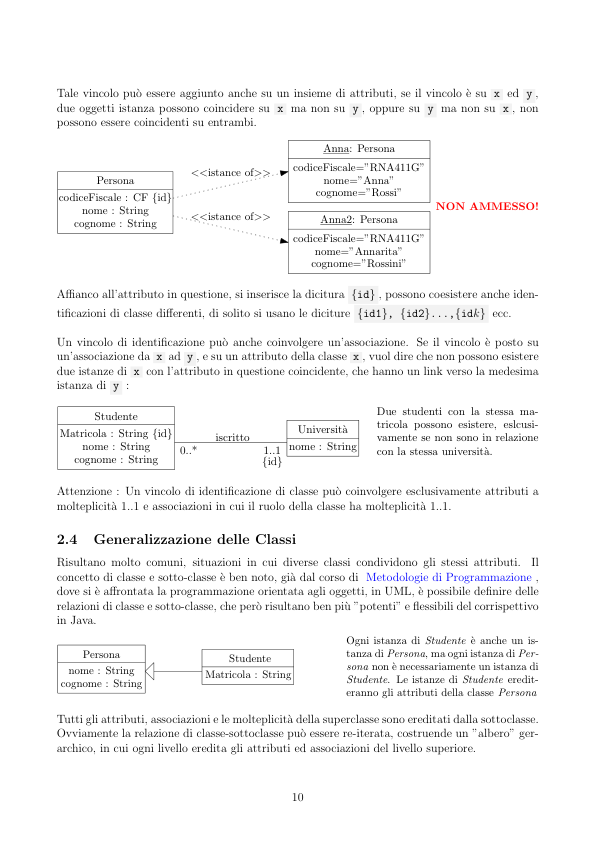

         La classe Studente sar`a sottoclasse di una classe Persona , se quest’ultima `e in una as-
         sociazione nascita con una classe Citt`a , anche Studente lo sar`a, una sottoclasse di
         Studente , ad esempio, StudenteStraniero , erediter`a sia le propriet`a di Studente che
         quelle di Persona .
                               Persona
                                                 nascita
                                                                 Citt`a
                                                tutStud
                              Studente
                                                                 Tutor
                          Matricola : String
                                                 nazStud
                          StudenteStraniero
                                                                Nazione
         Tutto ci`o, aumenta significativamente la complessit`a dello schema relazionale e del livello degli
         oggetti, nulla vieta ad un oggetto di appartenere a pi`u classi, nell’esempio precedente, un istanza
         di StudenteStraniero , `e anche istanza di Studente e Persona , per`o la classe pi`u specifica
         alla quale fa riferimento `e appunto StudenteStraniero , si definisce per un oggetto quindi
         l’insieme delle sue classi pi`u specifiche.
                           Persona
                                                   L’oggetto Anna `e un istanza di Stu-
                                                   dente,
                                                   ma
                                                   anche
                                                   di
                                                   Lavoratore,
                                                   a
                                                   sua
                                                   volta,
                                                   essendo
                                                   queste
                                                   ultime
                                                   sottoclassi di Persona,
                                                   `e anche im-
                                                   plicitamente
                                                   istanza
                                                   di
                                                   Persona.
                                                   L’insieme delle sue classi pi`u specifiche
                                                   `e {Studente,Lavoratore}.
                   Studente
                   Lavoratore
                           <<istance of>>
                 <<istance of>>
                                  <<istance of>>
                            Anna
         Se diverse classi sono sottoclassi di una classe comune, `e possibile utilizzare il costrutto ”is-
         a” per denotare tale comportamento del modello. Si ha una classe a , e due classi b e c ,
         entrambe sottoclassi di a tramite il costrutto ”is-a”, un oggetto istanza di a potr`a essere
         anche :
            ˆ Sia istanza di b che di c .
            ˆ Solo istanza di b .
            ˆ Solo istanza di c .
            ˆ Ne istanza di b , ne di c .

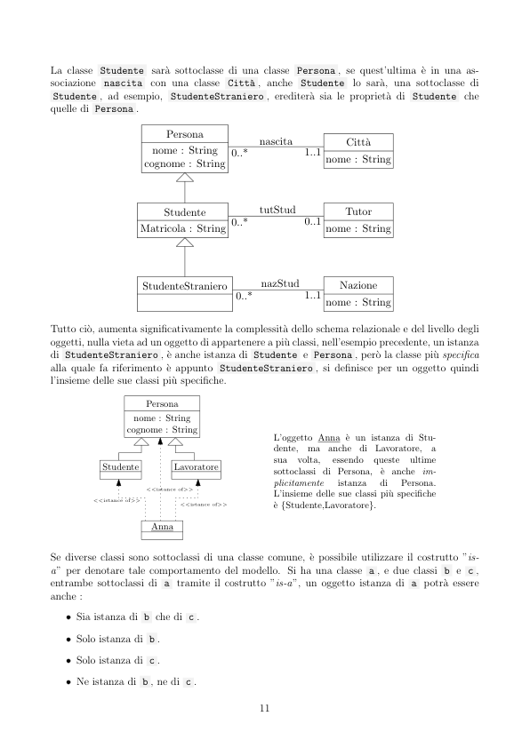

                               Persona
                                                    `e possibile che un oggetto sia
                                                    Studente, Lavoratore, Studente
                                                    e Lavoratore oppure nessuno
                                                    dei due.
                            occupazione
                      Studente
                      Lavoratore
         In questo caso Studente e Lavoratore fanno parte della stessa generalizzazione, ossia
          occupazione , nulla vieta ad una classe di essere superclasse di generalizzazioni distinte :
                                             Persona
                                                             genere
                             occupazione
                      Studente
                      Lavoratore
                                                     Uomo
                                                     Donna
         In questo modello, una Persona pu`o essere : Uomo, Donna, Uomo e Donna, ne Uomo ne Donna,
         e contemporaneamente pu`o essere Studente, Lavoratore, Studente e Lavoratore o nessuno dei
         due. Risulta ambiguo il fatto che una persona possa essere sia uomo che donna, `e necessario
         imporre allo schema, che ogni persona sia o Uomo o Donna, `e possibile considerare dei criteri
         sulle generalizzazioni, che si occupano proprio di gestire queste situazioni.
            ˆ Criterio disjoint - Impone agli oggetti istanza di una classe soggetta a generalizzazione,
              di non poter essere istanza di pi`u di una delle sottoclassi in questione. Se nell’esempio
              precedente, la generalizzazione genere avesse il criterio disjoint, sarebbe impossibile
              essere sia Uomo che Donna, ma sarebbe ancora possibile non essere ne Uomo ne Donna.
            ˆ Criterio complete - Impone agli oggetti istanza di una classe soggetta a generaliz-
              zazione, di dover essere obbligatoriamente istanza di almeno una delle sottoclassi in ques-
              tione. Se nell’esempio precedente, la generalizzazione genere avesse il criterio complete,
              sarebbe impossibile non essere ne Uomo ne Donna, ma sarebbe ancora possibile non essere
              sia Uomo che Donna.
         A seguito di ci`o, `e possibile combinare i diversi criteri per poter permettere ad un istanza di
         persona, di essere necessariamente o Uomo o Donna. Vogliamo quindi che la generalizzazione
         genere consideri entrambi i criteri complete e disjoint, vogliamo invece che la generalizzazione
         ruolo non abbia criteri, in quanto `e possibile che una persona decida di studiare, lavorare, fare
         entrambi o non fare nulla.

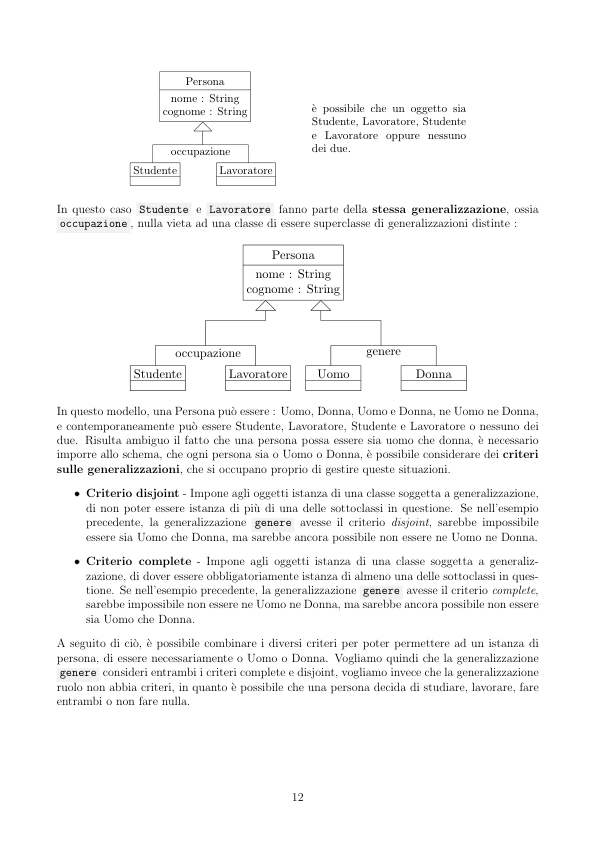

                                Persona
                                                                    i criteri si scrivono sulla
                                                                    linea
                                                                    della
                                                                    generaliz-
                                                                    zazione, chiusi fra delle
                                                                    parentesi graffe
                                            genere
                                            {disj,compl}
                occupazione
          Studente
          Lavoratore
                                       Uomo
                                       Donna
         Ora le possibili combinazioni di persona sono 8 : Studente Uomo, Lavoratore Uomo, Stu-
         dente e Lavoratore Uomo, Nullafacente Uomo, Studente Donna , Lavoratore Donna, Studente
         e Lavoratore Donna e Nullafacente Donna.
                                    {disjoint}
                                    {complete}
                                    {disj,compl}
          A
          B
          A
          B
          A
          B
          A
          B
                                                                             partiziona gli oggetti
         UML permette anche ad una classe di ereditare da pi`u classi, anche se tale scelta potrebbe au-
         mentare troppo la complessit`a del diagramma, e va utilizzata esclusivamente quando necessario,
         molto spesso `e consigliabile procedere diversamente.
                                                    Cavallo
                Animale
                                Mammifero
                                DotatoDiAli
                                                    Pipistrello
         2.5
         Operazioni di Classe
         Una classe ha un nome, degli attributi e delle operazioni, esse definiscono il comportamento
         della classe e differentemente dagli attributi non sono statici.
                            Studenti
                                                                  Corso
                                              votoMedio() : Float in [18,30]
                                              esame
                                              data : Date
                                              voto : 18..30
                    nEsamiFinoA(d:Date) : Int ≥0

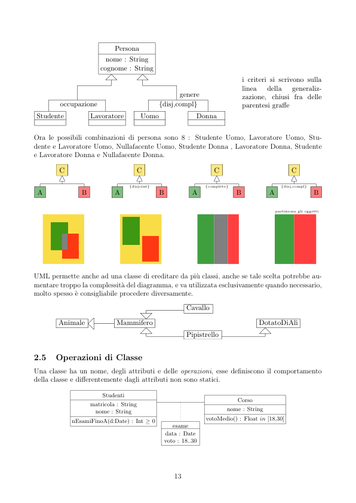

         Un operazione `e una propriet`a il cui valore `e calcolato a partire dai valori dell’oggetto che
         la invoca od altri oggetti ad esso correlati, un operazione pu`a anche cambiare lo stato di un
         oggetto. Quando un operazione modifica un oggetto, si dice che provoca degli effetti collaterali.
         La sintassi `e la seguente, un operazione ha un nome, dopo di ch´e si specificano in delle par-
         entesi tonde i parametri con relativi tipi, alla fine si inserisce il tipo di ritorno dell’operazione.
         L’operazione definita in una classe x viene sempre invocata da un oggetto istanza di x. L’ereditariet`a
         ovviamente, si applica anche alle operazioni.
         in UML quindi vengono definite le operazioni con i loro nomi (evocativi), parametri e tipo di
         ritorno, ma non viene esplicitato in maniera formale cosa queste operazioni devono calcolare.
         La descrizione logica-formale di ci`o che le operazioni devono fare (non come), viene data in un
         documento separato.
         2.6
         Documenti di Specifica
         Tali specifiche hanno lo scopo di affiancare il diagramma UML, e sono contenute in un docu-
         mento separato, un tipo di specifiche gi`a presentate sono le specifiche dei tipi di dato, viste
         nel capitolo 2.2, esistono 4 documenti differenti per le specifiche.
         2.6.1
         Specifica delle Classi
         La specifica delle classi `e un documento che associa ad ogni classe, appunto, una specifica
         formale su ci`o che rappresenta, di cui per ogni operazione `e data la sua descrizione logica-
         matematica, tale specifica pu`o essere scritta in linguaggio umano (informale) ed in linguaggio
         puramente logico (formale), per ora vedremo degli esempi di specifiche informali.
         La specifica di un operazione segue il seguente template :
              nome operazione(parametri) : tipo ritorno
                ˆ pre condizioni
                  . . .
                  . . .
                  . . .
                ˆ post condizioni
                  . . .
                  . . .
                  . . .
         Le specifiche includono alcune parole chiave, come this : L’oggetto invocante, oppure result :
         Il valore di ritorno.
         Le post condizioni danno la definizione matematica dell’operazione e del valore che resti-
         tuiranno, omettendo eventuali meccanismi di calcolo o implementazioni. Deve essere segnalato
         se l’operazione modifica o no il livello degli oggetti (le istanze presenti).
         Le pre condizioni sono le condizioni che devono essere soddisfatte dalle istanze per far si che
         l’operazione possa essere invocata, definiscono il cosiddetto contratto dell’operazione, va anche
         specificato se l’operazione modifica o no il livello degli oggetti.

                                                           Specifica della classe Corso
                                                          rappresenta un corso di laurea di
                                                          cui `e possibile sostenere l’esame.
                               Studenti
                                                                Operazioni :
                                                          Operazioni :
                       n esami fino a(d:Date) : Int ≥0
                                                           votoMedio() : Float in [18,30]
                  esame
                  data : Date
                  voto : 18..30
                                                           pre condizioni
                                                           L’oggetto
                                                           istanza
                                                           di
                                                           Corso
                                                           deve essere coinvolto almeno in
                                                           un link di tipo esame
                                                           post condizioni
                                                           Sia E l’insieme dei link di tipo
                                                           esame in cui `e coinvolta un is-
                                                           tanza di tipo Corso. Sia e(v)
                                                           l’attributo voto di un elemento
                                                           di E, sia S la somma di tutti i
                                                           valori di e(v) per ogni e ∈E.
                                                           Sia N la cardinalit`a di E, il
                                                           valore dell’operazione `e S
                                Corso
                       votoMedio() : Float in [18,30]
                                                                            N .
         2.7
         Specializzazione
         Abbiamo visto come una classe pu`o essere generalizzata, in un rapporto padre-figlio, ossia
         superclasse-sottoclasse, e che la classe figlia eredita gli attributi e le operazioni della classe
         padre, il punto `e che, essa pu`o anche specializzare un attributo desiderato, ossia restringerne il
         dominio, ad esempio:
                      ArticoloInVendita
                                                                ArticoloNuovo
                    garanzia anni : Int ≥0
                                                             codice ean : String
                                                             garanzia anni : Int ≥2
         Nel modello sovrastante, un articolo in vendita potrebbe avere una garanzia valida per zero o
         pi`u anni, ma un articolo nuovo ha una garanzia di minimo due anni, il tipo specializzato deve
         essere un sottotipo, vale a dire che l’insieme dei possibili valori che l’attributo specializzato
         pu`o assumere, deve essere un sotto-insieme dell’insieme dei valori che pu`o assumere l’attributo
         che specializza, si dice che ne restringe il tipo.
         Anche un association class, essendo una classe, pu`o essere specializzata ed essere soggetta a
         generalizzazioni.
                      ArticoloInVendita
                                                                    Utente
                    garanzia anni : Int ≥0
                                                venditore
                                            istante : DateTime
                                             venditoreNuovo
                       ArticoloNuovo
                                                               VenditoreProfessionale
                    codice ean : String
                    garanzia anni : Int ≥2
                                                                partita iva : String

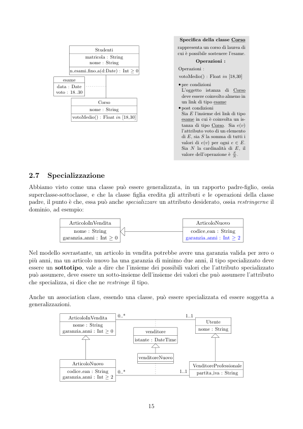

         In questo modello, ogni articolo `e venduto da esattamente un utente, e gli articoli nuovi possono
         essere venduti esclusivamente da venditori professionali. Un articolo nuovo `e in associazione
         con un utente, tale associazione per`o pu`o essere sia venditore che venditoreNuovo, nel secondo
         caso, l’utente deve essere necessariamente un venditore professionale.
         Supponiamo che vi sia una specializzazione di articolo, ossia un articolo in offerta, il calcolo
         del suo prezzo deve essere soggetto ad una riduzione, ha senso che vi siano due differenti oper-
         azioni calcoloPrezzo e calcoloPrezzoOfferta? No, dal momento che `e possibile specializzare un
         operazione, distinguendo le specifiche, eventualmente anche rendendo completamente differenti
         le post-condizioni.
                                                              Specifiche delle operazioni
                         Articolo
                                                   Il prezzo per l’acquisto di ”num” unit`a di un articolo ”x” da
                                                   vendere nella nazione ”naz” `e pari al ”prezzo unitario” di ”x”
                                                   moltiplicato per ”num” sommato al prezzo di spedizione verso
                                                   ”naz”.
                   nome : String
                   prezzo unitario : Float≥0
          calcoloPrezzo(num : Int > 0, naz : Nazione ) : Float ≥0
                                                   Il prezzo per l’acquisto di ”num” unit`a di un articolo ”x” da
                                                   vendere nella nazione ”naz” `e pari al ”prezzo unitario” di ”x”
                                                   moltiplicato per ”num” sommato al prezzo di spedizione verso
                                                   ”naz”, scontato per il fattore ”tasso sconto”.
                      ArticoloInOfferta
                   tasso sconto : Float ∈[0,1]
          calcoloPrezzo(num : Int > 0, naz : Nazione ) : Float ≥0
         L’importante `e che l’operazione specializzata, rispetto a quella che specializza, mantenga:
            ˆ Lo stesso numero e tipo di argomenti.
            ˆ Lo stesso tipo di ritorno, oppure un sotto-tipo del tipo dell’operazione che spacializza.
         2.8
         Specifica dei Vincoli Esterni
         Ci sono delle regole che il solo diagramma UML non pu`o modellare, si definiscono quindi delle
         costrizioni esterne al diagramma, in un documento separato, che hanno lo scopo di restringere
         il possibile livello degli oggetti, con dei requisiti pi`u sofisticati.
                            Impiegato
                                               [V.Dipartimendo.direttore anni afferenza]
                      afferenza
                                               Per
                                               ogni
                                               oggetto
                                               dip:Dipartimento,
                                               sia
                                               dir:Impiegato il direttore di tale dipartimento, tale
                                               che (dir,dip):dirige. Deve essere vero che :
                                  dirige
                     inizio : Date
                                                     (dir,dip).inizio ≤adesso - 5 anni
                           Dipartimento
         In tale modello, voglio far si che i direttori di un dipartimento, ne afferiscano, da almeno 5
         anni, il diagramma UML non permette di modellizzare tale vincolo.
         Un vincolo esterno `e composto da:
            ˆ Un identificatore univoco per riferirsi al vincolo.
            ˆ Un’asserzione matematica/logica, un invariante sui dati, ossia delle condizioni che i dati
              devono necessariamente rispettare.

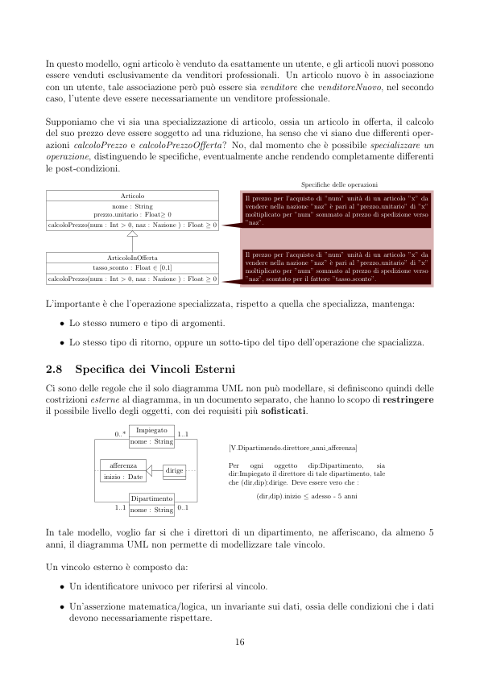

         Per semplicit`a, inizialmente le asserzioni saranno scritte in linguaggio umano. Se un vincolo
         coinvolge una sola classe, per mantenere un certo grado di modularit`a, `e buona norma specificare
         tale vincolo all’interno del documento di specifica della classe in questione.
         2.9
         Diagramma degli Use-Case
         Insieme all’UML, si modella un diagramma che descrive le funzionalit`a che il sistema deve re-
         alizzare, in termini appunti di use-case (scenari di utilizzo), tali use-case possono essere desritti
         come l’insieme omogeneo di funzionalit`a che un determinato gruppo di utenti omogeneo pu`o
         compiere. Tipicamente coinvolge concetti rappresentati da pi`u classi ed associazioni del dia-
         gramma delle classi.
         Definiamo come attore, il ruolo o la categoria che un utente del sistema (oppure un sistema
         esterno) pu`o assumere interagendo con il sistema. Un singolo utente pu`o assumere pi`u ruoli,
         ossia pu`o essere rappresentato da pi`u attori, e diversi utenti possono essere rappresentati dallo
         stesso ruolo, ossia essere rappresentati dallo stesso attore.
              Esempio : Un sistema prevede due attori : Docenti e Studenti. Paolo pu`o essere
              sia Docente che Studente, mentre sia Alice che Giovanni sono entrambi Studenti.
         2.9.1
         Semantica del Diagramma
         UML fornisce il diagramma degli use-case, `e un grafo, in cui:
            ˆ I nodi rappresentano attori e use-case.
            ˆ Gli archi rappresentano:
                – (i) - La possibilit`a per un attore di invocare uno use-case (a quali funzionalit`a pu`o
                  accedere un attore).
                – (ii) - La possibilit`a per uno use-case di invocare un altro use-case.
                – (iii) - La generalizzazione fra attori e fra use-case (verr`a vista in seguito).
         Gli attori sono rappresentati con uno stickman, gli use case da un ellisse.
              strumenti venditori
                                       use-case : insieme omogeneo di funzionalit`a del sistema
                  utilizza
                                       associazione (il nome pu`o essere omesso)
                                       attore : insieme omogeneo di utenti umani (o altri sistemi esterni)
                  utente
         Attenzione : Il fatto che esista un attore Utente non implica necessariamente l’esistenza di un
         una classe Utente nel diagramma delle classi, avremmo la gi`a citata classe Utente esclusivamente
         se il sistema deve rappresentare dei dati (attributi) sugli utenti.
         Vediamo adesso un Esempio di un diagramma degli use-case. Si hanno le seguenti specifiche:

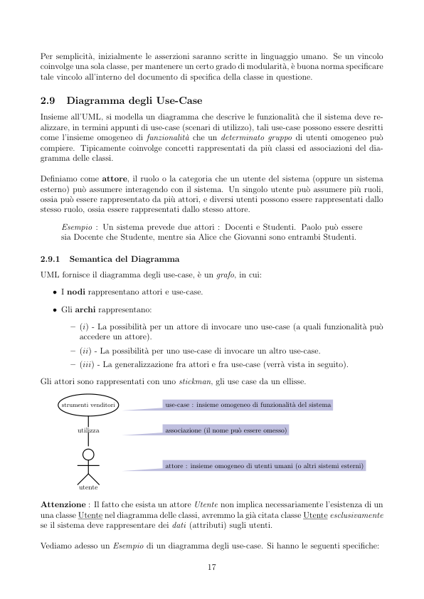

              Il sistema deve permettere agli studenti di iscriversi, via web, ai corsi offerti. La
              segreteria deve poter assegnare i docenti ai singoli corsi. I docenti devono poter
              inserire i risultati dei test degli studenti: tali test sono somministrati agli studenti
              utilizzando il sistema.
                       effettua iscrizione
                                    Gestione iscrizioni
                                   valuta
                                   effettua test
              Studente
                                                      Gestione test
                                                                               Docente
                       assegna docente
                                    Gestione docenti
             Segreteria
         Note sugli use-case:
            ˆ Gestione iscrizioni : funzionalit`a che permettono l’iscrizione via web da parte degli stu-
              denti.
            ˆ Gestione test : funzionalit`a che permettono la creazione, la somministrazione e la valu-
              tazione dei test.
            ˆ Gestione docenti : funzionalit`a che permettono l’assegnazione dei docenti ai corsi.
         Ogni singolo utente che si interfaccia/interagisce con il sistema modellato deve necessariamente
         assumere uno fra questi ruoli. Anche se esiste l’attore Segreteria, nel diagramma delle classi
         potrebbe non esistere alcuna classe Segreteria, in quanto di essa non `e necessario salvare alcuna
         informazione.
         Nel diagramma sovrastante sorge un problema, sia l’attore Studente che Docente hanno accesso
         a tutte le funzionalit`a dello use-case Gestione test, e non solamente a quelle che li riguardano.
         Nel diagramma, il concetto di Inclusione, permette ad uno use-case di utilizzare alcune delle
         funzionalit`a di un altro use-case.
                                     <<include>>
                                     <<include>>
                valuta
                effettua test
                somministrazione test
                creazione e
                valutazione test
                                                Gestione test
                                                                                     Docente
         Studente
         In questo modello, l’attore Docente come l’attore Studente ha un accesso limitato alle fun-
         zionalit`a dello use-case Gestione test, i docenti potranno creare e valutare i test, e gli studenti
         potranno parteciparvi, Gestione test include le funzionalit`a che permettono la memorizzazione
         nel sistema dei test e delle risposte degli studenti.
         Ci sono delle situazioni in cui uno use-case, eredit`a le funzionalit`a di un’altro use-case, aggiun-
         gendone di nuove, tale concetto prende il nome di Estensione. Riguardo il modello precedente,
         supponiamo che uno studente che si iscrive ad un test, ha anche la possibilit`a, se volente, di pa-
         gare online, lo use-case Iscrizione verr`a quindi esteso. Il pagamento online `e un caso particolare
         di iscrizione.

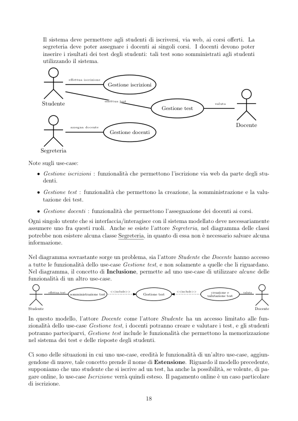

                         effettua iscrizione
                                                       Pagamento online
                                                       <<extend>>
                                      Gestione iscrizioni
                 Studente
         Alcuno funzionalit`a di uno use-case, in alcuni casi particolari, possono essere rimpiazzate con le
         funzionalit`a di un’altro use-case, `e possibilie generalizzare uno use-case. Supponiamo che gli
         studenti devono potersi identificare, e tale identificazione pu`o avvenire tramite una password,
         oppure tramite un accesso biometrico (impronta digitale o iride):
                                                                  Controllo password
                                       Identificazione
                 Studente
                                                                  Accesso biometrico
         Nota : nei diagrammi degli use-case non possiamo usare generalizzazioni uniche che coinvolgono
         pi`u sotto-usecase, n´e tantomeno vincoli {disjoint} e {complete}.
         Un’altra possibilit`a, `e quella di far si che un attore ”erediti” tutte le associazioni di un altro
         attore, potendo invocare i suoi use-case, `e possibile generalizzare un attore. Supponiamo
         che in un sistema, i manager possano fare le veci della segreteria ed accedere a gli use-case ad
         essa dedicati:
                                          assegna docente
                                                             Gestione docenti
                         Segreteria
                                                            Analisi economiche
                          Manager
         In questo modello un manager eredita le funzionalit`a della segreteria, e pu`o anche esso gestire
         i corsi dei docenti.
         Attenzione : Il diagramma non implica che esistano le classi Segreteria e Manager nel dia-
         gramma delle classi, n´e tantomeno che la classe Manager sia una sottoclasse di Segreteria.
         2.9.2
         Specifiche degli Use-Case
         Il diagramma UML degli use-case `e semplice e poco elaborato, pi`u semplice del diagramma
         delle classi in termini di quantit`a dei costrutti, da una visione di alto livello riguardo:

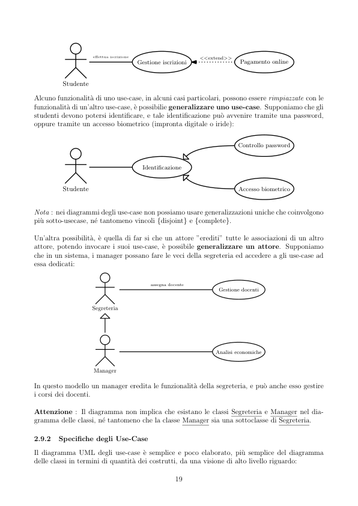

            ˆ Quali sono gli attori che possono interagire con il sistema.
            ˆ A quali macro-funzionalit`a gli attori definiti possono accedere.
         Definiscono come tali macro-funzionalit`a sono organizzate e modularizzate, deve essere un
         diagramma comprensibile per il committente, e non definisce le singole operazioni all’interno di
         ogni use-case, de facto, ogni singolo use-case deve essere affiancato da un apposito documento
         di specifica dettagliato.
         Le operazioni degli use-case, non presentano alcun oggetto di invocazione, possono come le
         operazioni di classe, non avere alcun tipo di ritorno, si guardi il seguente esempio:
                                                                      Studente
          Specifica dello use-case Iscrizione
          iscrizione ( mat : Int>0, nome : String) : Studente
          pre-condizioni:
          - non esiste alcun oggetto di classe Studente con valore “mat”
          per l’attributo matricola.
          post-condizioni:
          -viene creato e restituito un nuovo oggetto result:Studente
          con i valori “mat” e “nome” per, rispettivamente, gli at-
          tributi matricola e nome.
          ...
          (specifica delle altre operazioni dello use-case)
                                                                 matricola : Int > 0 {id}
                                                           media fino a(d:Date) : Float ∈[18,30]
                                                                                  Esame
                                                                      data : Date
                                                                      voto : 18..30
                                                                        Corso
                                                              voto medio() : Float ∈[18,30]
          Specifica dello use-case Verbalizzazione
          verbalizza ( s : Studente, c : Corso, d : Date, v : 18..30)
          pre-condizioni:
          - Non esiste gi`a un link (s,c) dell’associazione ”esame” .
          post-condizioni:
          - viene creato il link (s,c) di assoc. “esame”, con valori “d”
          e “v” per gli attributi “data” e “voto”.
          ...
          (specifica delle altre operazioni dello use-case)
                                                                                Iscrizione
                                                               Studente
                                                                              Verbalizzazione
                                                               Docente
         Si noti come nel diagramma delle classi non esiste alcuna classe Docente nonostante esista il
         medesimo attore, questo perch`e il sistema non richiede di memorizzare le informazioni relative
         ai docenti.
         Logica di Primo Ordine
         Una logica, `e una famiglia di linguaggi formali, che ha lo scopo di rappresentare l’informazione
         e manipolare la conoscenza. Ogni logica `e fornita di una sintassi e di una semantica, la
         sintassi definisce una serie di simboli e la struttura che le formule devono assumere per essere
         considerate valide, la semantica definisce il significato di tali formule.
         Nelle logiche classiche, ogni formula, in base al ”mondo” sulla quale `e applicata, pu`o essere
         vera oppure false. Per definire la sintassi devo stabilire:
            ˆ Quali simboli posso utilizzare (l’alfabeto)
            ˆ Quali sequenze finite di simboli possono comporre una formula

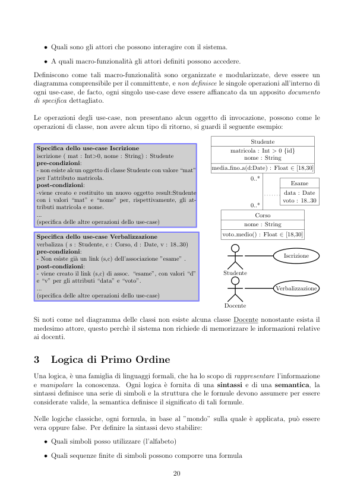

         La semantica invece stabilisce la verit`a delle formule nei cosiddetti ”mondi” possibili, ossia le
         interpretazioni. Nella logica di primo ordine, detta anche FOL si stabilisce
            ˆ Sintassi
            ˆ Semantica
                – Interpretazione
                – Assegnamento delle variabili
                – Modello
                – Valutazione di una formula
            ˆ Soddisfacibilit`a
            ˆ Insoddisfacibilit`a
            ˆ Validit`a
         3.1
         Sintassi della FOL
         La logica di primo ordine segue la seguente sintassi, vi sono :
            ˆ un insieme V di variabili
            ˆ un insieme F di simboli di funzione, dove ognuno di essi ha associata la sua arit`a
            ˆ un insieme P di simboli di predicato, dove ognuno di essi ha associata la sua arit`a
            ˆ dei connettivi logici, ossia : ¬, ∧, ∨, →, ↔
            ˆ dei quantificatori, universale ∀ed esistenziale ∃
            ˆ altri simboli speciali come la virgola
         L’arit`a dei simboli di funzione e dei simboli di predicato `e il numero di parametri/argomenti che
         accettano, un simbolo di funzione f di arit`a 1 si denota f/1. Ad esempio, definisco il simbolo di
         funzione succ/1, che associa ad ogni numero intero il suo successivo, se x ∈N, succ(x) = x + 1.
         I simboli di funzione servono ad identificare degli oggetti del mondo, dati degli argomenti, che
         sono oggetti del mondo, restituiscono un altro oggetto del mondo, i simboli di funzioni di arit`a
         0 sono detti simboli di costante. I simboli di predicato invece, definiscono delle propriet`a, dati
         degli argomenti, un simbolo di predicato pu`o essere vero o falso, ad esempio, per il simbolo
         doppio/2, risulta che doppio(x, y) = True ⇐⇒x = 2 · y.
         Un altro esempio pu`o essere un simbolo di predicato uomo/1 che `e vero se e solo se l’argomento
         passato `e un uomo, ma chi decide se un oggetto del mondo `e un uomo o no? E chi decide qual’`e
         la funzione effettiva associata ad un simbolo di funzione? Ci`o verr`a visto in seguito nel capitolo
         riguardante l’interpretazione.
         Una formula nella FOL si divide in due piani, il linguaggio dei termini ed il linguaggio delle
         formule.

            Definizione di termine
            ˆ Ogni variabile `e un termine
            ˆ Ogni simbolo di funzione di arit`a 0 `e un termine
            ˆ Se f/n `e un simbolo di funzione, dove n ≥1, e t1, t2 . . . , tn sono dei termini, allora anche
              f(t1, t2 . . . , tn) `e un termine.
         Consideriamo il seguente esempio
                     F = {zero/0, succ/1, socrate/0, padre/1}
                     V = {MiaV ar, X}
         I seguenti sono dei termini
                                   zero
                                   padre(padre(socrate))
                                   MiaV ar
                                   padre(succ(X))
                                   succ(zero)
                                   succ(succ(zero))
         Definizione di formula
            ˆ Se p/n `e un simbolo di predicato e t1, t2 . . . , tn sono dei termini, allora p(t1, t2 . . . , tn) `e
              una formula (atomica).
            ˆ Se ϕ e φ sono due formule, allora anche le seguenti sono formule
                – (ϕ)
                ϕ ∨φ
                ϕ →φ
                – ¬ϕ
                φ ∧ϕ
                ϕ ↔φ
            ˆ Se ϕ `e una formula e X `e una variabile, allora anche le seguenti sono formule
                                               ∀Xϕ
                                               ∃Xϕ
         Esiste un simbolo di predicato speciale, utilizzabile in ogni formula, ossia = /2, se x ed y sono
         identici, ossia sono lo stesso oggetto del mondo, allora = (x, y) sar`a vera, per comodit`a, tale
         simbolo verr`a utilizzato scrivendo x = y piuttosto che = (x, y). Analogamente, verr`a utilizzato
         x̸ = y piuttosto che ¬ = (x, y).
         Consideriamo il seguente esempio
         F = {zero/0, succ/1, socrate/0, padre/1}
         P = {doppio/2, somma/3, uomo/1, mortale/1}
         Le seguenti sequenze di simboli sono formule
         doppio(succ(succ(zero)), X)
         ∃Xdoppio(succ(succ(zero)), X)
         ∀Xdoppio(succ(succ(zero)), X)
         somma(succ(zero), zero, succ(zero))
         ∀X∀Y somma(X, X, Y )ßdoppio(X, Y )
         mortale(socrate)
         (∀X∃Y doppio(X, Y ))∧(∀I∀J∃Ksomma(I, J, K))
         mortale(socrate)∧mortale(padre(socrate))

         3.2
         Semantica della FOL
         La verit`a di una formula e dei predicati dipendono dal mondo in cui sono espressi, nella logica
         proposizionale:
                                         (
                                          `e vera se A = 1, B = 1, C = 1
                                          `e false se C = 0
                            (A ∨¬B) ∧C
         Bisogna definire la nozione di interpretazione, essa fornisce i valori di base per i predicati e per
         i termini. Tutte le formule atomiche sono le cosiddette lettere proposizionali, l’interpretazione `e
         una funzione I che associa ad ogni lettera proposizionale un valore di verit`a, la pre-interpretazione
         riguarda l’interpretazione dei termini.
         Consideriamo i seguenti simboli
                          F = {socrate/0, padre/1}
                          P = {Uomo/1, Mortale/0}
         Per valutare la formula
                         (∀XUomo(X) →Mortale(padre(X))) ∧Uomo(socrate)
         Bisogna fornire un insieme D di oggetti del dominio, una corrispondenza fra i simboli di funzione
         e funzioni effettive su D, ed una corrispondenza fra le variabili e gli elementi di D.
         Le funzioni nella FOL sono totali, ogni singolo elemento del dominio D pu`o essere valutato da
         una funzione associata al relativo simbolo di funzione, data un’interpretazione, una volta risolti
         tutti i termini, `e possibile valutare qualsiasi formula complessa.
         I simboli di predicato sono definiscono delle relazioni matematiche su Dn dove n `e l’arit`a del
         simbolo in questione. Un simbolo di predicato risulta vero se gli oggetti del dominio coinvolti
         sono contenuti nella relazione associata al simbolo, si consideri il seguente esempio
                                            D = {a, b, c}
                         P = {p/2}
                         la relazione associata a p `e p = {(a, b), (b, c)}
                          p(a, b) = True
                          p(a, c) = False
                          p(b, c) = True
         Vediamo adesso um esempio esaustivo, si considerino i seguenti simboli:
               F = {pippo/0, pluto/2, ciro/0}
               P = {Paperino/2, Ugo/0}
               V = {X, Y }
         Considero la formula sintatticamente corretta:
                    Paperino(pippo, pluto(X, pippo)) →¬(Ugo ∨Paperino(pippo, ciro))
         Per valutarla, necessito di un intepretazione I, considero il seguente dominio
                                           D = {a, b, c, d}
         Definisco ora le funzioni associate all’interpretazione I
                                 I(pippo) : D0 →D tale che pippo() = d
                                  I(ciro) : D0 →D tale che ciro() = a

                                      I(pluto) : D2 →D tale che
                                 pluto(a, a) = a
                                 pluto(b, c) = a
                                 pluto(a, b) = a
                                 pluto(b, d) = a
                                 pluto(a, c) = a
                                 pluto(c, c) = d
                                 pluto(a, d) = b
                                 pluto(c, d) = d
                                 pluto(b, b) = c
                                 pluto(d, d) = a
         Assegno le variabili
                                      I(X) = c
                                      I(Y ) = c
         A questo punto, definisco le relazioni associate ai simboli di predicato
                          Paperino = {(a, b), (b, b), (d, d)} `e una relazione su D2
         Ugo `e una relazione su D0, questi simboli di predicato hanno un valore fisso, sono o veri o falsi,
         in questo caso, definisco Ugo = True. A questo punto posso interpretare la formula
         Paperino(pippo, pluto(X, pippo)) →¬(Ugo ∨Paperino(pippo, ciro))
         Paperino(d, d) →¬(Ugo ∨Paperino(d, a))
         True →¬(True ∨False)
         True →¬(True)
         True →False
         False
         3.3
         Valutazione dei Termini

         Progettazione di Basi di Dati
         Una volta aver definito lo schema concettuale del sistema da realizzare, `e possibile derivarne
         una base di dati in pochi passaggi, tramite una metodologia precisa e delineata. Il processo di
         ”trasformazione” dal diagramma UML (con relativi vincoli) ad una base di dati, `e suddiviso in
         tre passaggi
           1. Far corrispondere ogni tipo di dato concettuale ad un tipo di dato implementato nel
           DBMS.
           2. Progettazione dello schema relazionale, tenendo conto dei vincoli.
           3. Progettazione delle specifiche realizzative inerenti alle operazioni di UseCase e classi.
                                                     Back End
                                         A
                                         P
                                                 Logica
                                                 applicazione
                        Front End
                                         I
                                                                  DBMS
         Quindi, dato in input un diagramma UML, si vuole definire una base di dati, si osservi il
         seguente esempio:
         input :
                                                esame
                                              -data : Data
                            Studente
                                                                  Corso
                        -matricola : Intero {id}
                        -nome : Stringa
                                                              -nome : Stringa {id}
         output :
          tabella Studente(matricola :
          integer, nome :
          varchar)
          tabella Corso(nome :
          varchar)
          tabella esame(studente :
          integer, corso :
          varchar, data :
          Data)
              foreign key studente references Studente(matricola)
              foreign key corso references Corso(nome)
         Scrivere manualmente la base di dati a partire dal diagramma UML comporta un rischio di
         errore maggiore, verr`a utilizzata una metodologia scalabile e robusta, suddivisa in due fasi:
           1. Ristrutturazione
           2. Traduzione diretta

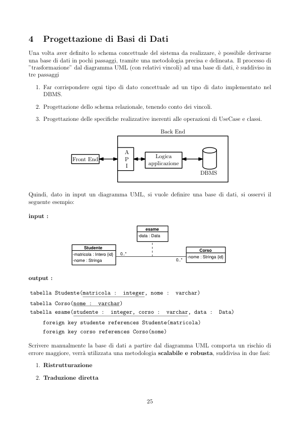

         4.1
         Ristrutturazione del Diagramma delle Classi
         La ristrutturazione, consiste nel definire un nuovo diagramma delle classi, adatto all’implementazione
         su una base di dati, tale diagramma, rispetter`a le seguenti propriet`a
            ˆ Definisce solamente classi le cui istanze saranno memorizzate sulla base di dati
            ˆ Non comprende operazioni di classe
            ˆ Risulta equivalente all’originale, ossia, rappresenta gli stessi livelli estensionali del dia-
              gramma di partenza, anche se diverso nella struttura
            ˆ Contiene i costrutti pi`u semplici del UML, ovvero
                – classe
                – associazione
                – attributi i cui tipi di dato, sono anche disponibili nel linguaggio SQL
                – molteplicit`a degli attributi, al massimo pari ad 1
         La ristrutturazione, `e composta da 6 passi fondamentali:
           1. Eliminazione di attributi multivalore
           2. Sostituzione dei tipi di dato
           3. Eliminazione delle generalizzazioni tra classi ed associazioni
           4. Definizione degli identificatori per ogni classe
           5. Selezione di un identificatore primario per ogni classe
         4.1.1
         Procedimento della Ristrutturazione
         PASSO 1
         Il primo passo consiste nel rimuovere dallo schema tutti quegli attributi, la cui molteplicit`a
         risulta superiore ad 1, in quanto un database relazionale non pu`o gestire attributi multivalore.
         Gli attributi multi valore, diventeranno una classe separata, la cui classe originale proprietaria
         sar`a collegata tramite un associazione, di molteplicit`a uguale a quella dell’attributo ormai
         eliminato.
             Studente
                                                StudenteNew
                                                             IndirizzoEmail
                                                             1..*
                                                             x..y
          -matricola : Intero {id}
          -nome : Stringa
          -email : Stringa [x..y]
                                                                  email
                                             -matricola : Intero {id}
                                             -nome : Stringa
                                                                            -valore : Stringa {id}
         Si abusa quindi del concetto di classe per adattare il diagramma alla tecnologia delle basi di
         dati relazionali.
         PASSO 2
         A questo punto, si vogliono eliminare tutti i tipi di dato concettuali, per sostituirli con dei tipi
         di dato esistenti ed implementati nel DBMS, per i tipi di dato di base, come i numeri interi o
         le stringhe, vi `e un immediata corrispondenza, ad esempio

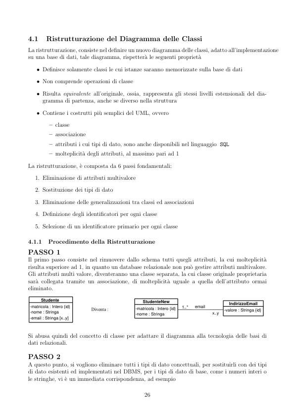

                                        Stringa ←→varchar
         Tutti i tipi di dato specializzati, necessiteranno di un tipo di dato nuovo, utilizzando il costrutto
          CREATE DOMAIN di SQL , per i tipi di dato enumerativi, sar`a necessario il costrutto CREATE TYPE .
             Studente
                                        StudenteNew
          -matricola : Intero {id}
          -nome : Stringa
          -genere : {m,f}
          -età : 18..99
                                     -matricola : integer {id}
                                     -nome : varchar(100)
                                     -genere : Genere
                                     -età : Age
         PASSO 3
         Questo passo risulta il pi`u ”ostico”, vogliamo modificare il nostro schema in modo che non
         contenga alcuna relazione is-a, ne fra classi, ne fra associazioni, dato che quest’ultime non sono
         supportate dal DBMS.
         Iniziamo con le generalizzazioni fra classi, esistono tre diversi approcci per liberarsene, ogni
         approccio, favorisce la scrittura e la velocit`a di esecuzione di una certa categoria di query,
         sfavorendone altre, colui che esegue la ristrutturazione, deve saper riconoscere quale approccio
         pu`o essere pi`u efficace a seconda dell’operazione.
            ˆ Fusione : Tale approccio prevede, il collasso di un insieme di sottoclassi nella superclasse,
              aumentando l’insieme di attributi della superclasse, in modo tale da poter distinguere ogni
              istanza di tale classe (ormai unica).
              Sar`a quindi l’insieme di attributi (o relazioni) di ogni istanza a definire se un oggetto
              appartiene ad una certa categoria o ad un altra (precedentemente, definito dalla relazione
              is-a). Dopo aver fuso le classi, `e necessaria la definizione di nuovi necessari vincoli esterni.
                           Persona
                                                                             PersonaNew
                        -nome : varchar(100)
                                                                         -nome : varchar(100)
                                                                         -tipo : TipoPersona
                                                                         -matricola : varchar(12)[0..1]
                                                                         -nascita : Date[0..1]
                            {disj}
                                      Studente
                  Docente
                                   -matricola : varchar(12)
                -nascita : Date
                                                                        afferenza
                                                                        iscritto
                  afferenza
                  iscritto
                                                                   DipartimentoNew
                                                                                   CorsoDiLaureaNew
                                                                   -nome : varchar(100)
                                                                                  -nome : varchar(100)
                 Dipartimento
                                     CorsoDiLaurea
               -nome : varchar(100)
                                   -nome : varchar(100)
              Vanno considerati i nuovi vincoli esterni :
                1. ∀p PersonaNew(p) →[tipo(p,′ Studente′) ↔∃m matricola(p, m)]
                2. ∀p PersonaNew(p) →[tipo(p,′ Studente′) ↔∃c iscritto(c, p)]
                3. ∀p PersonaNew(p) →[tipo(p,′ Docente′) ↔∃n nascita(p, n)]
                4. ∀p PersonaNew(p) →[tipo(p,′ Docente′) ↔∃d afferenza(d, p)]
              Quindi, l’approccio tramite fusione, comporta l’aggiunta di svariati vincoli esterni.

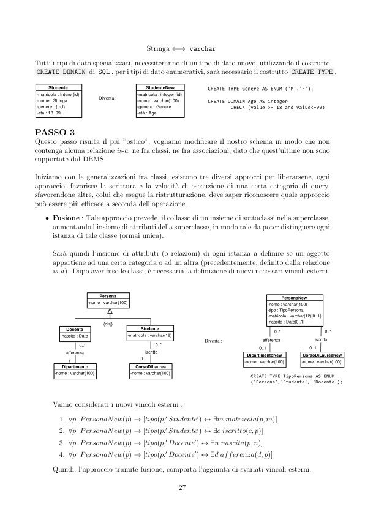

            ˆ Divisione in classi disgiunte : Tale approccio, prevede l’eliminazione di una super-
              classe, facendo vivere in maniera indipendente, quelle che prima erano sottoclassi, che
              dovranno ereditare tutti gli attributi e le associazioni, prima specificate nella superclasse,
              comportando ridondanza.
                             Città
                          -nome : varchar(100)
                                                                        CittàNew
                                                                      -nome : varchar(100)
                             residenza
                                                                res_stud
                                                                res_doc
                            Persona
                         -nome : varchar(100)
                         -cd : CodiceFiscale {id}
                                                                DocenteNEW
                                                                              StudenteNEW
                                                              -cf : CodiceFiscale {id}
                                                              -nome : varchar(100)
                                                                            -nome : varchar(100)
                                                                            -cf : CodiceFiscale {id}
                                                                            -matricola : varchar(12)
                            {disj,compl}
                                     Studente
                     Docente
                                  -matricola : varchar(12)
                   -nascita : Date
                                                               iscritto
                                                               afferenza
                     afferenza
                     iscritto
                                                              DipartimentoNew
                                                                            CorsoDiLaureaNew
                                                              -nome : varchar(100)
                                                                            -nome : varchar(100)
                    Dipartimento
                                    CorsoDiLaurea
                  -nome : varchar(100)
                                   -nome : varchar(100)
              Riguardo l’esempio sovrastante : Se nel diagramma originale non potevano coesistere uno
              studente ed un docente con lo stesso codice fiscale, nel nuovo diagramma, ci`o pu`o accadere,
              `e quindi necessario, quando vi sono degli identificatori nella superclasse eliminata, definire
              dei nuovi vincoli che impongano l’unicit`a delle istanze riguardo gli attributi univoci.
                     ¬∃s, d, v StudenteNew(s) ∧DocenteNew(d) ∧cf(s, v) ∧cf(d, v)
              Questo approccio necessita quindi di vincoli per recuperare la semantica del vincolo di
              identificazione concettuale nelle superclassi eliminate.
              Tale approccio va utilizzato con cautela, se saranno necessarie query che comprendono
              la consultazione di tutte le istanze della superclasse ormai eliminata, sar`a necessario
              eseguire un JOIN fra le istanze delle classi (ex-sottoclassi). Com’`e di facile intuizione,
              tale approccio risulta sensato se applicato a generalizzazioni {disjoint,complete}.
            ˆ Sostituzione con associazioni : Quest’ultimo approccio risulta, nella pratica, il pi`u
              utilizzato, in quanto riesce a mantenere la struttura del diagramma, il pi`u simile possi-
              bile a quella del diagramma originale, si tratta del sostituire le relazioni is-a con delle
              associazioni.
                                                                      PersonaNew
                             Persona
                                                                1..1 {id}
                                                                1..1{id}
                                                                    -nome : varchar(100)
                          -nome : varchar(100)
                                                                s_isa_p
                                                                d_isa_p
                                     Studente
                                                               DocenteNEW
                     Docente
                                                                             StudenteNEW
                                  -matricola : varchar(12)
                                                                            -matricola : varchar(12)
                   -nascita : Date
                     iscritto
                     afferenza
                     afferenza
                     iscritto
                                                              DipartimentoNew
                                                                            CorsoDiLaureaNew
                    Dipartimento
                                    CorsoDiLaurea
                                                             -nome : varchar(100)
                                                                            -nome : varchar(100)
                  -nome : varchar(100)
                                   -nome : varchar(100)

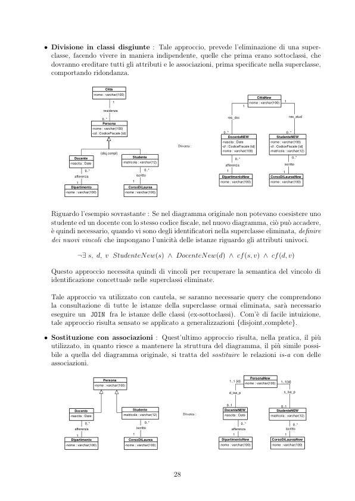

              Si noti come la struttura sia perfettamente mantenuta, e sia necessario che le associazioni
              che modellano l’ex relazione is-a, comprendano il vincolo di identificazione (un docente
              non pu`o essere due persone diverse).
              Se la generalizzazione comprende dei vincoli complete e/o disjoint, `e necessaria l’aggiunta
              di nuovi vincoli esterni, ad esempio, se la relazione dell’immagine sovrastante fosse dis-
              joint, sarebbe necessario imporre la non-esistenza di un’istanza di PersonaNew, che ha un
              link sia verso un istanza di DocenteNew, sia verso un istanza di StudenteNew.
                                                                       PersonaNew
                           Persona
                                                                 1..1 {id}
                                                                 1..1{id}
                                                                     -nome : varchar(100)
                         -nome : varchar(100)
                                                                 s_isa_p
                                                                 d_isa_p
                           {disjoint}
                                    Studente
                                                               DocenteNEW
                                                                               StudenteNEW
                   Docente
                                 -matricola : varchar(12)
                 -nascita : Date
                                                                             -matricola : varchar(12)
                   iscritto
                   afferenza
                   afferenza
                   iscritto
                                                               DipartimentoNew
                                                                              CorsoDiLaureaNew
                  Dipartimento
                                   CorsoDiLaurea
                                                              -nome : varchar(100)
                                                                             -nome : varchar(100)
                -nome : varchar(100)
                                  -nome : varchar(100)
                            ¬∃p, s, d
                            PersonaNew(p) ∧StudenteNew(s) ∧DocenteNew(d)
                                        ∧s isa p(s, p) ∧d isa p(d, p)
              Nel caso del vincolo complete, `e necessario specificare che ogni istanza di PersonaNew, `e
              almeno associata, o ad un’istanza di StudenteNew, oppure ad un istanza di DocenteNew.
                                                                       PersonaNew
                           Persona
                                                                 1..1 {id}
                                                                 1..1{id}
                                                                     -nome : varchar(100)
                         -nome : varchar(100)
                                                                 s_isa_p
                                                                 d_isa_p
                          {complete}
                                    Studente
                                                               DocenteNEW
                                                                               StudenteNEW
                   Docente
                                 -matricola : varchar(12)
                                                                             -matricola : varchar(12)
                 -nascita : Date
                   iscritto
                   afferenza
                   afferenza
                   iscritto
                  Dipartimento
                                   CorsoDiLaurea
                                                               DipartimentoNew
                                                                              CorsoDiLaureaNew
                -nome : varchar(100)
                                  -nome : varchar(100)
                                                              -nome : varchar(100)
                                                                             -nome : varchar(100)
                          ∀p PersonaNew(p) →[∃s s isa p(s, p)] ∨[∃d d isa p(d, p)]
              Com’`e di facile intuizione, in una generalizzazione {disjoint,complete} saranno necessari
              entrambi i vincoli.

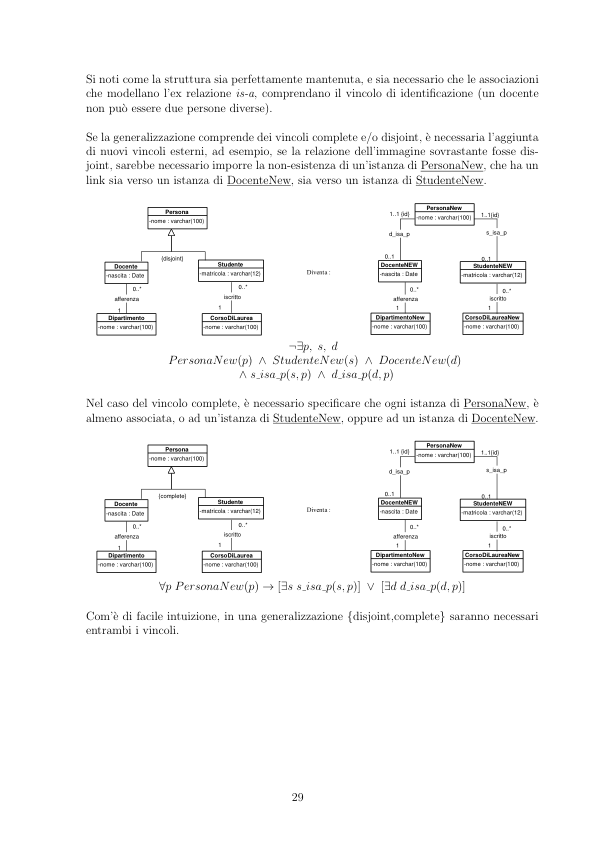
