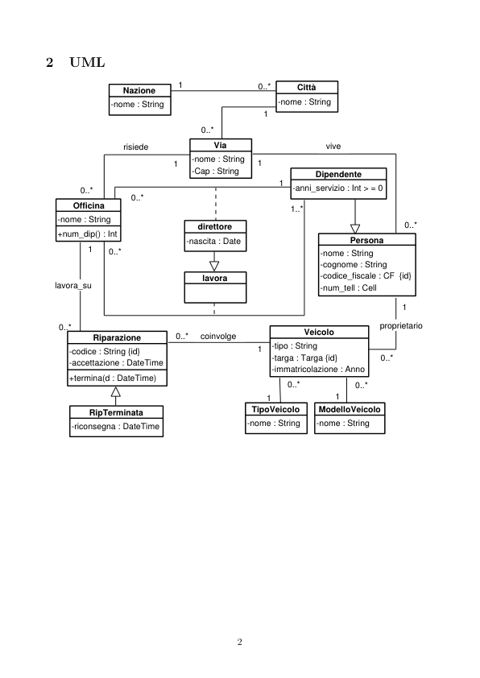
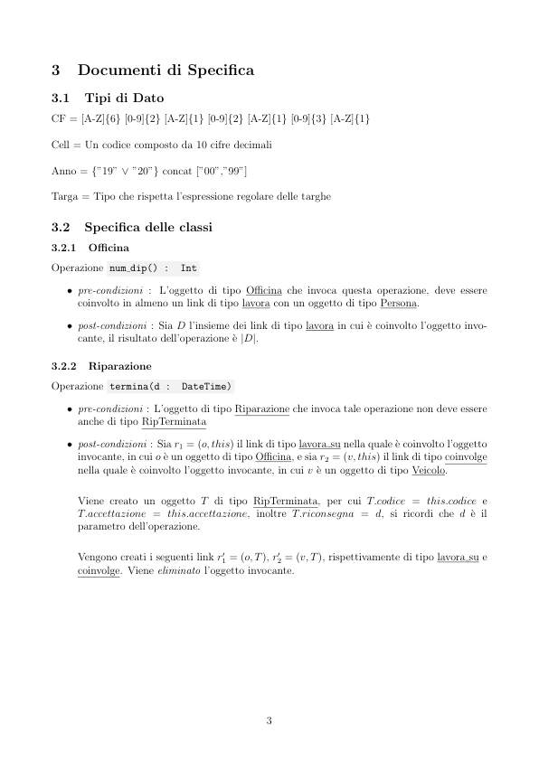

# Officine 1

> Fonte: `Officine 1.pdf`
> Estratto con PyMuPDF (conserva legature e formule); tolte le righe ripetute di intestazione e pie' di pagina e le etichette sparse dei diagrammi, che sono ritagliati in `figure/` e richiamati nel punto in cui compaiono.

---

Officine 1 (gruppo 42)
         Requisiti
           1. Persona
               1.1 nome
               1.2 cognome
               1.3 codice fiscale
               1.4 indirizzo
               1.5 numero di telefono
               1.6 lavora nell’officina?
                 1.6.1 anni di servizio
                 1.6.2 impiegato?
                 1.6.3 direttore?
                 1.6.3.1 data di nascita
               1.7 `e proprietario di auto?
                 1.7.1 auto in riparazione
           2. Auto
               2.1 modello
               2.2 tipo
               2.3 targa
               2.4 anno di immatricolazione
               2.5 proprietario
           3. Officina
               3.1 nome
               3.2 indirizzo
               3.3 numero dipendenti
           4. Riparazione
               4.1 veicolo coinvolto
               4.2 codice univoco
               4.3 data ed ora accettazione
               4.4 data ed ora riconsegna (se la riparazione `e terminata)

         UML
                                                             Città
                         Nazione
                                            Via
                         risiede
                         vive
                                       -Cap : String
                                                                 Dipendente
                                                             -anni_servizio : Int > = 0
                0..*
               Officina
                                                            1..*
            -nome : String
                                         direttore
            +num_dip() : Int
                                                                         Persona
                                      -nascita : Date
                  0..*
                                                                  -cognome : String
                                                                  -codice_fiscale : CF  {id}
                                                                  -num_tell : Cell
                                          lavora
           lavora_su
                                         proprietario
                                         coinvolge
            0..*
                                                               Veicolo
                   Riparazione
                                                        -tipo : String
                                                        -targa : Targa {id}
                                                        -immatricolazione : Anno
              -codice : String {id}
              -accettazione : DateTime
              +termina(d : DateTime)
                                                    TipoVeicolo
                                                                  ModelloVeicolo
                  RipTerminata
              -riconsegna : DateTime

         Documenti di Specifica
         3.1
         Tipi di Dato
         CF = [A-Z]{6} [0-9]{2} [A-Z]{1} [0-9]{2} [A-Z]{1} [0-9]{3} [A-Z]{1}
         Cell = Un codice composto da 10 cifre decimali
         Anno = {”19” ∨”20”} concat [”00”,”99”]
         Targa = Tipo che rispetta l’espressione regolare delle targhe
         3.2
         Specifica delle classi
         3.2.1
         Officina
         Operazione num dip() :
         Int
            ˆ pre-condizioni : L’oggetto di tipo Officina che invoca questa operazione, deve essere
              coinvolto in almeno un link di tipo lavora con un oggetto di tipo Persona.
            ˆ post-condizioni : Sia D l’insieme dei link di tipo lavora in cui `e coinvolto l’oggetto invo-
              cante, il risultato dell’operazione `e |D|.
         3.2.2
         Riparazione
         Operazione termina(d :
         DateTime)
            ˆ pre-condizioni : L’oggetto di tipo Riparazione che invoca tale operazione non deve essere
              anche di tipo RipTerminata
            ˆ post-condizioni : Sia r1 = (o, this) il link di tipo lavora su nella quale `e coinvolto l’oggetto
              invocante, in cui o `e un oggetto di tipo Officina, e sia r2 = (v, this) il link di tipo coinvolge
              nella quale `e coinvolto l’oggetto invocante, in cui v `e un oggetto di tipo Veicolo.
              Viene creato un oggetto T di tipo RipTerminata, per cui T.codice = this.codice e
              T.accettazione = this.accettazione, inoltre T.riconsegna = d, si ricordi che d `e il
              parametro dell’operazione.
              1 = (o, T), r′
              2 = (v, T), rispettivamente di tipo lavora su e
              coinvolge. Viene eliminato l’oggetto invocante.
              Vengono creati i seguenti link r′

