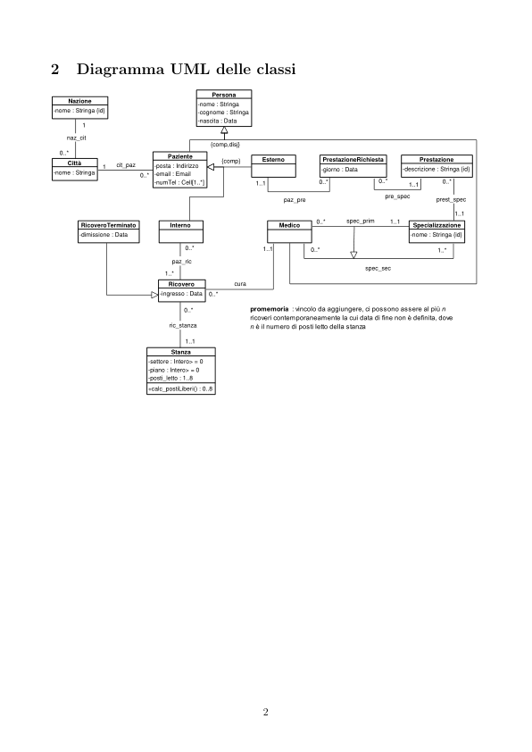
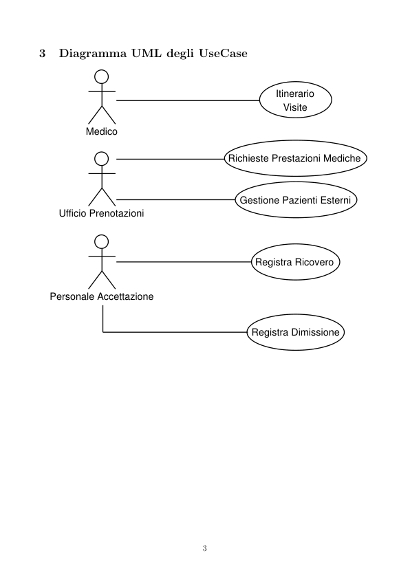

# QuickHospital

> Fonte: `QuickHospital.pdf`
> Estratto con PyMuPDF (conserva legature e formule); tolte le righe ripetute di intestazione e pie' di pagina e le etichette sparse dei diagrammi, che sono ritagliati in `figure/` e richiamati nel punto in cui compaiono.

---

QuickHospital
         Requisiti
         1. Paziente
         1.1 nome
         1.2 cognome
         1.3 data di nascita
         1.4 recapiti telefonici [1..*]
         1.5 email
         1.6 recapito postale
         1.7 interno o esterno?
         1.7.1 se esterno, prestazione medica richiesta (vedi REQ 4.)
         2. Medico
         2.1 nome
         2.2 cognome
         2.3 data di nascita
         2.4 pazienti in cura
         2.5 specializzazione primaria
         2.6 specializzazione secondaria
         3. Ricovero
         3.1 paziente coinvolto
         3.2 stanza del ricovero
         3.3 numero posti letto (da 1 a 8)
         3.4 piano
         3.5 settore
         3.6 data ricovero
         4. Prestazione Medica
         4.1 Paziente esterno coinvolto
         4.2 data richiesta
         4.3 specializzazione medica richiesta
         4.4 descrizione estesa

         Diagramma UML delle classi
                                       Persona
            Nazione
                                     -nome : Stringa
                                     -cognome : Stringa
                                     -nascita : Data
          -nome : Stringa {id}
            naz_cit
                                       {comp,disj}
           0..*
                               Paziente
                                         Esterno
                                         {comp}
                                                            PrestazioneRichiesta
                                                                              Prestazione
            Città
                     cit_paz
                             -posta : Indirizzo
                             -email : Email
                             -numTel : Cell[1..*]
                   0..*
                                                                           -descrizione : Stringa {id}
                                                            -giorno : Data
          -nome : Stringa
                                                     pre_spec
                                                     paz_pre
                                                                                  prest_spec
                                                                 spec_prim
               RicoveroTerminato
                                Interno
                                                    Medico
                                                                             Specializzazione
              -dimissione : Data
                                                                             -nome : Stringa {id}
                                                          1..*
                                paz_ric
                                                                    spec_sec
                               1..*
                               Ricovero
                                            cura
                              -ingresso : Data
                               ric_stanza
                                Stanza
                           -settore : Intero> = 0
                           -piano : Intero> = 0
                           -posti_letto : 1..8
                           +calc_postiLiberi() : 0..8

         Diagramma UML degli UseCase
                                                                   Itinerario
                                                                     Visite
                    Medico
                                                       Richieste Prestazioni Mediche
                                                          Gestione Pazienti Esterni
              Ufficio Prenotazioni
                                                              Registra Ricovero
            Personale Accettazione
                                                             Registra Dimissione

