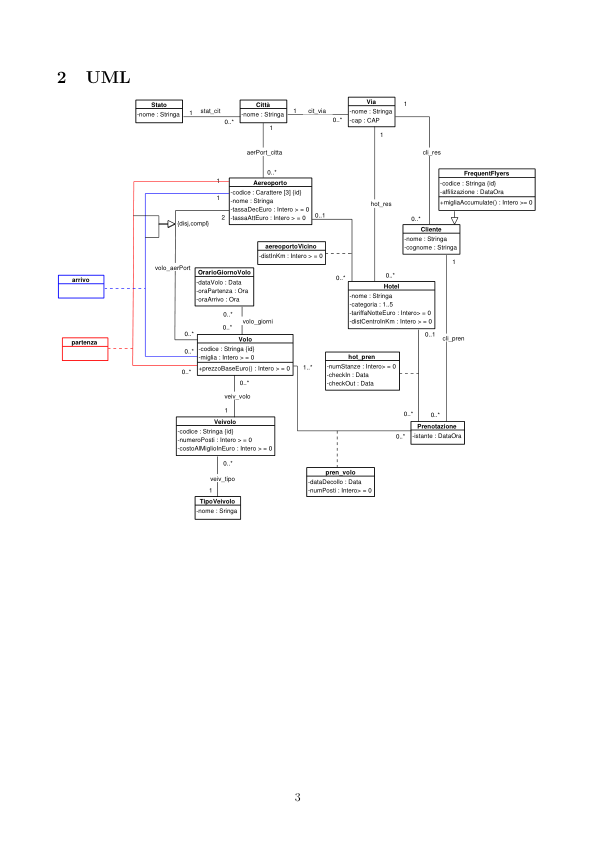
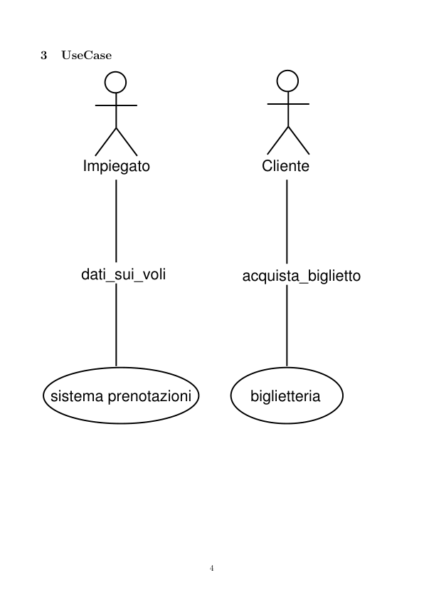

# RainAir

> Fonte: `RainAir.pdf`
> Estratto con PyMuPDF (conserva legature e formule); tolte le righe ripetute di intestazione e pie' di pagina e le etichette sparse dei diagrammi, che sono ritagliati in `figure/` e richiamati nel punto in cui compaiono.

---

Rain Air
         Specifica dei Requisiti
         1. Cliente
         1.1 nome
         1.2 cognome
         1.3 indirizzo
         1.4 prenotazioni
         1.5 frequen flyers (facoltativo)
         1.5.1 codice
         1.5.2 data affiliazione
         1.5.3 miglia accumulate (operazione di classe)
         2. Volo
         2.1 codice
         2.2 miglia percorse
         2.3 informazioni volo
         2.3.1 orario di partenza
         2.3.2 orario di arrivo
         2.3.3 aereoporto di partenza
         2.3.4 aereoporto di arrivo
         2.3.5 giorni
         2.4 veivolo usato
         2.5 prezzo base
         3. Prenotazione
         3.1 utente coinvolto
         3.2 voli coinvolti (almeno 1)
         3.2.1 data decollo (per ogni volo)
         3.2.2 numero posti richiesti (per ogni volo)
         3.3 istante prenotazione
         3.4 eventuale hotel (facoltativo)
         3.4.1 data check-in
         3.4.2 data check-out
         3.4.3 numero stanze prenotate
         4. Aereoporto
         4.1 codice (stringa 3 caratteri)
         4.2 nome

             4.3 citt`a
             4.4 stato
             4.5 tassa decollo
             4.6 tassa atterraggio
         5. Veivolo
         5.1 codice (stringa)
         5.2 tipo
         5.3 numero di posti
         5.4 costo al miglio
         6. Hotel
         6.1 nome
         6.2 indirizzo
         6.3 categoria (stelle, da 1 a 5)
         6.4 tariffa stanza per notte
         6.5 distanza dal centro in Km
         6.6 aereoporto vicino
         6.6.1 distanza aereoporto

         UML
                                                             Via
                         Stato
                                           Città
                                 stat_cit
                                 cit_via
                                                          -cap : CAP
                                         aerPort_citta
                                                                       cli_res
                                                                             FrequentFlyers
                                          Aereoporto
                                                                         -codice : Stringa {id}
                                                                         -affilizazione : DataOra
                                      -codice : Carattere [3] {id}
                                      -tassaDecEuro : Intero > = 0
                                      -tassaAttEuro : Intero > = 0
                                                                         +migliaAccumulate() : Intero >= 0
                                                              hot_res
                                                    0..1
                             {disj,compl}
                                                                      Cliente
                                                                   -cognome : Stringa
                                            aereoportoVicino
                                           -distInKm : Intero > = 0
                          volo_aerPort
                                 OrarioGiornoVolo
            arrivo
                                -dataVolo : Data
                                -oraPartenza : Ora
                                -oraArrivo : Ora
                                                                Hotel
                                                          -categoria : 1..5
                                                          -tariffaNotteEuro : Intero> = 0
                                                          -distCentroInKm : Intero > = 0
                                        volo_giorni
                                                                       0..1
                                        Volo
                                                                          cli_pren
            partenza
                                 -codice : Stringa {id}
                                 -miglia : Intero > = 0
                                                          hot_pren
                                                      -numStanze : Intero> = 0
                                                      -checkIn : Data
                                                      -checkOut : Data
                                 +prezzoBaseEuro() : Intero > = 0
                                                  1..*
                                     veiv_volo
                                   Veivolo
                                                                      Prenotazione
                             -codice : Stringa {id}
                             -numeroPosti : Intero > = 0
                             -costoAlMiglioInEuro : Intero > = 0
                                                                     -istante : DataOra
                                                      pren_volo
                                   veiv_tipo
                                                   -dataDecollo : Data
                                                   -numPosti : Intero> = 0
                                 TipoVeivolo
                                -nome : Sringa

         UseCase
                   Impiegato
                   Cliente
                   dati_sui_voli
                   acquista_biglietto
           biglietteria
           sistema prenotazioni

         Tipi di Dato
         CAP = 5 cifre decimali che seguono lo standard del CAP

         Specifica delle Classi
         5.1
         Specifica delle Operazioni di Classe
         5.1.1
         FrequentyFlyers
          migliaAccumulate() :
          Intero ≥0
            ˆ pre-condizioni : nessuna
            ˆ post-condizioni : Non modifica il livello estensionale
                                   sia dA tale che affilianzione(this, dA)
                            P = {p | cli pren(this, p) ∧istante(is, p) ∧is ≥dA}
                                  (m, posti) | ∃v V olo(v) ∃p ∈P pren volo(v, p)
                                  ∧¬(∃h hot pren(h, p))
                                  ∧miglia(v, m) ∧numPosti(v, p, posti)
                                         
                      PrenV oloNoHotel =

                                       
                                  (m, posti) | ∃v V olo(v) ∃p ∈P pren volo(v, p) ∧
                                  (∃h hot pren(h, p) ∧categoria(h, 4))
                                  ∧miglia(v, m) ∧numPosti(v, p, posti)
                      PrenV oloHotel4 =

                                       
                      PrenV oloHotel5 =
                                  (m, posti) | ∃v V olo(v) ∃p ∈P pren volo(v, p) ∧
                                  (∃h hot pren(h, p) ∧categoria(h, 5))
                                  ∧miglia(v, m) ∧numPosti(v, p, posti)

                                                 X
                                     r1 =
                                                            m · posti
                                         (m,posti)∈PrenV oloNoHotel
                                       
                                       X
                                                                  
                                                          m · posti
                                                                   · 2
                                   r2 =
                                         (m,posti)∈PrenV oloHotel4
                                       
                                       X
                                                                  
                                                          m · posti
                                                                   · 3
                                   r3 =
                                         (m,posti)∈PrenV oloHotel5
                                           result = r1 + r2 + r3

         5.1.2
         Volo
          prezzoBaseEuro() :
          Intero >= 0
            ˆ pre-condizioni : nessuna
            ˆ post-condizioni : Non modifica il livello estensionale
                     sia costo tale che costoAlMiglioInEuro(V, costo) ∧veiv volo(this, V )
                               sia costoV olo tale che costo · m ∧miglia(this, m)
                sia taxDec tale che tassaDecEuro(A, tax) ∧partenza(A, V ) ∧veiv volo(this, V )
                  sia taxAtt tale che tassaAttEuro(A, tax) ∧arrivo(A, V ) ∧veiv volo(this, V )
                                   prezzo = taxAtt + costoV olo + taxDec
                             sia p tale che numeroPosti(p, V ) ∧veiv volo(this, V )
                                           result = prezzo
                                                     p
                                                     · 1.2

         Specifica dei Vincoli Esterni
          [V.partenza prima di arrivo]
                                                  
                                                ¬
                      ∃part ∃arrivo ∃g OrarioGiornoV olo(g) ∧
                      part > arrivo ∧oraPartenza(g, part) ∧oraArrivo(g, arrivo)
                      
          [V.veivolo due voli stesso giorno]
                                                  
                                                ¬
                      ∃A ∃g ∃v1 ∃v2
                      V eivolo(A) ∧OrarioGiornoV olo(g) ∧V olo(v1) ∧V olo(v2) ∧
                            volo giorni(v1, g) ∧volo giorni(v2, g) ∧v1̸ = v2
                                  ∧veiv volo(v1, A) ∧veiv volo(v2, A)
                                  
          [V.prenotazione volo passato]
                                                  
                                                ¬
                   ∃p ∃v ∃g ∃d1 ∃d2 ∃k
                   Prenotazione(p) ∧V olo(v) ∧OrarioGiornoV olo(g)
                   pren volo(p, v) ∧volo giorni(v, g) ∧istante(p, d1) ∧dataV olo(g, d2)
                                         k ≥d2 ∧Data(k, d1)
                                         
          [V.checkout maggiore di checkin]
                      ∀h∀p hot pren(p, h)
                      ¬∃in ¬∃out chek in(p, h, in) ∧chek out(p, h, out) ∧in > out
          [V.checkin hotel maggiore o uguale DataOra prenotazione]
                      ∃pren ∃v ∃g ∃h ∃dataC ∃dataV ∃k
                      checkIn(p, h, dataC) ∧pren volo(pren, v) ∧volo giorni(v, g)
                           dataV olo(g, dataV ); ∧; dataV > k ∧Data(k, dataC)
          [V.posti prenotati minore uguale posti totali aereo]
                 ∀v ∀A ∀nposti ∀postiPren ∀pren
                 pren volo(v, pren, postiPren) ∧veiv volo(v, A) ∧numeroPosti(A, nposti)
                                        →nposti ≥postiPren

         Specifica degli UseCase
         7.1
         Specifica delle Operazioni degli UseCase
         7.1.1
         Sistema Prenotazioni
          posti disponibili(v :
          Volo, d :
          Data) :
          Intero ≥0
            ˆ pre-condizioni :
                                    ∃g volo giorni(v, g) ∧dataV olo(g, d)
            ˆ post-condizioni :
                          

                 NumP =
                           np | ∃p pren volo(v, p) ∧dataDecollo(v, p, d) ∧numPosti(v, p, np)
                                                     X
                                           result =
                                                          np
                                                   np∈NumP
          prezzo biglietti(v :
          Volo, d :
          Data, n :
          Intero ≥0) :
          Intero ≥0
            ˆ pre-condizioni :
                                    ∃g volo giorni(v, g) ∧dataV olo(g, d)
                                      n ≤posti disponibili(v, d)
            ˆ post-condizioni :
                                    prezzoBase = v. prezzoBaseEuro()
                                   postiDisp = posti disponibili(v, d)
                       postiTot = postiTot | veiv volo(v, A) ∧numeroPosti(A, postiTot)
                – Se postiDisp < postiTot · 1
                                        numInc = |postiDisp −postiTot|
                                              inc = PnumInc
                                        i=1
                                        1.02
                                        prezzoBase = prezzoBase · inc
                – altrimenti
                                        numInc = |postiDisp −postiTot|
                                              inc = PnumInc
                                        i=1
                                        0.98
                                        prezzoBase = prezzoBase · inc
              result = prezzoBase · n
