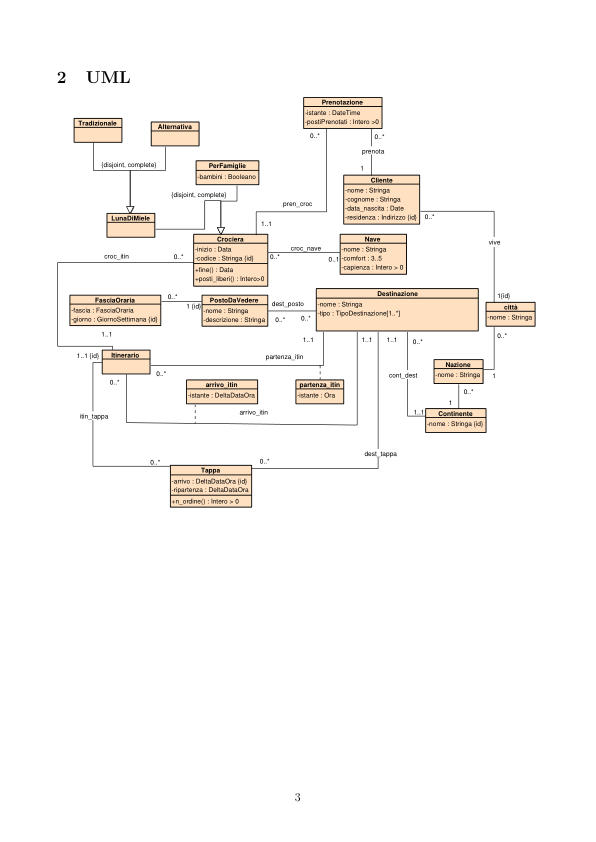
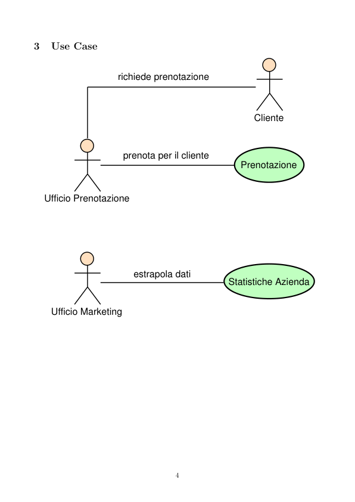
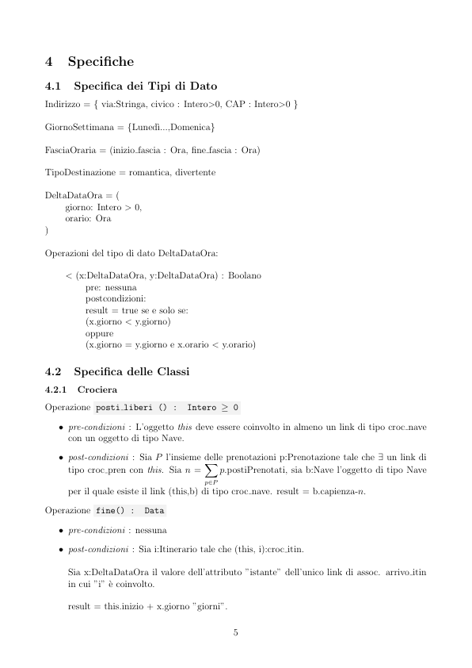
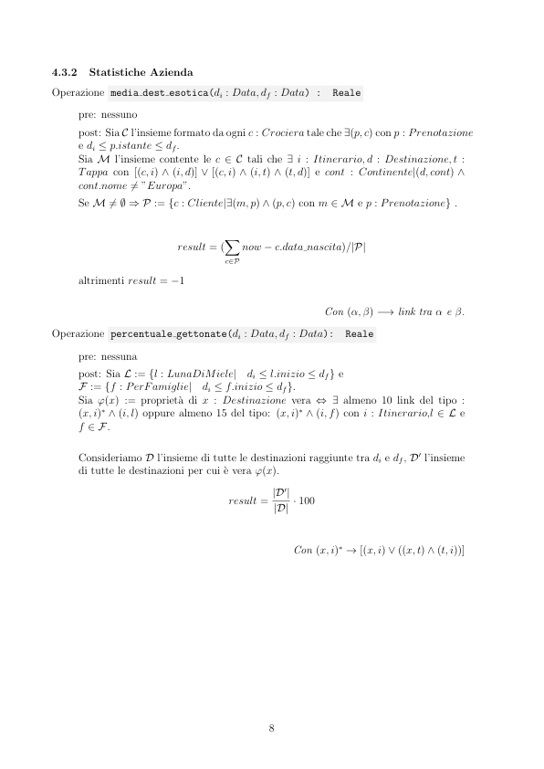

# Travel to the moon

> Fonte: `Travel to the moon.pdf`
> Estratto con PyMuPDF (conserva legature e formule); tolte le righe ripetute di intestazione e pie' di pagina e le etichette sparse dei diagrammi, che sono ritagliati in `figure/` e richiamati nel punto in cui compaiono.

---

Travel to the moon
         Requisiti
         I dati di interesse per il sistema sono
         1. Requisiti sulle crociere:
         1.1. codice
         1.2. data di inizio
         1.3. data di fine
         1.4. nave utilizzata (v. req. 2)
         1.5. itinerario (v. req. 4)
         1.6. il tipo, uno tra:
         1.6.1. luna di miele, di cui interessa:
         1.6.1.1. sottotipo, uno tra:
         1.6.1.1.1. tradizionali
         1.6.1.1.2. alternative
         1.6.2. per famiglie, di cui interessa:
         1.6.3. se adatte ai bambini (booleano)
         2. Requisiti sulle navi:
         2.1. nome
         2.2. comfort (3..5)
         2.3. capienza
         3. Requisiti sulle destinazioni:
         3.1. nome
         3.2. continente
         3.3. posti da vedere (v. req. 5)
         3.4. tipo, almeno uno tra:
         3.4.1. romantico
         3.4.2. divertente
         4. Requisiti sugli itinerari:
         4.1. sequenza ordinata di elementi, di cui interessa:
         4.1.1. porto (v. req. 3)
         4.1.2. arrivo:
         4.1.2.1. il numero d’ordine del giorno (rispetto alla data di inizio della crociera)
         4.1.2.2. ora
         4.1.3. ripartenza
         4.1.3.1. il numero d’ordine del giorno (rispetto alla data di inizio della crociera)

                      4.1.3.2. ora
         5. Requisiti sui posti da vedere:
         5.1. nome
         5.2. descrizione
         5.3. orari di apertura, nella forma di una mappa che associa ad ogni giorno della settimana
         (luned`ı, ..., domenica) un insieme di fasce orarie, dove ogni fascia oraria
         `e definita in termini di una coppia di orari
         6. Requisiti sulle prenotazioni:
         6.1 data ed ora della prenotazione.
         6.2 cliente coinvolto.
         6.3 crociera coinvolta
         6.4 numero posti prenotati
         7. Requisiti sui clienti:
         7.1 nome.
         7.2 cognome.
         7.3 data di nascita.
         7.4 indirizzo.

         UML
                                                      Prenotazione
                                                   -istante : DateTime
                                                   -postiPrenotati : Intero >0
             Tradizionale
             Alternativa
                                                            prenota
                 {disjoint, complete}
                                   PerFamiglie
                                 -bambini : Booleano
                                                              Cliente
                                                         -cognome : Stringa
                                                         -data_nascita : Date
                                                         -residenza : Indirizzo {id}
                            {disjoint, complete}
                                               pren_croc
                  LunaDiMiele
                                    Crociera
                                                             Nave
                                                                                  vive
                                                croc_nave
                                -inizio : Data
                                -codice : Stringa {id}
                                                         -comfort : 3..5
                                                         -capienza : Intero > 0
                 croc_itin
                                             0..1
                                +fine() : Data
                                +posti_liberi() : Intero>0
                                                               Destinazione
                                                                                   1{id}
                            1 {id}
               FasciaOraria
                                   PostoDaVedere
                                             dest_posto
                                                     -tipo : TipoDestinazione[1..*]
                                                                                    città
           -fascia : FasciaOraria
           -giorno : GiornoSettimana {id}
                                  -descrizione : Stringa
                 1..1
                  Itinerario
            1..1 {id}
                                            partenza_itin
                                                                          Nazione
                                                                 cont_dest
                  0..*
                                  arrivo_itin
                                                  partenza_itin
                               -istante : DeltaDataOra
                                                 -istante : Ora
             itin_tappa
             arrivo_itin
                                                                         Continente
                                                                       -nome : Stringa {id}
                                                             dest_tappa
                                 Tappa
                            -arrivo : DeltaDataOra {id}
                            -ripartenza : DeltaDataOra
                            +n_ordine() : Intero > 0

         Use Case
                                 richiede prenotazione
                                                                       Cliente
                                  prenota per il cliente
                                                                   Prenotazione
            Ufficio Prenotazione
                                     estrapola dati
                                                                Statistiche Azienda
              Ufficio Marketing

         Specifiche
         4.1
         Specifica dei Tipi di Dato
         Indirizzo = { via:Stringa, civico : Intero>0, CAP : Intero>0 }
         GiornoSettimana = {Luned`ı...,Domenica}
         FasciaOraria = (inizio fascia : Ora, fine fascia : Ora)
         TipoDestinazione = romantica, divertente
         DeltaDataOra = (
         giorno: Intero > 0,
         orario: Ora
         )
         Operazioni del tipo di dato DeltaDataOra:
             < (x:DeltaDataOra, y:DeltaDataOra) : Boolano
                  pre: nessuna
                  postcondizioni:
                  result = true se e solo se:
                  (x.giorno < y.giorno)
                  oppure
                  (x.giorno = y.giorno e x.orario < y.orario)
         4.2
         Specifica delle Classi
         4.2.1
         Crociera
         Operazione posti liberi () :
         Intero ≥0
            ˆ pre-condizioni : L’oggetto this deve essere coinvolto in almeno un link di tipo croc nave
              con un oggetto di tipo Nave.
            ˆ post-condizioni : Sia P l’insieme delle prenotazioni p:Prenotazione tale che ∃un link di
                                           X
              tipo croc pren con this. Sia n =
                                              p.postiPrenotati, sia b:Nave l’oggetto di tipo Nave
                                           p∈P
              per il quale esiste il link (this,b) di tipo croc nave. result = b.capienza-n.
         Operazione fine() :
         Data
            ˆ pre-condizioni : nessuna
            ˆ post-condizioni : Sia i:Itinerario tale che (this, i):croc itin.
              Sia x:DeltaDataOra il valore dell’attributo ”istante” dell’unico link di assoc. arrivo itin
              in cui ”i” `e coinvolto.
              result = this.inizio + x.giorno ”giorni”.

         Vincoli esterni :
         [V.Crociera.date]
             Per ogni oggetto c:Crociera deve essere: c.inizio ≤c.fine
         4.2.2
         Itinerario
         Vincoli esterni :
         [V.Itinerario.arrivo dopo ultima tappa]
             Per ogni i:Itinerario siano:
            ˆ T l’insieme delle istanze ’t’ di classe Tappa tali che (i,t):itin tappa
            ˆ x il valore dell’attributo ’istante’ dell’unico link di associazione arrivo itin in cui ’i’ `e
              coinvolto
             Per ogni t:T, deve essere: t.ripartenza < x.
         [V.Itinerario.prima tappa dopo partenza]
             Per ogni i:Itinerario siano:
            ˆ T l’insieme delle istanze ’t’ di classe Tappa tali che (i,t):itin tappa e t.arrivo.giorno = 1
            ˆ x il valore dell’attributo ’istante’ dell’unico link di associazione partenza itin in cui ’i’ `e
              coinvolto
             Per ogni t:T, deve essere t.arrivo.orario > x.
         [V.Itinerario.arrivo dopo partenza se senza tappe]
             Per ogni i:Itinerario tale siano:
            ˆ T l’insieme delle istanze ’t’ di classe Tappa tali che (i,t):itin tappa
            ˆ x il valore dell’attributo ’istante’ dell’unico link di associazione partenza itin in cui ’i’ `e
              coinvolto
            ˆ y il valore dell’attributo ’istante’ dell’unico link di associazione arrivo itin in cui ’i’ `e
              coinvolto
             se T = vuoto e y.giorno = 1, allora deve essere x < y.orario.
             Per ogni t:T, deve essere t.arrivo.orario > x.
         4.2.3
         Tappa
         Operazione n ordine() :
         Int > 0
            ˆ pre-condizioni : nessuna
            ˆ post-condizioni : No side-effect. Sia i l’itinerario della tappa this; Sia TappePrecedenti
              l’insieme degli oggetti t:Tappa tali che:

                – (i,t): itin tappa
                – t.arrivo < this.arrivo;
              result = |TappePrecedenti| + 1.
         Vincoli esterni :
         [V.Tappa.date]
             Per ogni istanza t:Tappa, deve essere: t.arrivo < t.ripartenza
         4.2.4
         Prenotazioni
         Vincoli esterni :
         [V.Prenotazioni.date]
              Per ogni istanza p:Prenotazione, ed ogni link r fra p:Prenotazione e c:Crociera, deve
              essere: p.data prenotazione<c.indirizzo
         4.2.5
         Fascia Oraria
         [V.FasciaOraria.inizio fascia fine fascia]
              Per ogni f:FasciaOraria, f.fascia.inizio fascia < f.fascia.fine fascia
         [V.FasciaOraria.sovrapposizione fasce]
              Per ogni f:FasciaOraria con |f.fascia| > 1 , presi f.fascia = x e f.fascia’ = y , non esiste
              y tale che: (x.inizio fascia ≤y.inizio fascia < x.fine fascia)
         4.3
         Specifica degli Use-Case
         4.3.1
         Prenotazione
         Operazione
          effettua prenotazione (cl:Cliente, cr:Crociera, nPosti :
          Intero>0) :
          Prenotazione
            ˆ pre-condizioni : cr.Inizio > now ∧nPosti ≤cr.posti liberi().
            ˆ post-condizioni : Crea oggetto p : Prenotazione tale che:
                – p.istante = now
                – p.postiPrenotati = nPosti
                – Viene creato un link di tipo croc pren fra cr e p
                – Viene creato un link di tipo prenota fra p e cl.
              result = p

         4.3.2
         Statistiche Azienda
         Operazione media dest esotica(di : Data, df : Data) :
         Reale
              pre: nessuno
              post: Sia C l’insieme formato da ogni c : Crociera tale che ∃(p, c) con p : Prenotazione
              e di ≤p.istante ≤df.
              Sia M l’insieme contente le c ∈C tali che ∃i : Itinerario, d : Destinazione, t :
              Tappa con [(c, i) ∧(i, d)] ∨[(c, i) ∧(i, t) ∧(t, d)] e cont : Continente|(d, cont) ∧
              cont.nome̸ = ”Europa”.
              Se M̸ = ∅⇒P := {c : Cliente|∃(m, p) ∧(p, c) con m ∈M e p : Prenotazione} .
                                         X
                                result = (
                                            now −c.data nascita)/|P|
                                         c∈P
              altrimenti result = −1
                                                           Con (α, β) −→link tra α e β.
         Operazione percentuale gettonate(di : Data, df : Data):
         Reale
              pre: nessuna
              post: Sia L := {l : LunaDiMiele|
              di ≤l.inizio ≤df} e
              F := {f : PerFamiglie|
              di ≤f.inizio ≤df}.
              Sia φ(x) := propriet`a di x : Destinazione vera ⇔∃almeno 10 link del tipo :
              (x, i)∗∧(i, l) oppure almeno 15 del tipo: (x, i)∗∧(i, f) con i : Itinerario,l ∈L e
              f ∈F.
              Consideriamo D l’insieme di tutte le destinazioni raggiunte tra di e df, D′ l’insieme
              di tutte le destinazioni per cui `e vera φ(x).
                                          result = |D′|
                                                  |D| · 100
                                                     Con (x, i)∗→[(x, i) ∨((x, t) ∧(t, i))]

