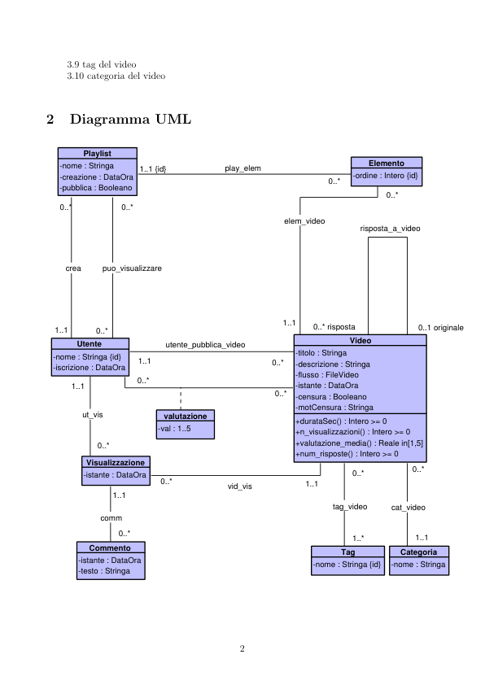
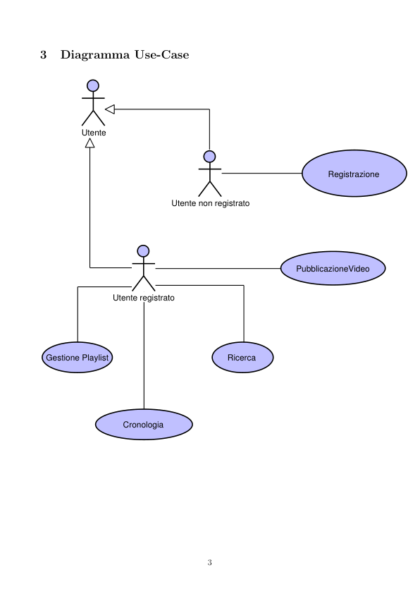
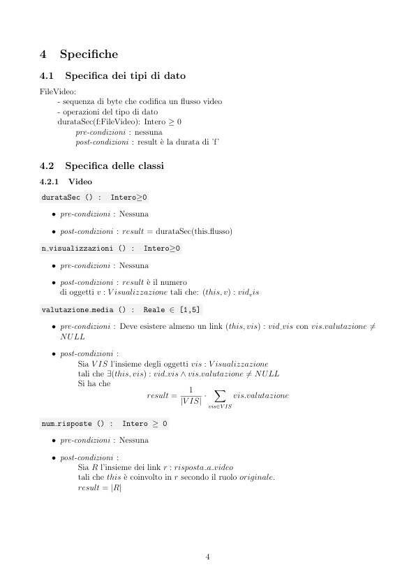
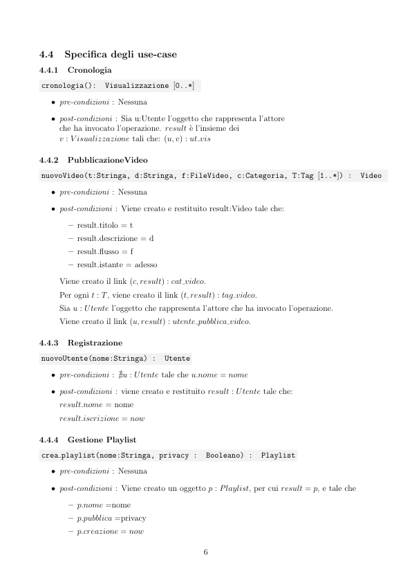
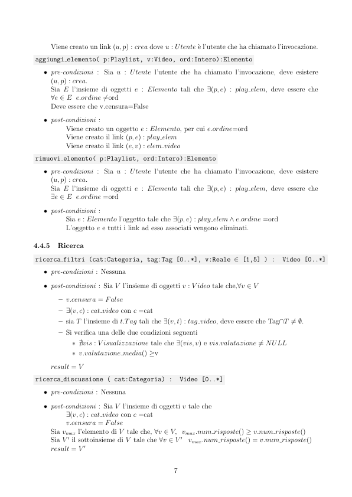

# TuTubi

> Fonte: `TuTubi.pdf`
> Estratto con PyMuPDF (conserva legature e formule); tolte le righe ripetute di intestazione e pie' di pagina e le etichette sparse dei diagrammi, che sono ritagliati in `figure/` e richiamati nel punto in cui compaiono.

---

TuTubi
         Requisiti
         1. Utente
         1.1 nome
         1.2 data iscrizione
         1.3 playlist create
         1.4 playlist visualizzate
         1.5 video pubblicati
         1.5.1 istante pubblicazione
         1.6 video visualizzati
         1.6.1 data ed ora visualizzazione
         1.6.2 valutazione video
         1.6.3 commento al video
         1.6.3.1 data ed ora commento
         2. Playlist
         2.1 nome
         2.2 data creazione
         2.3 pubblica o privata?
         2.4 video coinvolti
         2.4.1 ordine del video
         3. Video
         3.1 titolo
         3.2 commenti
         3.2.1 data ed ora commento
         3.3 descrizione
         3.4 file video
         3.5 istante pubblicazione
         3.6 video censurato?
         3.6.1 motivazione censura
         3.7 statistiche
         3.7.1 durata del video in secondi
         3.7.2 numero di visualizzazioni
         3.7.3 valutazione media
         3.7.4 numero di video risposta
         3.8 video risposta?
         3.8.1 video alla quale si risponde

             3.9 tag del video
             3.10 categoria del video
         Diagramma UML
                 Playlist
                                                                            Elemento
            -nome : Stringa
            -creazione : DataOra
            -pubblica : Booleano
                                              play_elem
                            1..1 {id}
                                                                        -ordine : Intero {id}
            0..*
                                                          elem_video
                                                                          risposta_a_video
             puo_visualizzare
             crea
                                                                0..* risposta
                                                                0..1 originale
           1..1
                   0..*
                                                                        Video
               Utente
                                  utente_pubblica_video
                                                             -titolo : Stringa
                                                             -descrizione : Stringa
                                                             -flusso : FileVideo
                                                             -istante : DataOra
                                                             -censura : Booleano
                                                             -motCensura : Stringa
          -nome : Stringa {id}
          -iscrizione : DataOra
              1..1
                ut_vis
                                 valutazione
                                                             +durataSec() : Intero >= 0
                                                             +n_visualizzazioni() : Intero >= 0
                                                             +valutazione_media() : Reale in[1,5]
                                                             +num_risposte() : Intero >= 0
                                -val : 1..5
                 Visualizzazione
                 -istante : DataOra
                                               vid_vis
                                                                    tag_video
                                                                    cat_video
                    comm
                                                                        1..*
                  Commento
                                                                      Tag
                                                                                  Categoria
                -istante : DataOra
                -testo : Stringa
                                                                -nome : Stringa {id}
                                                                                -nome : Stringa

         Diagramma Use-Case
                   Utente
                                                                              Registrazione
                                        Utente non registrato
                                                                      PubblicazioneVideo
                          Utente registrato
          Gestione Playlist
          Ricerca
                             Cronologia

         Specifiche
         4.1
         Specifica dei tipi di dato
         FileVideo:
             - sequenza di byte che codifica un flusso video
             - operazioni del tipo di dato
             durataSec(f:FileVideo): Intero ≥0
                  pre-condizioni : nessuna
                  post-condizioni : result `e la durata di ’f’
         4.2
         Specifica delle classi
         4.2.1
         Video
          durataSec () :
          Intero≥0
            ˆ pre-condizioni : Nessuna
            ˆ post-condizioni : result = durataSec(this.flusso)
          n visualizzazioni () :
          Intero≥0
            ˆ pre-condizioni : Nessuna
            ˆ post-condizioni : result `e il numero
              di oggetti v : V isualizzazione tali che: (this, v) : vidvis
          valutazione media () :
          Reale ∈[1,5]
            ˆ pre-condizioni : Deve esistere almeno un link (this, vis) : vid vis con vis.valutazione̸ =
              NULL
            ˆ post-condizioni :
                  Sia V IS l’insieme degli oggetti vis : V isualizzazione
                  tali che ∃(this, vis) : vid vis ∧vis.valutazione̸ = NULL
                  Si ha che
                                   result =
                                   |V IS| ·
                                                   X
                                                        vis.valutazione
                                                  vis∈V IS
          num risposte () :
          Intero ≥0
            ˆ pre-condizioni : Nessuna
            ˆ post-condizioni :
                  Sia R l’insieme dei link r : risposta a video
                  tali che this `e coinvolto in r secondo il ruolo originale.
                  result = |R|

         4.3
         Specifica dei vincoli esterni
         [V.Video.autore non risponde a se stesso]
         Per ogni r:Video, per cui esiste v:Video tale che
             (r,v): risponde a video
             sia:
             - u:Utente tale che:
             (u, r): pubblica
             Deve che (u,v) non `e un link di pubblica.
             Formalmente:
                               ∀r, v, u
                               V ideo(r) ∧V ideo(v) ∧Utente(u)∧
                                      pubblica(u, r)∧
                                      risponde a video(r, v)
                                      →
                                      ¬pubblica(u, v)
         [V.Visualizzazione.valutare proprio video]
         Per ogni utente u, sia V IS l’insieme degli oggetti di tipo V isualizzazione tale che:
            ˆ ∃(u, vis) : ut vis con vis ∈V IS
            ˆ ∃(vis, v) : vid vis con vis ∈V IS
            ˆ ∃(u, v) : utente pubblica video
         Deve essere che ∀vis ∈V is,
         vis.valutazione = NULL
         Formalmente
                         ∀u, v , vis Utente(u) ∧V ideo(v) ∧V isualizzazione(vis)
                                    ∧ut vis(u, vis) ∧vid vis(vis, v)
                                    ∧utente pubblica video(u, v) →
                                       valutazione(vis, NULL)
         [V.Playlist no visualizza privata]
         Per ogni utente u, se esiste (u, p) : puo visualizzare e non esiste (u, p) : crea, allora deve essere
         che p.pubblica = True
             Formalmente
                         ∀u∀p
                         Utente(u) ∧Playlist(p)∧
                         puo visualizzare(u, p) ∧∨crea(u, p) →pubblica(p, True)
         [V.Video censurati]
         Solo i video non censurati possono essere visualizzati, commentati, valutati o aggiunti a playlist.
             Formalmente
                        ∀v, vis, e
                        V ideo(v) ∧V isualizzazione(vis) ∧Elemento(e)
                                  elem video(v, e) ∨vid vis(vis, v) →
                                          censura(v, False)
         [V.Valutazione Registrati]
         Se esiste (u, v) : valutazione, allora esiste (u, vis) e (vis, v).
             Formalmente
                         ∀ut∀vid
                         valutazione(ut, vid) →∃vis
                         [V isualizzazione(vis) ∧ut vis(ut, vis) ∧vid vis(vis, vid)]

         4.4
         Specifica degli use-case
         4.4.1
         Cronologia
          cronologia():
          Visualizzazione [0..*]
            ˆ pre-condizioni : Nessuna
            ˆ post-condizioni : Sia u:Utente l’oggetto che rappresenta l’attore
              che ha invocato l’operazione. result `e l’insieme dei
              v : V isualizzazione tali che: (u, v) : ut vis
         4.4.2
         PubblicazioneVideo
          nuovoVideo(t:Stringa, d:Stringa, f:FileVideo, c:Categoria, T:Tag [1..*]) :
          Video
            ˆ pre-condizioni : Nessuna
            ˆ post-condizioni : Viene creato e restituito result:Video tale che:
                – result.titolo = t
                – result.descrizione = d
                – result.flusso = f
                – result.istante = adesso
              Viene creato il link (c, result) : cat video.
              Per ogni t : T, viene creato il link (t, result) : tag video.
              Sia u : Utente l’oggetto che rappresenta l’attore che ha invocato l’operazione.
              Viene creato il link (u, result) : utente pubblica video.
         4.4.3
         Registrazione
          nuovoUtente(nome:Stringa) :
          Utente
            ˆ pre-condizioni : ∄u : Utente tale che u.nome = nome
            ˆ post-condizioni : viene creato e restituito result : Utente tale che:
              result.nome = nome
              result.iscrizione = now
         4.4.4
         Gestione Playlist
          crea playlist(nome:Stringa, privacy :
          Booleano) :
          Playlist
            ˆ pre-condizioni : Nessuna
            ˆ post-condizioni : Viene creato un oggetto p : Playlist, per cui result = p, e tale che
                – p.nome =nome
                – p.pubblica =privacy
                – p.creazione = now

              Viene creato un link (u, p) : crea dove u : Utente `e l’utente che ha chiamato l’invocazione.
          aggiungi elemento( p:Playlist, v:Video, ord:Intero):Elemento
            ˆ pre-condizioni : Sia u : Utente l’utente che ha chiamato l’invocazione, deve esistere
              (u, p) : crea.
              Sia E l’insieme di oggetti e : Elemento tali che ∃(p, e) : play elem, deve essere che
              ∀e ∈E e.ordine̸ =ord
              Deve essere che v.censura=False
            ˆ post-condizioni :
                  Viene creato un oggetto e : Elemento, per cui e.ordine=ord
                  Viene creato il link (p, e) : play elem
                  Viene creato il link (e, v) : elem video
          rimuovi elemento( p:Playlist, ord:Intero):Elemento
            ˆ pre-condizioni : Sia u : Utente l’utente che ha chiamato l’invocazione, deve esistere
              (u, p) : crea.
              Sia E l’insieme di oggetti e : Elemento tali che ∃(p, e) : play elem, deve essere che
              ∃e ∈E e.ordine =ord
            ˆ post-condizioni :
                  Sia e : Elemento l’oggetto tale che ∃(p, e) : play elem ∧e.ordine =ord
                  L’oggetto e e tutti i link ad esso associati vengono eliminati.
         4.4.5
         Ricerca
          ricerca filtri (cat:Categoria, tag:Tag [0..*], v:Reale ∈[1,5] ) :
          Video [0..*]
            ˆ pre-condizioni : Nessuna
            ˆ post-condizioni : Sia V l’insieme di oggetti v : V ideo tale che,∀v ∈V
                – v.censura = False
                – ∃(v, c) : cat video con c =cat
                – sia T l’insieme di t.Tag tali che ∃(v, t) : tag video, deve essere che Tag∩T̸ = ∅.
                – Si verifica una delle due condizioni seguenti
                    * ∄vis : V isualizzazione tale che ∃(vis, v) e vis.valutazione̸ = NULL
                    * v.valutazione media() ≥v
              result = V
          ricerca discussione ( cat:Categoria) :
          Video [0..*]
            ˆ pre-condizioni : Nessuna
            ˆ post-condizioni : Sia V l’insieme di oggetti v tale che
              ∃(v, c) : cat video con c =cat
              v.censura = False
              Sia vmax l’elemento di V tale che, ∀v ∈V, vmax.num risposte() ≥v.num risposte()
              Sia V ′ il sottoinsieme di V tale che ∀v ∈V ′
              vmax.num risposte() = v.num risposte()
              result = V ′

