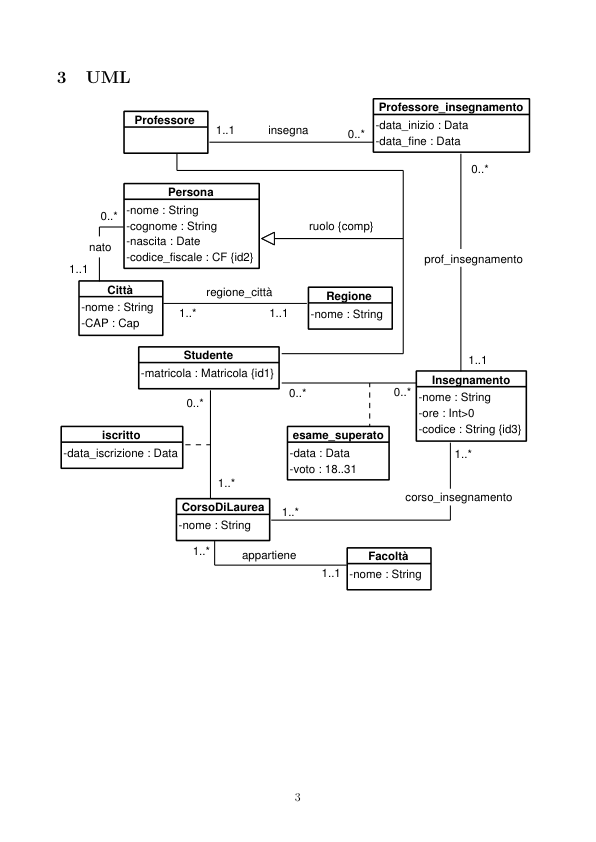
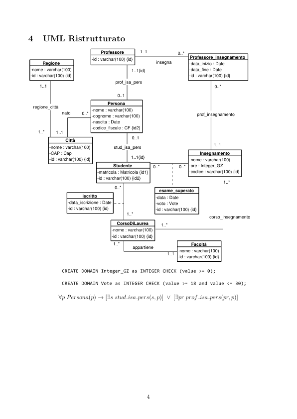

# Universita 2

> Fonte: `Universita 2.pdf`
> Estratto con PyMuPDF (conserva legature e formule); tolte le righe ripetute di intestazione e pie' di pagina e le etichette sparse dei diagrammi, che sono ritagliati in `figure/` e richiamati nel punto in cui compaiono.

---

Universit`a 2 (gruppo 42)
         Requisiti
         I dati di interesse per il sistema sono Studenti, Facolt`a, Professori e Corsi.
           1. Persona
               1.1 nome e cognome
               1.2 codice fiscale
               1.3 data di nascita
               1.4 citt`a di nascita
               1.5 Studente
                 1.5.1 matricola
                 1.5.2 corso di laurea - Il/I corso/corsi alla quale lo studente `e iscritto.
                 1.5.3 insegnamenti superati - Gli Insegnamenti che lo studente ha superato, uno stesso
                 Insegnamento non pu`o essere superato pi`u di una volta.
               1.6 Professore
                 1.6.1 insegnamenti erogati - L’Insegnamento (o pi`u di uno) erogato da un Professore.
           2. Corso di Laurea
               2.1 nome
               2.2 facolt`a
           3. Facolt`a
               3.1 nome
           4. Insegnamento
               4.1 nome
               4.2 ore di lezione
               4.3 corsi alla quale appartiene - Il Corso di Laurea nel quale un Insegnamento viene
               erogato.
               4.4 codice - Serie di caratteri alfanumerici che identificano univocamente un Insegnamento.

         Documenti di Specifica
         2.1
         Tipi di Dato
         I tipi sono dati sottoforma di espressioni regolari :
         Matricola = Stringa [0-9]{7}
         CF = [A-Z]{6} [0-9]{2} [A-Z]{1} [0-9]{2} [A-Z]{1} [0-9]{3} [A-Z]{1}
         Cap = Stringa [0-9]{5}

         UML
                                                               Professore_insegnamento
                      Professore
                                                               -data_inizio : Data
                                                               -data_fine : Data
                                             insegna
                            Persona
                     -cognome : String
                     -nascita : Date
                     -codice_fiscale : CF {id2}
                0..*
                                                   ruolo {comp}
              nato
                                                                       prof_insegnamento
           1..1
                  Città
                                  regione_città
                                                      Regione
             -nome : String
             -CAP : Cap
                              Studente
                       -matricola : Matricola {id1}
                                                                        Insegnamento
                                                                      -ore : Int>0
                                                                      -codice : String {id3}
                 iscritto
                                                 esame_superato
          -data_iscrizione : Data
                                                -data : Data
                                                -voto : 18..31
                                                                    corso_insegnamento
                              CorsoDiLaurea
                                        appartiene
                                                             Facoltà

         UML Ristrutturato
                                  Professore
                                                                Professore_insegnamento
                                                    insegna
              Regione
                                                               -data_inizio : Date
                                                               -data_fine : Date
          -nome : varchar(100)
          -id : varchar(100) {id}
                                            1..1{id}
                                      prof_isa_pers
             1..1
                                       0..1
                                    Persona
           regione_città
                              -nome : varchar(100)
                              -cognome : varchar(100)
                              -nascita : Date
                              -codice_fiscale : CF {id2}
                    nato
                                                                  prof_insegnamento
            1..1
            1..*
                                            0..1
                      Città
                -nome : varchar(100)
                -CAP : Cap
                -id : varchar(100) {id}
                                      stud_isa_pers
                                                                   Insegnamento
                                            1..1{id}
                                                               -nome : varchar(100)
                                                               -ore : Integer_GZ
                                                               -codice : varchar(100) {id}
                                      Studente
                                -matricola : Matricola {id1}
                                -id : varchar(100) {id2}
                                                     esame_superato
                           iscritto
                           -data : Date
                           -voto : Vote
                      -data_iscrizione : Date
                                                                      corso_insegnamento
                                       CorsoDiLaurea
                                     -nome : varchar(100)
                                                                Facoltà
                                            appartiene
                                                            -nome : varchar(100)
                   ∀p Persona(p) →[∃s stud isa pers(s, p)] ∨[∃pr prof isa pers(pr, p)]

