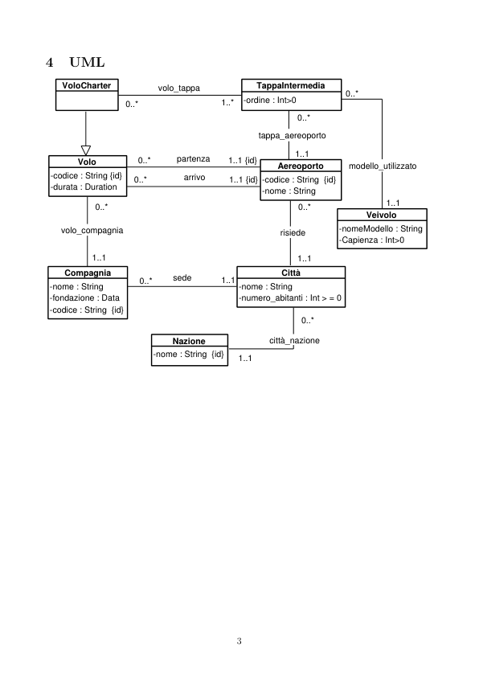
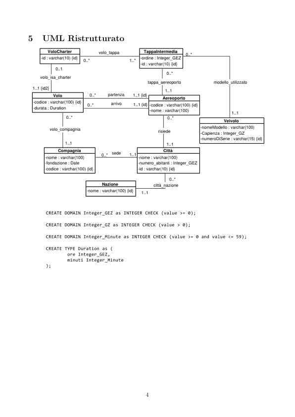

# Voli aerei 2

> Fonte: `Voli aerei 2.pdf`
> Estratto con PyMuPDF (conserva legature e formule); tolte le righe ripetute di intestazione e pie' di pagina e le etichette sparse dei diagrammi, che sono ritagliati in `figure/` e richiamati nel punto in cui compaiono.

---

Voli aerei 2 (gruppo 42)
         Requisiti
         I dati di interesse per il sistema sono Voli, Compagnia ed Aeroporti.
           1. Volo
               1.1 codice - Serie di caratteri alfanumerici che identificano univocamente un Volo.
               1.2 durata - Si usa un dato composto, consistente in un intero positivo per identificare
               la durata in ore, e due interi compresi fra 0 e 59, rispettivamente per i minuti ed i
               secondi.
               1.3 compagnia - La compagnia che fornisce il volo.
               1.4 aereoporto di partenza
               1.5 aereoporto di arrivo
               1.6 VoloCharter - Sar`a una sottoclasse di Volo, permetter`a di modellare i voli di tipo
               charter con le relative tappe intermedie.
           2. Aereoporto
               2.1 codice - Serie di caratteri alfanumerici che identificano univocamente un Aereoporto.
               2.2 nome
               2.3 citt`a - La citt`a in cui risiede l’Aereoporto.
               2.4 nazione - La nazione in cui si trova la citt`a.
           3. Compagnia
               3.1 nome
               3.2 anno di fondazione
               3.3 citt`a sede direzione
           4. TappaIntermedia
               4.1 ordine - L’ordine della tappa all’interno di un volo charter.
           5. Veivolo
               5.1 nome modello
               5.2 capienza
         Saranno necessarie due classi Citt`a e Nazione.

         Considerazioni
         Un Volo pu`o appartenere a pi`u di una Compagnia? No.
         Un Volo pu`o cambiare Compagnia? Se si, si vuole mantenere uno storico? No, non si vuole
         far si che uno stesso Volo possa cambiare compagnia mantenendo lo stesso codice, sar`a sem-
         plicemente un altro Volo, con codice diverso e Compagnia diversa, ma con il tragitto e durata
         identici.
         I Voli di tipo charter hanno sempre una partenza ed un arrivo, la loro relazione con le TappeIntermedie
         non fa riferimento a questi due, ma esclusivamente agli aereoporti di ”scalo”.
         Ogni VoloCharter ha associati pi`u modelli di Veivolo, un modello per ogni tappa.
         Ogni TappaIntermedia, che ha ordine x, ha associato un modello di veivolo, esso fa riferminto
         all’aereo utilizzato per la tratta x −1.
         I Veivoli non hanno un codice identificativo, perch´e non ci interessa rappresentare il singolo
         Veivolo associato ad una tappa, ma il suo modello.
         Specifica Tipi di Dato
         Duration : {h : Int≥0, m 0..59}

         UML
            VoloCharter
                                                     TappaIntermedia
                                 volo_tappa
                                                  -ordine : Int>0
                                              1..*
                                                      tappa_aereoporto
                                    partenza
                            1..1 {id}
                Volo
                                                                        modello_utilizzato
                                                          Aereoporto
          -codice : String {id}
          -durata : Duration
                                      arrivo
                                                      -codice : String  {id}
                                                      -nome : String
                                               1..1 {id}
                   0..*
                                                              Veivolo
                                                                      -nomeModello : String
                                                                      -Capienza : Int>0
            volo_compagnia
                                                          risiede
                   1..1
             Compagnia
                                                          Città
                                    sede
          -nome : String
          -fondazione : Data
          -codice : String  {id}
                                                 -nome : String
                                                 -numero_abitanti : Int > = 0
                                    Nazione
                                                        città_nazione
                                -nome : String  {id}

         UML Ristrutturato
                VoloCharter
                                                TappaIntermedia
                                 volo_tappa
                            1..*
             -id : varchar(10) {id}
                                               -ordine : Integer_GEZ
                                               -id : varchar(10) {id}
                  0..1
             volo_isa_charter
                                                  modello_utilizzato
                                                  tappa_aereoporto
           1..1 {id2}
                              1..1 {id}
                                    partenza
                  Volo
                                                       Aereoporto
           -codice : varchar(100) {id}
           -durata : Duration
                                     arrivo
                                             1..1 {id}
                                                  -codice : varchar(100) {id}
                                                  -nome : varchar(100)
                                                        Veivolo
                                                                    -nomeModello : varchar(100)
                                                                    -Capienza : Integer_GZ
                                                                    -numeroDiSerie : varchar(15) {id}
                volo_compagnia
                                                     risiede
                   Compagnia
                                                       Città
                                     sede
               -nome : varchar(100)
               -fondazione : Date
               -codice : varchar(100) {id}
                                              -nome : varchar(100)
                                              -numero_abitanti : Integer_GEZ
                                              -id : varchar(10) {id}
                                  Nazione
                                                    città_nazione
                             -nome : varchar(100) {id}

