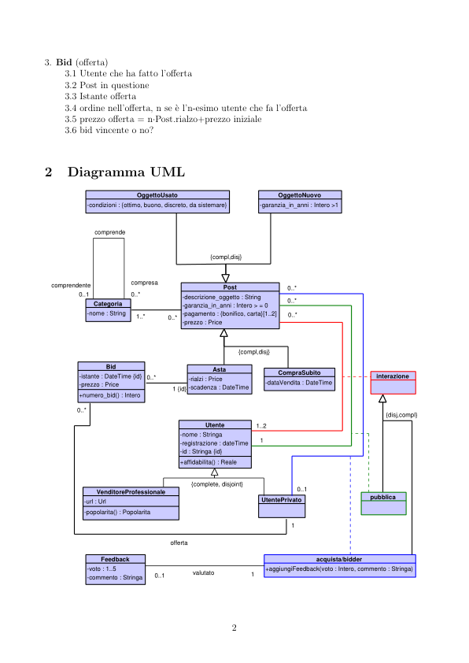
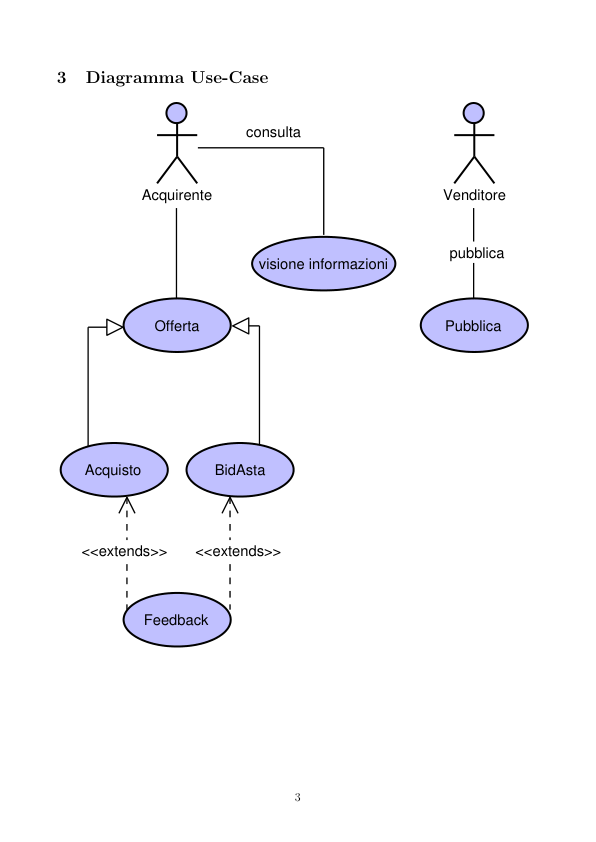
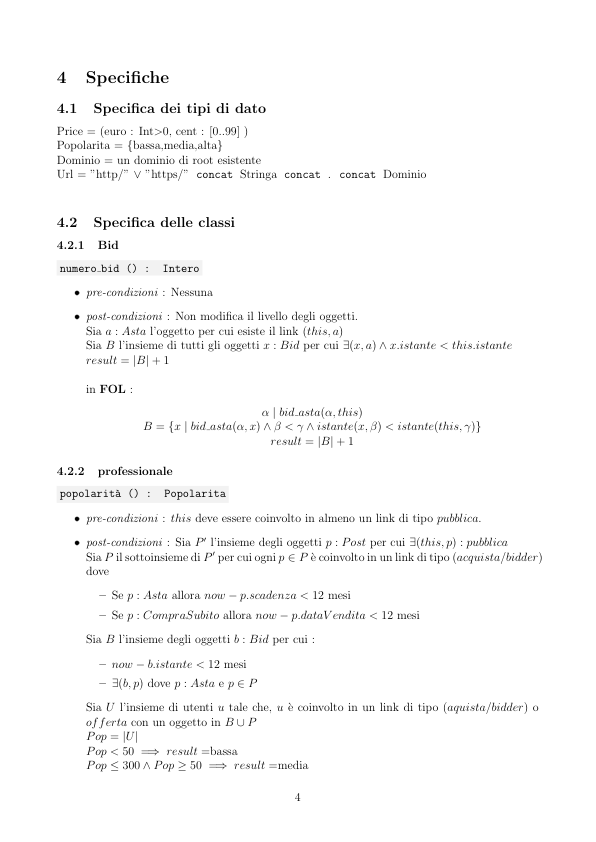
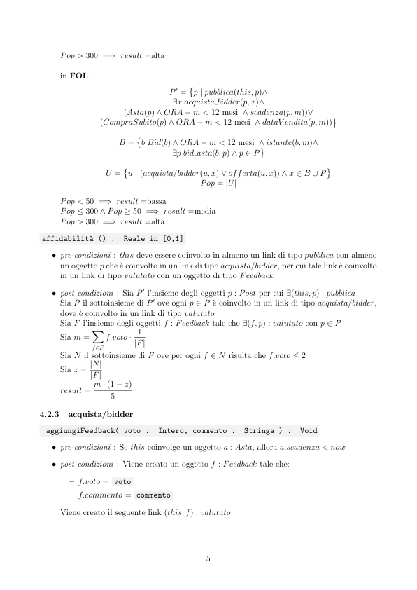
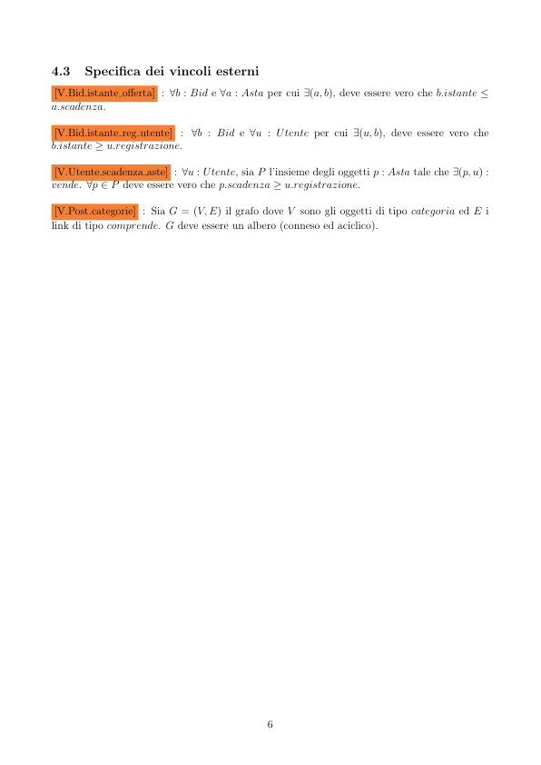
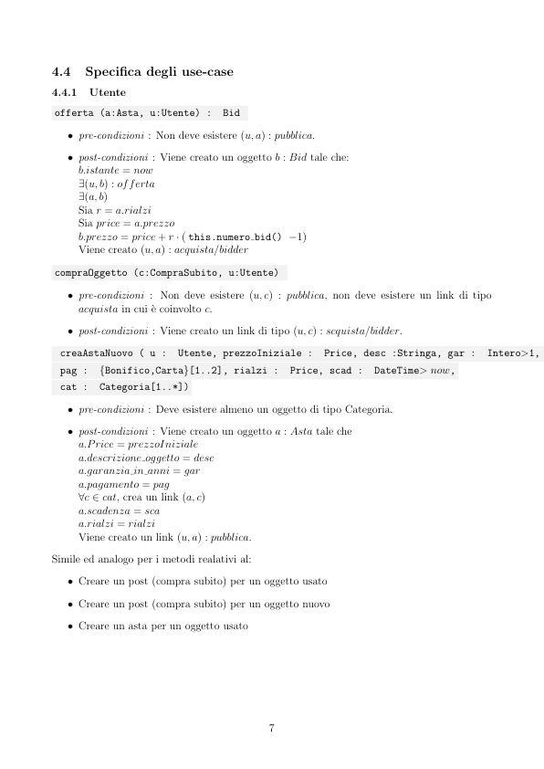

# eBuy

> Fonte: `eBuy.pdf`
> Estratto con PyMuPDF (conserva legature e formule); tolte le righe ripetute di intestazione e pie' di pagina e le etichette sparse dei diagrammi, che sono ritagliati in `figure/` e richiamati nel punto in cui compaiono.

---

eBuy
         Requisiti
         1. Utente
         1.1 nome
         1.2 data registrazione
         1.3 utente privato
         1.3.1 bid fatte
         1.3.2 acquisti fatte
         1.4 utente professionale
         1.4.1 URL vetrina
         1.4.2 post
         1.4.3 popolarit`a
         1.4.4 affidabilit`a
         2. Post (annuncio)
         2.1 descrizione oggetto
         2.2 categoria (fai classe categoria)
         2.3 garanziaInAnni int≥0
         2.4 pagabile in (implementato con enum)
         2.4.1 bonifico
         2.4.2 carta di credito
         2.5 usato? (implementato con enum)
         2.5.1 nuovo
         2.5.1.1 garanziaInAnni int>1 (attributo specializzato)
         2.5.2 usato
         2.5.2.1 condizioni ottimo,buono,discreto, da sistemare
         2.6 asta o no? (disjoint.complete)
         2.6.1 post con asta
         2.6.1.1 prezzo iniziale in (euro,centesimi)
         2.6.1.2 prezzo rialzi in (euro,centesimi)
         2.6.1.3 istante scadenza asta (date time)
         2.6.1.4 insieme di Bid (offerte)
         2.6.2 post senza asta
         2.6.2.1 prezzo in (euro,centesimi)
         2.6.2.1 utente che ha effettuato l’acquisto

         3. Bid (offerta)
         3.1 Utente che ha fatto l’offerta
         3.2 Post in questione
         3.3 Istante offerta
         3.4 ordine nell’offerta, n se `e l’n-esimo utente che fa l’offerta
         3.5 prezzo offerta = n·Post.rialzo+prezzo iniziale
         3.6 bid vincente o no?
         Diagramma UML
                             OggettoUsato
                                                           OggettoNuovo
                  -condizioni : {ottimo, buono, discreto, da sistemare}
                                                       -garanzia_in_anni : Intero >1
                    comprende
                                            {compl,disj}
          compresa
          comprendente
                                               Post
                0..*
                0..1
                0..*
                                      -descrizione_oggetto : String
                                      -garanzia_in_anni : Intero > = 0
                                      -pagamento : {bonifico, carta}[1..2]
                                      -prezzo : Price
                    Categoria
                  -nome : String
                             1..*
                                                  {compl,disj}
                      Bid
                Asta
                -istante : DateTime {id}
                -prezzo : Price
                                                           CompraSubito
                                                                                interazione
                                        -rialzi : Price
                                        -scadenza : DateTime
                                                        -dataVendita : DateTime
                                    1 {id}
                +numero_bid() : Intero
                0..*
                                                                                  {disj,compl}
                                           Utente
                                                      1..2
                                      -nome : Stringa
                                      -registrazione : dateTime
                                      -id : Stringa {id}
                                      +affidabilita() : Reale
                                        {complete, disjoint}
                                                               0..1
                    VenditoreProfessionale
                                                                               pubblica
                 UtentePrivato
                 -url : Url
                 -popolarita() : Popolarita
                                    offerta
                     Feedback
                                                                   acquista/bidder
                  -voto : 1..5
                  -commento : Stringa
                                                        +aggiungiFeedback(voto : Intero, commento : Stringa)
                                         valutato
                                0..1

         Diagramma Use-Case
                                         consulta
                       Acquirente
                       Venditore
                                                                           pubblica
                                           visione informazioni
                         Pubblica
                         Offerta
              BidAsta
              Acquisto
             <<extends>>
             <<extends>>
                        Feedback

         Specifiche
         4.1
         Specifica dei tipi di dato
         Price = (euro : Int>0, cent : [0..99] )
         Popolarita = {bassa,media,alta}
         Dominio = un dominio di root esistente
         Url = ”http/” ∨”https/” concat Stringa concat . concat Dominio
         4.2
         Specifica delle classi
         4.2.1
         Bid
          numero bid () :
          Intero
            ˆ pre-condizioni : Nessuna
            ˆ post-condizioni : Non modifica il livello degli oggetti.
              Sia a : Asta l’oggetto per cui esiste il link (this, a)
              Sia B l’insieme di tutti gli oggetti x : Bid per cui ∃(x, a) ∧x.istante < this.istante
              result = |B| + 1
              in FOL :
                        α | bid asta(α, this)
                        B = {x | bid asta(α, x) ∧β < γ ∧istante(x, β) < istante(this, γ)}
                                             result = |B| + 1
         4.2.2
         professionale
          popolarit`a () :
          Popolarita
            ˆ pre-condizioni : this deve essere coinvolto in almeno un link di tipo pubblica.
            ˆ post-condizioni : Sia P ′ l’insieme degli oggetti p : Post per cui ∃(this, p) : pubblica
              Sia P il sottoinsieme di P ′ per cui ogni p ∈P `e coinvolto in un link di tipo (acquista/bidder)
              dove
                – Se p : Asta allora now −p.scadenza < 12 mesi
                – Se p : CompraSubito allora now −p.dataV endita < 12 mesi
              Sia B l’insieme degli oggetti b : Bid per cui :
                – now −b.istante < 12 mesi
                – ∃(b, p) dove p : Asta e p ∈P
              Sia U l’insieme di utenti u tale che, u `e coinvolto in un link di tipo (aquista/bidder) o
              offerta con un oggetto in B ∪P
              Pop = |U|
              Pop < 50 =⇒result =bassa
              Pop ≤300 ∧Pop ≥50 =⇒result =media

              Pop > 300 =⇒result =alta
              in FOL :
                                        P ′ =
                                             
                       p | pubblica(this, p)∧
                       ∃x acquista bidder(p, x)∧
                       (Asta(p) ∧ORA −m < 12 mesi ∧scadenza(p, m))∨
                       (CompraSubito(p) ∧ORA −m < 12 mesi ∧dataV endita(p, m))

                                
                            B =
                                 b|Bid(b) ∧ORA −m < 12 mesi ∧istante(b, m)∧

                                         ∃p bid asta(b, p) ∧p ∈P
                             

                         U =
                              u | (acquista/bidder(u, x) ∨offerta(u, x)) ∧x ∈B ∪P
                                                Pop = |U|
              Pop < 50 =⇒result =bassa
              Pop ≤300 ∧Pop ≥50 =⇒result =media
              Pop > 300 =⇒result =alta
          affidabilit`a () :
          Reale in [0,1]
            ˆ pre-condizioni : this deve essere coinvolto in almeno un link di tipo pubblica con almeno
              un oggetto p che `e coinvolto in un link di tipo acquista/bidder, per cui tale link `e coinvolto
              in un link di tipo valutato con un oggetto di tipo Feedback
            ˆ post-condizioni : Sia P ′ l’insieme degli oggetti p : Post per cui ∃(this, p) : pubblica
              Sia P il sottoinsieme di P ′ ove ogni p ∈P `e coinvolto in un link di tipo acquista/bidder,
              dove `e coinvolto in un link di tipo valutato
              Sia F l’insieme degli oggetti f : Feedback tale che ∃(f, p) : valutato con p ∈P
                         f.voto · 1
                      X
              Sia m =
                                |F|
                      f∈F
              Sia N il sottoinsieme di F ove per ogni f ∈N risulta che f.voto ≤2
              Sia z = |N|
                     |F|
              result = m · (1 −z)
         4.2.3
         acquista/bidder
           aggiungiFeedback( voto :
           Intero, commento :
           Stringa ) :
           Void
            ˆ pre-condizioni : Se this coinvolge un oggetto a : Asta, allora a.scadenza < now
            ˆ post-condizioni : Viene creato un oggetto f : Feedback tale che:
                – f.voto = voto
                – f.commento = commento
              Viene creato il seguente link (this, f) : valutato

         4.3
         Specifica dei vincoli esterni
         [V.Bid.istante offerta] : ∀b : Bid e ∀a : Asta per cui ∃(a, b), deve essere vero che b.istante ≤
         a.scadenza.
         [V.Bid.istante reg utente] : ∀b : Bid e ∀u : Utente per cui ∃(u, b), deve essere vero che
         b.istante ≥u.registrazione.
         [V.Utente.scadenza aste] : ∀u : Utente, sia P l’insieme degli oggetti p : Asta tale che ∃(p, u) :
         vende. ∀p ∈P deve essere vero che p.scadenza ≥u.registrazione.
         [V.Post.categorie] : Sia G = (V, E) il grafo dove V sono gli oggetti di tipo categoria ed E i
         link di tipo comprende. G deve essere un albero (conneso ed aciclico).

         4.4
         Specifica degli use-case
         4.4.1
         Utente
          offerta (a:Asta, u:Utente) :
          Bid
            ˆ pre-condizioni : Non deve esistere (u, a) : pubblica.
            ˆ post-condizioni : Viene creato un oggetto b : Bid tale che:
              b.istante = now
              ∃(u, b) : offerta
              ∃(a, b)
              Sia r = a.rialzi
              Sia price = a.prezzo
              b.prezzo = price + r · ( this.numero bid() −1)
              Viene creato (u, a) : acquista/bidder
          compraOggetto (c:CompraSubito, u:Utente)
            ˆ pre-condizioni : Non deve esistere (u, c) : pubblica, non deve esistere un link di tipo
              acquista in cui `e coinvolto c.
            ˆ post-condizioni : Viene creato un link di tipo (u, c) : scquista/bidder.
           creaAstaNuovo ( u :
           Utente, prezzoIniziale :
           Price, desc :Stringa, gar :
           Intero>1,
           pag :
           {Bonifico,Carta}[1..2], rialzi :
           Price, scad :
           DateTime> now,
           cat :
           Categoria[1..*])
            ˆ pre-condizioni : Deve esistere almeno un oggetto di tipo Categoria.
            ˆ post-condizioni : Viene creato un oggetto a : Asta tale che
              a.Price = prezzoIniziale
              a.descrizione oggetto = desc
              a.garanzia in anni = gar
              a.pagamento = pag
              ∀c ∈cat, crea un link (a, c)
              a.scadenza = sca
              a.rialzi = rialzi
              Viene creato un link (u, a) : pubblica.
         Simile ed analogo per i metodi realativi al:
            ˆ Creare un post (compra subito) per un oggetto usato
            ˆ Creare un post (compra subito) per un oggetto nuovo
            ˆ Creare un asta per un oggetto usato

