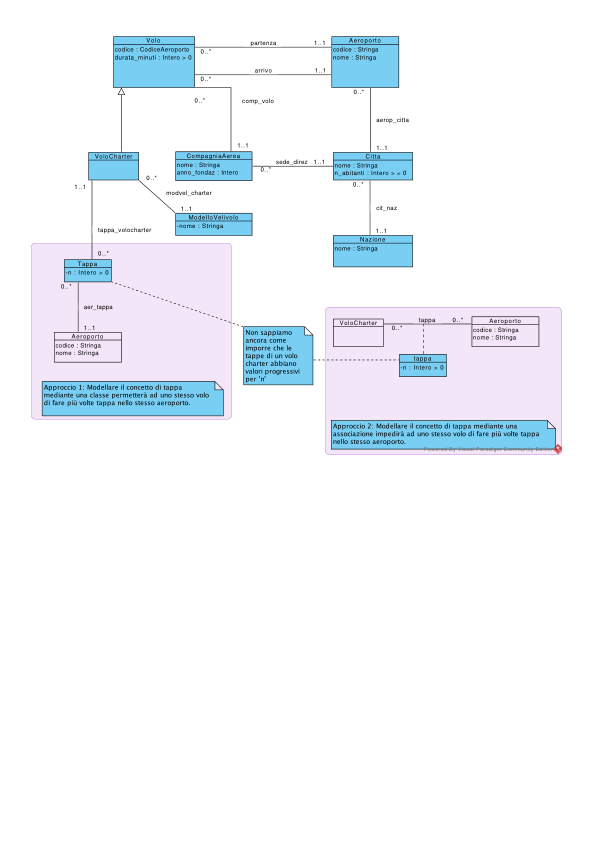

# Diagramma UML delle classi concettuale

> Fonte: `Diagramma UML delle classi concettuale.pdf`
> Estratto con PyMuPDF (conserva legature e formule); tolte le righe ripetute di intestazione e pie' di pagina e le etichette sparse dei diagrammi, che sono ritagliati in `figure/` e richiamati nel punto in cui compaiono.

---

Volo
                                                          Aeroporto
                                          partenza
                   codice : CodiceAeroporto
                   durata_minuti : Intero > 0
                                                       codice : Stringa
                                          arrivo
                                        comp_volo
                                                               aerop_citta
                               CompagniaAerea
               VoloCharter
                                                             Citta
                                              sede_direz
                             anno_fondaz : Intero
                                                        n_abitanti : Intero > = 0
            0..*
            1..1
                           modvel_charter
                                                               cit_naz
                               ModelloVelivolo
                             -nome : Stringa
                tappa_volocharter
                                                            Nazione
                0..*
             Tappa
          -n : Intero > 0
          0..*
              aer_tappa
                                                                 tappa
                                                                                  Aeroporto
                                                         VoloCharter
              1..1
                                                                               codice : Stringa
            Aeroporto
         codice : Stringa
         nome : Stringa
                                                                     tappa
                                                                   -n : Intero > 0
                                                                       Powered ByVisual Paradigm Community Edition

