# A.1 - Analisi dei requisiti mediante UML

> Fonte: `Slide A.1 - Analisi dei requisiti mediante UML - BD2.pdf`
> Estratto con PyMuPDF (conserva legature e formule); tolte le righe ripetute di intestazione e pie' di pagina e le etichette sparse dei diagrammi, che sono ritagliati in `figure/` e richiamati nel punto in cui compaiono.

---

A.1
              Parte: Analisi concettuale
                                                          Analisi dei Requisiti
                                                          Unified Modeling
                              UNITÀ:  A.1
                                                                 Language
                 Versione del 2024-02-18

                                                                      A.1.1
              Parte: Analisi concettuale
                                                     Analisi dei Requisiti
                                                     Unified Modeling Language
                                                     Diagrammi UML delle classi
                              UNITÀ:  A.1
                                                               e degli oggetti
                 Versione del 2024-02-18

                                                                     A.1.1.1
              Parte: Analisi concettuale
                                                       Analisi dei Requisiti
                                                       Unified Modeling Language
                                                       Diagrammi UML delle classi e degli
                              UNITÀ:  A.1
                                                                oggetti
                                                                Oggetti e classi
                 Versione del 2024-02-18

               Diagramma delle classi e degli oggetti per l’analisi
  •
  Nella fase di analisi ci si concentra sulle classi più che sugli oggetti
  •
  Gli oggetti servono essenzialmente per descrivere elementi singoli particolarmente significativi
  oppure per descrivere esempi
  •
  Approccio simile al paradigma della programmazione object-oriented, ad es. in Java:
    •
    Un programma si scrive definendo un insieme definito di class(i), non di oggetti
    •
    Gli oggetti vengono creati, modificati e distrutti durante l’esecuzione del programma
  •
  Come detto in precedenza, faremo riferimento solo ad un sottoinsieme dei meccanismi previsti in
  UML per descrivere il diagramma delle classi
A.1.

                                      Oggetti in UML
  •
  Un oggetto in UML modella un elemento del dominio di analisi che:
    •
    ha "vita propria”
    •
    è identificato univocamente mediante l’identificatore di oggetto
    •
    è istanza di una classe (la cosiddetta classe più specifica – vedremo che, in determinate
    circostanze, un oggetto è istanza di più classi, ma in ogni caso, tra le classi di cui un oggetto è
    istanza, esiste sempre la classe più specifica)
  •
  div_comm è l’identificatore di oggetto (scelto
  dall’analista per potersi riferire all’oggetto nello
  schema concettuale)
                                                                div_comm: Libro
  •
  Libro è la classe più specifica di cui l’oggetto è
  istanza
  •
  Si noti la sottolineatura
A.1.

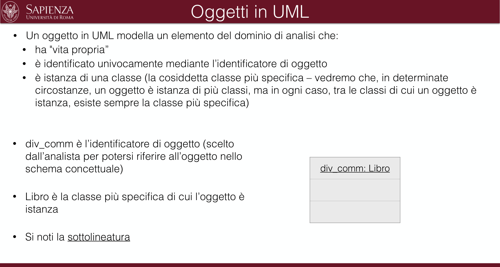

                                             Classi
  •
  Una classe modella un insieme di oggetti omogenei (le istanze della classe) ai quali sono
  associate proprietà statiche (attributi) e dinamiche (operazioni, le vedremo in seguito).
  •
  Ogni classe e' descritta da:
    •
    un nome
    •
    un insieme di proprietà (astrazioni delle proprietà comuni degli oggetti che sono istanze delle
    classi)
                              Nome della classe
                                                                    Il diagramma delle classi impone che
                                                                    tutte le sue istanze (oggetti) abbiano un
                                                      Libro
     Livello delle classi
                                               titolo: Stringa
       (intensionale)
                                                                      valore di tipo stringa  per l’attributo
                            Proprietà locali della
                                                                                “titolo”
                              classe: attributi
                                               (operazioni, in seguito)
                                                                     <<instance of>>
                                         <<instance of>>
    Possibile livello degli
                                      div_comm: Libro
                                                                             bio: Libro
       oggetti
       (estensionale)
                                                                    titolo = “La mia grandiosa vita”
                                 titolo = “La divina commedia”
A.1.

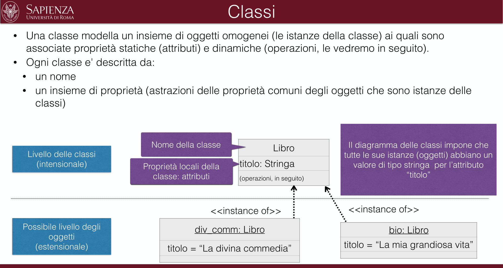

                                     Oggetti e classi
  •
  Un oggetto (istanza di una classe) è identificato da un identificatore univoco
  •
  Un diagramma delle classi in generale permette la coesistenza di oggetti identici
                                                     Libro
     Livello delle classi
                                                  titolo: Stringa
      (intensionale)
                                                 (operazioni, in seguito)
                                                                    <<instance of>>
                                         <<instance of>>
   Possibile livello
                                      div_comm: Libro
                                                                        div_comm_2: Libro
    degli oggetti
    (estensionale)
                                                                    titolo = “La divina commedia”
                                titolo = “La divina commedia”
                                              Oggetti identici possono coesistere
                                              AMMESSO
A.1.

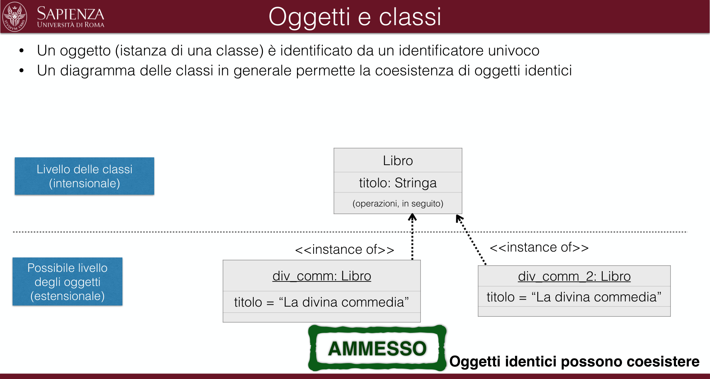

                                                                     A.1.1.2
              Parte: Analisi concettuale
                                                       Analisi dei Requisiti
                                                       Unified Modeling Language
                                                       Diagrammi UML delle classi e degli
                              UNITÀ:  A.1
                                                             oggetti
                                                             Link e associazioni
                 Versione del 2024-02-18

                                   Associazioni e link
  •
  Una associazione modella la possibilità che oggetti di due (o più classi) abbiano dei legami
  •
  Le istanze di associazioni si chiamano link: se A è una associazione tra le classi C1 e C2, una
  istanza di A è un link tra due oggetti (in altre parole, una coppia), uno della classe C1 e l’altro della
  classe C2
                                                               associazione
                                                                              Persona
                                           Libro
   Livello delle classi e delle associazioni
                                                        nome: Stringa
                                                        cognome: Stringa
                                                        autore
             (intensionale)
                                       titolo: Stringa
                                                              verso di lettura del
                                                              nome (opzionale)
                            <<instance of>>
                            <<instance of>>
                            <<instance of>>
                                div_comm: Libro
                                                                             dante: Persona
                                                        autore
   Possibile livello degli
                          titolo = “La divina commedia”
                                                                          nome = “Dante”
                                                                          cognome = “Alighieri”
    oggetti e dei link
     (estensionale)
                                                              link
A.1.

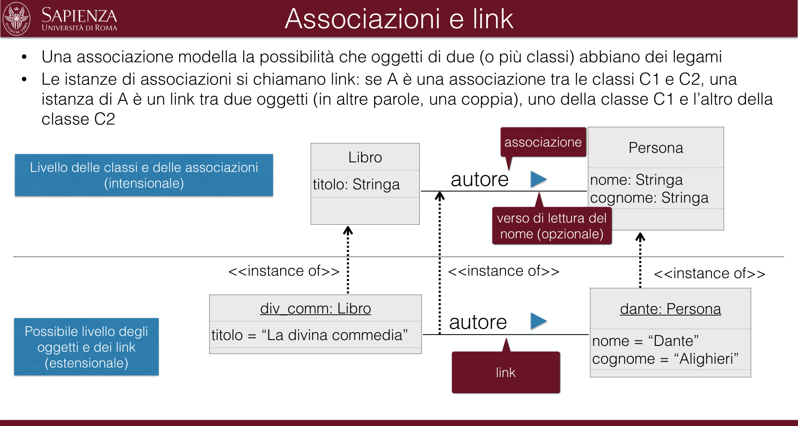

                                Associazioni e link (2)
  •
  Come gli oggetti sono istanze delle classi, così i link sono istanze delle associazioni (gli archi <<instance
  of>> non sono necessari)
  •
  Al contrario degli oggetti, però, i link non hanno identificatori espliciti: un link è implicitamente
  identificato dalla coppia (o in generale dalla ennupla, v. seguito) di oggetti che esso rappresenta
  •
  Ciò implica, ad esempio, che il seguente diagramma degli oggetti non è ammesso dal diagramma delle
  classi
                                                                                 Persona
                                             Libro
   nome: Stringa
   cognome: Stringa
   autore
   Livello delle classi e delle associazioni
                                         titolo: Stringa
            (intensionale)
                                                          <<instance of>>
                              <<instance of>>
                              <<instance of>>
                                                                                 <<instance of>>
                                                              autore
                                                                 NON AMMESSO
                                    div_comm: Libro
                                                                                 dante: Persona
    Possibile livello degli
                              titolo = “La divina commedia”
                                                              autore
                                                                             nome = “Dante”
                                                                             cognome = “Alighieri”
     oggetti e dei link
      (estensionale)
       Non ammesso: link uguali non possono coesistere
A.1.

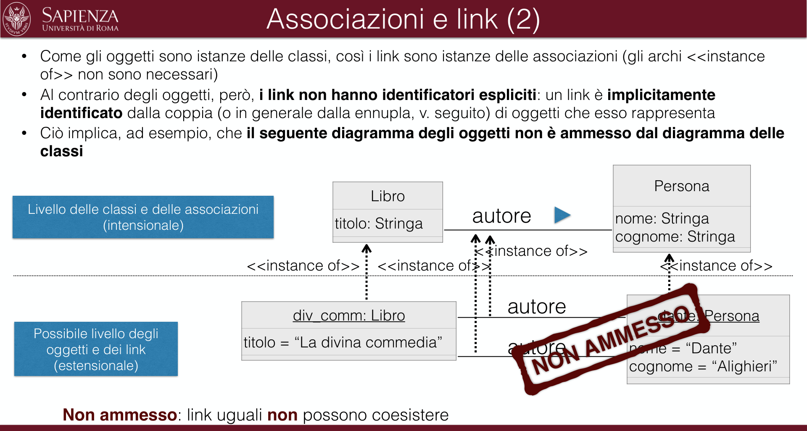

                                Associazioni e link (3)
  •
  …il seguente diagramma degli oggetti non è ammesso dal diagramma delle classi
  •
  Una associazione tra le classi Libro e Persona definisce la possibilità che il le istanze (oggetti)
  della classe Libro siano in relazione con istanze (oggetti) di classe Persona (la relazione si chiama
  “autore”).
  •
  Aver modellato la possibilità di tali legami mediante una associazione implica che, per l’analista,
  non ha concettualmente senso il fatto che un libro abbia “più volte lo stesso autore”.
                                                                                 Persona
                                             Libro
   nome: Stringa
   cognome: Stringa
   autore
   Livello delle classi e delle associazioni
                                         titolo: Stringa
            (intensionale)
                                                          <<instance of>>
                              <<instance of>>
                              <<instance of>>
                                                                                 <<instance of>>
                                                              autore
                                                                 NON AMMESSO
                                    div_comm: Libro
                                                                                 dante: Persona
    Possibile livello degli
                              titolo = “La divina commedia”
                                                              autore
                                                                             nome = “Dante”
                                                                             cognome = “Alighieri”
     oggetti e dei link
      (estensionale)
A.1.

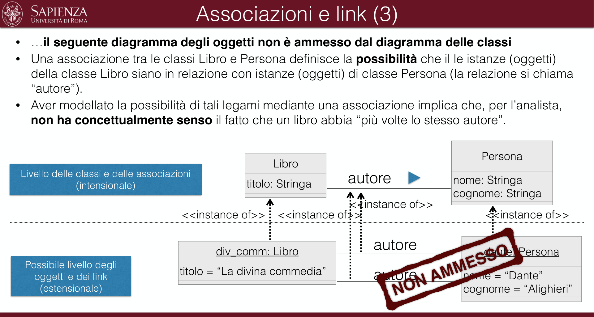

                                           Esempio
  Si vuole progettare un’applicazione che permetta ai clienti di prenotare hotel via web
A.1.

                                           Esempio
  Si vuole progettare un’applicazione che permetta ai clienti di prenotare hotel via web
                                                               Persona
 prenota
 Livello delle classi e delle
                            Hotel
     associazioni
     (intensionale)
                                                           nome: Stringa
                                                           cognome: Stringa
                        nome: Stringa
A.1.

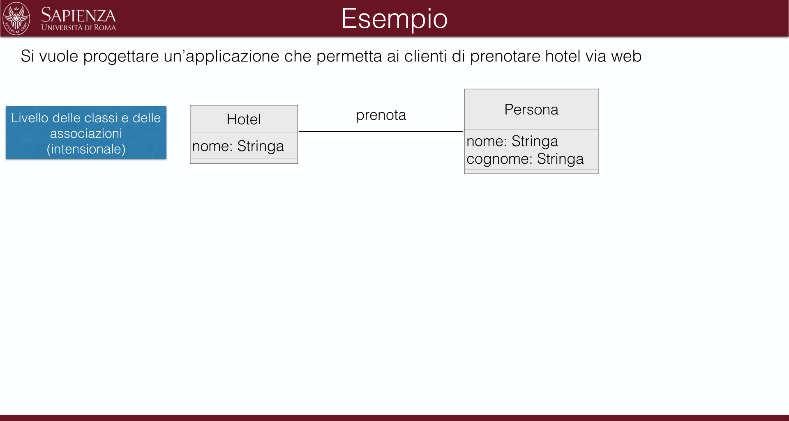

                                           Esempio
  Si vuole progettare un’applicazione che permetta ai clienti di prenotare hotel via web
                                                               Persona
 prenota
 Livello delle classi e delle
                            Hotel
     associazioni
     (intensionale)
                                                           nome: Stringa
                                                           cognome: Stringa
                        nome: Stringa
                                     <<instance of>>
                                     <<instance of>>
                    <<instance of>>
                                                              alice: Persona
   Possibile livello degli
                                              prenota
                            h1:Hotel
    oggetti e dei link
                                                           nome = “Alice”
                                                           cognome = “Bianchi”
                       nome = “La Pergola”
     (estensionale)
A.1.

                                           Esempio
  Si vuole progettare un’applicazione che permetta ai clienti di prenotare hotel via web
                                                               Persona
 prenota
 Livello delle classi e delle
                            Hotel
     associazioni
     (intensionale)
                                                           nome: Stringa
                                                           cognome: Stringa
                        nome: Stringa
                                     <<instance of>>
                                     <<instance of>>
                    <<instance of>>
                                                              alice: Persona
   Possibile livello degli
                                              prenota
                            h1:Hotel
    oggetti e dei link
                                                           nome = “Alice”
                                                           cognome = “Bianchi”
                       nome = “La Pergola”
     (estensionale)
   •
   E se volessimo rappresentare una seconda prenotazione di ‘alice’ presso ‘h1’?
A.1.

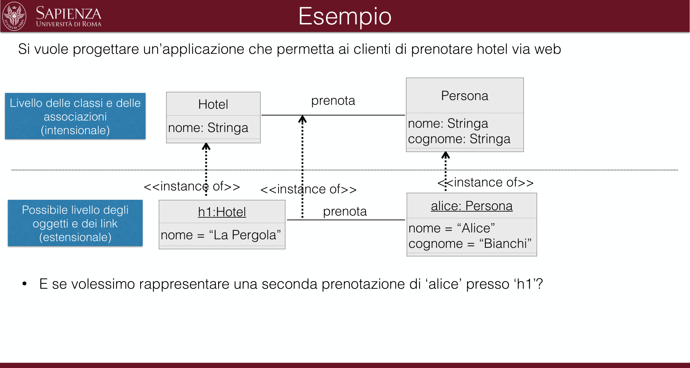

                                           Esempio
  Si vuole progettare un’applicazione che permetta ai clienti di prenotare hotel via web
                                                               Persona
 prenota
 Livello delle classi e delle
                            Hotel
     associazioni
     (intensionale)
                                                           nome: Stringa
                                                           cognome: Stringa
                        nome: Stringa
                                                <<instance of>>
                                     <<instance of>>
                                     <<instance of>>
                    <<instance of>>
                                                              alice: Persona
   Possibile livello degli
                                              prenota
                            h1:Hotel
    oggetti e dei link
                                                           nome = “Alice”
                                                           cognome = “Bianchi”
                       nome = “La Pergola”
                                              prenota
     (estensionale)
   •
   E se volessimo rappresentare una seconda prenotazione di ‘alice’ presso ‘h1’?
A.1.

                                           Esempio
  Si vuole progettare un’applicazione che permetta ai clienti di prenotare hotel via web
                                                               Persona
 prenota
 Livello delle classi e delle
                            Hotel
     associazioni
     (intensionale)
                                                           nome: Stringa
                                                           cognome: Stringa
                        nome: Stringa
                                                <<instance of>>
                                     <<instance of>>
                                     <<instance of>>
                    <<instance of>>
                                                              alice: Persona
                                                NON AMMESSO
   Possibile livello degli
                                              prenota
                            h1:Hotel
    oggetti e dei link
                                                           nome = “Alice”
                                                           cognome = “Bianchi”
                       nome = “La Pergola”
                                              prenota
     (estensionale)
   •
   E se volessimo rappresentare una seconda prenotazione di ‘alice’ presso ‘h1’?
A.1.

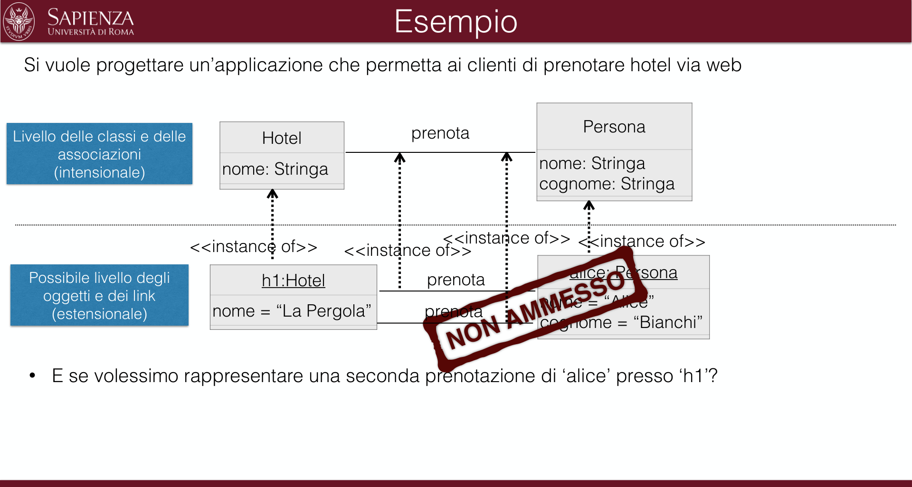

                                           Esempio
  Si vuole progettare un’applicazione che permetta ai clienti di prenotare hotel via web
                                                                              INADEGUATO
                                                               Persona
 prenota
 Livello delle classi e delle
                            Hotel
     associazioni
     (intensionale)
                                                           nome: Stringa
                                                           cognome: Stringa
                        nome: Stringa
                                                <<instance of>>
                                     <<instance of>>
                                     <<instance of>>
                    <<instance of>>
                                                              alice: Persona
                                                NON AMMESSO
   Possibile livello degli
                                              prenota
                            h1:Hotel
    oggetti e dei link
                                                           nome = “Alice”
                                                           cognome = “Bianchi”
                       nome = “La Pergola”
                                              prenota
     (estensionale)
   •
   E se volessimo rappresentare una seconda prenotazione di ‘alice’ presso ‘h1’?
   •
   Il diagramma qui sopra impedirebbe ad una stessa persona di prenotare, nella sua vita, lo stesso
   hotel più volte!
A.1.

                                           Esempio
  Si vuole progettare un’applicazione che permetta ai clienti di prenotare hotel via web
                                                                              INADEGUATO
                                                               Persona
 prenota
 Livello delle classi e delle
                            Hotel
     associazioni
     (intensionale)
                                                           nome: Stringa
                                                           cognome: Stringa
                        nome: Stringa
                                                <<instance of>>
                                     <<instance of>>
                                     <<instance of>>
                    <<instance of>>
                                                              alice: Persona
                                                NON AMMESSO
   Possibile livello degli
                                              prenota
                            h1:Hotel
    oggetti e dei link
                                                           nome = “Alice”
                                                           cognome = “Bianchi”
                       nome = “La Pergola”
                                              prenota
     (estensionale)
   •
   E se volessimo rappresentare una seconda prenotazione di ‘alice’ presso ‘h1’?
   •
   Il diagramma qui sopra impedirebbe ad una stessa persona di prenotare, nella sua vita, lo stesso
   hotel più volte!
   •
   Come risolvere?
A.1.

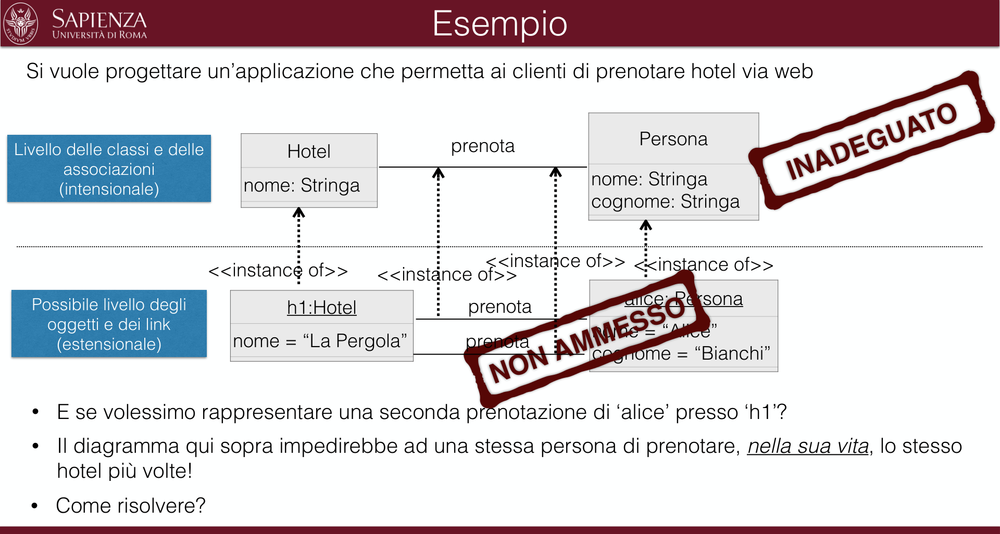

                                           Esempio
  Si vuole progettare un’applicazione che permetta ai clienti di prenotare hotel via web
  •
  Il diagramma precedente impedirebbe ad una stessa persona di prenotare, nella sua vita, lo
  stesso hotel più volte!
  •
  Come risolvere?
                                         ADEGUATO
                        Prenotazione
                        hotel_prenotato
                        cliente_prenotazione
             Hotel
                                                                                  Persona
        nome: Stringa
                                                                             nome: Stringa
                                                                             cognome: Stringa
                          hotel_prenotato
                          p1:Prenotazione
                          cliente_prenotazione
            h1:Hotel
                                                                                 alice: Persona
       nome = “La Pergola”
                          p2:Prenotazione
                          hotel_prenotato
                          cliente_prenotazione
                                                                              nome = “Alice”
                                                                              cognome = “Bianchi”
   •
   Abbiamo fatto in modo che ogni singola prenotazione abbia “vita propria”
   —> le prenotazioni sono a loro volta oggetti, istanze della nuova classe Prenotazione
A.1.

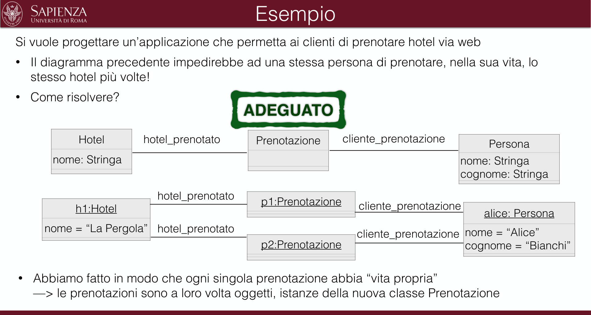

                      Associazioni multiple tra due classi
  •
  Tra le stesse classi possono essere definite più associazioni, che modellano legami di natura
  diversa
                                                            autore
                                                                               Persona
                                            Libro
                                                                          nome: Stringa
                                                                          cognome: Stringa
   Livello delle classi e delle associazioni
                                                            editore
                                       titolo: stringa
            (intensionale)
                               autore
                                         dante: Persona
         div_comm: Libro
                                                                          bio: Libro
                                      nome = “Dante”
                                      cognome = “Alighieri”
                                                                 titolo = “La mia grandiosa vita”
   titolo = “La divina commedia”
                    AMMESSO
                                                                     autore
                                                                     editore
                                                                                      AMMESSO
                          editore
                                          feltr: Persona
    Possibile livello degli
                                                                       modestino: Persona
                                      nome = “Faustino”
                                      cognome = “Feltrinelli”
     oggetti e dei link
                                                                     nome = “Modestino”
                                                                     cognome = “Rossi”
      (estensionale)
A.1.

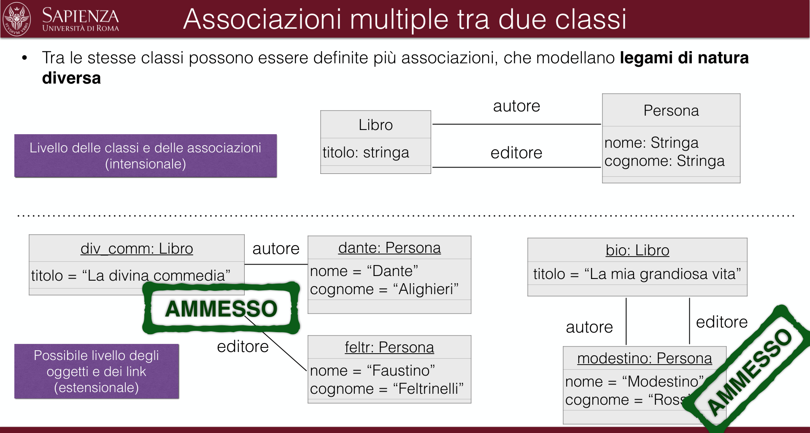

                                                                     A.1.1.3
              Parte: Analisi concettuale
                                                     Analisi dei Requisiti
                                                     Unified Modeling Language
                                                     Diagrammi UML delle classi e degli oggetti
                              UNITÀ:  A.1
                                                         Vincoli di molteplicità sulle
                                                         associazioni e sugli attributi
                 Versione del 2024-02-18

                      Associazioni: vincoli di molteplicità
  •
  I diagrammi delle classi visti fino ad ora sono modelli molto laschi della realtà di interesse
                                                                 Città
                          Impiegato
                                              nascita
  Livello delle classi e
                                                            nome: Stringa
   delle associazioni
                      nome: Stringa
                      cognome: Stringa
     (intensionale)
                                                              roma:Città
                                                                            Questo insieme di
                                                                            oggetti è ammesso dal
                                                                            diagramma delle classi
                                              nascita
                       nome=“Roma”
                       anna:Impiegato
  Possibile livello degli
                                              nascita
   oggetti e dei link
                                                                             di sopra, ma non
                                                                             soddisfa i vincoli del
                     nome=“Anna”
                     cognome=“Bianchi”
    (estensionale)
                                                              milano:Città
                                      AMMESSO, MA…
                                                                                 mondo reale
                                                            nome=“Milano”
A.1.

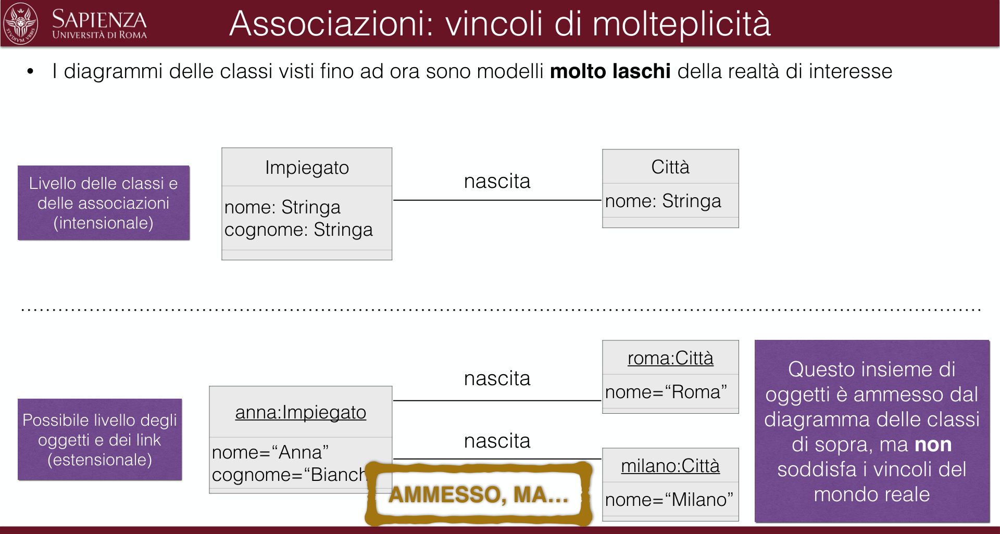

                    Associazioni: vincoli di molteplicità (2)
  •
  UML permette di definire vincoli di integrità in un diagramma delle classi
  •
  Un vincolo di integrità impone ulteriori restrizioni (oltre quelle strutturali imposte dal diagramma) sui
  livelli estensionali ammessi
  •
  Vediamo ora i vincoli di molteplicità sulle associazioni
                                              nascita
                                                                 Città
                          nome: Stringa
                          Impiegato
   Livello delle classi
                      nome: Stringa
                      cognome: Stringa
    (intensionale)
                                      “da 1 ad 1”
                                      “da 0 all’infinito”,
                                      ovvero “qualsiasi”
                                                          roma:Città
                                                                            A causa dei vincoli di
                                                                            molteplicità, ora questo
                                                                            insieme di oggetti e link
                                                                            non è più ammesso dal
                                              nascita
                       nome=“Roma”
                       anna:Impiegato
  Possibile livello degli
   oggetti e dei link
                     nome=“Anna”
                     cognome=“Bianchi”
                                              nascita
    (estensionale)
                                                          milano:Città
                                                                             diagramma delle classi
                                                                                    di sopra
                           NON PIÙ AMMESSO
                                                        nome=“Milano”
A.1.

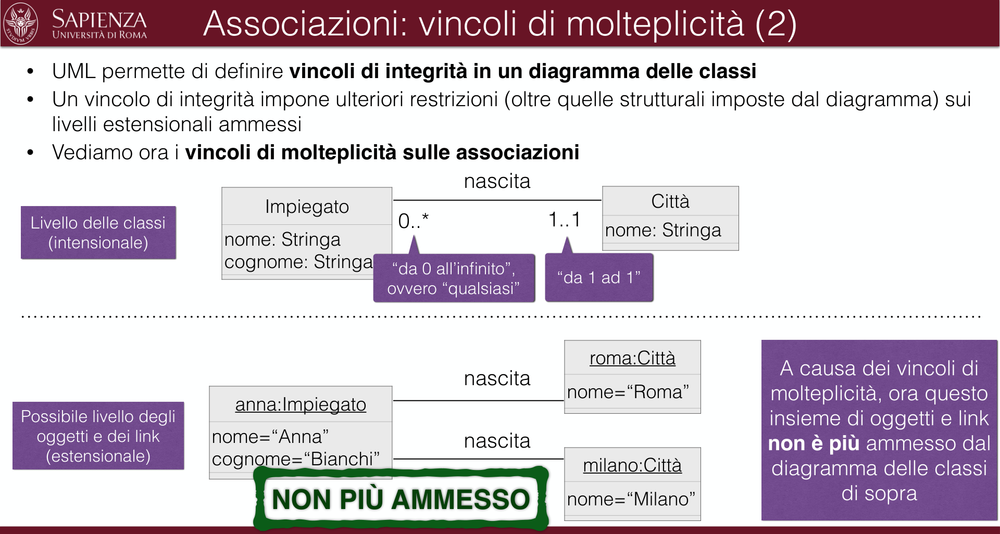

                    Associazioni: vincoli di molteplicità (3)
  •
  Semantica dei vincoli di molteplicità sui ruoli delle associazioni
                             Ruolo della classe
                                                      Ruolo della classe Città
                             Impiegato
                             nell’associazione
                                                        nell’associazione
                                                                           Città
              Impiegato
                                              nascita
                                                                       nome: Stringa
          nome: Stringa
          cognome: Stringa
 1..1: Ogni istanza di Impiegato deve essere coinvolta in un numero
 di link dell’associazione “nascita” che va “da 1 ad 1”
 Dato che non possiamo avere più link tra la stessa coppia di
 oggetti, questo è equivalente a: ogni istanza di Impiegato deve
                                                        0..*: Ogni istanza di Città deve essere coinvolta in un
                                                        numero di link dell’associazione “nascita” che va “da 0
                                                         all’infinito”
                                                         È equivalente a dire: ogni istanza di Città può essere
   essere legata ad una ed una sola istanza di Città (tramite link
                                                          legata ad un numero qualunque (0..*) di istanze di
                                                          Impiegato (tramite link dell’associazione “nascita”)
                dell’associazione “nascita”)
A.1.

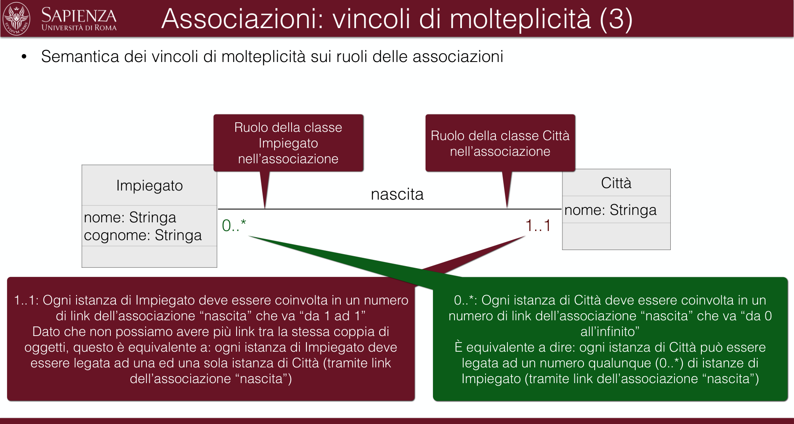

                    Associazioni: vincoli di molteplicità (4)
  •
  Semantica dei vincoli di molteplicità sui ruoli delle associazioni (cont.)
                                                                           Automobile
                                                possiede
                  targa: …
                  Persona
             nome: Stringa
                               (ignorato)
                                                                 a1:Automobile
                                     possiede
                                                                 targa=…
                                                                 a2:Automobile
               anna:Persona
                                        possiede
                                                                  targa=…
                                                                  a3:Automobile
                                         possiede
             nome=“Anna”
                                                                    targa=…
A.1.

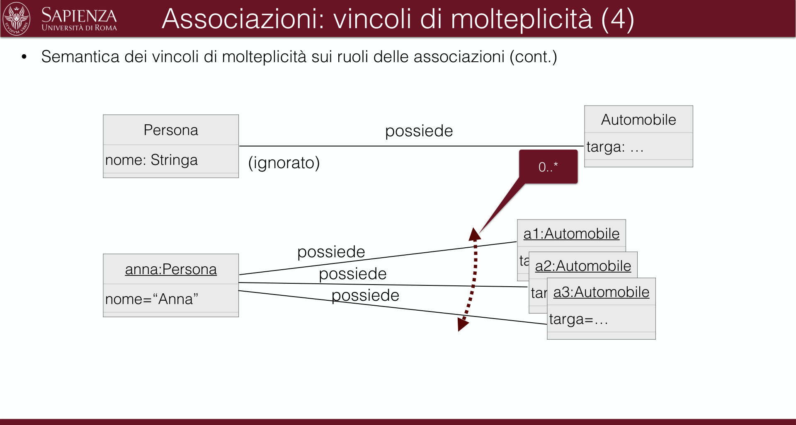

                          Esercizio: prenotazioni di hotel
  •
  Definire i vincoli di molteplicità sui ruoli delle associazioni del seguente diagramma delle classi
                                                                                 Persona
                        hotel_prenotato
                        cliente_prenotazione
            Hotel
                                          Prenotazione
                                                                             nome: Stringa
                                                                             cognome: Stringa
        nome: Stringa
                                         istante:DataOra
A.1.

                          Esercizio: prenotazioni di hotel
  •
  Definire i vincoli di molteplicità sui ruoli delle associazioni del seguente diagramma delle classi
  •
  Soluzione:
                                                                                 Persona
                        hotel_prenotato
                        cliente_prenotazione
            Hotel
                                          Prenotazione
                                                                             nome: Stringa
                                                                             cognome: Stringa
        nome: Stringa
                                         istante:DataOra
A.1.

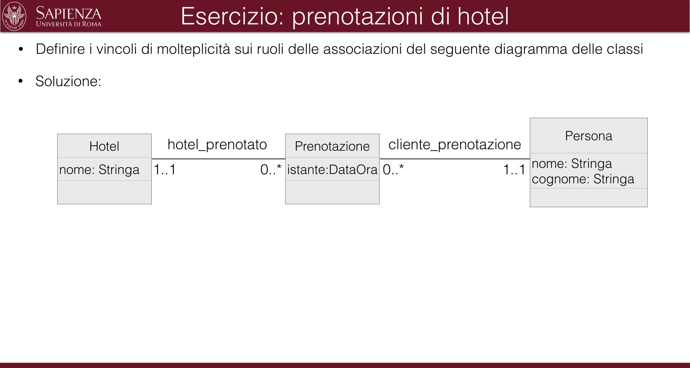

                                          Esercizio
  •
  Si vuole progettare un sistema che gestisca i dati anagrafici delle persone
  •
  Di ogni persona interessa il nome, il cognome, la data di nascita, la città di nascita e quella di
  residenza
  •
  Si definisca un diagramma delle classi concettuale per l’applicazione
A.1.

                                          Esercizio
  •
  Si vuole progettare un sistema che gestisca i dati anagrafici delle persone
  •
  Di ogni persona interessa il nome, il cognome, la data di nascita, la città di nascita e quella di
  residenza
  •
  Si definisca un diagramma delle classi concettuale per l’applicazione
                                               nascita
                                                                 Città
                           nome: Stringa
                           Impiegato
                       nome: Stringa
                       cognome: Stringa
                       data_nascita: Data
                                              residenza
A.1.

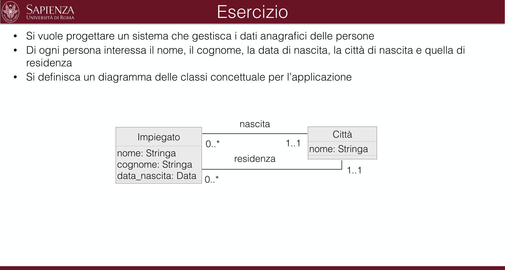

               Associazioni che insistono più volte sulla stessa classe
  •
  Supponiamo di voler modellare i sovrani di un regno ormai scomparso
  •
  Di ogni sovrano interessa il nome, il periodo in cui ha regnato, ed il predecessore
                                              Sovrano
                                           nome: Stringa
                                           inizio: Data
                                           fine: Data
  •
  Come possiamo rappresentare il concetto di predecessore?
A.1.

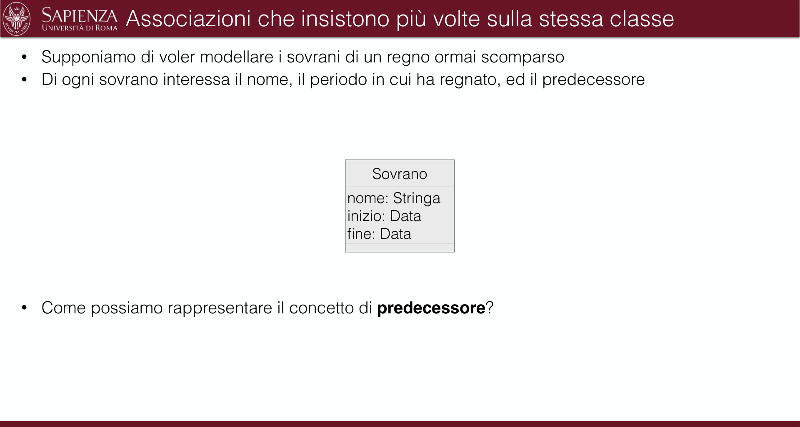

               Associazioni che insistono più volte sulla stessa classe (2)
                                                                                  Livello delle classi e
  •
  Supponiamo di voler modellare i sovrani di un regno ormai scomparso
                                                                                   delle associazioni
                                                                                     (intensionale)
  •
  Di ogni sovrano interessa il nome, il periodo in cui ha regnato, ed il predecessore
                                                                 predecessore
  •
  Sappiamo che le istanze dell’associazione sono
  coppie (s1, s2) di oggetti (istanze) di classe Sovrano.
                                                                                        nome di ruolo
                                                          Sovrano
                                                                                    successione
  •
  La classe Sovrano gioca due ruoli nell’associazione
  —> UML ci obbliga a dare esplicitamente nomi distinti
  ai due ruoli
                                                       nome: Stringa
                                                       inizio: Data
                                                       fine: Data
                                                                      successore
                                                                                       nome di ruolo
  •
  Una istanza dell’associazione diventa una coppia
  etichettata: (predecessore:s1, successore:s2)
  •
  L’ambiguità è sparita
                                                     successione
                                                                                 car1: Sovrano
                             ric2: Sovrano
    Possibile livello degli
                                           predecessore
                                           successore
                                                                              nome=“Carlo I”
                                                                              inizio=…
                                                                              fine=…
      oggetti e dei link
                         nome=“Riccardo II”
                         inizio=…
                         fine=…
      (estensionale)
A.1.

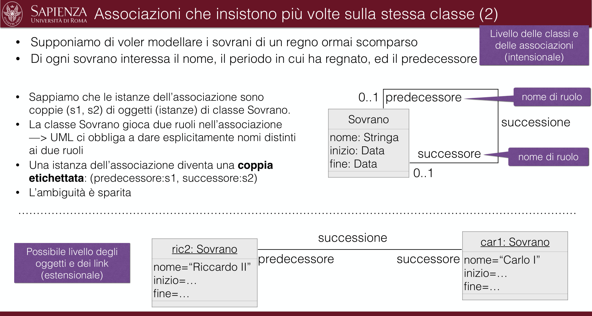

                                                                     A.1.1.4
              Parte: Analisi concettuale
                                                     Analisi dei Requisiti
                                                     Unified Modeling Language
                                                     Diagrammi UML delle classi e degli oggetti
                              UNITÀ:  A.1
                                                          Associazioni con attributi
                                                              (association class)
                 Versione del 2024-02-18

                              Associazioni con attributi
  •
  Si vuole progettare un sistema che gestisca gli esiti (voti in trentesimi) dei test superati dagli
  studenti di un corso.
  •
  Il corso è diviso in moduli e uno studente può superare il test di ogni modulo al più una volta.
  •
  Si definisca un diagramma delle classi concettuale per l’applicazione
                             Studente
                                                               Modulo
                                           test_superato
                                                            nome: Stringa
                                                            voto?
                          nome: Stringa
                          voto?
  •
  Come rappresentare i voti conseguiti dagli studenti nei test dei diversi moduli?
  •
  Non possiamo aggiungere un attributo “voto” né nella classe Studente né nella classe Modulo!
  •
  In effetti, un voto non è una proprietà locale di uno studente, né di un modulo, ma è una proprietà
  del legame tra uno studente ed un modulo… ovvero è una proprietà dell’associazione
A.1.

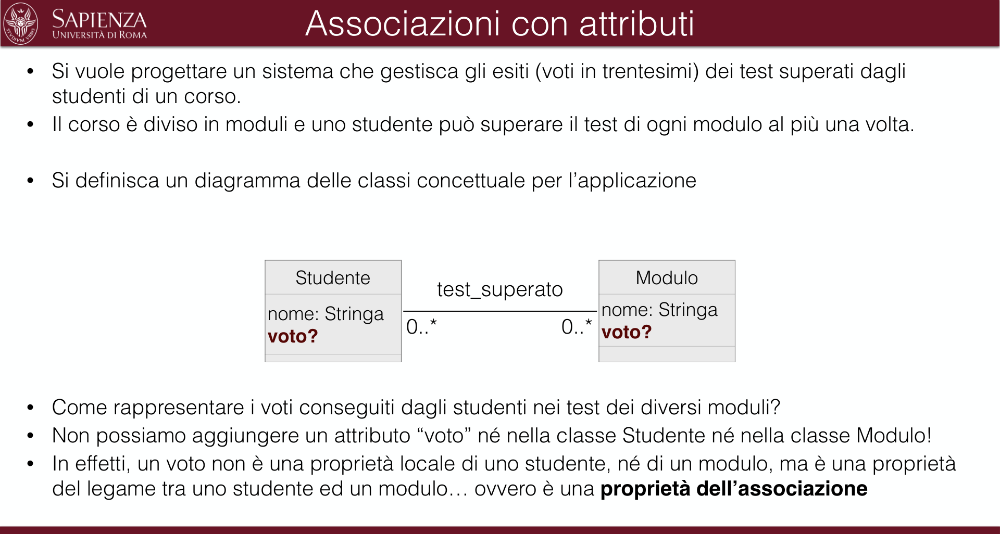

                           Associazioni con attributi (2)
  •
  Si vuole progettare un sistema che gestisca gli esiti (data e voto in trentesimi) dei test svolti dagli
  studenti di un corso.
  •
  Il corso è diviso in moduli e uno studente può sostenere il test di ogni modulo al più una volta.
     Livello delle classi e
                                       test_superato
     delle associazioni
                                                                              Associazione con
                                      voto: … (tipo?)
                                      data: Data
       (intensionale)
                                                                                 attributi
                                                          Modulo
                        Studente
                                                      nome: Stringa
                     nome: Stringa
                                     test_superato
                                     voto=27
                                     data=3/5/2023
                                                      py:Modulo
                                                      nome=“Python”
    Possibile livello
    degli oggetti e
    dei link
    (estensionale)
                                                                          ja:Modulo
                     anna:Studente
                                                                        nome=“Java”
                     nome=“Anna”
                                           test_superato
                                        voto=25
                                        data=7/9/2022
A.1.

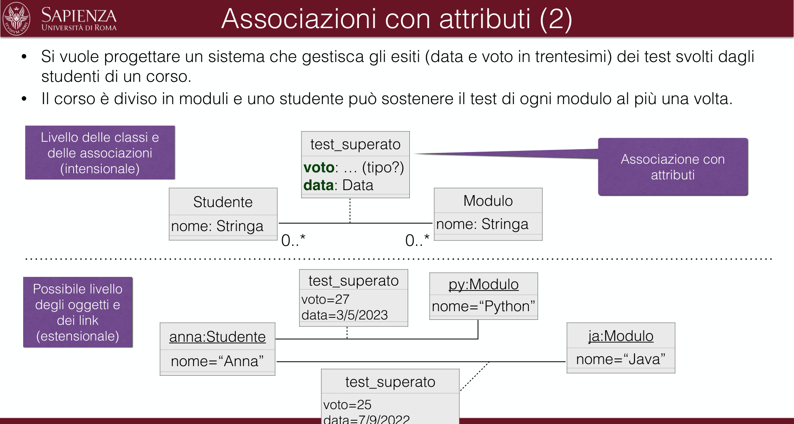

                           Associazioni con attributi (3)
  •
  Attenzione: anche in presenza di attributi, la natura dell’associazione non cambia:
     •
     il diagramma permette ad una stessa coppia di oggetti di formare al più un link
     dell’associazione
   Livello delle classi e
                                       test_superato
    delle associazioni
                                                                              Associazione con
                                      voto: …
                                      data: Data
      (intensionale)
                                                                                 attributi
                                                          Modulo
                        Studente
                                                      nome: Stringa
                     nome: Stringa
                                     test_superato
                                     voto=27
                                     data=3/5/2023
                                                      py:Modulo
                                                      nome=“Python”
    Possibile livello
                                                                        Questo insieme di oggetti e
    degli oggetti e
                                                                         link non è ammesso dal
                                                                         diagramma delle classi di
    dei link
    (estensionale)
                     anna:Studente
                               NON AMMESSO
                                                                        sopra: i due link restano
                                                                        uguali nonostante il valore
                     nome=“Anna”
                                            test_superato
                                                                               degli attributi
                                           voto=25
                                           data=7/9/2022
A.1.

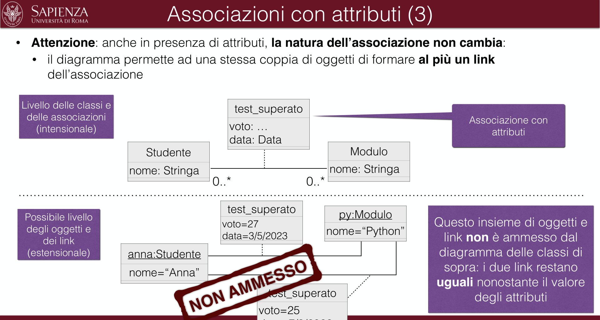

               Associazioni con attributi, anche dette association class
  •
  Un’associazione UML con attributi è anche chiamata association class, in quanto può essere a sua volta
  terminale di ulteriori associazioni
  •
  La natura dell’associazione non cambia:
     •
     il diagramma permette ad una stessa coppia di oggetti di formare al più un link dell’associazione
   Livello delle classi e
                                                                             Docente
                                       test_superato
                                                   nome: Stringa
                                                   docente_test
                                                   1..*
    delle associazioni
                                      voto: …
                                      data: Data
      (intensionale)
                                                          Modulo
                        Studente
                                                      nome: Stringa
                     nome: Stringa
                                            docente_test
                             test_superato
                             voto=27
                             data=3/5/2023
                                                      bea:Docente
                                                      nome=“Beatrice”
                                                                       Questo insieme di oggetti e
    Possibile livello
                                                                        link non è ammesso dal
                                                                        diagramma delle classi di
    degli oggetti e
    dei link
    (estensionale)
                                                  py:Modulo
                                                  nome=“Python”
                                                                      sopra: i due link
                                                                      “test_superato” restano uguali
                     anna:Studente
                  NON AMMESSO
                     nome=“Anna”
                                    test_superato
                                    voto=25
                                    data=7/9/2022
                                                                         nonostante il valore degli
                                                 docente_test
                                                 and:Docente
                                                 nome=“Andrea”
                                                                           attributi e i “loro” link
A.1.

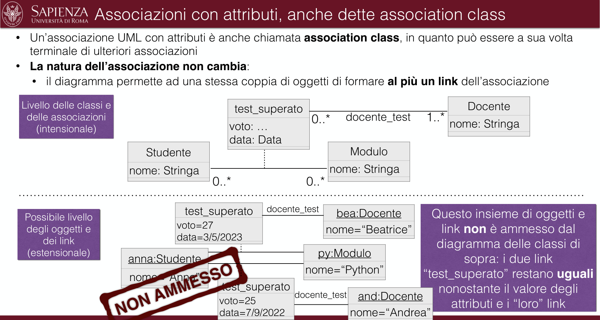

                                                                     A.1.1.5
              Parte: Analisi concettuale
                                                       Analisi dei Requisiti
                                                       Unified Modeling Language
                                                       Diagrammi UML delle classi e degli
                              UNITÀ:  A.1
                                                           oggetti
                                                           Tipi di dato concettuali
                 Versione del 2024-02-18

                        Tipi di dato concettuali: tipi base
  •
  Durante l’analisi concettuale dobbiamo definire il tipo di ogni attributo, di classe e di associazione
  •
  Ricordiamoci che, in analisi, non vogliamo effettuare scelte tecnologiche (ad es., sul linguaggio di
  programmazione)
  •
  Dunque, vogliamo utilizzare tipi di dato concettuali, che siano facilmente realizzabili con
  qualsivoglia tecnologia informatica (Python, Java, sistemi di gestione di basi di dati, etc.)
  •
  Tipi base:
     •
     Intero, Reale, Booleano, Data, Ora, DataOra
  •
  Vogliamo però anche essere certi di modellare la realtà in modo accurato!
A.1.

                  Tipi di dato concettuali: tipi specializzati
  •
  …Vogliamo però anche essere certi di modellare la realtà in modo accurato!
    Livello delle classi e
                                      test_superato
     delle associazioni
                                     voto: Intero
                                     data: Data
       (intensionale)
                                                          Modulo
                        Studente
                                                      nome: Stringa
                     nome: Stringa
                                                      py:Modulo
                                                      nome=“Python”
    Possibile livello
                                                                        Il valore -5 per il voto di
                                                                        ‘anna’ nel test del modulo
    degli oggetti e
    dei link
    (estensionale)
                     anna:Studente
                                                                        ‘py’ sarebbe lecito per il
                     nome=“Anna”
                                                                              diagramma!
                                              test_superato
                                              voto=-5
                                              data=3/5/2023
                        AMMESSO, MA…
A.1.

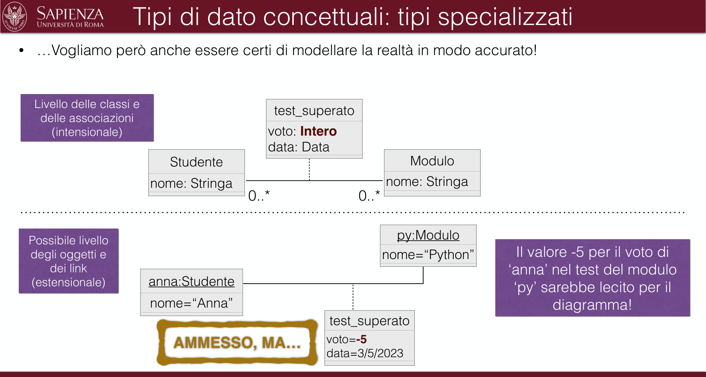

                Tipi di dato concettuali: tipi specializzati (2)
  •
  Vogliamo però anche essere certi di modellare la realtà in modo accurato!
  •
  Tipi di dato specializzati:
    •
    Intero > 0, Reale <= 0, etc., tipo intervallo (di interi): 18..30, 0..100, etc.
      Livello delle classi e
                                        test_superato
       delle associazioni
                                       voto: 18..30
                                       data: Data
         (intensionale)
                                                           Modulo
                         Studente
                                                        nome: Stringa
                       nome: Stringa
                                                       py:Modulo
                                                       nome=“Python”
     Possibile livello
      degli oggetti e
      dei link
      (estensionale)
                      anna:Studente
                                                                        Il valore -5 per il voto di
                                                                        anna nel test del modulo
                       nome=“Anna”
                                                test_superato
                 NON PIÙ AMMESSO
                                                                        Python non è più lecito!
                                                voto=-5
                                                data=3/5/2023
A.1.

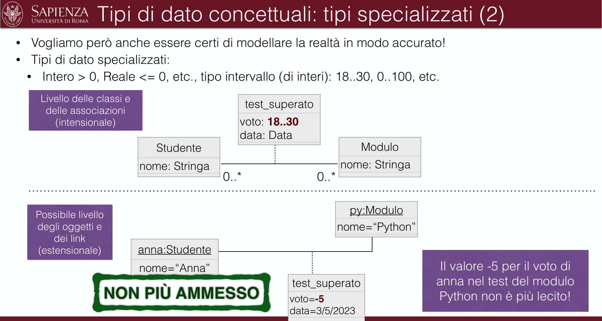

                   Tipi di dato concettuali: tipi enumerativi
  •
  Quando l’insieme dei possibili valori di un attributo è finito e piccolo, possiamo usare un tipo di
  dato enumerativo, che definisce esplicitamente e completamente l’insieme dei valori possibili per
  l’attributo.
  Ad esempio:
     •
     {maschio, femmina},  {Africa, America, Antartide, Asia, Europa, Oceania}, etc.
                                                       test_superato
    Livello delle classi e
                                                       voto: 18..30
                                                       data: Data
     delle associazioni
                                   Studente
                                                                           Modulo
      (intensionale)
                           nome: Stringa
                           genere: {maschio, femmina}
                                                                       nome: Stringa
    Possibile livello
                                                   py:Modulo
                                                   nome=“Python”
                                                   test_superato
    degli oggetti e
                                                   voto=27
                                                   data=3/5/2023
                                  anna:Studente
    dei link
    (estensionale)
                                nome=“Anna”
                                genere=femmina
                                                   Non è una stringa, ma un simbolo
                                                      (valore del tipo enumerativo)
A.1.

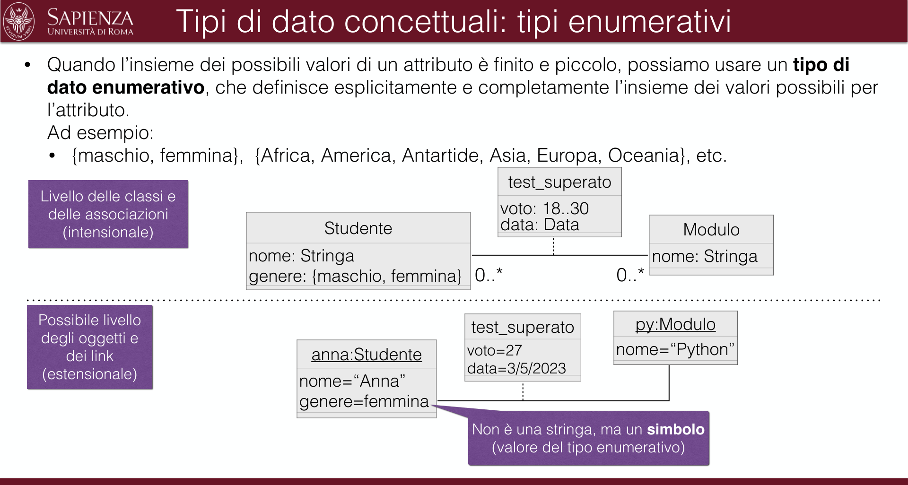

                           Tipi di dato definiti dall’utente
  •
  UML consente all’analista di definire nuovi tipi di dato, che potranno essere usati liberamente nello
  schema concettuale.
                                              test_superato
                                             voto: 18..30
                                             data: Data
                                                                 Modulo
                              Studente
                                                              nome: Stringa
                           nome: Stringa
                           genere: Genere
  •
  Tipo Genere = {maschio, femmina}
A.1.

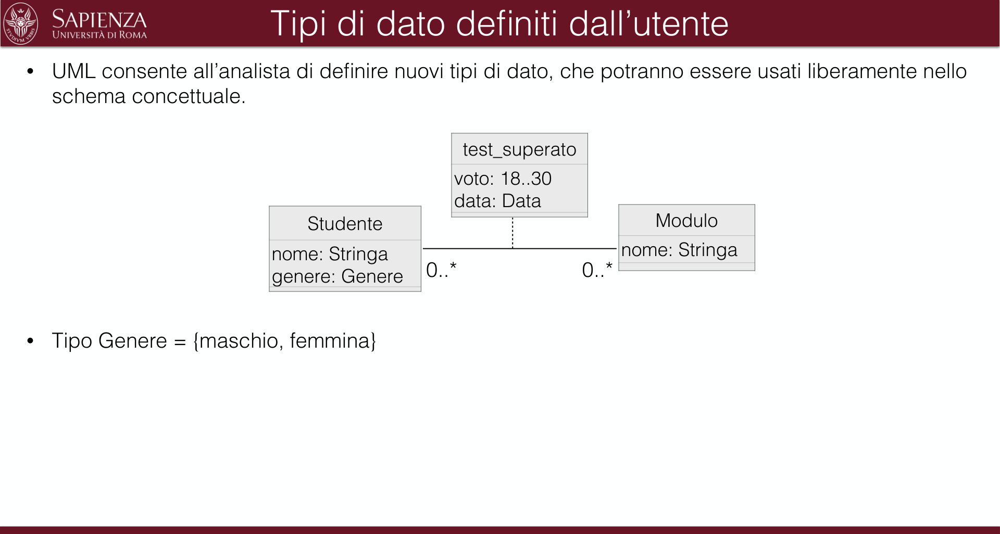

                                 Tipi di dato composti
  •
  UML consente all’analista di definire anche tipi di dato composti da più campi: tipi record
                                                                           Studente
  •
  Tipo Genere = {maschio, femmina}
                                                                      nome: Stringa
                                                                      genere: Genere
                                                                      indirizzo: Indirizzo
  •
  Tipo Indirizzo = (via:stringa, civico:intero>0, cap:intero>0)
  (Attenzione: la scelta di usare il tipo ‘intero>0’ per i campi
  ‘civico’ e ‘cap’ non è affatto adeguata: è solo un semplice
  esempio!)
                                                         anna:Studente
                                        nome=“Anna”
                                        genere=femmina
                                        indirizzo=(via=“Via di Casa mia”, civico=3, cap=84100)
A.1.

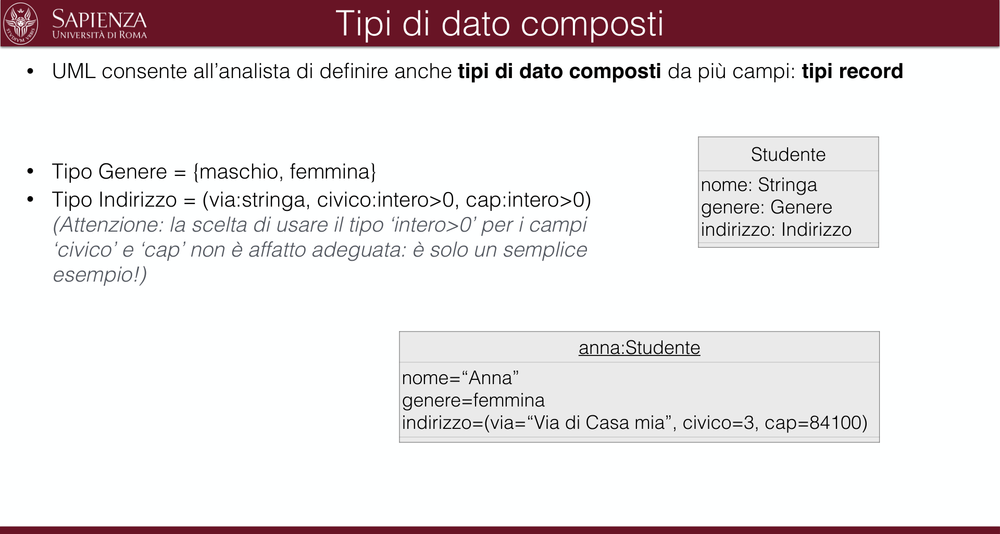

                      Vincoli di molteplicità sugli attributi
  •
  Anche gli attributi di classe e associazione possono avere vincoli di molteplicità (default: 1..1)
                                                                               Studente
                                                                      nome: Stringa
                                                                      genere: Genere
                                                                      email: Stringa [1..*]
                                                                      indirizzo: Indirizzo [0..1]
  •
  Ogni studente ha associato esattamente un nome e un genere
  •
  Ogni studente ha associato uno o più indirizzi email
  •
  Ogni studente ha associato al più un indirizzo
                                                                 anna:Studente
                                               nome=“Anna”
                                               genere=femmina
                                               email={“anna@kmail.com", “anna2002@yahuu.com”}
                                               indirizzo={}
A.1.

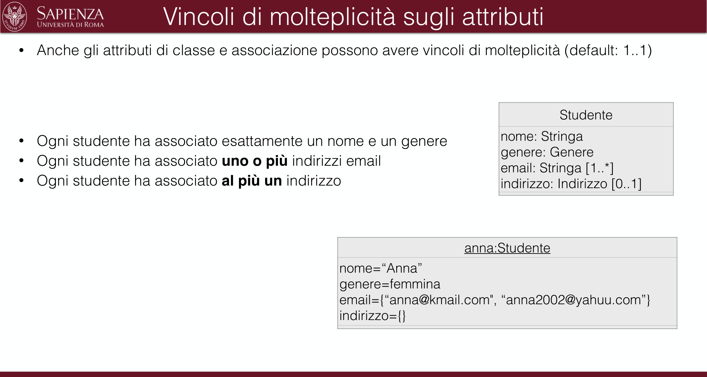

                                                                      A.1.6
              Parte: Analisi concettuale
                              UNITÀ:  A.1
                                                    Analisi dei Requisiti
                                                    Unified Modeling Language
                                                    Diagrammi UML delle classi e degli oggetti
                                                    Vincoli di identificazione di classe
                 Versione del 2024-02-18

                       Vincoli di identificazione di classe
  •
  In alcuni casi, per modellare correttamente il dominio applicativo, è necessario imporre alcuni
  ulteriori vincoli oltre a quelli naturalmente imposti dal diagramma delle classi
  •
  Vincolo (di integrità): una asserzione che impone restrizioni all’insieme dei livelli estensionali
  ammessi (ovvero agli insiemi di oggetti e link che possono coesistere) ulteriori a quelle strutturali
  che provengono dal diagramma delle classi
    •
    Abbiamo già visto i vincoli di molteplicità sulle associazioni
  •
  Ulteriore tipologia di vincolo:
     vincolo di identificazione di classe
                                                                                  Persona
    •
    Impone che non possono coesistere oggetti di una classe
    che coincidono nel valore di un insieme di attributi e/o sono
    collegati tramite link agli stessi oggetti di altre classi
                                                                          cf: CodiceFiscale {id1}
                                                                          nome: Stringa {id2}
                                                                          cognome: Stringa {id2}
                                                                          nascita: Data {id2}
    •
    Esempio: Non possono esistere due persone con lo stesso
    codice fiscale (“{id1}”) e non possono esistere persone
    con, simultaneamente, lo stesso nome, cognome e data di
    nascita (“{id2}”)
                                                                            {id2} definisce un unico
                                                                             vincolo su tre attributi
A.1.

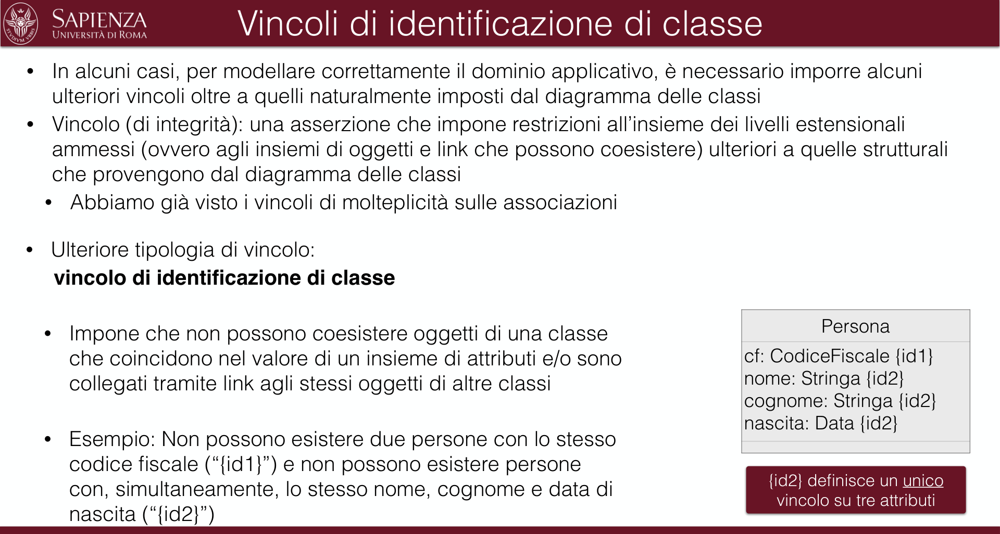

                     Vincoli di identificazione di classe (2)
  •
  Un vincolo di identificazione di classe può coinvolgere anche ruoli della classe
                                                                            iscritto
  •
  Esempio: Non possono esistere due studenti con la
  stessa matricola nella stessa università
                                                                                      Università
                                                                Studente
                                                                            {id}
                                                                                     nome: Stringa
                                                            matr: Stringa {id}
                                                            nome: Stringa
                                                            cognome: Stringa
                                                                               Si tratta di un unico
                                                                               vincolo
                                                                               Si tratta di un unico
                                                                                   vincolo
  •
  Attenzione: un vincolo di identificazione di classe può coinvolgere solo attributi a molteplicità
  [1..1] e/o ruoli della classe a molteplicità 1..1
A.1.

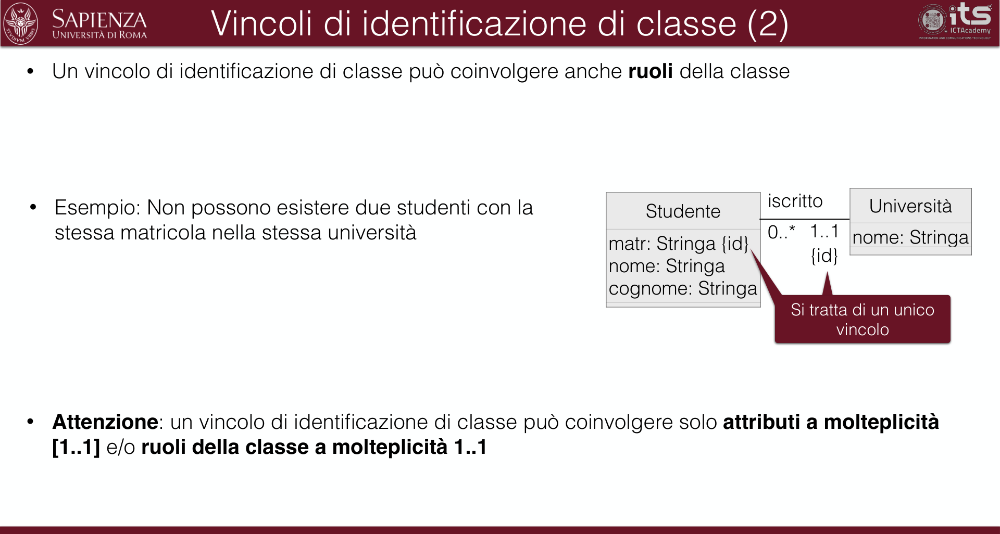

                                                                     A.1.1.7
              Parte: Analisi concettuale
                                                    Analisi dei Requisiti
                                                    Unified Modeling Language
                                                    Diagrammi UML delle classi e degli oggetti
                              UNITÀ:  A.1
                                                               Generalizzazione
                 Versione del 2024-02-18

                                Relazioni is-a tra classi
  •
  Fino ad ora abbiamo implicitamente assunto che classi diverse non hanno istanze in comune
  •
  In molte situazioni, vogliamo rappresentare il fatto che tra due classi sussista una relazione di
  sottoinsieme
  •
  I diagrammi delle classi permettono di definire il concetto di relazione is-a tra classi
                        Persona
                                         •
                                         Relazione is-a (“è anche un”): ogni istanza della classe
                                         Studente (sotto-classe) è (concettualmente!) anche
                                         un’istanza della classe Persona (super-classe)
    superclasse
                    nome: Stringa
                    genere: Genere
   •
   Ovviamente non vale il viceversa: non tutte le istanze di
   Persona devono per forza essere anche istanze di
   Studente
   sottoclasse
                        Studente
                    matricola: Stringa
A.1.

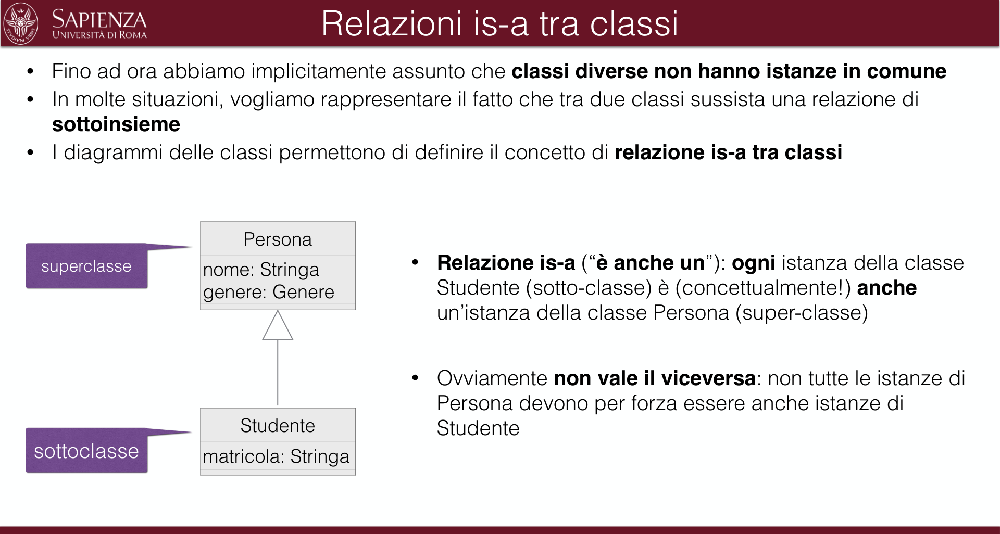

                      Relazioni is-a tra classi: ereditarietà
  •
  Fino ad ora abbiamo implicitamente assunto che classi diverse non hanno istanze in comune
  •
  In molte situazioni, vogliamo rappresentare il fatto che tra due classi sussista una relazione di
  sottoinsieme
  •
  I diagrammi delle classi permettono di definire il concetto di relazione is-a tra classi
                    nascita
                                             In presenza di relazioni is-a, vige il meccanismo
                                             dell’ereditarietà (ricorda il sillogismo aristotelico)
       Persona
                                 Città
                  1..1
                  0..*
  nome: Stringa
  genere: Genere
                           nome: Stringa
                                             •
                                             Di tutte le persone di interesse vogliamo
                                             rappresentare nome, genere e città di nascita
                                             •
                                             Di tutti gli studenti vogliamo rappresentare la
                                             matricola e l’eventuale tutor
                  tutor_stud
      Studente
                                 Tutor
                  0..1
                  0..*
                            nome: Stringa
  matricola: Stringa
                                             •
                                             Tutti gli studenti sono persone (relazione is-a)
                                                —> Di conseguenza, di tutti gli studenti stiamo
                                                rappresentando anche nome, genere, e città di
                                                nascita (con le loro molteplicità 1..1)
A.1.

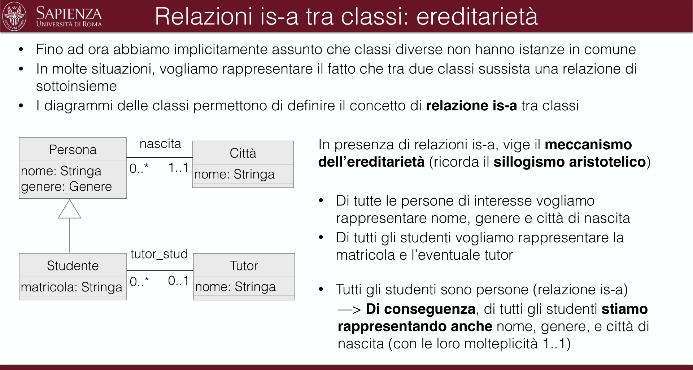

                   Relazioni is-a tra classi: ereditarietà (2)
  •
  Fino ad ora abbiamo implicitamente assunto che classi diverse non hanno istanze in comune
  •
  In molte situazioni, vogliamo rappresentare il fatto che tra due classi sussista una relazione di sottoinsieme
  •
  I diagrammi delle classi permettono di definire il concetto di relazione is-a tra classi
                     nascita
                                             Ovviamente possiamo avere relazioni is-a a più livelli: transitività!
        Persona
                                  Città
                                             •
                                             Di tutte le persone di interesse vogliamo rappresentare nome,
                                             genere e città di nascita
                   1..1
                   0..*
    nome: Stringa
    genere: Genere
                             nome: Stringa
                                             •
                                             Di tutti gli studenti vogliamo rappresentare la matricola e
                                             l’eventuale tutor
                                             •
                                             Di tutti gli studenti stranieri vogliamo rappresentare la nazione di
                                             provenienza
                    tutor_stud
       Studente
                                  Tutor
                                             •
                                             Tutti gli studenti sono persone (relazione is-a)
                   0..1
                   0..*
                                               —> Di conseguenza, di tutti gli studenti stiamo
                                               rappresentando anche nome, genere, ed città di nascita (con
                                               le loro molteplicità 1..1)
                             nome: Stringa
    matricola: Stringa
                                             •
                                             Tutti gli studenti stranieri sono studenti (relazione is-a)
                                             —> Di conseguenza, degli studenti stranieri stiamo
                                             rappresentando anche nome, genere, matricola, città di nascita
                                             (con le loro molteplicità 1..1)
                      naz_stud
     StudenteStraniero
     Nazione
                               nome: Stringa
A.1.

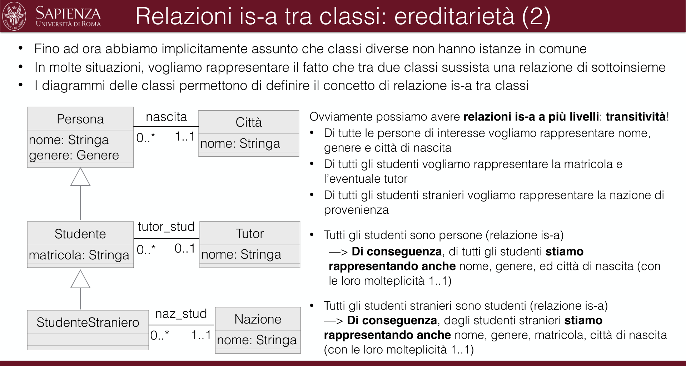

                      Classi più specifiche di un oggetto
  •
  Classi più specifiche di un oggetto O:
     •
     L’insieme delle classi di cui O è istanza che non sono a loro volta superclassi di altre classi di O
  •
  Esempio:
                       Persona
                                                •
                                                L’oggetto ‘anna’ è istanza di Persona,
                                                Studente, Lavoratore
                 Studente
                 Lavoratore
                                                •
                                                L’insieme delle classi più specifiche di
                                                ‘anna’ è {Studente, Lavoratore}
                                                —> …ma non Persona
                   <<instance of>>
    <<instance of>>
                                    <<instance of>>
                          anna
A.1.

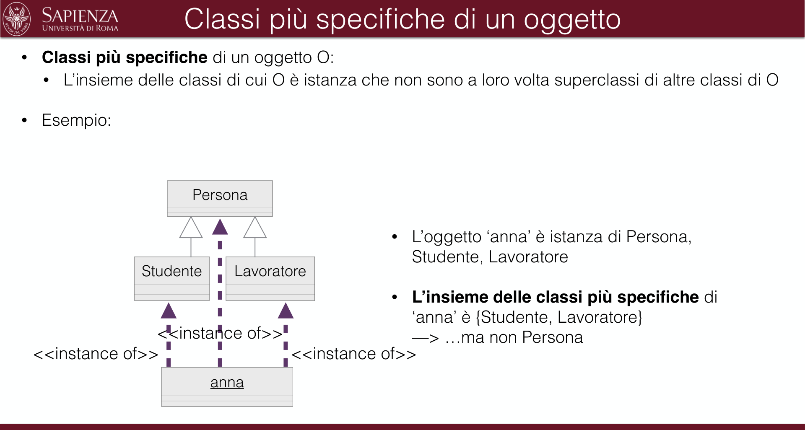

                                     Generalizzazioni
  •
  I diagrammi delle classi UML offrono un costrutto più complesso della relazione is-a: il costrutto
  della generalizzazione
  •
  Permette di definire che le istanze di una classe possono essere istanze di più classi figlie
  secondo uno stesso criterio concettuale
                            Persona
       superclasse
                                                  •
                                                  Significato:
                        nome: Stringa
                                                    •
                                                    Studente is-a Persona
                                                    •
                                                    Lavoratore is-a Persona
    criterio
    (opzionale)
                                                    •
                                                    Il criterio secondo il quale le Persone sono
                                                    considerate studenti e/o lavoratori è lo
                                                    stesso: quello dell’“occupazione”
                          occupazione
                   Studente
                   Lavoratore
                                                    •
                                                    È ancora possibile per un oggetto essere
                                                    istanza sia di Studente che di Lavoratore
                          sottoclassi
                          sottoclassi
A.1.

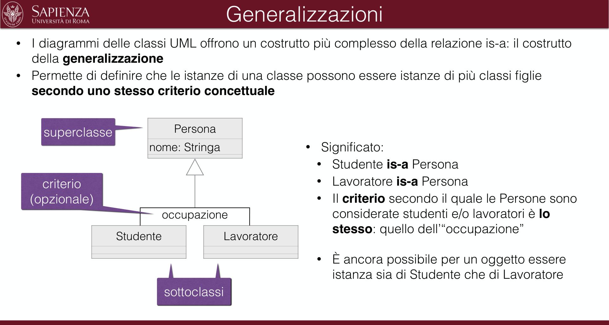

                                  Generalizzazioni (2)
  •
  La stessa classe può essere superclasse di generalizzazioni distinte (criteri diversi)
                     Persona
                                                 •
                                                 Significato:
     nome: Stringa
                                                   •
                                                   Secondo il criterio del genere, le Persone
                                                   sono considerate uomini e/o donne
                        •
                        Secondo il criterio (indipendente!)
                        dell’occupazione, le persone sono
                        considerate studenti e/o lavoratori
                        Studente
                        Lavoratore
     genere
                            occupazione
      Uomo
      Donna
  •
  Una istanza di Persona può essere sia istanza di Uomo che di Studente? Sì
  •
  Una istanza di Persona può essere istanza né di Uomo né di Donna? Sì
  •
  Una istanza di Persona può essere istanza sia di Uomo che di Donna? Sì
A.1.

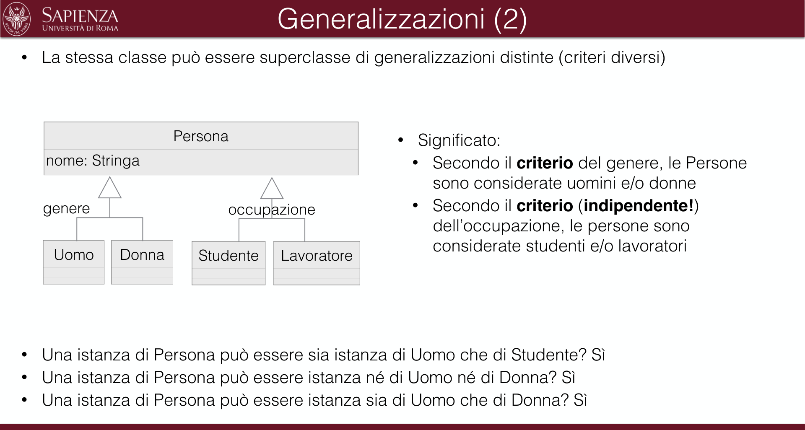

                   Vincoli sulle generalizzazioni: {disjoint}
  •
  In linea di principio, una istanza della classe base può essere istanza di più di una sottoclasse di
  una stessa generalizzazione
  •
  Spesso, nell’ottica di modellare accuratamente i requisiti, vorremmo evitarlo: generalizzazioni
  disgiunte.
                     Persona
                                                 •
                                                 Significato:
     nome: Stringa
                                                   •
                                                   La generalizzazione sul genere è disgiunta:
                                                   una istanza di Uomo non può essere anche
                                                   istanza di Donna
     genere
         occupazione
         {disjoint}
                                                   •
                                                   La generalizzazione sull’occupazione non è
                                                   disgiunta: una istanza di Studente può
                                                   essere anche istanza di Lavoratore (ma…)
      Uomo
      Donna
                        Studente
                        Lavoratore
  •
  Una istanza di Persona può essere sia istanza di Uomo che di Studente? Sì
  •
  Una istanza di Persona può essere istanza né di Uomo né di Donna? Sì
  •
  Una istanza di Persona può essere istanza sia di Uomo che di Donna? Non più
A.1.

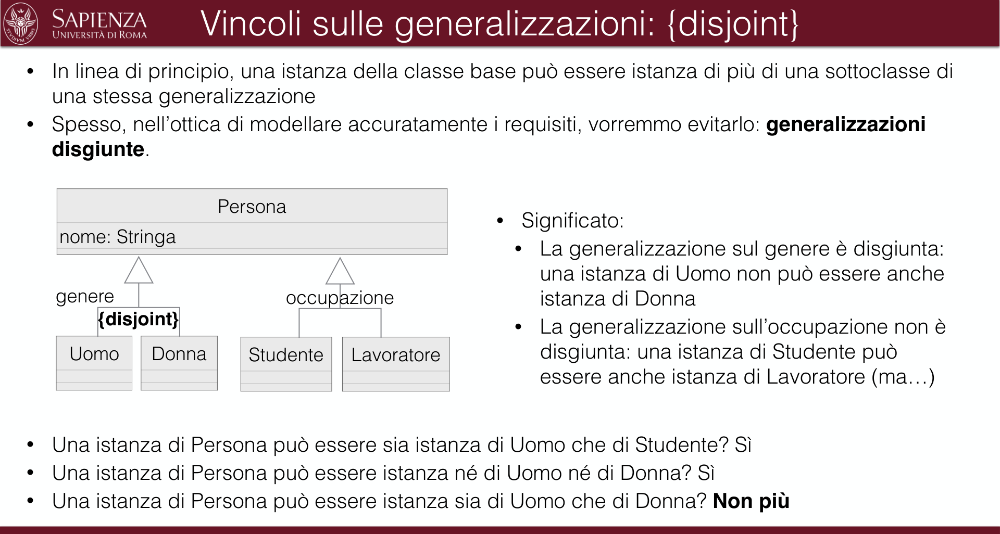

                  Vincoli sulle generalizzazioni: {complete}
  •
  In linea di principio, una istanza della classe base può essere istanza di nessuna delle sottoclassi
  di una stessa generalizzazione
  •
  Spesso, nell’ottica di modellare accuratamente i requisiti, vorremmo evitarlo: generalizzazioni
  complete.
                                                 •
                                                 Significato:
                     Persona
                                                   •
                                                   La generalizzazione sul genere è completa:
                                                   ogni istanza di Persona deve essere anche
                                                   istanza di almeno una sottoclasse tra Uomo e
                                                   Donna
     nome: stringa
     genere
        occupazione
        {complete}
                                                   •
                                                   La generalizzazione sull’occupazione non è
                                                   completa: possono esistere istanze di
                                                   Persona che non sono né istanze di Studente
                                                   né istanze di Lavoratore
      Uomo
      Donna
                        Studente
                        Lavoratore
  •
  Una istanza di Persona può essere sia istanza di Uomo che di Studente? Sì
  •
  Una istanza di Persona può essere istanza né di Uomo né di Donna? Non più
  •
  Una istanza di Persona può essere istanza sia di Uomo che di Donna? Sì
A.1.

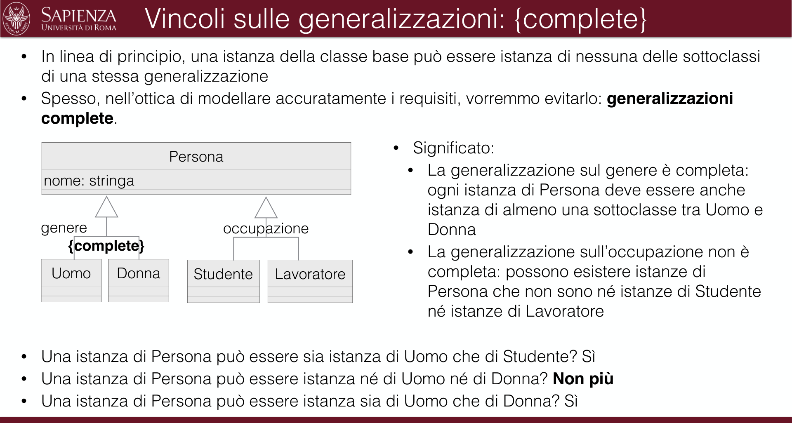

                Vincoli sulle generalizzazioni: {disjoint, complete}
  •
  Una generalizzazione può essere sia disgiunta che completa
  •
  Ogni istanza della superclasse è anche istanza di esattamente una sottoclasse della
  generalizzazione
                     Persona
                                                 •
                                                 Significato:
     nome: stringa
                                                   •
                                                   ogni istanza di Persona deve essere anche
                                                   istanza di esattamente una sottoclasse tra
                                                   Uomo e Donna
     genere
        occupazione
        {disj, compl}
        {disj, compl}
                                                   •
                                                   ogni istanza di Persona deve essere anche
                                                   istanza di esattamente una sottoclasse tra
                                                   Studente e Lavoratore
      Uomo
      Donna
                        Studente
                        Lavoratore
  •
  Una istanza di Persona può essere sia istanza di Uomo che di Studente? Sì
  •
  Una istanza di Persona può essere istanza né di Uomo né di Donna? Non più
  •
  Una istanza di Persona può essere istanza sia di Uomo che di Donna? Non più
A.1.

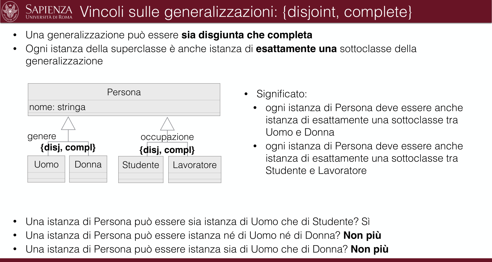

                   Vincoli sulle generalizzazioni: riepilogo
           C
                                    C
                                                             C
                                                                                      C
                                  {disjoint}
                                  {complete}
                                  {disjoint, complete}
      A
      B
                               A
                               B
                                                        A
                                                        B
                                                                                 A
                                                                                 B
A.1. 50

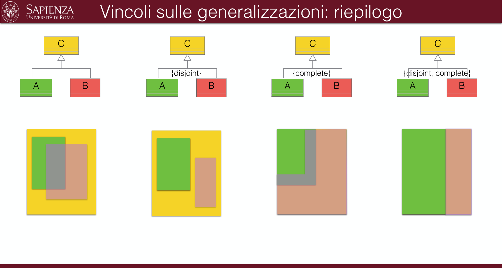

                                  Ereditarietà multipla
  •
  Una classe può essere sottoclasse di più classi. Il meccanismo dell’ereditarietà vale come sempre.
                                        Animale
                                                            DotatoDiAli
                                 Mammifero
                               Cavallo
                                                      Pipistrello
A.1.

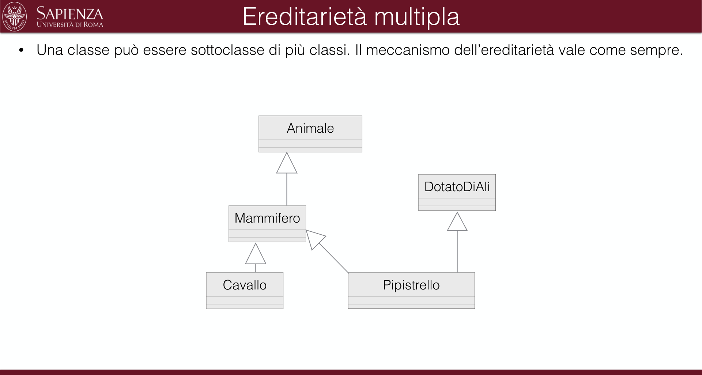

                                                                     A.1.1.8
              Parte: Analisi concettuale
                              UNITÀ:  A.1
                                                   Analisi dei Requisiti
                                                   Unified Modeling Language
                                                   Diagrammi UML delle classi e degli oggetti
                                                            Operazioni di classe
                 Versione del 2024-02-18

                                 Operazioni di classe
  •
  Finora abbiamo fatto riferimento solo a proprietà statiche (attributi e associazioni) di classi.
    •
    Proprietà statiche: i valori cambiano a seguito di esplicita modifica dei dati da parte degli utenti del
    sistema (o da parte di altre parti del sistema)
  •
  Una classe UML può definire anche proprietà dinamiche, che si chiamano operazioni.
    •
    Proprietà dinamiche: i valori vengono calcolati ogni volta che servono, a partire dai valori di altre
    proprietà
                                                                                 Studente
   Operazione di classe
                                                                      matricola: Intero > 0
                                                                      nome: Stringa
                                                         attributi
  •
  Una operazione della classe C indica che su ogni
  oggetto (istanza) della classe C si può eseguire un
  calcolo per:
                                                                      n_esami_fino_a(d:Data): Intero >= 0
                                                        operazioni
                                                                                    esame
                                                                                    data: Data
                                                                                    voto: 18..30
    •
    calcolare un valore a partire da altri dati e operazioni
    •
    effettuare cambiamenti di stato dell’oggetto (cioè per
    modificare le sue proprietà), dei link in cui è coinvolto
    e/o degli oggetti a questo collegati
                                                                                  Corso
                                                                      nome: Stringa
                                                                      voto_medio(): Reale in 18..30
A.1.

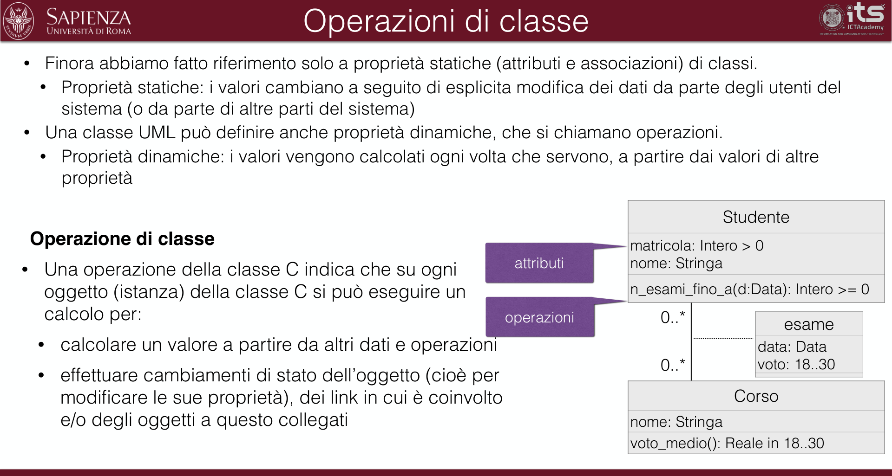

                                  Operazioni: sintassi
  Sintassi per la segnatura dell’operazione:
  •
  nome_operazione(argomenti) : tipo_ritorno
  dove:
                                                                            Studente
                                                                matricola: Intero > 0
                                                                nome: Stringa
    •
    “argomenti” è una lista di elementi della forma:
                                                    attributi
          nome_argomento : tipo_argomento
                                                                media_fino_a(d:Data): Reale in 18..30
    •
    “tipo_ritorno” è il tipo del valore restituito
    dall’operazione
                                                  operazioni
                                                                                  esame
                                                                                  data:Data
                                                                                  voto: 18..30
    •
    I tipi degli argomenti e del valore di ritorno
    possono essere tipi di dato concettuali oppure
    classi del diagramma
                                                      <<instance of>>
                                                                    Corso
                                                                    nome: Stringa
                                                                    voto_medio(): Reale in 18..30
  •
  Una operazione di classe può essere invocata
  solo su un oggetto della classe, che è un ulteriore
  argomento (non indicato nella segnatura)
                                                                                      <<instance of>>
                                                                              esame
                                                              <<instance of>>
                                                                                      c1:Corso
                                                                                         …
               s.media_fino_a(2/6/2023) —> 22.5
                                                           s:Studente
                                                           matricola = 555
                                                           nome = “Anna”
                                                                                          c2:Corso
                                                                                             …
                                                                               esame
oggetto di invocazione
valore degli argomenti
                                       valore di ritorno
A.1.

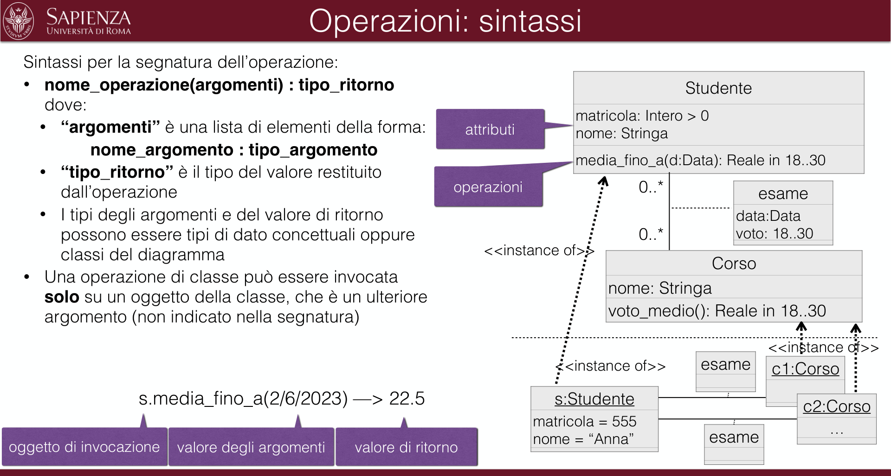

                               Operazioni: ereditarietà
  •
  Il meccanismo dell’ereditarietà si applica anche alle operazioni di classe
  •
  Dunque, ad es., possiamo invocare:
                                                                              Studente
                                                                 matricola: Intero > 0
                                                                 nome: Stringa
                                                                 media_fino_a(d:Data): reale in 18..30
             ss.media_fino_a(2/6/2023) —> 28.3
                                                                          StudenteStraniero
                           valore degli argomenti
                           valore di ritorno
 oggetto di invocazione (della
       sottoclasse)
                                                                            <<instance of>>
                                                                  ss:StudenteStraniero
                                                                  matricola = 666
                                                                  nome = “Frank”
A.1.

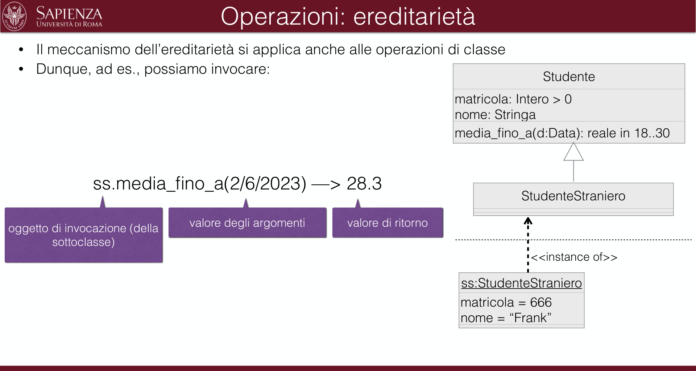

                                Operazioni: specifiche
  •
  Il diagramma delle classi non definisce cosa calcolano le operazioni, né se e come modificano i
  dati
  •
  Ogni classe del diagramma con operazioni andrà affiancata da un documento di specifica che
  entra nel dettaglio (v. seguito)
A.1.

                                                                     A.1.1.9
              Parte: Analisi concettuale
                                                     Analisi dei Requisiti
                                                     Unified Modeling Language
                                                     Diagrammi UML delle classi e degli oggetti
                              UNITÀ:  A.1
                                                         Specializzazioni di attributi,
                                                         associazioni ed operazioni
                 Versione del 2024-02-18

                            Specializzazione di attributi
   •
   In una generalizzazione, una sottoclasse non solo può avere proprietà aggiuntive rispetto alla superclasse,
   ma può anche specializzare le proprietà ereditate dalla superclasse, restringendone il tipo
   •
   Degli articoli in vendita vanno rappresentati: nome e numero di anni di garanzia (anche zero)
   •
   Alcuni articoli sono nuovi
   •
   Degli articoli nuovi interessa anche il codice EAN
   •
   Inoltre, per gli articoli nuovi, la garanzia deve essere di almeno due anni
   Attenzione: il tipo dell’attributo specializzato (ArticoloNuovo.anni_garanzia) deve essere più ristretto del tipo dell’attributo
   che specializza
                          ArticoloInVendita
                          nome: Stringa
                          anni_garanzia: Intero >= 0
                                ArticoloNuovo
                                                                     NON AMMESSO
                          codice_ean: Stringa
                          anni_garanzia: Intero >= 2
                                                    ArticoloImpossibile
                                                    anni_garanzia: Reale
                        AMMESSO
A.1.

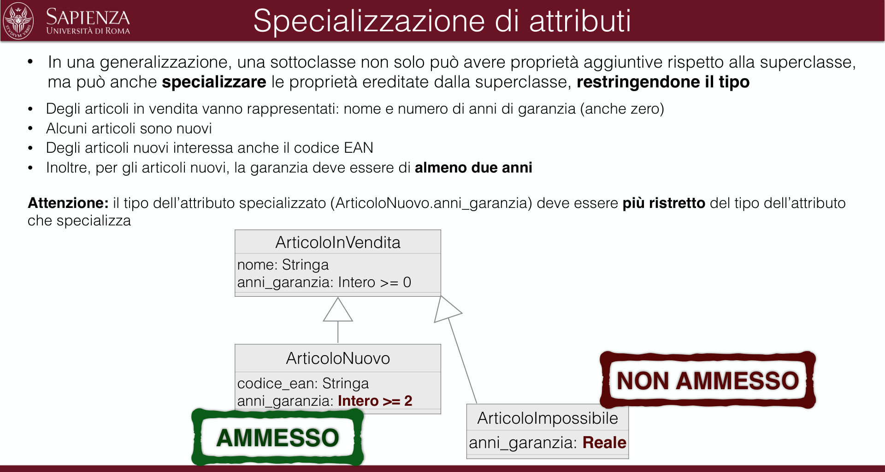

                        Specializzazione di associazioni
   •
   Ricordiamo che un’associazione con attributi si chiama “association class” e dunque… è anche
   una classe, e dunque… può a sua volta essere terminale di associazioni
    •
    Una association class, in quanto classe, può anche essere radice di relazioni is-a e
    generalizzazioni!
  •
  Ogni articolo è venduto da esattamente un utente
  •
  Gli articoli nuovi possono essere venduti solo da venditori professionali
  Attenzione: l’associazione vend_nuovo deve essere di tipo compatible con il tipo dell’associazione venditore
                                                               Utente
                      ArticoloInVendita
                                                            nome: Stringa
                                             venditore
                                             istante: DataOra
                 nome: Stringa
                 anni_garanzia: Intero >= 0
                                             vend nuovo
                                                            Venditore
                                                            Professionale
                      ArticoloNuovo
                 codice_ean: Stringa
                 anni_garanzia: Intero >= 2
                                                            p_iva: Stringa
A.1.

                      Specializzazione di associazioni (2)
   •
   Ricordiamo che un’associazione con attributi si chiama “association class” e dunque… è anche
   una classe, e dunque… può a sua volta essere terminale di associazioni
    •
    Una association class, in quanto classe, può anche essere radice di relazioni is-a e
    generalizzazioni!
  •
  Ogni articolo è venduto da almeno un utente
  •
  Gli articoli nuovi devono essere venduti da almeno un venditore professionale
  Attenzione: l’associazione vend_nuovo deve essere di tipo compatible con il tipo dell’associazione venditore
                                         1..*
                                                               Utente
                      ArticoloInVendita
                                                            nome: Stringa
                                             venditore
                                             istante: DataOra
                 nome: Stringa
                 anni_garanzia: Intero >= 0
                                             vend nuovo
                                                            Venditore
                                                            Professionale
                      ArticoloNuovo
                 codice_ean: Stringa
                 anni_garanzia: Intero >= 2
                                                            p_iva: Stringa
A.1.

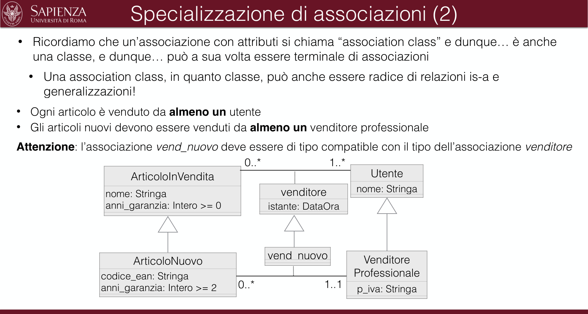

                      Specializzazione di associazioni (3)
  Esempio:
  •
  Il sistema deve rappresentare impiegati, il dipartimento a cui afferisce ogni impiegato (con data di
  inizio afferenza) e direttore (un impiegato).
  •
  I direttori devono afferire al dipartimento che dirigono.
                                     Impiegato
                                     nome: Stringa
                                       afferenza
                                       inizio: Data
                                                      dirige
                                     Dipartimento
                                     nome: Stringa
A.1.

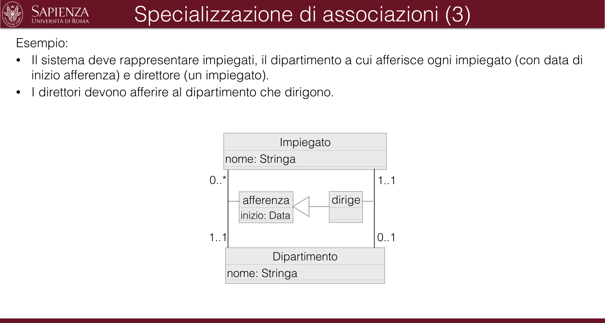

                Specializzazione di associazioni: condizioni per la correttezza
  Le specializzazioni di associazioni necessitano di particolare attenzione relativamente ai vincoli di molteplicità.
  Esempio:
  •
  Ogni articolo è venduto da esattamente un utente
  •
  Gli articoli nuovi devono essere venduti da almeno un venditore professionale
                                                                    Utente
                           ArticoloInVendita
                                                                 nome: Stringa
                                                 venditore
                                                 istante: DataOra
                       nome: Stringa
                       anni_garanzia: Intero >= 0
                                                  vend nuovo
                                                                 Venditore
                                                                 Professionale
                            ArticoloNuovo
                      codice_ean: Stringa
                      anni_garanzia: Intero >= 2
                                             1..*
                                                                  p_iva: Stringa
  Il vincolo 1..* è fuorviante. In realtà diagramma implica che ogni articolo nuovo è venduto da un solo
  venditore professionale!
A.1. 62

                Specializzazione di associazioni: condizioni per la correttezza (2)
  Le specializzazioni di associazioni necessitano di particolare attenzione relativamente ai vincoli di molteplicità.
  Esempio:
  •
  Ogni articolo è venduto da esattamente un utente
  •
  Gli articoli nuovi devono essere venduti da almeno due venditori professionali
                                                                    Utente
                           ArticoloInVendita
                                                                 nome: Stringa
                                                 venditore
                                                 istante: DataOra
                       nome: Stringa
                       anni_garanzia: Intero >= 0
                                                  vend nuovo
                                                                 Venditore
                                                                 Professionale
                            ArticoloNuovo
                      codice_ean: Stringa
                      anni_garanzia: Intero >= 2
                                             2..*
                                                                  p_iva: Stringa
  Il vincolo 2..* comporta che non possano esistere articoli nuovi!
A.1. 63

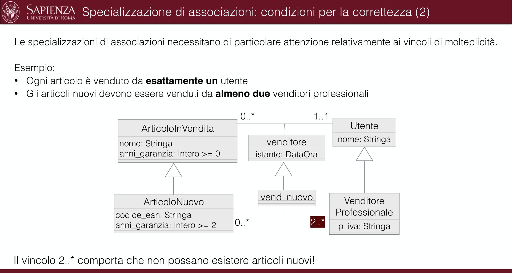

                  Specializzazione di operazioni di classe
  Anche le operazioni di classe possono essere oggetto di specializzazione nelle sottoclassi
  Esempio:
  •
  Di tutti gli articoli in vendita va calcolato il prezzo, che è uguale al prezzo unitario moltiplicato per il numero di pezzi
  richiesto, ed incrementato delle spese di spedizione (che dipendono dalla nazione dove la merce sarà
  consegnata)
  •
  Alcuni articoli sono in offerta. Il loro prezzo è scontato di un certo fattore di sconto.
                       Articolo
                                                  Specifi
                                                  (da defi
          nome: Stringa
          prezzo_unitario: Reale >= 0
          prezzo(num:Intero > 0, naz:Nazione): Reale >= 0
          Il prezzo per l’acquisto di “num” unità di un articolo “a” da consegnarsi
                                                 nella nazione “naz” è pari al “prezzo_unitario” di “a” moltiplicato per
                                                     “num” e sommato al costo della spedizione verso “naz”.
                                                Il prezzo di “num” unità di un articolo in offerta “a” da consegnarsi in
                                                “naz” è pari al prezzo di vendita come calcolato dall’operazione nella
                    ArticoloInOfferta
          tasso_sconto: Reale in [0,1]
          prezzo(num: Intero > 0, naz:Nazione): Reale >= 0
                                                     superclasse scontato del fattore “tasso_sconto” di “a”.
  Come per la specializzazione di attributi, la segnatura dell’operazione nella sottoclasse deve essere compatibile
  con quella dell’operazione definita nella superasse, ovvero:
  • Stesso numero e tipo di argomenti
  • Il tipo di ritorno dell’operazione nella sottoclasse è dello stesso tipo o un sotto-tipo di quello dell’operazione nella
  superclasse.
A.1.

                                                                      A.1.2
              Parte: Analisi concettuale
                              UNITÀ:  A.1
                                                    Analisi dei Requisiti
                                                    Unified Modeling Language
                                                    Diagrammi degli use-case
                 Versione del 2024-02-18

                        Diagramma UML degli use-case
  Modellano le funzionalità che il sistema deve realizzare, in termini di use-case (scenari di utilizzo)
  Use-case
  Cattura un insieme omogeneo di funzionalità accedute da un gruppo omogeneo di utenti.
  Tipicamente coinvolge concetti rappresentati da più classi e associazioni del diagramma delle classi.
  Attore
  Ruolo che un utente (umano o sistema esterno) gioca interagendo con il sistema.
  Lo stesso utente può essere rappresentato da più attori (può giocare più ruoli).
  Più utenti possono essere rappresentati dallo stesso attore.
A.1.

                        Diagramma UML degli use-case
  Un diagramma UML degli use-case è un grafo in cui:
  •
  i nodi rappresentano attori e use-case
  •
  gli archi rapprentano:
    •
    la possibilità per un attore di invocare uno use-case
    •
    la possibilità per uno use-case di invocare un altro use-case
    •
    la generalizzazione tra attori e tra use-case
  Definizione: cosa è un grafo?
  Una struttura molto comune in informatica. Rappresenta una rete di elementi, chiamati nodi, collegati a coppie da archi
  •
  Esempio: mappa di una rete di metropolitane:
                                                       Nodo
                                                                                    Nome use-case
                                                       Arco
                                                                 Nome attore
A.1.

                 Diagramma degli use-case: associazione
  •
  Modella la possibilità di accesso, da parte di un attore, alle funzionalità di uno use-case
                                        Strumenti venditori
                                        utilizza
                          Utente
                                   Associazione
                                   (il nome si può omettere)
                     Attore: insieme
                     omogeneo di utenti fisici
                                                    Use-case: insieme
                                                    omogeneo di funzionalità
                        (o altri sistemi)
                                                         del sistema
  Attenzione. L’esistenza dell’attore Utente non implica l’esistenza della classe Utente nel diagramma
  delle classi. Avremo la classe Utente solo se il sistema deve rappresentare dati sugli utenti.
A.1.

                                           Esempio
  Il sistema deve permettere agli studenti di iscriversi, via web, ai corsi offerti. La segreteria deve poter
  assegnare i docenti ai singoli corsi. I docenti devono poter inserire i risultati dei test degli studenti: tali
  test sono somministrati agli studenti utilizzando il sistema.
                  effettua-
                  iscrizione
                                                Funzionalità
                                                che permettono
                                                l’iscrizione web da
                                                parte degli studenti
                           Gestione iscrizioni
          Studente
                           valuta
                           effettua_test
                                                    Gestione test
                  assegna
                  docente
                                                                        Docente
                                                                                   Attenzione: gli
                                                                                   studenti e i docenti
                                                                                   possono accedere a
                            Gestione docenti
                                                              Funzionalità
                                                              che permettono
                                                                                   tutte le funzionalità
                                                                                   di questo use-case!
                                            Funzionalità
                                                               la creazione, la
                                                               somministrazione e la
                                            che permettono
                                            l’assegnazione dei
                                            docenti ai corsi, etc.
          Segreteria
                                                                                    (Dovremo fare di
                                                                valutazione dei test
                                                                                       meglio…)
A.1.

                     Dipendenze tra use-case: inclusione
  •
  Alcune funzionalità dello use-case A hanno bisogno di usare alcune funzionalità dello use-case B
                                                           effettua_test
                                                                  Somministrazione
  Esempio:
  1. i docenti possono creare e valutare i test
  degli studenti
  2. gli studenti possono rispondere ai test
  3. i test e le risposte degli studenti vanno
  memorizzati nel sistema
                                                                       test
                                                                                   <<include>>
                                                     Studente
                                                 Funzionalità che
                                                 permettono la
                                                 somministrazione dei test
                                                                                Gestione test
                                                                                       <<include>>
                                                           Funzionalità
                                                           che permettono
                                                           la memorizzazione dei
                                                           test e delle risposte degli
                                                                               Creazione e
                                                                               valutazione test
                                                                studenti
                                                                                       valuta
                                                           Funzionalità
                                                           che permettono
                                                            la creazione e la
                                                            valutazione dei test
                                                                studenti
                                                                                  Docente
A.1.

                    Dipendenze tra use-case: estensione
  •
  Alcune funzionalità dello use-case A, solo in alcuni casi particolari, sono estese con le funzionalità
  dello use-case B
                                                                     Iscrizione
  Esempio:
  1. Gli studenti possono iscriversi a corsi
  2. Durante il processo di iscrizione, gli studenti
  possono optare per il pagamento online
                                                     Studente
                                                                                  <<extend>>
                                                                            Pagamento online
                                                                                   Nota il verso della
                                                                                   dipendenza: dallo
                                                                                  use-case che
                                                                                  estende (B) allo use-
                                                                                    case esteso (A)
A.1.

                          Generalizzazione tra use-case
  •
  Alcune funzionalità dello use-case A, solo in alcuni casi particolari, sono rimpiazzate con le
  funzionalità dello use-case B
  Esempio:
  1. Gli studenti devono potersi identificare
  2. L’identificazione online avviene tramite
  password
  3. La registrazione delle presenze ai corsi
  avviene tramite impronta digitale/iride
  scansionata dal lettore del tornello
  Accesso
  biometrico a varco
                                                                   Identificazione
                                                     Studente
                                                          Controllo password
                                                      Nota: nei diagrammi degli use-case non possiamo usare
                                                       generalizzazioni uniche che coinvolgono più sotto-
                                                       usecase, né tantomeno vincoli  {disjoint} e {complete}
A.1.

                             Generalizzazione tra attori
  •
  L’attore B può fare le veci dell’attore A, e ne eredita tutte le associazioni
                                                                  assegna
                                                                  docente
  •
  Esempio: i manager possono fare le veci
  della Segreteria, ed accedere a tutti gli use-
  case accessibili dalla Segreteria
                                                                           Gestione docenti
  Attenzione. Il diagramma non implica che
  esistano le classi Segreteria e Manager nel
  diagramma delle classi, né tantomeno che la
  classe Manager sia una sottoclasse di
  Segreteria
                                                         Segreteria
                                                                          Analisi economiche
                                                          Manager
A.1.

                   Diagramma degli use-case: specifiche
  •
  Il diagramma degli use-case è molto semplice, e dà solo una visione di alto livello di:
     •
     quali attori possono usare il sistema
     •
     quali macro-funzionalità sono accessibili ai diversi attori
  •
  Definisce inoltre come le diverse macro-funzionalità vadano modularizzate
  •
  Si tratta di un diagramma facilmente comprensibile anche al committente
  •
  Il diagramma non definisce le singole operazioni all’interno di ogni use-case
  •
  Ogni use-case del diagramma andrà affiancato da un documento di specifica che entra nel
  dettaglio (v. seguito)
A.1.
