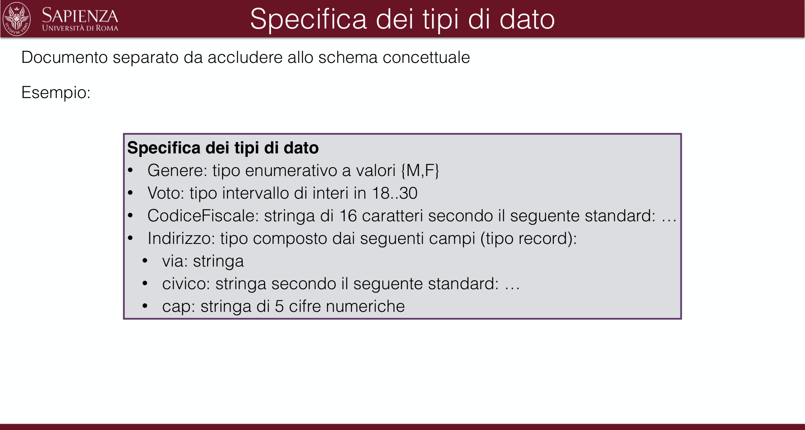
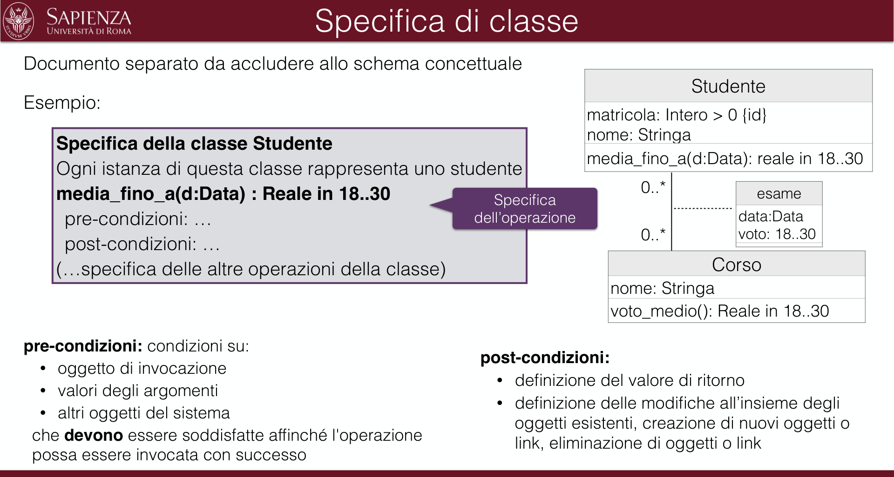
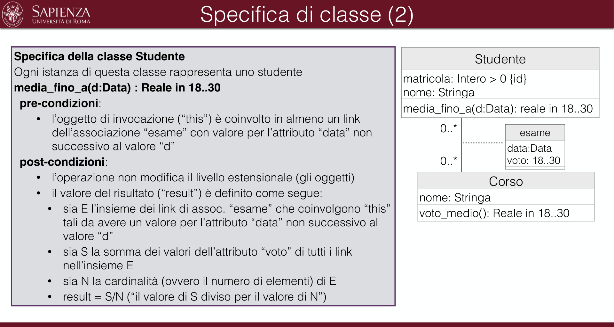
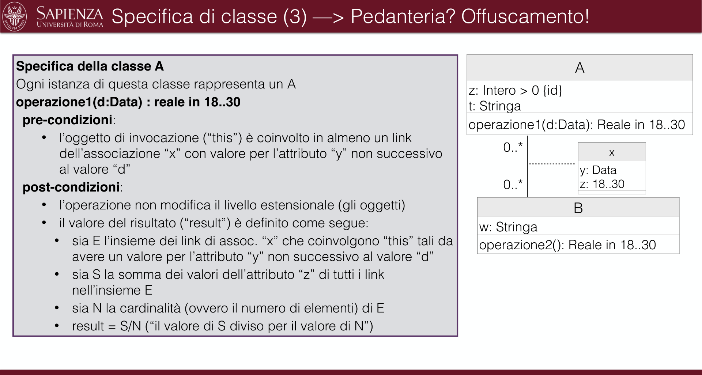
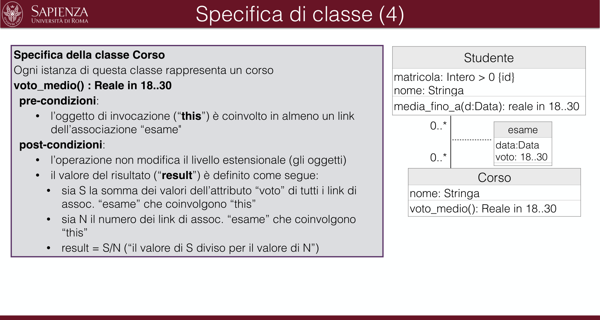
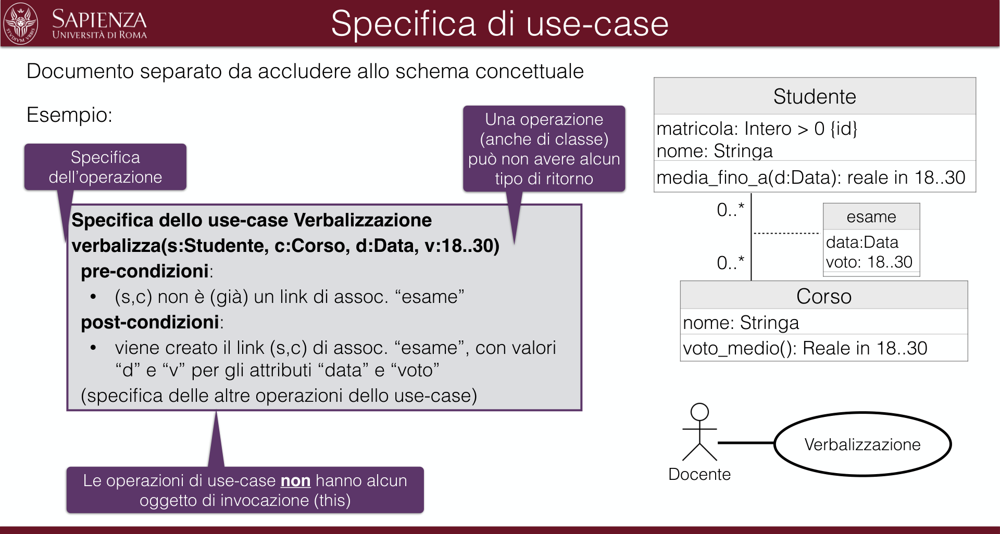
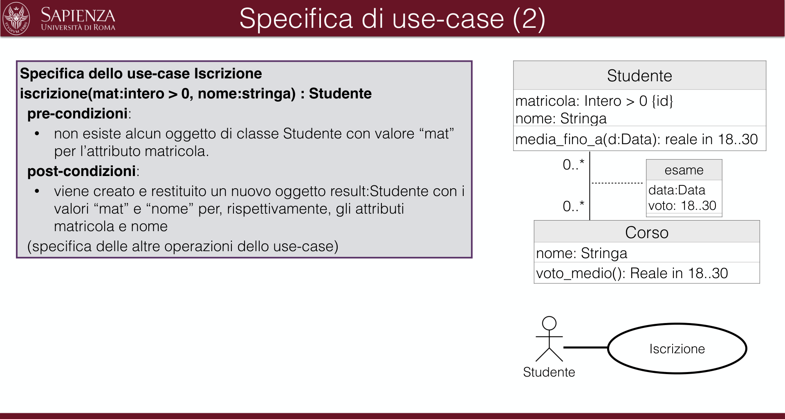
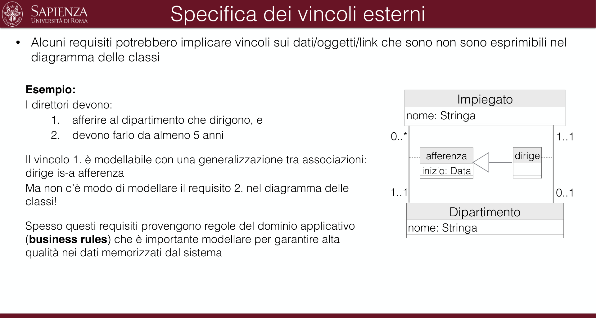
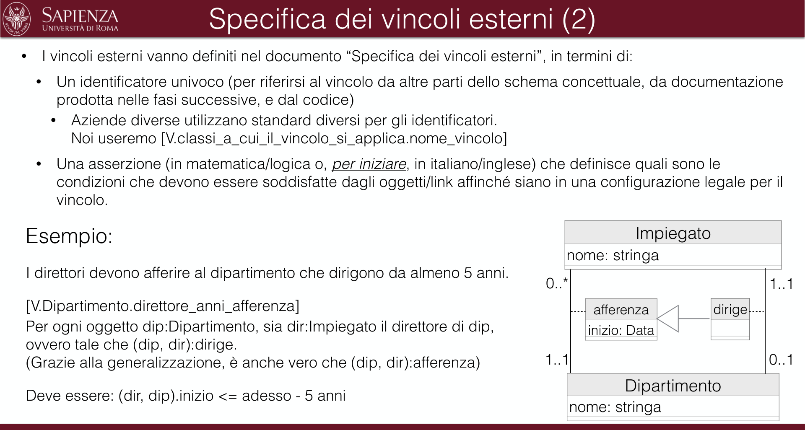

# A.2 - Documenti di specifica (specifiche informali)

> Fonte: `Slide A.2 - Documenti di specifica (specifiche informali) - BD2.pdf`
> Estratto con PyMuPDF (conserva legature e formule); tolte le righe ripetute di intestazione e pie' di pagina e le etichette sparse dei diagrammi, che sono ritagliati in `figure/` e richiamati nel punto in cui compaiono.

---

A.2
              Parte: Analisi concettuale
                                                     Analisi dei Requisiti
                                                     Documenti di specifica
                              UNITÀ:  A.2
                                                       (specifiche informali)

                Analisi dei requisiti: Documenti di specifica
  •
  Il diagramma UML delle classi non definisce nel dettaglio cosa calcolano le operazioni di classe, né se e
  come modificano gli oggetti esistenti (i dati)
  •
  Il diagramma UML degli use-case non definisce quali sono le operazioni di ogni use-case, né cosa calcolano,
  né se e come modificano gli oggetti esistenti (i dati)
  Lo schema concettuale va corredato di documenti di specifica:
  Specifica dei tipi di dato
  Definisce tutti i tipi di dato non standard utilizzati nello schema concettuale
  Specifica di una classe
  Definisce cosa calcola ogni operazione di classe e se e come modifica gli oggetti/link esistenti (i dati)
  Specifica di uno use-case
  Definisce l’insieme delle operazioni di uno use-case. Per ogni operazione, definisce cosa calcola e se e come
  modifica gli oggetti/link esistenti (i dati)
  Specifica dei vincoli esterni
  Definisce ulteriori vincoli (non esprimibili nel diagramma della classi, di qui il nome “esterni”) che gli oggetti/link
  devono soddisfare

                               Specifica dei tipi di dato
  Documento separato da accludere allo schema concettuale
  Esempio:
               Specifica dei tipi di dato
               •
               Genere: tipo enumerativo a valori {M,F}
               •
               Voto: tipo intervallo di interi in 18..30
               •
               CodiceFiscale: stringa di 16 caratteri secondo il seguente standard: …
               •
               Indirizzo: tipo composto dai seguenti campi (tipo record):
                 •
                 via: stringa
                 •
                 civico: stringa secondo il seguente standard: …
                 •
                 cap: stringa di 5 cifre numeriche

                                   Specifica di classe
  Documento separato da accludere allo schema concettuale
                                                                             Studente
  Esempio:
                                                                 nome: Stringa
                                                                 media_fino_a(d:Data): reale in 18..30
      Specifica della classe Studente
      Ogni istanza di questa classe rappresenta uno studente
      media_fino_a(d:Data) : Reale in 18..30
                                                                                    esame
                                                     Specifica
                                                     dell’operazione
                                                                                  data:Data
                                                                                  voto: 18..30
      pre-condizioni: …
      post-condizioni: …
      (…specifica delle altre operazioni della classe)
                                                                    Corso
                                                                    nome: Stringa
                                                                    voto_medio(): Reale in 18..30
  pre-condizioni: condizioni su:
                                                     post-condizioni:
    • oggetto di invocazione
                                                       • definizione del valore di ritorno
    • valori degli argomenti
                                                       • definizione delle modifiche all’insieme degli
                                                       oggetti esistenti, creazione di nuovi oggetti o
                                                       link, eliminazione di oggetti o link
   • altri oggetti del sistema
   che devono essere soddisfatte affinché l'operazione
   possa essere invocata con successo

                                Specifica di classe (2)
  Specifica della classe Studente
  Ogni istanza di questa classe rappresenta uno studente
  media_fino_a(d:Data) : Reale in 18..30
                                                                             Studente
                                                                 nome: Stringa
                                                                 media_fino_a(d:Data): reale in 18..30
   pre-condizioni:
   •
   l’oggetto di invocazione (“this”) è coinvolto in almeno un link
   dell’associazione “esame” con valore per l’attributo “data” non
   successivo al valore “d”
   post-condizioni:
                                                                                    esame
                                                                                  data:Data
                                                                                  voto: 18..30
     •
     l’operazione non modifica il livello estensionale (gli oggetti)
                                                                    Corso
                                                                    nome: Stringa
                                                                    voto_medio(): Reale in 18..30
     •
     il valore del risultato (“result”) è definito come segue:
       •
       sia E l’insieme dei link di assoc. “esame” che coinvolgono “this”
       tali da avere un valore per l’attributo “data” non successivo al
       valore “d”
       •
       sia S la somma dei valori dell’attributo “voto” di tutti i link
       nell’insieme E
       •
       sia N la cardinalità (ovvero il numero di elementi) di E
       •
       result = S/N (“il valore di S diviso per il valore di N”)
S.A.2. 5

               Specifica di classe (3) —> Pedanteria? Offuscamento!
  Specifica della classe A
  Ogni istanza di questa classe rappresenta un A
  operazione1(d:Data) : reale in 18..30
                                                                                 A
                                                                  z: Intero > 0 {id}
                                                                  t: Stringa
                                                                  operazione1(d:Data): Reale in 18..30
   pre-condizioni:
   •
   l’oggetto di invocazione (“this”) è coinvolto in almeno un link
   dell’associazione “x” con valore per l’attributo “y” non successivo
   al valore “d”
   post-condizioni:
                                                                                      x
                                                                                  y: Data
                                                                                  z: 18..30
     •
     l’operazione non modifica il livello estensionale (gli oggetti)
                                                                    B
                                                                    w: Stringa
                                                                    operazione2(): Reale in 18..30
     •
     il valore del risultato (“result”) è definito come segue:
       •
       sia E l’insieme dei link di assoc. “x” che coinvolgono “this” tali da
       avere un valore per l’attributo “y” non successivo al valore “d”
       •
       sia S la somma dei valori dell’attributo “z” di tutti i link
       nell’insieme E
       •
       sia N la cardinalità (ovvero il numero di elementi) di E
       •
       result = S/N (“il valore di S diviso per il valore di N”)
S.A.2. 6

                                Specifica di classe (4)
  Specifica della classe Corso
  Ogni istanza di questa classe rappresenta un corso
  voto_medio() : Reale in 18..30
                                                                             Studente
                                                                 nome: Stringa
                                                                 media_fino_a(d:Data): reale in 18..30
   pre-condizioni:
   •
   l’oggetto di invocazione (“this”) è coinvolto in almeno un link
   dell’associazione “esame"
   post-condizioni:
                                                                                    esame
                                                                                  data:Data
                                                                                  voto: 18..30
     •
     l’operazione non modifica il livello estensionale (gli oggetti)
     •
     il valore del risultato (“result”) è definito come segue:
                                                                    Corso
                                                                    nome: Stringa
                                                                    voto_medio(): Reale in 18..30
       •
       sia S la somma dei valori dell’attributo “voto” di tutti i link di
       assoc. “esame” che coinvolgono “this”
       •
       sia N il numero dei link di assoc. “esame” che coinvolgono
       “this”
       •
       result = S/N (“il valore di S diviso per il valore di N”)
S.A.2. 7

                                 Specifica di use-case
  Documento separato da accludere allo schema concettuale
                                                                             Studente
  Esempio:
                                              Una operazione
                                              (anche di classe)
                                              può non avere alcun
                                                                 nome: Stringa
                                                                 media_fino_a(d:Data): reale in 18..30
    Specifica
    dell’operazione
                                                 tipo di ritorno
                                                                                    esame
       Specifica dello use-case Verbalizzazione
       verbalizza(s:Studente, c:Corso, d:Data, v:18..30)
                                                                                  data:Data
                                                                                  voto: 18..30
        pre-condizioni:
                                                                    Corso
                                                                    nome: Stringa
                                                                    voto_medio(): Reale in 18..30
        •
        (s,c) non è (già) un link di assoc. “esame”
        post-condizioni:
        •
        viene creato il link (s,c) di assoc. “esame”, con valori
        “d” e “v” per gli attributi “data” e “voto”
        (specifica delle altre operazioni dello use-case)
                                                                                Verbalizzazione
                                                                  Docente
        Le operazioni di use-case non hanno alcun
             oggetto di invocazione (this)
S.A.2. 8

                              Specifica di use-case (2)
  Specifica dello use-case Iscrizione
  iscrizione(mat:intero > 0, nome:stringa) : Studente
                                                                             Studente
                                                                 nome: Stringa
                                                                 media_fino_a(d:Data): reale in 18..30
   pre-condizioni:
   •
   non esiste alcun oggetto di classe Studente con valore “mat”
   per l’attributo matricola.
   post-condizioni:
                                                                                    esame
                                                                                  data:Data
                                                                                  voto: 18..30
   •
   viene creato e restituito un nuovo oggetto result:Studente con i
   valori “mat” e “nome” per, rispettivamente, gli attributi
   matricola e nome
   (specifica delle altre operazioni dello use-case)
                                                                    Corso
                                                                    nome: Stringa
                                                                    voto_medio(): Reale in 18..30
                                                                                  Iscrizione
                                                                  Studente
S.A.2. 9

                            Specifica dei vincoli esterni
  •
  Alcuni requisiti potrebbero implicare vincoli sui dati/oggetti/link che sono non sono esprimibili nel
  diagramma delle classi
    Esempio:
    I direttori devono:
                                                                    Impiegato
                                                                    nome: Stringa
        1.
        afferire al dipartimento che dirigono, e
        2.
        devono farlo da almeno 5 anni
                                                                                             1..1
                                                                                      dirige
                                                                       afferenza
    Il vincolo 1. è modellabile con una generalizzazione tra associazioni:
    dirige is-a afferenza
    Ma non c’è modo di modellare il requisito 2. nel diagramma delle
    classi!
                                                                      inizio: Data
                                                                 1..1
                                                                                             0..1
                                                                    Dipartimento
                                                                    nome: Stringa
    Spesso questi requisiti provengono regole del dominio applicativo
    (business rules) che è importante modellare per garantire alta
    qualità nei dati memorizzati dal sistema

                         Specifica dei vincoli esterni (2)
  •
  I vincoli esterni vanno definiti nel documento “Specifica dei vincoli esterni”, in termini di:
    •
    Un identificatore univoco (per riferirsi al vincolo da altre parti dello schema concettuale, da documentazione
    prodotta nelle fasi successive, e dal codice)
      •
      Aziende diverse utilizzano standard diversi per gli identificatori.
      Noi useremo [V.classi_a_cui_il_vincolo_si_applica.nome_vincolo]
    •
    Una asserzione (in matematica/logica o, per iniziare, in italiano/inglese) che definisce quali sono le
    condizioni che devono essere soddisfatte dagli oggetti/link affinché siano in una configurazione legale per il
    vincolo.
                                                                      Impiegato
                                                                      nome: stringa
   Esempio:
   I direttori devono afferire al dipartimento che dirigono da almeno 5 anni.
                                                                                               1..1
   [V.Dipartimento.direttore_anni_afferenza]
   Per ogni oggetto dip:Dipartimento, sia dir:Impiegato il direttore di dip,
   ovvero tale che (dip, dir):dirige.
   (Grazie alla generalizzazione, è anche vero che (dip, dir):afferenza)
                                                                         afferenza
                                                                                        dirige
                                                                         inizio: Data
                                                                   1..1
                                                                                               0..1
                                                                      Dipartimento
                                                                      nome: stringa
   Deve essere: (dir, dip).inizio <= adesso - 5 anni

                         Specifica dei vincoli esterni (3)
  •
  Nel caso (frequente) in cui un vincolo esterno si applica naturalmente agli oggetti di una sola classe, è
  raccomandato definirlo nella specifica di quella classe piuttosto che nella specifica dei vincoli esterni
  •
  Con questo approccio, il documento “Specifica dei vincoli esterni” conterrà solo la definizione dei
  vincoli che non sono attribuibili a singole classi
   Esempio:
   Specifica classe Dipartimento
   operazione_1(…): …
   pre: …
   post: …
   …
   Vincoli esterni:
   [V.Dipartimento.direttore_anni_afferenza]
   Per ogni oggetto dip:Dipartimento, sia dir:Impiegato il direttore di dip, ovvero tale che (dip, dir):dirige.
   (Grazie alla generalizzazione, è anche vero che (dip, dir):afferenza)
   Deve essere: (dir, dip).inizio <= adesso - 5 anni
