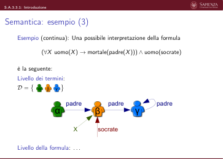
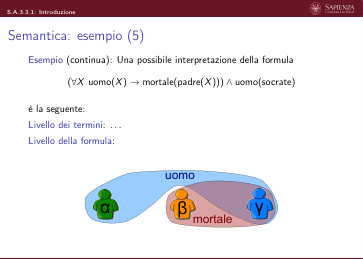

# A.3 - Logica del primo ordine (FOL)

> Fonte: `Slide A.3 - Logica del primo ordine (FOL) - BD2.pdf`
> Estratto con PyMuPDF (conserva legature e formule); tolte le righe ripetute di intestazione e pie' di pagina e le etichette sparse dei diagrammi, che sono ritagliati in `figure/` e richiamati nel punto in cui compaiono.

---

Slides A.3 (S.A.3)
                         Analisi dei requisiti
                         Logica del Primo Ordine (FOL)

 S.A.3: Logica del Primo Ordine (FOL)
  Indice
       Queste slide sono composte dalle seguenti sottounità:
       S.A.3.1. Introduzione
       S.A.3.2. Sintassi
       S.A.3.3. Semantica
           S.A.3.3.1. Introduzione
           S.A.3.3.2. Valutazione dei Termini
           S.A.3.3.3. Valutazione delle Formule

                                 Slides A.3.1 (S.A.3.1)
                              Analisi dei requisiti
                              Logica del Primo Ordine (FOL)
                                        Introduzione

 S.A.3.1: Introduzione
  Logica
       Famiglia di linguaggi formali per rappresentare informazione e derivare
       conseguenze.
       Ogni logica (come ogni altro linguaggio formale) è definita da una
       sintassi e una semantica.
       Sintassi: Considera il linguaggio come l’insieme delle sequenze finite di
       simboli ammesse dal linguaggio (formule), dove ogni simbolo appartiene
       ad un insieme prefissato (alfabeto). La sintassi definisce quindi la
       struttura delle formule.
       Semantica: Definisce il significato di ogni formula della logica, ovvero la
       sua verità nei diversi mondi possibili.

 S.A.3.1: Introduzione
  Logica (2)
       Esempio: il linguaggio dell’aritmetica
          ▶Sintassi: x + 2 ≥y è una formula, x2 + y ≥non lo è.
          ▶Semantica:
                ▶x +2 ≥y è vero sse valore di x +2 non è minore del valore di y
                ▶x + 2 ≥y è vero in un mondo dove x = 7 e y = 1
                ▶x + 2 ≥y è falso in un mondo dove x = 0 e y = 6.
       Nelle logiche classiche, ogni formula è vera o falsa in ogni mondo.
       Dato mondo m e formula φ: m |= φ sse φ è vera nel mondo m
       =⇒m modello di φ.

 S.A.3.1: Introduzione
  Logica: Sintassi
       Sintassi: Considera il linguaggio come l’insieme delle sequenze finite di
       simboli ammesse dal linguaggio(formule), dove ogni simbolo appartiene
       ad un insieme prefissato (alfabeto). La sintassi definisce quindi la
       struttura delle formule.
       Per definire la sintassi di una logica occorre stabilire:
          ▶Quali simboli appartengono al suo alfabeto
          ▶Quali sequenze finite di elementi dell’alfabeto (formule)
             compongono il linguaggio.
       Nota: La sintassi stabilisce quali sequenze di simboli siano formule
       logiche, e non dice nulla sul loro significato.

 S.A.3.1: Introduzione
  Logica: Semantica
       Semantica: Definisce il significato di ogni formula della logica, ovvero la
       sua verità nei diversi mondi possibili. In ogni mondo possibile, una
       formula può essere “vera” o “falsa”.
       Idea:
          ▶Si dà un significato (interpretazione) alle formule più semplici
          (atomiche).
          ▶Si usano le regole del sistema logico per stabilire il significato di
             formule arbitrarie.
       Simile a valutare un’espressione algebrica a partire dalla valutazione dei
       suoi termini atomici.
       Esempio: Si dà una interpretazione (valore) ad x ed y
       =⇒si usano le regole dell’aritmetica per valutare x + y ≤20.

 S.A.3.1: Introduzione
  Logica (dei predicati) del primo ordine
          ▶Sintassi
          ▶Semantica
                ▶Interpretazione
                ▶Assegnamento di variabili
                ▶Modello
                ▶Valutazione di una formula rispetto ad una interpretazione e
          ad un assegnamento di variabili
          ▶Soddisfacibilità
          ▶Insoddisfacibilità
          ▶Validità

                                 Slides A.3.2 (S.A.3.2)
                              Analisi dei requisiti
                              Logica del Primo Ordine (FOL)
                                            Sintassi

 S.A.3.2: Sintassi
  Sintassi di FOL: Alfabeto
       Definizione (Alfabeto della logica del primo ordine)
       L’alfabeto della logica del primo ordine è dato da:
          ▶un insieme V di variabili
          ▶un insieme F di simboli di funzione, ognuno dei quali ha associato il
          suo numero di argomenti detto arità
          ▶un insieme P di simboli di predicato, ognuno dei quali ha associato
          il suo numero di argomenti detto arità
          =⇒assumeremo che P contenga il predicato di arità 2 “=” (chiamato
          uguaglianza)
          ▶i connettivi logici ¬, ∨, ∧, →, ↔
          ▶i quantificatori ∀ed ∃, denominati rispettivamente quantificatore
          universale e quantificatore esistenziale
          ▶i simboli speciali “ ( ”, “ ) ” e “ , ” (virgola).

 S.A.3.2: Sintassi
  Alfabeto di FOL: osservazioni
          ▶Poiché il simbolo di predicato “=” è obbligatorio, per semplicità
          spesso lo ometteremo nella lista dei simboli di interesse
          ▶Per riferirci ad un simbolo di funzione f o ad un simbolo di predicato
          p di arità k, scriveremo rispettivamente f/k e p/k
          ▶I simboli di funzione di arità 0 vengono anche detti simboli di
          costante
          ▶Rispetto alla logica proposizionale, gli oggetti più simili alle lettere
             proposizionali sono i simboli di predicato di arità 0, che verranno
             appunto denominati lettere proposizionali anche in questo contesto.

 S.A.3.2: Sintassi
  Alfabeto di FOL: esempio
       Alcuni simboli di funzione con i loro significati “intuitivi”:
          ▶zero/0
          il numero naturale 0 – simbolo di costante
          ▶succ/1
          succ(X) è il numero naturale X + 1 (successore di X)
          ▶socrate/0
          l’individuo “Socrate” – simbolo di costante
          ▶padre/1
             padre(X) è il padre dell’individuo X.

 S.A.3.2: Sintassi
  Alfabeto di FOL: esempio (2)
       Alcuni simboli di predicato con i loro significati “intuitivi”:
          ▶doppio/2
          doppio(X, Y ): il numero naturale Y è il doppio del numero naturale
          X
          ▶somma/3
          somma(X, Y , Z): il numero naturale Z è la somma dei numeri
          naturali X ed Y
          ▶uomo/1
          uomo(X): l’individuo X è un uomo
          ▶mortale/1
             mortale(X), l’individuo X è mortale.

 S.A.3.2: Sintassi
  Sintassi di FOL: formule
       A partire dall’alfabeto si può definire il linguaggio della logica del primo
       ordine.
       Questo linguaggio ha una struttura sintattica più complessa di quello
       della logica proposizionale: la sua definizione induttiva deve essere
       effettuata in due passi:
          1. Viene definito un linguaggio intermedio, chiamato linguaggio dei
          termini
          2. Si definisce il linguaggio delle formule (o della logica del
          prim’ordine), utilizzando nella regola base della definizione il
          linguaggio dei termini.

 S.A.3.2: Sintassi
  Il linguaggio dei termini
       Definizione (Termini)
       L’insieme dei termini è definito induttivamente come segue:
          ▶ogni variabile in V è un termine
          ▶ogni simbolo di costante in F è un termine
          ▶se f è un simbolo di funzione (f ∈F) di arità n > 0 e t1, . . . , tn sono
             termini, allora anche f(t1, . . . , tn) è un termine.

 S.A.3.2: Sintassi
  Il linguaggio dei termini (2)
       Esempio:
       Sia F = {zero/0, succ/1, socrate/0, padre/1}
       Le seguenti sequenze di simboli sono termini (MiaVariabile e X sono
       variabili)
          1. zero
          2. MiaVariabile
          3. succ(zero)
                                                     4. padre(padre(socrate))
                                                     5. padre(succ(X))
                                                     6. succ(succ(zero))
       Idea: i termini denotano oggetti di interesse
       (quale oggetto di interesse è denotato da un termine non è stabilito dalla
       sintassi!)

 S.A.3.2: Sintassi
  Il linguaggio delle formule
       Definizione (Formule)
       L’insieme delle formule è definito induttivamente come segue:
          ▶se p è un simbolo di predicato di arità n e t1, . . . , tn sono termini,
          p(t1, . . . , tn) è una formula (detta formula atomica)
          ▶se ϕ e ψ sono formule, lo sono anche:
                ▶(ϕ)
                ▶¬ϕ
                                           ▶ϕ ∨ψ
                                           ▶ϕ ∧ψ
                                                                      ▶ϕ →ψ
                                                                      ▶ϕ ↔ψ
          ▶se ϕ è una formula e X è una variabile allora anche
             ∀X ϕ
             e
             ∃X ϕ
             sono formule.
       Scriveremo X = Y invece di = (X, Y ) e X̸ = Y al posto di ¬(X = Y ) (a
       sua volta al posto di ¬=(X, Y )).

 S.A.3.2: Sintassi
  Il linguaggio delle formule (2)
       Esempio: siano
          ▶F = {zero/0, succ/1, socrate/0, padre/1}
          ▶P = {doppio/2, somma/3, uomo/1, mortale/1}.
       Le seguenti sequenze di simboli sono formule:
          ▶doppio(succ(succ(zero)), X)
          ▶∃X doppio(succ(succ(zero)), X)
          ▶∀X doppio(succ(succ(zero)), X)
          ▶somma(succ(zero), zero, succ(zero))
          ▶∀X∀Y somma(X, X, Y ) →doppio(X, Y )
          ▶(∀X∃Y doppio(X,Y )) ∧(∀I∀J∃K somma(I,J,K))
          ▶mortale(socrate)
          ▶mortale(socrate) ∧mortale(padre(socrate))
          ▶∀X mortale(X)

 S.A.3.2: Sintassi
  Il linguaggio delle formule (3)
          ▶(∀X uomo(X) →mortale(X)) ∧uomo(socrate)
          ▶∀X uomo(X) →uomo(padre(X))
          ▶∀X uomo(socrate)
          ▶∀X∀Y uomo(X)
          ▶uomo(X)
          ▶X = socrate
          ▶X = Y
          ▶∀X uomo(X) →uomo(socrate).

 S.A.3.2: Sintassi
  Il linguaggio delle formule (4)
       Le seguenti sequenze di simboli non sono formule:
          ▶succ(zero)
          ▶mortale(mortale(socrate))
          ▶padre(mortale(X))
          ▶∃socrate mortale(socrate)
          ▶∃X padre(X)
          ▶X ∨Y
          ▶zero ∧zero
          ▶X ∧zero =

                                 Slides A.3.3 (S.A.3.3)
                              Analisi dei requisiti
                              Logica del Primo Ordine (FOL)
                                          Semantica

                              Slides A.3.3.1 (S.A.3.3.1)
                                Analisi dei requisiti
                                Logica del Primo Ordine (FOL)
                                        Semantica
                                        Introduzione

 S.A.3.3.1: Introduzione
  Richiamo: semantica nella logica proposizionale
          ▶Formule atomiche =⇒lettere proposizionali
          ▶Interpretazione: funzione I che assegna un valore di verità ad ogni
          lettera proposizionale
          ▶Funzione di valutazione (predefinita nella logica!) che date:
             ▶una formula arbitrariamente complessa
             ▶una interpretazione sulle sue lettere (sottoformule atomiche)
             calcola il valore di verità della formula rispetto all’interpretazione
             data.

 S.A.3.3.1: Introduzione
  Richiamo: semantica nella logica proposizionale (2)
       Esempio:
          ▶Formula: φ : a ∧(b ∨c)
          ▶Lettere proposizionali in φ: {a, b, c}
          ▶Interpretazione I: I(a) = true,
          I(b) = true,
          I(c) = false
       La valutazione della formula avviene per induzione dai valori delle sue
       sotto-formule atomiche (lettere) dati dall’interpretazione I.

 S.A.3.3.1: Introduzione
  Richiamo: semantica nella logica proposizionale (3)
       Esempio (continua):
          ▶Formula: φ : a ∧(b ∨c)
          ▶Interpretazione I: I(a) = true,
          I(b) = true,
          I(c) = false.
       La funzione induttiva di valutazione è predefinita nella logica (e
       implementa la nota semantica dei connettivi logici):
          1. Passo base La formula atomica b vale I(b) = true
          2. Passo base La formula atomica c vale I(c) = false
          3. Passo induttivo La formula (b ∨c) vale true (semantica di ∨)
          4. Passo base La formula atomica a vale I(a) = true
          5. Passo induttivo La formula a ∧(b ∨c) vale true (semantica di ∧).
       =⇒La formula proposizionale φ è vera nell’interpretazione I.
       =⇒L’interpretazione I è un modello di φ: I |= φ.

 S.A.3.3.1: Introduzione
  Richiamo: semantica nella logica proposizionale (4)
       Si può estendere il significato di ogni formula proposizionale senza
       riferimento a particolari interpretazioni:
          ▶formula soddisfacibile: esiste una interpretazione che è suo modello
          ▶formula valida: ogni interpretazione è suo modello
          ▶formula insoddisfacibile: nessuna interpretazione è suo modello.
       Esempio:
          ▶la formula a ∧(b ∨c) è soddisfacibile
          ▶la formula (a →b) ∨(b →a) è valida
          ▶la formula (a →b) ∧(¬a →b) ∧¬b è insoddisfacibile.

 S.A.3.3.1: Introduzione
  Semantica della logica del prim’ordine
       Stesso itinerario concettuale della logica proposizionale:
          1. Si definisce la nozione di interpretazione (valutazione delle formule
          atomiche)
          2. Si definisce come viene valutata una formula data una particolare
          interpretazione
          3. Si stabilisce il significato di ogni formula senza riferimento a
          particolari interpretazioni.

 S.A.3.3.1: Introduzione
  Semantica: termini vs. formule
       La struttura del linguaggio evidenzia due livelli sintattici:
          ▶Il livello dei termini
          ▶Il livello delle formule
       Abbiamo bisogno quindi di due nozioni di valutazione:
          ▶La valutazione dei termini:
                ▶Valutazione dei termini atomici:
                ▶Pre-interpretazione (valutazione dei simboli di funzione)
                ▶Assegnamento di variabili (valutazione delle variabili)
                ▶Funzione (predefinita nella logica) di valutazione dei termini
          “complessi” a partire dalla valutazione dei termini atomici
          ▶La valutazione delle formule: . . .

 S.A.3.3.1: Introduzione
  Semantica: termini vs. formule (2)
       Abbiamo bisogno quindi di due nozioni di valutazione:
          ▶La valutazione dei termini: . . .
          ▶La valutazione delle formule:
                ▶Valutazione delle formule atomiche:
                ▶interpretazione
                ▶Valutazione (predefinita nella logica) delle formule “complesse”
                   a partire dalla valutazione delle formule atomiche.

 S.A.3.3.1: Introduzione
  Semantica: esempio
       Iniziamo informalmente con un semplice esempio.
       Esempio: siano
          ▶F = {socrate/0, padre/1}
          ▶P = {uomo/1, mortale/1}
       Per valutare la formula:
                  (∀X uomo(X) →mortale(padre(X))) ∧uomo(socrate)
       dobbiamo fornire:

 S.A.3.3.1: Introduzione
  Semantica: esempio (2)
       Esempio (continua): Per valutare la formula
                  (∀X uomo(X) →mortale(padre(X))) ∧uomo(socrate)
       dobbiamo fornire:
       Livello dei termini:
          ▶un insieme D di “oggetti del mondo” (dominio)
          ▶una corrispondenza dai simboli di funzione a funzioni su D (funzioni
             di opportuna arità):
                ▶socrate/0 (simbolo di costante) =⇒funzione da D0 a D
          =⇒elemento di D
          ▶padre/1 (simbolo di funzione 1-aria) =⇒funzione da D1 a D
          ▶una corrispondenza dalle variabili a elementi di D:
                ▶X (variabile) =⇒elemento di D
       Livello della formula: . . .

 S.A.3.3.1: Introduzione
  Semantica: esempio (3)
       Esempio (continua): Una possibile interpretazione della formula
                  (∀X uomo(X) →mortale(padre(X))) ∧uomo(socrate)
       è la seguente:
       Livello dei termini:
             

       D =
                 γ
                 α
                 β
                             padre
                                                padre
                                                padre
                        γ
                        α
                        β
                                X
                                           socrate
       Livello della formula: . . .

 S.A.3.3.1: Introduzione
  Semantica: esempio (4)
       Esempio (continua): Per valutare la formula
                  (∀X uomo(X) →mortale(padre(X))) ∧uomo(socrate)
       dobbiamo fornire:
       Livello dei termini: . . .
       Livello della formula:
          ▶una corrispondenza dai simboli di predicato a relazioni su D di
             opportuna arità:
                ▶uomo/1 =⇒relazione 1-aria su D ( =⇒sottoinsieme di D1)
                ▶mortale/1 =⇒relazione 1-aria su D ( =⇒sottoinsieme di
                   D1)

 S.A.3.3.1: Introduzione
  Semantica: esempio (5)
       Esempio (continua): Una possibile interpretazione della formula
                  (∀X uomo(X) →mortale(padre(X))) ∧uomo(socrate)
       è la seguente:
       Livello dei termini: . . .
       Livello della formula:
                                             uomo
                           γ
                           α
                           β mortale

 S.A.3.3.1: Introduzione
  Semantica: esempio (6)
       Esempio (riepilogo): Una possibile interpretazione della formula
                  (∀X uomo(X) →mortale(padre(X))) ∧uomo(socrate)
       è la seguente:
       Livello dei termini:
          ▶D = {α, β, γ}
          ▶socrate/0 associato all’elemento β (funzione D0 →D)
          ▶padre/1 associato alla seguente funzione P : D1 →D:
                                  P(α) = β, P(β) = γ, P(γ) = γ
          ▶X associato a β
       Livello della formula:
          ▶uomo/1 associato alla relazione U ⊆D1: U = {α, γ}
          ▶mortale/1 associato alla relazione M ⊆D1: M = {β, γ}.

                              Slides A.3.3.2 (S.A.3.3.2)
                                Analisi dei requisiti
                                Logica del Primo Ordine (FOL)
                               Semantica
                               Valutazione dei Termini

 S.A.3.3.2: Valutazione dei Termini
  Valutazione dei termini
       Ricordiamo la definizione induttiva dei termini (sintassi):
       Definizione (Termini)
       L’insieme dei termini è definito induttivamente come segue:
          ▶ogni variabile in V è un termine
          ▶ogni simbolo di costante in F è un termine
          ▶se f è un simbolo di funzione (f ∈F) di arità n > 0 e t1, . . . , tn sono
             termini, allora anche f(t1, . . . , tn) è un termine

 S.A.3.3.2: Valutazione dei Termini
  Valutazione dei termini (2)
       Per valutare ogni termine che può essere scritto a partire da un insieme di
       variabili V e un insieme di simboli di funzione F abbiamo bisogno di
       definire:
          ▶la valutazione dei termini atomici:
          ▶pre-interpretazione (valutazione dei simboli di funzione)
          ▶assegnamento di variabili (valutazione delle variabili)
          ▶la funzione (predefinita nella logica) di valutazione dei termini
             “complessi” a partire dalla valutazione dei termini atomici.

 S.A.3.3.2: Valutazione dei Termini
  Pre-interpretazione
       Definizione (Pre-interpretazione)
       Sia F un insieme di simboli di funzione.
       Una pre-interpretazione preI per F è costituita da:
          ▶un insieme non vuoto D:
          il dominio di interpretazione (finito o
          infinito)
          ▶una corrispondenza che associa ad ogni simbolo di funzione f/n ∈F
             di arità n ≥0 una funzione (totale) del tipo
                                               Dn −→D
             denotata “preI(f)” (se n = 0, la funzione associa al simbolo di
             costante f/0 un elemento di D)

 S.A.3.3.2: Valutazione dei Termini
  Esempio di pre-interpretazione: preNAT
       Sia F = {zero/0, succ/1}.
       Definiamo la pre-interpretazione preNAT per F come segue:
          ▶il dominio di interpretazione D è l’insieme degli interi non negativi:
          D = {0, 1, 2, . . .}
          ▶preNAT(zero) = 0 ∈D
          ▶preNAT(succ) è la funzione D →D definita come:
             preNAT(succ)(0) = 1
             preNAT(succ)(1) = 2
                                                      preNAT(succ)(2) = 3
                                                      . . .
       preNAT associa correttamente al simbolo unario succ/1 una funzione del
       tipo D1 −→D (funzione unaria)
       Per nostra scelta, la funzione (totale) preNAT(succ) codifica
       correttamente la funzione successore sugli interi non negativi

 S.A.3.3.2: Valutazione dei Termini
  Assegnamento di variabili
       Definizione (Assegnamento di variabili)
       Sia V un insieme di variabili e sia preI una pre-interpretazione con
       dominio D.
       Un assegnamento delle variabili V per preI è una funzione
                                            V −→D
       che associa ad ogni variabile in V un elemento del dominio di
       interpretazione di preI.
       Nota: manteniamo l’assegnamento di variabili separato dalla
       pre-interpretazione. Questo risulterà comodo per valutare formule con
       variabili quantificate

 S.A.3.3.2: Valutazione dei Termini
  Esempio: assegnamento di variabili per preNAT
       Sia V = {X, Y , Z}. Considerando la pre-interpretazione preNAT in cui il
       dominio di interpretazione D è l’insieme degli interi non negativi, la
       funzione W tale che
          ▶W (X) = 3
          ▶W (Y ) = 6
          ▶W (Z) = 4
       è un assegnamento delle variabili V per preNAT

 S.A.3.3.2: Valutazione dei Termini
  Valutazione dei termini
       Siano F un insieme di simboli di funzione e V un insieme di variabili.
       Per valutare un termine (arbitrariamente complesso) su F e V, dobbiamo
       avere a disposizione:
          ▶una pre-interpretazione preI per F e
          ▶un assegnamento delle variabili V per preI.

 S.A.3.3.2: Valutazione dei Termini
  Valutazione dei termini (2)
       Definizione (Valutazione di termini) Dati V e F, sia T l’insieme di tutti i
       termini che possono essere generati da V e F. Dati una
       pre-interpretazione preI su dominio D e un assegnamento di variabili S
       per preI, la funzione
                                    pre-evalpreI,S : T −→D
       è definita induttivamente come segue, seguendo la struttura induttiva dei
       termini:
          1. caso base (termini atomici):
          1.1. se X è una variabile: pre-evalpreI,S(X) = S(X)
          1.2. se c è un simbolo di costante: pre-evalpreI,S(c) = preI(c)
          2. caso induttivo (termini complessi):
          2.1. se f è un simbolo di funzione di arità n > 0 e t1, . . . , tn sono
          termini: pre-evalpreI,S( f (t1, . . . , tn) ) =
          preI(f )( pre-evalpreI,S(t1), . . . , pre-evalpreI,S(tn) )

 S.A.3.3.2: Valutazione dei Termini
  Valutazione dei termini: esempio
       Sia V = {X, Y , Z} e F = {zero/0, succ/1}.
       Riconsideriamo la pre-interpretazione preNAT e l’assegnazione W :
          ▶W (X) = 3
          ▶W (Y ) = 6
          ▶W (Z) = 4
       L’insieme T dei termini che possono essere generati da V e F è:
             zero,
             X,
             Y ,
             Z,
             succ(zero),
             succ(X),
             succ(Y ),
             succ(Z),
             succ(succ(zero)),
             succ(succ(X)),
             succ(succ(Y )),
             succ(succ(Z)),
             succ(succ(succ(zero))),
             succ(succ(succ(X))),
             succ(succ(succ(Y ))), succ(succ(succ(Z))), . . .
       Nota: T è infinito, data la presenza in F di simboli di arità > 0.

 S.A.3.3.2: Valutazione dei Termini
  Valutazione dei termini: esempio (2)
       A cosa corrisponde pre-evalpreNAT,W (zero)?
          ▶La pre-interpretazione preNAT associa il simbolo zero ∈F di arità
             zero (simbolo di costante) all’elemento 0 ∈D
             [caso 1.2]
       Quindi pre-evalpreNAT,W (zero) = preNAT(zero) = 0

 S.A.3.3.2: Valutazione dei Termini
  Valutazione dei termini: esempio (3)
       A cosa corrisponde pre-evalpreNAT,W (succ(succ(X)))?
       = preNAT(succ)(pre-evalpreNAT,W (succ(X)))
       [caso 2.1]
       = preNAT(succ)(preNAT(succ)(pre-evalpreNAT,W (X))
       [caso 2.1]
       = preNAT(succ)(preNAT(succ)(W (X)))
       = preNAT(succ)(preNAT(succ)(3))
       [caso 1.1]
       La pre-interpretazione preNAT associa il simbolo succ ∈F di arità 1 alla
       funzione D →D definita come:
       preNAT(succ)(0) = 1
       preNAT(succ)(1) = 2
                                                   preNAT(succ)(2) = 3
                                                   . . .
       Quindi:
       = preNAT(succ)(preNAT(succ)(3)) = preNAT(succ)(4) = 5

                              Slides A.3.3.3 (S.A.3.3.3)
                                Analisi dei requisiti
                                Logica del Primo Ordine (FOL)
                              Semantica
                              Valutazione delle Formule

 S.A.3.3.3: Valutazione delle Formule
  Interpretazione
       Definizione (Interpretazione)
       Una interpretazione I è costituita da:
          ▶Una pre-interpretazione preI (che a sua volta definisce un dominio D
          e una funzione su D per ogni simbolo di funzione)
          ▶Una funzione che associa ad ogni simbolo di predicato p/n di arità n
             una relazione I(p) su Dn:
                                         I(p) ⊆D × · · · × D
                                         |
                                         {z
                                         }
                                         n volte
             Tale corrispondenza deve assegnare al simbolo di predicato “=” la
             relazione {(d, d) | d ∈D} ⊆D × D
       Nota: una (pre-)interpretazione non include un assegnamento di variabili!

 S.A.3.3.3: Valutazione delle Formule
  Interpretazione (2)
       Interpretazione di “=”
       L’ultimo punto della definizione di interpretazione chiarisce che
       l’interpretazione di “=” deve rispettare i vincoli intuitivi dell’uguaglianza.
       Ad esempio
          ▶se abbiamo una interpretazione I con dominio di interpretazione
          D = {d1, d2, d3},
          ▶allora la relazione associata da I al simbolo “=” deve essere
             necessariamente quella definita come:
                                     {(d1, d1), (d2, d2), (d3, d3)}

 S.A.3.3.3: Valutazione delle Formule
  Esempio di interpretazione: NAT
       Siano:
          ▶F = {zero/0, succ/1}
          ▶P = {doppio/2, somma/3}
       L’interpretazione NAT è definita in questo modo:
          ▶la pre-interpretazione è preNAT (cfr. esempio precedente)
          ▶NAT(doppio) = {⟨0, 0⟩, ⟨1, 2⟩, ⟨2, 4⟩, ⟨3, 6⟩, . . . } = {⟨x, y⟩| y = 2x}
          ▶NAT(somma) = {⟨0, 0, 0⟩, ⟨0, 1, 1⟩, ⟨1, 0, 1⟩, ⟨1, 1, 2⟩, . . . } =
                                         {⟨x, y, z⟩| z = x + y}

 S.A.3.3.3: Valutazione delle Formule
  Valutazione di formule
       Sia F un insieme di simboli di funzione, P un insieme di simboli di
       predicato e V un insieme di varibili.
       Per valutare una formula (arbitrariamente complessa) su F, P e V,
       abbiamo bisogno di:
          ▶una interpretazione I su P, che include una pre-interpretazione preI
          su F
          ▶un assegnamento alle variabili V per preI.

 S.A.3.3.3: Valutazione delle Formule
  Valutazione di formule (2)
       Definizione (Valutazione di una formula)
       Siano dati V, F e P, e sia Φ l’insieme di tutte le formule che possono
       essere generate da V, F e P.
       Sia I una interpretazione su P che include una pre-interpretazione preI su
       F. Sia inoltre S un assegnamento alle variabili V per preI.
       Definiamo, in dipendenza da I e da S, la funzione
                                  evalI,S : Φ −→{true, false}
       come segue:

 S.A.3.3.3: Valutazione delle Formule
  Valutazione di formule (3)
       Definizione (Valutazione di una formula) (continua)
       La funzione è definita in modo induttivo, seguendo la struttura induttiva
       delle formule:
          1. caso base (formule atomiche):
          1.1. se p/n è un simbolo di predicato e t1, . . . tn sono termini:
          evalI,S(p(t1, . . . , tn)) = I(p)(pre-evalpreI,S(t1), . . . , pre-evalpreI,S(tn))
          2. caso induttivo (formule complesse):
          . . .

 S.A.3.3.3: Valutazione delle Formule
  Valutazione di formule (4)
       Definizione (Valutazione di una formula) (continua)
          1. caso base (formule atomiche):
          . . .
          2. caso induttivo (formule complesse):
          2.1. se ϕ e ψ sono formule allora (similm. alla logica prop.):
          •
          evalI,S( (ϕ) )
          =
          evalI,S(ϕ)
          •
          evalI,S(¬ϕ)
          =
          true se evalI,S(ϕ) = false;
          =
          false altrimenti
          •
          evalI,S(ϕ ∨ψ)
          =
          true se evalI,S(ϕ) = true oppure
              se evalI,S(ψ) = true
              =
              false altrimenti
              •
              evalI,S(ϕ ∧ψ)
              =
              true se evalI,S(ϕ) = evalI,S(ψ) = true
              =
              false altrimenti
              •
              evalI,S(ϕ →ψ)
              =
              evalI,S(¬ϕ ∨ψ)
              •
              evalI,S(ϕ ↔ψ)
              =
              evalI,S( (ϕ →ψ) ∧(ψ →ϕ) )
              2.2. . . .

 S.A.3.3.3: Valutazione delle Formule
  Valutazione di formule (5)
       Definizione (Valutazione di una formula) (continua)
          1. case base (formule atomiche): . . .
          2. caso induttivo (formule complesse):
          2.1. . . .
          2.2. se ϕ è una formula e V è una variabile in V allora:
          evalI,S(∃V ϕ) = true se esiste d ∈D t.c. evalI,S[V /d](ϕ) = true
                    = false altrimenti
                    evalI,S(∀V ϕ) = true se per ogni d ∈D vale evalI,S[V /d](ϕ) = true
                                    = false altrimenti
       Nota: Dato un assegnamento di variabili S, con S[X/d] si indica un
       assegnamento uguale ad S eccettuato il fatto che alla variabile X viene
       assegnato il valore d (esempio: se S(X) = 3 e S(Y ) = 4, allora
       S[Y /9](X) = 3 e S[Y /9](Y ) = 9).
       Nota: in una formula chiusa (dove tutte le variabili sono quantificate)
       l’assegnamento di variabili non gioca alcun ruolo (!!)

 S.A.3.3.3: Valutazione delle Formule
  Esempio: valutazione su NAT
       Riconsideriamo l’interpretazione NAT (che include preNAT) su:
          ▶F = {zero/0, succ/1}
          ▶P = {doppio/2, somma/3}
       vista in un esempio precedente, e la seguente assegnazione W sulle
       variabili V = {X, Y , I, J, K}:
          ▶W (X) = 3
          ▶W (Y ) = 6
          ▶W (I) = W (J) = W (K) = 4

 S.A.3.3.3: Valutazione delle Formule
  Esempio: valutazione su NAT (2)
       Quanto vale evalNAT,W (doppio(succ(succ(zero)), X))?
        = NAT(doppio)(pre-evalpreNAT,W (succ(succ(zero))), pre-evalpreNAT,W (X))
        = NAT(doppio)(preNAT(succ)(pre-evalpreNAT,W (succ(zero))), W (X))
        = NAT(doppio)(preNAT(succ)(preNAT(succ)(pre-evalpreNAT,W (zero))), 3)
        = NAT(doppio)(preNAT(succ)(preNAT(succ)(preNAT(zero))), 3)
        = NAT(doppio)(preNAT(succ)(preNAT(succ)(0)), 3)
        = NAT(doppio)(preNAT(succ)(1), 3)
        = NAT(doppio)(2, 3)
        = false

 S.A.3.3.3: Valutazione delle Formule
  Esempio: valutazione su NAT (3)
       Quanto vale evalNAT,W (∃X doppio(succ(succ(zero)), X))?
       La variabile X è esistenzialmente quantificata. Dalla regola 2.2, la
       formula è true sse esiste d ∈D tale che:
                    evalNAT,W [X/d](doppio(succ(succ(zero)), X)) = true
       Questo è vero per d = 4. La formula è quindi vera
       Nota: il valore assegnato da W alla variabile quantificata X è irrilevante

 S.A.3.3.3: Valutazione delle Formule
  Esempio: valutazione su NAT (4)
       Quanto vale evalNAT,W (∀X doppio(succ(succ(zero)), X))?
       La variabile X è universalmente quantificata. Dalla regola 2.2, la formula
       è false sse esiste d ∈D tale che:
                   evalNAT,W [X/d](doppio(succ(succ(zero)), X)) = false
       Questo avviene, ad es., per d = 1. La formula è quindi falsa
       Nota: il valore assegnato da W alla variabile quantificata X è irrilevante

 S.A.3.3.3: Valutazione delle Formule
  Esempio: valutazione su NAT (5)
       Quanto vale evalNAT,W (somma(succ(zero), zero, succ(zero)))?
                 = NAT(somma)( pre-evalpreNAT,W (succ(zero)),
                                     pre-evalpreNAT,W (zero),
                                     pre-evalpreNAT,W (succ(zero)))
                 = NAT(somma)( preNAT(succ)(pre-evalpreNAT,W (zero)),
                                     preNAT(zero),
                                     preNAT(succ)(pre-evalpreNAT,W (zero)))
                 = NAT(somma)( preNAT(succ)(0), 0, preNAT(succ)(0))
                 = NAT(somma)( 1, 0, 1)
                 = true

 S.A.3.3.3: Valutazione delle Formule
  Esercizio: valutazione su NAT
          1. Si calcoli il valore di verità delle formule seguenti sull’interpretazione
          NAT e sull’assegnamento di variabili W definiti in precedenza
          1.1. ∀X∀Y (somma(X, X, Y ) →doppio(X, Y ))
          1.2. (∀X∃Y doppio(X, Y )) ∧(∀I∀J∃K somma(I, J, K))
          1.3. ∀X∃Y doppio(X, Y )
          1.4. ∃Y ∀X doppio(X, Y )
          2. L’assegnamento di variabili W gioca un qualche ruolo nel
          determinare il valore di verità delle formule qui sopra? Perché?
          3. L’assegnamento di variabili W gioca un qualche ruolo nel
          determinare il valore di verità delle sotto-formule delle formule qui
          sopra?
          4. L’ordine dei quantificatori ha un qualche impatto nel determinare il
          valore di verità di una formula?

 S.A.3.3.3: Valutazione delle Formule
  Soddisfacibilità, insoddisfacibilità, validità, modelli
          ▶Formula ϕ soddisfacibile: esiste una interpretazione I e un
          assegnamento di variabili S tale che evalI,S(ϕ) = true
          ▶Formula ϕ insoddisfacibile: per ogni interpretazione I e
          assegnamento di variabili S, si ha evalI,S(ϕ) = false
          ▶Formula ϕ valida: per ogni interpretazione I ed ogni assegnamento
             di variabili S, si ha evalI,S(ϕ) = true
       Nota: in una formula chiusa (dove tutte le variabili sono quantificate)
       l’assegnamento di variabili non gioca alcun ruolo (!!)
       Per formule chiuse abbiamo anche:
          ▶Modello di ϕ: interpretazione M per cui si ha: evalM,S(ϕ) = true
             per qualunque assegnamento di variabili S
             (formula chiusa =⇒S irrilevante)
                                                M |= ϕ

 S.A.3.3.3: Valutazione delle Formule
  Esempio: valutazione di formule aperte
       Si consideri la seguente formula aperta
                                       ∃X doppio(X, Y )
       Data l’interpretazione NAT definita in un esempio precedente, si
       definiscano tutte le assegnazioni alle variabili che rendono la formula vera
       e tutte quelle che la rendono falsa

 S.A.3.3.3: Valutazione delle Formule
  Esempio: valutazione di formule aperte
       Si consideri la seguente formula aperta
                                       ∃X doppio(X, Y )
       Data l’interpretazione NAT definita in un esempio precedente, si
       definiscano tutte le assegnazioni alle variabili che rendono la formula vera
       e tutte quelle che la rendono falsa
       Soluzione
          ▶La formula è vera per tutte le assegnazioni alle variabili che assegnano
          ad Y un valore pari
          ▶La formula è falsa per tutte le assegnazioni alle variabili che assegnano
             ad Y un valore dispari

 S.A.3.3.3: Valutazione delle Formule
  Regole di precedenza per la valutazione
       In FOL vengono usate convenzionalmente le seguenti regole di
       precedenza per la valutazione dei connettivi e quantificatori:
          1. ¬
          2. ∧, ∨
          3. ∀, ∃
          4. →
       Esempio: La formula
                         ∀X P(X) ∨S(X) →∃Y Q(X, Y ) ∧¬R(Y )
       viene valutata come se fosse
                   ∀X ((P(X) ∨S(X)) →(∃Y (Q(X, Y ) ∧¬ (R(Y )))))

 S.A.3.3.3: Valutazione delle Formule
  Campo d’azione dei quantificatori
       La presenza di più quantificatori che quantificano variabili omonime può
       creare ambiguità
       Esempio: Si consideri la formula
                   ∀X uomo(X) ∧∃X mortale(X) ∨X = padre(socrate)
          ▶A quale quantificatore fa riferimento X in mortale(X)?
          ▶A quale quantificatore fa riferimento X in X = padre(socrate)?
       Il problema del campo di azione di un quantificatore è analogo a quello
       del campo d’azione degli identificatori in un linguaggio di
       programmazione con sottoprogrammi

 S.A.3.3.3: Valutazione delle Formule
  Campo d’azione dei quantificatori (2)
       Osservazione: il nome di una variabile quantificata non gioca alcun ruolo,
       analogamente ai parametri formali nei linguaggi di programmazione
       La formula può essere sempre riscritta evitando che due quantificatori
       siano applicati a variabili omonime
       Quindi, in base alle intenzioni del progettista, la formula può essere
       scritta come (formule non equivalenti!):
          1. ∀X uomo(X) ∧∃Y mortale(X) ∨Y = padre(socrate)
          2. ∀X uomo(X) ∧∃Y mortale(Y ) ∨Y = padre(socrate)
          3. ∀X uomo(X) ∧∃Y mortale(Y ) ∨X = padre(socrate)
          4. ∀X uomo(X) ∧∃Y mortale(X) ∨X = padre(socrate)
       Nota: in alcuni casi (come quello dell’esempio) l’ambiguità può essere
       risolta semplicemente aggiungendo le parentesi, ad es.:
       (∀X uomo(X)) ∧(∃X mortale(X) ∨X = padre(socrate)) (equiv. alla 2.)
       Suggerimento: usare parentesi ed evitare quantificatori su var. omonime!
