# A.4 - Logica del primo ordine (FOL) nell’Analisi Concettuale

> Fonte: `Slide A.4 - Logica del primo ordine (FOL) nell’Analisi Concettuale - BD2.pdf`
> Estratto con PyMuPDF (conserva legature e formule); tolte le righe ripetute di intestazione e pie' di pagina e le etichette sparse dei diagrammi, che sono ritagliati in `figure/` e richiamati nel punto in cui compaiono.

---

Slides A.4 (S.A.4)
       Analisi dei requisiti
       Logica del primo ordine (FOL) nell’Analisi Concettuale

 S.A.4: Logica del primo ordine (FOL) nell’Analisi Concettuale
  Indice
       Queste slide sono composte dalle seguenti sottounità:
       S.A.4.1. Introduzione
       S.A.4.2. Alfabeto
       S.A.4.3. Semantica di un diagramma UML delle classi in FOL
           S.A.4.3.1. Esempio di interpretazione
           S.A.4.3.2. Disgiunzione e Generalizzazione tra Classi, Associazioni e Domini
           S.A.4.3.3. Tipizzazione di Associazioni
           S.A.4.3.4. Tipizzazione di Attributi
           S.A.4.3.5. Cardinalità di Associazioni e Attributi
           S.A.4.3.6. Tipizzazione di Operazioni
           S.A.4.3.7. Vincoli di Identificazione di Classe
           S.A.4.3.8. Un Esempio Completo
           S.A.4.3.9. Logica e Realtà
       S.A.4.4. Vincoli Esterni

 S.A.4: Logica del primo ordine (FOL) nell’Analisi Concettuale
  Indice (2)
       S.A.4.5. Specifiche di Operazioni di Classe o Use-Case

                                 Slides A.4.1 (S.A.4.1)
               Analisi dei requisiti
               Logica del primo ordine (FOL) nell’Analisi Concettuale
                                        Introduzione

 S.A.4.1: Introduzione
  FOL nell’Analisi Concettuale
       Lo schema concettuale dell’applicazione consiste in:
          1. Diagramma UML delle classi
          2. Specifica delle operazioni di classe
          3. Vincoli su oggetti e link, esterni al diagramma delle classi
          4. Diagramma UML degli use-case
          5. Specifica delle operazioni di use-case
       Abbiamo visto come sia pericoloso, soprattutto per sistemi complessi,
       limitarsi ad usare il linguaggio naturale per definire 3., 2. e 5.
       Il linguaggio naturale è potenzialmente:
          ▶Ambiguo
          ▶Omissivo
                                                     ▶Contraddittorio
                                                     ▶Poco leggibile.
       Anche l’interpretazione dei diagrammi può risultare ambigua, se non si
       associa una semantica precisa ai diversi costrutti.

 S.A.4.1: Introduzione
  FOL nell’Analisi Concettuale: Obiettivi
          1. Associare una semantica precisa (usando la logica del primo ordine,
          FOL, opportunamente estesa) ai diagrammi delle classi
          (ignoreremo i diagrammi degli use-case, sempre molto semplici)
          2. Utilizzare la logica del primo ordine (FOL, opportunamente estesa)
          per definire tutto ciò che, nello schema concettuale, non è definibile
          mediante diagrammi:
                ▶Vincoli sui dati, esterni al diagramma delle classi
                ▶Specifiche delle operazioni di classe e di use-case

 S.A.4.1: Introduzione
  FOL nell’Analisi Concettuale: sommario
       Vedremo come:
          ▶Un diagramma UML delle classi rappresenta una formula Φ in logica
          del primo ordine (FOL) i cui modelli definiscono tutti e soli i livelli
          estensionali legali degli oggetti e dei link.
          ▶Il linguaggio diagrammatico può allora essere considerato come uno
          strumento user-friendly per la definizione della formula logica Φ che
          definisce la struttura dei dati/operazioni di interesse.
          ▶Il vocabolario di Φ prevede simboli di predicato e di funzione che
          dipendono dal nome dei costrutti (classi, associazioni, attributi,
          domini, etc.) del diagramma delle classi.
          ▶. . .

 S.A.4.1: Introduzione
  FOL nell’Analisi Concettuale: sommario (2)
       Vedremo come:
          ▶. . .
          ▶I vincoli sui dati non esprimibili nel diagramma delle classi possono
             essere espressi direttamente in logica mediante una formula Ψ (sullo
             stesso vocabolario di Φ) che va intesa in and con Φ e quindi
             restringe l’insieme dei modelli che definiscono tutti e soli i livelli
             estensionali legali degli oggetti e link:
               Interpretazione M rappresenta
               un livello estensionale degli oggetti e link legale
               ⇐⇒M |= Φ∧Ψ.
          ▶Anche la specifica di un’operazione di classe o use-case in termini di
             precondizioni e postcondizioni può essere caratterizzata mediante la
             logica, usando lo stesso vocabolario di Φ.

 S.A.4.1: Introduzione
  FOL nell’Analisi Concettuale: sommario (3)
       Conseguenze:
          ▶Lo schema concettuale dell’applicazione può essere considerato
             come definito interamente in logica e quindi non ambiguo e
             univocamente interpretabile.
          ▶È possibile dimostrare formalmente proprietà strutturali dello schema
             concettuale, prima delle fasi di progettazione e di implementazione.

                                 Slides A.4.2 (S.A.4.2)
               Analisi dei requisiti
               Logica del primo ordine (FOL) nell’Analisi Concettuale
                                           Alfabeto

 S.A.4.2: Alfabeto
  Semantica dello schema concettuale in logica
       Purtroppo non esiste una semantica formale per la totalità dei costrutti e
       dei diagrammi UML.
       Un diagramma UML delle classi con i costrutti visti in questo corso ha
       invece una semantica formale.
       Dunque, per quanto ci riguarda, un diagramma delle classi è una specifica
       formale degli oggetti di interesse per un certo dominio applicativo, della
       loro struttura, delle loro articolazioni e dei legami tra loro.

 S.A.4.2: Alfabeto
  Semantica dello schema concettuale in logica (2)
       Mostreremo come:
          ▶un diagramma delle classi definisca una formula Φ in logica del
             primo ordine (first-order logic, FOL), che esprime vincoli sui livelli
             estensionali ammessi (legali) per lo schema concettuale.
                        Interpretazione M rappresenta
                        un livello estensionale legale per il
                                                                  ⇐⇒M |= Φ.
                               diagramma delle classi
          La formula Φ sarà una congiunzione (and) di blocchi di formule,
          ognuno dei quali definisce la semantica di ogni modulo (classi,
          associazioni, attributi, domini, generalizzazioni, vincoli di
          identificazione, vincoli di molteplicità) presente nel diagramma delle
          classi
          ▶la specifica di ogni operazione di classe o di use-case può essere
             definita formalmente utilizzando opportune estensioni di FOL.

 S.A.4.2: Alfabeto
  Alfabeto
       La formalizzazione di uno schema concettuale sarà definita su un certo
       alfabeto FOL, ovvero (oltre che i connettivi logici, i quantificatori, etc. e
       un certo numero di variabili):
          ▶su un certo insieme di simboli di predicato P e
          ▶su un certo insieme di simboli di funzione F.
       I simboli di predicato in P (con le loro arità) sono univocamente definiti
       dal nome dei diversi moduli e costrutti presenti nel diagramma delle classi
       (in particolare, dai nomi delle classi, associazioni, attributi, domini,
       operazioni di classe) e nel diagramma degli use-case (operazioni di
       use-case).
       I simboli di funzione in F (con le loro arità) sono univocamente definiti
       dalle operazioni necessarie per operare sui valori dei domini.
       Come al solito, assumeremo che tra i simboli di predicato P ci sia il
       simbolo binario di uguaglianza =/2 la cui semantica è fissata.

 S.A.4.2: Alfabeto
  Simboli di predicato per le classi
       Ogni classe C presente nel diagramma delle classi definisce il simbolo di
       predicato unario C/1.
                   C
                                                        C/1 ∈P
       In ogni modello M della formula Φ che definisce un livello estensionale
       legale per lo schema concettuale, le istanze della classe C saranno
       rappresentate dagli elementi x del dominio di interpretazione di M tali
       che C(x) = true.

 S.A.4.2: Alfabeto
  Simboli di predicato per le classi (2)
       Esempio
       Supponiamo che un diagramma delle classi definisca le classi:
          ▶Persona
          ▶Azienda.
       La formula FOL Φ definita dal diagramma conterrà occorrenze dei
       simboli di predicato Persona/1 e Azienda/1. Quindi:
                            P = {. . . , Persona/1, Azienda/1, . . .} .
       Un modello M di Φ definirà (tra l’altro):
          ▶l’estensione del simbolo di predicato Persona, ad es.:
          M(Persona) = {α, β} (tutte e sole le istanze della classe Persona)
          ▶l’estensione del simbolo di predicato Azienda, ad es.:
             M(Azienda) = {γ, δ} (tutte e sole le istanze della classe Azienda).

 S.A.4.2: Alfabeto
  Simboli di predicato per domini
       Ogni dominio dom utilizzato nello schema concettuale definisce il simbolo
       di predicato unario dom/1.
                   C
                                                      dom/1 ∈P
           attr : dom
       In ogni modello M della formula Φ, i valori del dominio dom saranno
       rappresentati dagli elementi d del dominio di interpretazione di M tali
       che dom(d) = true.

 S.A.4.2: Alfabeto
  Simboli di predicato per domini (2)
       Esempio
       Supponiamo che uno schema concettuale menzioni (ad es., come tipo di
       un attributo di classe) i domini intero e data.
       La formula FOL Φ conterrà occorrenze dei simboli di predicato intero/1 e
       data/1. Quindi:
                              P = {. . . , Intero/1, Data/1, . . .} .
       Un modello M di Φ definirà (tra l’altro):
          ▶l’estensione del simbolo di predicato Intero/1
          ▶l’estensione del simbolo di predicato Data/1

 S.A.4.2: Alfabeto
  Simboli di predicato per attributi di classe
       Per ogni attributo attr di una classe del diagramma delle classi definisce il
       simbolo di predicato binario attr/2.
                   C
                                                       attr/2 ∈P
              attr : dom
       In ogni modello M della formula Φ, i valori dell’attributo attr per
       l’istanza c di C saranno rappresentati dagli elementi v del dominio di
       interpretazione di M tali che attr(c, v) = true.
       Nota: Perché non utilizziamo simboli di funzione per formalizzare
       attributi?

 S.A.4.2: Alfabeto
  Simboli di predicato per attributi di classe (2)
       Esempio
       Supponiamo che un diagramma delle classi definisca la classe Persona
       con l’attributo email:Stringa.
       La formula FOL Φ conterrà occorrenze del simbolo di predicato email/2.
       Quindi:
       P = {. . . , email/2, . . .} .
       Un modello M di Φ definirà (tra l’altro) l’estensione del simbolo di
       predicato email/2, ad es.:
                         
                                                                                      
                             . . . , (α, alpha@mymail.com),
                             (α, alpha2@hismail.com), (β, b@yourmail.com) . . .
           M(email) =
       (tutti e soli i valori dell’attributo email per le diverse istanze di Persona)
       Nota: se usassimo simboli di funzione per formalizzare attributi, non
       potremmo supportare attributi multivalore

 S.A.4.2: Alfabeto
  Simboli di predicato per associazioni tra due classi
       Ogni associazione assoc (tra le classi C1 e C2, distinte o meno) presente
       nel diagramma delle classi definisce il simbolo di predicato binario
       assoc/2.
            C1
            C2
            ruolo1
            ruolo2
            assoc
            assoc/2 ∈P
       In ogni modello M della formula Φ, le istanze dell’associazione assoc
       saranno rappresentate dalle coppie (ruolo1 : c1, ruolo2 : c2) del dominio di
       interpretazione di M tali che assoc(c1, c2) = true.
       L’ordine degli argomenti è definito dall’ordine lessicografico dei nomi dei
       ruoli.
       L’idea si generalizza ad associazioni che si attestano su altre associazioni.

 S.A.4.2: Alfabeto
  Simboli di predicato per associazioni tra due classi (2)
       Esempio
       Supponiamo che un diagramma delle classi definisca l’associazione binaria
       lavora tra le classi Persona e Azienda.
                            Azienda
                            Persona
                            lavora
       La formula FOL Φ conterrà occorrenze del simbolo di predicato lavora/2.
       Quindi:
                                   P = {. . . , lavora/2, . . .} .
       Un modello M di Φ definirà (tra l’altro) l’estensione del simbolo di
       predicato lavora/2, ad es.:
                   M(lavora) = {(azienda : γ, persona : α), (δ, α), (δ, β)}
       (tutte e sole le istanze di lavora, ovvero aziende e persone che vi lavorano)

 S.A.4.2: Alfabeto
  Simboli di predicato per attributi di associazione
       Ogni attributo attr (di dominio dom) di una associazione assoc binaria
       del diagramma definisce il simbolo di predicato ternario attr/3.
           C2
           C1
                   ruolo1
                   ruolo2
                   assoc
                                                               attr/3 ∈P
                          assoc
                       attr : dom
       In ogni modello M della formula Φ, i valori v dell’attributo attr delle
       istanze (ruolo1 : c1, ruolo2 : c2) dell’associazione assoc saranno
       rappresentati dalle terne (c1, c2, v) del dominio di interpretazione di M
       tali che attr(c1, c2, v) = true.

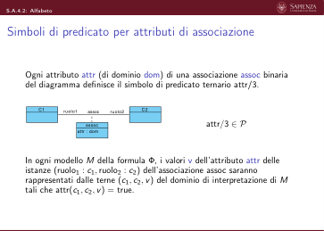

 S.A.4.2: Alfabeto
  Simboli di predicato per attributi di associazione (2)
       Esempio
       Supponiamo che un diagramma delle classi definisca l’associazione binaria
       lavora tra le classi Persona e Azienda con attributo afferenza/data.
                                          lavora
                               Azienda
                               Persona
                                               lavora
                                           afferenza : Data
       La formula FOL Φ conterrà occorrenze del simbolo di predicato
       afferenza/3. Quindi:
                                 P = {. . . , afferenza/3, . . .} .
       Un modello M di Φ definirà (tra l’altro) l’estensione del simbolo di
       predicato afferenza/3, ad es.:
         M(afferenza) = {(γ, α, 3/2/1992), (δ, α, 5/7/2003), (δ, β, 1/10/1996)}
       (tutti e soli i valori di afferenza per tutte le istanze di lavora)

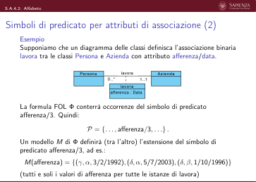

 S.A.4.2: Alfabeto
  Simbolo di predicato “=”
       Come al solito, assumiamo che sia presente il simbolo di predicato binario
       di uguaglianza =/2, che useremo in forma infissa
       La semantica del simbolo di predicato = non è oggetto di interpretazione:
       ogni interpretazione I fissa l’estensione di questo simbolo di predicato alle
       coppie di elementi del dominio di interpretazione uguali
       Esempio
       Supponiamo che una interpretazione I definisca il dominio di
       interpretazione D = {α, β, γ}.
       L’estensione del predicato =/2 nell’interpretazione I è fissata a:
                                I(=) = {(α, α), (β, β), (γ, γ)}

 S.A.4.2: Alfabeto
  Simboli per domini specializzati
       Ogni dominio specializzato dom_spec utilizzato nello schema concettuale,
       specializzazione del dominio dom, definisce:
          ▶un simbolo di pred. unario per dom_spec
          ▶un simbolo di pred. unario per dom
          {dom/1, dom_spec/1} ⊆P
       In ogni modello M della formula Φ, i valori dei domini dom e dom_spec
       saranno rappresentati dagli elementi d del dominio di interpretazione di M tali
       che, rispettivamente dom(d) = true e dom_spec(d) = true.
       Esempio: Supponiamo che nello schema concettuale occorrano (ad es., come
       tipi di attributi di una qualche classe o associazione) i domini Intero ≥0 e 0..59.
       La formula FOL Φ conterrà occorrenze dei simboli di predicato intero/1,
       “Intero ≥0”/1, “0..59”/1. Quindi:
                      P = {. . . , Intero/1, “Intero ≥0”/1, “0..59”/1, . . .} .

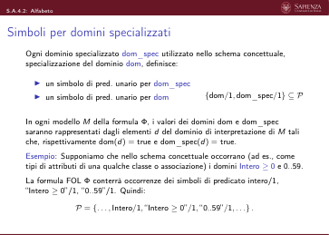

 S.A.4.2: Alfabeto
  Simboli per campi di domini composti
       Ogni dominio dom composto dai campi f1/dom1, . . . , fn/domn definisce:
          ▶un simbolo di predicato unario dom/1
          ▶un simbolo di predicato unario per ogni dominio di ogni campo
          ▶un simbolo di predicato binario per ogni campo.
       Esempio: dominio dom = record(f1 : dom1, . . . , fn : domn):
                       {dom/1, dom1/1, . . . , domn/1, f1/2, . . . , fn/2} ⊆P
       In ogni modello M della formula Φ:
          ▶i valori dei domini dom, dom1, . . . , domn saranno rappresentati dagli
             elementi d del dominio di interpretazione di M tali che, rispettivamente
             dom(d) = true, dom1(d) = true, . . . , domn(d) = true.
          ▶i valori dei campi f1, . . . , fn di un’istanza d del dominio dom saranno
             rappresentati dagli elementi d′
             1, . . . , d′
             n del dominio di interpretazione di
             M tali che f1(d, d′
                                1) = true, . . . , fn(d, d′
                                n) = true.

 S.A.4.2: Alfabeto
  Simboli per campi di domini composti (2)
       Esempio
       Supponiamo che in uno schema concettuale occorra il dominio Ora composto
       dai campi h/“0..23”, m/“0..59” e s/“0..59”.
       La formula FOL Φ definita conterrà occorrenze dei simboli di predicato Ora/1,
       “0..23”/1, “0..59”/1, h/2, m/2, s/2.
       Quindi:
                    P = {. . . , Ora/1, [0,23]/1, [0,59]/1, h/2, m/2, s/2, . . .} .
       Un modello M di Φ definirà (tra l’altro) l’estensione di questi simboli di
       predicato. Ad esempio:
         ▶M(Ora) = {α, β, . . .}
         ▶M(0..23) = {γ, δ, . . .}
                                      ▶M(0..59) = {γ, δ, ϵ, φ, . . .}
                                      ▶M(h) = {(α, γ), (β, δ), . . .}
                                                                    ▶M(m) = {(α, δ), (β, ϵ), . . .}
                                                                    ▶M(s) = {(α, φ), (β, δ), . . .}
       Intuitivamente, M sta interpretando il valore α del dominio Ora come avere il
       valore γ per il campo h, δ per il campo m, φ per il campo s (ovvero α è l’ora
       γ : δ : φ).

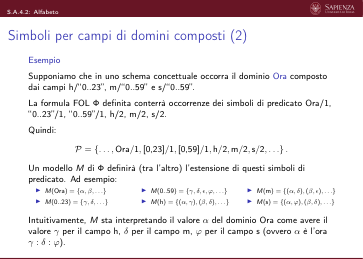

 S.A.4.2: Alfabeto
  Simboli per operazioni di classe
       Ogni operazione operaz() di una classe C avente n argomenti di tipi T1, . . . ,
       Tn ed un dominio di ritorno definisce un simbolo di predicato (n + 2)-ario:
                   C
                                              operazC,T1,...,Tn/(n + 2) ∈P
           op(a1 : T1, ..., an : Tn) : Tr
       Ogni modello M della formula Φ che definisce un livello estensionale legale per
       lo schema concettuale interpreterà la formula atomica operaz(c, v1, . . . , vn, vr)
       come: l’operazione operaz() della classe C, invocata sull’oggetto c e con
       argomenti v1, . . . , vn restituisce, tra eventuali altri, il valore vr.
       Nota: a causa della possibilità di overloading, dobbiamo formalizzare operazioni
       omonime, ma con argomenti diversi, con simboli di predicato diversi.

 S.A.4.2: Alfabeto
  Simboli per operazioni di classe (2)
       Esempio
       Supponiamo che un diagramma delle classi definisca, nella classe Persona,
       l’operazione:
          ▶progetti_di_budget_almeno(b:Intero > 0) : Progetto [0..*]
       La formula FOL Φ definita dal diagramma conterrà occorrenze dei simboli di
       predicato Persona/1, Progetto/1 e
       progetti_di_budget_almenoPersona,Intero>0/3.
       Quindi:
                     . . . , Persona/1, Progetto/1, Intero/1, “Intero > 0′′/1,
                                                                                 
               P =
                                                                                   .
                        progetti_di_budget_almenoPersona,Intero>0/3, . . .

 S.A.4.2: Alfabeto
  Simboli per operazioni di classe (3)
       Un modello M di Φ definirà (tra l’altro):
          ▶l’estensione del simbolo di predicato Persona, ad es.:
             M(Persona) = {α, β} (tutte e sole le istanze della classe Persona)
          ▶l’estensione del simbolo di predicato Progetto, ad es.:
             M(Progetto) = {γ, δ} (tutte e sole le istanze della classe Progetto)
          ▶l’estensione del simbolo di predicato Intero, ad es.:
             M(Intero) = {ϵ, ϕ, λ, ω, . . .} (tutte e sole le istanze del dominio Intero)
          ▶l’estensione del simbolo di predicato Intero> 0, ad es.:
             M(Intero > 0) = {ϕ, ω, . . .} (tutte e sole le istanze del dominio “Intero
             > 0”)
          ▶l’estensione del simbolo di predicato progetti_di_budget_almeno, ad es.:
             M(progetti_di_budget_almenoPersona,Intero>0) =
             {(α, ϕ, γ), (α, ϕ, δ), (β, ω, γ), . . .} (tutte e sole le terne (x, y, z) di
             elementi del dominio tali che l’esecuzione dell’operazione su x con
             argomento y avrebbe z tra i suoi risultati).

 S.A.4.2: Alfabeto
  Altri simboli
       Il nostro obiettivo è usare FOL per esprimere conoscenza sul dominio
       applicativo non esprimibile mediante diagrammi.
       In particolare:
          ▶Vincoli sui dati non esprimibili nel diagramma delle classi
             Esempio: i direttori di dipartimento devono avere un’anzianità di
             servizio di almeno 5 anni
          ▶Definizione delle funzionalità che il sistema dovrà offrire:
             Esempio: la segreteria didattica dovrà poter calcolare la media dei
             voti degli esami di ogni dato studente (operazioni di classe e/o
             use-case)

 S.A.4.2: Alfabeto
  Altri simboli (2)
       Per agevolare la modellazione di tale conoscenza in logica estenderemo:
          ▶l’insieme dei simboli di predicato P con:
                ▶opportuni simboli per tutte le necessarie relazioni matematiche:
                ≤/2, </2, ≥/2, >/2, etc.
                (che useremo, se opportuno, in forma infissa –zucchero
                sintattico)
                ▶opportuni simboli per tutte le operazioni di classe e di use-case
          (v. seguito)
          ▶l’insieme dei simboli di funzione F con:
                ▶opportuni simboli per tutte le necessarie operazioni
                   matematiche:
                   +/2, −/2, ∗/2, //2, | · |/1, sqrt/1, pow/2, log2/1, etc.
                   (che useremo, se opportuno, in forma infissa –zucchero
                   sintattico)

                                 Slides A.4.3 (S.A.4.3)
         Analisi dei requisiti
         Logica del primo ordine (FOL) nell’Analisi Concettuale
         Semantica di un diagramma UML delle classi in FOL

                              Slides A.4.3.1 (S.A.4.3.1)
              Analisi dei requisiti
              Logica del primo ordine (FOL) nell’Analisi Concettuale
              Semantica di un diagramma UML delle classi in FOL
                             Esempio di interpretazione

 S.A.4.3.1: Esempio di interpretazione
  Semantica di un diagramma delle classi in FOL: formula
       Dato un diagramma delle classi, la formula Φ che ne definisce la
       semantica è, come visto, sul seguente alfabeto:
          ▶Insieme dei simboli di predicato P: simboli per classi, domini,
          associazioni, attributi, oltre a simboli per relazioni matematiche (ad
          es., ≤, <, ≥, >, etc.)
          ▶Insieme dei simboli di funzione F: simboli di costante per denotare
             valori di domini base, ad es., 0, 1, 2, etc. per gli interi, “uomo”,
             “donna” per il dominio enumerativo Genere, etc. + simboli di
             funzione per operazioni matematiche (ad es., +, −, ∗, /, | · |, etc.).

 S.A.4.3.1: Esempio di interpretazione
  Semantica di un diagramma delle classi in FOL: formula
       (2)
       La formula Φ esprime dei vincoli che una interpretazione M deve
       soddisfare affinché rappresenti un livello estensionale legale del
       diagramma.
       Quindi:
                  M |= Φ ⇐⇒
                  M rappresenta un livello estensionale
                                       legale del diagramma delle classi.

 S.A.4.3.1: Esempio di interpretazione
  Esempio
       La formula FOL Φ che definisce la semantica del seguente diagramma:
                    Persona
                                            Dipartimento
                                                      sede
                                                                      Citta
                Persona
                cf : Stringa {id}
                stipendio : Intero > = 0
                                   lavora
                                       lavora
                 {disjoint, complete}
                  Uomo
                  Donna
                                       dirige
                                 dirige
       è definita sul seguente insieme di simboli di predicato e di funzione:
          ▶P = { Persona/1, Uomo/1, Donna/1, Dipartimento/1, Citta/1, sede/2,
             lavora/2, dirige/2, cf/2, stipendio/2, annoAfferenza/3, nome/2 sede/2,
             n_dipendenti/3, Intero/1, “Intero ≥0”/1, Stringa/1, ≤/2, </2, ≥/2,
             >/2, . . . }
          ▶F = { +/2, −/2, ∗/2, “/”/2, . . . }
             (oltre che costanti per gli elementi dei domini che compaiono in Φ, v. seguito)

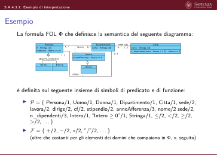

 S.A.4.3.1: Esempio di interpretazione
  Esempio
       La formula FOL Φ che definisce la semantica del seguente diagramma:
                                                      sede
                    Persona
                                            Dipartimento
                                                                      Citta
                Persona
                cf : Stringa {id}
                stipendio : Intero > = 0
                                   lavora
                                       lavora
                 {disjoint, complete}
                  Uomo
                  Donna
                                       dirige
                                 dirige
       Una possibile interpretazione I per la formula Φ che definisce la
       semantica del diagramma è:
          ▶Dominio di interpretazione D = {α, β, γ, δ}
          ▶Interpretazione dei simboli di predicato:
               ▶I(Persona) = {α, β}
               ▶I(Uomo) = {α, δ}
               ▶I(Donna) = {α, γ}
               ▶I(Dipart.) = {γ, β}
                                          ▶I(Citta) = {α, δ}
                                          ▶I(“intero ≥0”) = {α, γ}
                                          ▶I(stringa) = {β, γ}
                                          ▶I(sede) = {(γ, α), (γ, β)}
                                                                     ▶I(lavora) = {(α, γ)}
                                                                     ▶I(dirige) = {(β, γ)}
                                                                     ▶. . .
          ▶Interpretazione dei simboli di funzione: ignorata per ora
       I rappresenta un livello estensionale legale per il diagramma?

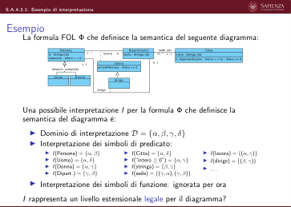

 S.A.4.3.1: Esempio di interpretazione
  Esempio
       Interpretazione I:
          ▶Dominio di interpretazione D = {α, β, γ, δ}
          ▶Interpretazione dei simboli di predicato:
               ▶I(Persona) = {α, β}
               ▶I(Uomo) = {α, δ}
               ▶I(Donna) = {α, γ}
               ▶I(Dipart.) = {γ, β}
                                          ▶I(Citta) = {α, δ}
                                          ▶I(“intero ≥0”) = {α, γ}
                                          ▶I(stringa) = {β, γ}
                                          ▶I(sede) = {(γ, α), (γ, β)}
                                                                     ▶I(lavora) = {(α, γ)}
                                                                     ▶I(dirige) = {(β, γ)}
                                                                     ▶. . .
          ▶Interpretazione dei simboli di funzione: ignorata per ora
       I rappresenta un livello estensionale legale per il diagramma?
       I ha molti problemi, per esempio:
          ▶definisce α essere sia una persona (al contempo sia uomo che
          donna) che una città che un intero ≥0
          ▶definisce δ essere un uomo (ma non una persona) e una città
          ▶definisce due sedi per il dipartimento γ (che, tra l’altro, è definito
          essere anche un intero ≥0 e una stringa)
          ▶definisce β come direttore del dipartimento γ anche se non vi lavora
          ▶. . .

 S.A.4.3.1: Esempio di interpretazione
  Semantica del diagramma UML delle classi in FOL
       (versione iniziale)
       Mostreremo come un diagramma delle classi definisca una formula Φ in
       logica del primo ordine (first-order logic, FOL), che esprime vincoli sui
       livelli estensionali ammessi, impedendo ad interpretazioni come la
       precedente di esserne modello.
       Dunque, la formula Φ garantisce che:
         Interpretazione M rappresenta
         un livello estensionale legale del diagramma delle classi
         ⇐⇒M |= Φ.
       Pertanto, Φ definisce la semantica di un diagramma delle classi, perché
       permette di distinguere le interpretazioni che definiscono i livelli
       estensionali ammessi (modelli di Φ) dalle altre.

 S.A.4.3.1: Esempio di interpretazione
  Semantica del diagramma UML delle classi in FOL
       (versione iniziale) (2)
       La formula logica Φ definita da un diagramma delle classi è una
       congiunzione (and) di blocchi di formule, ognuno dei quali definisce la
       semantica di ogni modulo (classi, associazioni, attributi, domini,
       generalizzazioni, vincoli di identificazione, vincoli di molteplicità) presente
       nel diagramma.

                              Slides A.4.3.2 (S.A.4.3.2)
              Analisi dei requisiti
              Logica del primo ordine (FOL) nell’Analisi Concettuale
              Semantica di un diagramma UML delle classi in FOL
                 Disgiunzione e Generalizzazione tra Classi,
                                 Associazioni e Domini

 S.A.4.3.2: Disgiunzione e Generalizzazione tra Classi, Associazioni e Domini
  Disgiunzione tra tipi e/o classi
       Una prima tipologia di vincoli da definire in Φ impongono la disgiunzione
       tra domini e/o classi
       In particolare:
          1. due classi diverse non appartenenti ad uno stesso DAG di
          generalizzazioni
          2. due classi diverse appartenenti ad uno stesso DAG di
          generalizzazioni tali che il cammino che le congiunge passa per due
          classi figlie di una stessa generalizzazione {disjoint}
          3. due domini diversi semanticamente disgiunti
          4. una qualunque classe e un qualunque dominio
       non devono avere istanze in comune

 S.A.4.3.2: Disgiunzione e Generalizzazione tra Classi, Associazioni e Domini
  Disgiunzione tra tipi e/o classi: esempio
       Non devono avere istanze in comune:
                                  r
                                  1. due classi diverse non appartenenti ad
                                  uno stesso DAG di generalizzazioni
            A
            D
                                            L
                                  r
                                                      ▶∀x A(x) →¬L(x)
                   B
                   C
                                       s
               b : Intero >= 0
                                                      ▶∀x B(x) →¬L(x)
                                           s
                                                      ▶. . .
            E
            F
            G
            H
                                                      ▶∀x H(x) →¬L(x)

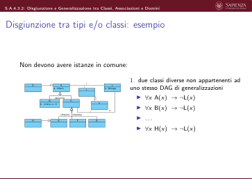

 S.A.4.3.2: Disgiunzione e Generalizzazione tra Classi, Associazioni e Domini
  Disgiunzione tra tipi e/o classi: esempio
       Non devono avere istanze in comune:
                                  r
                                  2. due classi diverse appartenenti ad uno
                                  stesso DAG di generalizzazioni tali che
                                  il cammino che le congiunge passa per
                                  due classi figlie di una generalizzazione
            A
            D
                                            L
                                  r
                   B
                   C
                                       s
               b : Intero >= 0
                                           s
                                                     ▶∀x B(x)→¬C(x)
                                                     ▶∀x B(x)→¬E(x)
                                                     ▶∀x B(x)→¬F(x)
                                                     ▶∀x B(x)→¬G(x)
                                                     ▶∀x B(x)→¬H(x)
                                                                           ▶∀x E(x)→¬F(x)
                                                                           ▶∀x E(x)→¬G(x)
                                                                           ▶∀x F(x)→¬G(x)
                                                                           ▶∀x H(x)→¬F(x)
                                                                           ▶∀x H(x)→¬G(x)
            E
            F
            G
            H

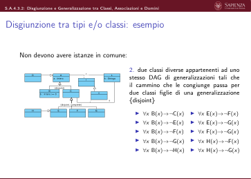

 S.A.4.3.2: Disgiunzione e Generalizzazione tra Classi, Associazioni e Domini
  Disgiunzione tra tipi e/o classi: esempio
       Non devono avere istanze in comune:
                                  r
                                  3.
                                  due domini diversi semanticamente
                                  disgiunti
            A
            D
                                            L
                                  r
                                                      ▶∀x Intero(x) →¬Stringa(x)
                   B
                   C
                                       s
               b : Intero >= 0
                                                      ▶∀x “Intero ≥0”(x) →¬Stringa(x)
                                           s
            E
            F
            G
            H

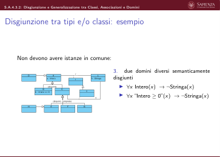

 S.A.4.3.2: Disgiunzione e Generalizzazione tra Classi, Associazioni e Domini
  Disgiunzione tra tipi e/o classi: esempio
       Non devono avere istanze in comune:
                                  r
                                  4. una qualunque classe e un qualunque
                                  dominio
            A
            D
                                            L
                                  r
                                                      ▶∀x A(x) →¬Intero(x)
                                                      ▶. . .
                                                      ▶∀x L(x) →¬Intero(x)
                   B
                   C
                                       s
               b : Intero >= 0
                                           s
            E
            F
            G
            H
                                                      ▶∀x A(x) →¬“Intero ≥0”(x)
                                                      ▶. . .
                                                      ▶∀x L(x) →¬“Intero ≥0”(x)
                                                      ▶∀x A(x) →¬Stringa(x)
                                                      ▶. . .
                                                      ▶∀x L(x) →¬Stringa(x)

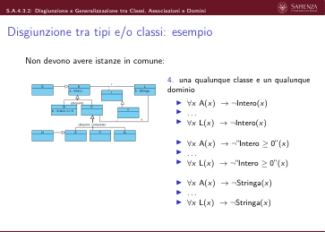

 S.A.4.3.2: Disgiunzione e Generalizzazione tra Classi, Associazioni e Domini
  Generalizzazioni tra classi e tra associazioni
       Un ulteriore insieme di vincoli da definire in Φ impone la relazione di
       sottoinsieme tra gli insiemi delle istanze di classi o associazioni e loro
       generalizzazioni
       In particolare:
          1. le istanze di una classe figlia di una generalizzazione sono anche
          istanze della classe base
          2. le istanze di una associazione figlia di una generalizzazione sono
          anche istanze dell’associazione base

 S.A.4.3.2: Disgiunzione e Generalizzazione tra Classi, Associazioni e Domini
  Generalizzazione tra tra classi e tra associazioni: esempio
                                  r
                                  1. Le istanze di una classe figlia di una
                                  generalizzazione sono anche istanze della
                                  classe base
            A
            D
                                            L
                                  r
                   B
                   C
                                                      ▶∀x B(x) →A(x)
                                       s
               b : Intero >= 0
                                           s
                                                      ▶∀x C(x) →A(x)
            E
            F
            G
            H
                                                      ▶∀x D(x) →A(x)
                                                      ▶∀x E(x) →C(x)
                                                      ▶∀x F(x) →C(x)
                                                      ▶∀x G(x) →C(x)
                                                      ▶∀x H(x) →E(x)

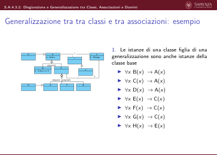

 S.A.4.3.2: Disgiunzione e Generalizzazione tra Classi, Associazioni e Domini
  Generalizzazione tra tra classi e tra associazioni: esempio
                                  r
                                  2. Le istanze di una associazione figlia di
                                  una generalizzazione sono anche istanze
                                  dell’associazione base
            A
            D
                                            L
                                  r
                   B
                   C
                                                      ▶∀x, y s(x, y) →r(x, y)
                                       s
               b : Intero >= 0
                                           s
            E
            F
            G
            H

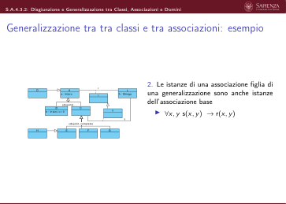

 S.A.4.3.2: Disgiunzione e Generalizzazione tra Classi, Associazioni e Domini
  Generalizzazioni complete tra classi
       Una ulteriore tipologia di vincoli da definire in Φ impongono la
       completezza nelle generalizzazioni {complete}
                                  r
            A
            D
                                            L
                                                   Ogni istanza di una classe base di una
                                                   generalizzazione completa è istanza di
                                                   (almeno) una delle classi figlie
                                  r
                   B
                   C
                                       s
               b : Intero >= 0
                                           s
                                                      ▶∀x C(x) →E(x)∨F(x)∨G(x)
            E
            F
            G
            H

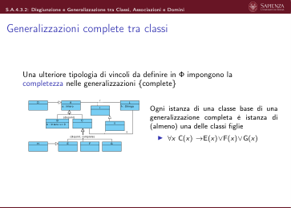

 S.A.4.3.2: Disgiunzione e Generalizzazione tra Classi, Associazioni e Domini
  Specializzazione di domini
       Una ulteriore tipologia di vincoli da definire in Φ definiscono i simboli di
       predicato per i domini specializzati (ad es., dom_spec) in termini dei
       simboli di predicato per i relativi domini base (ad es., dom).
       La forma generale per questi vincoli (che andranno in and con le altre
       sotto-formule di Φ) è:
       ∀x dom_spec(x) ←→[dom(x) ∧“x soddisfa il criterio di specializzazione”]
       Esempio:
          ▶∀x “Intero ≥0”(x) ←→[Intero(x) ∧x≥0]
          ▶∀x “0..59”(x) ←→[Intero(x) ∧x≥0 ∧x≤59]
       Nota: stiamo usando ←→per definire il simbolo dom_spec. Ogni
       interpretazione della formula Φ sarà costretta, per essere un modello, a
       definire l’estensione di dom_spec/1 come specificato dalla formula.

 S.A.4.3.2: Disgiunzione e Generalizzazione tra Classi, Associazioni e Domini
  Esempio
                                                      sede
                    Persona
                                            Dipartimento
                                                                      Citta
                Persona
                cf : Stringa {id}
                stipendio : Intero > = 0
                                   lavora
                                       lavora
                 {disjoint, complete}
                  Uomo
                  Donna
                                       dirige
                                 dirige
       La formula Φ che definisce la semantica del diagramma dovrà contenere, in
       and, le seguenti sotto-formule:
         1. ∀x Persona(x) →¬Dipartimento(x)
         2. ∀x Persona(x) →¬Citta(x)
         3. ∀x Persona(x) →¬“Intero ≥0”(x)
         4. ∀x Persona(x) →¬Intero(x)
         5. ∀x Persona(x) →¬Stringa(x)
         6. ∀x Uomo(x) →¬Donna(x)
         7. ∀x Uomo(x) →¬Dipartimento(x)
         8. ∀x Uomo(x) →¬Citta(x)
         9. ∀x Uomo(x) →¬“Intero ≥0”(x)
         10. ∀x Uomo(x) →¬Intero(x)
         11. ∀x Uomo(x) →¬Stringa(x)
         12. ∀x Donna(x) →¬Dipartimento(x)
         13. ∀x Donna(x) →¬Citta(x)
         14. ∀x Donna(x) →¬“Intero ≥0”(x)
                                                   15. ∀x Donna(x) →¬Intero(x)
                                                   16. ∀x Donna(x) →¬Stringa(x)
                                                   17. ∀x Dipartimento(x) →¬Citta(x)
                                                   18. ∀x Dipartimento(x) →¬“Intero ≥0”(x)
                                                   19. ∀x Dipartimento(x) →¬Intero(x)
                                                   20. ∀x Dipartimento(x) →¬Stringa(x)
                                                   21. ∀x “Intero ≥0”(x) →¬Stringa(x)
                                                   22. ∀x Intero(x) →¬Stringa(x)
                                                   23. ∀x Uomo(x) →Persona(x)
                                                   24. ∀x Donna(x) →Persona(x)
                                                   25. ∀x Persona(x) →Uomo(x) ∨Donna(x)
                                                   26. ∀x, y dirige(x, y) →lavora(x, y)
                                                   27. ∀x “Intero ≥0”(x) ↔[Intero(x) ∧x ≥0]

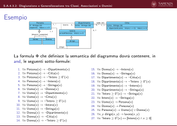

 S.A.4.3.2: Disgiunzione e Generalizzazione tra Classi, Associazioni e Domini
  Esempio (2)
       Questa definizione di Φ impedisce che l’interpretazione I vista in precedenza:
          ▶Dominio di interpretazione D = {α, β, γ, δ}
          ▶Interpretazione dei simboli di predicato:
               ▶I(Persona) = {α, β}
               ▶I(Uomo) = {α, δ}
               ▶I(Donna) = {α, γ}
               ▶I(Dipart.) = {γ, β}
                                          ▶I(Citta) = {α, δ}
                                          ▶I(“Intero ≥0”) = {α, γ}
                                          ▶I(Stringa) = {β, γ}
                                          ▶I(sede) = {(γ, α), (γ, β)}
                                                                     ▶I(lavora) = {(α, γ)}
                                                                     ▶I(dirige) = {(β, γ)}
                                                                     ▶. . .
          ▶Interpretazione dei simboli di funzione: ignorata per ora
       sia un modello di Φ e quindi rappresenti un livello estensionale legale per il
       diagramma.
       Ad esempio, la sotto-formula di Φ: ∀x Persona(x) →¬Citta(x)
       è violata per x = α
       Essendo Φ definita come un and delle sue sotto-formule, si ha: I̸ |= Φ.

                              Slides A.4.3.3 (S.A.4.3.3)
              Analisi dei requisiti
              Logica del primo ordine (FOL) nell’Analisi Concettuale
              Semantica di un diagramma UML delle classi in FOL
                            Tipizzazione di Associazioni

 S.A.4.3.3: Tipizzazione di Associazioni
  Esempio
                    Persona
                                            Dipartimento
                                                      sede
                                                                      Citta
                Persona
                cf : Stringa {id}
                stipendio : Intero > = 0
                                   lavora
                                       lavora
                 {disjoint, complete}
                  Uomo
                  Donna
                                       dirige
                                 dirige
       Consideriamo l’interpretazione I definita come segue:
          ▶Dominio di interpretazione D = {α, β, γ, δ, ϵ, ϕ, ι}
          ▶Interpretazione dei simboli di predicato:
                ▶I(Pers.)={α, β}
                ▶I(Dipar.)={γ, δ}
                                        ▶I(Citta)={ϵ}
                                        ▶I(sede)={(γ, β)}
                                                                ▶I(lavora)={(α, β)}
          ▶. . .
          ▶Interpretazione dei simboli di funzione: ignorata per ora
       L’interpretazione, correttamente, non assegna gli stessi elementi del dominio a
       predicati che definiscono classi e/o domini disgiunti

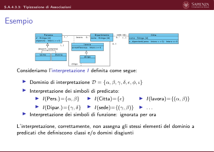

 S.A.4.3.3: Tipizzazione di Associazioni
  Esempio
                    Persona
                                            Dipartimento
                                                      sede
                                                                      Citta
                Persona
                cf : Stringa {id}
                stipendio : Intero > = 0
                                   lavora
                                       lavora
                 {disjoint, complete}
                  Uomo
                  Donna
                                       dirige
                                 dirige
       Consideriamo l’interpretazione I definita come segue:
          ▶Dominio di interpretazione D = {α, β, γ, δ, ϵ, ϕ, ι}
          ▶Interpretazione dei simboli di predicato:
                ▶I(Pers.)={α, β}
                ▶I(Dipar.)={γ, δ}
                                        ▶I(Citta)={ϵ}
                                        ▶I(sede)={(γ, β)}
                                                                ▶I(lavora)={(α, β)}
          ▶. . .
          ▶Interpretazione dei simboli di funzione: ignorata per ora
       L’interpretazione non rappresenta ancora un livello estensionale legale per il
       diagramma, ad es. perché definisce i seguenti istanze di associazioni (link):
          ▶(γ, β) (associazione sede) che lega un dipartimento ad una persona
          ▶(α, β) (associazione lavora) che lega una persona ad una persona

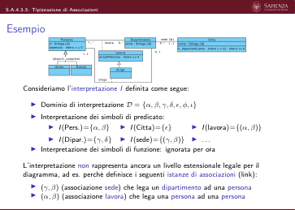

 S.A.4.3.3: Tipizzazione di Associazioni
  Tipizzazione di associazioni tra due classi
       Una ulteriore tipologia di vincoli da definire in Φ impone che:
       le coppie dell’estensione di un predicato che definisce una associazione
       assoc tra le classi C1 e C2 siano elementi del prodotto cartesiano C1 × C2
                          C1
                          C2
                          ruolo1
                          ruolo2
                          assoc
        =⇒La formula Φ conterrà, in and, la seguente sotto-formula:
                          ∀c1, c2 assoc(c1, c2) →C1(c1) ∧C2(c2)

 S.A.4.3.3: Tipizzazione di Associazioni
  Esempio
             Persona
                                          Dipartimento
                                                       sede
                                                                           Citta
        Persona
        cf : Stringa {id}
        stipendio : Intero > = 0
                                lavora
                                    lavora
         {disjoint, complete}
          Uomo
          Donna
                                    dirige
                             dirige
       La formula Φ che definisce la semantica del diagramma ER dovrà
       contenere, in and, anche le seguenti sotto-formule (oltre alle precedenti):
          ▶∀x, y lavora(x, y) →Dipartimento(x) ∧Persona(y)
          ▶∀x, y dirige(x, y) →Dipartimento(x) ∧Persona(y)
          ▶∀x, y sede(x, y) →Citta(x) ∧Dipartimento(y)

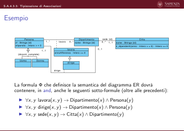

 S.A.4.3.3: Tipizzazione di Associazioni
  Esempio (2)
       Questa definizione di Φ impedisce che l’interpretazione I vista in
       precedenza:
          ▶Dominio di interpretazione D = {α, β, γ, δ, ϵ, ϕ, ι}
          ▶Interpretazione dei simboli di predicato:
          ▶I(lavora) = {(α, β)}
          ▶. . .
          ▶Interpretazione dei simboli di funzione: ignorata per ora
                ▶I(Pers.) = {α, β}
                ▶I(Dipar.) = {γ, δ}
                                        ▶I(Citta) = {ϵ}
                                        ▶I(sede) = {(β, γ)}
       sia un modello di Φ e quindi rappresenti un livello estensionale legale per
       il diagramma.
       Ad esempio, la sotto-formula di Φ:
                    ∀x, y lavora(x, y) →Dipartimento(x) ∧Persona(y)
       è violata per x = β e y = α
       Essendo Φ definita come un and delle sue sotto-formule, si ha: I̸ |= Φ.

                              Slides A.4.3.4 (S.A.4.3.4)
              Analisi dei requisiti
              Logica del primo ordine (FOL) nell’Analisi Concettuale
              Semantica di un diagramma UML delle classi in FOL
                               Tipizzazione di Attributi

 S.A.4.3.4: Tipizzazione di Attributi
  Esempio
                        Persona
                                            Dipartimento
                                                      sede
                                                                    Citta
                    Persona
                                     lavora
                                        lavora
                      Uomo
                      Donna
                                        dirige
                                   dirige
       Consideriamo l’interpretazione I definita come segue:
          ▶Dominio di interpretazione D = {α, β, γ, δ, ϵ, ϕ, ι}
          ▶Interpretazione dei simboli di predicato:
               ▶I(Pers.)={α, β}
               ▶I(Dipar.)={γ, δ}
                                   ▶I(lavora)={(δ, β)}
                                   ▶I(“intero ≥0”)={ϕ}
                                                       ▶I(stringa)={ι}
                                                       ▶I(cf)={(α, β), (β, ι)}
                                                                          ▶I(annoAff.)={(α, β, ι)}
          ▶. . .
          ▶Interpretazione dei simboli di funzione: ignorata per ora
       L’interpretazione, correttamente:
          ▶non assegna gli stessi elementi del dominio a predicati che definiscono
          classi e/o domini disgiunti ed è consistente con i vincoli dovuti alle
          generalizzazioni
          ▶assegna, ai predicati che definiscono associazioni, ennuple le cui
             componenti sono istanze delle giuste classi

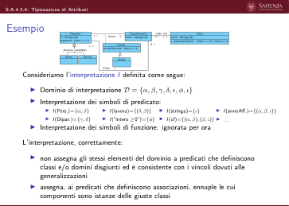

 S.A.4.3.4: Tipizzazione di Attributi
  Esempio
                                                      sede
                        Persona
                                            Dipartimento
                                                                    Citta
                    Persona
                                     lavora
                                        lavora
                      Uomo
                      Donna
                                        dirige
                                   dirige
       Consideriamo l’interpretazione I definita come segue:
          ▶Dominio di interpretazione D = {α, β, γ, δ, ϵ, ϕ, ι}
          ▶Interpretazione dei simboli di predicato:
               ▶I(Pers.)={α, β}
               ▶I(Dipar.)={γ, δ}
                                   ▶I(lavora)={(δ, β)}
                                   ▶I(“intero ≥0”)={ϕ}
                                                       ▶I(stringa)={ι}
                                                       ▶I(cf)={(α, β), (β, ι)}
                                                                          ▶I(annoAff.)={(α, β, ι)}
          ▶. . .
          ▶Interpretazione dei simboli di funzione: ignorata per ora
       L’interpretazione non rappresenta ancora un livello estensionale legale per il
       diagramma, ad es. perché definisce i seguenti valori per gli attributi:
          ▶La persona α ha la persona β come valore per l’attributo cf
          ▶La coppia di persone (α, β) ha la stringa ι come valore per l’attributo
             annoAfferenza, anche se (α, β) non è una istanza della relationship lavora

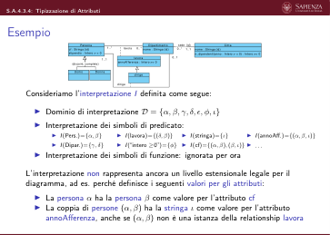

 S.A.4.3.4: Tipizzazione di Attributi
  Tipizzazione di attributi
       È necessario definire una ulteriore tipologia di vincoli in Φ per imporre
       che:
          ▶le coppie dell’estensione di un predicato che definisce i valori di un
          attributo di (una o più) classe hanno come prima componente
          un’istanza di quella/quelle classi, e come seconda componente
          un’istanza del dominio dell’attributo
          ▶le terne dell’estensione di un predicato che definisce i valori di un
             attributo di (una o più) associazioni hanno come prime due
             componenti una coppia che definisce un’istanza di quella
             associazione, e come terza componente un’istanza del dominio
             dell’attributo

 S.A.4.3.4: Tipizzazione di Attributi
  Tipizzazione di attributi (2)
                                               C2
                                               C1
                                                      ruolo1
                                                      ruolo2
                                                      assoc
                       C
                  attr : dom
                                                             assoc
                                                          attr : dom
        =⇒La formula Φ conterrà, in and, le seguenti sotto-formule:
                    ∀c, v attr(c, v) ∧C(c) →dom(v)
                    ∀c1, cn, v attr(c1, c2, v) ∧assoc(c1, c2) →dom(v)
       Si noti la differenza delle formule rispetto a quelle per la tipizzazione di
       associazioni (ad es., ∀c1, c2 assoc(c1, c2) →C1(c1) ∧C2(c2)).
       Ragione: diverse classi e diverse associazioni possono avere attributi
       omonimi su domini potenzialmente diversi. Prevediamo un unico simbolo
       di predicato (di arità 2) per gestire tutti gli attributi omonimi di classe e
       un unico simbolo di predicato di arità 3 per gestire tutti gli attributi
       omonimi di associazioni tra due classi, etc.

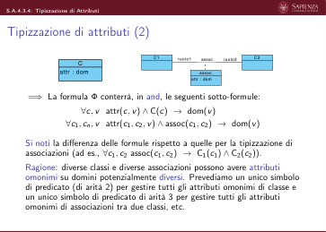

 S.A.4.3.4: Tipizzazione di Attributi
  Esempio
                        Persona
                                            Dipartimento
                                                      sede
                                                                    Citta
                    Persona
                                     lavora
                                        lavora
                      Uomo
                      Donna
                                        dirige
                                   dirige
       La formula Φ che definisce la semantica del diagramma ER dovrà
       contenere, in and, anche le seguenti sotto-formule (oltre alle precedenti):
          ▶∀x, v cf(x, v) ∧Persona(x) →Stringa(v)
          ▶∀x, v stipendio(x, v) ∧Persona(x) →“Intero ≥0”(v)
          ▶∀x, y, v annoAfferenza(x, y, v) ∧lavora(x, y) →“Intero ≥0”(v)
          ▶∀x, v nome(x, v) ∧Dipartimento(x) →Stringa(v)
          ▶∀x, v nome(x, v) ∧Citta(x) →Stringa(v)
       Nota:
       se l’attributo nome dell’entità Citta fosse di un altro dominio dom, l’ultima sotto-formula sarebbe:
       ∀x, v nome(x, v) ∧Citta(x) →dom(v). Questa non interferirebbe con la definizione del dominio dell’attributo
       omonimo dell’entità Dipartimento a causa dei vincoli di disgiunzione tra entità (∀x Dipartimento(x) →¬Citta(x))

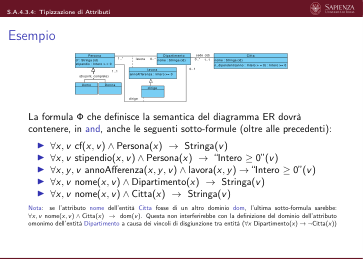

 S.A.4.3.4: Tipizzazione di Attributi
  Esempio (2)
       Questa definizione di Φ impedisce che l’interpretazione I vista in
       precedenza:
          ▶Dominio di interpretazione D = {α, β, γ, δ, ϵ, ϕ, ι}
          ▶Interpretazione dei simboli di predicato:
               ▶I(Pers.)={α, β}
                                   ▶I(lavora)={(δ, β)}
                                                      ▶I(stringa)={ι}
                                                                          ▶I(annoAff.)={(α, β, ι)}
               ▶I(Dipar.)={γ, δ}
                                   ▶I(“intero ≥0”)={ϕ}
                                                      ▶I(cf)={(α, β), (β, ι)}
          ▶. . .
          ▶Interpretazione dei simboli di funzione: ignorata per ora
       sia un modello di Φ e quindi rappresenti un livello estensionale legale per
       il diagramma.
       Ad esempio, la sotto-formula di Φ: ∀x, v cf(x, v)∧Persona(x) →stringa(v)
       è violata per x = α e y = β
       Essendo Φ definita come un and delle sue sotto-formule, si ha: I̸ |= Φ.

                              Slides A.4.3.5 (S.A.4.3.5)
              Analisi dei requisiti
              Logica del primo ordine (FOL) nell’Analisi Concettuale
              Semantica di un diagramma UML delle classi in FOL
                     Cardinalità di Associazioni e Attributi

 S.A.4.3.5: Cardinalità di Associazioni e Attributi
  Esempio
                                                      sede
                       Persona
                                            Dipartimento
                                                                    Citta
                   Persona
                   cf : Stringa {id}
                   stipendio : Intero > = 0
                                    lavora
                                        lavora
                     Uomo
                     Donna
                                        dirige
                                   dirige
       Consideriamo l’interpretazione I definita come segue:
          ▶Dominio di interpretazione D = {α, β, γ, δ, ϵ, ϕ, ι, χ, λ}
          ▶Interpretazione dei simboli di predicato:
               ▶I(Pers.)={α, β}
               ▶I(Dipar.)={γ, δ}
               ▶I(lavora)={(γ, α), (δ, α)}
               ▶I(“Intero ≥0”)={ϕ}
                                        ▶I(Stringa)={ϵ, ι}
                                        ▶I(cf)={(α, ϵ), (α, ι)}
                                        ▶I(annoAff.)={(γ, α, ϕ)}
                                        ▶I(Citta)={χ, λ}
                                                                ▶I(sede)={(χ, γ), (λ, γ)}
                                                                ▶I(nome)={(γ, ϵ), (γ, ι)}
                                                                ▶. . .
          ▶Interpretazione dei simboli di funzione: ignorata per ora
       L’interpretazione soddisfa tutti i vincoli visti in precedenza e modellati come
       sottoformule di Φ legate da and

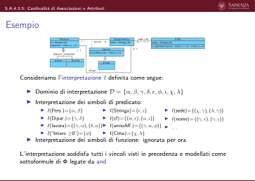

 S.A.4.3.5: Cardinalità di Associazioni e Attributi
  Esempio
       L’interpretazione I:
          ▶Dominio di interpretazione D = {α, β, γ, δ, ϵ, ϕ, ι, χ, λ}
          ▶Interpretazione dei simboli di predicato:
               ▶I(Pers.)={α, β}
               ▶I(Dipar.)={γ, δ}
               ▶I(lavora)={(γ, α), (δ, α)}
               ▶I(“Intero ≥0”)={ϕ}
                                        ▶I(Stringa)={ϵ, ι}
                                        ▶I(cf)={(α, ϵ), (α, ι)}
                                        ▶I(annoAff.)={(γ, α, ϕ)}
                                        ▶I(Citta)={χ, λ}
                                                                ▶I(sede)={(χ, γ), (λ, γ)}
                                                                ▶I(nome)={(γ, ϵ), (γ, ι)}
                                                                ▶. . .
          ▶Interpretazione dei simboli di funzione: ignorata per ora
       non rappresenta ancora un livello estensionale legale per il diagramma, ad es.
       perché viola i vincoli di cardinalità su relationship e attributi. Ad esempio:
          ▶La persona α ha sia ϵ che ι come valore per l’attributo cf
          ▶La persona β non ha alcun valore per l’attributo cf
          ▶Il dipartimento γ è coinvolto in due istanze della relationship sede
          ▶L’istanza (δ, α) della relationship lavora non ha alcun valore per
          l’attributo annoAfferenza
          ▶La città χ non ha alcun valore per l’attributo nome
          ▶Il dipartimento γ ha due valori per l’attributo nome

 S.A.4.3.5: Cardinalità di Associazioni e Attributi
  Vincoli di cardinalità
       È necessario definire una ulteriore tipologia di vincoli in Φ per imporre
       che siano soddisfatti:
          ▶i vincoli di cardinalità sui ruoli delle associazioni
          ▶i vincoli di cardinalità sugli attributi di classi e associazioni

 S.A.4.3.5: Cardinalità di Associazioni e Attributi
  Vincoli di cardinalità sui ruoli di associazioni
                                  C1
                                  C2
                                  ruolo1
                                                assoc
                                                      ruolo2
                                         min1..max1
                                                   min2..max2
       La formula Φ conterrà, in and, le seguenti sotto-formule:
       Vincoli di cardinalità minima (solo se > 0):
           ∀c1 C1(c1) →
           esistono almeno min2 istanze diverse di assoc
           che coinvolgono c1 (come prima componente)
           ∧
           ∀c2 C2(c2) →
           esistono almeno min1 istanze diverse di assoc
           che coinvolgono c2 (come seconda componente)

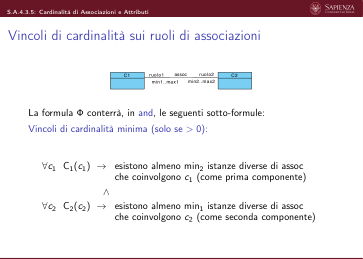

 S.A.4.3.5: Cardinalità di Associazioni e Attributi
  Vincoli di cardinalità sui ruoli di associazioni
       La formula Φ conterrà, in and, le seguenti sotto-formule:
       Vincoli di cardinalità minima (solo se > 0):
                       ∀c1 C1(c1) →∃c1
                                         2, . . . , cmin2
                                         c1
                                          2̸ =c2
                                          2 ∧· · ·∧cmin2−1
                                          2̸
                                          =cmin2
                                         assoc(c1, c1
                                                   2)∧· · ·∧assoc(c1, cmin2
                                                   ) ∧
                       ∀c2 C2(c2) →∃c1
                                         1, . . . , cmin1
                                         c1
                                          1̸ =c2
                                          1 ∧· · ·∧cmin1−1
                                          1̸
                                          =cmin1
                                         assoc(c1
                                                1, c2)∧· · ·∧assoc(cmin1
                                                , c2)

 S.A.4.3.5: Cardinalità di Associazioni e Attributi
  Vincoli di cardinalità sui ruoli di associazioni
       La formula Φ conterrà, in and, le seguenti sotto-formule:
       Vincolo di cardinalità massima (solo se̸ = ∗):
           ∀c1 C1(c1) →
           non esistono max2 + 1 istanze diverse di assoc
           che coinvolgono c1 (come prima componente)
           ∧
           ∀c2 C2(c2) →
           non esistono max1 + 1 istanze diverse di assoc
           che coinvolgono c2 (come seconda componente)

 S.A.4.3.5: Cardinalità di Associazioni e Attributi
  Vincoli di cardinalità sui ruoli di associazioni
       La formula Φ conterrà, in and, le seguenti sotto-formule:
       Vincolo di cardinalità massima (solo se̸ = ∗):
                                         2, . . . , cmax2+1
                                         c1
                       ∀c1 C1(c1) →¬∃c1
                                          2̸ =c2
                                          2 ∧· · ·∧cmin2
                                          2̸
                                          =cmax2+1
                                         assoc(c1, c1
                                     2)∧· · ·∧assoc(c1, cmax2+1
                                     )
                                     ∧
                       ∀c2 C2(c2) →¬∃c1
                                         1, . . . , cmax1+1
                                         c1
                                          1̸ =c2
                                          1 ∧· · ·∧cmax1
                                          1̸
                                          =cmax1+1
                                         assoc(c1
                                                1, c2)∧· · ·∧assoc(cmin1+1
                                                , c2)

 S.A.4.3.5: Cardinalità di Associazioni e Attributi
  Vincoli di cardinalità sui ruoli di associazioni: Esempio
                       Persona
                                            Dipartimento
                                                      sede
                                                                    Citta
                   Persona
                   cf : Stringa {id}
                   stipendio : Intero > = 0
                                    lavora
                                        lavora
                     Uomo
                     Donna
                                        dirige
                                   dirige
       La formula Φ che definisce la semantica del diagramma ER dovrà
       contenere, in and, anche le seguenti sotto-formule (oltre alle precedenti):
          ▶∀d Dipartimento(d)→[∃p1 lavora(d, p1)]
          ▶∀p Persona(p)→¬ [∃d1, d2 d1̸=d2∧dirige(d1, p)∧dirige(d2, p)]
          ▶∀d Dipartimento(d)→[∃p1 dirige(d, p1)]
          ▶∀d Dipartimento(d)→¬ [∃p1, p2 p1̸=p2∧dirige(d, p1)∧dirige(d, p2)]
          ▶∀d Dipartimento(d)→[∃c1 sede(c1, d)]
          ▶∀d Dipartimento(d)→¬ [∃c1, c2 c1̸=c2∧sede(c1, d)∧sede(c2, d)]

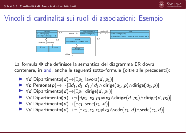

 S.A.4.3.5: Cardinalità di Associazioni e Attributi
  Vincoli di cardinalità sui ruoli di associazioni: Esempio
       (2)
       Questa definizione di Φ impedisce che l’interpretazione I:
          ▶Dominio di interpretazione D = {α, β, γ, δ, ϵ, ϕ, ι}
          ▶Interpretazione dei simboli di predicato:
               ▶I(Pers.)={α, β}
               ▶I(Dipar.)={γ, δ}
               ▶I(lavora)={(γ, α), (δ, α)}
               ▶I(“Intero ≥0”)={ϕ}
                                          ▶I(Stringa)={ϵ, ι}
                                          ▶I(cf)={(α, ϵ), (α, ι)}
                                          ▶I(annoAff.)={(γ, α, ϕ)}
                                          ▶I(Citta)={χ, λ}
                                                                    ▶I(sede)={(χ, γ), (λ, γ)}
                                                                    ▶I(nome)={(γ, ϵ), (γ, ι)}
                                                                    ▶. . .
          ▶Interpretazione dei simboli di funzione: ignorata per ora
       sia modello di Φ e rappresenti un livello estens. legale per il diagramma.
       Ad esempio, la sotto-formula di Φ:
               ∀d Dipartimento(d)→¬ [∃c1, c2 c1̸=c2∧sede(c1, d)∧sede(c2, d)]
       è violata per d = γ.
       Essendo Φ definita come un and delle sue sotto-formule, si ha: I̸ |= Φ.

 S.A.4.3.5: Cardinalità di Associazioni e Attributi
  Vincoli di cardinalità su attributi di entità
                                                 C
                                          attr : dom [min..max]
       Per ogni ruolo attributo attrc di una entità C, la formula Φ conterrà, in
       and, le seguenti sotto-formule:
       Vincolo di cardinalità minima (solo se min > 0):
                     ∀c C(c) →
                     esistono almeno min valori diversi
                     per l’attributo attr dell’istanza c

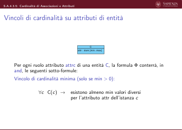

 S.A.4.3.5: Cardinalità di Associazioni e Attributi
  Vincoli di cardinalità su attributi di entità
       Per ogni ruolo attributo attrc di una entità C, la formula Φ conterrà, in
       and, le seguenti sotto-formule:
       Vincolo di cardinalità minima (solo se min > 0):
                        ∀c C(c) →∃v1, . . . , vmin
                               v1̸=v2 ∧· · ·∧v1̸=vmin ∧· · ·∧vmin−1̸=vmin ∧
                               attr(c, v1) ∧· · ·∧attr(c, vmin)

 S.A.4.3.5: Cardinalità di Associazioni e Attributi
  Vincoli di cardinalità su attributi di entità
       Per ogni ruolo attributo attrc di una entità C, la formula Φ conterrà, in
       and, le seguenti sotto-formule:
       Vincolo di cardinalità massima (solo se max̸ = ∗):
                  ∀c C(c) →
                  non esistono max + 1 valori diversi per
                  l’attributo attr dell’istanza c

 S.A.4.3.5: Cardinalità di Associazioni e Attributi
  Vincoli di cardinalità su attributi di entità
       Per ogni ruolo attributo attrc di una entità C, la formula Φ conterrà, in
       and, le seguenti sotto-formule:
       Vincolo di cardinalità massima (solo se max̸ = ∗):
                       ∀c C(c) →¬
                              ∃v1, . . . , vmax+1
                              v1̸=v2 ∧· · ·∧v1̸=vmax+1 ∧· · ·∧vmax̸=vmax+1 ∧
                                    
                              attr(c, v1) ∧· · ·∧attr(c, vmax+1)
                                                               

 S.A.4.3.5: Cardinalità di Associazioni e Attributi
  Vincoli di cardinalità su attributi di entità: Esempio
                       Persona
                                            Dipartimento
                                                      sede
                                                                    Citta
                   Persona
                   cf : Stringa {id}
                   stipendio : Intero > = 0
                                    lavora
                                        lavora
                     Uomo
                     Donna
                                        dirige
                                   dirige
       La formula Φ che definisce la semantica del diagramma ER dovrà
       contenere, in and, anche le seguenti sotto-formule (oltre alle precedenti):
          ▶∀p Persona(p)→[∃v1 cf(p, v1)]
          ▶∀p Persona(p)→¬ [∃v1, v2 v1̸=v2∧cf(p, v1)∧cf(p, v2)]
          ▶∀p Persona(p)→[∃v1 stipendio(p, v1)]
          ▶∀p Persona(p)→¬ [∃v1, v2 v1̸=v2∧stipendio(p, v1)∧stipendio(p, v2)]
          ▶∀d Dipartimento(d)→[∃v1 nome(d, v1)]
          ▶∀d Dipartimento(d)→¬ [∃v1, v2 v1̸=v2∧nome(d, v1)∧nome(d, v2)]
          ▶∀c Citta(c)→[∃v1 nome(c, v1)]
          ▶∀c Citta(c)→¬ [∃v1, v2 v1̸=v2∧nome(c, v1)∧nome(c, v2)]

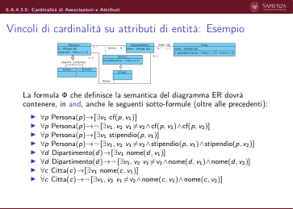

 S.A.4.3.5: Cardinalità di Associazioni e Attributi
  Vincoli di cardinalità su attributi di entità: Esempio (2)
       Questa definizione di Φ impedisce che l’interpretazione I:
          ▶Dominio di interpretazione D = {α, β, γ, δ, ϵ, ϕ, ι}
          ▶Interpretazione dei simboli di predicato:
               ▶I(Pers.)={α, β}
               ▶I(Dipar.)={γ, δ}
               ▶I(lavora)={(γ, α), (δ, α)}
               ▶I(“Intero ≥0”)={ϕ}
                                          ▶I(Stringa)={ϵ, ι}
                                          ▶I(cf)={(α, ϵ), (α, ι)}
                                          ▶I(annoAff.)={(α, γ, ϕ)}
                                          ▶I(Citta)={χ, λ}
                                                                    ▶I(sede)={(χ, γ), (λ, γ)}
                                                                    ▶I(nome)={(γ, ϵ), (γ, ι)}
                                                                    ▶. . .
          ▶Interpretazione dei simboli di funzione: ignorata per ora
       sia modello di Φ e rappresenti un livello estens. legale per il diagramma.
       Ad esempio, la sotto-formula di Φ:
              ∀d Dipartimento(d)→¬ [∃v1, v2 v1̸=v2∧nome(d, v1)∧nome(d, v2)]
       è violata per d = γ.
       Essendo Φ definita come un and delle sue sotto-formule, si ha: I̸ |= Φ.

 S.A.4.3.5: Cardinalità di Associazioni e Attributi
  Vincoli di cardinalità su attributi di associazione
                                                assoc
                                   C1
                                   C2
                                                assoc
                                           -attr : dom [min..max]
       Per ogni attributo attr di una qualche associazione assoc, la formula Φ
       conterrà, in and, le seguenti sotto-formule:
       Vincolo di cardinalità minima (solo se min > 0):
            ∀c1, c2 assoc(c1, c2) →
            esistono almeno min valori diversi per
            l’attributo attr dell’istanza (c1, c2)

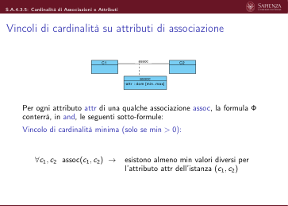

 S.A.4.3.5: Cardinalità di Associazioni e Attributi
  Vincoli di cardinalità su attributi di associazione
                                                assoc
                                   C1
                                   C2
                                                assoc
                                           -attr : dom [min..max]
       Per ogni attributo attr di una qualche associazione assoc, la formula Φ
       conterrà, in and, le seguenti sotto-formule:
       Vincolo di cardinalità minima (solo se min > 0):
               ∀c1, c2 assoc(c1, c2) →∃v1, . . . , vmin
                                         v1̸=v2 ∧· · ·∧v1̸=vmin ∧· · ·∧vmin−1̸=vmin ∧
                                         attr(c1, c2, v1) ∧· · ·∧attr(c1, c2, vmin)

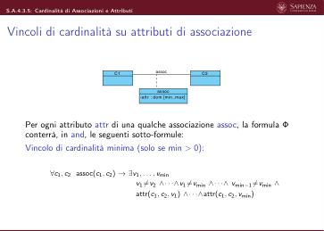

 S.A.4.3.5: Cardinalità di Associazioni e Attributi
  Vincoli di cardinalità su attributi di associazione
                                                assoc
                                   C1
                                   C2
                                                assoc
                                           -attr : dom [min..max]
       Per ogni attributo attr di una qualche associazione assoc, la formula Φ
       conterrà, in and, le seguenti sotto-formule:
       Vincolo di cardinalità massima (solo se max̸ = ∗):
           ∀c1, c2 assoc(c1, c2) →
           non esistono max + 1 valori diversi per
           l’attributo attr dell’istanza (c1, c2)

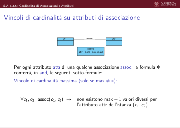

 S.A.4.3.5: Cardinalità di Associazioni e Attributi
  Vincoli di cardinalità su attributi di associazione
                                                assoc
                                   C1
                                   C2
                                                assoc
                                           -attr : dom [min..max]
       Per ogni attributo attr di una qualche associazione assoc, la formula Φ
       conterrà, in and, le seguenti sotto-formule:
       Vincolo di cardinalità massima (solo se max̸ = ∗):
                  ∀c1, c2 assoc(c1, c2) →
                                
                               ¬
                                 ∃v1, . . . , vmax+1
                                    v1̸=v2 ∧· · ·∧v1̸=vmax+1 ∧· · ·∧vmax̸=vmax+1 ∧
                                                                           
                                    attr(c1, c2, v1) ∧· · ·∧attr(c1, c2, vmax+1)

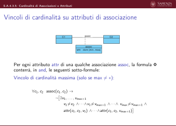

 S.A.4.3.5: Cardinalità di Associazioni e Attributi
  Vincoli di cardinalità sui ruoli di associazione: Esempio
                       Persona
                                            Dipartimento
                                                      sede
                                                                    Citta
                   Persona
                   cf : Stringa {id}
                   stipendio : Intero > = 0
                                    lavora
                                        lavora
                     Uomo
                     Donna
                                        dirige
                                   dirige
       La formula Φ che definisce la semantica del diagramma ER dovrà
       contenere, in and, anche le seguenti sotto-formule (oltre alle precedenti):
          ▶∀d, p lavora(d, p)→[∃v1 annoAfferenza(d, p, v1)]
          ▶∀d, p lavora(d, p)→
             ¬ [∃v1, v2 v1̸=v2∧annoAfferenza(d, p, v1)∧annoAfferenza(d, p, v2)]

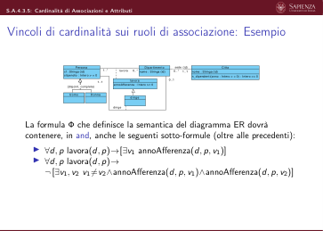

 S.A.4.3.5: Cardinalità di Associazioni e Attributi
  Vincoli di cardinalità sui ruoli di associazione: Esempio
       (2)
       Questa definizione di Φ impedisce che l’interpretazione I:
          ▶Dominio di interpretazione D = {α, β, γ, δ, ϵ, ϕ, ι}
          ▶Interpretazione dei simboli di predicato:
               ▶I(Pers.)={α, β}
               ▶I(Dipar.)={γ, δ}
               ▶I(lavora)={(γ, α), (δ, α)}
               ▶I(“Intero ≥0”)={ϕ}
                                          ▶I(Stringa)={ϵ, ι}
                                          ▶I(cf)={(α, ϵ), (α, ι)}
                                          ▶I(annoAff.)={(α, γ, ϕ)}
                                          ▶I(Citta)={χ, λ}
                                                                    ▶I(sede)={(χ, γ), (λ, γ)}
                                                                    ▶I(nome)={(γ, ϵ), (γ, ι)}
                                                                    ▶. . .
          ▶Interpretazione dei simboli di funzione: ignorata per ora
       sia modello di Φ e rappresenti un livello estens. legale per il diagramma.
       Ad esempio, la sotto-formula di Φ:
                       ∀d, p lavora(d, p)→[∃v1 annoAfferenza(d, p, v1)]
       è violata per d = δ e p = α.
       Essendo Φ definita come un and delle sue sotto-formule, si ha: I̸ |= Φ.

                              Slides A.4.3.6 (S.A.4.3.6)
              Analisi dei requisiti
              Logica del primo ordine (FOL) nell’Analisi Concettuale
              Semantica di un diagramma UML delle classi in FOL
                             Tipizzazione di Operazioni

 S.A.4.3.6: Tipizzazione di Operazioni
  Esempio
                       Persona
                                            Dipartimento
                                                      sede
                                                                    Citta
                   Persona
                   cf : Stringa {id}
                   stipendio : Intero > = 0
                                    lavora
                                        lavora
                     Uomo
                     Donna
                                        dirige
                                   dirige
       Consideriamo l’interpretazione I definita come segue:
          ▶Dominio di interpretazione D = {α, β, γ, δ, ϵ, ϕ, ι, χ, λ}
          ▶Interpretazione dei simboli di predicato:
               ▶I(Pers.)={α, β}
               ▶I(Dipar.)={γ, δ}
               ▶I(lavora)={(γ, α), (δ, α)}
               ▶I(“Intero ≥0”)={ϕ}
                                        ▶I(Stringa)={ϵ, ι}
                                        ▶I(cf)={(α, ϵ), (α, ι)}
                                        ▶I(annoAff.)={(γ, α, ϕ)}
                                        ▶I(Citta)={χ, λ}
                                                                ▶I(sede)={(χ, γ), (λ, γ)}
                                                                ▶I(nome)={(γ, ϵ), (γ, ι)}
                                                                ▶I(n_dipendentiCitta,Intero≥0)=
          {(α, ϵ, ι), . . .}
          ▶Interpretazione dei simboli di funzione: ignorata per ora
       L’interpretazione soddisfa tutti i vincoli visti in precedenza e modellati come
       sottoformule di Φ legate da and

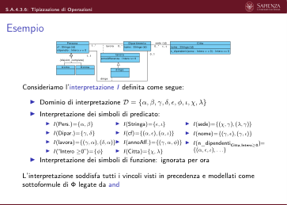

 S.A.4.3.6: Tipizzazione di Operazioni
  Esempio
       L’interpretazione I:
          ▶Dominio di interpretazione D = {α, β, γ, δ, ϵ, ϕ, ι, χ, λ}
          ▶Interpretazione dei simboli di predicato:
               ▶I(Pers.)={α, β}
               ▶I(Dipar.)={γ, δ}
               ▶I(lavora)={(γ, α), (δ, α)}
               ▶I(“Intero ≥0”)={ϕ}
                                        ▶I(Stringa)={ϵ, ι}
                                        ▶I(cf)={(α, ϵ), (α, ι)}
                                        ▶I(annoAff.)={(γ, α, ϕ)}
                                        ▶I(Citta)={χ, λ}
                                                                ▶I(sede)={(χ, γ), (λ, γ)}
                                                                ▶I(nome)={(γ, ϵ), (γ, ι)}
                                                                ▶I(n_dipendentiCitta,Intero≥0)=
          {(α, ϵ, ι), . . .}
          ▶Interpretazione dei simboli di funzione: ignorata per ora
       non rappresenta ancora un livello estensionale legale per il diagramma, ad es.
       perché rappresenta il fatto che:
          ▶L’operazione n_dipendenti(), quando invocata sulla persona (non città!)
             α con l’argomento ϵ (una stringa!) restituisce, tra gli altri, il valore ι (una
             stringa!)

 S.A.4.3.6: Tipizzazione di Operazioni
  Tipizzazione di operazioni
       È necessario definire una ulteriore tipologia di vincoli in Φ per imporre
       che:
          ▶una operazione può fornire un risultato solo se l’oggetto di
             invocazione e gli argomenti sono delle classi/associazioni/tipi
             corretti, e tale risultato è del tipo corretto

 S.A.4.3.6: Tipizzazione di Operazioni
  Tipizzazione di operazioni (2)
                                                      ruolo2
                                                      ruolo1
                                                             assoc
                                                C2
                                                C1
                        C
               op(a1 : T1, ..., an : Tn) : Tr
                                                             assoc
                                                       op(a1 : T1, ..., an : Tn) : Tr
        =⇒La formula Φ conterrà, in and, le seguenti sotto-formule:
         ∀c, v1, . . . vn, vr
         opC,T1,...,Tn(c, v1, . . . , vn, vr) →
                                C(c) ∧T1(v1) ∧· · · ∧Tn(vn) ∧Tr(vr)
         ∀c1, c2, v1, . . . vn, vr
         opassoc,T1,...,Tn(c, v1, . . . , vn, vr) →
                                    assoc(c1, c2) ∧T1(v1) ∧· · · ∧Tn(vn) ∧Tr(vr)
       Nota: per semplicità, mostriamo la formalizzazione solo delle operazioni i
       cui argomento hanno molteplicità [1..1]

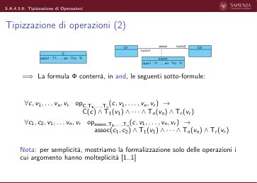

 S.A.4.3.6: Tipizzazione di Operazioni
  Esempio
                        Persona
                                            Dipartimento
                                                      sede
                                                                    Citta
                    Persona
                                     lavora
                                        lavora
                      Uomo
                      Donna
                                        dirige
                                   dirige
       La formula Φ che definisce la semantica del diagramma ER dovrà
       contenere, in and, anche le seguenti sotto-formule (oltre alle precedenti):
          ▶∀c, v, r n_dipendentiCitta,Intero≥0(c, v, r) →Persona(c) ∧
             “Intero ≥0”(v) ∧“Intero ≥0”(r)

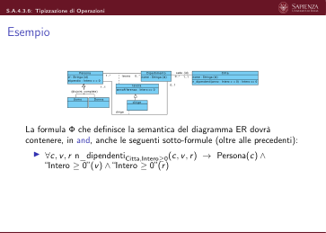

 S.A.4.3.6: Tipizzazione di Operazioni
  Esempio (2)
       Questa definizione di Φ impedisce che l’interpretazione I vista in
       precedenza:
          ▶Dominio di interpretazione D = {α, β, γ, δ, ϵ, ϕ, ι}
          ▶Interpretazione dei simboli di predicato:
               ▶I(Pers.)={α, β}
                                   ▶I(“intero ≥0”)={ϕ}
                                                      ▶I(annoAff.)={(α, β, ι)}
                                                                          ▶. . .
               ▶I(Dipar.)={γ, δ}
                                   ▶I(stringa)={ι}
                                                      ▶I(n_dipendentiCitta,Intero≥0)=
               ▶I(lavora)={(δ, β)}
                                   ▶I(cf)={(α, β), (β, ι)}
                                                         {(α, ϵ, ι), . . .}
          ▶Interpretazione dei simboli di funzione: ignorata per ora

 S.A.4.3.6: Tipizzazione di Operazioni
  Esempio (3)
       sia un modello di Φ e quindi rappresenti un livello estensionale legale per
       il diagramma.
       Ad esempio, la sotto-formula di Φ:
       ∀c, v, r n_dipendentiCitta,Intero≥0(c, v, r) →Persona(c)∧
       “Intero ≥0”(v)∧“Intero ≥0”(r) è violata per c = α, v = ϵ, r = ι
       Essendo Φ definita come un and delle sue sotto-formule, si ha: I̸ |= Φ.

                              Slides A.4.3.7 (S.A.4.3.7)
              Analisi dei requisiti
              Logica del primo ordine (FOL) nell’Analisi Concettuale
              Semantica di un diagramma UML delle classi in FOL
                       Vincoli di Identificazione di Classe

 S.A.4.3.7: Vincoli di Identificazione di Classe
  Esempio
                        Persona
                                            Dipartimento
                                                      sede
                                                                    Citta
                    Persona
                                     lavora
                                        lavora
                      Uomo
                      Donna
                                        dirige
                                   dirige
       Consideriamo l’interpretazione I definita come segue:
          ▶Dominio di interpretazione D = {α, β, γ, δ, ϵ, ϕ, ι}
          ▶Interpretazione dei simboli di predicato:
               ▶I(Pers.)={α, β}
               ▶I(Dipar.)={γ, δ}
               ▶I(lavora)={(γ, α)}
               ▶I(“Intero ≥0”)={ϕ}
                                        ▶I(Stringa)={ϵ, ι}
                                        ▶I(cf)={(α, ϵ), (β, ϵ)}
                                        ▶I(annoAff.)={(α, γ, ϕ)}
                                        ▶I(Citta)={χ}
                                                                ▶I(sede)={(χ, γ), (χ, δ)}
                                                                ▶I(nome)={(γ, ϵ), (δ, ϵ), (χ, ι)}
                                                                ▶. . .
          ▶Interpretazione dei simboli di funzione: ignorata per ora
       L’interpretazione soddisfa tutti i vincoli visti in precedenza e modellati come
       sottoformule di Φ legate da and

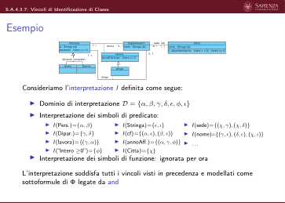

 S.A.4.3.7: Vincoli di Identificazione di Classe
  Esempio
                        Persona
                                            Dipartimento
                                                      sede
                                                                    Citta
                    Persona
                                     lavora
                                        lavora
                      Uomo
                      Donna
                                        dirige
                                   dirige
       Consideriamo l’interpretazione I definita come segue:
          ▶Dominio di interpretazione D = {α, β, γ, δ, ϵ, ϕ, ι}
          ▶Interpretazione dei simboli di predicato:
               ▶I(Pers.)={α, β}
               ▶I(Dipar.)={γ, δ}
               ▶I(lavora)={(γ, α)}
               ▶I(“Intero ≥0”)={ϕ}
                                        ▶I(Stringa)={ϵ, ι}
                                        ▶I(cf)={(α, ϵ), (β, ϵ)}
                                        ▶I(annoAff.)={(α, γ, ϕ)}
                                        ▶I(Citta)={χ}
                                                                ▶I(sede)={(χ, γ), (χ, δ)}
                                                                ▶I(nome)={(γ, ϵ), (δ, ϵ), (χ, ι)}
                                                                ▶. . .
          ▶Interpretazione dei simboli di funzione: ignorata per ora
       L’interpretazione non rappresenta ancora un livello estensionale legale per il
       diagramma, ad es. perché definisce i seguenti valori per gli attributi:
          ▶Le persone α e β hanno lo stesso valore per l’attributo cf
          ▶I dipartimenti γ e δ hanno lo stesso nome, sebbene abbiano sede nella
             stessa città

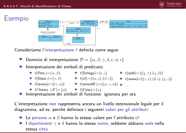

 S.A.4.3.7: Vincoli di Identificazione di Classe
  Vincoli di identificazione di classe
       È necessario definire una ulteriore tipologia di vincoli in Φ per imporre
       che:
          ▶i vincoli di identificazione per le classi siano soddisfatti

 S.A.4.3.7: Vincoli di Identificazione di Classe
  Vincoli di identificazione di classe
       È necessario definire una ulteriore tipologia di vincoli in Φ per imporre
       che:
          ▶i vincoli di identificazione per le classi siano soddisfatti
       Per ogni vincolo di identificazione di classe come il seguente (per C):
                                  C
                                  C1
                                                 assoc1
                            attr1 : dom1 {id}
                            attr2 : dom2 {id}
                            ...
                            attrN : domN {id}
                                                 assoc m
                                                                 ...
                                                                 Cm
       la formula Φ conterrà, in and, la seguente sotto-formula:
          ∃c, c′, v1, . . . , vn, c1, . . . , cm C(c) ∧C(c′) ∧c̸ = c′ ∧
         
       ¬
            attr1(c, v1) ∧· · · ∧attrn(c, vn) ∧attr1(c′, v1) ∧· · · ∧attrn(c′, vn) ∧
            assoc1(c, c1) ∧· · · ∧assocm(c, cm) ∧assoc1(c′, c1) ∧· · · ∧assocm(c′, cm)
                                                                                                  

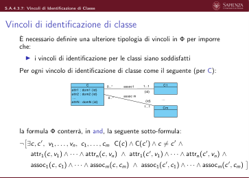

 S.A.4.3.7: Vincoli di Identificazione di Classe
  Vincoli di identificazione di entità: esempio
                                                         sede
             Persona
                                            Dipartimento
                                                                              Citta
        Persona
        cf : Stringa {id}
        stipendio : Intero > = 0
                                lavora
                                     lavora
         {disjoint, complete}
          Uomo
          Donna
                                     dirige
                              dirige
       La formula Φ che definisce la semantica del diagramma ER dovrà
       contenere, in and, anche le seguenti sotto-formule (oltre alle precedenti):
          ▶¬
               
                ∃p1, p2, v Persona(p1)∧Persona(p2)∧p1̸=p2∧cf(p1, v)∧cf(p2, v)
                                                                                           
          ▶¬
             ∃d1, d2, v, c Dipartimento(d1)∧Dipartimento(d2)∧d1̸=
             d2∧nome(d1, v)∧sede(c, d1)∧nome(d2, v)∧sede(c, d2)
               
                                                                             

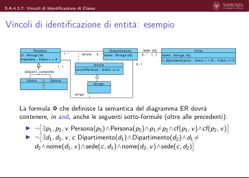

 S.A.4.3.7: Vincoli di Identificazione di Classe
  Vincoli di identificazione di entità: esempio (2)
       Questa definizione di Φ impedisce che l’interpretazione I:
          ▶Dominio di interpretazione D = {α, β, γ, δ, ϵ, ϕ, ι}
          ▶Interpretazione dei simboli di predicato:
               ▶I(Pers.)={α, β}
               ▶I(Dipar.)={γ, δ}
               ▶I(lavora)={(γ, α)}
               ▶I(“Intero ≥0”)={ϕ}
                                        ▶I(Stringa)={ϵ, ι}
                                        ▶I(cf)={(α, ϵ), (β, ϵ)}
                                        ▶I(annoAff.)={(α, γ, ϕ)}
                                        ▶I(Citta)={χ}
                                                                ▶I(sede)={(χ, γ), (χ, δ)}
                                                                ▶I(nome)={(γ, ϵ), (δ, ϵ), (χ, ι)}
                                                                ▶. . .
          ▶Interpretazione dei simboli di funzione: ignorata per ora
       sia un modello di Φ e rappresenti un livello estensionale legale per il
       diagramma, perché le sotto-formule di Φ:
          ▶¬
               
                                                                                     
                ∃p1, p2, v Persona(p1)∧Persona(p2)∧p1̸=p2∧cf(p1, v)∧cf(p2, v)
          ▶¬
               
             ∃d1, d2, v, c Dipartimento(d1)∧Dipartimento(d2)∧d1̸=
             d2∧nome(d1, v)∧sede(c, d1)∧nome(d2, v)∧sede(c, d2)
                                                                        
       sono violate, rispettivamente, per p1 = α e p2 = β e per d1 = γ e d2 = δ.
       Essendo Φ definita come un and delle sue sotto-formule, si ha: I̸ |= Φ.

                              Slides A.4.3.8 (S.A.4.3.8)
              Analisi dei requisiti
              Logica del primo ordine (FOL) nell’Analisi Concettuale
              Semantica di un diagramma UML delle classi in FOL
                                Un Esempio Completo

 S.A.4.3.8: Un Esempio Completo
  Un esempio completo
       La semantica del seguente diagramma delle classi
                                                      sede
                       Persona
                                            Dipartimento
                                                                    Citta
                   Persona
                   cf : Stringa {id}
                   stipendio : Intero > = 0
                                    lavora
                                        lavora
                     Uomo
                     Donna
                                        dirige
                                   dirige
       è definita dalla seguente formula Φ:
       (Nota: alcune sottoformule potrebbero essere omesse a causa di ridondanze)
                                   // Disgiunzione tra classi e/o domini
                                ∀x Persona(x) →¬Dipartimento(x) ∧
                                ∀x Persona(x) →¬Citta(x) ∧
                                ∀x Persona(x) →¬“Intero ≥0”(x) ∧
                                ∀x Persona(x) →¬Intero(x) ∧
                                ∀x Persona(x) →¬Stringa(x) ∧
                                ∀x Uomo(x) →¬Donna(x) ∧
                                ∀x Uomo(x) →¬Dipartimento(x) ∧

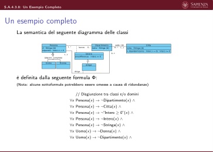

 S.A.4.3.8: Un Esempio Completo
  Un esempio completo
       La semantica del seguente diagramma delle classi
                       Persona
                                            Dipartimento
                                                      sede
                                                                    Citta
                   Persona
                   cf : Stringa {id}
                   stipendio : Intero > = 0
                                    lavora
                                        lavora
                     Uomo
                     Donna
                                        dirige
                                   dirige
       è definita dalla seguente formula Φ:
       (Nota: alcune sottoformule potrebbero essere omesse a causa di ridondanze)
                             . . . // Disgiunzione tra classi e/o domini (cont.)
                             ∀x Uomo(x) →¬Citta(x) ∧
                             ∀x Uomo(x) →¬“Intero ≥0”(x) ∧
                             ∀x Uomo(x) →¬Intero(x) ∧
                             ∀x Uomo(x) →¬Stringa(x) ∧
                             ∀x Donna(x) →¬Dipartimento(x) ∧
                             ∀x Donna(x) →¬Citta(x) ∧
                             ∀x Donna(x) →¬“Intero ≥0”(x) ∧
                             ∀x Donna(x) →¬Intero(x) ∧
                             ∀x Donna(x) →¬Stringa(x) ∧

 S.A.4.3.8: Un Esempio Completo
  Un esempio completo
       La semantica del seguente diagramma delle classi
                       Persona
                                            Dipartimento
                                                      sede
                                                                    Citta
                   Persona
                   cf : Stringa {id}
                   stipendio : Intero > = 0
                                    lavora
                                        lavora
                     Uomo
                     Donna
                                        dirige
                                   dirige
       è definita dalla seguente formula Φ:
       (Nota: alcune sottoformule potrebbero essere omesse a causa di ridondanze)
                             . . . // Disgiunzione tra classi e/o domini (cont.)
                             ∀x Dipartimento(x) →¬Citta(x) ∧
                             ∀x Dipartimento(x) →¬“Intero ≥0”(x) ∧
                             ∀x Dipartimento(x) →¬Intero(x) ∧
                             ∀x Dipartimento(x) →¬Stringa(x) ∧
                             ∀x Citta(x) →¬“Intero ≥0”(x) ∧
                             ∀x Citta(x) →¬Intero(x) ∧
                             ∀x Citta(x) →¬Stringa(x) ∧
                             ∀x “Intero ≥0”(x) →¬Stringa(x) ∧
                             ∀x Intero(x) →¬Stringa(x) ∧

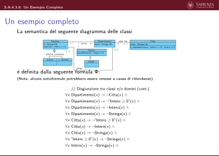

 S.A.4.3.8: Un Esempio Completo
  Un esempio completo
       La semantica del seguente diagramma delle classi
                       Persona
                                            Dipartimento
                                                      sede
                                                                    Citta
                   Persona
                   cf : Stringa {id}
                   stipendio : Intero > = 0
                                    lavora
                                        lavora
                     Uomo
                     Donna
                                        dirige
                                   dirige
       è definita dalla seguente formula Φ:
       (Nota: alcune sottoformule potrebbero essere omesse a causa di ridondanze)
                             . . . // Generalizzazione tra classi e tra associazioni
                             ∀x Uomo(x) →Persona(x) ∧
                             ∀x Donna(x) →Persona(x) ∧
                             ∀x Persona(x) →Uomo(x) ∨Donna(x) ∧
                           ∀x, y dirige(x, y) →lavora(x, y) ∧

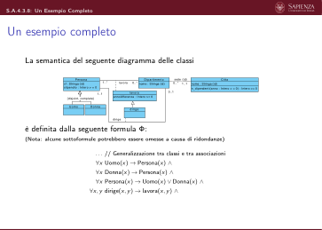

 S.A.4.3.8: Un Esempio Completo
  Un esempio completo
       La semantica del seguente diagramma delle classi
                       Persona
                                            Dipartimento
                                                      sede
                                                                    Citta
                   Persona
                   cf : Stringa {id}
                   stipendio : Intero > = 0
                                    lavora
                                        lavora
                     Uomo
                     Donna
                                        dirige
                                   dirige
       è definita dalla seguente formula Φ:
       (Nota: alcune sottoformule potrebbero essere omesse a causa di ridondanze)
                               . . . // Specializzazione di domini
                               ∀x “Intero ≥0”(x) ↔[Intero(x) ∧x ≥0] ∧

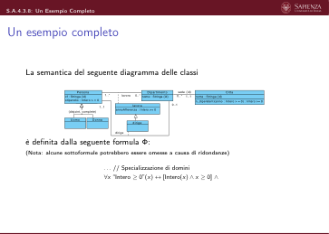

 S.A.4.3.8: Un Esempio Completo
  Un esempio completo
       La semantica del seguente diagramma delle classi
                       Persona
                                            Dipartimento
                                                      sede
                                                                    Citta
                   Persona
                   cf : Stringa {id}
                   stipendio : Intero > = 0
                                    lavora
                                        lavora
                     Uomo
                     Donna
                                        dirige
                                   dirige
       è definita dalla seguente formula Φ:
       (Nota: alcune sottoformule potrebbero essere omesse a causa di ridondanze)
                             . . . // Tipizzazione di associazioni
                           ∀d, p lavora(d, p) →Dipartimento(d) ∧Persona(p) ∧
                           ∀d, p dirige(d, p) →Dipartimento(d) ∧Persona(p) ∧
                           ∀c, d sede(c, d) →Citta(c) ∧Dipartimento(d) ∧

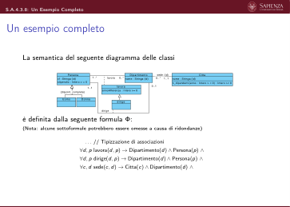

 S.A.4.3.8: Un Esempio Completo
  Un esempio completo
       La semantica del seguente diagramma delle classi
                       Persona
                                            Dipartimento
                                                      sede
                                                                    Citta
                   Persona
                   cf : Stringa {id}
                   stipendio : Intero > = 0
                                    lavora
                                        lavora
                     Uomo
                     Donna
                                        dirige
                                   dirige
       è definita dalla seguente formula Φ:
       (Nota: alcune sottoformule potrebbero essere omesse a causa di ridondanze)
                          . . . // Tipizzazione di attributi
                        ∀x, v cf(x, v) ∧Persona(x) →Stringa(v) ∧
                        ∀x, v stipendio(x, v) ∧Persona(x) →“Intero ≥0”(v) ∧
                      ∀x, y, v annoAfferenza(x, y, v) ∧lavora(x, y) →“Intero ≥0”(v) ∧
                        ∀x, v nome(x, v) ∧Dipartimento(x) →Stringa(v) ∧
                        ∀x, v nome(x, v) ∧Citta(x) →Stringa(v) ∧

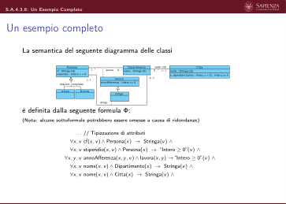

 S.A.4.3.8: Un Esempio Completo
  Un esempio completo
       La semantica del seguente diagramma delle classi
                       Persona
                                            Dipartimento
                                                      sede
                                                                    Citta
                   Persona
                   cf : Stringa {id}
                   stipendio : Intero > = 0
                                    lavora
                                        lavora
                     Uomo
                     Donna
                                        dirige
                                   dirige
       è definita dalla seguente formula Φ:
       (Nota: alcune sottoformule potrebbero essere omesse a causa di ridondanze)
                   . . . // Vincoli di cardinalità sui ruoli di associazioni
                   ∀d Dipartimento(d) →[∃p1 lavora(d, p1)] ∧
                   ∀p Persona(p) →¬ [∃d1, d2 d1̸ = d2 ∧dirige(d1, p) ∧dirige(d2, p)] ∧
                   ∀d Dipartimento(d) →[∃p1 dirige(d, p1)] ∧
                   ∀d Dipartimento(d) →¬ [∃p1, p2 p1̸ = p2 ∧dirige(d, p1) ∧dirige(d, p2)] ∧
                   ∀d Dipartimento(d) →[∃c1 sede(c1, d)] ∧
                   ∀x Dipartimento(d) →¬ [∃c1, c2 c1̸ = c2 ∧sede(c1, d) ∧sede(c2, d)] ∧

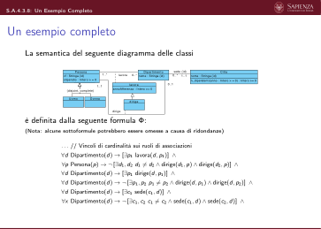

 S.A.4.3.8: Un Esempio Completo
  Un esempio completo
       La semantica del seguente diagramma delle classi
                       Persona
                                            Dipartimento
                                                      sede
                                                                    Citta
                   Persona
                   cf : Stringa {id}
                   stipendio : Intero > = 0
                                    lavora
                                        lavora
                     Uomo
                     Donna
                                        dirige
                                   dirige
       è definita dalla seguente formula Φ:
       (Nota: alcune sottoformule potrebbero essere omesse a causa di ridondanze)
                  . . . // Vincoli di cardinalità su attributi di classe
                   ∀x Persona(x) →[∃v1 cf(x, v1)] ∧
                   ∀x Persona(x) →¬ [∃v1, v2 v1̸ = v2 ∧cf(x, v1) ∧cf(x, v2)] ∧
                   ∀x Persona(x) →[∃v1 stipendio(x, v1)] ∧
                   ∀x Persona(x) →¬ [∃v1, v2 v1̸ = v2 ∧stipendio(x, v1) ∧stipendio(x, v2)] ∧

 S.A.4.3.8: Un Esempio Completo
  Un esempio completo
       La semantica del seguente diagramma delle classi
                       Persona
                                            Dipartimento
                                                      sede
                                                                    Citta
                   Persona
                   cf : Stringa {id}
                   stipendio : Intero > = 0
                                    lavora
                                        lavora
                     Uomo
                     Donna
                                        dirige
                                   dirige
       è definita dalla seguente formula Φ:
       (Nota: alcune sottoformule potrebbero essere omesse a causa di ridondanze)
                   . . . // Vincoli di cardinalità su attributi di classe (cont.)
                   ∀x Dipartimento(x) →[∃v1 nome(x, v1)] ∧
                   ∀x Dipartimento(x) →¬ [∃v1, v2 v1̸ = v2 ∧nome(x, v1) ∧nome(x, v2)] ∧
                   ∀x Citta(x) →[∃v1 nome(x, v1)] ∧
                   ∀x Citta(x) →¬ [∃v1, v2 v1̸ = v2 ∧nome(x, v1) ∧nome(x, v2)] ∧

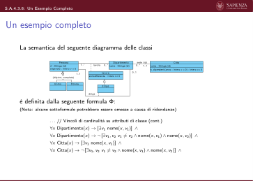

 S.A.4.3.8: Un Esempio Completo
  Un esempio completo
       La semantica del seguente diagramma delle classi
                                                      sede
                       Persona
                                            Dipartimento
                                                                    Citta
                   Persona
                   cf : Stringa {id}
                   stipendio : Intero > = 0
                                    lavora
                                        lavora
                     Uomo
                     Donna
                                        dirige
                                   dirige
       è definita dalla seguente formula Φ:
       (Nota: alcune sottoformule potrebbero essere omesse a causa di ridondanze)
             . . . // Vincoli di cardinalità su attributi di associazione
           ∀x, y lavora(x, y) →[∃v1 annoAfferenza(x, y, v1)] ∧
           ∀x, y lavora(x, y) →¬ [∃v1, v2 v1̸ = v2 ∧annoAfferenza(x, y, v1) ∧annoAfferenza(x, y, v2)] ∧

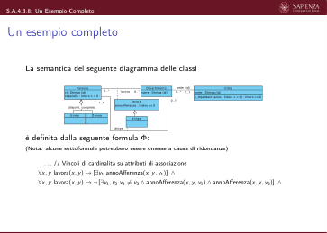

 S.A.4.3.8: Un Esempio Completo
  Un esempio completo
       La semantica del seguente diagramma delle classi
                       Persona
                                            Dipartimento
                                                      sede
                                                                    Citta
                   Persona
                   cf : Stringa {id}
                   stipendio : Intero > = 0
                                    lavora
                                        lavora
                     Uomo
                     Donna
                                        dirige
                                   dirige
       è definita dalla seguente formula Φ:
       (Nota: alcune sottoformule potrebbero essere omesse a causa di ridondanze)
                              . . . // Tipizzazione di operazioni
                           ∀c, v, r n_dipendentiCitta,Intero≥0(c, v, r) →
                                 Persona(c) ∧“Intero ≥0”(v) ∧“Intero ≥0”(r)

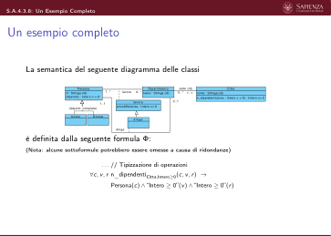

 S.A.4.3.8: Un Esempio Completo
  Un esempio completo
       La semantica del seguente diagramma delle classi
                       Persona
                                            Dipartimento
                                                      sede
                                                                    Citta
                   Persona
                   cf : Stringa {id}
                   stipendio : Intero > = 0
                                    lavora
                                        lavora
                     Uomo
                     Donna
                                        dirige
                                   dirige
       è definita dalla seguente formula Φ:
       (Nota: alcune sottoformule potrebbero essere omesse a causa di ridondanze)
                         . . . // Vincoli di identificazione di classe
                  ¬
                   
                    ∃p1, p2, v Persona(p1) ∧Persona(p2) ∧p1̸ = p2 ∧cf(p1, v) ∧cf(p2, v)
                                                                           
                                                                            ∧
                 
                ¬
                  ∃d1, d2, v, c Dipartimento(d1) ∧Dipartimento(d2)∧
                            d1̸ = d2 ∧nome(d1, v) ∧sede(c, d1) ∧nome(d2, v) ∧sede(c, d2)
                                                                              
                                                                                ∧
                   
                                                                           
                  ¬
                    ∃c1, c2, v Citta(c1) ∧Citta(c2) ∧c1̸ = c2 ∧nome(c1, v) ∧nome(c2, v)

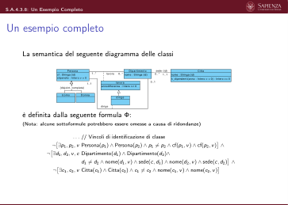

 S.A.4.3.8: Un Esempio Completo
  Semantica di un diagramma delle classi
       La formula Φ che definisce un diagramma delle classi esprime i vincoli che
       una interpretazione M deve soddisfare affinché rappresenti un livello
       estensionale legale del diagramma.
       Quindi:
                  M |= Φ ⇐⇒
                  M rappresenta un livello estensionale
                                       legale del diagramma delle classi.

 S.A.4.3.8: Un Esempio Completo
  Semantica di un diagramma delle classi
       La formula Φ che definisce un diagramma delle classi esprime i vincoli che
       una interpretazione M deve soddisfare affinché rappresenti un livello
       estensionale legale del diagramma.
       Quindi:
                  M |= Φ ⇐⇒
                  M rappresenta un livello estensionale
                                       legale del diagramma delle classi.
       . . . Ma manca ancora qualcosa. . .

                              Slides A.4.3.9 (S.A.4.3.9)
              Analisi dei requisiti
              Logica del primo ordine (FOL) nell’Analisi Concettuale
              Semantica di un diagramma UML delle classi in FOL
                                     Logica e Realtà

 S.A.4.3.9: Logica e Realtà
  Esempio
       Consideriamo il seguente diagramma delle classi:
                                                      sede
                       Persona
                                            Dipartimento
                                                                    Citta
                   Persona
                   cf : Stringa {id}
                   stipendio : Intero > = 0
                                    lavora
                                        lavora
                     Uomo
                     Donna
                                        dirige
                                   dirige
       la cui formula Φ è stata vista nelle slide precedenti.
       Sia M la seguente interpretazione, modello di Φ:
          ▶Dominio di interpretazione D = {α, β, γ, δ, ϵ, ϕ, ι, χ, λ}
          ▶Interpretazione dei simboli di predicato:
               ▶I(Pers.)={α, β}
               ▶I(Dipar.)={γ, δ}
               ▶I(lavora)={(γ, α), (δ, α)}
               ▶I(“intero ≥0”)={ϕ, λ}
               ▶I(stringa)={ϵ, ι}
               ▶I(cf)={(α, ϵ), (β, ι)}
                                                   ▶I(annoAff.)={(α, γ, ϕ), (α, δ, λ)}
                                                   ▶I(Citta)={χ}
                                                   ▶I(sede)={(χ, γ), (χ, δ)}
                                                   ▶I(nome)={(γ, ϵ), (δ, ι), (χ, ι)}
                                                   ▶I(≥)={(α, δ), (λ, ϕ), (ι, γ)}
          ▶. . .
          ▶Interpretazione dei simboli di funzione: ignorata per ora

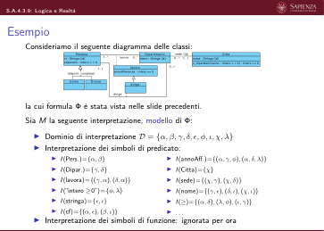

 S.A.4.3.9: Logica e Realtà
  Esempio
       Gli elementi del dominio di interpretazione D sono oggetti/fatti/persone/etc.
       del mondo.
       M potrebbe essere quindi la seguente:
          ▶Dominio di interpretazione D = { A p p l
          e , ,
          , H e l
          l o ! ,
          ,
          ,
          , ,
          }
          ▶Interpretazione dei simboli di predicato:
               ▶I(Pers.)={ A p p l
               e , }
               ▶I(Dipar.)={ , H e l
               l o ! }
               ▶I(lavora)={( , A p p l
               e ), ( H e l
               l o ! , A p p l
               e )}
               ▶I(“intero ≥0”)={
               ,
               }
               ▶I(stringa)={
               ,
               }
               ▶I(cf)={( A p p l
               e ,
               ), ( ,
               )}
                                                   ▶I(annoAff.)={( A p p l
                                                   e ,
                                                   ,
                                                   ), ( A p p l
                                                   e , H e l
                                                   l o ! ,
                                                   )}
                                                   ▶I(Citta)={ }
                                                   ▶I(sede)={( ,
                                                   ), ( , H e l
                                                   l o ! )}
                                                   ▶I(nome)={( ,
                                                   ), ( H e l
                                                   l o ! ,
                                                   ), ( ,
                                                   )}
                                                   ▶I(≥)={( A p p l
                                                   e , H e l
                                                   l o ! ), (
                                                   ,
                                                   ), (
                                                   ,
                                                   )}
          ▶. . .
          ▶Interpretazione dei simboli di funzione: ignorata per ora
       L’interpretazione M interpreta i simboli di predicato in modo del tutto avulso
       dalla realtà!

 S.A.4.3.9: Logica e Realtà
  Logica e realtà
       Abbiamo visto che una interpretazione può essere completamente avulsa dalla
       realtà e comunque essere un modello delle formule di interesse.
       Questo è dovuto al grande potere di astrazione della logica:
          ▶la verità o falsità di una formula può essere determinata solo dopo aver
             definito una interpretazione che dia la semantica dei termini e delle
             formule atomici
          ▶il concetto di interpretazione non è limitato in alcun modo dal “mondo
             reale”.
       In questo corso intendiamo usare la logica per esprimere proprietà del mondo
       reale, del quale, nello schema concettuale dell’applicazione, stiamo cercando di
       modellare un frammento.
       Vogliamo quindi limitare la nostra attenzione alle interpretazioni consistenti
       (coerenti) con la realtà.

 S.A.4.3.9: Logica e Realtà
  Logica e realtà (2)
       Intendiamo quindi limitare la nostra attenzione alle interpretazioni consistenti
       con la realtà. A tal fine osserviamo che:
          ▶I simboli di predicato 1-ari definiscono classi oppure domini.
          ▶I simboli di predicato non 1-ari per associazioni o attributi sono sempre
             vincolati a simboli di predicato 1-ari relativi a classi o domini.
          ▶La semantica dei simboli di predicato che definiscono classi è variabile da
             progetto a progetto, in quanto dipende dal frammento di mondo che si
             sta modellando.
             Il diagramma delle classi serve appunto a definire come i dati si articolano
             nelle diverse classi ed associazioni.
             Saranno gli utenti a definire nel sistema le istanze delle diverse classi.

 S.A.4.3.9: Logica e Realtà
  Logica e realtà (3)
       La semantica de:
          ▶i simboli di predicato che definiscono:
          ▶domini (Intero/1, Stringa/1, Ora/1, etc.)
          ▶relazioni tra elementi di domini (ad es., ≥/2)
          ▶campi di domini composti (es.: h/2 per il campo h del dominio Ora)
          ▶i simboli di funzione che definiscono:
                ▶funzioni standard tra elementi di domini (ad es., aritmetiche, su
                stringhe, etc.)
                ▶costanti che denotano elementi di domini (ad es., zero)
                                        è sempre la stessa.
       Difatti non vogliamo ridefinire nel sistema software che progetteremo:
          ▶quali sono gli interi, le stringhe, le ore, etc.
          ▶qual è la semantica delle relazioni tra elementi di domini (ad es., ≥)
          ▶qual è la semantica dei campi dei domini composti (ad es., quale sia il valore del campo h
          di una particolare istanza del dominio ora)
          ▶qual è la semantica delle funzioni aritmetiche (ad es., quanto vale 5 + 3) e delle altre
            funzioni uso comune (ad es., qual è la lunghezza di una certa stringa).

 S.A.4.3.9: Logica e Realtà
  Logica e realtà (4)
       In corsi più avanzati vedrete come (e fino a quale limite!) si può estendere la
       logica per gestire al suo interno la semantica dei domini.
       Ad esempio, vedrete come (e fino a quale limite!) rappresentare nella logica
       stessa il fatto che:
          ▶l’estensione del predicato intero/1 debba contenere tutti e soli gli
             elementi di {. . . , −2, −1, 0, 1, 2, . . .}
          ▶l’estensione del predicato ≥/2 debba contenere tutti e soli le coppie di
             interi per cui vale (davvero) x ≥y
          ▶etc.

 S.A.4.3.9: Logica e Realtà
  Logica e realtà (5)
       In questo corso adottiamo una assunzione:
             Semantica del Mondo Reale: Tutte le interpretazioni della formula Φ
             che definisce un diagramma delle classi devono definire:
                ▶l’estensione dei simboli di predicato che rappresentano:
                ▶domini
                ▶relazioni tra elementi di domini
                ▶la semantica dei campi di domini composti
                ▶e l’estensione dei simboli di funzione che rappresentano:
       ▶funzioni standard tra elementi dei domini
       ▶costanti che denotano elementi di domini
       in modo consistente con la realtà.
       Questa assunzione è al di fuori della logica: stiamo definendo un criterio
       (esterno alla logica!) che isola un sottoinsieme delle possibili interpretazioni.
       Solo per queste interpretazioni ha senso chiedersi se siano modelli della formula
       Φ e quindi livelli estensionali legali per il diagramma.

 S.A.4.3.9: Logica e Realtà
  Semantica di un diagramma delle classi: versione finale
       La formula Φ che definisce un diagramma delle classi esprime i vincoli che
       una interpretazione M che soddisfa la Semantica del Mondo Reale deve
       soddisfare affinché rappresenti un livello estensionale legale del
       diagramma.
       Quindi:
         M |= Φ
         e M soddisfa l’assunzione di
         Semantica del Mondo Reale
                                            ⇐⇒
                                            M rappresenta un livello estensionale
                                                      legale del diagramma delle classi.

 S.A.4.3.9: Logica e Realtà
  Logica e Realtà: esempio
  Consideriamo il seguente diagramma delle classi la cui formula Φ è stata già
  vista:
                                                      sede
                       Persona
                                            Dipartimento
                                                                    Citta
                   Persona
                   cf : Stringa {id}
                   stipendio : Intero > = 0
                                    lavora
                                        lavora
                     Uomo
                     Donna
                                        dirige
                                   dirige
       Sia M la seguente interpretazione (modello di Φ):
          ▶Dominio di interpretazione
          D = { A p p l
          e , ,
          , H e l
          l o ! ,
          ,
          ,
          , ,
          ,
          ,
          , . . .}
          ▶Interpretazione dei simboli di predicato:
          ▶I(annoAff.)={( A p p l
          e ,
          ,
          ), ( A p p l
          e , H e l
          l o ! ,
          )}
          ▶I(Citta)={ }
          ▶I(sede)={( ,
          ), ( , H e l
          l o ! )}
          ▶I(nome)={( ,
          ), ( H e l
          l o ! ,
          ), ( ,
          )}
          ▶I(≥)={(
          ,
          )}
          ▶. . .
          ▶Interpretazione dei simboli di funzione:
               ▶I(Pers.)={ A p p l
               e , }
               ▶I(Dipar.)={ , H e l
               l o ! }
               ▶I(lavora)={( , A p p l
               e ), ( H e l
               l o ! , A p p l
               e )}
               ▶I(intero)={
               ,
               ,
               ,
               , }
               ▶I(“intero ≥0”)={
               ,
               ,
               ,
               }
               ▶I(stringa)={ ,
               }
               ▶I(cf)={( A p p l
               e ,
               ), ( ,
               )}
             ▶I(+)={(
             ,
             )→
             } ▶I(zero)=
       M non soddisfa la Semantica del Mondo Reale, quindi non verrà mai considerata.

 S.A.4.3.9: Logica e Realtà
  Logica e Realtà: esempio
       Sia M′ la seguente interpretazione (modello di Φ):
          ▶Dominio di interpretazione
          D = {
          , ,
          ,
          , H e l
          l o ! ,
          , A p p l
          e ,
          , ,
          ,
          , . . .}
          ▶Interpretazione dei simboli di predicato:
          ▶I(annoAff.)={(
          ,
          ,
          ), (
          ,
          , )}
          ▶I(Citta)={
          }
          ▶I(sede)={(
          ,
          ), (
          ,
          )}
          ▶I(nome)={(
          , H e l
          l o ! ), (
          , A p p l
          e ), (
          , A p p l
          e )}
          ▶I(≥)={( ,
          ), . . . tutte le altre coppie di
          interi (x, y) t.c. x≥y}
          ▶. . .
          ▶Interpretazione dei simboli di funzione:
               ▶I(Pers.)={
               , }
               ▶I(Dipar.)={
               ,
               }
               ▶I(lavora)={(
               ,
               ), (
               ,
               )}
               ▶I(intero)={ ,
               ,
               , , , . . . tutti gli altri}
               ▶I(“intero ≥0”)={ ,
               ,
               , , . . . tutti gli altri}
               ▶I(stringa)={ H e l
               l o ! , A p p l
               e , . . . tutte le altre}
               ▶I(cf)={(
               , H e l
               l o ! ), ( , A p p l
               e )}
             ▶I(+)={( ,
             )→, . . . tutte le altre terne (x, y)→z t.c. x+y =z} ▶I(zero)=
       M′ soddisfa la Semantica del Mondo Reale (v. estensioni di Intero/1, ≥/2,
       Stringa/1, +/2)
       Nota: L’estensione di “Intero ≥0”/2 è forzata da Φ a contenere tutti e soli gli
       elementi d ∈D tali che Intero(d) ∧d ≥0.

                                 Slides A.4.4 (S.A.4.4)
               Analisi dei requisiti
               Logica del primo ordine (FOL) nell’Analisi Concettuale
                                      Vincoli Esterni

 S.A.4.4: Vincoli Esterni
  Vincoli esterni al diagramma ER
       Spesso è necessario imporre ulteriori vincoli di integrità, che non sono
       esprimibili direttamente in ER (business rules).
       Esempio:
                       Persona
                                            Dipartimento
                                                      sede
                                                                    Citta
                   Persona
                   cf : Stringa {id}
                   stipendio : Intero > = 0
                                    lavora
                                        lavora
                     Uomo
                     Donna
                                        dirige
                                   dirige
          1. ogni direttore deve lavorare da ≥5 anni nel dipartimento che dirige
          2. nessun impiegato può avere uno stipendio superiore a quello del
          direttore del suo dipartimento
          3. il direttore in ogni dipartimento con sede a Roma deve avere almeno
          10 anni di anzianità in quel dipartimento

 S.A.4.4: Vincoli Esterni
  Vincoli esterni al diagramma ER (2)
       Abbiamo visto come i vincoli esterni vanno imposti in opportuni documenti di
       specifica.
       In prima istanza possiamo usare asserzioni in linguaggio naturale. Esempio:
       V.dirige.afferenza: Per ogni istanza (p : Persona, d : Dipartimento) della assoc. dirige, l’istanza
            (p : Persona, d : Dipartimento) della assoc. lavora deve avere un valore v per l’attributo
            annoAfferenza per cui vale: v ≤annoCorrente −5.
       V.Persona.stipendio: Per ogni istanza (dir : Persona, dip : Dipartimento) della assoc. dirige
            e per ogni istanza (p : Persona, dip : Dipartimento) della assoc. lavora relativa ad uno
            stesso dipartimento dip, siano: stipdir il valore dell’attributo stipendio di dir e stipp il valore
            dell’attributo stipendio di p. Deve essere: stipdir ≥stipp.
       V.dirige.Roma: Per ogni coppia di istanze (dir : Persona, dip : Dipartimento) della assoc. dirige
            e (dip : Dipartimento, c : Citta) della assoc. sede relative ad uno stesso dipartimento dip,
            se l’istanza c : Citta ha come valore dell’attributo nome la stringa “Roma”, allora il valore
            a dell’attributo afferenza dell’istanza (dir : Persona, dip : Dipartimento) della assoc. lavora
            deve essere tale che: a ≤annoCorrente −10.
       annoCorrente denota l’istanza del dominio intero che rappresenta l’anno corrente.

 S.A.4.4: Vincoli Esterni
  Vincoli esterni al diagramma ER (3)
       I vincoli esterni ad un diagramma delle classi impongono ulteriori restrizioni ai
       livelli estensionali ammessi.
       Negli esempi precedenti, per ogni vincolo esterno, abbiamo definito:
          ▶un identificatore univoco (ad es., V.dirige.afferenza). In questo corso,
             definiamo identificatori dei vincoli della forma:
                               V.⟨costrutto diagramma⟩.⟨nome vincolo⟩
             dove:
                ▶⟨costrutto diagramma⟩è il nome del (o di un) costrutto del
          diagramma delle classi (classe o associazione) al cui il vincolo si
          applica
          ▶⟨nome vincolo⟩è un breve nome evocativo del vincolo.
          ▶una asserzione espressa in linguaggio naturale.

 S.A.4.4: Vincoli Esterni
  Vincoli esterni al diagramma ER (4)
       Ogni vincolo esterno, con il suo identificatore, va definito o nella specifica di
       una classe/associazione, oppure in uno documento di specifica dei vincoli
       esterni.
       L’uso del linguaggio naturale per esprimere i vincoli esterni è pericoloso, in
       quanto:
          ▶potenzialmente ambiguo
          ▶potenzialmente omissivo o contraddittorio
          ▶in generale poco leggibile per vincoli complessi.
       Ora vedremo come definire i vincoli esterni ad un diagramma delle classi
       mediante l’uso della logica del primo ordine opportunamente estesa.

 S.A.4.4: Vincoli Esterni
  Semantica dei vincoli esterni
       Consideriamo la formula logica Φ che definisce la semantica di un
       diagramma delle classi.
       Possiamo esprimere un vincolo esterno mediante una formula logica ξ da
       mettere in and con Φ.
         M |= Φ ∧ξ
         e M soddisfa la
         Semantica del Mondo Reale
                                           ⇐⇒
                                           M rappresenta un livello estensionale
                                                            legale del diagramma.

 S.A.4.4: Vincoli Esterni
  Esempio
                       Persona
                                            Dipartimento
                                                      sede
                                                                    Citta
                   Persona
                   cf : Stringa {id}
                   stipendio : Intero > = 0
                                    lavora
                                        lavora
                     Uomo
                     Donna
                                        dirige
                                   dirige
       V.Persona.stipendio: Per ogni istanza (dir : Persona, dip : Dipartimento) della
       assoc. dirige e per ogni istanza (p : Persona, dip : Dipartimento) della assoc.
       lavora relativa ad uno stesso dipartimento dip, siano: stipdir il valore
       dell’attributo stipendio di dir e stipp il valore dell’attributo stipendio di p.
       Deve essere: stipdir ≥stipp.
       V.Persona.stipendio:
                                                 
                    ξ : ∀dir,dip, p, stipdir, stipp
                                                  dirige(dir, dip) ∧lavora(p, dip)∧
                             stipendio(dir, stipdir) ∧stipendio(p, stipp)
                                                                        
                                                                           →stipdir ≥stipp
       dove abbiamo usato la notazione infissa per il simbolo di predicato ≥/2.

 S.A.4.4: Vincoli Esterni
                       Persona
                                            Dipartimento
                                                      sede
                                                                    Citta
  Esempio
                   Persona
                   cf : Stringa {id}
                   stipendio : Intero > = 0
                                    lavora
                                        lavora
                     Uomo
                     Donna
                                        dirige
                                   dirige
       V.Persona.stipendio:
                                                 
                    ξ : ∀dir,dip, p, stipdir, stipp
                                                  dirige(dir, dip) ∧lavora(p, dip)∧
                                                                        
                             stipendio(dir, stipdir) ∧stipendio(p, stipp)
                                                                           →stipdir ≥stipp
       Consideriamo la seguente interpretazione I:
          ▶Dominio di interpretaz. D = {α, β, γ, δ, χ, . . . interi, stringhe}
          ▶Interpretazione dei simboli di predicato:
          ▶I(stipendio)={(α, 60), (β, 40)}
          ▶I(dirige)={(α, γ)}
          ▶I(nome)={(γ, ‘Produz.’), (δ, ‘Contab.’)}
          ▶I(≥)={le coppie (x, y) di interi tali che x≥y}
          ▶. . .
          ▶Interpretazione dei simboli di funzione: ignorata per ora
               ▶I(Pers.)={α, β}
               ▶I(Dipar.)={γ}
               ▶I(lavora)={(α, γ), (β, γ)}
               ▶I(intero)={gli interi}
               ▶I(“intero ≥0”)={gli interi non neg.}
               ▶I(stringa)={le stringhe}
       L’interpretazione I soddisfa la Semantica del Mondo Reale ed è un modello di
       Φ ∧ξ: rappresenta quindi un livello estensionale legale per il diagramma.

 S.A.4.4: Vincoli Esterni
  Esempio
                       Persona
                                            Dipartimento
                                                      sede
                                                                    Citta
                   Persona
                   cf : Stringa {id}
                   stipendio : Intero > = 0
                                    lavora
                                        lavora
                     Uomo
                     Donna
                                        dirige
                                   dirige
       V.Persona.stipendio2: Per ogni istanza (dir : Persona, dip : Dipartimento) della
       assoc. dirige e per ogni istanza (p : Persona, dip : Dipartimento) della assoc.
       lavora (con p̸ = dir) relativa ad uno stesso dipartimento dip, siano: stipdir il
       valore dell’attributo stipendio di dir e stipp il valore dell’attributo stipendio di
       p. Deve essere: stipdir ≥stipp + 10.
         V.Persona.stipendio2:
                                         
            ξ : ∀dir, dip, p, stipdir, stipp
                                          dirige(dir, dip) ∧lavora(p, dip) ∧p̸ = dir∧
                                                               
                    stipendio(dir, stipdir) ∧stipendio(p, stipp)
                                                                 →stipdir ≥stipp + 10
       dove occorrono i simboli di funzione +/2 (con notazione infissa) e 10/0.
       Tutte le interpretazioni che soddisfano la Semantica del Mondo Reale
       assegneranno il simbolo di funzione (costante) 10/0 all’elemento 10 ∈D che
       rappresenta il “numero dieci”

 S.A.4.4: Vincoli Esterni
  Esempio
                                                      sede
                       Persona
                                            Dipartimento
                                                                    Citta
                   Persona
                   cf : Stringa {id}
                   stipendio : Intero > = 0
                                    lavora
                                        lavora
                     Uomo
                     Donna
                                        dirige
                                   dirige
         V.Persona.stipendio2:
                                         
            ξ : ∀dir, dip, p, stipdir, stipp
                                          dirige(dir, dip) ∧lavora(p, dip) ∧p̸ = dir∧
                                                               
                    stipendio(dir, stipdir) ∧stipendio(p, stipp)
                                                                 →stipdir ≥stipp + 10
       Consideriamo la seguente interpretazione I:
          ▶Dominio di interpretaz. D = {α, β, γ, δ, χ, . . . interi, stringhe}
          ▶Interpretazione dei simboli di predicato:
               ▶I(Pers.)={α, β}
               ▶I(Dipar.)={γ}
               ▶I(lavora)={(α, γ), (β, γ)}
               ▶I(stipendio)={(α, 60), (β, 40)}
                                                  ▶I(dirige)={(α, γ)}
                                                  ▶I(≥)={(0, 0), (1, 0), (2, 0), (2, 1), . . . , (60, 50), . . .}
                                                  ▶. . .
          ▶Interpretazione dei simboli di funzione:
             ▶I(+)={(0, 0)→0, (0, 1)→1, (1, 0)→1, (0, 2)→2, . . . , (40, 10)→50, . . .} ▶I(10)=10
       L’interpretazione I soddisfa la Semantica del Mondo Reale ed è un modello di
       Φ ∧ξ: quindi rappresenta un livello estensionale legale per il diagramma.

 S.A.4.4: Vincoli Esterni
  Istante Corrente
       Esempio:
                       Persona
                                            Dipartimento
                                                      sede
                                                                    Citta
                   Persona
                   cf : Stringa {id}
                   stipendio : Intero > = 0
                                    lavora
                                        lavora
                     Uomo
                     Donna
                                        dirige
                                   dirige
       V.dirige.afferenza: Per ogni istanza (p : Persona, d : Dipart.) della assoc. dirige,
       l’istanza (p : Persona, d : Dipart.) della assoc. lavora deve avere un valore v per
       l’attributo annoAfferenza per cui vale: v ≤annoCorrente −5.
       Per rappresentare l’istante corrente (da cui si può ricavare l’anno corrente),
       estendiamo il vocabolario con il simbolo di costante adesso/0.
       Per la Semantica del Mondo Reale, l’interpretazione di adesso/1 è fissata
       all’istanza del dominio DataOra (con campi data e ora) che denota l’istante
       corrente.
         V.dirige.afferenza:
         ξ : ∀p, dip, v, oggi, annoOggi
                                        
                                         dirige(p, dip) ∧annoAfferenza(p, dip, v)∧
                                                                
                   data(adesso, oggi) ∧anno(oggi, annoOggi)
                                                                  →v ≤annoOggi −5.

 S.A.4.4: Vincoli Esterni
  Istante Corrente
       Esempio:
       Persona
       cf : Stringa {id}
       stipendio : Intero > = 0
                                                      sede
                       Persona
                                            Dipartimento
                                                                    Citta
                                    lavora
                                        lavora
                     Uomo
                     Donna
                                        dirige
                                   dirige
       V.dirige.Roma: Per ogni coppia di istanze (dir : Persona, dip : Dipartimento)
       della assoc. dirige e (dip : Dipartimento, c : Citta) della assoc. sede relative ad
       uno stesso dipartimento dip, se l’istanza c : Citta ha come valore dell’attributo
       nome la stringa “Roma”, allora il valore a dell’attributo afferenza dell’istanza
       (dir : Persona, dip : Dipartimento) della assoc. lavora deve essere tale che:
       a ≤annoCorrente −10.
       V.dirige.Roma:
       ξ : ∀p, dip, c, a, oggi, annoOggi
       
                   dirige(p, dip) ∧sede(dip, c) ∧nome(c, “Roma”)∧
                 annoAfferenza(p, dip, a) ∧data(adesso, oggi) ∧anno(oggi, annoOggi)
                                                                                          
                                                                                             →
                            a ≤annoOggi −10.

 S.A.4.4: Vincoli Esterni
  Semantica di un diagramma delle classi con vincoli
       esterni
       La semantica di un diagramma delle classi definito da una formula in
       logica del primo ordine Φ ed equipaggiato con vincoli esterni espressi
       dalle formule ξ1, . . . , ξn è definita come l’insieme dei modelli di
       Φ ∧ξ1 ∧· · · ∧ξn che soddisfano la Semantica del Mondo Reale:
       Quindi:
         M |= Φ ∧ξ1 ∧· · · ∧ξn
         e M soddisfa l’assunzione di
         Semantica del Mondo Reale
                                            ⇐⇒
                                            M rappresenta un livello estensionale
                                                            legale del diagramma.
       La Semantica del Mondo Reale impone alle interpretazioni M di fissare
       l’interpretazione di tutti i simboli (di predicato e di funzione) in modo
       consistente con la realtà, ad eccezione dei simboli di predicato per:
           ▶classi
           ▶associazioni
           ▶attributi
           ▶operazioni

                                 Slides A.4.5 (S.A.4.5)
              Analisi dei requisiti
              Logica del primo ordine (FOL) nell’Analisi Concettuale
              Specifiche di Operazioni di Classe o Use-Case

 S.A.4.5: Specifiche di Operazioni di Classe o Use-Case
  Specifiche di use-case
       Abbiamo visto che ogni classe del diagramma UML delle classi con
       operazioni ed ogni use-case nel diagramma UML degli use-case viene
       corredato da un documento di specifica, ad es.:
       Specifica use-case nome_use-case
          operazione1(arg1 : T1, . . . , argn : Tn) : Tr
          precondizioni: pre-condizioni
          postcondizioni: post-condizioni
          operazione2(arg1 : T1, . . . , Tm : Tm) : T’r
          precondizioni: pre-condizioni
          postcondizioni: post-condizioni
       ...
       End

 S.A.4.5: Specifiche di Operazioni di Classe o Use-Case
  Specifiche di use-case (2)
       La specifica di ogni singola operazione è del tipo:
          operaz(arg1 : T1, . . . , argn : Tn) : Trit
          precondizioni: pre-condizioni
          postcondizioni: post-condizioni
          ▶segnatura: nome dell’operazione, nome e tipo degli eventuali
          argomenti (in caso di operazioni di classe, si considera un ulteriore
          argomento, l’oggetto di invocazione) e tipo dell’eventuale valore di
          ritorno
          ▶precondizioni: condizioni sugli argomenti e sul livello estensionale
          del sistema che devono valere all’avvio dell’esecuzione
          dell’operazione, affinché il suo comportamento sia definito
          ▶postcondizioni: condizioni sul livello estensionale del sistema che
             devono valere al termine dell’esecuzione dell’operazione (nel caso
             questa faccia side-effect) e definizione dell’eventuale valore di
             ritorno.

 S.A.4.5: Specifiche di Operazioni di Classe o Use-Case
  Specifiche di operazioni e linguaggio naturale
       Come per la definizione dei vincoli esterni al diagramma delle classi,
       anche per la specifica delle operazioni l’uso del linguaggio naturale è
       pericoloso, in quanto:
          ▶potenzialmente ambiguo
          ▶potenzialmente omissivo
          ▶potenzialmente contraddittorio
          ▶in generale poco leggibile (soprattutto per operazioni di una certa
             complessità).
       In questo corso daremo la specifica delle operazioni di classe e use-case in
       modo formale utilizzando la logica del primo ordine opportunamente
       estesa.

 S.A.4.5: Specifiche di Operazioni di Classe o Use-Case
  Specifiche Concettuali di Operazioni in Logica
       Una operazione è definita dai seguenti input e output:
       Input:
          ▶Un livello estensionale dei dati (il livello estensionale corrente),
             formalizzabile come un modello Min di Φ ∧ξ1 · · · ∧ξn, dove:
          ▶Φ è la formula FOL che definisce il diagramma delle classi
          ▶ξ1 · · · ∧ξn sono le formule FOL che definiscono i vincoli esterni.
          Min soddisfa la Semantica del Mondo Reale.
          ▶Un valore (parametro attuale) per ogni argomento (parametro
             formale) presente nella segnatura, del relativo tipo
       Output:
          ▶Un valore del tipo di ritorno Trit (se definito dalla segnatura)
          ▶Un nuovo livello estensionale dei dati (nel caso l’operazione abbia
             side-effect), formalizzato come un nuovo modello Mout di
             Φ ∧ξ1 · · · ∧ξn.
             Anche Mout soddisfa la Semantica del Mondo Reale.

 S.A.4.5: Specifiche di Operazioni di Classe o Use-Case
  Specifiche Concettuali di Operazioni in Logica
       Una operazione è definita dai seguenti input e output:
                               Livello estensionale
                                                     arg1
                                                     · · ·
                                                     argn
                                 corrente: Min
                              operaz(arg1 : T1, . . . , argn : Tn) : Trit
                                ▶precondizioni: π
                                ▶poscondizioni: ρ
                               Nuovo livello
                               estensionale: Mout
                               result
       result non è definito se l’operazione non ha alcun valore di ritorno
       Mout è uguale ad Min se l’operazione non ha side-effect sui dati

 S.A.4.5: Specifiche di Operazioni di Classe o Use-Case
  Specifiche Concettuali di Operazioni in Logica
                               Livello estensionale
                                                     arg1
                                                     · · ·
                                                     argn
                                 corrente: Min
                              operaz(arg1 : T1, . . . , argn : Tn) : Trit
                                ▶precondizioni: π
                                ▶poscondizioni: ρ
                               Nuovo livello
                               estensionale: Mout
                               result
       Le precondizioni formalizzano, mediante una formula FOL π, i requisiti
       aggiuntivi che il modello Min di Φ ∧ξ1 · · · ∧ξn e i valori degli argomenti
       (parametri attuali) devono soddisfare affinché l’operazione sia definita.
                                                           Min, arg1, . . . , argn |=
             L’operazione è definita sul
             livello estensionale Min e sui
             parametri attuali arg1, . . . , argn
                                                        Φ ∧ξ1 · · · ∧ξn ∧π∧
                                                        T1(arg1) ∧· · · ∧Tn(argn)
                                                        e Min soddisfa la Semantica
                                                 ⇐⇒
                                                              del Mondo Reale

 S.A.4.5: Specifiche di Operazioni di Classe o Use-Case
  Specifiche Concettuali di Operazioni in Logica
                               Livello estensionale
                                                     arg1
                                                     · · ·
                                                     argn
                                 corrente: Min
                              operaz(arg1 : T1, . . . , argn : Tn) : Trit
                                ▶precondizioni: π
                                ▶poscondizioni: ρ
                               Nuovo livello
                               estensionale: Mout
                               result
       Le postcondizioni definiscono:
       ▶in cosa il modello Mout differisce da Min, in termini di:
          ▶elementi del dominio di interpr. D che esistono in Mout, ma non in Min
          (nuove istanze di classi)
          ▶elementi del dominio di interpr. D che esistono in Min, ma non in Mout
       (istanze di classi non più esistenti)
       ▶ennuple di predicati che esistono in Mout, ma non in Min
       ▶ennuple di predicati che esistono in Min, ma non in Mout
       ▶il valore di ritorno result (in termini di Mout e/o Min)
       Il soddisfacimento delle precondizioni π deve garantire che
       Mout |= Φ ∧ξ1 · · · ∧ξn e che quindi è ancora un livello estens. legale dei dati.

 S.A.4.5: Specifiche di Operazioni di Classe o Use-Case
  Esempio
                                   Studente
                                                             Corso
                                              esame
                               matricola : Stringa {id}
                               nome : Stringa
                               cognome : Stringa
                               indirizzo : Indirizzo
                                                           nome : Stringa
                                                  esame
                                                voto : 18..31
                                               Statistiche studenti
                                 calcola
                                           effettua
                         Segreteria
                         Iscrizioni
                                   effettua
                                                 Verbalizzazione
                          Docente

 S.A.4.5: Specifiche di Operazioni di Classe o Use-Case
  Esempio: Operazioni con Side-Effect sui Dati
       Specifica use-case Verbalizzazione
         verbalizzaEsame(s : Studente, c : Corso, v : [18,31])
         precondizioni: L’istanza s non è coinvolta in alcuna istanza della assoc. esame con l’istanza
         c:
         ¬esame(s, c).
         postcondizioni:
       End
       Nella formula FOL, s e c sono variabili libere. La formula è valutata sul
       livello estensionale dei dati e sull’assegnamento delle variabili s e c ai
       valori (elementi del dominio di interpretazione) dati dai parametri attuali.

 S.A.4.5: Specifiche di Operazioni di Classe o Use-Case
  Esempio: Operazioni con Side-Effect sui Dati
       Specifica use-case Verbalizzazione
         verbalizzaEsame(s : Studente, c : Corso, v : [18,31])
         precondizioni: L’istanza s non è coinvolta in alcuna istanza della assoc. esame con l’istanza
         c:
         ¬esame(s, c).
         postcondizioni:
         Modifica del Livello Estensionale dei Dati: Il livello estensionale dei dati al termine
              dell’esecuzione dell’operazione differisce da quello di partenza come segue:
              Nuovi elementi del dominio di interpretazione : nessuno
              Elementi del dominio di interpretazione che non esistono più : nessuno
              Nuove ennuple di predicati:
         ▶Alla relazione che interpreta il predicato esame viene aggiunta la coppia (s, c)
         ▶Alla relazione che interpreta il predicato voto viene aggiunta la terna (s, c, v)
         Ennuple di predicati che non esistono più: nessuna
         Valore di Ritorno: nessuno.
       End

 S.A.4.5: Specifiche di Operazioni di Classe o Use-Case
  Esempio: Operazioni con Side-Effect sui Dati
       Specifica use-case Verbalizzazione
         verbalizzaEsame(s : Studente, c : Corso, v : [18,31])
         precondizioni: L’istanza s non è coinvolta in alcuna istanza della assoc. esame con l’istanza
         c:
         ¬esame(s, c).
         postcondizioni:
         Modifica del Livello Estensionale dei Dati: Il livello estensionale dei dati al termine
              dell’esecuzione dell’operazione differisce da quello di partenza come segue:
              Nuovi elementi del dominio di interpretazione : nessuno
              Elementi del dominio di interpretazione che non esistono più : nessuno
              Nuove ennuple di predicati:
         ▶Alla relazione che interpreta il predicato esame viene aggiunta la coppia (s, c)
         ▶Alla relazione che interpreta il predicato voto viene aggiunta la terna (s, c, v)
         Ennuple di predicati che non esistono più: nessuna
         Valore di Ritorno: nessuno.
       End
       O più semplicemente. . .

 S.A.4.5: Specifiche di Operazioni di Classe o Use-Case
  Esempio: Operazioni con Side-Effect sui Dati
       Specifica use-case Verbalizzazione
         verbalizzaEsame(s : Studente, c : Corso, v : [18,31])
         precondizioni: L’istanza s non è coinvolta in alcuna istanza della assoc. esame con l’istanza
         c:
         ¬esame(s, c).
         postcondizioni:
         Modifica del Livello Estensionale dei Dati: Il livello estensionale dei dati al termine
              dell’esecuzione dell’operazione differisce da quello di partenza come segue:
              Elementi del dominio di interpretazione : invariati
              Nuove ennuple di predicati:
         ▶esame(s, c)
         ▶voto(s, c, v)
         Ennuple di predicati che non esistono più: nessuna
         Valore di Ritorno: nessuno.
       End

 S.A.4.5: Specifiche di Operazioni di Classe o Use-Case
  Esempio: Operazioni con Side-Effect sui Dati
       Specifica use-case Iscrizione
         iscriviStudente(n : Stringa, c : Stringa, m : Stringa) : Studente
         precondizioni: Non esiste un’istanza della classe Studente con il valore m per l’attributo
         matricola:
         ¬∃s Studente(s) ∧matricola(s, m).
         postcondizioni:
       End
       Nella formula FOL, n, c e m sono variabili libere. La formula è valutata
       sul livello estensionale dei dati e sull’assegnamento delle variabili n, c e m
       ai valori (elementi del dominio di interpretazione) dati dai parametri
       attuali.

 S.A.4.5: Specifiche di Operazioni di Classe o Use-Case
  Esempio: Operazioni con Side-Effect sui Dati
       Specifica use-case Iscrizione
         iscriviStudente(n : Stringa, c : Stringa, m : Stringa) : Studente
         precondizioni: Non esiste un’istanza della classe Studente con il valore m per l’attributo
         matricola:
         ¬∃s Studente(s) ∧matricola(s, m).
         postcondizioni:
         Modifica del Livello Estensionale dei Dati: Il livello estensionale dei dati al termine
              dell’esecuzione della funzione differisce da quello di partenza come segue:
              Nuovi elementi del dominio di interpretazione : α.
              Elementi del dominio di interpretazione che non esistono più : nessuno
              Nuove ennuple di predicati:
         ▶Alla relazione che interpreta il pred. Studente/1 viene aggiunto α
         ▶Alla relazione che interpreta il pred. nome/2 viene aggiunta (α, n)
         ▶Alla relazione che interpreta il pred. cognome/2 viene aggiunta (α, c)
         ▶Alla relazione che interpreta il pred. matricola/2 viene aggiunta (α, m)
         Ennuple di predicati che non esistono più: nessuna
         Valore di Ritorno: result = α.
       End

 S.A.4.5: Specifiche di Operazioni di Classe o Use-Case
  Esempio: Operazioni con Side-Effect sui Dati
       Specifica use-case Iscrizione
         iscriviStudente(n : Stringa, c : Stringa, m : Stringa) : Studente
         precondizioni: Non esiste un’istanza della classe Studente con il valore m per l’attributo
         matricola:
         ¬∃s Studente(s) ∧matricola(s, m).
         postcondizioni:
         Modifica del Livello Estensionale dei Dati: Il livello estensionale dei dati al termine
              dell’esecuzione della funzione differisce da quello di partenza come segue:
              Nuovi elementi del dominio di interpretazione : α.
              Elementi del dominio di interpretazione che non esistono più : nessuno
              Nuove ennuple di predicati:
         ▶Alla relazione che interpreta il pred. Studente/1 viene aggiunto α
         ▶Alla relazione che interpreta il pred. nome/2 viene aggiunta (α, n)
         ▶Alla relazione che interpreta il pred. cognome/2 viene aggiunta (α, c)
         ▶Alla relazione che interpreta il pred. matricola/2 viene aggiunta (α, m)
         Ennuple di predicati che non esistono più: nessuna
         Valore di Ritorno: result = α.
       End
       O più semplicemente. . .

 S.A.4.5: Specifiche di Operazioni di Classe o Use-Case
  Esempio: Operazioni con Side-Effect sui Dati
       Specifica use-case Iscrizione
         iscriviStudente(n : Stringa, c : Stringa, m : Stringa) : Studente
         precondizioni: Non esiste un’istanza della classe Studente con il valore m per l’attributo
         matricola:
         ¬∃s Studente(s) ∧matricola(s, m).
         postcondizioni:
         Modifica del Livello Estensionale dei Dati: Il livello estensionale dei dati al termine
              dell’esecuzione della funzione differisce da quello di partenza come segue:
              Elementi del dominio di interpretazione : un nuovo elemento α.
              Nuove ennuple di predicati:
         ▶Studente(α)
         ▶nome(α, n)
         ▶cognome(α, c)
         ▶matricola(α, m)
         Ennuple di predicati che non esistono più: nessuna
         Valore di Ritorno: result = α.
       End

 S.A.4.5: Specifiche di Operazioni di Classe o Use-Case
  Esempio: Operazioni con Side-Effect sui Dati
       Specifica use-case Iscrizione
         cambiaIndirizzoStudente(s : Studente, i : Stringa)
         precondizioni: nessuna
         postcondizioni:
         Modifica del Livello Estensionale dei Dati: Sia iold il valore che, nel livello estensionale
              dei dati di partenza, rende vera la seguente formula: indirizzo(s, iold).
              Il livello estensionale dei dati al termine dell’esecuzione della funzione differisce da quello
              di partenza come segue:
              Nuovi elementi del dominio di interpretazione : nessuno
              Elementi del dominio di interpretazione che non esistono più : nessuno
              Nuove ennuple di predicati: Alla relazione che interpreta il pred. indirizzo/2 viene
              aggiunta (s, i)
              Ennuple di predicati che non esistono più: Alla relazione che interpreta il pred.
         indirizzo/2 viene eliminata (s, iold)
         Valore di Ritorno: nessuno.
       End
       O più semplicemente. . .

 S.A.4.5: Specifiche di Operazioni di Classe o Use-Case
  Esempio: Operazioni con Side-Effect sui Dati
       Specifica use-case Iscrizione
         cambiaIndirizzoStudente(s : Studente, i : Stringa)
         precondizioni: nessuna
         postcondizioni:
         Modifica del Livello Estensionale dei Dati: Sia iold il valore che, nel livello estensionale
         dei dati di partenza, rende vera la seguente formula: indirizzo(s, iold).
         Il livello estensionale dei dati al termine dell’esecuzione della funzione differisce da quello
         di partenza come segue:
         Elementi del dominio di interpretazione : invariati.
         Variazioni nelle ennuple di predicati: indirizzo(s, i),
         ¬indirizzo(s, iold)
         Valore di Ritorno: nessuno.
       End

 S.A.4.5: Specifiche di Operazioni di Classe o Use-Case
  Operazioni che Calcolano Valori
       Abbiamo già visto un esempio di operazione di use-case le cui
       postcondizioni definiscono un semplice valore di ritorno.
       Spesso abbiamo necessità di modellare operazioni i cui valori di ritorno
       sono calcolati in modo non banale.
       Esempio
       Specifica use-case Statistiche studenti
         mediaVoti(s : Studente) : reale in [18,31]
         precondizioni: L’istanza s è coinvolta in almeno un’istanza della assoc. esame:
                                            ∃c esame(s, c).
         postcondizioni: result è la somma dei valori dell’attributo voto di tutte le istanze di assoc.
         esame definite nel livello estensionale nelle quali l’istanza s è coinvolta, diviso per il numero
         di tali istanze.
       End

 S.A.4.5: Specifiche di Operazioni di Classe o Use-Case
  Operazioni che Calcolano Valori (2)
       Assumiamo per un momento che il numero di esami sostenuti da uno
       studente sia fissato e pari a 2.
       Potremmo definire le postcondizioni come segue:
         mediaVoti(s : Studente) : reale in [18,31]
         precondizioni: L’istanza s è coinvolta in almeno un’istanza della assoc. esame:
                                            ∃c esame(s, c).
         postcondizioni: result soddisfa la seguente formula:
                ∃c1,c2, v1, v2
                    c1̸ = c2 ∧esame(s, c1) ∧voto(s, c1, v1) ∧esame(s, c2) ∧voto(s, c2, v2) ∧
                        result = ((v1 + v2)/2)
       result è l’unica variabile libera nella formula. Si noti che, data l’assunzione, è garantito che esista-
       no valori per c1, c2, v1, v2 che soddisfano c1̸ = c2 ∧esame(s, c1) ∧voto(s, c1, v1) ∧esame(s, c2) ∧
       voto(s, c2, v2).

 S.A.4.5: Specifiche di Operazioni di Classe o Use-Case
  Operazioni che Calcolano Valori (3)
       La formula vista può generalizzarsi ad un qualunque numero di esami
       noto (noto al tempo in cui definiamo la specifica!)
       Purtroppo, al momento in cui scriviamo la specifica, non sappiamo
       quanti esami ha sostenuto il generico studente s, quindi non sappiamo
       quante variabili c1, c2, . . . , v1, v2, . . . utilizzare nella formula!
       Noi adotteremo una soluzione semplice: estendiamo la logica del primo
       ordine per supportare:
          ▶insiemi di assegnamenti di variabili
          ▶operazioni insiemistiche (∩, ∪, etc.)
          ▶funzioni su insiemi (come P, | · |, Q, etc.)

 S.A.4.5: Specifiche di Operazioni di Classe o Use-Case
  Operazioni che Calcolano Valori (4)
       Esempio:
         mediaVoti(s : Studente) : reale in [18,31]
         precondizioni: L’istanza s è coinvolta in almeno un’istanza della assoc. esame:
               ∃c esame(s, c).
         postcondizioni:
         Modifica del Livello Estensionale dei Dati: nessuna
         Valore di Ritorno: Sia C = {(c, v) | esame(s, c) ∧voto(s, c, v)} . Si ha:
                                                     P
                                                        (c,v)∈C v
                                            result =
                                                         |C|
       ▶C è l’insieme di tutte le assegnazioni alle variabili (c, v) che rendono la formula
       esame(s, c) ∧voto(s, c, v) vera nel livello estensionale (se l’operazione fa side-effect,
       specifichiamo quale livello estensionale: di partenza o al termine dell’esecuzione).
       ▶c e v sono le uniche variabili libere nella formula (oltre s, che però è assegnata al
       valore del parametro attuale dell’operazione). La formula, dati dei valori per c e v, è
       quindi vera o falsa.
       ▶Il numeratore dell’espressione per result viene valutato alla somma dei valori delle
       componenti v di tutti gli elementi (coppie (c, v)) dell’insieme C.
       ▶Il denominatore dell’espressione per result è la cardinalità di C.

 S.A.4.5: Specifiche di Operazioni di Classe o Use-Case
  Esempio
       Specifica use-case Statistiche studenti (continua)
         numMedioEsami() : reale ≥0
         precondizioni: Il livello estensionale dei dati definisce almeno una istanza di classe Studente:
         ∃s Studente(s).
         postcondizioni:
         Modifica del Livello Estensionale dei Dati: nessuna
         Valore di Ritorno: result è pari al numero di istanze di assoc. esame definite nel livello
              estensionale diviso per il numero di istanze di classe Studente. Formalmente, siano:
                           E = {(s, c) | esame(s, c)}
                           e
                           S = {s | Studente(s)}
              gli insiemi, rispettivamente, di tutte le coppie (s, c) istanze della assoc. esame e di
              tutte le istanze della classe Studente. Si ha: result =
              |E|
              |S|.
       End

 S.A.4.5: Specifiche di Operazioni di Classe o Use-Case
  Estensioni alla logica: sommario
       Utilizzeremo la logica dei primo ordine con le seguenti estensioni:
          ▶Insiemi
                ▶Un insieme è definito a partire da una formula FOL φ aperta e
                consiste in tutte e sole le assegnazioni alle variabili libere di φ che
                rendono la formula vera.
                ▶Se l’operazione fa side-effect, specifichiamo, per ogni definizione di
                   insieme, se φ va interpretata sul livello estensionale all’inizio o al
                   termine dell’esecuzione dell’operazione.
          ▶Funzioni su insiemi:
                ▶. . .

 S.A.4.5: Specifiche di Operazioni di Classe o Use-Case
  Estensioni alla logica: sommario
       Utilizzeremo la logica dei primo ordine con le seguenti estensioni:
          ▶Insiemi
                ▶. . .
          ▶Funzioni su insiemi:
                ▶P
                (a1,...,an)∈A ψ(a1, . . . , an):
                La funzione valuta alla somma dei valori ψ(a1, . . . , an) (per una
                qualche funzione ψ) per tutte le ennuple (a1, . . . , an) nell’insieme A
                (insieme di n-ple).
                ▶Q
                (a1,...,an)∈A ψ(a1, . . . , an):
                La funzione valuta al prodotto dei valori ψ(a1, . . . , an) per tutte le
                ennuple (a1, . . . , an) nell’insieme A.
                ▶|A|:
                   La funzione valuta alla cardinalità dell’insieme A. La funzione può
                   essere riscritta come: P
                   (a1,...,an)∈A 1 (come somma di un 1 per ogni
                   ennupla di A).

 S.A.4.5: Specifiche di Operazioni di Classe o Use-Case
  Estensioni alla logica: sommario
       Utilizzeremo la logica dei primo ordine con le seguenti estensioni:
          ▶Insiemi
                ▶. . .
          ▶Funzioni su insiemi:
                ▶. . .
                ▶A ∪B:
                La funzione valuta all’insieme unione degli insiemi A e B.
                ▶A ∩B:
                La funzione valuta all’insieme intersezione degli insiemi A e B.
                ▶A −B:
                   La funzione valuta all’insieme differenza degli insiemi A e B, ovvero
                   l’insieme contenente tutti e soli gli elementi di A che non sono
                   anche elementi di B.

 S.A.4.5: Specifiche di Operazioni di Classe o Use-Case
  Estensioni alla logica: sommario
       Utilizzeremo la logica dei primo ordine con le seguenti estensioni:
          ▶Insiemi
                ▶. . .
          ▶Funzioni su insiemi:
                ▶. . .
                ▶S
                A∈A A:
                La funzione valuta all’insieme unione degli insiemi elementi di A
                (dove A è un insieme di insiemi).
                ▶T
                   A∈A A:
                   La funzione valuta all’insieme intersezione degli insiemi elementi di
                   A (dove A è un insieme di insiemi).
