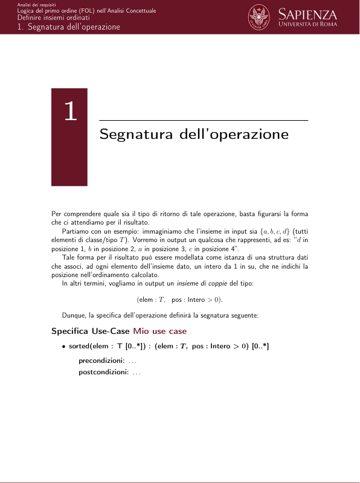
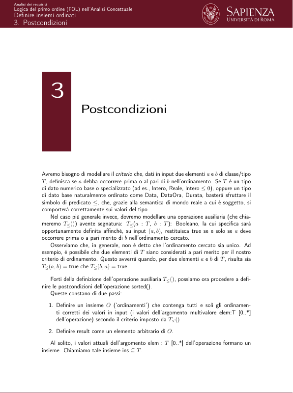
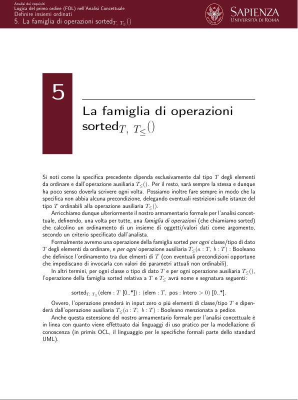

# A.4.1 - Definire insiemi ordinati

> Fonte: `Documento A.4.1 - Definire insiemi ordinati - BD2.pdf`
> Estratto con PyMuPDF (conserva legature e formule); tolte le righe ripetute di intestazione e pie' di pagina e le etichette sparse dei diagrammi, che sono ritagliati in `figure/` e richiamati nel punto in cui compaiono.

---

Documento A.4.1 (D.A.4.1)
               Analisi dei requisiti
               Logica del primo ordine (FOL) nell’Analisi
                  Concettuale
                  Definire insiemi ordinati
                                                                              Documento D.A.4.1

    Analisi dei requisiti
    Logica del primo ordine (FOL) nell’Analisi Concettuale
    Definire insiemi ordinati
              In alcuni casi, durante la fase di analisi concettuale è necessario definire un ordina-
              mento totale tra gli elementi di un insieme, in quanto tale ordinamento è concettualmente
              rilevante e non può essere ignorato.
              Ad esempio, si consideri il seguente frammento di specifica dei requisiti (dal progetto
              QuickHospital):
                   Il sistema deve permettere di calcolare, su richiesta di un medico, il suo
                   itineriario delle visite, ovvero un insieme ordinato delle stanze cui accedere
                   (che sono tutte e sole le stanze che ospitano i pazienti che ha in cura).
                   L’ordinamento è dato in primo luogo dal piano delle stanze dei pazienti
                   da visitare, ed in secondo luogo dal settore di appartenenza di tali stanze
                   (entrambi in ordine crescente). I settori sono infatti numerati secondo un
                   criterio di vicinanza topologica. Pertanto se un dato medico deve visitare
                   le stanze {(7, 4), (7, 1), (1, 3), (1, 1), (3, 4)} dove la prima componente di
                   ognuna è il piano e la seconda il settore, l’itinerario di visita proposto deve
                   essere [(1, 1), (1, 3), (3, 4), (7, 1), (7, 7)].
              In casi come questo, l’operazione di use-case modellata dall’analista deve necessa-
              riamente restituire un insieme di oggetti (di classe Stanza) ordinato secondo un certo
              criterio, pena il non soddisfacimento dei requisiti.
              In questo breve documento vedremo come le estensioni già applicate a FOL (in
              particolare teoria degli insiemi e aritmetica) di permettono di definire uno scheletro
              generale per imporre un ordinamento totale ad un insieme di oggetti di una qualche
              classe o valori di un qualche tipo di dato (ad es., composto).
              Iniziamo quindi con il vedere come si può modellare una operazione che, dato in
              input un insieme di oggetti di una certa classe (o insieme di valori di un certo tipo di
              dato) T restituisca un ordinamento totale di tali elementi.
                                               Documento D.A.4.1

    Analisi dei requisiti
    Logica del primo ordine (FOL) nell’Analisi Concettuale
    Definire insiemi ordinati
    1. Segnatura dell’operazione
                 Segnatura dell’operazione
              Per comprendere quale sia il tipo di ritorno di tale operazione, basta figurarsi la forma
              che ci attendiamo per il risultato.
              Partiamo con un esempio: immaginiamo che l’insieme in input sia {a, b, c, d} (tutti
              elementi di classe/tipo T). Vorremo in output un qualcosa che rappresenti, ad es: “d in
              posizione 1, b in posizione 2, a in posizione 3, c in posizione 4”.
              Tale forma per il risultato può essere modellata come istanza di una struttura dati
              che associ, ad ogni elemento dell’insieme dato, un intero da 1 in su, che ne indichi la
              posizione nell’ordinamento calcolato.
                 In altri termini, vogliamo in output un insieme di coppie del tipo:
                                      (elem : T,
                                      pos : Intero > 0).
                 Dunque, la specifica dell’operazione definirà la segnatura seguente:
              Specifica Use-Case Mio use case
                 • sorted(elem : T [0..*]) : (elem : T, pos : Intero > 0) [0..*]
                     precondizioni: . . .
                     postcondizioni: . . .
                                               Documento D.A.4.1

    Analisi dei requisiti
    Logica del primo ordine (FOL) nell’Analisi Concettuale
    Definire insiemi ordinati
    1. Segnatura dell’operazione
              dove abbiamo utilizzato la notazione (elem : T, pos : Intero > 0) per definire un tipo
              anonimo composto da due campi: il primo di nome elem di tipo T, ed il secondo di
              nome pos di tipo Intero > 0.
              Alternativamente possiamo definire il tipo di ritorno nel documento di specifica dei
              tipi di dato come tipo composto nel modo usuale (dandogli un nome).
                                               Documento D.A.4.1

    Analisi dei requisiti
    Logica del primo ordine (FOL) nell’Analisi Concettuale
    Definire insiemi ordinati
    2. Precondizioni
                 Precondizioni
              Nel caso tipico in cui qualunque insieme di valori per l’argomento elem in input potrà
              essere ordinato in qualunque stato del livello estensionale, la specifica dell’operazione
              non avrà alcuna precondizione.
              Altrimenti le precondizioni definiranno, al solito, le ulteriori condizioni necessarie, sui
              valori del parametro attuale (multivalore) elem e sul livello estensionale, affinché il rag-
              giungimento delle post-condizioni sia garantito. Ad esempio, le precondizioni potrebbero
              imporre che tutti i valori del parametro attuale elem abbiano valori definiti per alcuni at-
              tributi/campi (opzionali nel diagramma delle classi o nella definizione del tipo T), senza
              i quali non possono essere ordinati.
                                               Documento D.A.4.1

    Analisi dei requisiti
    Logica del primo ordine (FOL) nell’Analisi Concettuale
    Definire insiemi ordinati
    3. Postcondizioni
                 Postcondizioni
              Avremo bisogno di modellare il criterio che, dati in input due elementi a e b di classe/tipo
              T, definisca se a debba occorrere prima o al pari di b nell’ordinamento. Se T è un tipo
              di dato numerico base o specializzato (ad es., Intero, Reale, Intero ≤0), oppure un tipo
              di dato base naturalmente ordinato come Data, DataOra, Durata, basterà sfruttare il
              simbolo di predicato ≤, che, grazie alla semantica di mondo reale a cui è soggetto, si
              comporterà correttamente sui valori del tipo.
              Nel caso più generale invece, dovremo modellare una operazione ausiliaria (che chia-
              meremo T≤()) avente segnatura: T≤(a : T, b : T): Booleano, la cui specifica sarà
              opportunamente definita affinché, su input (a, b), restituisca true se e solo se a deve
              occorrere prima o a pari merito di b nell’ordinamento cercato.
              Osserviamo che, in generale, non è detto che l’ordinamento cercato sia unico. Ad
              esempio, è possibile che due elementi di T siano considerati a pari merito per il nostro
              criterio di ordinamento. Questo avverrà quando, per due elementi a e b di T, risulta sia
              T≤(a, b) = true che T≤(b, a) = true.
              Forti della definizione dell’operazione ausiliaria T≤(), possiamo ora procedere a defi-
              nire le postcondizioni dell’operazione sorted().
                 Queste constano di due passi:
                1. Definire un insieme O (‘ordinamenti’) che contenga tutti e soli gli ordinamen-
                ti corretti dei valori in input (i valori dell’argomento multivalore elem:T [0..*]
                dell’operazione) secondo il criterio imposto da T≤()
                2. Definire result come un elemento arbitrario di O.
              Al solito, i valori attuali dell’argomento elem : T [0..*] dell’operazione formano un
              insieme. Chiamiamo tale insieme ins ⊆T.
                                               Documento D.A.4.1

    Analisi dei requisiti
    Logica del primo ordine (FOL) nell’Analisi Concettuale
    Definire insiemi ordinati
    3. Postcondizioni
              L’insieme O di tutti gli ordinamenti corretti di ins sarà dunque un insieme di insiemi,
              in quanto ogni elemento di O sarà a sua volta un insieme di coppie (elem : T, pos :
              Intero > 0).
                          O = {insord | “insord è un ordinamento corretto di ins”} .
              Veniamo ai requisiti che il generico elemento insord di O deve soddisfare (requisiti da
              definire a destra del ‘tale che’).
              Ogni insord deve essere necessariamente un sottoinsieme (anche non proprio) di ins×
              1..|ins|, ovvero dell’insieme delle coppie aventi un elemento di ins come primo elemento
              ed un intero tra 1 e |ins| (la cardinalità di ins) come secondo elemento:
                                         insord ⊆ins × 1..|ins|.
                                         (3.1)
              Ma questo non basta. Difatti, un insieme insord che soddisfa la condizione qui sopra
              potrebbe non definire ordinamento totale di ins. In particolare, potrebbe non menzionare
              un certo elemento di ins, potrebbe assegnare la stessa posizione nell’ordinamento a due
              elementi diversi di ins. Infine, anche se definisse un ordinamento totale di ins, potrebbe
              violare il criterio definito da T≤().
                 Vanno quindi aggiunti i seguenti ulteriori vincoli su insord:
                1. Ogni elemento di ins deve comparire esattamente una volta in insord. Un modo
                semplice di imporre questo vincolo è di scomporlo in due parti:
                   1.1. Ogni elemento di ins compare almeno una volta in insord:
                                         ∀o o ∈S →∃i (o, i) ∈insord.
                                         (3.2)
                   1.2. Ogni elemento di ins compare al più una volta in insord:
                          ∀o o ∈S →¬∃i1, i2 i1̸ = i2 ∧(o, i1) ∈insord ∧(o, i2) ∈insord
                          (3.3)
                2. Ogni indice tra 1 e |ins| compare esattamente una volta in insord. Di nuovo, un
                modo semplice di imporre questo vincolo è di scomporlo in due parti:
                   2.1. Ogni indice i compare almeno una volta in insord:
                                ∀i (Intero(i) ∧1 ≤i ∧i ≤|ins|) →∃o (o, i) ∈insord
                                (3.4)
                   2.2. Ogni indice i compare al più una volta in insord. Questo vincolo è implicato
                   dagli altri e può quindi essere omesso, grazie al fatto che la funzione mate-
                   matica definita dal predicato insord ha dominio (ins) e codominio (interi tra
                   1 e |ins|) della stessa taglia.
              Un insieme insord sottoinsieme (anche non proprio) di ins × 1..|ins| che soddisfa i
              vincoli qui sopra definirà un ordinamento totale (o permutazione) di ins.
              Quel che ci resta da imporre ad insord è che l’ordinamento rispetti il criterio definito
              dall’operazione ausiliaria T≤():
                                               Documento D.A.4.1

    Analisi dei requisiti
    Logica del primo ordine (FOL) nell’Analisi Concettuale
    Definire insiemi ordinati
    3. Postcondizioni
                3. insord definisce un ordinamento conforme a quanto imposto da T≤():
                    ∀o1, o2, i1, i2 (o1, i1) ∈insord∧(o2, i2) ∈insord∧i1 ≤i2 →T≤(o1, o2, true) (3.5)
                   Dal punto di vista della notazione, ricordiamo che una operazione ad n argomenti
                   è formalizzata come un simbolo di predicato (formula atomica) a n+1 argomenti,
                   dove i primi n rappresentano gli input, e l’ultimo rappresenta l’output dell’opera-
                   zione. Nel caso in esame, abbiamo n = 2 e quindi il simbolo di predicato T≤/3;
                   la semantica della formula atomica T≤(o1, o1, v) è: uno dei valori restituiti da
                   T≤quando invocata su o1 ed o2 è v (per questa operazione, in realtà si tratta
                   dell’unico valore, in quanto il tipo di ritorno di T≤ha molteplicità [1..1]).
                                               Documento D.A.4.1

    Analisi dei requisiti
    Logica del primo ordine (FOL) nell’Analisi Concettuale
    Definire insiemi ordinati
    4. Specifica completa
                 Specifica completa
              La specifica completa è dunque la seguente:
              Specifica Use-Case Mio use case
                 • sorted(elem : T [0..*]) : (elem : T, pos : Intero > 0) [0..*]
                     precondizioni: nessuna (o altro, in base al caso in esame)
                     postcondizioni: Detto ins ⊆T l’insieme dei valori attuali dell’argomento
                       elem, sia:
                                O = {insord | insord ⊆ins × 1..|ins| ∧da (3.2) a (3.5)}
                       result è (un qualunque assegnamento) tale da soddisfare la formula:
                                                  result ∈O.
                                               Documento D.A.4.1

    Analisi dei requisiti
    Logica del primo ordine (FOL) nell’Analisi Concettuale
    Definire insiemi ordinati
    5. La famiglia di operazioni sortedT, T≤()
                 La famiglia di operazioni
                 sortedT, T≤()
              Si noti come la specifica precedente dipenda esclusivamente dal tipo T degli elementi
              da ordinare e dall’operazione ausiliaria T≤(). Per il resto, sarà sempre la stessa e dunque
              ha poco senso doverla scrivere ogni volta. Possiamo inoltre fare sempre in modo che la
              specifica non abbia alcuna precondizione, delegando eventuali restrizioni sulle istanze del
              tipo T ordinabili alla operazione ausiliaria T≤().
              Arricchiamo dunque ulteriormente il nostro armamentario formale per l’analisi concet-
              tuale, definendo, una volta per tutte, una famiglia di operazioni (che chiamiamo sorted)
              che calcolino un ordinamento di un insieme di oggetti/valori dati come argomento,
              secondo un criterio specificato dall’analista.
              Formalmente avremo una operazione della famiglia sorted per ogni classe/tipo di dato
              T degli elementi da ordinare, e per ogni operazione ausiliaria T≤(a : T, b : T) : Booleano
              che definisce l’ordinamento tra due elmenti di T (con eventuali precondizioni opportune
              che impediscano di invocarla con valori dei parametri attuali non ordinabili).
              In altri termini, per ogni classe o tipo di dato T e per ogni operazione ausiliaria T≤(),
              l’operazione della famiglia sorted relativa a T e T≤avrà nome e segnatura seguenti:
                        sortedT, T≤(elem : T [0..*]) : (elem : T, pos : Intero > 0) [0..*].
              Ovvero, l’operazione prenderà in input zero o più elementi di classe/tipo T e dipen-
              derà dall’operazione ausiliaria T≤(a : T, b : T) : Booleano menzionata a pedice.
              Anche questa estensione del nostro armamentario formale per l’analisi concettuale è
              in linea con quanto viene effettuato dai linguaggi di uso pratico per la modellazione di
              conoscenza (in primis OCL, il linguaggio per le specifiche formali parte dello standard
              UML).
                                               Documento D.A.4.1

