# B.1 - Progettazione - Introduzione e modello relazionale

> Fonte: `Slide B.1 - Progettazione - Introduzione e modello relazionale - BD2.pdf`
> Estratto con PyMuPDF (conserva legature e formule); tolte le righe ripetute di intestazione e pie' di pagina e le etichette sparse dei diagrammi, che sono ritagliati in `figure/` e richiamati nel punto in cui compaiono.

---

Parte: Basi di dati
                              UNITÀ:  B.1
                                                         Basi di dati
                                                         Progettazione della base dati e delle
                                                    funzionalità
                                                    Introduzione e modello relazionale
                 Versione del 2024-04-23

                       Parte: Basi di dati
                              UNITÀ:  B.1
                                                    Basi di dati
                                                    Progettazione della base dati e delle funzionalità
                                                     Introduzione e modello relazionale
                                                        La fase di progettazione
                 Versione del 2024-04-23

                                 Fase di progettazione
  Input della fase di progettazione:
  Schema concettuale dell’applicazione, output della Fase di Analisi. Consiste in:
  •
  I diagrammi UML
  •
  Le specifiche dei tipi di dato, delle classi, degli use case, e dei vincoli esterni
                                      Schema concettuale (UML + specifiche)
                               Analisi dei requisiti
                                                                             Progetto
                   Requisiti
                                         _____
                                         _____
                                         _____
                                         _____
                                         _____
                                                 _____
                                                 _____
                                                 _____
                                                 _____
                                                 _____
                                                         _____
                                                         _____
                                                         _____
                                                         _____
                                                         _____
                                                                 _____
                                                                 _____
                                                                 _____
                                                                 _____
                                                                 _____
                                          _____
                                          _____
                                          _____
                                          _____
                                          _____
                                                  _____
                                                  _____
                                                  _____
                                                  _____
                                                  _____
                                                          _____
                                                          _____
                                                          _____
                                                          _____
                                                          _____
                                                                  _____
                                                                  _____
                                                                  _____
                                                                  _____
                                                                  _____
                                          _____
                                          _____
                                          _____
                                          _____
                                          _____
                                                  _____
                                                  _____
                                                  _____
                                                  _____
                                                  _____
                                                          _____
                                                          _____
                                                          _____
                                                          _____
                                                          _____
                                                                  _____
                                                                  _____
                                                                  _____
                                                                  _____
                                                                  _____
                                           _____
                                           _____
                                           _____
                                           _____
                                           _____
                                                   _____
                                                   _____
                                                   _____
                                                   _____
                                                   _____
                                                           _____
                                                           _____
                                                           _____
                                                           _____
                                                           _____
                                                                   _____
                                                                   _____
                                                                   _____
                                                                   _____
                                                                   _____

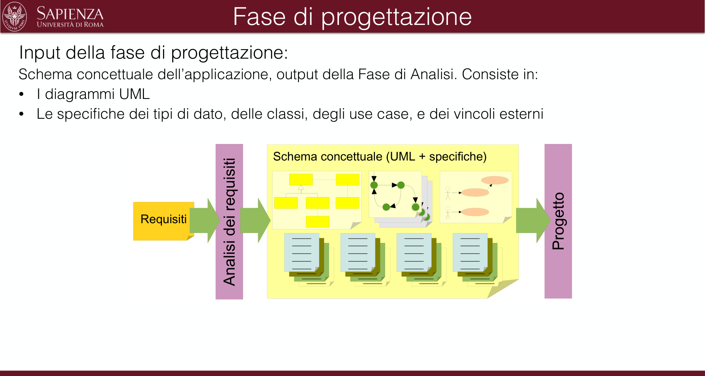

                           Fase di progettazione (cont.)
  Output della fase di progettazione:
  Documenti di progetto per realizzare l’applicazione mediante una particolare tecnologia
  •
  Obiettivo: prendere decisioni fondamentali su:
    •
    linguaggi di programmazione
    •
    tecnologia e strutture per la memorizzazione dei dati
    •
    architettura dell’applicazione
    •
    algoritmi per realizzare le funzionalità
    •
    ...
  •
  Concentrarsi su come realizzare l’applicazione (la fase di Analisi si è concentrata su cosa)
                                    Progetto della base dati
                                                                 DBMS
                                                          Realizzazione
                                                                  BD
                           Progetto
                                                                Applicazione
                                   Progetto delle funzionalità

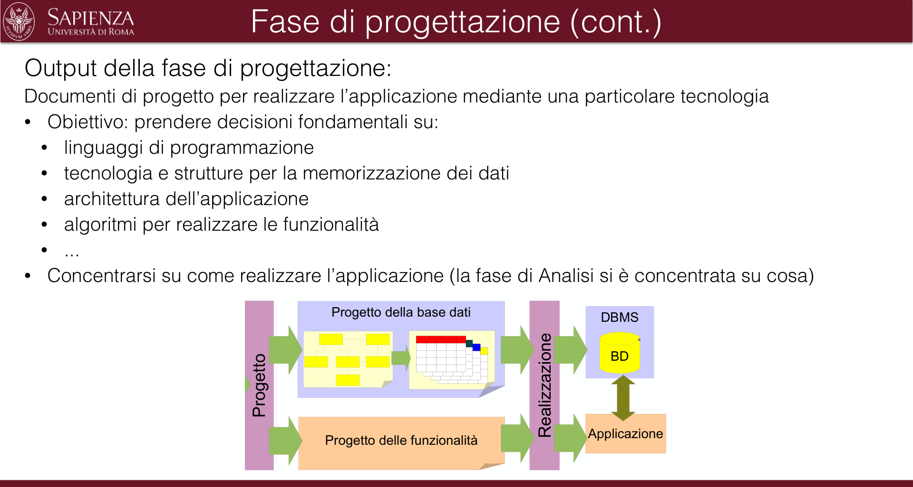

                         La fase di progettazione (cont.)
  •
  In questo insegnamento:
    •
    Progettazione della base dati relazionale per consentire la memorizzazione persistente dei dati
    di interesse (come definiti nel diagramma delle classi)
  •
  In altri insegnarenti:
    •
    Progettazione del sistema in termini di:
      •
      Applicazione in-cloud che interagisce con la base dati (back-end)
      •
      Applicazione di front-end che interagisce con l’utente (in browser web/smartphone) e dialoga
      con il back-end

                       Parte: Basi di dati
                              UNITÀ:  B.1
                                                    Basi di dati
                                                    Progettazione della base dati e delle funzionalità
                                                     Introduzione e modello relazionale
                                                              DBMS relazionali
                 Versione del 2024-04-23

                  DataBase Management System (DBMS)
  •
  In linea di principio, potremmo progettare l’applicazione di modo che salvi oggetti e link in opportuni file sul file system
    •
    Problemi:
      •
      file diversi possono essere creati, cancellati e modificati indipendentemente l’uno dall’altro
      —> questo può creare incoerenze rispetto alle informazioni che il contenuto dei file rappresentano
      •
      processi diversi (ad es. funzionalità del sistema invocate contemporaneamente —in concorrenza— da più attori)
      potrebbero effettuare modifiche sui dati in conflitto le une con le altre
      •
      …
   DataBase Management System (DBMS)
      •
      Sistema software che gestisce una collezione di dati (anche di grandissime dimensioni) su memoria di massa,
      garantendo:
        •
        accesso e condivisione dei dati controllati, granulari, e disciplinati (utenti, gruppi, privilegi)
        •
        supporto all’esecuzione concorrente delle letture e scritture (transazioni), anche da parte di applicazioni diverse
        •
        persistenza dei dati memorizzati
        •
        meccanismi sofisticati per l’interrogazione e manipolazione efficiente dei dati
        •
        metadati (dati che descrivono la struttura dei dati memorizzati)
        •
        possibilità di memorizzazione distribuita e/o replicata dei dati
        •
        enorme semplificazione del lavoro dei progettisti e degli sviluppatori (che non devono implementare le funzionalità
        offerte dal DBMS)
        •
        standardizzazione dell’utilizzo (API e linguaggi di interrogazione e manipolazione) dei DBMS, rendendo “semplice”
        la sostituzione del DBMS usato da un sistema esistente

                       Parte: Basi di dati
                              UNITÀ:  B.1
                                                    Basi di dati
                                                    Progettazione della base dati e delle funzionalità
                                                     Introduzione e modello relazionale
                                                     Il modello relazionale dei dati
                 Versione del 2024-04-23

               Modello relazionale dei dati e DBMS relazionali
  •
  I DBMS si distinguono per la tipologia di modello dei dati che offrono:
    •
    DBMS relazionali (oggetto di questa unità)
    •
    DBMS a grafo, chiave/valore, etc. (oggetto di altre unità)
   Modello relazionale dei dati
   I dati sono organizzati in tabelle (ognuna con nome e insieme di attributi:tipo)
   Esempio: Questo DB rappresenta dati su moduli didattici e loro aule e docenti
                                                                                 Schema del DB
                                                                                 (livello intensionale)
                                                                                 Schema del DB
                                                                                 (livello intensionale)
                                                                                 Schema del DB
                                                                                 (livello intensionale)
                    Modulo
                                                         Aula
                                                                                  Docente
  codice
  :string
  nome:string
  crediti
                                aula
                                    docente
                                              codice
                                                       nome

                                                       :string
                                                                indirizzo
                                                                          codice
                                                                                 nome:
                                                                                        cognome:
                           :int
                                :int
                                      :int
                                                :int
                                                                :string
                                                                            :int
                                                                                 string
                                                                                          string
  prog
  Progettazione
  python Programm. Python
  java
  Programm. Java
  ds
  Data science
                                               Aula Rossa
                                               via …
                                               Aula Gialla piazza …
                                               Aula Verde
                                               via …
                                               Aula Blu
                                               piazza …
                                                                           Alice
                                                                           Bianchi
                                                                           Biagio
                                                                           Rossi
                                                                           Carla
                                                                           Neri
                                                                           Daniele
                                                                           Verdi
                                                          Contenuto del DB
                                                          (livello estensionale)
                                                          Contenuto del DB
                                                          (livello estensionale)
                                                          Contenuto del DB
                                                          (livello estensionale)

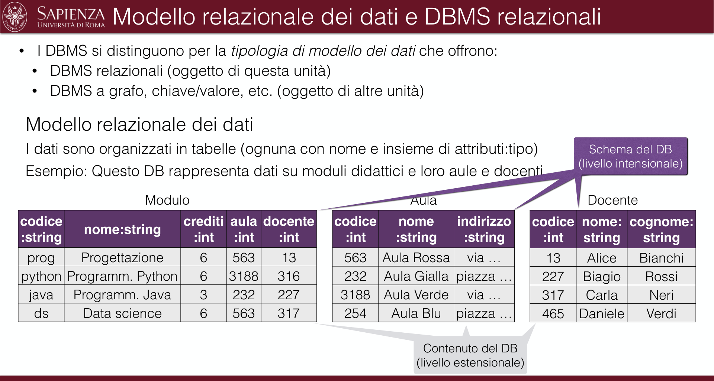

               Modello relazionale dei dati e DBMS relazionali
  •
  I DBMS si distinguono per la tipologia di modello dei dati che offrono:
    •
    DBMS relazionali (oggetto di questa unità)
    •
    DBMS a grafo, chiave/valore, etc. (oggetto di altre unità)
   Modello relazionale dei dati
   I dati sono organizzati in tabelle (ognuna con nome e insieme di attributi:tipo)
   Esempio: Questo DB rappresenta dati su moduli didattici e loro aule e docenti
                                                                                 Schema del DB
                                                                                 (livello intensionale)
                                                                                 Schema del DB
                                                                                 (livello intensionale)
                                                                                 Schema del DB
                                                                                 (livello intensionale)
                    Modulo
                                                         Aula
                                                                                  Docente
  codice
  :string
  nome:string
  crediti
                                aula
                                    docente
                                              codice
                                                       nome

                                                       :string
                                                                indirizzo
                                                                          codice
                                                                                 nome:
                                                                                        cognome:
                           :int
                                :int
                                      :int
                                                :int
                                                                :string
                                                                            :int
                                                                                 string
                                                                                          string
  prog
  Progettazione
  python Programm. Python
  java
  Programm. Java
  ds
  Data science
                                               Aula Rossa
                                               via …
                                               Aula Gialla piazza …
                                               Aula Verde
                                               via …
                                               Aula Blu
                                               piazza …
                                                                           Alice
                                                                           Bianchi
                                                                           Biagio
                                                                           Rossi
                                                                           Carla
                                                                           Neri
                                                                           Daniele
                                                                           Verdi
                                                          Contenuto del DB
                                                          (livello estensionale)
                                                          Contenuto del DB
                                                          (livello estensionale)
                                                          Contenuto del DB
                                                          (livello estensionale)

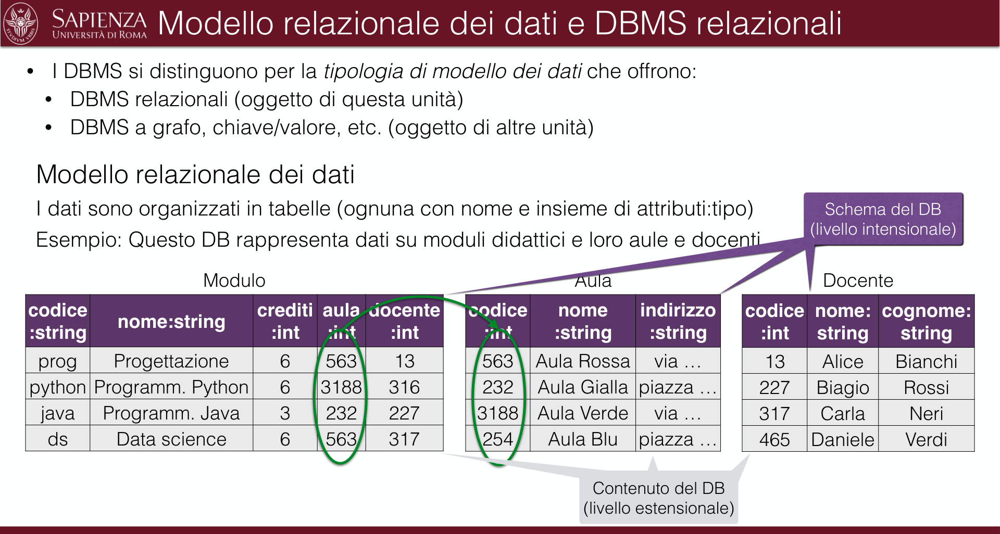

               Modello relazionale dei dati e DBMS relazionali
  •
  I DBMS si distinguono per la tipologia di modello dei dati che offrono:
    •
    DBMS relazionali (oggetto di questa unità)
    •
    DBMS a grafo, chiave/valore, etc. (oggetto di altre unità)
   Modello relazionale dei dati
   I dati sono organizzati in tabelle (ognuna con nome e insieme di attributi:tipo)
   Esempio: Questo DB rappresenta dati su moduli didattici e loro aule e docenti
                                                                                 Schema del DB
                                                                                 (livello intensionale)
                                                                                 Schema del DB
                                                                                 (livello intensionale)
                                                                                 Schema del DB
                                                                                 (livello intensionale)
                    Modulo
                                                         Aula
                                                                                  Docente
  codice
  :string
  nome:string
  crediti
                                aula
                                    docente
                                              codice
                                                       nome

                                                       :string
                                                                indirizzo
                                                                          codice
                                                                                 nome:
                                                                                        cognome:
                           :int
                                :int
                                      :int
                                                :int
                                                                :string
                                                                            :int
                                                                                 string
                                                                                          string
  prog
  Progettazione
  python Programm. Python
  java
  Programm. Java
  ds
  Data science
                                               Aula Rossa
                                               via …
                                               Aula Gialla piazza …
                                               Aula Verde
                                               via …
                                               Aula Blu
                                               piazza …
                                                                           Alice
                                                                           Bianchi
                                                                           Biagio
                                                                           Rossi
                                                                           Carla
                                                                           Neri
                                                                           Daniele
                                                                           Verdi
                                                          Contenuto del DB
                                                          (livello estensionale)
                                                          Contenuto del DB
                                                          (livello estensionale)
                                                          Contenuto del DB
                                                          (livello estensionale)

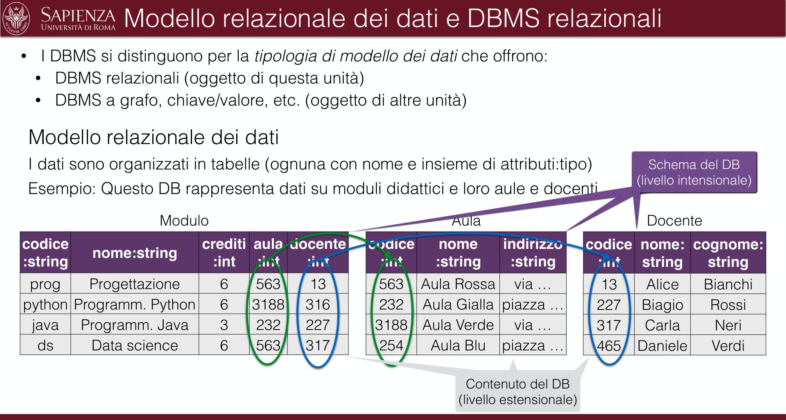

                            Modello relazionale dei dati
                 Attributo o
                 colonna (in inglese:
                  column), o campo
                                              Modulo
  Tipo dell’attributo, tra quelli
                             codice
                             :string
                             nome:string
                             crediti
                                                          aula
                                                               docente
  supportati dal DBMS: int,
  real, double, boolean, etc.
                                                     :int
                                                           :int
                                                                 :int
                             prog
                             Progettazione
                             python Programm. Python
                             java
                             Programm. Java
                             ds
                             Data science
                                                                         Ennupla (in inglese: tuple),
                                                                           o riga (row), o record
                                                                               Aula
                  I valori fungono anche da “riferimenti a” o
                  “collegamenti” (bidirezionali!) tra ennuple di
                  tabelle diverse.
                                                                    codice
                                                                             nome

                                                                             :string
                                                                                      indirizzo
                                                                      :int
                                                                                      :string
                                                                       Aula Rossa
                                                                       via …
                                                                       Aula Gialla piazza …
                                                                       Aula Verde
                                                                       via …
                                                                       Aula Blu
                                                                       piazza …
                  Vantaggi:
                  - I dati sono intellegibili
                  - I dati sono navigabili
                  - I dati sono portabili
S.B.1. 10

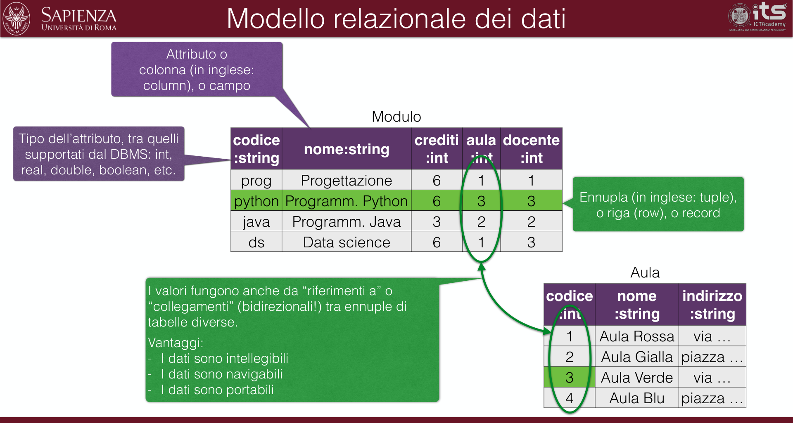

                Modello relazionale dei dati: informazione incompleta
  •
  Il modello relazionale impone ai dati una struttura rigida:
  i dati sono rappresentati per mezzo di ennuple
  •
  Le ennuple ammesse sono dettate dagli schemi di relazione
  •
  Alcuni dati potrebbero non essere disponibili, per varie ragioni. Esempio:
                                     Docente
               codice

                         nome

                         :string
                                cognome

                                                   email

                                                   :string
                                                                               Dato mancante:
                 :int
                                 :string
                                                                          Cosa significa?
                                                                          Come viene rappresentato?
                  Alice
                  Bianchi
                  alice.bianchi@yahuu.com
                  Biagio
                  Rossi
                  biagio.rossi@yourmail.com
                  Carla
                  Neri
                  Daniele
                  Verdi
                  dani2001@kmail.com
                                                                        Possibili significati:
                                                                        1. sconosciuto
                                                                        2. inesistente
                                                                        3. sconosciuto o inesist.
  I DBMS permettono di assegnare attributi di ennuple al valore
  speciale NULL, con il significato 3.
  Se si vuole distinguere tra 1. o 2. bisogna farlo esplicitamente, ad
  es., aggiungendo nuovi attributi che “spieghino” il significato di
  NULL. Ad es., nuovo attributo ragione_assenza_email:int

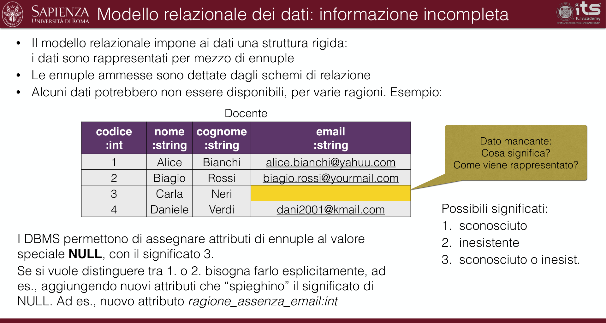

                                    Vincoli di integrità
  •
  Un DB può avere contenuti che, sebbene strutturalmente corretti, non dovrebbero essere
  ammessi, in quanto non modellano correttamente i requisiti
  Esempio:
               Studente
                                          Modulo
                                                                         Esame
                                 codice
                                                           studente

                                                                    modulo

                                                                            voto

                                                                                  lode

                                                                                  :booleano
       codice
              nome:
                     cognome:
                                 :string
                                 nome:string
                                                              :int
                                                                     :string
                                                                             :int
         :int
               string
                       string
                                 prog
                                 Progettazione
                                 python Programm. Python
          Alice
          Bianchi
          Biagio
          Rossi
          Carla
          Neri
          Daniele
          Verdi
                                                             prog
                                                             FALSE
                                                             cucina
                                                             TRUE
                                                             java
                                                             FALSE
                                                             NULL
                                                             ds
                                                             TRUE
                                                             ballo
                                                             -50
                                                             TRUE
                                                             NULL
                                                             TRUE
                                   java
                                   Programm. Java
                                   ds
                                   Data science

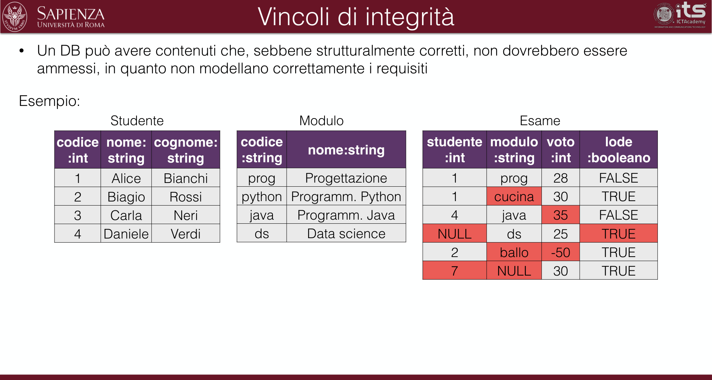

                              Vincoli di integrità (cont.)
  Definizione:
  •
  Proprietà che deve essere soddisfatta dal contenuto delle tabelle del DB affinché rappresentino
  informazioni corrette per l’applicazione
  •
  Ad uno schema di base di dati associamo un insieme di vincoli di integrità e consideriamo legali
  solo i DB che li soddisfano tutti.
  •
  I DBMS permettono di definire vincoli:
    •
    intra-tabella (che coinvolgono una sola tabella)
    •
    inter-tabella (che coinvolgono più tabelle)

                    Vincoli intra-tabella: vincoli di ennupla
  Vincoli di ennupla (vincoli sulle “righe”)
  Esprimono condizioni sui valori di ciascuna ennupla di una tabella, indipendentemente dalle altre
  ennuple
  Esempio:
                                                                         Esame
  • voto >= 18 and voto <= 30
                                                            studente

                                                                    modulo

                                                                            voto

                                                                                  lode

                                                                                  :booleano
                                                              :int
                                                                     :string
                                                                             :int
  • if lode = TRUE then voto = 30

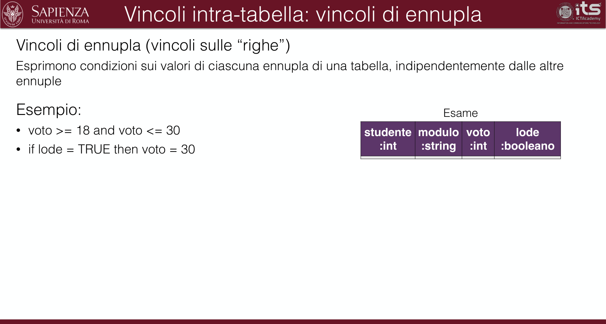

                     Vincoli intra-tabella: vincoli di chiave
  Vincoli di chiave (vincoli sulle “colonne”)
  Dichiarano che non possono esistere più ennuple della stessa tabella che coincidono sul valore di
  uno o più attributi
  Esempio:
                                                                         Studente
  • non esistono due studenti con la stessa matricola
                                                            matricola

                                                                     nome

                                                                     :stringa
                                                                             cognome

                                                                                      nascita

                                                            :stringa
                                                                             :stringa
                                                                                       :date
  • non esistono due studenti che hanno gli stessi valori
  per {nome, cognome, nascita}
  (hanno gli stessi valori su tutti e tre questi attributi)
  Attenzione: il secondo è solo un semplice esempio,
  questo è falso in realtà
  Chiave di una tabella
  Un insieme K di uno o più attributi tali che:
  • non possono esistere due ennuple che coincidono su tutti tali attributi
  • se togliessimo da K un qualunque attributo, i restanti non formerebbero più una chiave

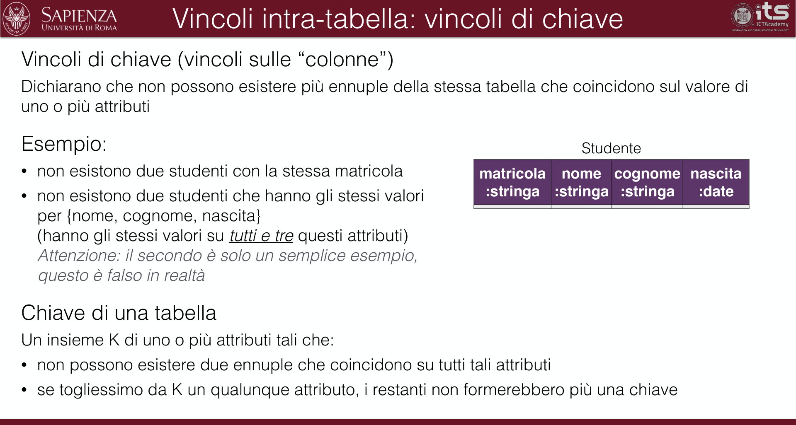

                Vincoli intra-tabella: vincoli di chiave (cont.)
  Chiavi e valori NULL
  In presenza di valori NULL, i valori degli attributi che formano una chiave di una tabella:
  • non permettono di identificare univocamente le ennuple della tabella
  • non permettono di realizzare facilmente i riferimenti con dati di altre tabelle
                                                                              Esame
                  Studente
                                                Modulo
                                                                 studente

                                                                          modulo

                                                                          :stringa
                                                                                  voto

                                                                                        lode

                                                                                        :booleano
                                        codice:
       codice

             nome

             :stringa
                     cognome

                              nascita

                                        stringa
                                        nome:stringa
                                                                    :int
                                                                                  :int
        :int
                      :stringa
                               :data
                                         prog
                                         Progettazione
                                         NULL
                                         Programm. Python
                                         java
                                         Programm. Java
                                         NULL
                                         Data science
                                                                   prog
                                                                   FALSE
                                                                   NULL
                                                                   TRUE
                                                                   java
                                                                   FALSE
                                                                   NULL
                                                                   ds
                                                                   FALSE
                                                                   ballo
                                                                   FALSE
                                                                   NULL
                                                                   NULL
                                                                   FALSE
       Alice
       Bianchi
       3/4/200
       NULL
       Biagio
       Rossi
       8/3/200
       Carla
       Neri
       NULL
       NULL
       Daniele
       Verdi
       7/1/200
  Chiavi primarie
  • Tra le chiavi di una tabella, se ne sceglie una, la chiave primaria
  • Gli attributi della chiave primaria non possono avere valori NULL
  • Gli attributi della chiave primaria di una tabella sono indicati sottolineati

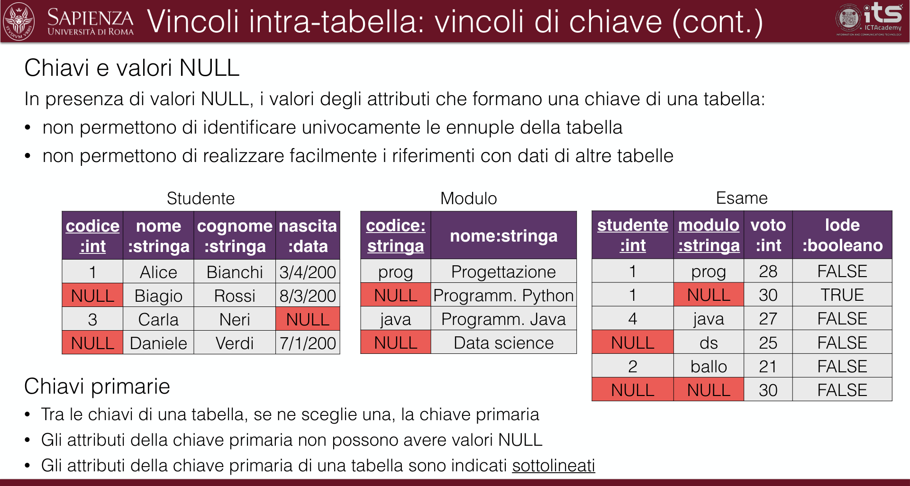

                  Vincoli inter-tabella: vincoli di foreign key
  Dati in tabelle diverse sono correlati attraverso valori comuni, in particolare, attraverso valori delle
  chiavi (di solito primarie)
  Vincolo di foreign key (o di integrità referenziale)
  Da insieme di attributi A in tabella T1 verso tutti gli attributi di una chiave K di tabella T2:
                                      T1(A) references T2(K)
  Tutti i valori di T1(A) devono occorrere come valori della chiave K in una ennupla di T2
                                 Modulo
                                                                      Aula
               codice
               :string
               nome:string
               crediti
                                             aula
                                                 docente
                                                           codice
                                                                    nome
                                                                    :string
                                                                            indirizzo
                                       :int
                                             :int
                                                   :int
                                                            :int
                                                                             :string
               prog
               Progettazione
               python Programm. Python
               java
               Programm. Java
               ds
               Data science
                                                             Aula Rossa
                                                             via …
                                                             Aula Gialla piazza …
                                                             Aula Verde
                                                             via …
                                                             Aula Blu
                                                             piazza …
                                                                               {codice} deve essere una
                                                                               chiave di Aula, così che
                                                                               l’ennupla corrispondente
                              foreign key: Modulo(aula) references Aula(codice)
                                                                                   sia al più una!

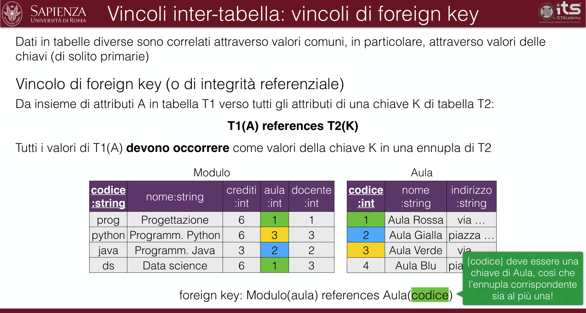

                  Vincoli inter-tabella: vincoli di foreign key
  Dati in tabelle diverse sono correlati attraverso valori comuni, in particolare, attraverso valori delle
  chiavi (di solito primarie)
  Vincolo di foreign key (o di integrità referenziale)
  Da insieme di attributi A in tabella T1 verso tutti gli attributi di una chiave K di tabella T2:
                                      T1(A) references T2(K)
  Tutti i valori di T1(A) devono occorrere come valori della chiave K in una ennupla di T2
                                 Modulo
                                                                      Aula
               codice
               :string
               nome:string
               crediti
                                             aula
                                                 docente
                                                           codice
                                                                    nome
                                                                    :string
                                                                            indirizzo
                                       :int
                                             :int
                                                   :int
                                                            :int
                                                                             :string
               prog
               Progettazione
               python Programm. Python
               java
               Programm. Java
               ds
               Data science
                                                             Aula Rossa
                                                             via …
                                                             Aula Gialla piazza …
                                                             Aula Verde
                                                             via …
                                                             Aula Blu
                                                             piazza …
                                                                               {codice} deve essere una
                                                                               chiave di Aula, così che
                                                                               l’ennupla corrispondente
                              foreign key: Modulo(aula) references Aula(codice)
                                                                                   sia al più una!

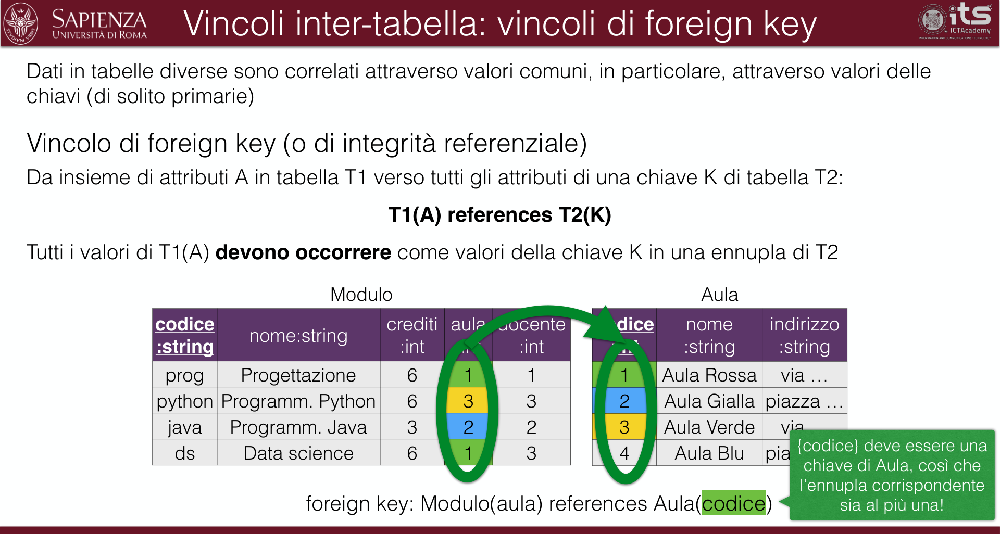

               Vincoli inter-tabella: vincoli di foreign key (cont.)
  •
  Esempio:
        FK: Riparazione(officina) ref. Officina(nome)
        FK: Riparazione(veicolo) ref. Veicolo(targa)
        FK: RicambioRip(officina, rip) ref.
                                                              Riparazione(officina, codice)

               Vincoli inter-tabella: vincoli di foreign key (cont.)
  •
  Esempio:
        FK: Riparazione(officina) ref. Officina(nome)
        FK: Riparazione(veicolo) ref. Veicolo(targa)
        FK: RicambioRip(officina, rip) ref.
                                                              Riparazione(officina, codice)

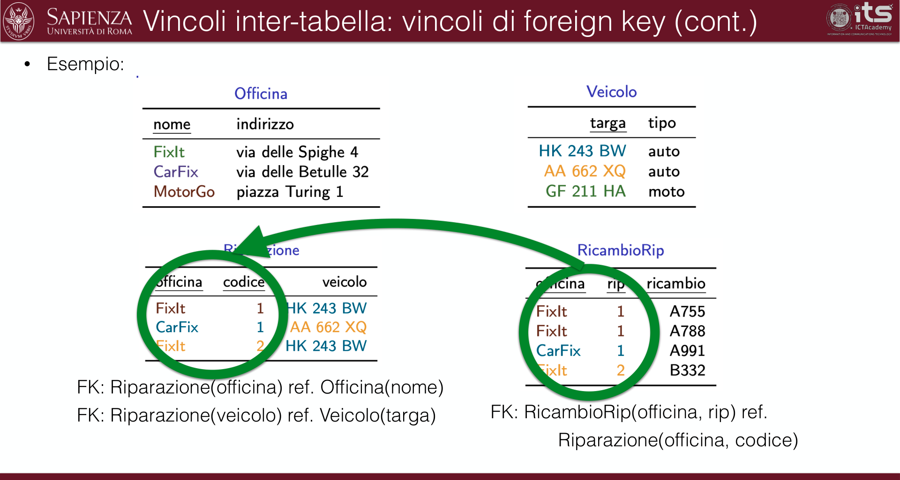

               Vincoli inter-tabella: vincoli di foreign key (cont.)
  Che succede se si tenta di effettuare una modifica al DB che violerebbe un vincolo di foreign key?
  Esempio 1
           FK: Riparazione(officina) ref. Officina(nome)
           FK: Riparazione(veicolo) ref. Veicolo(targa)
   Tentativo: modificare l’ennupla (AA 662 XQ, auto) nella tabella Veicolo in ( ZZ 111 ZZ, auto)
    —> Il DB rileva che la modifica violerebbe il vincolo di FK (perché (CarFix, 1) non è chiave in Riparazione)
    —> Il DB rifiuta l’operazione, mantenendo il vincolo soddisfatto

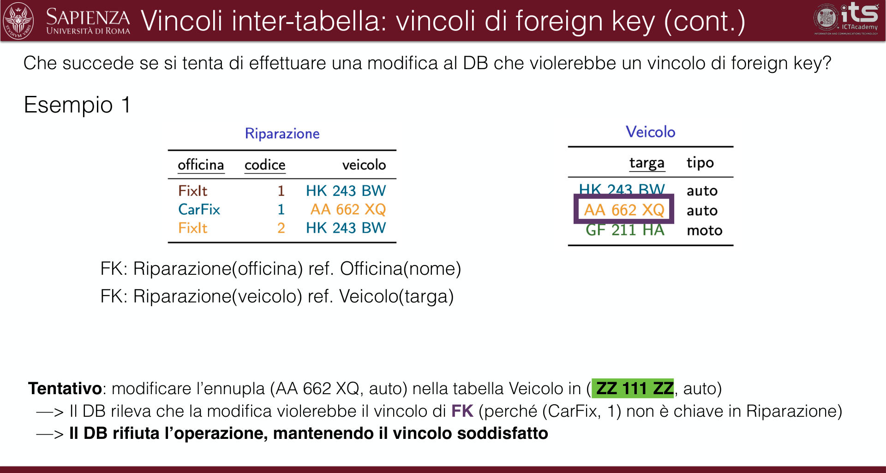

               Vincoli inter-tabella: vincoli di foreign key (cont.)
  Che succede se si tenta di effettuare una modifica al DB che violerebbe un vincolo di foreign key?
  Esempio 1
                                                                 ZZ 111 ZZ
           FK: Riparazione(officina) ref. Officina(nome)
           FK: Riparazione(veicolo) ref. Veicolo(targa)
   Tentativo: modificare l’ennupla (AA 662 XQ, auto) nella tabella Veicolo in ( ZZ 111 ZZ, auto)
    —> Il DB rileva che la modifica violerebbe il vincolo di FK (perché (CarFix, 1) non è chiave in Riparazione)
    —> Il DB rifiuta l’operazione, mantenendo il vincolo soddisfatto

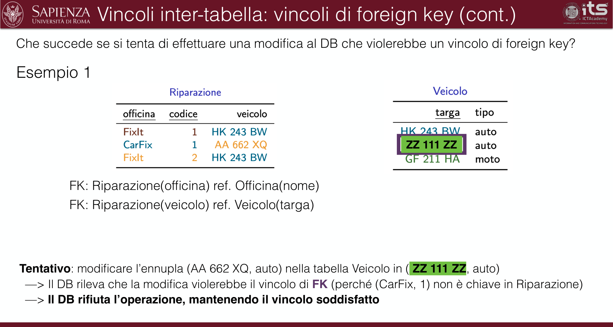

               Vincoli inter-tabella: vincoli di foreign key (cont.)
  Che succede se si tenta di effettuare una modifica al DB che violerebbe un vincolo di foreign key?
  Esempio 1
                                                                 ZZ 111 ZZ
           FK: Riparazione(officina) ref. Officina(nome)
           FK: Riparazione(veicolo) ref. Veicolo(targa)
   Tentativo: modificare l’ennupla (AA 662 XQ, auto) nella tabella Veicolo in ( ZZ 111 ZZ, auto)
    —> Il DB rileva che la modifica violerebbe il vincolo di FK (perché (CarFix, 1) non è chiave in Riparazione)
    —> Il DB rifiuta l’operazione, mantenendo il vincolo soddisfatto

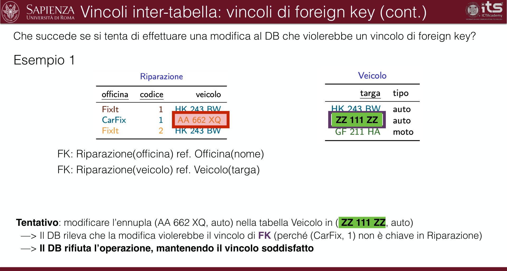

               Vincoli inter-tabella: vincoli di foreign key (cont.)
  Che succede se si tenta di effettuare una modifica al DB che violerebbe un vincolo di foreign key?
  Esempio 2
         FK: Riparazione(officina) ref. Officina(nome)
         FK: Riparazione(veicolo) ref. Veicolo(targa)
         FK: RicambioRip(officina, rip) ref.
                                                               Riparazione(officina, codice)
   Tentativo: modificare l’ennupla (CarFix, 1, AA 662 XQ) nella tabella Riparazione in (CarFix, 2, AA 662 XQ)
    —> Il DB rileva che la modifica violerebbe il vincolo di FK (perché esiste una ennupla in RicambioRip che violerebbe
    il vincolo)
    —> Il DB rifiuta l’operazione, mantenendo il vincolo soddisfatto

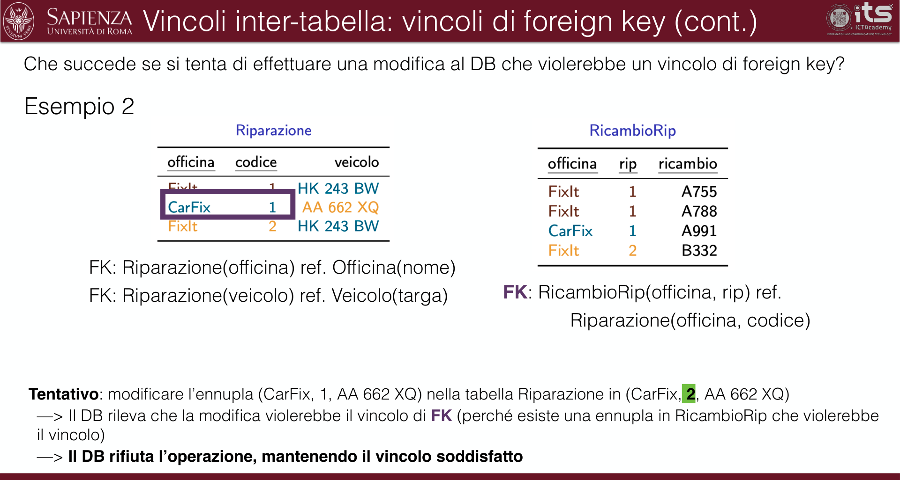

               Vincoli inter-tabella: vincoli di foreign key (cont.)
  Che succede se si tenta di effettuare una modifica al DB che violerebbe un vincolo di foreign key?
  Esempio 2
         FK: Riparazione(officina) ref. Officina(nome)
         FK: Riparazione(veicolo) ref. Veicolo(targa)
         FK: RicambioRip(officina, rip) ref.
                                                               Riparazione(officina, codice)
   Tentativo: modificare l’ennupla (CarFix, 1, AA 662 XQ) nella tabella Riparazione in (CarFix, 2, AA 662 XQ)
    —> Il DB rileva che la modifica violerebbe il vincolo di FK (perché esiste una ennupla in RicambioRip che violerebbe
    il vincolo)
    —> Il DB rifiuta l’operazione, mantenendo il vincolo soddisfatto

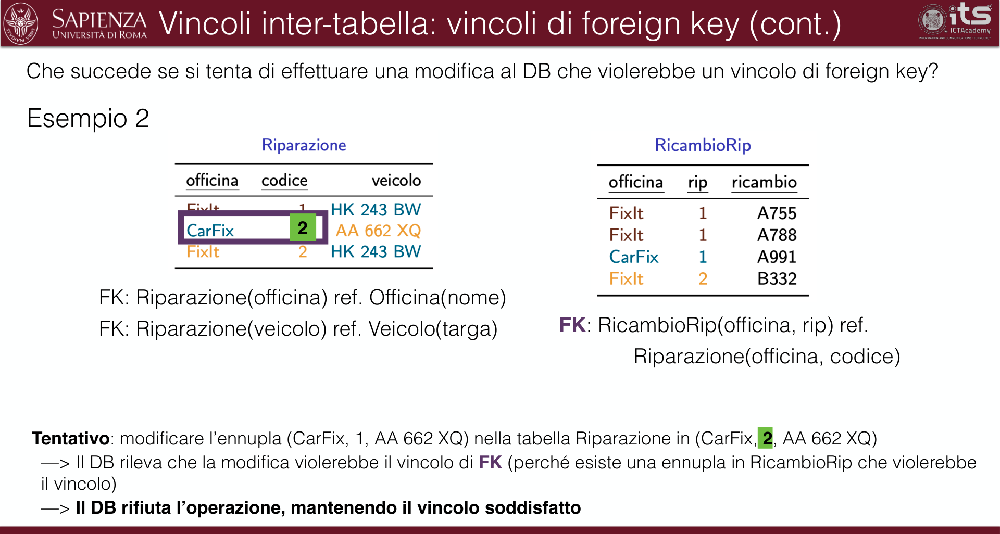

               Vincoli inter-tabella: vincoli di foreign key (cont.)
  Che succede se si tenta di effettuare una modifica al DB che violerebbe un vincolo di foreign key?
  Esempio 3
         FK: Riparazione(officina) ref. Officina(nome)
         FK: Riparazione(veicolo) ref. Veicolo(targa)
         FK: RicambioRip(officina, rip) ref.
                                                               Riparazione(officina, codice)
   Tentativo: cancellare l’ennupla (CarFix, 1, AA 662 XQ) nella tabella Riparazione
    —> Il DB rileva che la modifica violerebbe il vincolo di FK (perché esiste una ennupla in
    RicambioRip che violerebbe il vincolo)
    —> Il DB rifiuta l’operazione, mantenendo il vincolo soddisfatto

               Vincoli inter-tabella: vincoli di foreign key (cont.)
  Dunque: in caso di modifiche che violerebbero un vincolo di FK, per default il DBMS rifiuta l’operazione
  Il progettista del DB può modificare questo comportamento di default, scegliendo un’azione compensativa
  Esempio 4: cancellazione e riparazione delle ennuple orfane con valori NULL
         FK: Riparazione(officina) ref. Officina(nome)
         FK: Riparazione(veicolo) ref. Veicolo(targa)
                                                        FK: RicambioRip(officina, rip) ref.
                                                             Riparazione ON DELETE SET NULL
                                                               (officina, codice)
   Tentativo: cancellare l’ennupla (CarFix, 1, AA 662 XQ) nella tabella Riparazione
    —> Il DBMS rileva che la modifica violerebbe il vincolo di FK (perché esiste una ennupla in RicambioRip che violerebbe il vincolo)
    —> Il DBMS modifica la ennupla problematica di RicambioRip in (NULL, NULL, A991), mantenendo il vincolo soddisfatto

    —> in questo caso, essendo questi attributi parte della chiave primaria, il DBMS non può lasciare la situazione così, ed è
    costretto ad annullare tutte le modifiche.

               Vincoli inter-tabella: vincoli di foreign key (cont.)
  Dunque: in caso di modifiche che violerebbero un vincolo di FK, per default il DBMS rifiuta l’operazione
  Il progettista del DB può modificare questo comportamento di default, scegliendo un’azione compensativa
  Esempio 4: cancellazione e riparazione delle ennuple orfane con valori NULL
                                                            NULL     NULL
         FK: Riparazione(officina) ref. Officina(nome)
         FK: Riparazione(veicolo) ref. Veicolo(targa)
                                                        FK: RicambioRip(officina, rip) ref.
                                                             Riparazione ON DELETE SET NULL
                                                               (officina, codice)
   Tentativo: cancellare l’ennupla (CarFix, 1, AA 662 XQ) nella tabella Riparazione
    —> Il DBMS rileva che la modifica violerebbe il vincolo di FK (perché esiste una ennupla in RicambioRip che violerebbe il vincolo)
    —> Il DBMS modifica la ennupla problematica di RicambioRip in (NULL, NULL, A991), mantenendo il vincolo soddisfatto

    —> in questo caso, essendo questi attributi parte della chiave primaria, il DBMS non può lasciare la situazione così, ed è
    costretto ad annullare tutte le modifiche.

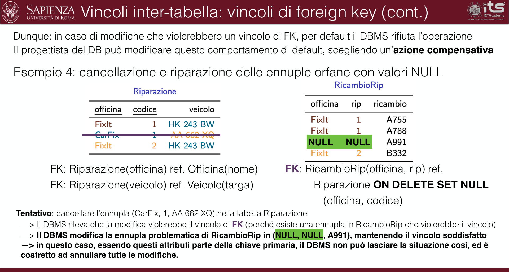

               Vincoli inter-tabella: vincoli di foreign key (cont.)
  Dunque: in caso di modifiche che violerebbero un vincolo di FK, per default il DBMS rifiuta l’operazione
  Il progettista del DB può modificare questo comportamento di default, scegliendo un’altra azione compensativa
  Esempio 5: modifica e riparazione delle ennuple orfane con valori NULL
         FK: Riparazione(officina) ref. Officina(nome)
         FK: Riparazione(veicolo) ref. Veicolo(targa)
                                                        FK: RicambioRip(officina, rip) ref.
                                                             Riparazione ON UPDATE SET NULL
                                                               (officina, codice)
   Tentativo: modificare l’ennupla (CarFix, 1, AA 662 XQ) nella tabella Riparazione in (CarFix, 2, AA 662 XQ)
    —> Il DB rileva che la modifica violerebbe il vincolo di FK (perché esiste una ennupla in RicambioRip che violerebbe il vincolo)
    —> Il DB modifica la ennupla problematica di RicambioRip in (NULL, NULL, A991), mantenendo il vincolo soddisfatto

    —> anche in questo caso, essendo questi attributi parte della chiave primaria, il DBMS non può lasciare la situazione
    così, ed è costretto ad annullare tutte le modifiche.

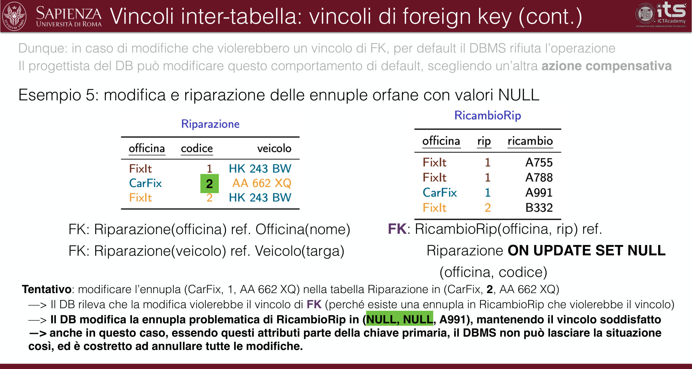

               Vincoli inter-tabella: vincoli di foreign key (cont.)
  Dunque: in caso di modifiche che violerebbero un vincolo di FK, per default il DBMS rifiuta l’operazione
  Il progettista del DB può modificare questo comportamento di default, scegliendo un’altra azione compensativa
  Esempio 5: modifica e riparazione delle ennuple orfane con valori NULL
                                                            NULL     NULL
         FK: Riparazione(officina) ref. Officina(nome)
         FK: Riparazione(veicolo) ref. Veicolo(targa)
                                                        FK: RicambioRip(officina, rip) ref.
                                                             Riparazione ON UPDATE SET NULL
                                                               (officina, codice)
   Tentativo: modificare l’ennupla (CarFix, 1, AA 662 XQ) nella tabella Riparazione in (CarFix, 2, AA 662 XQ)
    —> Il DB rileva che la modifica violerebbe il vincolo di FK (perché esiste una ennupla in RicambioRip che violerebbe il vincolo)
    —> Il DB modifica la ennupla problematica di RicambioRip in (NULL, NULL, A991), mantenendo il vincolo soddisfatto

    —> anche in questo caso, essendo questi attributi parte della chiave primaria, il DBMS non può lasciare la situazione
    così, ed è costretto ad annullare tutte le modifiche.

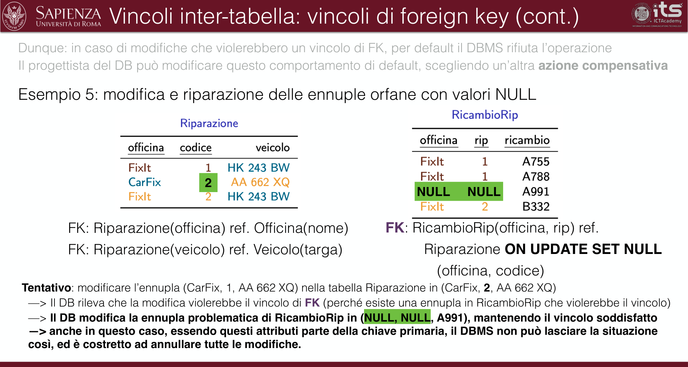

               Vincoli inter-tabella: vincoli di foreign key (cont.)
  Dunque: in caso di modifiche che violerebbero un vincolo di FK, per default il DBMS rifiuta l’operazione
  Il progettista del DB può modificare questo comportamento di default, scegliendo un’altra azione compensativa
  Esempio 6: cancellazione in cascata delle ennuple orfane
         FK: Riparazione(officina) ref. Officina(nome)
         FK: Riparazione(veicolo) ref. Veicolo(targa)
                                                        FK: RicambioRip(officina, rip) ref.
                                                             Riparazione ON DELETE CASCADE
                                                               (officina, codice)
   Tentativo: cancellare l’ennupla (CarFix, 1, AA 662 XQ) nella tabella Riparazione
    —> Il DB rileva che la modifica violerebbe il vincolo di FK (perché esiste una ennupla in RicambioRip che violerebbe
    il vincolo)
    —> Il DB cancella la ennupla problematica di RicambioRip, mantenendo il vincolo soddisfatto

               Vincoli inter-tabella: vincoli di foreign key (cont.)
  Dunque: in caso di modifiche che violerebbero un vincolo di FK, per default il DBMS rifiuta l’operazione
  Il progettista del DB può modificare questo comportamento di default, scegliendo un’altra azione compensativa
  Esempio 6: cancellazione in cascata delle ennuple orfane
         FK: Riparazione(officina) ref. Officina(nome)
         FK: Riparazione(veicolo) ref. Veicolo(targa)
                                                        FK: RicambioRip(officina, rip) ref.
                                                             Riparazione ON DELETE CASCADE
                                                               (officina, codice)
   Tentativo: cancellare l’ennupla (CarFix, 1, AA 662 XQ) nella tabella Riparazione
    —> Il DB rileva che la modifica violerebbe il vincolo di FK (perché esiste una ennupla in RicambioRip che violerebbe
    il vincolo)
    —> Il DB cancella la ennupla problematica di RicambioRip, mantenendo il vincolo soddisfatto

               Vincoli inter-tabella: vincoli di foreign key (cont.)
  Dunque: in caso di modifiche che violerebbero un vincolo di FK, per default il DBMS rifiuta l’operazione
  Il progettista del DB può modificare questo comportamento di default, scegliendo un’altra azione compensativa
  Esempio 7: aggiornamento in cascata
         FK: Riparazione(officina) ref. Officina(nome)
         FK: Riparazione(veicolo) ref. Veicolo(targa)
                                                        FK: RicambioRip(officina, rip) ref.
                                                             Riparazione ON UPDATE CASCADE
                                                               (officina, codice)
  Tentativo: modificare l’ennupla (CarFix, 1, AA 662 XQ) nella tabella Riparazione in (CarFix, 2, AA 662 XQ)
   —> Il DB rileva che la modifica violerebbe il vincolo di FK (perché esiste una ennupla in RicambioRip che violerebbe il
   vincolo)
   —> Il DB modifica la ennupla problematica di RicambioRip in (CarFix, 2, A991), mantenendo il vincolo soddisfatto

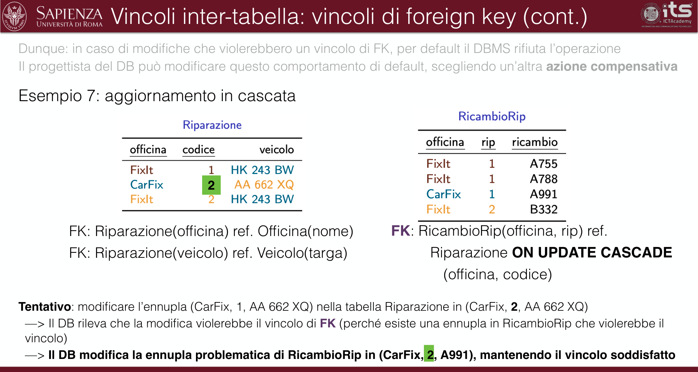

               Vincoli inter-tabella: vincoli di foreign key (cont.)
  Dunque: in caso di modifiche che violerebbero un vincolo di FK, per default il DBMS rifiuta l’operazione
  Il progettista del DB può modificare questo comportamento di default, scegliendo un’altra azione compensativa
  Esempio 7: aggiornamento in cascata
         FK: Riparazione(officina) ref. Officina(nome)
         FK: Riparazione(veicolo) ref. Veicolo(targa)
                                                        FK: RicambioRip(officina, rip) ref.
                                                             Riparazione ON UPDATE CASCADE
                                                               (officina, codice)
  Tentativo: modificare l’ennupla (CarFix, 1, AA 662 XQ) nella tabella Riparazione in (CarFix, 2, AA 662 XQ)
   —> Il DB rileva che la modifica violerebbe il vincolo di FK (perché esiste una ennupla in RicambioRip che violerebbe il
   vincolo)
   —> Il DB modifica la ennupla problematica di RicambioRip in (CarFix, 2, A991), mantenendo il vincolo soddisfatto

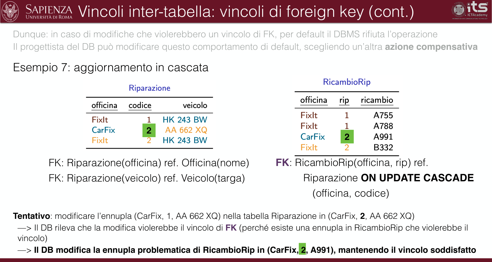

               Vincoli inter-tabella: vincoli di foreign key (cont.)
  Le azioni compensative per UPDATE e DELETE si possono comporre
                   FK: RicambioRip(officina, rip) ref.
                        Riparazione
                        ON DELETE SET NULL ON UPDATE CASCADE
                         (officina, codice)
