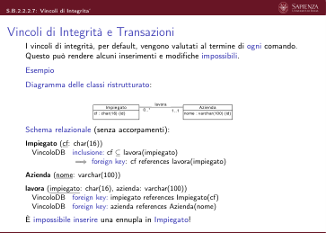
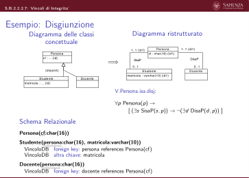

# B.2.2 - Il linguaggio SQL

> Fonte: `Slide B.2.2 - Il linguaggio SQL - BD2.pdf`
> Estratto con PyMuPDF (conserva legature e formule); tolte le righe ripetute di intestazione e pie' di pagina e le etichette sparse dei diagrammi, che sono ritagliati in `figure/` e richiamati nel punto in cui compaiono.

---

Slides B.2.2 (S.B.2.2)
                         Basi di dati
                         Sistemi di Gestione di Basi di Dati Relazionali
                                    Il Linguaggio SQL

 S.B.2.2: Il Linguaggio SQL
  Indice
       Queste slide sono composte dalle seguenti sottounità:
       S.B.2.2.1. Introduzione
       S.B.2.2.2. Data Definition Language
           S.B.2.2.2.1. Creazione di Database, Schemi e Tabelle
           S.B.2.2.2.2. Domini Definiti dall’Utente
           S.B.2.2.2.3. Generazione di Valori Progressivi
           S.B.2.2.2.4. Viste
           S.B.2.2.2.5. Controllo dell’Accesso
           S.B.2.2.2.6. Indici
           S.B.2.2.2.7. Vincoli di Integrita‘
       S.B.2.2.3. Data Manipulation Language
           S.B.2.2.3.1. Inserimento, Cancellazione e Modifica (Comandi Base)
           S.B.2.2.3.2. Interrogazioni
                S.B.2.2.3.2.1. Interrogazioni su Singola Tabella

 S.B.2.2: Il Linguaggio SQL
  Indice (2)
                S.B.2.2.3.2.2. Interrogazioni su Tabelle Multiple
                S.B.2.2.3.2.3. Funzioni Aggregate
                S.B.2.2.3.2.4. Raggruppamenti
                S.B.2.2.3.2.5. Operatori Insiemistici
                S.B.2.2.3.2.6. Interrogazioni nella Clausola From
                S.B.2.2.3.2.7. Interrogazioni Annidate
                S.B.2.2.3.2.8. Join Espliciti
                S.B.2.2.3.2.9. Outer Join
           S.B.2.2.3.3. Espressioni
           S.B.2.2.3.4. Inserimento, Cancellazione e Modifica (Comandi Avanzati)
           S.B.2.2.3.5. Transazioni

                              Slides B.2.2.1 (S.B.2.2.1)
                         Basi di dati
                         Sistemi di Gestione di Basi di Dati Relazionali
                                      Il Linguaggio SQL
                                        Introduzione

 S.B.2.2.1: Introduzione
  Il linguaggio SQL
          ▶Linguaggio di riferimento per le basi di dati relazionali
          ▶Originariamente Structured Query Language, ora nome proprio
          ▶1974: prima versione come linguaggio di interrogazione di System R
          (IBM)
          ▶1983: standard de-facto
          ▶1986: standard ANSI con costrutti base (SQL-86)
          ▶1989: aggiunta dei costrutti per la gestione di integrità referenziale
             (SQL-89)

 S.B.2.2.1: Introduzione
  Il linguaggio SQL (2)
          ▶1992: introduzione di un grande numero di funzionalità (SQL-92 o
             SQL-2)
                ▶linguaggio ricco e complesso
                ▶non ancora (!) supportato totalmente dai DBMS commerciali
                ▶tre livelli di supporto: Entry (simile a SQL-89), Intermediate
                SQL (gran parte implementata da DBMS), Full SQL (include
                molte caratteristiche non implementate)
                ▶sebbene DBMS si definiscano SQL-compliant, spesso non
                   aderiscono completamente allo standard (!)

 S.B.2.2.1: Introduzione
  Il linguaggio SQL (3)
          ▶1999 – 2011: SQL:1999, SQL:2003, SQL:2006, SQL:2008,
             SQL:2011
                ▶compatibile con SQL-2, ma offre molte funzionalità in più
                ▶suddiviso in parti: SQL/XML (gestione XML), etc.
                ▶ancora lontano dall’essere adottato dai DBMS commerciali
       Noi vedremo SQL-2 (SQL-92)

 S.B.2.2.1: Introduzione
  Architettura standard a 3 livelli per i DBMS
       Standard ANSI/SPARC
          1. Livello interno: implementa le strutture fisiche di memorizzazione
          (file sequenziali, file hash, indici, etc.)
          2. Livello logico: fornisce un modello logico dei dati, indipendente da
          come sono memorizzati fisicamente: =⇒modello relazionale
          3. Livello esterno: fornisce una o più descrizioni di porzioni di interesse
          della base dati, indipendenti dal modello logico. Può prevedere
          organizzazioni dei dati alternative e diverse rispetto a quelle
          utilizzate nello schema logico.

 S.B.2.2.1: Introduzione
  Architettura standard a 3 livelli per i DBMS (2)
       Esempio:
       Livello interno: strutture interne di memorizzazione
       Livello logico: modello relazionale dei dati
       Docente
          mat
          cognome
          nome
          email
         Rossi
         Mario
         rossi@unimia.it
         Bianchi
         Anna
         a.bianchi@unimia.it
         Verdi
         Giulia
         giulia.v@unimia.it
       Corso
                                                           Incarico
         codice
         nome
         aula
                                                            docente
                                                            corso
            Basi di dati
            1C
            Ing. SW
            3F
            Algebra
            1C
            Geometria
            3F

 S.B.2.2.1: Introduzione
  Architettura standard a 3 livelli per i DBMS (3)
       Livello esterno: viste sui dati
       InfoCorsi
                corso
                aula
                cognome doc.
                nome doc.
                email doc.
         Basi di dati
         1C
         Rossi
         Mario
         rossi@unimia.it
         Ing. SW
         3F
         Rossi
         Mario
         rossi@unimia.it
         Algebra
         1C
         Verdi
         Giulia
         giulia.v@unimia.it
         Geometria
         3F
         Verdi
         Giulia
         giulia.v@unimia.it
       Viste diverse per utenti diversi

 S.B.2.2.1: Introduzione
  SQL e livelli dell’architettura dei DBMS
       Il linguaggio SQL fornisce costrutti per operare:
          ▶a livello logico:
                ▶Data Definition Language (DDL) per creare schemi di relazioni
                ▶Data Manipulation Language (DML) per interrogare ed
          aggiornare i dati
          ▶a livello esterno: costrutti DDL per creare viste della base dati

                              Slides B.2.2.2 (S.B.2.2.2)
                         Basi di dati
                         Sistemi di Gestione di Basi di Dati Relazionali
                              Il Linguaggio SQL
                              Data Definition Language

                           Slides B.2.2.2.1 (S.B.2.2.2.1)
                        Basi di dati
                        Sistemi di Gestione di Basi di Dati Relazionali
                  Il Linguaggio SQL
                  Data Definition Language
                  Creazione di Database, Schemi e Tabelle

 S.B.2.2.2.1: Creazione di Database, Schemi e Tabelle
  Creazione di Database, Schemi e Tabelle
          ▶create database nome_database [opzioni]
             Crea un database.
          ▶create schema nome_schema [opzioni]
             Crea uno schema (namespace) all’interno del database corrente.
          ▶create table nome_tabella ( ... )
             Crea una nuova tabella all’interno di uno schema del database
             corrente

 S.B.2.2.2.1: Creazione di Database, Schemi e Tabelle
  Creazione di tabelle
        create
        table
        [ nome_schema . ] nome_tabella
        (
        nome_attributo
        dominio
        [ v i n c o l i
        di
        dominio ] ,
        nome_attributo
        dominio
        [ v i n c o l i
        di
        dominio ] ,
        . . .
        nome_attributo
        dominio
        [ v i n c o l i
        di
        dominio ] ,
        [ a l t r i
        v i n c o l i
        i n t r a −r e l a z i o n a l i ]
        [ v i n c o l i
        i n t e r −r e l a z i o n a l i ]
        )
       nome_schema è opzionale
       se omesso =⇒schema di default (senza nome).

 S.B.2.2.2.1: Creazione di Database, Schemi e Tabelle
  Creazione di tabelle (2)
       Esempio:
        create
        table
        Corso
        (
        codice
        i n t e g e r
        not
        null ,
        nome character
        varying
        (100)
        not
        null ,
        aula
        character
        varying
        (10)
        not
        null ,
        primary
        key ( codice )
        )
        create
        table
        I n c a r i c o
        (
        docente
        i n t e g e r
        not
        null ,
        corso
        i n t e g e r
        not
        null ,
        primary
        key ( docente ,
        corso ) ,
        f o r e i g n
        key ( docente )
        r e f e r e n c e s
        Docente ( matr ) ,
        f o r e i g n
        key ( corso )
        r e f e r e n c e s
        Corso ( codice )
        )

 S.B.2.2.2.1: Creazione di Database, Schemi e Tabelle
  Domini SQL predefiniti
          ▶Domini numerici:
          ▶interi: integer, smallint (e molti altri)
          ▶decimali: numeric(prec, scala), decimal(prec, scala)
          ▶approssimati: float (prec), real, double precision
          ▶Stringhe
          ▶character [varying] (lung_max) (abbrev. in char/varchar)
          ▶text
          ▶(molti altri)
          ▶Istanti temporali:
          ▶date (tipo record con campi per anno, mese, giorno)
          ▶time (tipo record con campi per ora, min, sec)
          ▶timestamp (tipo record con campi per anno, . . . , sec)
          ▶Intervalli temporali: interval
          ▶Valori booleani: Boolean (SQL:1999)
          ▶Dati non strutturati di grandi dimensioni: CLOB e BLOB

 S.B.2.2.2.1: Creazione di Database, Schemi e Tabelle
  Creazione di tabelle: valori di default
        create
        table
        Impiegato
        (
        nome
        . . . ,
        cognome
        . . . ,
        s t i p e n d i o
        i n t e g e r
        d e f a u l t
        0 ,
        . . .
       Se, durante un inserimento o modifica di una ennupla della tabella
       Impiegato non viene indicato un valore per la colonna stipendio
       allora tale valore viene messo a 0.

 S.B.2.2.2.1: Creazione di Database, Schemi e Tabelle
  Creazione di tabelle: vincoli di dominio
        create
        table
        Impiegato
        (
        nome varchar (100)
        not
        null ,
        cognome
        varchar (100)
        not
        null ,
        s t i p e n d i o
        i n t e g e r
        d e f a u l t 0
        check ( s t i p e n d i o >= 0) ,
        . . .
        )
          ▶Ogni ennupla nella relazione deve soddisfare il vincolo
          stipendio >= 0.
          ▶Il vincolo viene controllato automaticamente prima dell’inserimento
          o della modifica di ennuple.
          ▶In caso di violazione, l’inserimento o la modifica non ha luogo (e
             viene generato un errore).

 S.B.2.2.2.1: Creazione di Database, Schemi e Tabelle
  Creazione di tabelle: vincoli di chiave
        create
        table
        Studente
        (
        m a t r i c o l a
        i n t e g e r
        not
        null ,
        nome varchar (100)
        not
        null ,
        cognome
        varchar (100)
        not
        null ,
        n a s c i t a
        date ,
        cf
        character
        (16)
        not
        null ,
        //
        chiave
        p r i m a r i a
        ( i m p l i c a
        not
        n u l l )
        primary
        key ( m a t r i c o l a ) ,
        unique
        ( c f ) ,
        //
        a l t r a
        chiave
        unique
        ( cognome , nome ,
        n a s c i t a )
        //
        a l t r a
        chiave
        )
       Alternativa quando il vincolo è su un unico attributo:
 create
 table
 Studente
 (
 m a t r i c o l a
 i n t e g e r
 primary
 key ,
 //
 i m p l i c a
 not
 n u l l
 . . .
 cf
 character
 (16)
 not
 n u l l
 unique ,

 S.B.2.2.2.1: Creazione di Database, Schemi e Tabelle
  SQL e modello relazionale
       Una tabella SQL non rappresenta in generale una relazione (!)
       In particolare, può contenere ennuple uguali
        =⇒affinché rappresenti una relazione, è necessario definire almeno una chiave

 S.B.2.2.2.1: Creazione di Database, Schemi e Tabelle
  SQL e modello relazionale (2)
                                                    create
                                                    table
                                                    Studente
                                                    (
                                                    matr
                                                    i n t e g e r
                                                    not
                                                    null
                                                    ,
                                                    cognome
        create
        table
        Studente
        (
        matr
        i n t e g e r
        not
        null ,
        cognome
                                                       varchar (100)
                                                       not
                                                       null ,
                                                       nome
           varchar (100)
           not
           null ,
           nome
                                                    varchar (100)
                                                    not
                                                    null ,
                                                    primary
                                                    key ( matr )
                                                    )
        varchar (100)
        not
        n u l l
        )
         matr
         cognome
         nome
                                                      matr
                                                      cognome
                                                      nome
         Rossi
         Mario
         Rossi
         Mario
         Verdi
         Giulia
                                                      Rossi
                                                      Mario
                                                      Verdi
                                                      Giulia
                                                      Bianchi
                                                      Anna

 S.B.2.2.2.1: Creazione di Database, Schemi e Tabelle
  Vincoli di integrità referenziale
       Esempio
                             Officina
                                                                      Veicolo
                nome
                indirizzo
                                                                      targa
                                                                      tipo
                FixIt
                via delle Spighe 4
                CarFix
                via delle Betulle 32
                MotorGo
                piazza Turing 1
                                                               HK 243 BW
                                                               auto
                                                               AA 662 XQ
                                                               auto
                                                               GF 211 HA
                                                               moto
                        Riparazione
                                                                 RicambioRip
              officina
              codice
              veicolo
                                                          officina
                                                          rip
                                                          ricambio
              FixIt
              HK 243 BW
              CarFix
              AA 662 XQ
              FixIt
              HK 243 BW
                                                          FixIt
                                                          A755
                                                          FixIt
                                                          A788
                                                          CarFix
                                                          A991
                                                          FixIt
                                                          B332
          πofficina(Riparazione) ⊆πnome(Officina)
                                                           rip (RicambioRip) ⊆
                                                        πofficina
          πveicolo(Riparazione) ⊆πtarga(Veicolo)
                                                                  πofficina
                                                                    codice (Riparazione)

 S.B.2.2.2.1: Creazione di Database, Schemi e Tabelle
  Vincoli di integrità referenziale (2)
                                            Officina
                                        nome
                                        indirizzo
        create
        table
        O f f i c i n a
        (
        nome varchar (100)
        not
        null ,
        i n d i r i z z o
        varchar (500)
        not
        null ,
        primary
        key (nome)
        )

 S.B.2.2.2.1: Creazione di Database, Schemi e Tabelle
  Vincoli di integrità referenziale (3)
                                            Veicolo
                                           targa
                                           tipo
        create
        table
        Veicolo
        (
        targa
        char (8)
        not
        null ,
        t i p o
        varchar (50)
        not
        null ,
        primary
        key ( targa )
        )

 S.B.2.2.2.1: Creazione di Database, Schemi e Tabelle
  Vincoli di integrità referenziale (4)
                                          Riparazione
                                   officina
                                   codice
                                   veicolo
        create
        table
        Riparazione
        (
        o f f i c i n a
        varchar (100)
        not
        null ,
        codice
        i n t e g e r
        not
        null ,
        v e i c o l o
        char (8)
        not
        null ,
        primary
        key ( o f f i c i n a ,
        codice ) ,
        f o r e i g n
        key ( o f f i c i n a )
        r e f e r e n c e s
        O f f i c i n a (nome) ,
        f o r e i g n
        key ( v e i c o l o )
        r e f e r e n c e s
        Veicolo ( targa )
        )
       Sintassi:
        foreign key ( attributi ) references Tabella( attributi
        chiave)
       =⇒Gli attributi di Tabella a cui il vincolo punta devono formare una
       chiave (primary key o unique) di Tabella

 S.B.2.2.2.1: Creazione di Database, Schemi e Tabelle
  Vincoli di integrità referenziale (5)
                                         RicambioRip
                                    officina
                                    rip
                                    ricambio
        create
        table
        RicambioRip
        (
        o f f i c i n a
        varchar (100)
        not
        null ,
        r i p
        i n t e g e r
        not
        null ,
        ricambio
        char (5)
        not
        null ,
        primary
        key ( o f f i c i n a ,
        rip ,
        ricambio ) ,
        f o r e i g n
        key ( o f f i c i n a ,
        r i p )
        r e f e r e n c e s
        Riparazione (nome ,
        codice ) ,
        f o r e i g n
        key ( ricambio )
        r e f e r e n c e s
        Ricambio ( codice )
        )

 S.B.2.2.2.1: Creazione di Database, Schemi e Tabelle
  Modifica e cancellazione di tabelle, schemi e database
       Modifica
          ▶alter table
                ▶alter table add column
                ▶alter table drop column
                ▶alter table alter column
                ▶alter table add constraint
                ▶alter table drop constraint
                ▶etc.
       Cancellazione
          ▶drop table <nome tabella>
          ▶drop schema <nome schema>
          ▶drop database <nome database>
       Per i dettagli si veda la documentazione di SQL e quella del DBMS in
       uso.

                           Slides B.2.2.2.2 (S.B.2.2.2.2)
                        Basi di dati
                        Sistemi di Gestione di Basi di Dati Relazionali
                             Il Linguaggio SQL
                             Data Definition Language
                             Domini Definiti dall’Utente

 S.B.2.2.2.2: Domini Definiti dall’Utente
  Domini SQL definiti dall’utente
       È possibile per l’utente definire nuovi domini, da usarsi come i domini
       predefiniti.
       In particolare, è possibile definire:
          ▶Domini specializzazione di altri domini
          ▶Domini di tipo enumerativo
          ▶Domini di tipo record
       SQL offre due comandi:
        create
        domain
        . . .
       e
        create
        type
        . . .
       I due comandi offrono funzionalità diverse.

 S.B.2.2.2.2: Domini Definiti dall’Utente
  Definizione di domini SQL specializzati
       Un dominio specializzato definisce un insieme di valori che ùn
       sottoinsieme dei valori di un dominio esistente.
        create
        domain nome_dominio as
        tipo_base
        [ v a l o r e
        di
        d e f a u l t ]
        [ v i n c o l o ]
       Esempio: Definizione del dominio voto (interi tra 18 e 30):
        create
        domain voto
        as
        i n t e g e r
        d e f a u l t 0
        check ( value >= 18 and
        value <= 30)
       Il vincolo definisce i valori del dominio base che sono anche valori del
       dominio specializzato. Si usano le parole chiavi check e value.

 S.B.2.2.2.2: Domini Definiti dall’Utente
  Definizione di domini SQL di Tipo Enumerativo
       Un dominio di tipo enumerativo definisce un insieme finito, piccolo e
       stabile di valori, ognuno identificato da una etichetta.
        create
        type nome_dominio as
        enum ( ’ v a l o r e
        1 ’ ,
        . . . ,
        ’ v a l o r e N ’ )
       Esempio: Definizione del dominio enumerativo genere (valori: M ed F):
        create
        type
        genere
        as enum ( ’M’ ,
        ’F ’ )
       Esempio: Definizione del dominio enumerativo continente (a 6 valori):
        create
        type
        c o n t in en te
        as
        enum ( ’ America Nord ’ ,
        ’ America Sud ’ ,
        ’ A f r i c a ’ ,
        ’ Europa ’ ,
        ’ Asia ’ ,
        ’ Oceania ’ )
       Nota: le etichette (ad es., ’America Nord’) non sono stringhe, ma
       identificatori per gli elementi dell’insieme (nonostante gli apici!)

 S.B.2.2.2.2: Domini Definiti dall’Utente
  Definizione di domini SQL di Tipo Record
       I valori di un dominio di tipo record (o dominio composto) sono record di
       valori, uno per ogni campo del record. Il valore di ogni campo di un record è
       del rispettivo dominio.
        create
        type nome_dominio as
        (
        campo1 dominio1 ,
        . . . ,
        campoN dominioN
        )
       Esempio: Definizione del dominio composto indirizzo:
       (una definizione molto semplice, solo a titolo di esempio)
        create
        type
        i n d i r i z z o
        (
        v i a
        varchar (200) ,
        c i t t a
        varchar (100)
        )
       Nota: Il costrutto create type è implementato in modo non-standard da
       alcuni DBMS, e può soffrire di limitazioni (ad es., niente vincoli di dominio
       mediante check e/o not null).
       Qui mostriamo la sintassi di PostgreSQL. Consultare sempre la documentazione
       del DBMS in uso!

 S.B.2.2.2.2: Domini Definiti dall’Utente
  Modifica e cancellazione di domini
       I domini creati dall’utente possono essere modificati o rimossi:
       Modifica:
          ▶alter domain <nome dominio>
          ▶alter type <nome dominio>
       Cancellazione:
          ▶drop domain <nome dominio>
          ▶drop type <nome dominio>
       Per i dettagli si veda la documentazione di SQL e quella del DBMS in
       uso.

                           Slides B.2.2.2.3 (S.B.2.2.2.3)
                        Basi di dati
                        Sistemi di Gestione di Basi di Dati Relazionali
                        Il Linguaggio SQL
                        Data Definition Language
                        Generazione di Valori Progressivi

 S.B.2.2.2.3: Generazione di Valori Progressivi
  Generazione di Valori Progressivi
       Abbiamo visto come alcune volte sia necessario o conveniente aggiungere
       un identificatore artificiale in una entità e quindi un attributo aggiuntivo
       nella relazione della base dati che la realizza
       Esempio:
                                          Prenotazione
                                      id : integer {id}
                                      istante : timestamp
       Prenotazione (id:integer, istante:timestamp)
       È possibile lasciare al DBMS il compito di assegnare valori diversi
       (tipicamente progressivi) per il campo id alle diverse ennuple della
       relazione Prenotazione.
       Non esiste uno standard.

 S.B.2.2.2.3: Generazione di Valori Progressivi
  Generazione di Valori Progressivi in PostgreSQL
       PostgreSQL fornisce il costrutto delle sequenze.
        create
        sequence
        Prenotazione_id_seq ;
        create
        table
        Prenotazione
        (
        id
        i n t e g e r
        d e f a u l t
        n e x t v a l ( ’ Prenotazione_id_seq
        ’ )
        not
        null ,
        i s t a n t e
        timestamp not
        null ,
        primary
        key ( id )
        ) ;
       Scorciatoia: create table Prenotazione (id
       serial not null ,
       ...)
       Inserimento di ennuple: sfrutta il fatto che id ha un valore di default:
        i n s e r t
        into
        Prenotazione ( i s t a n t e )
        values
        ( ’2011−08−24 13:15:05 ’ )
        r e t u r n i n g
        id
       Nota: Il costrutto PostgreSQL (non standard) returning id permette al
       comando insert di restituire all’utente il valore per id scelto dal DBMS.

 S.B.2.2.2.3: Generazione di Valori Progressivi
  Generazione di Valori Progressivi in MySQL
       MySQL fornisce il modificatore auto_increment per gli attributi.
        create
        table
        Prenotazione
        (
        id
        i n t e g e r
        not
        n u l l
        auto_increment ,
        i s t a n t e
        timestamp not
        null ,
        primary
        key ( id )
        ) ;
       Inserimento di ennuple:
        i n s e r t
        into
        Prenotazione ( i s t a n t e )
        values
        ( ’2011−08−24 13:15:05 ’ )

                           Slides B.2.2.2.4 (S.B.2.2.2.4)
                        Basi di dati
                        Sistemi di Gestione di Basi di Dati Relazionali
                                Il Linguaggio SQL
                                Data Definition Language
                                              Viste

 S.B.2.2.2.4: Viste
  Architettura standard per i DBMS
       Architettura standard a 3 livelli per i DBMS:
          1. Livello interno
          rappresentazione fisica dei dati, dipende dal DBMS.
          2. Livello logico
          modello logico dei dati, indipendente da come sono memorizzati
          fisicamente =⇒modello relazionale.
          3. Livello esterno
          fornisce una o più descrizioni di porzioni di interesse della base dati,
          indipendenti dal modello logico. Può prevedere organizzazioni dei
          dati alternative e diverse rispetto a quelle utilizzate nello schema
          logico.
              =⇒Viste sui dati

 S.B.2.2.2.4: Viste
  Viste sui Dati
       Vista: tabella le cui ennuple sono calcolate a partire da una
       interrogazione su altre tabelle (e/o viste).
        create
        view <Nome v i s t a > as
        s e l e c t
        . . .
       Esempio:
        create
        view
        G e n i t o r i
        as
        s e l e c t mat . f i g l i o
        as
        persona ,
        mat . madre as madre ,
        pat . padre
        as
        padre
        from
        Maternita mat ,
        P a t e r n i t a
        pat
        where mat . f i g l i o = pat . f i g l i o
       Genitori è una tabella virtuale: il suo contenuto è calcolato solo quando
       serve e non è memorizzato in modo persistente.
        =⇒Non è possibile invocare insert, delete, update su una vista

 S.B.2.2.2.4: Viste
  Esempi
       Esempio 1: Definire una vista che mostri il reddito medio delle persone
       divise per età.
                                             Persona
                                     nome
                                     eta
                                     reddito
         create
         view
         RedditoMedioPerEta
         as
         s e l e c t
         eta ,
         avg ( r e d d i t o )
         as
         redditoMedio
         from Persona
         group by eta

 S.B.2.2.2.4: Viste
  Esempi
       Esempio 2: Definire una vista che mostri le età delle persone che hanno
       reddito medio massimo.
                                             Persona
                                     nome
                                     eta
                                     reddito
         create
         view EtaRedditoMax
         as
         s e l e c t
         eta
         from RedditoMedioPerEta
         where redditoMedio =
                ( s e l e c t max( redditoMedio )
                 from RedditoMedioPerEta )

                           Slides B.2.2.2.5 (S.B.2.2.2.5)
                        Basi di dati
                        Sistemi di Gestione di Basi di Dati Relazionali
                                Il Linguaggio SQL
                                Data Definition Language
                                 Controllo dell’Accesso

 S.B.2.2.2.5: Controllo dell’Accesso
  Controllo dell’accesso
          ▶I DBMS prevedono meccanismi per controllare l’accesso alle risorse:
                ▶tabelle
                ▶viste
                                           ▶domini
                                           ▶procedure
                                                                      ▶. . .
          ▶Meccanismo basato su utenti/password e privilegi
          ▶L’utente che crea una risorsa ne è il proprietario, può modificarla,
          eliminarla, e dare privilegi ad altri utenti
          ▶Esiste super-utente (_system o root).

 S.B.2.2.2.5: Controllo dell’Accesso
  Creazione di Utenti
       Per creare un utente:
        create
        user <Nome> with <Opzioni>
       Tra le opzioni è presente ‘password’ per definire una password.
       Attenzione: molti dettagli sono omessi e i DBMS possono comportarsi in
       modo diverso. Consultare sempre la documentazione del DBMS in uso.

 S.B.2.2.2.5: Controllo dell’Accesso
  Privilegi Utente
       Un privilegio è definito da:
          ▶la risorsa alla quale si riferisce
          ▶l’utente che lo concede
          ▶l’utente che lo riceve
          ▶l’azione permessa sulla risorsa
          ▶se l’utente che riceve il privilegio può concederlo o meno ad altri
             utenti.

 S.B.2.2.2.5: Controllo dell’Accesso
  Privilegi Disponibili
       I DBMS prevedono (almeno) i seguenti privilegi:
          ▶insert: permette di inserire un nuovo oggetto (ad es., ennupla) nella
          risorsa (ad es., tabella)
          ▶update: permette di aggiornare il valore di un oggetto (ad es.,
          ennupla) della risorsa (ad es., tabella)
          ▶delete: permette di eliminare oggetti (ad es., ennuple) dalla risorsa
          (ad es., tabella)
          ▶select: permette di leggere la risorsa (ad es., tabella)
          ▶references: permette che venga fatto un riferimento alla risorsa (ad
          es., tabella) durante la definizione dello schema di una tabella
          ▶usage: permette di utilizzare la risorsa (ad es., dominio) in una
          definizione (ad es., dello schema di una tabella)
          ▶all privileges: permette qualunque azione sulla risorsa.

 S.B.2.2.2.5: Controllo dell’Accesso
  Concessione di Privilegi ad Utenti
       Una parte del linguaggio SQL è dedicata alla gestione del controllo
       d’accesso.
       Per concedere dei privilegi ad un insieme di utenti:
        grant 
 on <Risorsa > to <Utenti >
           [ with
           grant
           option ]
       Fornisce i privilegi < Privilegi > sulla risorsa <Risorsa> agli utenti
       <Utenti>
       Se si specifica with grant option gli utenti che ricevono i privilegi
       possono invocare comandi grant per gli stessi privilegi sulla stessa risorsa
       per concederli ad altri utenti.
       Esempio: grant select on Impiegato to www
       L’utente www può effettuare interrogazioni sulla tabella (o vista)
       Impiegato (ma non può concedere il privilegio ad altri).

 S.B.2.2.2.5: Controllo dell’Accesso
  Revoca di Privilegi ad Utenti
       Per revocare dei privilegi ad un insieme di utenti:
        revoke 
 on <Risorsa > from <Utenti >
           [ r e s t r i c t
           |
           cascade ]
       Revoca i privilegi < Privilegi > sulla risorsa <Risorsa> agli utenti
       <Utenti>
       Se si specifica cascade, vengono revocati anche i privilegi propagati verso
       altri utenti (default: restrict ).
       SQL:1999 definisce anche i ruoli (insiemi di privilegi). Agli utenti si
       assegnano ruoli che definiscono privilegi.
       Attenzione: molti dettagli sono omessi e i DBMS possono comportarsi in
       modo diverso. Consultare sempre la documentazione del DBMS in uso.

 S.B.2.2.2.5: Controllo dell’Accesso
  Principio dei Privilegi Minimali
       In questo corso non entriamo in dettagli sugli aspetti di sicurezza e
       privatezza, cruciali per applicazioni reali.
       Tali aspetti saranno affrontati in corsi più avanzati.
       Tuttavia, la regola d’oro è:
             Principio dei privilegi minimali:
             Concedere ad un utente solo i privilegi strettamente necessari
             per poter eseguire le azioni che deve poter eseguire.

                           Slides B.2.2.2.6 (S.B.2.2.2.6)
                        Basi di dati
                        Sistemi di Gestione di Basi di Dati Relazionali
                                Il Linguaggio SQL
                                Data Definition Language
                                             Indici

 S.B.2.2.2.6: Indici
  Indici
       Strutture dati ausiliarie su memoria secondaria che consentono il recupero
       efficiente delle ennuple di una relazione quando sono dati i valori (o
       intervalli di valori) di alcuni attributi (pseudo-chiave).
       Implementati per lo più con strutture ad albero a pochi livelli (ma anche
       hash).
       Possono essere:
          ▶primari: le ennuple sono memorizzate nello stesso indice o, sebbene
          in un file separato, sono memorizzate ordinate per il valore della
          pseudo-chiave
          ▶secondari: l’ordinamento dell’indice è indipendente da quello delle
             ennuple nel file che memorizza la relazione. L’indice contiene
             puntatori alle ennuple.
        =⇒Per dettagli, si veda il corso di “Basi di Dati, Modulo 1”.

 S.B.2.2.2.6: Indici
  Gestione degli indici in SQL
       Molti DBMS accettano i comandi seguenti (con varianti e opzioni) per
       creare ed eliminare indici.
          ▶create index <Nome> on <Tabella> (<Attributi>)
          using <Metodo>
          ▶drop index <Nome>
       Quest comandi non sono standard SQL.
       Creare un indice su una lista di attributi <Attributi> consente:
          ▶il recupero più efficiente delle ennuple di <Tabella> a partire da
          valori degli attributi <Attributi> (esatti o intervalli di valori)
          ▶al prezzo di minore efficienza negli inserimenti, aggiornamenti e
             cancellazioni di ennuple (l’impatto negativo è di solito piccolo,
             grazie a tecniche sofisticate di aggiornamento degli indici).
       I DBMS di solito creano automaticamente un indice sugli attributi chiave
       primaria di ogni tabella.

                           Slides B.2.2.2.7 (S.B.2.2.2.7)
                        Basi di dati
                        Sistemi di Gestione di Basi di Dati Relazionali
                                Il Linguaggio SQL
                                Data Definition Language
                                   Vincoli di Integrita‘

 S.B.2.2.2.7: Vincoli di Integrita‘
  Vincoli di Integrità
       Abbiamo già visto alcune tipologie di vincoli di integrità supportati dai
       DBMS relazionali:
          ▶Vincoli di chiave
          primary key e unique dentro create table e alter table
          ▶Vincoli di dominio
          check in create domain e alter domain
          check e not NULL in create table e alter table
          ▶Vincoli di ennupla
          check in create table e alter table
          ▶Vincoli di foreign key
              foreign key in create table e alter table

 S.B.2.2.2.7: Vincoli di Integrita‘
  Esempio
       Vogliamo creare il seguente database con vincoli:
       Progetto (nome:varchar(100), inizio:date, fine:date)
          VincoloDB
          ennupla: fine ≥inizio
       WP (nome:varchar(100), progetto:varchar(100), inizio:date, fine:date)
          VincoloDB
          foreign key: progetto references Progetto(nome)
          VincoloDB
          ennupla: fine ≥inizio
          ▶Vincolo di ennupla fine ≥inizio in Progetto.
             Possiamo usare una clausola check all’interno di create table:
               create
               table
               Progetto
               (
               nome varchar (100)
               not
               null ,
               i n i z i o
               date
               not
               null ,
               f i n e
               date
               not
               null ,
               primary
               key (nome) ,
               check ( f i n e >= i n i z i o )
               )

 S.B.2.2.2.7: Vincoli di Integrita‘
  Esempio
       Vogliamo creare il seguente database con vincoli:
       Progetto (nome:varchar(100), inizio:date, fine:date)
          VincoloDB
          ennupla: fine ≥inizio
       WP (nome:varchar(100), progetto:varchar(100), inizio:date, fine:date)
          VincoloDB
          foreign key: progetto references Progetto(nome)
          VincoloDB
          ennupla: fine ≥inizio
          ▶Vincolo di ennupla fine ≥inizio in WP. Analogamente:
               create
               table WP (
               nome varchar (100)
               not
               null ,
               progetto
               varchar (100)
               not
               null ,
               i n i z i o
               date
               not
               null ,
               f i n e
               date
               not
               null ,
               primary
               key (nome) ,
               f o r e i g n
               key
               progetto
               r e f e r e n c e s
               Progetto (
               nome) ,
               check ( f i n e >= i n i z i o )
               )

 S.B.2.2.2.7: Vincoli di Integrita‘
  Vincoli di Integrità e Transazioni
       I vincoli di integrità, per default, vengono valutati al termine di ogni comando.
       Questo può rendere alcuni inserimenti e modifiche impossibili.
       Esempio
       Diagramma delle classi ristrutturato:
                                           Azienda
                                           1..1
                                           0..*
                                           lavora
                                Impiegato
                            cf : char(16) {id}
                                                        nome : varchar(100) {id}
       Schema relazionale (senza accorpamenti):
       Impiegato (cf: char(16))
         VincoloDB
         inclusione: cf ⊆lavora(impiegato)
                       =⇒foreign key: cf references lavora(impiegato)
       Azienda (nome: varchar(100))
       lavora (impiegato: char(16), azienda: varchar(100))
         VincoloDB
         foreign key: impiegato references Impiegato(cf)
         VincoloDB
         foreign key: azienda references Azienda(nome)
       È impossibile inserire una ennupla in Impiegato!

 S.B.2.2.2.7: Vincoli di Integrita‘
  Vincoli di Integrità e Transazioni (2)
       Un vincolo di integrità può essere dichiarato deferrable.
          ▶Per un vincolo deferrable è possibile per l’utente decidere se valutarlo solo
             al termine della transazione corrente
          ▶Per default tutti i vincoli sono not deferrable, quindi vengono valutati
             immediatamente.

 S.B.2.2.2.7: Vincoli di Integrita‘
  Vincoli di Integrità e Transazioni (3)
       Per l’esempio possiamo quindi scrivere:
                                             create
                                             table
                                             l a v o r a
                                             (
                                             impiegato
                                             char (16)
                                             not
                                             null ,
                                             azienda
                                             varchar (100)
                                             not
                                             null ,
                                             primary
                                             key ( impiegato ) ,
                                             f o r e i g n
                                             key ( impiegato )
                                             r e f e r e n c e s
                                             Impiegato ( c f )
                                             deferrable ,
                                             f o r e i g n
                                             key ( azienda )
                                             r e f e r e n c e s
                                             Azienda (nome)
                                             ) ;
        create
        table
        Impiegato
        (
        cf
        char (16)
        not
        null ,
        primary
        key ( c f )
        ) ;
        create
        table
        Azienda
        (
        nome varchar (100)
        not
        null ,
        primary
        key (nome)
        ) ;
       a l t e r
       table
       Impiegato
       add
       c o n s t r a i n t
       impiegatoInLavora
       f o r e i g n
       key ( c f )
       r e f e r e n c e s
       l a v o r a ( impiegato )
       d e f e r r a b l e ;
       Nota: per imporre uno dei vincoli di foreign key utilizziamo alter table per
       evitare di menzionare (in create table Impiegato) il nome della tabella
       lavora, non ancora creata.

 S.B.2.2.2.7: Vincoli di Integrita‘
  Vincoli di Integrità e Transazioni (4)
       L’inserimento di dati può ora avvenire in una transazione:
        i n s e r t
        into
        azienda (nome)
        values
        ( ’ az ’ ) ;
       begin
       t r an sa ct ion ;
       set
       c o n s t r a i n t s
       a l l
       d e f e r r e d ;
       i n s e r t
       into
       impiegato ( c f )
       values
       ( ’ 111 ’ ) ;
       i n s e r t
       into
       l a v o r a ( impiegato ,
       azienda )
       values
       ( ’ 111
       ’ ,
       ’ az ’ ) ;
       commit work ;
       Il comando set constraints all deferred ; richiede esplicitamente al DBMS
       di verificare i vincoli dichiarati deferrable solo al termine della transazione.

 S.B.2.2.2.7: Vincoli di Integrita‘
  Vincoli di Integrità Generici
       Esempio
       Vogliamo creare il seguente database con vincoli:
       Progetto (nome:varchar(100), inizio:date, fine:date)
          VincoloDB
          ennupla: fine ≥inizio
       WP (nome:varchar(100), progetto:varchar(100), inizio:date, fine:date)
          VincoloDB
          foreign key: progetto references Progetto(nome)
          VincoloDB
          ennupla: fine ≥inizio
       Supponiamo di voler imporre il seguente ulteriore vincolo: inizio e fine di ogni
       WP devono essere comprese tra inizio e fine del corrispondente Progetto.
       Errore: Sintassi non permessa!
       Il costrutto check permette di esprimere solo vincoli di dominio o di ennupla!

 S.B.2.2.2.7: Vincoli di Integrita‘
  Vincoli di Integrità Generici
       Esempio
       Supponiamo di voler imporre il seguente ulteriore vincolo: inizio e fine di ogni
       WP devono essere comprese tra inizio e fine del corrispondente Progetto.
       Potremmo pensare di procedere così:
        create
        table WP (
        nome varchar (100)
        not
        null ,
        progetto
        varchar (100)
        not
        null ,
        i n i z i o
        date
        not
        null ,
        f i n e
        date
        not
        null ,
        primary
        key (nome) ,
        f o r e i g n
        key
        progetto
        r e f e r e n c e s
        Progetto (nome) ,
        check ( f i n e >= i n i z i o ) ,
        check ( i n i z i o
        between
        date
        ( s e l e c t
        i n i z i o
        from Progetto
        where nome=progetto )
        and date
        ( s e l e c t
        f i n e
        from Progetto
        where nome=progetto ) ) ,
        check ( f i n e
        between
        date
        ( s e l e c t
        i n i z i o
        from Progetto
        where nome=progetto )
        and date
        ( s e l e c t
        f i n e
        from Progetto
        where nome = progetto ) )
        )
       Errore: Sintassi non permessa!
       Il costrutto check permette di esprimere solo vincoli di dominio o di ennupla!

 S.B.2.2.2.7: Vincoli di Integrita‘
  Vincoli di Integrità Generici
       I vincoli non traducibili con le tecniche viste vanno imposti nel DBMS
       con approcci più complessi:
          1. asserzioni in standard SQL (almeno teoricamente. . . )
          2. trigger in linguaggi non standard

 S.B.2.2.2.7: Vincoli di Integrita‘
  Asserzioni
       Lo standard SQL offre un costrutto generale per esprimere vincoli di
       integrità arbitrariamente complessi:
        create
        a s s e r t i o n <nome vincolo >
        check ( <condizione > )
       Esempio: inizio e fine di ogni WP devono essere comprese tra inizio e fine
       del corrispondente Progetto.
       Potremmo pensare di procedere così:
         create
         a s s e r t i o n
         check_date_wp
         check (
           not
           e x i s t s (
           s e l e c t
           ∗from WP w,
           Progetto p
           where w. progetto = p . nome
         and ( w. i n i z i o < p . i n i z i o
         or w. f i n e > p .
         f i n e )
         ) )
       Vincolo ignorato! Nessun DBMS commerciale oggi implementa le
       asserzioni SQL (sarebbe troppo inefficiente!)

 S.B.2.2.2.7: Vincoli di Integrita‘
  Trigger in PostgreSQL
       Sintassi
        create
        [ c o n s t r a i n t ]
        t r i g g e r <nome>
        { be fo re
        |
        a f t e r
        |
        i n s t e a d
        of } {<operaz .
        i n t e r c e t t a t a > [
        or
        . . .
        ]}
        on <t a b e l l a >
          [
          from referenced_table_name
          ]
          { not
          d e f e r r a b l e
          |
          [
          d e f e r r a b l e
          ]
          {
          i n i t i a l l y
          immediate
          |
          i n i t i a l l y
          d e f e r r e d
          } }
          [
          f o r
          [
          each
          ]
          { row
          |
          statement }
          ]
          [
          when ( <condizione > )
          ]
          execute
          procedure <nome funzione > ( <argomenti> )
          ▶operazione intercettata: insert, update, delete
          ▶istante dell’invocazione: prima o dopo o invece dell’operazione
             (instead of vale solo per le viste)
          ▶deferrable (solo se di tipo constraint e after )
          ▶when: se falsa, la funzione non viene eseguita

 S.B.2.2.2.7: Vincoli di Integrita‘
  Trigger in PostgreSQL
       Sintassi
        create
        [ c o n s t r a i n t ]
        t r i g g e r <nome>
        { be fo re
        |
        a f t e r
        |
        i n s t e a d
        of } {<operaz .
        i n t e r c e t t a t a > [
        or
        . . .
        ]}
        on <t a b e l l a >
          [
          from referenced_table_name
          ]
          { not
          d e f e r r a b l e
          |
          [
          d e f e r r a b l e
          ]
          {
          i n i t i a l l y
          immediate
          |
          i n i t i a l l y
          d e f e r r e d
          } }
          [
          f o r
          [
          each
          ]
          { row
          |
          statement }
          ]
          [
          when ( <condizione > )
          ]
          execute
          procedure <nome funzione > ( <argomenti> )
          ▶for each row: la funzione viene invocata una volta per ogni ennupla
          impattata dall’operazione
          ▶for statement: la funzione viene invocata una volta per comando (ad es.,
             insert).
       PostgreSQL supporta la definizione di funzioni scritte nel linguaggio
       procedurale chiamato PL/pgSQL (proviene dal più famoso PL/SQL
       Oracle), ma anche in altri linguaggi (ad es., Python).
       Funzionalità proprietarie, consultare la documentazione del DBMS in uso!

 S.B.2.2.2.7: Vincoli di Integrita‘
  Esempio: Disgiunzione
                                                     Diagramma ristrutturato
           Diagramma delle classi
                  concettuale
                                                              Persona
                                                                        1..1 {id1}
                                                    1..1 {id1}
                    Persona
                                                           cf : char(16) {id1}
                 cf : ... {id}
                                                     DisaP
                                                     SisaP
                                           =⇒
                                                     0..1
                                                                             0..1
                  {disjoint}
                                                         Studente
                                                         Docente
                                                   matricola : varchar(10) {id1}
               Studente
               Docente
         matricola : ... {id}
                                              V.Persona.isa.disj:
                                              ∀p Persona(p) →
                                                   [ (∃s SisaP(s, p)) →¬(∃d DisaP(d, p)) ]
       Schema Relazionale
       Persona(cf:char(16))
       Studente(persona:char(16), matricola:varchar(10))
         VincoloDB
         foreign key: persona references Persona(cf)
         VincoloDB
         altra chiave: matricola
       Docente(persona:char(16))
         VincoloDB
         foreign key: docente references Persona(cf)

 S.B.2.2.2.7: Vincoli di Integrita‘
  Esempio: Disgiunzione (2)
       Trigger per V.Persona.isa.disj (approccio 1, before):
          ▶Operazioni: inserimento o modifica in Studente o Docente
          ▶Istante di invocazione: prima dell’operazione intercettata
          ▶Funzione:
                1. Sia isError = FALSE;
                2. Sia new l’ennupla che si sta inserendo oppure l’ennupla risultato
                della modifica;
                3. Se si sta inserendo o modificando una ennupla in Studente:
                    i s E r r o r
                    :=
                    e x i s t s
                    ( s e l e c t
                    ∗from Docente d
                    where d . persona = new . persona ) ;
                4. Altrimenti (inserimento/modifica di una ennupla in Docente):
                    i s E r r o r
                    :=
                    e x i s t s
                    ( s e l e c t
                    ∗from Studente
                    s
                    where s . persona = new . persona ) ;
                5. Se isError = TRUE blocca l’operazione;
                6. Altrimenti permetti l’operazione.

 S.B.2.2.2.7: Vincoli di Integrita‘
  Esempio: Disgiunzione (3)
       Codice PL/SQL per la funzione del trigger V.Persona.isa.disj (appr. 1,
       before):
        create
        f u n c t i o n
        V_Persona_isa_disj ()
         r e t u r n s
         t r i g g e r
         as
         $V_Persona_isa_disj$
         d e c l a r e
         i s E r r o r
         boolean :=
         f a l s e ; −−var .
         l o c a l e
         begin
            case −−TG_TABLE_NAME: nome
            t a b e l l a
            r e l a t i v a
            a l l ’ operaz .
            when TG_TABLE_NAME i l i k e
            ’ Studente ’
            then
            i s E r r o r
            :=
            e x i s t s
            (
            s e l e c t
            ∗from Docente d where d . persona = new . persona ) ;
            when TG_TABLE_NAME i l i k e
            ’ Docente ’
            then
            i s E r r o r = e x i s t s
            (
            s e l e c t
            ∗from Studente
            s
            where s . persona = new . persona ) ;
            e l s e
            r a i s e
            exception
            ’ La
            funzione
            non
            puo ’ ’
            e s s e r e
            invocata
            s u l l a
            t a b e l l a %’ , TG_TABLE_NAME;
            end case ;
        i f
        ( i s E r r o r )
        then
        r a i s e
        exception
        ’ Vincolo V. SDisaP . d i s j o i n t
        v i o l a t o
        da Persona . id = %’ , new . persona ;
        end
        i f ;
        r e t u r n new ; −−se OK,
        i l
        t r i g g e r
        ’ before ’
        deve
        r e s t i t u i r e
        ’new ’
        end ;
        $V_Persona_isa_disj$
        language
        p l p g s q l ;

 S.B.2.2.2.7: Vincoli di Integrita‘
  Esempio: Disgiunzione (4)
       Definizione del trigger V.Persona.isa.disj su Studente e Docente
       (approccio 1, before):
        create
        t r i g g e r
        V_Persona_isa_disj_trigger_Studente
        before
        i n s e r t
        or
        update on Studente
        f o r
        each row
        execute
        procedure
        V_Persona_isa_disj () ;
        create
        t r i g g e r
        V_Persona_isa_disj_trigger_Docente
        before
        i n s e r t
        or
        update on Docente
        f o r
        each row
        execute
        procedure
        V_Persona_isa_disj () ;

 S.B.2.2.2.7: Vincoli di Integrita‘
  Esempio: Disgiunzione (5)
       Approccio 2, after (best practice attuale in PostgreSQL):
        create
        f u n c t i o n
        V_Persona_isa_disj_after ()
        r e t u r n s
        t r i g g e r
        as
        $V_Persona_isa_disj$
        d e c l a r e
        i s E r r o r
        boolean :=
        f a l s e ; −−var .
        l o c a l e
        begin
        SELECT COUNT(∗) > 0 INTO STRICT i s E r r o r FROM Docente d ,
        Studente
        s
        WHERE d . persona = new . persona AND s . persona = new . persona ;
        i f
        ( i s E r r o r )
        then
        r a i s e
        exception
        ’ Vincolo V. SDisaP . d i s j o i n t
        v i o l a t o
        da Persona . id
        = %’ , new . persona ;
        end
        i f ;
        r e t u r n NULL; −−i l
        v a l .
        di
        r i t .
        di
        un
        t r i g g e r
        ’ a f t e r ’
        viene
        i g n o r a t o
        end ;
        $V_Persona_isa_disj$
        language
        p l p g s q l ;
        create
        c o n s t r a i n t
        t r i g g e r
        V_Persona_isa_disj_trigger_Studente
        a f t e r
        i n s e r t
        or
        update on Studente
        d e f e r r a b l e
        i n i t i a l l y
        immediate
        f o r
        each row
        execute
        procedure
        V_Persona_isa_disj_after () ;
        create
        t r i g g e r
        V_Persona_isa_disj_trigger_Docente
        a f t e r
        i n s e r t
        or
        update on Docente
        d e f e r r a b l e
        i n i t i a l l y
        immediate
        f o r
        each row
        execute
        procedure
        V_Persona_isa_disj_after () ;

 S.B.2.2.2.7: Vincoli di Integrita‘
  Esempio: Disgiunzione (6)
       Note:
          ▶In una function possiamo usare SELECT ... INTO STRICT ... per
             salvare il contenuto delle colonne dell’unica riga del risultato in
             variabili locali (in questo caso, avremmo potuto usare anche
          isError := EXISTS (SELECT...))
          ▶La condizione da verificare cambia in base al momento nel quale
          scatta il trigger (before o after)
          ▶Nell’implementazione attuale, solo i trigger after possono essere
          constraint trigger. I constraint trigger possono essere deferrable.
          ▶La best practice attuale in PostgreSQL è quella di utilizzare
          constraint trigger (after, poss. deferrable) per implementare i vincoli
          generici, e riservare i trigger before ad altro: modifiche delle ennuple
          inserite dall’utente, mantenimento di ridondanza, etc.
          ▶Oltre a before e after, possiamo utilizzare instead, ad es. per
             emulare insert/update/delete su viste (v. documentazione)

                              Slides B.2.2.3 (S.B.2.2.3)
                         Basi di dati
                         Sistemi di Gestione di Basi di Dati Relazionali
                           Il Linguaggio SQL
                           Data Manipulation Language

                           Slides B.2.2.3.1 (S.B.2.2.3.1)
                        Basi di dati
                        Sistemi di Gestione di Basi di Dati Relazionali
       Il Linguaggio SQL
       Data Manipulation Language
       Inserimento, Cancellazione e Modifica (Comandi Base)

 S.B.2.2.3.1: Inserimento, Cancellazione e Modifica (Comandi Base)
  Inserimento di Ennuple
       L’istruzione per inserire M ≥1 ennuple in una tabella è insert
        i n s e r t
        into
        t a b e l l a ( a t t r i b u t o 1 ,
        . . . ,
        attributoN )
        values
        ( valore1_1 ,
        . . . ,
        valore1_N ) ,
        . . .
        ( valoreM_1 ,
        . . . ,
        valoreM_N )
       Esempio
                                            Officina
                                 nome
                                 indirizzo
                                 FixIt
                                 via delle Spighe 4
                                 CarFix
                                 via delle Betulle 32
       Per inserire la nuova ennupla (’MotorGo’, ’piazza Turing 1’). . .

 S.B.2.2.3.1: Inserimento, Cancellazione e Modifica (Comandi Base)
  Inserimento di Ennuple (2)
       Per inserire la nuova ennupla (’MotorGo’, ’piazza Turing 1’)
        i n s e r t
        into
        O f f i c i n a (nome ,
        i n d i r i z z o )
        values
        ( ’ MotorGo ’ ,
        ’ piazza
        Turing 1 ’ )
       oppure
        i n s e r t
        into
        O f f i c i n a ( i n d i r i z z o , nome)
        values
        ( ’ piazza
        Turing 1 ’ ,
        ’ MotorGo ’ )
                                          Officina
                                nome
                                indirizzo
                                FixIt
                                via delle Spighe 4
                                CarFix
                                via delle Betulle 32
                                MotorGo
                                piazza Turing 1

 S.B.2.2.3.1: Inserimento, Cancellazione e Modifica (Comandi Base)
  Cancellazione di Ennuple
       L’istruzione per cancellare ennuple in una tabella è delete
       delete
       from
       t a b e l l a
       where
       c o nd i z i o n e
       Vengono cancellate tutte le ennuple di tabella che soddisfano condizione
       Esempio
                                            Officina
                                nome
                                indirizzo
                                FixIt
                                via delle Spighe 4
                                CarFix
                                via delle Betulle 32
                                MotorGo
                                piazza Turing 1
       Per cancellare la ennupla (’MotorGo’, ’piazza Turing 1’). . .

 S.B.2.2.3.1: Inserimento, Cancellazione e Modifica (Comandi Base)
  Cancellazione di Ennuple (2)
       Per cancellare la ennupla (’MotorGo’, ’piazza Turing 1’):
       delete
       from
       O f f i c i n a
       where nome = ’ MotorGo ’
           and
           i n d i r i z z o = ’ piazza
           Turing 1 ’
       oppure, sfruttando il fatto che l’attributo nome è chiave
       delete
       from
       O f f i c i n a
       where nome = ’ MotorGo ’
                                            Officina
                                nome
                                indirizzo
                                FixIt
                                via delle Spighe 4
                                CarFix
                                via delle Betulle 32

 S.B.2.2.3.1: Inserimento, Cancellazione e Modifica (Comandi Base)
  Cancellazione di Ennuple (3)
       Attenzione: omettere la clausola where equivale a scrivere where true
        =⇒l’istruzione
        delete
        from
        O f f i c i n a
       elimina tutte le ennuple della tabella Officina !

 S.B.2.2.3.1: Inserimento, Cancellazione e Modifica (Comandi Base)
  Modifica di Ennuple
       L’istruzione per modificare ennuple in una tabella è update
        update
        Tabella
        set
        a t t r i b u t o 1 = espr1 ,
        . . . ,
        attributoN =
        esprN
        [ where
        c on d i z i o n e ]
       In tutte le ennuple di tabella che soddisfano condizione, i valori degli
       attributi attributo1 ,
       ...,
       attributoN vengono modificati in,
       rispettivamente, espr1,
       ..., esprN.
       Esempio
       Officina
                                 nome
                                 indirizzo
                                 FixIt
                                 via delle Spighe 4
                                 CarFix
                                 via delle Betulle 32
                                 MotorGo
                                 piazza Turing 1
       Per modificare il valore dell’attributo indirizzo dell’officina ’MotorGo’ in
        ’ viale Einstein 25’. . .

 S.B.2.2.3.1: Inserimento, Cancellazione e Modifica (Comandi Base)
  Modifica di Ennuple (2)
       Per modificare il valore dell’attributo indirizzo dell’officina ’MotorGo’ in
        ’ viale Einstein 25’. . .
       update
       O f f i c i n a
       set
       i n d i r i z z o = ’ v i a l e
       E i n s t e i n
       25 ’
       where nome = ’ MotorGo ’
           and
           i n d i r i z z o = ’ piazza
           Turing 1 ’
       oppure, sfruttando il fatto che l’attributo nome è chiave
       update
       O f f i c i n a
       set
       i n d i r i z z o = ’ v i a l e
       E i n s t e i n
       25 ’
       where nome = ’ MotorGo ’
                                           Officina
                                nome
                                indirizzo
                                FixIt
                                via delle Spighe 4
                                CarFix
                                via delle Betulle 32
                                MotorGo
                                viale Einstein 25

 S.B.2.2.3.1: Inserimento, Cancellazione e Modifica (Comandi Base)
  Modifica di Ennuple (3)
       Attenzione: omettere la clausola where equivale a scrivere where true
        =⇒l’istruzione
        update
        O f f i c i n a
        set
        i n d i r i z z o = ’ v i a l e
        E i n s t e i n
        25 ’
       modifica il valore dell’attributo indirizzo di tutte le ennuple della tabella
        Officina !

 S.B.2.2.3.1: Inserimento, Cancellazione e Modifica (Comandi Base)
  Costrutti Avanzati
       SQL mette a disposizione costrutti più avanzati per l’inserimento, la
       cancellazione e la modifica dei dati.
       Vedremo alcuni di questi costrutti più avanti.
       Per gli altri, consultare la documentazione dello standard SQL e quella
       del DBMS in uso.

                           Slides B.2.2.3.2 (S.B.2.2.3.2)
                        Basi di dati
                        Sistemi di Gestione di Basi di Dati Relazionali
                              Il Linguaggio SQL
                              Data Manipulation Language
                                       Interrogazioni

                        Slides B.2.2.3.2.1 (S.B.2.2.3.2.1)
                        Basi di dati
                        Sistemi di Gestione di Basi di Dati Relazionali
                                Il Linguaggio SQL
                                Data Manipulation Language
                        Interrogazioni
                        Interrogazioni su Singola Tabella

 S.B.2.2.3.2.1: Interrogazioni su Singola Tabella
  SQL Data Manipulation Language: interrogazioni
          ▶L’istruzione di interrogazione è select
          ▶restituisce il risultato in forma di tabella (che potrebbe non
             rappresentare una relazione!)
       Interrogazioni su una singola tabella
       s e l e c t
       t a b e l l a . a t t r i b u t o 1 ,
       −−t a r g e t
       l i s t
       t a b e l l a . a t t r i b u t o 2 ,
       . . . ,
       t a b e l l a . attributoN
       from
       t a b e l l a
       −−c l a u s o l a
       from
       where
       c on d i z i o n e
       −−c l a u s o l a
       where

 S.B.2.2.3.2.1: Interrogazioni su Singola Tabella
  Interrogazioni su singola tabella
       Esempio: restituire l’indirizzo dell’officina “FixIt”
                                            Officina
                                nome
                                indirizzo
                                FixIt
                                via delle Spighe 4
                                CarFix
                                via delle Betulle 32
                                MotorGo
                                piazza Turing 1
       πindirizzo (σnome=′FixIt′ (Officina))
                                                                Risultato
       s e l e c t
       O f f i c i n a . i n d i r i z z o
       from
       O f f i c i n a
       where
       O f f i c i n a . nome = ’
       F i x I t ’
                                                           Officina.indirizzo
                                                           via delle Spighe 4

 S.B.2.2.3.2.1: Interrogazioni su Singola Tabella
  Interrogazioni su singola tabella (2)
       Esempio: restituire gli stipendi e le età delle persone con più di 40 anni e
       stipendio minore di 45 kEuro/anno
                                             Persona
                             cognome
                             nome
                             eta
                             stipendio
                             Rossi
                             Mario
                             Verdi
                             Giulia
                             Bianchi
                             Anna
                             Rossi
                             Mario
       πstipendio,eta (σeta>40∧stipendio<45 (Persona))
       s e l e c t
       Persona . s t i p e n d i o ,
       Persona . eta
       from
       Persona
       where
       Persona . eta > 40 and Persona . s t i p e n d i o < 45

 S.B.2.2.3.2.1: Interrogazioni su Singola Tabella
  Interrogazioni su singola tabella (3)
       s e l e c t
       Persona . s t i p e n d i o ,
       Persona . eta
       from
       Persona
       where
       Persona . eta > 40 and Persona . s t i p e n d i o < 45
                                           Risultato
                                         stipendio
                                         eta
       Quando non c’è ambiguità nel nome di un attributo (ad es., quando la
       clausola from contiene una sola tabella), questo si può indicare senza
       farlo precedere dal nome della tabella
       =⇒l’interrogazione precedente equivale a:
       s e l e c t
       s t i p e n d i o ,
       eta
       from
       Persona
       where
       eta > 40 and
       s t i p e n d i o < 45

 S.B.2.2.3.2.1: Interrogazioni su Singola Tabella
  Select distinct
       La tabella restituita da una istruzione select potrebbe non rappresentare una
       relazione
       Esempio: restituire cognome e nome delle persone che hanno più di 40 anni
                                            Persona
                              cognome
                              nome
                              eta
                              stipendio
                              Rossi
                              Mario
                              Verdi
                              Giulia
                              Bianchi
                              Anna
                              Rossi
                              Mario
       πcognome,nome (σeta>40 (Persona))
       s e l e c t
       cognome , nome
       from
       Persona
       where
       eta > 40

 S.B.2.2.3.2.1: Interrogazioni su Singola Tabella
  Select distinct (2)
                                                                     Risultato
       s e l e c t
       cognome , nome
       from
       Persona
       where
       eta > 40
                                                                cognome
                                                                nome
                                                                Rossi
                                                                Mario
                                                                Bianchi
                                                                Anna
                                                                Rossi
                                                                Mario
                                                                     Risultato
       s e l e c t
       d i s t i n c t
       cognome , nome
       from
       Persona
       where
       eta > 40
                                                                cognome
                                                                nome
                                                                Rossi
                                                                Mario
                                                                Bianchi
                                                                Anna

 S.B.2.2.3.2.1: Interrogazioni su Singola Tabella
  Select *
       Esempio: restituire tutti i dati (cognome, nome, età e stipendio) delle
       persone che hanno più di 40 anni
                                            Persona
                             cognome
                             nome
                             eta
                             stipendio
                             Rossi
                             Mario
                             Verdi
                             Giulia
                             Bianchi
                             Anna
                             Rossi
                             Mario
       πcognome,nome,eta,stipendio (σeta>40 (Persona)) = σeta>40 (Persona)
       s e l e c t
       cognome , nome ,
       eta ,
       s t i p e n d i o
       from
       Persona
       where
       eta > 40

 S.B.2.2.3.2.1: Interrogazioni su Singola Tabella
  Select * (2)
                                           Risultato
                             cognome
                             nome
                             eta
                             stipendio
                             Rossi
                             Mario
                             Bianchi
                             Anna
                             Rossi
                             Mario
       L’interrogazione è equivalente a:
       s e l e c t
       ∗
       from
       Persona
       where
       eta > 40

 S.B.2.2.3.2.1: Interrogazioni su Singola Tabella
  Select senza where
       Se la condizione della clausola where è true, la clausola può essere
       omessa del tutto
       Esempio: nome e cognome di tutte le persone
        s e l e c t
        cognome , nome
        from Persona
       che è equivalente a:
       s e l e c t
       cognome , nome
       from Persona
       where
       true

 S.B.2.2.3.2.1: Interrogazioni su Singola Tabella
  Condizione like
       Esempio: restituire i dati delle persone che hanno un cognome che inizia
       per ‘R’
       s e l e c t
       ∗
       from Persona
       where cognome
       l i k e
       ’R%’
          ▶‘%’: qualunque stringa
          ▶‘_’: qualunque carattere
       Esempio: where cognome like ’R_s%’
       =⇒cognome che inizia per ‘R’ ed ha ‘s’ come terzo carattere (ad es.,
       Rossi)

 S.B.2.2.3.2.1: Interrogazioni su Singola Tabella
  Condizioni ‘is null’ e ‘is not null’
       Esempio: restituire i dati delle persone che hanno più di 40 anni o di cui
       non si conosce l’età
       s e l e c t
       ∗
       from Persona
       where eta > 40
       or
       eta
       i s
       n u l l
       Esempio: restituire i dati delle persone di cui si conosce l’età
       s e l e c t
       ∗
       from Persona
       where eta
       i s
       not
       n u l l

                        Slides B.2.2.3.2.2 (S.B.2.2.3.2.2)
                        Basi di dati
                        Sistemi di Gestione di Basi di Dati Relazionali
                                Il Linguaggio SQL
                                Data Manipulation Language
                        Interrogazioni
                        Interrogazioni su Tabelle Multiple

 S.B.2.2.3.2.2: Interrogazioni su Tabelle Multiple
  Interrogazioni su più tabelle
       Esempio: restituire gli indirizzi delle officine dove è stato riparato il veicolo di
       targa ‘HK 243 BW’
                                                               Riparazione
                       Officina
           nome
           indirizzo
                                                   officina
                                                   codice
                                                   veicolo
           FixIt
           via delle Spighe 4
           CarFix
           via delle Betulle 32
           MotorGo
           piazza Turing 1
                                                   FixIt
                                                   HK 243 BW
                                                   CarFix
                                                   AA 662 XQ
                                                   MotorGo
                                                   HK 243 BW
             πindirizzo (σveicolo=‘HK 243 BW’ (Officina ▷◁nome=officina Riparazione)) =
                  πindirizzo (Officina ▷◁nome=officina (σveicolo=‘HK 243 BW’ (Riparazione)))

 S.B.2.2.3.2.2: Interrogazioni su Tabelle Multiple
  Interrogazioni su più tabelle
       Esempio: restituire gli indirizzi delle officine dove è stato riparato il veicolo di
       targa ‘HK 243 BW’
                                                               Riparazione
                       Officina
           nome
           indirizzo
                                                   officina
                                                   codice
                                                   veicolo
           FixIt
           via delle Spighe 4
           CarFix
           via delle Betulle 32
           MotorGo
           piazza Turing 1
                                                   FixIt
                                                   HK 243 BW
                                                   CarFix
                                                   AA 662 XQ
                                                   MotorGo
                                                   HK 243 BW
         s e l e c t
         O f f i c i n a . i n d i r i z z o
         from
         O f f i c i n a ,
         Riparazione
         where
         O f f i c i n a . nome = Riparazione . o f f i c i n a
         and
         Riparazione . v e i c o l o = ’HK 243 BW’

 S.B.2.2.3.2.2: Interrogazioni su Tabelle Multiple
  Interrogazioni su più tabelle
       Esempio: restituire gli indirizzi delle officine dove è stato riparato il veicolo di
       targa ‘HK 243 BW’
                                                               Riparazione
                       Officina
           nome
           indirizzo
                                                   officina
                                                   codice
                                                   veicolo
           FixIt
           via delle Spighe 4
           CarFix
           via delle Betulle 32
           MotorGo
           piazza Turing 1
                                                   FixIt
                                                   HK 243 BW
                                                   CarFix
                                                   AA 662 XQ
                                                   MotorGo
                                                   HK 243 BW
         s e l e c t
         O f f i c i n a . i n d i r i z z o
         from
         O f f i c i n a ,
         Riparazione
         where
         O f f i c i n a . nome = Riparazione . o f f i c i n a
         and
         Riparazione . v e i c o l o = ’HK 243 BW’
                                             Risultato
                                        Officina.indirizzo
                                        via delle Spighe 4
                                        piazza Turing 1

 S.B.2.2.3.2.2: Interrogazioni su Tabelle Multiple
  Alias di tabelle
        s e l e c t
        O f f i c i n a . i n d i r i z z o
        from
        O f f i c i n a ,
        Riparazione
        where
        O f f i c i n a . nome = Riparazione . o f f i c i n a
        and
        Riparazione . v e i c o l o = ’HK 243 BW’
       può essere riscritta come:
        s e l e c t
        o . i n d i r i z z o
        from
        O f f i c i n a
        as o ,
        Riparazione
        as
        r
        where o . nome = r . o f f i c i n a
            and r . v e i c o l o = ’HK 243 BW’
       oppure:
        s e l e c t
        o . i n d i r i z z o
        from
        O f f i c i n a
        o ,
        Riparazione
        r
        where o . nome = r . o f f i c i n a
            and r . v e i c o l o = ’HK 243 BW’

 S.B.2.2.3.2.2: Interrogazioni su Tabelle Multiple
  Occorrenze multiple di una tabella
       Esempio: restituire le targhe dei veicoli che sono stati riparati in almeno
       due diverse officine
                                           Riparazione
                                officina
                                codice
                                veicolo
                                FixIt
                                HK 243 BW
                                CarFix
                                AA 662 XQ
                                MotorGo
                                HK 243 BW
                            πv1(ρofficina,veicolo→o1,v1 (Riparazione)
                                ▷◁v1=v2∧o1̸=o2
                                ρofficina,veicolo→o2,v2 (Riparazione))
       s e l e c t
       d i s t i n c t
       r1 . v e i c o l o
       as
       targa
       from
       Riparazione
       as r1 ,
       Riparazione
       as
       r2
       where r1 . v e i c o l o = r2 . v e i c o l o
           and r1 . o f f i c i n a <> r2 . o f f i c i n a
       Nota: si osservi anche select attributo as nuovo_nome

 S.B.2.2.3.2.2: Interrogazioni su Tabelle Multiple
  Select SQL e algebra relazionale
       In generale, una interrogazione SQL del tipo:
       s e l e c t
       attr1 ,
       attr2 ,
       . . . ,
       attrN
       from Tabella1 ,
       . . . ,
       TabellaM
       where
       c o nd i z i o n e
       è (quasi) equivalente alla seguente espressione in algebra relazionale:
                   πattr1,...,attrN (σcondizione (Tabella1 × · · · × TabellaM))
       Il risultato della interrogazione SQL potrebbe avere ennuple duplicate
       =⇒select distinct per eliminarli, ma costoso

 S.B.2.2.3.2.2: Interrogazioni su Tabelle Multiple
  Select SQL e algebra relazionale (2)
       La semantica di una interrogazione SQL del tipo
       select
       ... from ... where è data in termini di prodotto cartesiano tra
       tabelle
       Questo non significa che il DBMS esegua davvero il prodotto cartesiano
       (molto costoso)
       Prima di essere eseguita, una interrogazione SQL viene pre-processata dal
       DBMS che ne calcola il piano di esecuzione, riscrivendola in modo più
       efficiente
          ▶esecuzione di selezioni (σ, ovvero parti della clausola where) e
          proiezioni (π, parti della clausola select) il più presto possibile
          ▶esecuzione di join invece che dei prodotti cartesiani
       L’ottimizzazione di interrogazioni è un argomento abbastanza complesso,
       che verrà presentato in corsi più avanzati
       Per l’utente: privilegiare la chiarezza e la leggibilità

 S.B.2.2.3.2.2: Interrogazioni su Tabelle Multiple
  Select . . . order by
       Il risultato di una interrogazione SQL può essere ordinato
       (a proposito di scostamenti con il modello relazionale)
       s e l e c t
       ∗
       from
       O f f i c i n a
       where
       . . .
       order
       by nome asc
       Clausola order by attr1 asc|desc,
       ..., attrN asc|desc

                        Slides B.2.2.3.2.3 (S.B.2.2.3.2.3)
                        Basi di dati
                        Sistemi di Gestione di Basi di Dati Relazionali
                                Il Linguaggio SQL
                                Data Manipulation Language
                                   Interrogazioni
                                   Funzioni Aggregate

 S.B.2.2.3.2.3: Funzioni Aggregate
  Funzioni Aggregate nella Target List: Count
        s e l e c t
        t a r g e t _ l i s t
        from
        . . .
        where
        . . .
       Nelle espressioni della target_list possiamo avere funzioni aggregate
       Calcolano un singolo valore a partire da tutte le ennuple
       =⇒il risultato è una tabella con una sola ennupla
       Esempio:
       Restituire l’elenco delle riparazioni del veicolo ‘HK 243 BW’:
       s e l e c t
       ∗
       from
       Riparazione
       where
       v e i c o l o = ’HK 243 BW’
                                                            officina
                                                            codice
                                                            veicolo
                                                            FixIt
                                                            HK 243 BW
                                                            FixIt
                                                            HK 243 BW
       Restituire il numero di riparazioni del veicolo ‘HK 243 BW’:
       s e l e c t
       count (∗)
       from
       Riparazione
       where
       v e i c o l o = ’HK 243 BW’
                                                            count(*)

 S.B.2.2.3.2.3: Funzioni Aggregate
  Funzioni Aggregate nella Target List: Count (2)
       Esempio:
       Restituire l’elenco di officine che hanno riparato il veicolo ‘HK 243 BW’:
       s e l e c t
       o f f i c i n a
       from
       Riparazione
       where
       v e i c o l o = ’HK 243 BW’
                                                            officina
                                                            FixIt
                                                            FixIt
       Restituire la lunghezza dell’elenco di officine che hanno riparato il veicolo
       ‘HK 243 BW’ (non ha molto senso. . . ):
       s e l e c t
       count ( o f f i c i n a )
       from
       Riparazione
       where
       v e i c o l o = ’HK 243 BW’
                                                            count(officina)

 S.B.2.2.3.2.3: Funzioni Aggregate
  Funzioni Aggregate nella Target List: Count (3)
       Esempio:
       Restituire l’elenco delle officine distinte che hanno riparato il veicolo ‘HK
       243 BW’:
       s e l e c t
       d i s t i n c t
       o f f i c i n a
       from
       Riparazione
       where
       v e i c o l o = ’HK 243 BW’
                                                                     officina
                                                                     FixIt
       Restituire il numero di officine (distinte) che hanno riparato il veicolo ‘HK
       243 BW’:
       s e l e c t
       count ( d i s t i n c t
       o f f i c i n a )
       from
       Riparazione
       where
       v e i c o l o = ’HK 243 BW’
                                                                     count(officina)

 S.B.2.2.3.2.3: Funzioni Aggregate
  Funzioni Aggregate nella Target List: Count (4)
          ▶count(∗): numero di ennuple
          ▶count(attributo): numero di valori non NULL per l’attributo (con
             duplicati)
          ▶count(distinct attributo ): numero di valori non NULL e distinti
             per l’attributo

 S.B.2.2.3.2.3: Funzioni Aggregate
  Funzioni Aggregate nella Target List: Count (5)
       Esempio
       Persona
                                  cognome
                                  nome
                                  eta
                                  stipendio
                                  Rossi
                                  Mario
                                  Verdi
                                  Giulia
                                  NULL
                                  Bianchi
                                  Anna
                                  Rossi
                                  Mario
                                  Verdi
                                  Giulia
        s e l e c t
        count (∗)
        from Persona
                                                        count(*)
        s e l e c t
        count ( s t i p e n d i o )
        from Persona
                                                        count(stipendio)
        s e l e c t
                                                        count(distinct stipendio)
        count ( d i s t i n c t
        s t i p e n d i o )
        from Persona

 S.B.2.2.3.2.3: Funzioni Aggregate
  Altre Funzioni Aggregate
          ▶sum(attributo): somma su domini numerici o tempo
          ▶avg(attributo ): valore medio su domini numerici o tempo
          ▶min(attributo): valore minimo su domini ordinati
          ▶max(attributo): valore massimo su domini ordinati
       I valori NULL sono ignorati

 S.B.2.2.3.2.3: Funzioni Aggregate
  Altre Funzioni Aggregate (2)
       Esempio:
                                             Persona
                                 cognome
                                 nome
                                 eta
                                 stipendio
                                 Rossi
                                 Mario
                                 Verdi
                                 Giulia
                                 NULL
                                 Bianchi
                                 Anna
                                 Rossi
                                 Mario
                                 Verdi
                                 Giulia
        s e l e c t
        count ( eta ) , sum( eta ) ,
        avg ( eta ) , min ( eta ) , max( eta
        ) ,
        count ( s t i p e n d i o ) , sum( s t i p e n d i o ) ,
        avg ( s t i p e n d i o ) ,
        min ( s t i p e n d i o ) , max( s t i p e n d i o )
        from Persona
        count(eta)
        sum(eta)
        avg(eta)
        min(eta)
        max(eta)
        count(stipendio)
        sum(stipendio)
        avg(stipendio)
        min(stipendio)
        max(stipendio)
        43.2
        47.5

 S.B.2.2.3.2.3: Funzioni Aggregate
  Funzioni Aggregate: Omogeneità nella Target List
                                             Persona
                                 cognome
                                 nome
                                 eta
                                 stipendio
                                 Rossi
                                 Mario
                                 Verdi
                                 Giulia
                                 NULL
                                 Bianchi
                                 Anna
                                 Rossi
                                 Mario
                                 Verdi
                                 Giulia
        s e l e c t nome ,
        avg ( s t i p e n d i o )
        from Persona
       Errore: di chi sarebbe il nome?
       La target-list di una interrogazione select
       ... from ... where ... deve
       essere omogenea: se contiene funzioni aggregate non può contenere
       attributi e viceversa (con una eccezione, v. seguito).

                        Slides B.2.2.3.2.4 (S.B.2.2.3.2.4)
                        Basi di dati
                        Sistemi di Gestione di Basi di Dati Relazionali
                                Il Linguaggio SQL
                                Data Manipulation Language
                                     Interrogazioni
                                     Raggruppamenti

 S.B.2.2.3.2.4: Raggruppamenti
  Funzioni Aggregate e Raggruppamenti: Group by
       Le funzioni aggregate possono essere applicate a partizioni delle ennuple:
                          Persona
                                                                GenFiglio
                    id
                    nome
                    stipendio
                                                                 gen
                                                                 figlio
                    Luca
                    Anna
                    Giulia
                    Maria
                    Antonio
       Restituire i nomi delle persone con figli e con stipendio ≥45, con i nomi dei
       relativi figli:
       select g.id as gid, g.nome as genitore, f .nome as figlio
       from Persona g, GenFiglio gf, Persona f
       where g.id = gf.gen and gf. figlio = f.id and g. stipendio >= 45
                         Risultato
                     gid
                     genitore
                     figlio
                   Luca
                   Antonio
                   Luca
                   Giulia
                   Anna
                   Antonio
                   Maria
                   Giulia

 S.B.2.2.3.2.4: Raggruppamenti
  Funzioni Aggregate e Raggruppamenti: Group by
       Le funzioni aggregate possono essere applicate a partizioni delle ennuple:
       select g.id as gid, g.nome as genitore, count(f.nome)as nFigli
       from Persona g, GenFiglio gf, Persona f
       where g.id = gf.gen and gf. figlio = f.id and g. stipendio >= 45
       group by g.id , g.nome
                         Risultato
                                                       gid
                                                       genitore
                                                       nFigli
                     gid
                     genitore
                     figlio
                                             =⇒
                                                      Luca
                                                      Anna
                                                      Maria
                   Luca
                   Antonio
                   Luca
                   Giulia
                   Anna
                   Antonio
                   Maria
                   Giulia
       Restituire i nomi delle persone con figli e con stipendio ≥45, insieme al
       numero dei loro figli.
       Nota: gli attributi nella target list devono comparire tra gli attributi della
       clausola group by

 S.B.2.2.3.2.4: Raggruppamenti
  Semantica delle interrogazioni con group by ed aggregati
       select attrA, attrB, aggr (...) ,
       ..., aggrN (...)
       from Tabella1,
       ..., TabellaM
       where condizione
       group by attrA, attrB, attrC,
       ...,
       attrG
          1. Si esegue l’interrogazione
          select ∗from Tabella1,
          ..., TabellaM where condizione
          2. Si partizionano le ennuple risultanti mettendo nello stesso gruppo quelle
          che coincidono nei valori di tutti gli attributi nella clausola group by
          3. Per ogni gruppo si calcolano indipendentemente i valori delle funzoni
          aggregate
          4. Si restituisce una ennupla per ogni gruppo, con i valori di (alcuni tra) gli
          attributi della clausola group by e i valori delle funzioni aggregate per il
          singolo gruppo . . .

 S.B.2.2.3.2.4: Raggruppamenti
  Semantica delle interrogazioni con group by ed aggregati
       select attrA, attrB, aggr (...) ,
       ..., aggrN (...)
       from Tabella1,
       ..., TabellaM
       where condizione
       group by attrA, attrB, attrC,
       ...,
       attrG
       having condizione_sui_gruppi
          1. Si esegue l’interrogazione
          select ∗from Tabella1,
          ..., TabellaM where condizione
          2. Si partizionano le ennuple risultanti mettendo nello stesso gruppo quelle
          che coincidono nei valori di tutti gli attributi nella clausola group by
          3. Per ogni gruppo si calcolano indipendentemente i valori delle funzoni
          aggregate
          4. Si restituisce una ennupla per ogni gruppo, con i valori di (alcuni tra) gli
          attributi della clausola group by e i valori delle funzioni aggregate per il
          singolo gruppo . . .
          5. . . . omettendo le ennuple per i gruppi che non soddisfano la condizione
          having

 S.B.2.2.3.2.4: Raggruppamenti
  Group by e condizione having
       La condizione having esprime una condizione sui gruppi
       =⇒può contenere funzioni aggregate
       Esempio: Restituire i nomi delle persone con stipendio ≥45 ed almeno 2 figli,
       insieme al numero dei figli.
       s e l e c t
       g . id
       as
       gid ,
       g . nome as
       genitore ,
       count ( f . nome)
       as
       n F i g l i
       from Persona g ,
       GenFiglio
       gf ,
       Persona
       f
       where g . id = gf . gen and gf . f i g l i o = f . id
        and g . s t i p e n d i o >= 45
        group by g . id ,
        g . nome
        having
        count ( f . nome) >= 2
       Nota 1: Non è possibile utilizzare nella clausola having gli alias della target list.
       Nota 2: Per maggiore robustezza, è preferibile usare count(f. id) invece di
       count(f.nome) (id è chiave primaria di Persona, quindi non può avere valori
       NULL): questo permetterebbe di contare anche i figli con nome NULL.

                        Slides B.2.2.3.2.5 (S.B.2.2.3.2.5)
                        Basi di dati
                        Sistemi di Gestione di Basi di Dati Relazionali
                                Il Linguaggio SQL
                                Data Manipulation Language
                                 Interrogazioni
                                 Operatori Insiemistici

 S.B.2.2.3.2.5: Operatori Insiemistici
  Operatori insiemistici: unione
        queryA
        union
        [ a l l
        |
        d i s t i n c t ]
        queryB
       Restituisce l’unione delle ennuple restituite da queryA e queryB
          ▶union distinct : elimina i duplicati (default!!)
          ▶union all : mantiene i duplicati

 S.B.2.2.3.2.5: Operatori Insiemistici
  Operatori insiemistici: unione (2)
       Esempio:
                  Persona
                                             Maternita
                                                                        Paternita
          nome
          eta
          reddito
                                          madre
                                          figlio
                                                                    padre
                                                                    figlio
          Andrea
          Aldo
          Maria
          Anna
          Filippo
          Luigi
          Franco
          Olga
          Sergio
          Luisa
                                          Luisa
                                          Maria
                                          Luisa
                                          Luigi
                                          Anna
                                          Olga
                                          Anna
                                          Filippo
                                          Maria
                                          Andrea
                                          Maria
                                          Aldo
                                                                    Sergio
                                                                    Franco
                                                                    Luigi
                                                                    Olga
                                                                    Luigi
                                                                    Filippo
                                                                    Franco
                                                                    Andrea
                                                                    Franco
                                                                    Aldo

 S.B.2.2.3.2.5: Operatori Insiemistici
  Operatori insiemistici: unione (3)
                                                    padre
                                                    figlio
                                                    Sergio
                                                    Franco
                                                    Luigi
                                                    Olga
                                                    Luigi
                                                    Filippo
                                                    Franco
                                                    Andrea
                                                    Franco
                                                    Aldo
                                                    Luisa
                                                    Maria
                                                    Luisa
                                                    Luigi
                                                    Anna
                                                    Olga
                                                    Anna
                                                    Filippo
                                                    Maria
                                                    Andrea
                                                    Maria
                                                    Aldo
        s e l e c t
        padre ,
        f i g l i o
        from
        p a t e r n i t a
        union
        s e l e c t
        madre ,
        f i g l i o
        from
        maternita
       Nomi degli attributi del risultato dal primo operando

 S.B.2.2.3.2.5: Operatori Insiemistici
  Operatori insiemistici: unione (4)
                                                                 genitore
                                                                 figlio
                                                                 Sergio
                                                                 Franco
                                                                 Luigi
                                                                 Olga
                                                                 Luigi
                                                                 Filippo
                                                                 Franco
                                                                 Andrea
                                                                 Franco
                                                                 Aldo
                                                                 Maria
                                                                 Luisa
                                                                 Luigi
                                                                 Luisa
                                                                 Olga
                                                                 Anna
                                                                 Filippo
                                                                 Anna
                                                                 Andrea
                                                                 Maria
                                                                 Aldo
                                                                 Maria
        s e l e c t
        padre
        as
        genitore ,
        f i g l i o
        from
        p a t e r n i t a
        union
        s e l e c t
        f i g l i o ,
        madre as
        g e n i t o r e
        from
        maternita
       Notazione posizionale

 S.B.2.2.3.2.5: Operatori Insiemistici
  Operatori insiemistici: differenza
        queryA
        except
        queryB
                                                            queryA
                                                            minus
                                                            queryB
                                  oppure
       Restituisce le ennuple di queryA che non sono in queryB
       Esempio:
        s e l e c t nome
        from
        Impiegato
        minus
        s e l e c t
        cognome
        from
        Impiegato

 S.B.2.2.3.2.5: Operatori Insiemistici
  Operatori insiemistici: intersezione
        queryA
        i n t e r s e c t
        queryB
       Restituisce le ennuple comuni a queryA e queryB
       =⇒può essere riscritta in modo più efficiente utilizzando un join
       Esempio:
        s e l e c t nome
        from
        Impiegato
        i n t e r s e c t
        s e l e c t
        cognome
        from
        Impiegato
                                               s e l e c t
                                               d i s t i n c t
                                               i . nome
                                               from Impiegato
                                               i ,
                                               Impiegato
                                               j
                                               where
                                               i . nome = j .
                                               cognome
                                  equivale a

                        Slides B.2.2.3.2.6 (S.B.2.2.3.2.6)
                        Basi di dati
                        Sistemi di Gestione di Basi di Dati Relazionali
                                Il Linguaggio SQL
                                Data Manipulation Language
                       Interrogazioni
                       Interrogazioni nella Clausola From

 S.B.2.2.3.2.6: Interrogazioni nella Clausola From
  Query nella clausola from
       La clausola from può contenere sotto-query
        s e l e c t
        . . .
        from Persona p ,
       ( s e l e c t
       . . . as nome
       . . .
       from
       . . .
       where
       . . .
       group by
       . . .
       having
       . . . )
       q
       where p . nome = q . nome and
       . . .
       Semantica: valutazione stratificata
          1. viene calcolata la query più interna e mantenuta in una tabella
          temporanea
          2. viene calcolata la query più esterna trattando q come se fosse una
          normale relazione
          3. viene cancellata la tabella temporanea creata al punto 1.

 S.B.2.2.3.2.6: Interrogazioni nella Clausola From
  Esempio
                    Persona
                                                Maternita
                                                                        Paternita
            nome
            eta
            reddito
                                             madre
                                             figlio
                                                                     padre
                                                                     figlio
       Restituire la media (sulle madri) dei redditi totali dei loro figli:
        s e l e c t
        avg (q . t o t _ r e d d i t o _ f i g l i )
        as
        a v g _ r e d d i t o _ t o t a l e _ f i g l i
        from ( s e l e c t m. nome as madre ,
        sum( f . r e d d i t o )
        as
        t o t _ r e d d i t o _ f i g l i
        from
        Maternita m,
        Persona
        f
        where m. f i g l i o = f . nome
        group by m. nome
        )
        as q

                        Slides B.2.2.3.2.7 (S.B.2.2.3.2.7)
                        Basi di dati
                        Sistemi di Gestione di Basi di Dati Relazionali
                                Il Linguaggio SQL
                                Data Manipulation Language
                               Interrogazioni
                               Interrogazioni Annidate

 S.B.2.2.3.2.7: Interrogazioni Annidate
  Query Annidate (nested)
       La clausola where può contenere condizioni su sotto-query:
         ▶attr = (select aggregato() from ...)
         ▶attr > (select aggregato() from ...)
         ▶attr >= (select aggregato() from ...)
         ▶attr < (select aggregato() from ...)
         ▶attr <= (select aggregato() from ...)
         ▶attr <> (select aggregato() from ...)
         ▶attr =any (select ...)
                                                         ▶attr >any (select ...)
                                                         ▶attr >=any (select ...)
                                                         ▶attr <>any (select ...)
                                                         ▶attr <all (select
                                                         ...)
                                                         ▶attr <=all (select ...)
                                                         ▶attr >all (select
                                                         ...)
                                                         ▶attr >=all (select ...)
                                                         ▶attr <>all (select ...)
         oppure attr in (select
         ...)
         ▶attr =all (select
         ...)
         ▶attr <any (select ...)
         ▶attr <=any (select ...)
                                                         oppure attr not in (select
                                                         ...)
                                                         ▶exists (select
                                                         ...)
                                                         ▶not exists (select
                                                         ...)

 S.B.2.2.3.2.7: Interrogazioni Annidate
  Esempio 1
       Restituire nome e reddito dei padri di persone con reddito > 20:
                    Persona
                                                        Paternita
             nome
             eta
             reddito
                                                      padre
                                                      figlio
       s e l e c t
       d i s t i n c t
       p . nome ,
       p . r e d d i t o
       from Persona p ,
       P a t e r n i t a
       pat ,
       Persona
       f
       where p . nome = pat . padre
       and
       f . nome = pat . f i g l i o
       and
       f . r e d d i t o > 20
       oppure
       s e l e c t
       d i s t i n c t nome ,
       r e d d i t o
       from Persona p
       where p . nome =any ( s e l e c t
       pat . padre
       from
       P a t e r n i t a
       pat ,
       Persona
       f
       where
       f . nome = pat . f i g l i o
       and
       f . r e d d i t o > 20
       )

 S.B.2.2.3.2.7: Interrogazioni Annidate
  Esempio 2
       Restituire i dati delle persone con reddito maggiore del reddito di tutte le
       persone di età < 30
                                             Persona
                                      nome
                                      eta
                                      reddito
       s e l e c t nome
       from Persona p
       where p . r e d d i t o >a l l
             ( s e l e c t
             r e d d i t o
             from Persona
             where eta < 30)
       oppure
       s e l e c t nome
       from Persona p
       where p . r e d d i t o >
              ( s e l e c t max( r e d d i t o )
              from Persona
              where eta <
              30)

 S.B.2.2.3.2.7: Interrogazioni Annidate
  Esempio 3
       Restituire i dati delle persone con almeno un figlio
                  Persona
                                              Paternita
                                                                      Maternita
                                                                      madre
                                                                      figlio
          nome
          eta
          reddito
                                           padre
                                           figlio
        s e l e c t
        ∗
        from Persona
        p
       where
       e x i s t s
       ( s e l e c t
       ∗
       from
       P a t e r n i t a
       where padre =
       p.nome )
           or
           e x i s t s
           ( s e l e c t
           ∗
           from
           Maternita
           where madre =
           p.nome )
       Query annidata e correlata: l’attributo p.nome nella query annidata si
       riferisce alla relazione p nella clausola from della query più esterna

 S.B.2.2.3.2.7: Interrogazioni Annidate
  Query Annidate: Semantica
       Semantica delle query nidificate:
       Per ogni ennupla t definita dalla clausola from della query esterna:
          1. esegui la sotto-query (che può dipendere da t)
          2. usa il risultato della sotto-query per valutare se la ennupla t deve far
          parte del risultato.
       Questa è la semantica delle query annidate, non l’algoritmo usato dal
       DBMS

 S.B.2.2.3.2.7: Interrogazioni Annidate
  Query Annidate: Efficienza
          ▶Le query annidate possono porre problemi di efficienza: i DBMS
             non sono bravi ad ottimizzarle (in special modo quelle correlate).
          ▶In particolar modo, i DBMS non sono in grado di ottimizzare a
             dovere le query annidate e correlate.
          ▶Le query annidate (soprattutto se correlate) andrebbero quindi
             evitate il più possibile, anche se talvolta sono più leggibili.

 S.B.2.2.3.2.7: Interrogazioni Annidate
  Query Annidate: Limitazioni
       Le sotto-query di una query annidata devono rispettare alcune limitazioni:
          ▶Le sotto-query non possono contenere operatori insiemistici (union,
          intersect, except o minus)
          ▶Sebbene una sotto-query può far riferimento a variabili definite in
             blocchi più esterni (interrogazioni annidate e correlate), non è
             possibile, in una query, fare riferimento a variabili definite in blocchi
             più interni (ovviamente!).

 S.B.2.2.3.2.7: Interrogazioni Annidate
  Esempio 4
       Restituire nome ed età delle madri che hanno almeno un figlio la cui età
       differisce meno di 20 anni dalla loro.
                  Persona
                                              Paternita
                                                                        Maternita
          nome
          eta
          reddito
                                           padre
                                           figlio
                                                                      madre
                                                                      figlio
        s e l e c t nome ,
        eta
        from Persona
        p ,
        Maternita mat
       where p . nome = mat . madre
           and mat . f i g l i o
           in
           ( s e l e c t q . nome
                                          from Persona q
                                          where
                                          p.eta
                                          −q . eta < 20)

 S.B.2.2.3.2.7: Interrogazioni Annidate
  Esempio 5
       Restituire i dati delle persone con il reddito più alto.
                  Persona
                                              Paternita
                                                                        Maternita
          nome
          eta
          reddito
                                           padre
                                           figlio
                                                                      madre
                                                                      figlio
       s e l e c t
       ∗
       from Persona
       where
       r e d d i t o = ( s e l e c t max( r e d d i t o )
       from Persona )
       oppure
       s e l e c t
       ∗
       from Persona
       where
       r e d d i t o >=a l l
       ( s e l e c t
       r e d d i t o
       from Persona )

 S.B.2.2.3.2.7: Interrogazioni Annidate
  Esempio 6
       Restituire i dati delle persone che hanno la coppia (età, reddito) diversa
       da tutte le altre.
                  Persona
                                              Paternita
                                                                        Maternita
          nome
          eta
          reddito
                                           padre
                                           figlio
                                                                      madre
                                                                      figlio
        s e l e c t
        ∗
        from Persona
        p
       where ( eta ,
       r e d d i t o )
       not
       in
       ( s e l e c t
       eta ,
       r e d d i t o
       from Persona
       where nome <>
       p.nome )

                        Slides B.2.2.3.2.8 (S.B.2.2.3.2.8)
                        Basi di dati
                        Sistemi di Gestione di Basi di Dati Relazionali
                                Il Linguaggio SQL
                                Data Manipulation Language
                                        Interrogazioni
                                        Join Espliciti

 S.B.2.2.3.2.8: Join Espliciti
  Join Esplicito
       SQL prevede una sintassi esplicita per l’operazione di join:
        s e l e c t
        . . .
        from <Tabella A> j o i n <Tabella B>
       on <c on d i z i o ne
       di
       join >
       where <a l t r e
       c o n d i z i o n i >
       Equivalente a:
       s e l e c t
       . . .
       from <Tabella A>, <Tabella B>
       where <c o n d iz i o n e
       di
       join > and <a l t r e
       c o n d i z i o n i >
       Sintassi non molto usata: il modulo del DBMS dedicato
       all’ottimizzazione delle query riscrive automaticamente una query in
       termini di operazioni di join, quando possibile

 S.B.2.2.3.2.8: Join Espliciti
  Esempio 1
       Restituire madre e padre di ogni persona.
                  Persona
                                              Paternita
                                                                        Maternita
          nome
          eta
          reddito
                                           padre
                                           figlio
                                                                      madre
                                                                      figlio
       s e l e c t mat . f i g l i o
       as
       persona ,
       mat . madre as madre ,
       pat . padre
       as
       padre
       from
       Maternita mat ,
       P a t e r n i t a
       pat
       where mat . f i g l i o = pat . f i g l i o
       ma anche:
        s e l e c t mat . f i g l i o
        as
        persona ,
        mat . madre as madre ,
        pat . padre
        as
        padre
        from
        Maternita mat
        j o i n
        P a t e r n i t a
        pat
        on mat . f i g l i o = pat . f i g l i o

 S.B.2.2.3.2.8: Join Espliciti
  Join Naturale
       Esiste anche il costrutto natural join che effettua il join naturale.
       Join naturale: equi-join su attributi omonimi di relazioni diverse.
       s e l e c t mat . f i g l i o
       as
       persona ,
       mat . madre as madre ,
       pat . padre
       as
       padre
       from
       Maternita mat ,
       P a t e r n i t a
       pat
       where mat . f i g l i o = pat . f i g l i o
       ma anche:
        s e l e c t mat . f i g l i o
        as
        persona ,
        mat . madre as madre ,
        pat . padre
        as
        padre
        from
        Maternita mat
        j o i n
        P a t e r n i t a
        pat
        on mat . f i g l i o = pat . f i g l i o
       ma anche:
        s e l e c t mat . f i g l i o
        as
        persona ,
        mat . madre as madre ,
        pat . padre
        as
        padre
        from
        Maternita mat
        natural
        j o i n
        P a t e r n i t a
        pat

                        Slides B.2.2.3.2.9 (S.B.2.2.3.2.9)
                        Basi di dati
                        Sistemi di Gestione di Basi di Dati Relazionali
                                Il Linguaggio SQL
                                Data Manipulation Language
                                        Interrogazioni
                                         Outer Join

 S.B.2.2.3.2.9: Outer Join
  Outer Join: Motivazione
       In un join tra due relazioni R1 e R2:
          ▶Una ennupla r1 di R1 partecipa al risultato solo se esiste una ennupla r2 di
          R2 per cui (r1, r2) soddisfa la condizione di join.
          ▶Una ennupla r2 di R2 partecipa al risultato solo se esiste una ennupla r1 di
             R1 per cui (r1, r2) soddisfa la condizione di join.
       Esempio: restituire madre e padre di ogni persona.
                 Persona
                                         Paternita
                                                               Maternita
           nome
           eta
           reddito
                                       padre
                                       figlio
                                                             madre
                                                             figlio
         s e l e c t
         mat . f i g l i o
         as
         persona ,
         mat . madre as madre ,
         pat . padre
         as
         padre
         from
         Maternita mat
         j o i n
         P a t e r n i t a
         pat
         on mat . f i g l i o = pat . f i g l i o
       Una ennupla mat di Maternita partecipa al risultato in una coppia (mat, pat)
       per ogni ennupla pat di Paternita per cui (mat, pat) soddisfa
       “mat. figlio = pat. figlio ”.
       =⇒Una persona senza padre o senza madre noti non farà parte del risultato.

 S.B.2.2.3.2.9: Outer Join
  Left Outer Join
       Esempio: restituire madre e, se noto, padre di ogni persona.
                 Persona
                                         Paternita
                                                               Maternita
          nome
          eta
          reddito
                                       padre
                                       figlio
                                                             madre
                                                             figlio
         s e l e c t mat . f i g l i o
         as
         persona ,
         mat . madre as madre ,
         pat . padre
         as
         padre
         from
         Maternita mat
         l e f t
         outer
         j o i n
         P a t e r n i t a
         pat
         on mat . f i g l i o = pat . f i g l i o
       In un left outer join, tutte le ennuple di Maternita (relazione a sinistra)
       partecipano al risultato. Per ogni ennupla mat di Maternita:
          ▶mat partecipa al risultato in una coppia (mat, pat) per ogni ennupla
          pat di Paternita per cui (mat, pat) soddisfa la condizione di join.
          ▶Inoltre, se non esiste alcuna ennupla pat di Paternita per cui (mat,
             pat) soddisfa la condizione di join, allora mat partecipa al risultato
             sotto forma di (mat, NULL, . . . , NULL).

 S.B.2.2.3.2.9: Outer Join
  Right Outer Join
       Esempio: restituire padre e, se nota, madre di ogni persona.
                 Persona
                                         Paternita
                                                               Maternita
          nome
          eta
          reddito
                                       padre
                                       figlio
                                                             madre
                                                             figlio
         s e l e c t mat . f i g l i o
         as
         persona ,
         mat . madre as madre ,
         pat . padre
         as
         padre
         from
         Maternita mat
         r i g h t
         outer
         j o i n
         P a t e r n i t a
         pat
         on mat . f i g l i o = pat . f i g l i o
       In un right outer join, tutte le ennuple di Paternita (relazione a destra)
       partecipano al risultato. Per ogni ennupla pat di Paternita:
          ▶pat partecipa al risultato in una coppia (mat, pat) per ogni ennupla
          mat di Maternita per cui (mat, pat) soddisfa la condizione di join.
          ▶Inoltre, se non esiste alcuna ennupla mat di Maternita per cui (mat,
             pat) soddisfa la condizione di join, allora pat partecipa al risultato
             sotto forma di (NULL, . . . , NULL, pat).

 S.B.2.2.3.2.9: Outer Join
  Full Outer Join
       Esempio: restituire i genitori noti di ogni persona con almeno un genitore noto.
         s e l e c t
         ∗
         from
         Maternita mat
         f u l l
         outer
         j o i n
         P a t e r n i t a
         pat
         on mat . f i g l i o = pat . f i g l i o
       In un full outer join, tutte le ennuple di Maternita e tutte le ennuple di
       Paternita (entrambe le relazioni) partecipano al risultato:
          ▶Ogni ennupla mat di Maternita partecipa al risultato in una coppia (mat,
             pat) per ogni ennupla pat di Paternita per cui (mat, pat) soddisfa la
             condizione di join.
          ▶Ogni ennupla pat di Paternita partecipa al risultato in una coppia (mat,
             pat) per ogni ennupla mat di Maternita per cui (mat, pat) soddisfa la
             condizione di join.
          ▶Le ennuple mat di Maternita che non sono state incluse, partecipano al
             risultato sotto forma di (mat, NULL, . . . , NULL).
          ▶Le ennuple pat di Paternita che non sono state incluse, partecipano al
             risultato sotto forma di (NULL, . . . , NULL, pat).

                           Slides B.2.2.3.3 (S.B.2.2.3.3)
                        Basi di dati
                        Sistemi di Gestione di Basi di Dati Relazionali
                              Il Linguaggio SQL
                              Data Manipulation Language
                                         Espressioni

 S.B.2.2.3.3: Espressioni
  Espressioni nel Comando Select
       La target list e la clausola where dell’istruzione select possono contenere
       espressioni.
       Esempi:
          s e l e c t nome ,
          reddito ,
          r e d d i t o /12
          as
          stipendioMese
          from Impiegato
          where eta −2 < 30∗r e d d i t o
          s e l e c t
          eta ,
          count (∗)+max( r e d d i t o )
          as nonHaSenso
          from Impiegato
          group by eta
          s e l e c t
          i n i t c a p (nome) ,
          s q r t ( eta+s i n ( r e d d i t o ) )−round ( r e d d i t o /100)
          as nonHaSenso
          from Impiegato
          where eta < round ( s q r t (850)+length (nome) )

 S.B.2.2.3.3: Espressioni
  Espressioni nel Comando Update
       Anche i comandi update possono contenere espressioni.
       Esempio: Vogliamo incrementare di 1 il valore dell’attributo voto di tutte
       le ennuple della tabella Esame relative allo studente con matricola 1101
       (stando attenti a non superare mai il valore 30):
                       Esame
              studente
              corso
              voto
       update Esame
       set
       voto = l e a s t ( voto +1, 30)
       where
       m a t r i c o l a = ’ 1101 ’
       Nota: la funzione SQL least (di arità variabile) restituisce il minimo tra i
       valori nella lista degli argomenti (la funzione min è una funzione
       aggregata e serve ad altro).

 S.B.2.2.3.3: Espressioni
  Espressioni nel Comando Update
       Anche i comandi update possono contenere espressioni.
       Esempio: Vogliamo incrementare di 1 il valore dell’attributo voto di tutte
       le ennuple della tabella Esame relative allo studente con matricola 1101
       (stando attenti a non superare mai il valore 30):
                       Esame
                                                                    Esame
              studente
              corso
              voto
                                                            studente
                                                            corso
                                                            voto
                                              =⇒
       update Esame
       set
       voto = l e a s t ( voto +1, 30)
       where
       m a t r i c o l a = ’ 1101 ’
       Nota: la funzione SQL least (di arità variabile) restituisce il minimo tra i
       valori nella lista degli argomenti (la funzione min è una funzione
       aggregata e serve ad altro).

 S.B.2.2.3.3: Espressioni
  Espressioni nel Comando Insert
       Ovviamente anche i comandi insert possono contenere espressioni.
       Esempio:
                       Esame
              studente
              corso
              voto
        i n s e r t
        into Esame ( studente ,
        corso ,
        voto )
        values
        ( ’ 1101 ’ ,
        ’ 593 ’ , 25+2)

 S.B.2.2.3.3: Espressioni
  Espressioni nel Comando Insert
       Ovviamente anche i comandi insert possono contenere espressioni.
       Esempio:
                                                                 Esame
                       Esame
                                                         studente
                                                         corso
                                                         voto
              studente
              corso
              voto
                                              =⇒
        i n s e r t
        into Esame ( studente ,
        corso ,
        voto )
        values
        ( ’ 1101 ’ ,
        ’ 593 ’ , 25+2)

 S.B.2.2.3.3: Espressioni
  Funzioni Disponibili
          ▶I DBMS mettono a disposizione molte funzioni, che possono essere
             usate nelle espressioni. In particolare, funzioni su:
          ▶stringhe
          ▶interi
          ▶reali
          ▶timestamp
          ▶etc.
          ▶Gli utenti possono definire ulteriori funzioni.
       =⇒Consultare il manuale del DBMS in uso.
       (Gli esempi in questo corso sono relativi a PostgreSQL.)

 S.B.2.2.3.3: Espressioni
  Funzioni su stringhe che ritornano stringhe
       Alcuni esempi:
       (Consultare il manuale del DBMS per i dettagli e per una lista esaustiva)
          ▶upper(string), lower(string), initcap(string)
          Restituisce la stringa tutta in maiuscolo, tutta in minuscolo, solo
          con la prima lettera maiuscola rispettivamente.
          ▶lpad(string,length,pad), rpad(string,length,pad)
          Restituisce la stringa spostata sulla sinistra o sulla destra fino a
          length caratteri usando il carattere di riempimento pad (default: ’ ’,
          ovvero singolo spazio).
          ▶ltrim(string, trimlist), rtrim(string, trimlist)
             Restituisce la stringa con la parte più a sinistra o più a destra che fa
             match con i caratteri in trimlist rimossi (default: singolo spazio).

 S.B.2.2.3.3: Espressioni
  Funzioni su stringhe che ritornano stringhe (2)
          ▶replace(string, target, replacement)
          Restituisce la stringa con tutte le occorrenze di target rimpiazzate
          con replacement. Se replacement è omesso, tutte le occorrenze di
          target sono cancellate.
          ▶substr(string, pos, len)
          Restituisce la sottostringa di string che comincia alla posizione pos
          ed è lunga len caratteri. Se pos è negativo, la posizione viene
          calcolata dalla fine di string. Il primo carattere della stringa ha
          posizione 1.
          ▶translate(string, fromlist, tolist)
             Restituisce la stringa con ogni carattere in fromlist rimpiazzato con
             il corrispondente carattere in tolist.

 S.B.2.2.3.3: Espressioni
  Funzioni su stringhe che ritornano stringhe (3)
          ▶to_char(number, format)
             Formatta il numero number secondo la stringa format (che deve
             essere tra singoli apici). Consultare il manuale del DBMS per
             informazioni sul formato.
             Esempio:
              s e l e c t
              to_char (1250000 ,
              ’ $9 999 999.99 ’ )
              as
              r e s u l t 1 ;
              s e l e c t
                    to_char ( date ( ’2013−05−21 ’ ) ,
                    ’DD FMMonth
                    YYYY ’ )
                    as
                    r e s u l t 2 ;
                       result1
                       $ 1 250 000.00
                                                     result2
                                                     21 May 2013

 S.B.2.2.3.3: Espressioni
  Funzioni su stringhe che restituiscono interi
       Alcuni esempi:
       (Consultare il manuale del DBMS per i dettagli e per una lista esaustiva)
          ▶position(string, substring) (in PostgreSQL: strpos)
          Restituisce la prima posizione della stringa substring in string. Se in
          string non vi è alcuna occorrenza di substring, allora restituisce 0.
          ▶length(string)
             Ritorna la lunghezza di string.

 S.B.2.2.3.3: Espressioni
  Funzioni matematiche
       Alcuni esempi:
       (Consultare il manuale del DBMS per i dettagli e per una lista esaustiva)
          ▶abs(value)
          ▶exp(value)
          ▶log(value)
          ▶log(base, value)
          ▶power(base, exp)
                                       ▶sqrt(value)
                                       ▶ceil(value)
                                       ▶floor(value)
                                       ▶round(value)
                                       ▶trunc(value)
                                                                    ▶cos(value)
                                                                    ▶sin(value)
                                                                    ▶acos(value)
                                                                    ▶. . .
       Molte funzioni non standard ma implementate in molti DBMS.

 S.B.2.2.3.3: Espressioni
  Altre Funzioni Disponibili
       Altre funzioni disponibili su PostgreSQL:
          ▶funzioni per pattern matching (similar per espressioni regolari)
          ▶funzioni per i tipi datetime, timestamp etc.
          ▶funzioni di supporto al tipo enum
          ▶funzioni per tipi geometrici
          ▶funzioni per la manipolazioni di sequenze
          ▶funzioni aggregate statistiche
          ▶. . .
       Consultare il manuale del DBMS per i dettagli e per una lista esaustiva.

                           Slides B.2.2.3.4 (S.B.2.2.3.4)
                        Basi di dati
                        Sistemi di Gestione di Basi di Dati Relazionali
            Il Linguaggio SQL
            Data Manipulation Language
            Inserimento, Cancellazione e Modifica (Comandi
                                          Avanzati)

 S.B.2.2.3.4: Inserimento, Cancellazione e Modifica (Comandi Avanzati)
  Inserimento da Query
       Abbiamo già visto il costrutto:
        insert into Tabella( attributi ) values (...)
       per inserire una ennupla in una tabella.
       È possibile inserire in una tabella tutte le ennuple risultato di una query:
        i n s e r t
        into
        Tabella ( a t t r i b u t i )
        s e l e c t
        . . .
       Esempio:
        i n s e r t
        into
        Persona (nome ,
        eta ,
        s t i p e n d i o )
        s e l e c t
        padre , NULL, NULL
        from
        P a t e r n i t a
        where padre
        not
        in
        ( s e l e c t nome from Persona )

 S.B.2.2.3.4: Inserimento, Cancellazione e Modifica (Comandi Avanzati)
  Cancellazione da Query
       Abbiamo già visto il costrutto:
       delete from Tabella [where condizione]
       per cancellare le ennuple di una tabella che soddisfano condizione.
       La condizione può contenere query annidate.
       Esempio:
       delete
       from
       P a t e r n i t a
       where
       f i g l i o
       not
       in
       ( s e l e c t nome from Persona )
       Esistono versioni del comando delete che permettono di esprimere
       condizioni su tabelle multiple.

 S.B.2.2.3.4: Inserimento, Cancellazione e Modifica (Comandi Avanzati)
  Inserimento di Valori di Default
       Abbiamo visto come definire valori di default per attributi di tabelle:
       create
       table
       Persona
       (
       cf
       char (16)
       not
       null ,
       nome varchar (100)
       not
       null ,
       cognome
       varchar (100)
       not
       null ,
       s t i p e n d i o
       i n t e g e r
       not
       n u l l
       d e f a u l t
       50 ,
       primary
       key ( cf )
       ) ;
       Esempio di inserimento di una ennupla:
        i n s e r t
        into
        Persona ( cf , nome ,
        cognome ,
        s t i p e n d i o )
        values
        ( ’ xxx . . . . . xxx ’ ,
        ’ Mario ’ ,
        ’ Rossi ’ ,
        45)
       ma anche:
        i n s e r t
        into
        Persona ( cf , nome ,
        cognome )
        values
        ( ’ xxx . . . . . xxx ’ ,
        ’ Mario ’ ,
        ’ Rossi ’ )
        =⇒Il valore per l’attributo stipendio sarà pari al valore di default.

 S.B.2.2.3.4: Inserimento, Cancellazione e Modifica (Comandi Avanzati)
  Modifica a Valori di Default
       Abbiamo visto come definire valori di default per attributi di tabelle:
       create
       table
       Persona
       (
       cf
       char (16)
       not
       null ,
       nome varchar (100)
       not
       null ,
       cognome
       varchar (100)
       not
       null ,
       s t i p e n d i o
       i n t e g e r
       not
       n u l l
       d e f a u l t
       50 ,
       primary
       key ( cf )
       ) ;
       Esempio di modifica di una ennupla:
        update Persona
           set
           s t i p e n d i o = 60 where
           cf = ’ xxx . . . . . xxx ’
       ma anche:
        update Persona
        set
        s t i p e n d i o = DEFAULT where
        cf = ’ xxx . . . . . xxx ’
        =⇒Il valore per l’attributo stipendio sarà pari al valore di default.

                           Slides B.2.2.3.5 (S.B.2.2.3.5)
                        Basi di dati
                        Sistemi di Gestione di Basi di Dati Relazionali
                              Il Linguaggio SQL
                              Data Manipulation Language
                                         Transazioni

 S.B.2.2.3.5: Transazioni
  Transazioni
       Spesso è necessario:
          ▶effettuare più modifiche contestuali ad un database
          ▶fare in modo che il database sia utilizzabile concorrentemente da più
             utenti e/o processi.
       In queste ed altre situazioni abbiamo bisogno del concetto di transazione.

 S.B.2.2.3.5: Transazioni
  Esempio
        create
        table
        ContoCorrente
        (
        id
        i n t e g e r
        not
        n u l l
        primary
        key ,
        saldo
        r e a l
        not
        null ,
        check ( saldo >= 0)
        )
       Esempio: Effettuare un giroconto di EUR 1000 dal conto corrente 111111
       al conto corrente 999999.
        update
        ContoCorrente
        set
        saldo = saldo −1000 where
        id = ’ 111111 ’ ;
        update
        ContoCorrente
        set
        saldo = saldo + 1000 where
        id = ’ 999999 ’ ;
       Cosa succede se:
          ▶Il conto 111111 non ha saldo sufficiente?
          ▶Avviene un malfunzionamento dopo il primo comando?

 S.B.2.2.3.5: Transazioni
  Transazioni: proprietà ACID
       Un DBMS si dice transazionale se supporta il concetto di transazione.
       Transazione: insieme di operazioni da considerare indivisibile, corretto
       anche in presenza di concorrenza, e con effetti definitivi.
       Le transazioni sono:
          ▶Atomiche
          ▶Consistenti
          ▶Isolate
          ▶Durevoli (persistenti)

 S.B.2.2.3.5: Transazioni
  Transazioni: proprietà ACID (2)
       Le transazioni sono. . . atomiche
       La sequenza di operazioni sulla base dati è indivisibile:
          ▶o vengono resi visibili tutti i suoi effetti
          ▶oppure la transazione non deve avere alcun effetto sui dati.
       Non è possibile lasciare la base dati in uno stato intermedio attraversato
       durante l’esecuzione della transazione.
       Se si verifica un errore durante l’esecuzione di una transazione, il DBMS
       deve ripristinare lo stato che la base dati aveva al momento dell’avvio
       della transazione.

 S.B.2.2.3.5: Transazioni
  Transazioni: proprietà ACID (3)
       Le transazioni sono. . . consistenti
       Al termine dell’esecuzione della transazione, tutti i vincoli sulla base dati
       devono essere soddisfatti. In caso contrario, il DBMS deve ripristinare lo
       stato che la base dati aveva al momento dell’avvio della transazione.
       Nota: durante l’esecuzione della transazione, ci possono essere violazioni
       dei vincoli (ad es., foreign key, inclusione, esterni) definiti come deferred.

 S.B.2.2.3.5: Transazioni
  Transazioni: proprietà ACID (4)
       Le transazioni sono. . . isolate
       L’esecuzione di una transazione deve essere indipendente dall’esecuzione
       contemporanea di altre transazioni (non interferenza).
       Il risultato dell’esecuzione concorrente di un insieme di transazioni deve
       essere analogo all’esecuzione delle stesse transazioni in sequenza.

 S.B.2.2.3.5: Transazioni
  Transazioni: proprietà ACID (5)
       Le transazioni sono. . . durevoli
       L’effetto di una transazione completata con successo deve essere
       persistente ed essere mantenuto in modo definitivo nella base dati.

 S.B.2.2.3.5: Transazioni
  Esecuzione di transazioni in SQL
       Comandi principali:
          ▶start transaction (o begin transaction)
          inizia una transazione
          ▶commit work
          termina la transazione con successo (dati salvati)
          ▶rollback work
             abortisce una transazione (dati ripristinati, come se nessun comando
             della transazione fosse stato mai eseguito).
       Nota: non tutti i DBMS supportano transazioni annidate. Ad esempio,
       PostgreSQL le supporta solo parzialmente mediante il costrutto
       savepoint.

 S.B.2.2.3.5: Transazioni
  Esecuzione di transazioni in SQL (2)
       Esempio: giroconto di EUR 1000 dal conto corrente 111111 al conto
       corrente 999999.
       begin
       t r a n s a c t i o n ;
       update
       ContoCorrente
       set
       saldo = saldo −1000 where
       id = ’ 111111 ’ ;
       update
       ContoCorrente
       set
       saldo = saldo + 1000 where
       id = ’ 999999 ’ ;
       commit work ;
