# B.3.1 - Progettazione di basi dati relazionali

> Fonte: `Slide B.3.1 - Progettazione di basi dati relazionali - BD2.pdf`
> Estratto con PyMuPDF (conserva legature e formule); tolte le righe ripetute di intestazione e pie' di pagina e le etichette sparse dei diagrammi, che sono ritagliati in `figure/` e richiamati nel punto in cui compaiono.

---

Parte: Cenni di ingegneria del sw
                                                      Basi di dati relazionali
                                                      La fase di progettazione
                                                      Progettazione di basi dati
                              UNITÀ:  B.3
                                                                  relazionali
                 Versione del 2024-05-26

                  Passi della progettazione della base dati
  A partire dallo schema concettuale dell’applicazione (output della fase di analisi), ovvero:
  •
  diagramma UML concettuale delle classi
  •
  specifiche dei tipi di dato
  •
  specifiche delle classi
  •
  specifiche dei vincoli esterni
  •
  diagramma UML concettuale degli use-case
  •
  specifiche concettuali degli use-case
  effettueremo le seguenti attività:
  1. Decideremo la corrispondenza dei tipi di dato concettuali in domini SQL supportati dal DBMS
  2. Progetteremo lo schema relazionale della base dati tenendo conto di tutti i vincoli isolati in fase di
  analisi concettuale e dei requisiti di performance
  3. Progetteremo le specifiche realizzative delle operazioni di use-case e delle operazioni di classe.

     Parte: Cenni di ingegneria del sw
                                                      Basi di dati relazionali
                                                      Progettazione di basi dati relazionali
                                                      Produzione dello schema relazionale
                              UNITÀ:  B.3
                                                                  con vincoli
                                                                  Introduzione
                 Versione del 2024-05-26

               Produzione dello schema relazionale da schema concettuale
  •
  Obiettivo: generare lo schema relazionale (con vincoli) per la base dati.
    •
    Input: diagramma delle classi UML concettuale con classi, associazioni, attributi, is-a,
    generalizzazioni, vincoli di identificazione, vincoli esterni
    •
    Output: un insieme di relazioni con vincoli di integrità.

                Produzione dello schema relazionale da schema conc. (cont.)
  •
  Esempio (caso molto semplice):
                                              esame
                                              data:Data
        0..*
        0..*
        Studente
        matricola: intero {id}
        nome: stringa
        media_fino_a(d:data): reale in [18.30]
                                                                         Corso
                                                             voto_medio(): reale in [18,30]
  •
  Il progettista decide che le istanze di Studente, Corso ed esame devono essere memorizzate in un DB
  •
  Il progettista decide che ogni istanza di classe o associazione sia memorizzata come una singola ennupla
  di una tabella
  •
  Il progettista definisce il seguente schema relazionale con vincoli per il DB:
    •
    Tabella Studente(matricola:integer, nome:varchar)
    •
    Tabella Corso(nome:varchar)
    •
    Tabella esame(studente:integer, corso:varchar, data:Date)
      •
      foreign key: studente references Studente(matricola)
      •
      foreign key: corso references Corso(nome)

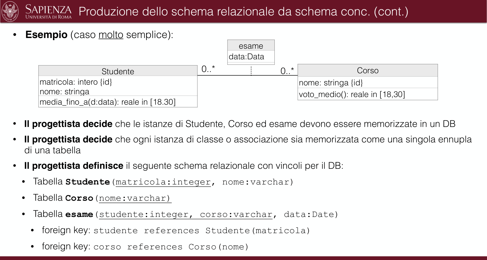

                Produzione dello schema relazionale da schema conc. (cont.)
  •
  Esempio (caso leggermente più complesso):
                                                insegna
                                                da:Data
        1..*
        1..*
        Docente
        matricola: intero {id}
        nome: stringa
                                                                         Corso
                                                             voto_medio(): reale in [18,30]
  •
  Il progettista decide che le istanze di Docente, Corso ed insegna devono essere memorizzate in un DB
  •
  Il progettista decide che ogni istanza di classe o associazione sia memorizzata come una singola ennupla di una tabella
  •
  Il progettista definisce il seguente schema relazionale con vincoli per il DB:
    •
    Tabella Docente(matricola:integer, nome:varchar)
      •
      vincolo di inclusione: matricola occorre in insegna(docente) <— non è foreign key!
    •
    Tabella Corso(nome:varchar)
      •
      vincolo di inclusione: nome occorre in insegna(corso) <— non è foreign key!
    •
    Tabella insegna(docente:integer, corso:varchar, da:Date)
      •
      foreign key: docente references Docente(matricola)
      •
      foreign key: corso references Corso(nome)

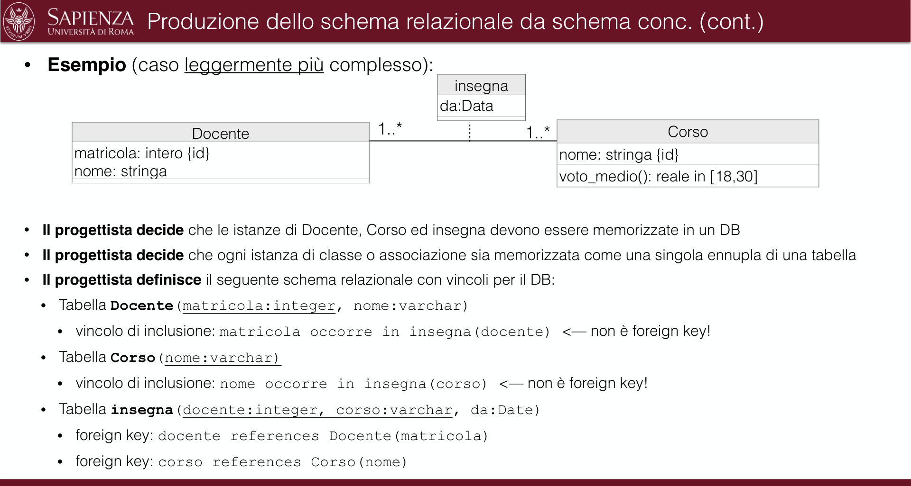

                    Una Metodologia Robusta e Scalabile
  •
  I diagrammi UML concettuali delle classi possono contenere molti costrutti ed essere complicati.
    •
    Come gestire attributi multivalore?
    •
    Come gestire relazioni is-a, generalizzazioni disgiunte e non disgiunte, complete e non complete?
    •
    …
  •
  Scrivere direttamente lo schema relazionale a partire dal diagramma delle classi UML concettuale comporta alto
  rischio di errore…
  •
  Vedremo una metodologia robusta e scalabile:
     1. Ristrutturazione del diagramma UML delle classi: a partire dal diagramma delle classi concettuale il progettista
     produce:
      •
      un nuovo (!) diagramma delle classi (ristrutturato). Il nuovo diagramma:
        •
        definisce solo le classi le cui istanze vanno memorizzate nel DB
        •
        non ha operazioni di classe (non supportate dai DBMS relazionali; gestite nella fase di progettazione delle
        funzionalità)
      •
      è equivalente all’originale, ovvero permette di rappresentare gli stessi livelli estensionali dei dati (al più con struttura
      diversa)
      •
      contiene solo i costrutti più semplici: classe, associazione, attributi di tipi di dato disponibili SQL (base o definiti dal
      progettista, v. slide su SQL) e con molteplicità massima pari ad 1
     •
     tiene conto di alcuni requisiti di performance
     2. Traduzione diretta: produciamo lo schema relazionale della base dati a partire dal diagramma delle classi
     ristrutturato e tenendo conto di ulteriori requisiti di performance.

     Parte: Cenni di ingegneria del sw
                                                Basi di dati relazionali
                                                Progettazione di basi dati relazionali
                                                Produzione dello schema relazionale con vincoli
                              UNITÀ:  B.3
                                                 Ristrutturazione del diagramma UML
                                                                  delle classi
                 Versione del 2024-05-26

               Ristrutturazione del diagramma UML delle classi
  •
  Obiettivo: trasformare la porzione del diagramma UML concettuale delle classi relativa alle classi/
  associazioni le cui istanze si vogliono memorizzare nel DB in un diagramma equivalente, ma dalla
  cui struttura si possa direttamente derivare lo schema relazionale del DB.
  •
  La metodologia prevede una sequenza di passi da eseguire nell’ordine dato. Ogni passo può
  prevedere alcune alternative da valutare caso per caso (con un occhio alle performance):
     1. Eliminazione di attributi multivalore
     2. Sostituzione dei tipi di dato concettuali con opportuni tipi supportati dal DBMS (tipi base o
     definiti dall’utente)
     3. Eliminazione delle generalizzazioni tra classi
     4. Eliminazione delle generalizzazioni tra associazioni
     5. Definizione di un identificatore per ogni classe
     6. Selezione di un identificatore primario per ogni classe
   Il diagramma delle classi ristrutturato è, dal punto di vista concettuale, di pessima qualità.
   Ma questo non è importante: la ristrutturazione è solo un modo grafico di procedere per ottenere un
   semi-lavorato equivalente all’originale e da cui facilmente produrre lo schema relazionale del DB!

     Parte: Cenni di ingegneria del sw
                                                     Basi di dati relazionali
                                                     Progettazione di basi dati relazionali
                                                     Produzione dello schema rel. con vincoli
                                                     Ristrutturazione del diagramma UML delle classi
                              UNITÀ:  B.3
                                                           Eliminazione di attributi
                                                                   multivalore
                 Versione del 2024-05-26

                      Eliminazione di Attributi Multivalore
  Obiettivo:
  •
  Ristrutturare il diagramma UML concettuale delle classi in uno equivalente che non contenga attributi
  multivalore (che non sono supportati dai DBMS).
  Metodologia:
  • Creare una nuova classe le cui istanze rappresentano i valori del tipo di dato effettivamente utilizzate nel
  livello degli oggetti e dei link
      Esito del passo di ristrutturazione
      Diagramma delle classi concettuale
                                                                       email
       Studente
       matricola: intero {id}
       nome: stringa
       email: stringa [X..Y]
                                                 Studente
                                                 nome: stringa
                                                                                 IndirizzoEmail
                                                                                 valore: stringa {id}
                                                                  X..Y
                                                                                 Non vogliamo
                                                                                 rappresentare nel DB
                                                                                  più volte la  stessa
                                         Sempre 1..*!
                                         Stiamo imponendo che il DB dovrà
                                         memorizzare solo gli indirizzi email
                                         effettivamente associati ad (almeno) uno
  istanza del tipo
  Nota: la nuova classe UML non ha
  alcuna rilevanza concettuale. Stiamo
  abusando del concetto di classe per
  rappresentare i valori di un tipo di dato.
                                                                           E’ la molteplicità dell’attributo
                                                                                concettuale: X..Y
                                                     studente

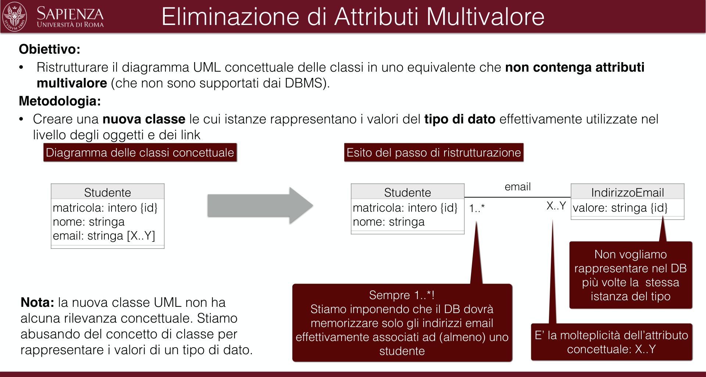

                 Eliminazione di Attributi Multivalore (cont.)
  Esempio: eliminazione degli attributi multivalore di associazione
     Esito del passo di ristrutturazione
     Diagramma delle classi concettuale
                                                                     esame
                                                                                Corso
      Studente
      matricola: intero {id}
      nome: stringa
                                                Studente
                                                nome: stringa
                                                                         esame_prova
        0..*
                                                                                    DataProva
                                                                                    data: Data {id}
                                                                  esame
                esame
                                                                        X..Y
                          Una data per ogni
                                                                voto: 18..31
             data: Data [X..Y]
             voto: 18..31
                          prova d’esame
        0..*
      Corso
      nome: stringa {id}
                                                                                  Non vogliamo
                                                                                  rappresentare nel DB
                                                                                   più volte la  stessa
  istanza del tipo
  Nota: la nuova classe UML non ha alcuna
  rilevanza concettuale. Stiamo abusando del
  concetto di classe per rappresentare i
  valori di un tipo di dato effettivamente
  utilizzati a livello estensionale.
                                           Sempre 1..*!
                                           Stiamo imponendo che il DB dovrà
                                           memorizzare solo le date effettivamente
                                                                             E’ la molteplicità dell’attributo
                                              associate ad (almeno) un esame
                                                                                 concettuale: X..Y

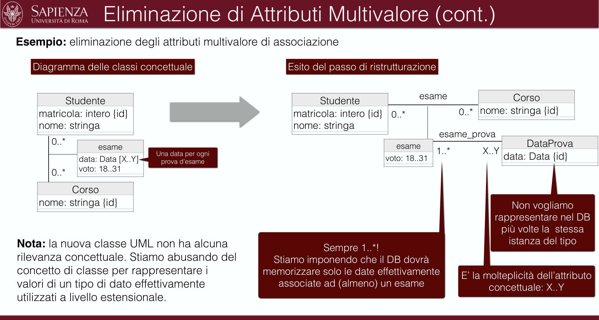

                 Eliminazione di Attributi Multivalore (cont.)
        Al termine del passo di eliminazione degli attributi multivalore tutti gli attributi del diagramma
                        ristrutturato hanno vincoli di cardinalità [0..1] oppure [1..1]

     Parte: Cenni di ingegneria del sw
                                                      Basi di dati relazionali
                                                      Progettazione di basi dati relazionali
                                                      Produzione dello schema rel. con vincoli
                                                      Ristrutturazione del diagramma UML delle
                              UNITÀ:  B.3
                                                          classi
                                                          Scelta dei tipi di dato
                 Versione del 2024-05-26

                                 Scelta dei tipi di dato
  Obiettivo:
  •
  Ristrutturare il diagramma UML concettuale delle classi in uno equivalente che contenga solo attributi di tipi
  di dato (detti anche domini) supportati dal DBMS.
  Metodologia:
  • Scegliere un opportuno tipo di dato supportato dal DBMS per ogni attributo, anche definendo, tramite SQL,
  tipi di dato utente.
    • Tipi concettuali base: intero, reale, stringa, Data, Ora, DataOra
    —> hanno un immediato corrispettivo in SQL: integer, varchar(…), Date, Time, DateTime, TimeStamp, etc.
    [link a documentazione PostgreSQL]
    • Tipi concettuali specializzati: ad es., intero > 0, reale <= 0, x..y, etc.
    —> definire nuovi tipi di dato supportati dal DBMS usando SQL: CREATE DOMAIN (v. slide su SQL DDL)
    • Tipi concettuali enumerativi: ad es., {M,F}, etc.
    —> definire nuovi tipi di dato supportati dal DBMS usando SQL: CREATE TYPE … AS ENUM (v. slide su
    SQL DDL)
    • Tipi concettuali composti: ad es., Indirizzo, etc.
    —> definire nuovi tipi di dato supportati dal DBMS usando SQL: CREATE TYPE … AS (…) (v. slide su SQL
    DDL)

                           Scelta dei tipi di dato (cont.)
  Esempio (tipi base, specializzati, enumerativi):
     Esito del passo di ristrutturazione
     Diagramma delle classi concettuale
                                                                     esame
                                                                                Corso
                                                                                nome: varchar(100) {id}
          Studente
                                                  Studente
      matricola: intero {id}
      nome: stringa
      genere: {M,F}
                                             nome: varchar(100)
                                             genere: Genere
                                                                   esame
                                                                   data:date
                                                                   voto: Voto
                esame
        0..*
             data: Data
             voto: 18..31
                                              CREATE TYPE Genere AS ENUM ('M', 'F');
        0..*
      Corso
      nome: stringa {id}
                                              CREATE DOMAIN Voto AS Integer
                                                CHECK (value >= 18 and value <= 31);

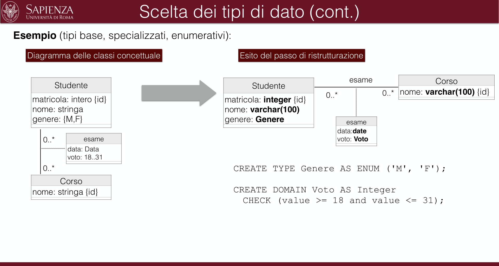

                           Scelta dei tipi di dato (cont.)
  Esempio (tipi composti):
     Esito del passo di ristrutturazione
     Diagramma delle classi concettuale
                                                                     esame
                                                                                Corso
                                                                                nome: varchar(100) {id}
          Studente
                                                   Studente
      matricola: intero {id}
      nome: stringa
      indirizzo: Indirizzo
                                              nome: varchar(100)
                                              indirizzo: Indirizzo
                                                                  esame
                                                                data: date
                                                                voto: Voto
                esame
        0..*
             data: Data
             voto: 18..31
        0..*
                                        CREATE TYPE Indirizzo (
                                                                          NOT NULL non supportato da
                                        via varchar(100) NOT NULL,
                                        civico integer NOT NULL
                                        );
      Corso
      nome: stringa {id}
                                                                                 PostgreSQL
  Tipo di dato Indirizzo: record(
                                        Nota: il costrutto CREATE TYPE è supportato da molti DBMS
                                        in modo limitato, v. slide su SQL DDL.
  - via: stringa
  - civico: intero
  )

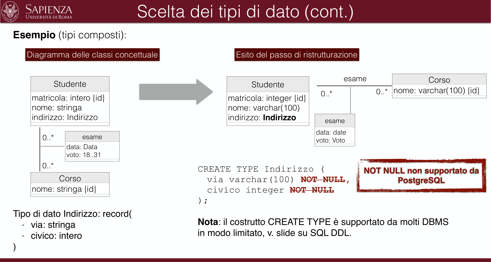

                           Scelta dei tipi di dato (cont.)
                                               Esito del passo di ristrutturazione
  Esempio (tipi composti):
     Diagramma delle classi concettuale
                                                                     esame
                                                                               Corso
                                                                               nome: varchar(100) {id}
                                                   Studente
                                              nome: varchar(100)
                                              genere: Indirizzo
          Studente
                                                                         esame_prova
                                                                                   DataProva
                                                                                   data: Date {id}
      matricola: intero {id}
      nome: stringa
      indirizzo: Indirizzo
                                                                 esame
                                                                voto: Voto
                                       CREATE TYPE Indirizzo (
                esame
        0..*
                                       via varchar(100) NOT NULL,
                                       civico integer NOT NULL CHECK (value > 0)
                                       );
             data: Data
             voto: [18,31]
        0..*
      Corso
      nome: stringa {id}
                                                                       NOT NULL e CHECK non
                                                                       supportati da PostgreSQL
                                       Come fare?
  Tipo di dato Indirizzo: record(
  - via: stringa
  - civico: intero > 0
  )

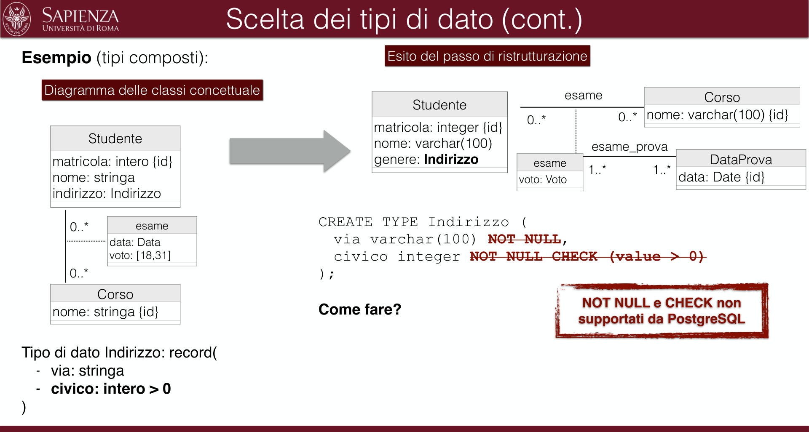

                           Scelta dei tipi di dato (cont.)
                                               Esito del passo di ristrutturazione
  Esempio (tipi composti):
     Diagramma delle classi concettuale
                                                                     esame
                                                                               Corso
                                                                               nome: varchar(100) {id}
                                                   Studente
                                              nome: varchar(100)
                                              indirizzo: Indirizzo
          Studente
                                                                         esame_prova
                                                                                   DataProva
                                                                                   data: Date {id}
      matricola: intero {id}
      nome: stringa
      indirizzo: Indirizzo
                                                                 esame
                                                                voto: Voto
                                      Metodologia: creare domini ausiliari
                esame
        0..*
             data: Data
             voto: 18..31
                                      CREATE Domain String100_not_null AS varchar(100)
                                         CHECK (value IS NOT NULL);
        0..*
      Corso
      nome: stringa {id}
                                      CREATE DOMAIN Int_gz_not_null AS Integer
                                         CHECK (value IS NOT NULL and value > 0);
  Tipo di dato Indirizzo: record(
                                      CREATE TYPE Indirizzo (
  - via: stringa
  - civico: intero > 0
  )
                                      via String100_not_null,
                                      civico Int_gz_not_null
                                      );

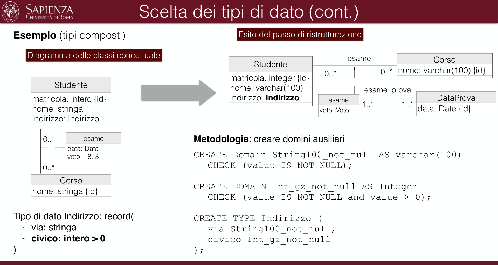

                           Scelta dei tipi di dato (cont.)
   Al termine del passo di definizione della corrispondenza dei tipi di dato concettuali in tipi supportati
    dal DBMS, tutti gli attributi del diagramma ristrutturato sono semplici, hanno un dominio supportato
                      dal DBMS ed hanno vincoli di cardinalità [0..1] oppure [1..1]

     Parte: Cenni di ingegneria del sw
                                                      Basi di dati relazionali
                                                      Progettazione di basi dati relazionali
                                                      Produzione dello schema rel. con vincoli
                                                      Ristrutturazione del diagramma UML delle
                              UNITÀ:  B.3
                                                              classi
                                                              Generalizzazioni
                 Versione del 2024-05-26

                    Ristrutturazione delle generalizzazioni
  Obiettivo:
  •
  Ristrutturare il diagramma UML concettuale delle classi in uno equivalente che non contenga relazioni-isa o
  generalizzazioni tra classi o associazioni, che non sono supportate dal DBMS.
  Metodologia:
  • Relazioni is-a o generalizzazioni tra classi: scegliere il modo più opportuno di ristrutturare ogni singolo
  livello di ogni generalizzazione, scegliendo tra tre possibili approcci:
    •
    Fusione di sottoclassi nelle loro superclassi
    •
    Divisione delle superclassi in classi disgiunte
    •
    Sostituzione di relazioni is-a con associazioni
  •
  Relazioni is-a o generalizzazioni tra associazioni:
    •
    Fusione di sotto-associazioni nelle loro super-associazioni, se opportuno a valle del passo precedente
    •
    Aggiunta di vincoli esterni (che saranno opportunamente gestiti più avanti)

                Ristrutturazione delle generalizzazioni: fusione
  Approccio: fondere un intero livello della generalizzazione (superclasse + sottoclassi) in un’unica
  classe
                                                              Persona
            Persona
                                                    nome: varchar(100)
                                                    genere: Genere
                                                    tipo: TipoPersona
                                                    Molteplicità minima
       nome: varchar(100)
       genere: Genere
                                                                                  Molteplicità minima
                                                                                    rilassata a zero
                                                                                    rilassata a zero
     Studente
     matricola: varchar(12)
                                                       iscritto
                                                                 CorsoDiLaurea
                                                                 nome: varchar(100)
            0..*
                iscritto
                                         CREATE TYPE TipoPersona AS ENUM
                                           ('Persona', 'Studente');
            1..1
     CorsoDiLaurea
     nome: varchar(100)
                                         Vincoli esterni: per ogni istanza p di Persona:
                                         1. p.tipo = ‘Studente’ se e solo se p.matricola è valorizzato:

                                         2. p.tipo = ‘Studente’ se e solo se p è coinvolto in un link “iscritto”:
                                         ∀p Persona(p) →[tipo(p, 'Studente') ↔∃m matricola(p, m)]
                                            ∀p Persona(p) →[tipo(p, 'Studente') ↔∃c iscritto(c, p)]

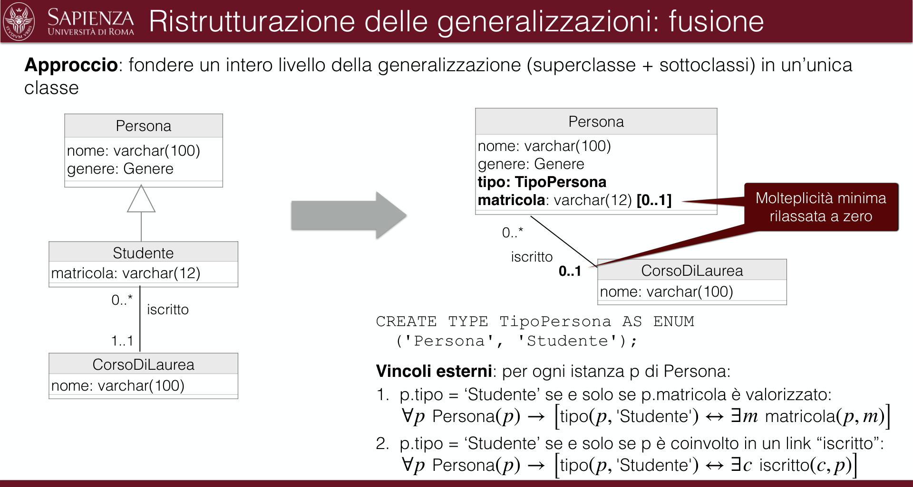

               Ristrutturazione delle generalizzazioni: fusione (cont.)
  Ristrutturazione di generalizzazioni per fusione in caso di sottoclassi disgiunte
                                                              Persona
                                                    nome: varchar(100)
                                                    tipo: TipoPersona
                                                    nascita: Date [0..1]
            Persona
                                                                                   Molteplicità minima
                                                                                   rilassata a zero
                                                                                   Molteplicità minima
                                                                                   Molteplicità minima
                                                                                   rilassata a zero
                                                                                   Molteplicità minima
       nome: varchar(100)
                                                                                     rilassata a zero
                                                                                     rilassata a zero
                {disjoint}
                                                                      afferenza
                                                    iscritto
 Studente
 matricola: varchar(12)
                      Docente
                      nascita: Date
                                                   CorsoDiLaurea
                                                   nome: varchar(100)
                                                                   Dipartimento
                                                                   nome: varchar(100)
      0..*
                                              CREATE TYPE TipoPersona AS ENUM
                                                ('Persona', 'Studente’, 'Docente');
          iscritto
                           afferenza
                                              Vincoli esterni: per ogni istanza p di Persona:
                                              1.
                                              p.tipo = ‘Studente’ se e solo se p.matricola è valorizzato:
      1..1
                                                 ∀p Persona(p) →[tipo(p, 'Studente') ↔∃m matricola(p, m)]
  CorsoDiLaurea
  nome: varchar(100)
                    Dipartimento
                    nome: varchar(100)

                                              2.
                                              p.tipo = ‘Studente’ se e solo se p è coinvolto in un link “iscritto”:
                                                 ∀p Persona(p) →[tipo(p, 'Studente') ↔∃c iscritto(c, p)]

                                              3.
                                              p.tipo = ‘Docente’ se e solo se p.nascita è valorizzato:
                                                 ∀p Persona(p) →[tipo(p, 'Docente') ↔∃n nascita(p, n)]
                          Più vincoli esterni

                             da gestire
                                              4.
                                              p.tipo = ‘Docente’ se e solo se p è coinvolto in un link “afferenza”:
                                                 ∀p Persona(p) →[tipo(p, 'Docente') ↔∃d afferenza(d, p)]

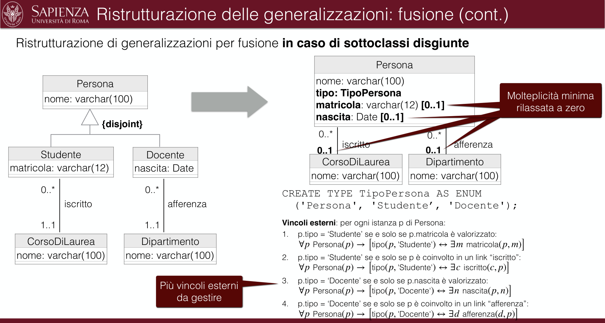

               Ristrutturazione delle generalizzazioni: fusione (cont.)
  Ristrutturazione di generalizzazioni per fusione in caso di sottoclassi disgiunte e complete
                                                              Persona
                                                    nome: varchar(100)
                                                    tipo: TipoPersona
                                                    nascita: Date [0..1]
            Persona
                                                                                   Molteplicità minima
                                                                                   rilassata a zero
                                                                                   Molteplicità minima
                                                                                   Molteplicità minima
                                                                                   rilassata a zero
                                                                                   Molteplicità minima
       nome: varchar(100)
                                                                                     rilassata a zero
                                                                                     rilassata a zero
                 {disjoint, complete}
                                                                      afferenza
                                                    iscritto
 Studente
 matricola: varchar(12)
                      Docente
                      nascita: Date
                                                   CorsoDiLaurea
                                                   nome: varchar(100)
                                                                   Dipartimento
                                                                   nome: varchar(100)
      0..*
                                                  CREATE TYPE TipoPersona AS ENUM
          iscritto
                           afferenza
                                                    ('Persona', 'Studente’, 'Docente');
                                                  Vincoli esterni: per ogni istanza p di Persona:
                                                  1.
                                                  p.tipo = ‘Studente’ se e solo se p.matricola è valorizzato:
      1..1
                                                     ∀p Persona(p) →[tipo(p, 'Studente') ↔∃m matricola(p, m)]
  CorsoDiLaurea
  nome: varchar(100)
                    Dipartimento
                    nome: varchar(100)

                                                  2.
                                                  p.tipo = ‘Studente’ se e solo se p è coinvolto in un link “iscritto”:
                                                     ∀p Persona(p) →[tipo(p, 'Studente') ↔∃c iscritto(c, p)]

                                                  3.
                                                  p.tipo = ‘Docente’ se e solo se p.nascita è valorizzato:
                                                     ∀p Persona(p) →[tipo(p, 'Docente') ↔∃n nascita(p, n)]
                             Più vincoli esterni

                                da gestire
                                                  4.
                                                  p.tipo = ‘Docente’ se e solo se p è coinvolto in un link “afferenza”:
                                                     ∀p Persona(p) →[tipo(p, 'Docente') ↔∃d afferenza(d, p)]

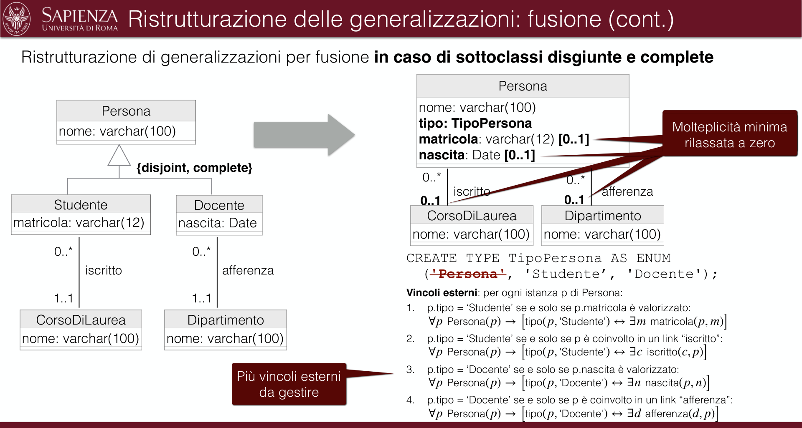

               Ristrutturazione delle generalizzazioni: fusione (cont.)
  Ristrutturazione di generalizzazioni per fusione in caso di sottoclassi disgiunte
                                                    Persona
                                                    nome: varchar(100)
                                                    is_studente:boolean
                                                    is_docente:boolean
                                                    nascita: Date [0..1]
            Persona
                                                                                   Molteplicità minima
                                                                                   Molteplicità minima
                                                                                   Molteplicità minima
                                                                                   rilassata a zero
                                                                                   Molteplicità minima
       nome: varchar(100)
                                                                                     rilassata a zero
                                                                                     rilassata a zero
                                                                                     rilassata a zero
                {disjoint}
                                                                      afferenza
                                                    iscritto
 Studente
 matricola: varchar(12)
                      Docente
                      nascita: Date
                                                   CorsoDiLaurea
                                                   nome: varchar(100)
                                                                   Dipartimento
                                                                   nome: varchar(100)
      0..*
          iscritto
                           afferenza
                                           Vincoli esterni: per ogni istanza p di Persona:
                                           1.
                                           p.is_studente = TRUE se e solo se p.matricola è valorizzato:
                                             ∀p Persona(p) →[is_studente(p, true) ↔∃m matricola(p, m)]
      1..1

  CorsoDiLaurea
  nome: varchar(100)
                    Dipartimento
                    nome: varchar(100)
                                           2.
                                           p.is_studente = TRUE se e solo se p è coinvolto in un link “iscritto”:
                                             ∀p Persona(p) →[is_studente(p, true) ↔∃c iscritto(c, p)]

                                           3.
                                           p.is_docente = TRUE se e solo se p.nascita è valorizzato:
                                             ∀p Persona(p) →[is_docente(p, true) ↔∃n nascita(p, n)]

                                           4.
                                           p.is_docente = TRUE se e solo se p è coinvolto in un link “afferenza”:
                                             ∀p Persona(p) →[is_docente(p, true) ↔∃d afferenza(d, p)]

               Ristrutturazione delle generalizzazioni: fusione (cont.)
  Ristrutturazione di generalizzazioni per fusione in caso di sottoclassi disgiunte
                                                    Persona
                                                    nome: varchar(100)
                                                    is_studente:boolean
                                                    is_docente:boolean
                                                    nascita: Date [0..1]
            Persona
                                                                                   Molteplicità minima
                                                                                   Molteplicità minima
                                                                                   Molteplicità minima
                                                                                   rilassata a zero
                                                                                   Molteplicità minima
       nome: varchar(100)
                                                                                     rilassata a zero
                                                                                     rilassata a zero
                                                                                     rilassata a zero
                 {disjoint, complete}
                                                                      afferenza
                                                    iscritto
 Studente
 matricola: varchar(12)
                      Docente
                      nascita: Date
                                                   CorsoDiLaurea
                                                   nome: varchar(100)
                                                                   Dipartimento
                                                                   nome: varchar(100)
      0..*
                                                     Vincoli esterni: per ogni istanza p di Persona:
                                                     1.
                                                     p.is_studente = TRUE se e solo se p.matricola è valorizzato:
          iscritto
                           afferenza
                                                        ∀p Persona(p) →[is_studente(p, true) ↔∃m matricola(p, m)]

      1..1
                                                     2.
                                                     p.is_studente = TRUE se e solo se p è coinvolto in un link “iscritto”:
                                                        ∀p Persona(p) →[is_studente(p, true) ↔∃c iscritto(c, p)]
  CorsoDiLaurea
  nome: varchar(100)
                    Dipartimento
                    nome: varchar(100)

                                                     3.
                                                     p.is_docente = TRUE se e solo se p.nascita è valorizzato:
                                                        ∀p Persona(p) →[is_docente(p, true) ↔∃n nascita(p, n)]

                                                     4.
                                                     p.is_docente = TRUE se e solo se p è coinvolto in un link “afferenza”:
                                                        ∀p Persona(p) →[is_docente(p, true) ↔∃d afferenza(d, p)]

                                                     5.
                                                     p.is_docente = TRUE oppure p.is_studente = TRUE
                                                        ∀p Persona(p) →[is_docente(p, true) ∨is_studente(p, true]

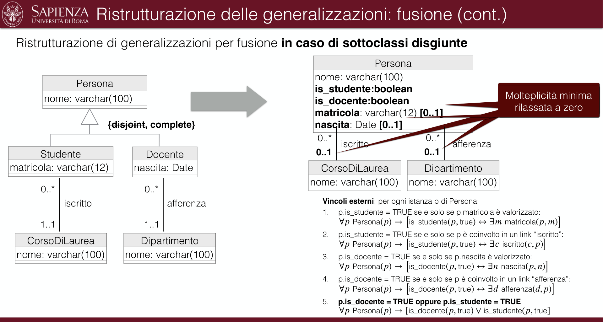

               Ristrutt. delle generalizzazioni: divisione in classi disgiunte
  Ristrutturazione di generalizzazioni per divisione in caso di sottoclassi disgiunte e complete
                  1..1
         Città
         nome: varchar(100)
         residenza
                                               Città
                                               nome: varchar(100)
                                               residenza_stud
                                                                               residenza_doc
                 0..*
                                                                   Moltiplicar
                                                                   Moltiplicare
                                                                   Moltiplicare
                                                                   Moltiplicare
             Persona
                                                                   e attributi
                                                                   attributi e
                                                                   attributi e
                                                                    attributi e
        cf: CodiceFiscale {id}
        nome: varchar(100)
                                                Studente
                                                nome: varchar(100)
                                                cf: CodiceFiscale {id}
                                                matricola: varchar(12)
                                                                             Docente
                                                                             nome: varchar(100)
                                                                             cf: CodiceFiscale {id}
                                                                             nascita: Date
                                                                    e ruoli!
                                                                     ruoli
                                                                     ruoli
                                                                      ruoli
                  {disjoint, complete}
                                                      iscritto
                                                                                afferenza
  Studente
  matricola: varchar(12)
                       Docente
                       nascita: Date
                                                  CorsoDiLaurea
                                                  nome: varchar(100)
                                                                             Dipartimento
                                                                             nome: varchar(100)
      iscritto
      1..1
      0..*
                       afferenza
                                        Vincoli esterni:
                                        1. non devono esistere s:Studente e d:Docente tali che s.cf = d.cf:
                                        ¬∃s, d, v Studente(s) ∧Docente(d) ∧cf(s, v) ∧cf(d, v)
  CorsoDiLaurea
  nome: varchar(100)
                    Dipartimento
                    nome: varchar(100)
                                                              Approccio problematico per generalizzazioni
                    Per recuperare la semantica
                    del vincolo di identificazione
                                                                  non complete e/o non disgiunte
                                                             In generale: approccio da usare con cautela!
                      concettuale in Persona

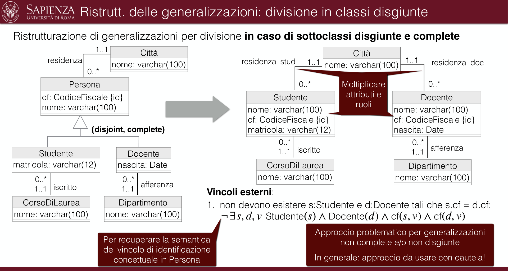

                Ristrutturazione delle generalizzazioni: sost. di relazioni is-a con associazioni
  Ristrutturazione di relazioni is-a indipendenti o generalizzazioni non disgiunte e non complete
                                                                  Persona
                                                                  nome: varchar(100)
                                                                                   d_isa_p
                                                    s_isa_p
                Persona
           nome: varchar(100)
                                                    Studente
                                                    matricola: varchar(12)
                                                                                   Docente
                                                                                   nascita: Date
                                                                       Aggiungiamo
                                                                       Aggiungiamo
                                                                      identificatore
                                                                      esterno per le ex
                                                                      identificatore
                                                                      esterno per le ex
                                                          iscritto
                                                          afferenza
 Studente
 matricola: varchar(12)
                      Docente
                      nascita: Date
                                                                        sottoclassi
                                                                        sottoclassi
                                                    CorsoDiLaurea
                                                    nome: varchar(100)
                                                                                 Dipartimento
                                                                                 nome: varchar(100)
      0..*
          iscritto
                           afferenza
      1..1
  CorsoDiLaurea
  nome: varchar(100)
                    Dipartimento
                    nome: varchar(100)
                                                           Struttura perfettamente mantenuta

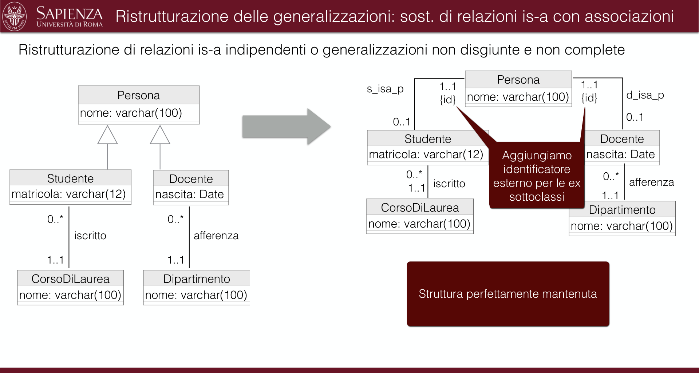

                Ristrutturazione delle generalizzazioni: sost. di relazioni is-a con associazioni
  Ristrutturazione in caso di sottoclassi disgiunte
                                                                  Persona
                                                                  nome: varchar(100)
            Persona
       nome: varchar(100)
                                                    s_isa_p
                                                    d_isa_p
                                                    Studente
                                                    matricola: varchar(12)
                                                                                   Docente
                                                                                   nascita: Date
                 {disjoint}
                                                          iscritto
                                                          afferenza
 Studente
 matricola: varchar(12)
                      Docente
                      nascita: Date
                                                    CorsoDiLaurea
                                                    nome: varchar(100)
                                                                                 Dipartimento
                                                                                 nome: varchar(100)
      0..*
          iscritto
                           afferenza
      1..1
  CorsoDiLaurea
  nome: varchar(100)
                    Dipartimento
                    nome: varchar(100)
                                      Vincoli esterni:
                                      1. Disgiunzione: non devono esistere p:Persona, s:Studente e
                                      d:Docente tali che (s, p): s_isa_p e (d, p): d_isa_p:
                                         ¬∃p, s, d Persona(p) ∧Studente(s) ∧Docente(d) ∧s_isa_p(s, p) ∧d_isa_p(d, p)

               Ristrutturazione delle generalizzazioni: sost. di relazioni is-a con associazioni
  Ristrutturazione in caso di sottoclassi complete
                                                                  Persona
                                                                  nome: varchar(100)
            Persona
       nome: varchar(100)
                                                    s_isa_p
                                                    d_isa_p
                                                    Studente
                                                    matricola: varchar(12)
                                                                                   Docente
                                                                                   nascita: Date
                {complete}
                                                          iscritto
                                                          afferenza
 Studente
 matricola: varchar(12)
                      Docente
                      nascita: Date
                                                    CorsoDiLaurea
                                                    nome: varchar(100)
                                                                                 Dipartimento
                                                                                 nome: varchar(100)
      0..*
          iscritto
                           afferenza
                                        Vincoli esterni:
                                        1. Completezza: per ogni p:Persona:
      1..1
  CorsoDiLaurea
  nome: varchar(100)
                    Dipartimento
                    nome: varchar(100)
                                          • esiste s:Studente per cui: (s, p): s_isa_p
                                          • oppure esiste d:Docente per cui: (d, p): d_isa_p:
                                          ∀p Persona(p) →[∃s s_isa_p(s, p)] ∨[∃d d_isa_p(d, p)]

                Ristrutturazione delle generalizzazioni: sost. di relazioni is-a con associazioni
  Ristrutturazione in caso di sottoclassi disgiunte e complete
                                                                  Persona
                                                                  nome: varchar(100)
            Persona
       nome: varchar(100)
                                                    s_isa_p
                                                    d_isa_p
                                                    Studente
                                                    matricola: varchar(12)
                                                                                   Docente
                                                                                   nascita: Date
                 {disjoint, complete}
                                                          iscritto
                                                          afferenza
 Studente
 matricola: varchar(12)
                      Docente
                      nascita: Date
                                                    CorsoDiLaurea
                                                    nome: varchar(100)
                                                                                 Dipartimento
                                                                                 nome: varchar(100)
      0..*
                                      Vincoli esterni:
                                      1. Disgiunzione: non devono esistere p:Persona, s:Studente e
                                      d:Docente tali che (s, p): s_isa_p e (d, p): d_isa_p:
          iscritto
                           afferenza
      1..1
  CorsoDiLaurea
  nome: varchar(100)
                    Dipartimento
                    nome: varchar(100)
                                        ¬∃p, s, d Persona(p) ∧Studente(s) ∧Docente(d) ∧s_isa_p(s, p) ∧d_isa_p(d, p)
                                      2. Completezza: per ogni p:Persona:
                                       • esiste s:Studente per cui: (s, p): s_isa_p
                                       • oppure esiste d:Docente per cui: (d, p): d_isa_p
                                        ∀p Persona(p) →[∃s s_isa_p(s, p)] ∨[∃d d_isa_p(d, p)]

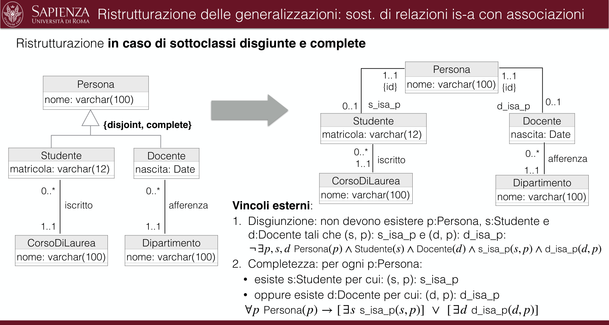

               Ristrutturazione delle generalizzazioni tra associazioni: fusione
  Ristrutturazione in caso le relazioni is-a tra classi siano state ristrutturate per fusione
                                                                    ArticoloInVendita
     ArticoloInVendita
                                                                   nome: varchar(100)
                                                                   cond: CondArticolo
                                                                   anni_garanzia: IntGEZ
                                Utente
                                nome: varchar(100)
   nome: varchar(100)
   anni_garanzia: IntGEZ
                    venditore
                    istante: DataOra
                                                                       venditore
                                                                       istante: DataOra
                                                                   Utente
                                                                   nome: varchar(100)
                                                                   tipo: TipoUtente
                      vend_nuovo
     ArticoloNuovo
                                  Venditore
                                  Professionale
  anni_garanzia: IntGE2
                                               CREATE TYPE CondArticolo AS
                                               ENUM (‘nuovo’, ‘usato’);
                                               CREATE TYPE TipoUtente AS
                                                 ENUM (‘privato’, ‘prof’);
 CREATE DOMAIN IntGEZ AS Integer
 (check value >= 0);
 CREATE DOMAIN IntGE2 AS Integer
                                               Vincoli esterni:
                                               1.
                                               per ogni a:ArticoloInVendita:
                                                 •
                                                 se a.cond = ‘nuovo’ allora a.anni_garanzia >= 2:
   (check value >= 2);
                                                   ∀a, g ArticoloInVendita(a) ∧anni_garanzia(a, g) ∧cond(a, nuovo) →g ≥2
                                                 •
                                                 se a.cond = ‘nuovo’ allora il link (a,u):venditore nel quale ‘a’ è coinvolto
                                                 è tale che u.tipo = ‘prof’
                                                   ∀a, u ArticoloInVendita(a) ∧venditore(a, u) ∧cond(a, nuovo) →tipo(u, prof)

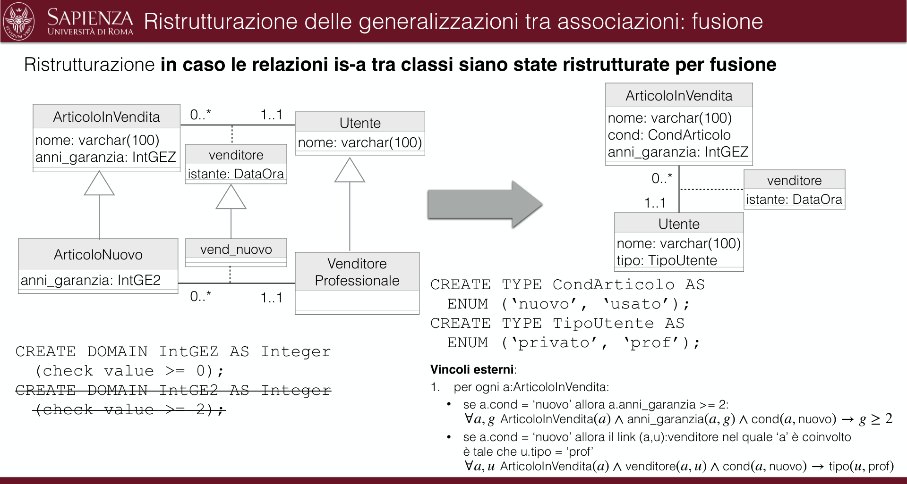

                Ristrutturazione delle generalizzazioni tra associazioni: sost. con associazioni
  Ristrutturazione in caso le relazioni is-a tra classi siano state ristrutturate per sostituzione con
  associazioni
         Articolo
                                                         Articolo
                                Utente
                                nome: varchar(100)
                                                                                Utente
                                                                                nome: varchar(100)
   nome: varchar(100)
   anni_garanzia: IntGEZ
                                                   nome: varchar(100)
                                                   anni_garanzia: IntGEZ
                    venditore
                    istante: DataOra
                                                                    venditore
                                                                    istante: DataOra
                                                            an_isa_a
                                                            vp_isa_u
                      vend_nuovo
                                                                      vend_nuovo
                                                     ArticoloNuovo
     ArticoloNuovo
                                  Venditore
                                  Professionale
                                                                                  Venditore
                                                                                  Professionale
                                                  codice_ean: varchar(50)
  codice_ean: varchar(50)
  anni_garanzia: IntGE2
                                p_iva: varchar(50)
                                                                                p_iva: varchar(50)
                                     Vincoli esterni:
                                     1.
                                     per ogni an:ArticoloNuovo, l’istanza a:Articolo tale che (an, a):an_isa_a deve avere:
                                     a.anni_garanzia >= 2
CREATE DOMAIN IntGEZ AS Integer
(check value >= 0);
CREATE DOMAIN IntGE2 AS Integer
                                        ∀an, a, g ArticoloNuovo(an) ∧Articolo(a) ∧an_isa_a(an, a) ∧anni_garanzia(a, g) →g ≥2
  (check value >= 2);
                                     2.
                                     per ogni an:ArticoloNuovo, a:Articolo, vp:VendProf, u:Utente tali che:
                                        •
                                        (an,vp): vend_nuovo, (an, a): an_isa_a, (vp, u): vp_isa_u
                                        deve essere: (a, u): venditore:
                                        ∀an, a, vp, u ArticoloNuovo(an) ∧Articolo(a) ∧VendProf(vp) ∧Utente(u) ∧

                                           vend_nuovo(an, vp) ∧an_isa_a(an, a) ∧vp_isa_u(vp, u) →venditore(a, u)

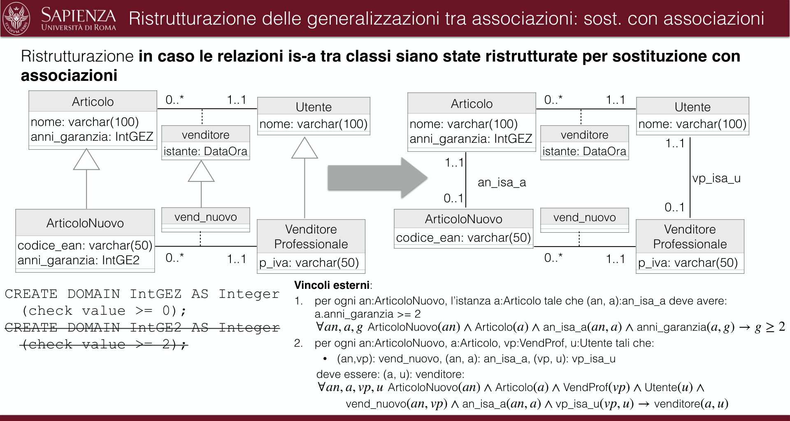

                Ristrutturazione delle generalizzazioni (cont.)
     Al termine del passo di ristrutturazione delle generalizzazioni, tutte le classi e le associazioni del
         diagramma ristrutturato definiscono insiemi di istanze (oggetti o link) disgiunte a coppie

     Parte: Cenni di ingegneria del sw
                                                      Basi di dati relazionali
                                                      Progettazione di basi dati relazionali
                                                      Produzione dello schema rel. con vincoli
                                                      Ristrutturazione del diagramma UML delle
                              UNITÀ:  B.3
                                                          classi
                                                          Identificatori di classe
                 Versione del 2024-05-26

                                Identificatori di classe
  Obiettivo:
  •
  Ristrutturare il diagramma UML concettuale delle classi in uno equivalente che abbia almeno un
  identificatore per ogni classe, che fungerà da chiave della futura tabella del DB, ed eleggere un
  identificatore primario per ogni classe, che lungherà da chiave primaria della futura tabella.
  Metodologia:
  •
  Per ogni classe con identificatori concettuali, decidere se uno tra quelli disponibili è di qualità sufficiente
  per formare una chiave primaria: non deve essere troppo complesso. Eleggerlo a identificatore primario.
  •
  Per ogni classe senza identificatori concettuali, o per la quale non è stato scelto un identificatore primario
  al passo precedente, definire un identificatore artificiale.

                           Identificatori di classe (cont.)
             Persona
             nome: varchar(100)
             cf: CodiceFiscale {id}
                                 d_isa_p
         1..1
         {id2}
                                                                   Persona
                                                                   nome: varchar(100)
                                                                   cf: CodiceFiscale {id1}
   s_isa_p
                                                       s_isa_p
                                                       d_isa_p
      0..1
      0..1
Studente
matricola: varchar(12) {id1}
                       Docente
                       nascita: Date
                                                        Studente
                                                        matricola: varchar(12) {id2}
                                                                                   Docente
                                                                                   nascita: Date
        iscritto
        1..1
        0..*
        afferenza
        1..1
                                                                iscritto
                                                                afferenza
  CorsoDiLaurea
  nome: varchar(100)
                     Dipartimento
                     nome: varchar(100)
                                                           CorsoDiLaurea
                                                           id: integer {id1}
                                                           nome: varchar(100)
                                                                              Dipartimento
                                                                              id: integer {id1}
                                                                              nome: varchar(100)
             Per le classi che erano sotto-classi di generalizzazioni
             Per le classi che erano sotto-classi di generalizzazioni
              ristrutturate mediante sostituzione con associazioni,
              ristrutturate mediante sostituzione con associazioni,
                 questo identificatore deve essere il primario
                 questo identificatore deve essere il primario
                                                                 Identificatori artificiali, di
                                                                 nessuna rilevanza concettuale
                                                                 Identificatori artificiali, di
                                                                 nessuna rilevanza concettuale
   Attributi e ruoli identificatori primari di una classe denotati con {id1}
          Eventuali altri identificatori con {id2}, {id3}, etc.
S.B.3. 38

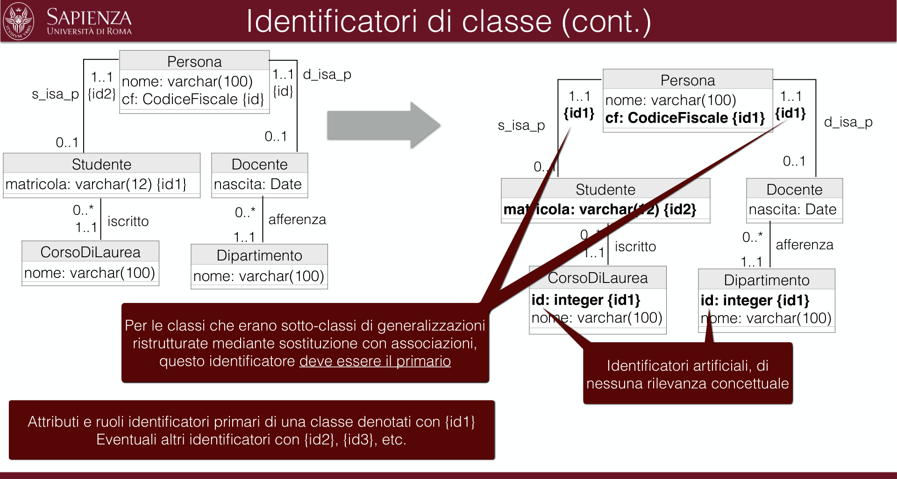

                           Identificatori di classe (cont.)
  •
  Controllare che non ci siano cicli di identificatori primari esterni
                    ab
          A
          a {id1}
                         B
                         b {id1}
                                                  Ciclo di identificatori primari esterni:
                                                  • per identificare (id. primario) un oggetto di A serve il
                                                  valore dell’attributo ‘a’ e un oggetto di B
         1..1
         {id1}
                                                  • per identificare (id. primario) un oggetto di B serve il
                                                  valore dell’attributo ‘b’ e un oggetto di C
              bc
              ac
                                                  • per identificare (id. primario) un oggetto di C serve il
                                                  valore dell’attributo ‘c’ e un oggetto di …A (!)
                  C
                  c {id1}
                                                                           ab
                                                                 A
                                                                 a {id1}
                                                                                   B
                                                                                id {id1}
                                                                                b {id2}
     Rompere cicli di identificatori primari esterni:
                                                                     bc
                                                                     ac
     • scegliere la/le classi più opportuna/e ed
     eleggere per questa/e un altro identificatore
     (anche creandone uno artificiale)
                                                                        C
                                                                        c {id1}
                                                                               {id2}

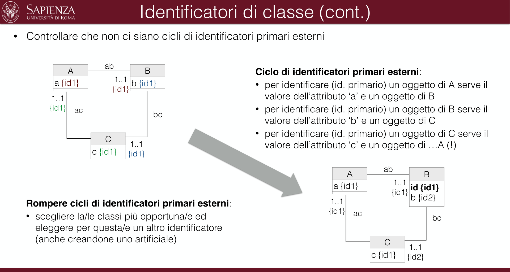

                Ristrutturazione delle generalizzazioni (cont.)
   Al termine del passo di definizione degli identificatori di classi, tutte le classi hanno almeno un
   identificatore, ne hanno certamente uno primario, e gli identificatori primari esterni non formano cicli.

     Parte: Cenni di ingegneria del sw
                                                      Basi di dati relazionali
                                                      Progettazione di basi dati relazionali
                                                      Produzione dello schema rel. con vincoli
                                                      Ristrutturazione del diagramma UML delle
                              UNITÀ:  B.3
                                                     classi
                                                     Specifica dei vincoli esterni
                 Versione del 2024-05-26

                                       Vincoli esterni
  Obiettivo:
  •
  Ristrutturare i vincoli esterni al diagramma UML concettuale delle classi in vincoli equivalenti sul diagramma
  UML delle classi ristrutturato.
  Metodologia:
  •
  Aggiungere al documento di specifica ristrutturata dei vincoli esterni i vincoli esterni definiti, in fase di
  analisi, nelle specifiche concettuali delle classi e nella specifica concettuale dei vincoli esterni,
  opportunamente adattati alla struttura del diagramma UML delle classi ristrutturato.

                                 Vincoli esterni (cont.)
  Esempio:
                                                                 Impiegato
                                                                 nome: varchar
                                                                 tipo:{Impiegato, Direttore}
                                                                 nascita: Date
      Impiegato
      nome: stringa
                       Direttore
                       nascita: Data
   0..*
                        dirige
         afferenza
                                                                     afferenza
                                                                                     dirige
        inizio: Data
   1..1
                                                                    inizio: Date
      Dipartimento
      nome: stringa
                                                                 Dipartimento
                                                                 nome: archer
 Vincolo esterno:
                                                        Vincolo esterno:
  I direttori devono afferire al dipartimento che dirigono da
  almeno 5 anni.
                                                         [V.Dipartimento.direttore_anni_afferenza]
                                                         Per ogni oggetto dip:Dipartimento, sia dir:Impiegato il
                                                         direttore di dip, ovvero tale che (dip, dir):dirige.
                                                         Deve essere:
  [V.Dipartimento.direttore_anni_afferenza]
  Per ogni oggetto dip:Dipartimento, sia dir:Direttore il direttore
  di dip, ovvero tale che (dip, dir):dirige.
  (Grazie alle due generalizzazioni, è anche vero che (dip,
  dir):afferenza)
                                                          1. (dir, dip) è anche istanza della associazione
                                                          “afferenza”
                                                          2. (dir, dip).inizio <= adesso - 5 anni
  Deve essere: (dir, dip).inizio <= adesso - 5 anni

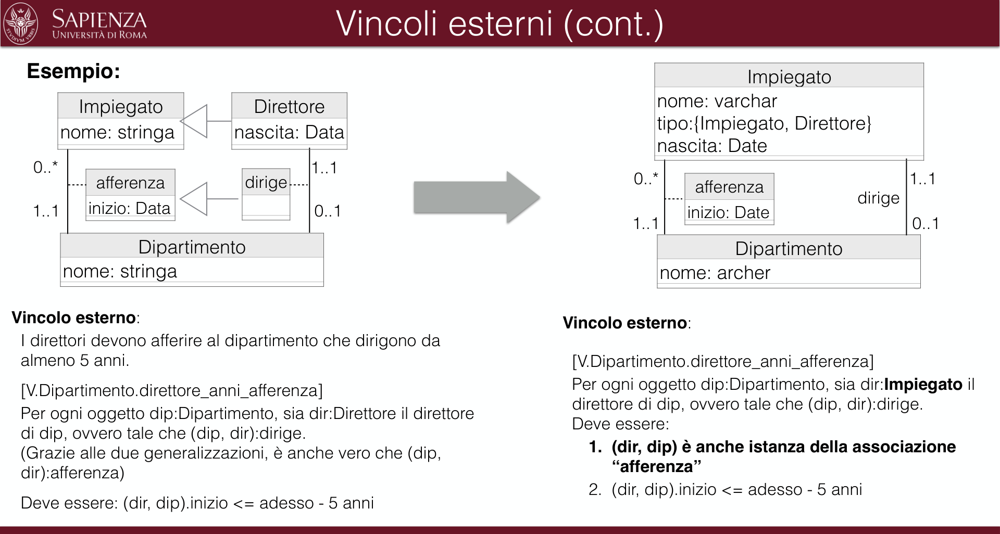

     Parte: Cenni di ingegneria del sw
                                                     Basi di dati relazionali
                                                     Progettazione di basi dati relazionali
                                                     Produzione dello schema rel. con vincoli
                                                     Ristrutturazione del diagramma UML delle classi
                              UNITÀ:  B.3
                                                       Specifica delle operazioni di
                                                            classe e di use-case
                 Versione del 2024-05-26

               Specifica delle operazioni di classe e di use-case
  Obiettivo:
  •
  Ristrutturare le specifiche concettuali di classi e di use-case in nuove specifiche equivalenti sul diagramma
  UML delle classi ristrutturato.
  Metodologia:
  •
  Ristrutturare la specifica di ogni operazione di classe, di ogni vincolo di classe, e di ogni operazione di use-
  case in modo da adattarla alla nuova struttura del diagramma UML delle classi ristrutturato.

               Specifica delle operazioni di classe e di use-case (cont.)
   Al termine del passo di ristrutturazione della specifica delle operazioni di classe, dei vincoli di classe
   e delle operazioni di use-case, tutti i documenti di specifica sono ora coerenti con la nuova struttura
                             del diagramma UML delle classi ristrutturato.

     Parte: Cenni di ingegneria del sw
                                                       Basi di dati relazionali
                                                       Progettazione di basi dati relazionali
                                                       Produzione dello schema rel. con vincoli
                                                       Traduzione diretta del
                                                       diagramma UML delle classi
                              UNITÀ:  B.3
                                                                  ristrutturato
                 Versione del 2024-05-26

               Traduzione diretta del diagramma UML delle classi ristrutturato
  •
  Obiettivo: generare lo schema relazionale (con vincoli) per la base dati.
    •
    Input: diagramma delle classi UML ristrutturato e specifiche ristrutturate
    •
    Output: un insieme di tabelle relazionali con vincoli di integrità.
  •
  Metodologia:
    •
    Ogni classe si traduce in una tabella relazionale
    •
    Ogni associazione si traduce in una tabella relazionale più vincoli di foreign key (oppure si
    accorpa nella tabella che traduce una delle classi coinvolte)
    •
    I vincoli di molteplicità dei ruoli di associazione si traducono in vincoli di chiave, foreign key, o in
    vincoli esterni (tipicamente, vincoli di inclusione più generale).

               Traduzione diretta del diagramma UML delle classi ristrutturato: classi
                                                       Corso
                                                       nome: varchar {id1}
                                                       modalita: Modalita [0..1]
                          Studente
                    matricola: integer {id1}
                    nome: varchar
                    genere: Genere
                                                          CREATE TABLE Studente (
 Studente(matricola:integer, nome:varchar, genere:Genere)
                                                          matricola integer not null,
                                                          nome varchar not null,
                                                          genere Genere not null,
                                                          primary key (matricola)
                                                          );
 Corso(nome:varchar, modalita*: Modalita)
                                                          CREATE TABLE Corso (
 (*): può assumere valori NULL
                                                          nome varchar not null,
                                                          modalita Modalita, -- anche NULL
                                                          primary key (nome)
                                                          );
S.B.3. 49

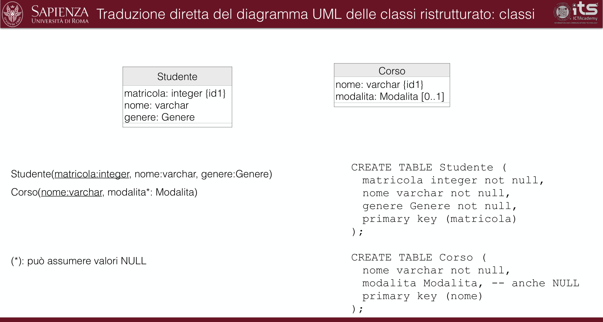

                Traduzione diretta del diagramma UML delle classi ristrutturato: associazioni
                                             esame
                                                       Corso
                                                       modalita: Modalita [0.,1]
                          Studente
                    nome: varchar
                    genere: Genere
                                            esame
                                           voto: Voto
 Studente(matricola:integer, nome:varchar, genere:Genere)
 Corso(nome:varchar, modalita* Modalita)
 esame ( studente:integer ,      corso:varchar,      voto:Voto)
   foreign key: studente ref. Studente(matricola)
   foreign key: corso ref. Corso(nome)
 (*): può assumere valori NULL
S.B.3. 50

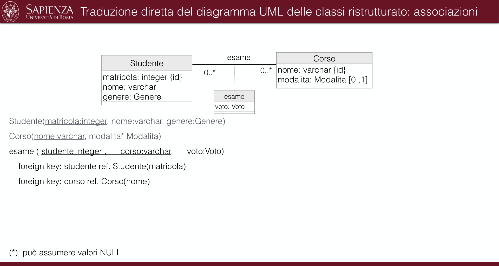

                Traduzione diretta del diagramma UML delle classi ristrutturato: associazioni
                                             esame
                                                       Corso
                                                       modalita: Modalita [0.,1]
                          Studente
                    nome: varchar
                    genere: Genere
                                            esame
                                           voto: Voto
 Studente(matricola:integer, nome:varchar, genere:Genere)
 Corso(nome:varchar, modalita* Modalita)
 esame ( studente:integer ,      corso:varchar,      voto:Voto)
   foreign key: studente ref. Studente(matricola)
   foreign key: corso ref. Corso(nome)
 Attributi uno-ad-uno con attributi
    di una chiave di Studente
 (*): può assumere valori NULL
S.B.3. 50

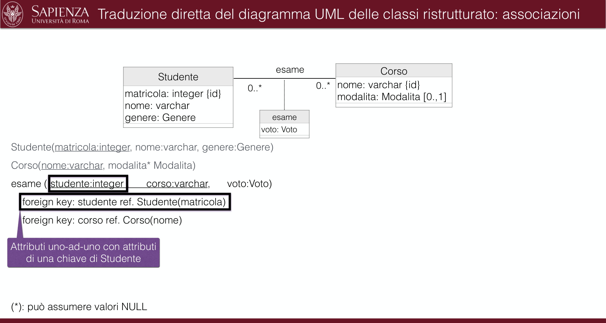

                Traduzione diretta del diagramma UML delle classi ristrutturato: associazioni
                                             esame
                                                       Corso
                                                       modalita: Modalita [0.,1]
                          Studente
                    nome: varchar
                    genere: Genere
                                            esame
                                           voto: Voto
 Studente(matricola:integer, nome:varchar, genere:Genere)
 Corso(nome:varchar, modalita* Modalita)
 esame ( studente:integer ,      corso:varchar,      voto:Voto)
   foreign key: studente ref. Studente(matricola)
   foreign key: corso ref. Corso(nome)
 Attributi uno-ad-uno con attributi
    di una chiave di Studente
          Attributi uno-ad-uno con
          attributi di una chiave di Corso
 (*): può assumere valori NULL
S.B.3. 50

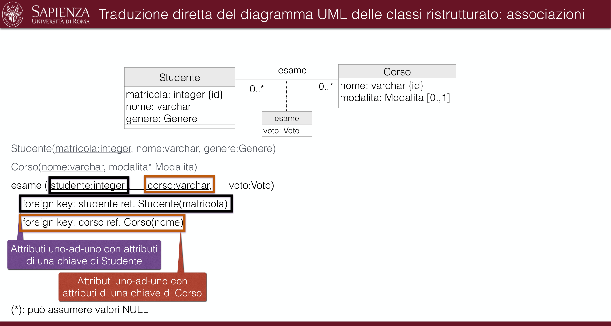

                Traduzione diretta del diagramma UML delle classi ristrutturato: associazioni
                                             esame
                                                       Corso
                                                       modalita: Modalita [0.,1]
                          Studente
                    nome: varchar
                    genere: Genere
                                            esame
                                           voto: Voto
 Studente(matricola:integer, nome:varchar, genere:Genere)
 Corso(nome:varchar, modalita* Modalita)
 esame ( studente:integer ,      corso:varchar,      voto:Voto)
   foreign key: studente ref. Studente(matricola)
   foreign key: corso ref. Corso(nome)
 Attributi uno-ad-uno con attributi
    di una chiave di Studente
                                    Tutti e soli gli attributi
          Attributi uno-ad-uno con
          attributi di una chiave di Corso
                                     chiave primaria di
                                         ‘esame’
 (*): può assumere valori NULL
S.B.3. 50

                Traduzione diretta del diagramma UML delle classi ristrutturato: associazioni
                                             esame
                                                       Corso
                                                       modalita: Modalita [0.,1]
                          Studente
                    nome: varchar
                    genere: Genere
                                            esame
                                           voto: Voto
 Studente(matricola:integer, nome:varchar, genere:Genere)
                                                          CREATE TABLE esame (
 Corso(nome:varchar, modalita* Modalita)
                                                            studente integer not null,
                                                            corso integer not null,
                                                            voto Voto not null,
                                                            primary key (studente, corso),
 esame ( studente:integer ,      corso:varchar,      voto:Voto)
   foreign key: studente ref. Studente(matricola)
   foreign key: corso ref. Corso(nome)
                                                            foreign key (studente) references
 Attributi uno-ad-uno con attributi
                                                            Studente(matricola),
                                                            foreign key (corso) references
    di una chiave di Studente
                                    Tutti e soli gli attributi
          Attributi uno-ad-uno con
          attributi di una chiave di Corso
                                     chiave primaria di
                                                          Corso(nome)
                                                          );
                                         ‘esame’
 (*): può assumere valori NULL
S.B.3. 50

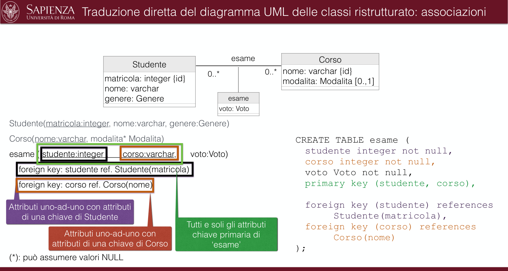

                Traduz. diretta del diagr. UML delle classi ristrutturato: vincoli di molt. massima
  Passo 1: Vincoli di molteplicità massima 1
                                                       Corso
                                                       modalita: Modalita [0.,1]
                          Docente
                    nome: varchar
                    genere: Genere
                                            insegna
                                           da: Date
                                           Molteplicità massima = 1
                                           —> Vincolo di integrità in
 ‘insegna’
 Docente(matricola:integer, nome:varchar, genere:Genere)
 Corso(nome:varchar, modalita*: Modalita)
 insegna (docente:integer, corso:varchar,      da:Date)
   altra chiave: docente
   foreign key: docente references Docente(matricola)
   foreign key: corso references Corso(nome)
                                                              chiave primaria “inutilmente”
                                                                 lunga —> si accorcia
               insegna ( docente:integer ,      corso:varchar,      da:Date)
                 altra chiave: docente
                 foreign key: docente references Docente(matricola)
                 foreign key: corso references Corso(nome)

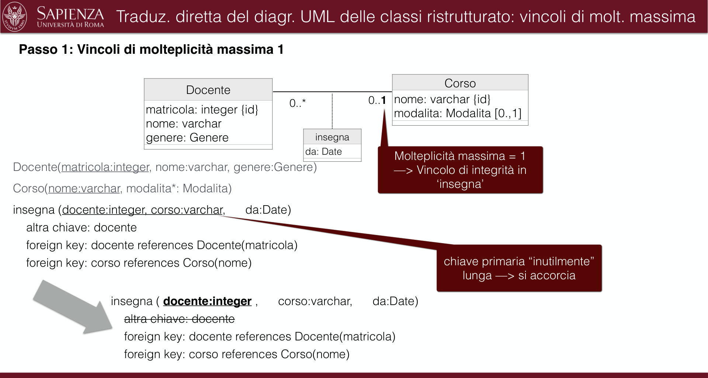

                Traduz. dir. diagr. UML delle classi ristrutt.: vincoli di molt. massima (cont.)
  Passo 1: Vincoli di molteplicità massima 1 (cont.)
                                                         Corso
                                                         modalita: Modalita [0.,1]
                            Docente
                      nome: varchar
                      genere: Genere
                                              insegna
                                             da: Date
                                             Molteplicità massima = 1
                                             —> Vincolo di integrità in
                                                         Molteplicità massima = 1
                                                         —> Vincolo di integrità in
 Docente(matricola:integer, nome:varchar, genere:Genere)
 Corso(nome:varchar, modalita*: Modalita)
                                                                ‘insegna’
                                                                ‘insegna’
 insegna (docente:integer, corso:varchar,      da:Date)
   altra chiave: corso
   altra chiave: docente
   foreign key: docente references Docente(matricola)
   foreign key: corso references Corso(nome)
                                                        chiave primaria “inutilmente” lunga
                                                        —> si accorcia… in un modo o nell’altro
 insegna ( docente:integer, corso:varchar, da:Date)
                                                        insegna ( docente:integer, corso:varchar, da:Date)
   altra chiave: corso
   altra chiave: docente
   foreign key: docente references Docente(matricola)
   foreign key: corso references Corso(nome)
                                                          altra chiave: corso
                                                          altra chiave: docente
                                                          foreign key: docente references Docente(matricola)
                                                          foreign key: corso references Corso(nome)
                                               oppure

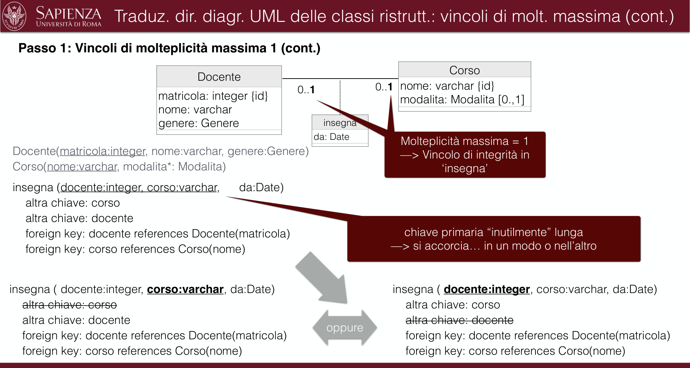

               Traduz. dir. diagr. UML delle classi ristrutturato: vincoli di molt. minima
  Passo 2: Vincoli di molteplicità minima 1
                                                       Corso
                                                       modalita: Modalita [0.,1]
                          Docente
                    nome: varchar
                    genere: Genere
                                            insegna
                                           da: Date
                                                       Molteplicità minima = 1
                                                       —> Vincolo di integrità in
                                                              ‘Corso’
 Docente(matricola:integer, nome:varchar, genere:Genere)
 Corso(nome:varchar, modalita*:Modalita)
   v. inclusione: Corso(nome) occorre in insegna(corso)
                                                     Vincolo di inclusione: generalizzazione di vincolo di
                                                     foreign key, ma gli attributi della tabella di destinazione
 insegna (docente:integer, corso:varchar, da:Date)
   foreign key: docente references Docente(matricola)
   foreign key: corso references Corso(nome)
                                                                non formano una chiave.
                                                       I DBMS non offrono costrutti che lo implementano
                                                                     direttamente

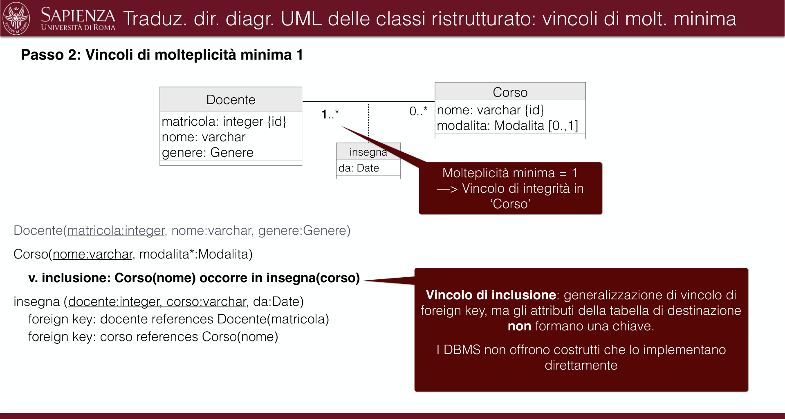

                Traduz. dir. del diagr. UML delle classi ristrutturato: vincoli di molt. minima
  Passo 2: Vincoli di molteplicità minima 1 (cont.)
                                                       Corso
                                                       modalita: Modalita [0.,1]
                          Docente
                    nome: varchar
                    genere: Genere
                                            insegna
                                           da: Date
                                                       Molteplicità miima = 1
                                                       —> Vincolo di integrità in
                                                       Molteplicità minima = 1
                                                       —> Vincolo di integrità in
                                                              ‘Corso’
                                                              ‘Corso’
  Docente(matricola:integer, nome:varchar, genere:Genere)
   v. inclusione: Docente(matricola) occorre in insegna(docente)
  Corso(nome:varchar, modalita*: Modalita)
                                                     Vincolo di inclusione: generalizzazione di vincolo di
                                                     foreign key, ma gli attributi della tabella di destinazione
                                                     Vincolo di inclusione: generalizzazione di vincolo di
                                                     foreign key, ma gli attributi della tabella di destinazione
   v. inclusione: Corso(nome) occorre in insegna(corso)
  insegna(docente:integer, corso:varchar, da:Date)
                                                             non devono formare una chiave.
                                                                non formano una chiave.
   foreign key: docente references Docente(matricola)
   foreign key: corso references Corso(nome)
                                                       I DBMS non offrono costrutti che lo implementano
                                                       I DBMS non offrono costrutti che lo implementano
                                                                     direttamente
                                                                     direttamente

                Traduz. diretta del diagr. UML delle classi ristrutturato: vincoli di molt. 1..1
  Caso speciale: Vincoli di molteplicità 1..1
                                                       Corso
                                                       modalita: Modalita [0.,1]
                          Docente
                    nome: varchar
                    genere: Genere
                                            insegna
                                           da: Date
                                                      Molteplicità 1..1
                                                      —> Combiniamo i due passi
                                                            precedenti
  Docente(matricola:integer, nome:varchar, genere:Genere)
  Corso(nome:varchar, modalita*: Modalita)
   v. inclusione: Corso(nome) occorre in insegna(corso)
                                                     Vincolo di inclusione: in questo caso l’attributo ‘corso’
  insegna (docente:integer, corso:varchar, da:Date)
                                                        forma una chiave completa della tabella Corso.
   foreign key: docente references Docente(matricola)
   foreign key: corso references Corso(nome)
                                                       Il vincolo di inclusione è implementabile tramite un
                                                                 vincolo di foreign key:
                                                     foreign key: Corso(nome) references insegna(corso)

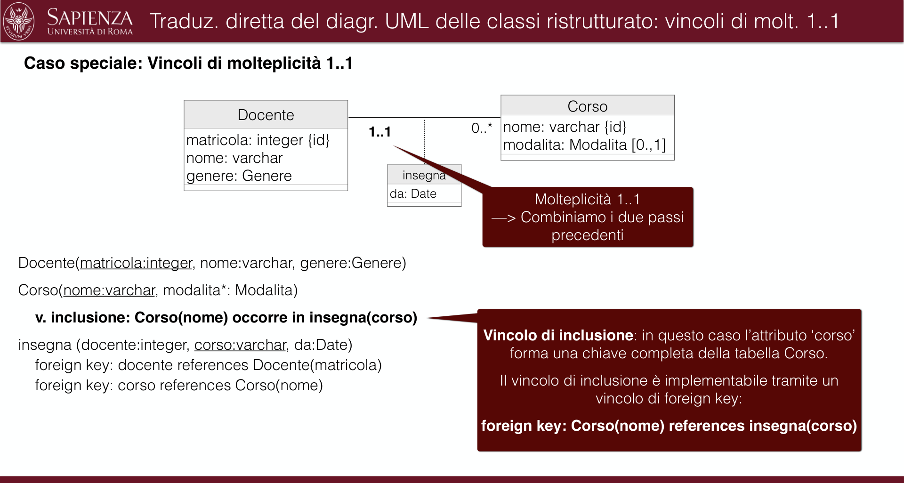

                Traduz. diretta del diagr. UML delle classi ristrutturato: accorpamenti
  L’identificatore primario di Studente coinvolge un ruolo di associazione (ovviamente a molt. 1..1)
                                                       Università
                          Studente
                    matricola: integer {id1}
                    nome: varchar
                    genere: Genere
                                            iscritto
                                           da: Date
                                                      Come facciamo a definire la chiave primaria della
                                                                  tabella Persona?
  Universita(nome:varchar)
  Studente(matricola:integer, nome:varchar, genere:Genere,
  universita:varchar, iscritto_da:Date)
                                                     Accorpamento: la tabella che implementa
                                                     l’associazione ‘iscritto’ viene accorpata nella tabella che
   foreign key: universita references Universita(nome)
                                                           implementa la classe Studente
                                                           (nota: corrispondenza delle righe 1-1)

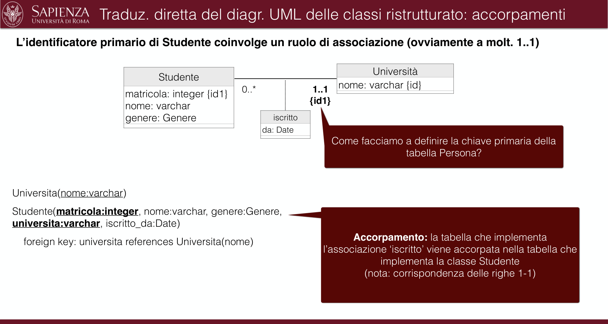

                   Traduz. diretta del diagr. UML delle classi ristrutturato: accorpamenti
  Caso tipico: associazione che deriva da ristrutturazione di relazione is-a
                                       studente_isa_persona
                                                       Persona
                                                       cf: CodiceFiscale {id1}
                                                       nome: varchar
                    Studente
                    matricola: integer {id2}
                                                      Come facciamo a definire la chiave primaria della
                                                                  tabella Studente?
  Persona(cf:CodiceFiscale, nome:varchar)
  Studente(persona:CodiceFiscale, matricola:integer)
   altra chiave: matricola
   foreign key: persona references Persona(cf)

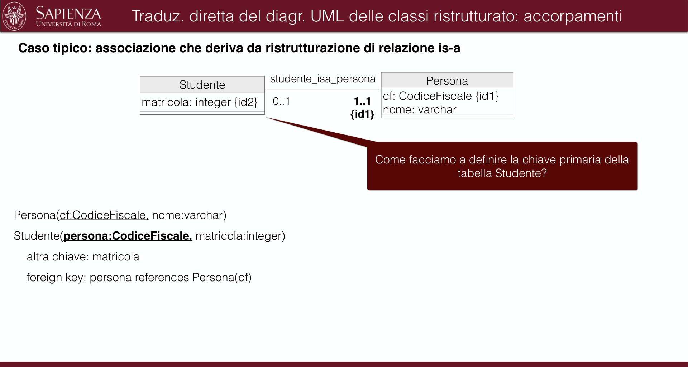

                 Traduz. diretta del diagr. UML delle classi ristrutturato: accorpamenti
  E’ possibile procedere ad accorpamenti ogni volta che un’associazione ha un ruolo a molt. 1..1 o 0..1
                                                       Università
                                                       nome: varchar {id1}
                          Studente
                    cf: CodiceFiscale {id1}
                    nome: varchar
                    genere: Genere
                                            iscritto
                                                        Non abbiamo alcuna necessità di accorpare la
                                           da: Date
                                                          tabella ‘iscritto’ nella tabella ‘Studente’…
                                                              Ma può essere conveniente.
                                                                Valutare caso per caso
                 Senza accorpamento
 Universita(nome:varchar)
 Studente(cf:CodiceFiscale, nome:varchar, genere:Genere)
                                                                     Con accorpamento
   v. inclusione: Studente(cf) occorre in iscritto(studente)
    —> foreign key: Studente(cf) references iscritto(studente)
                                                      Universita(nome:varchar)
 iscritto(studente:CodiceFiscale, universita:varchar)
                                                      Studente(cf:CodiceFiscale, nome:varchar, genere:Genere,
                                                      universita:varchar, iscritto_da:Date)
   foreign key: studente references Studente(cf)
   foreign key: universita references Universita(nome)
                                                        foreign key: universita references Universita(nome)

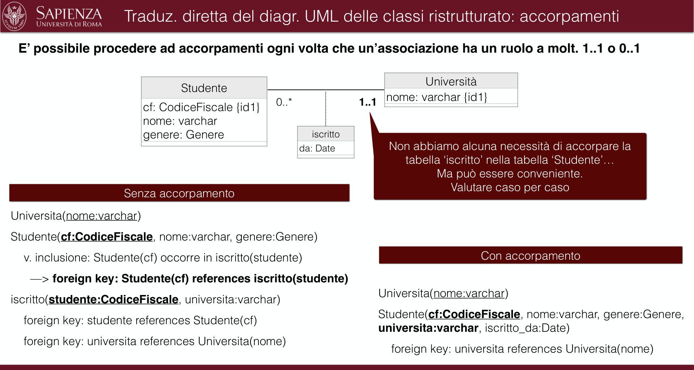

                Traduz. diretta del diagr. UML delle classi ristrutturato: accorpamenti (cont.)
  E’ possibile procedere ad accorpamenti ogni volta che un’associazione ha un ruolo a molt. 1..1 o 0..1
                                                       Università
                                                       nome: varchar {id1}
                          Studente
                    cf: CodiceFiscale {id1}
                    nome: varchar
                    genere: Genere
                                            iscritto
                                           da: Date
                                                                         Caso a molt. 0..1
                 Senza accorpamento
 Universita(nome:varchar)
                                                                    Con accorpamento
 Studente(cf:CodiceFiscale, nome:varchar, genere:Genere)
                                                      Universita(nome:varchar)
   v. inclusione: Studente(cf) occorre in iscritto(studente)
                                                      Studente(cf:CodiceFiscale, nome:varchar, genere:Genere,
                                                      universita*:varchar, iscritto_da*:Date)
    —> foreign key: Studente(cf) references iscritto(studente)
                                                        foreign key: universita references Universita(nome)
 iscritto(studente:CodiceFiscale, universita:varchar)
                                                        v. ennupla: (universita is null) = (iscritto_da is null)
   foreign key: studente references Studente(cf)
   foreign key: universita references Universita(nome)
                                                      (*) può assumere valori NULL

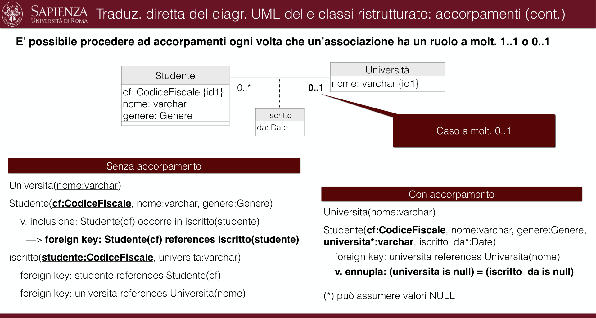

     Parte: Cenni di ingegneria del sw
                                                     Basi di dati relazionali
                                                     Progettazione di basi dati relazionali
                                                     Produzione dello schema rel. con vincoli
                              UNITÀ:  B.3
                                                         Vincoli esterni
                 Versione del 2024-05-26

                    Vincoli esterni allo schema relazionale
  •
  Obiettivo: progettare come implementare, nel DBMS, ogni vincolo esterno.
    •
    Input: schema relazionale, vincoli esterni ristrutturati
    •
    Output: decisioni su come implementare i vincoli esterni
  •
  Metodologia:
    •
    Utilizzare, ove possibile, i costrutti di unique, foreign key, e gli altri costrutti per imporre vincoli di
    integrità supportati dal DBMS in uso
    •
    Per tutti gli altri, definire opportuni trigger
      •
      Trigger: programma imperativo (in linguaggio proprietario del DBMS!) eseguito all’interno del
      DBMS che:
        •
        intercetta un evento (insert/update/delete di ennuple in una o più tabella)
        •
        esegue un controllo (codice imperativo con SQL immerso)
        •
        può sollevare un’eccezione per rifiutare l’operazione intercettata

               Esempio: vincoli esterni allo schema relazionale
                     Dipartimento
                     lavora
                     aff: timestamp
         Persona
                                                                       Dipartimento
                                                                       nome: varchar {id1}
                                                                       lavora
                                                                       aff: timestamp
                                                           Persona
    cf: CodFis {id}
                                                      cf: CodFis {id1}
            0..1
            1..1
                        dirige
                                                                          dirige
                                                      Vincolo esterno [V.dirige.isa_lavora]
                                                         ∀d, p dirige(d, p) →lavora(d, p)
 Definizione delle seguenti relazioni con vincoli:
 Persona(cf:CodFis)
                                                  lavora(dip:integer, persona:CodFis)
                                  Implementable come
                                                   VincoloDB: foreign key: persona references Persona(cf)
                                                   VincoloDB: foreign key: dip references Dipartimento(id)
                                  foreign key, perché
                                  dirige(dip) è chiave
 Dipartimento(id:integer, nome:varchar)
  VincoloDB: inclusione: id ⊆ dirige(dip)
  VincoloDB: inclusione: id ⊆ lavora(dip)
                                                  dirige(dip:integer, persona:CodFis)
                                                   VincoloDB: inclusione: (dip, persona) ⊆ lavora(dip, persona)
                                                   VincoloDB chiave: persona
               Può essere ignorato, perché
                  è implicato dagli altri
                  Implementabile come foreign key,
                  perché lavora(dip, persona) è chiave

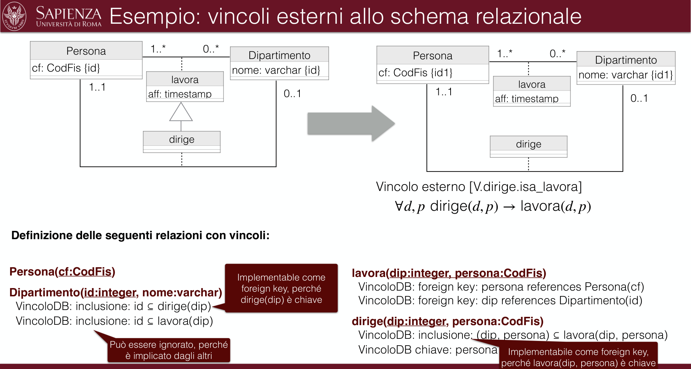

               Esempio 1: vincoli esterni allo schema relazionale
  Come implementare invece questo vincolo esterno?
                                                                       Persona
                                                                  id: serial {id1}
                                                                  nome: varchar(100)
            Persona
       nome: varchar(100)
                                                    s_isa_p
                                                    d_isa_p
                                                    Studente
                                                    matricola: varchar(12)
                                                                                   Docente
                                                                                   nascita: Date
                 {disjoint}
 Studente
 matricola: varchar(12)
                      Docente
                      nascita: Date
                                          Vincolo esterno [V.Persona.gen.disj]
                                          Non devono esistere p:Persona, s:Studente e d:Docente tali che
                                          (s, p): s_isa_p e (d, p): d_isa_p:
                                          ¬∃p, s, d Persona(p) ∧Studente(s) ∧Docente(d) ∧s_isa_p(s, p) ∧d_isa_p(d, p)
  Non è implementabile tramite primary key, unique, foreign key, check (il costrutto check permette la definizione
  di soli vincoli di ennupla)

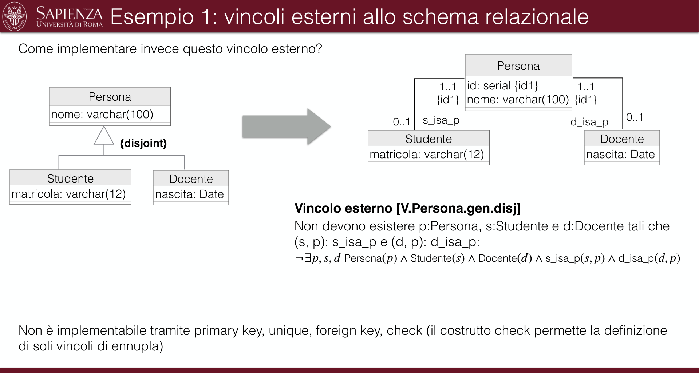

               Esempio 1: progettazione di vincoli esterni mediante trigger
                                              • Persona(id:serial, nome:varchar(100))
               Persona
               id: serial {id1}
               nome: varchar(100)
                                              • Studente(persona:integer, matricola:varchar(12))  // accorpa s_isa_p
                                              foreign key persona references Persona(id)
          1..1
          {id1}
                                              • Docente(persona:integer, nascita:date)  // accorpa d_isa_p
                                              foreign key persona references Persona(id)
    s_isa_p
    d_isa_p
    0..1
    0..1
                      Docente
                      nascita: Date
 Studente
 matricola: varchar(12)
                                              Progetto del trigger V.Persona.gen.disj
 Vincolo esterno [V.Persona.gen.disj]
                                              Operazioni da intercettare: INSERT o UPDATE in Studente o Docente
                                              Quando invocare la funzione: dopo l’operazione intercettata
                                              Funzione(old, new):
 ¬∃p, s, d Persona(p) ∧Studente(s) ∧Docente(d) ∧
       s_isa_p(s, p) ∧d_isa_p(d, p)
                                              • Sia isError = EXISTS(
                                              SELECT *
                                              FROM Studente s, Docente d
                                              WHERE s.persona = new.persona
                                              AND d.persona = new.persona
                                              )
 Quali sono gli eventi che possono portare
 un DB legale a diventare illegale?
 Quando invocare la funzione? Appena prima o appena dopo
 aver effettuato l’operazione (su DB prima o dopo la modifica).
 Pseudocodice della funzione con SQL immerso. Argomenti:
 •
 old (solo per UPDATE e DELETE): ennupla da cancellare/
 cancellata o da modificare/prima della modifica
 •
 new (solo per INSERT e UPDATE): ennupla da inserire/inserita o
 a valle della modifica
 Perché non vanno intercettati i tentativi di INSERT o UPDATE in Persona?
                                              • Se isError = TRUE solleva eccezione “INSERT/UPDATE viola il vincolo”
                                              • Altrimenti, permetti l’operazione

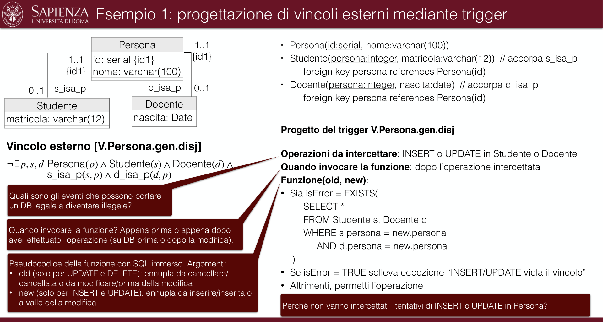

               Esempio 2: vincoli esterni allo schema relazionale
  Come implementare invece questo vincolo esterno?
                                                                       Persona
                                                                  id: serial {id1}
                                                                  nome: varchar(100)
            Persona
       nome: varchar(100)
                                                    s_isa_p
                                                    d_isa_p
                                                    Studente
                                                    matricola: varchar(12)
                                                                                   Docente
                                                                                   nascita: Date
                {complete}
 Studente
 matricola: varchar(12)
                      Docente
                      nascita: Date
                                          Vincolo esterno [V.Persona.gen.compl]
                                          Per ogni p:Persona:
                                          • esiste s:Studente per cui (s, p):s_isa_p oppure
                                          • esiste d:Docente per cui (d, p):d_isa_p
                                          ∀p Persona(p) →[∃x s_isa_p(x, p) ∨d_isa_p(x, p)]
  Non è implementabile tramite primary key, unique, foreign key, check (il costrutto check permette la definizione
  di soli vincoli di ennupla)

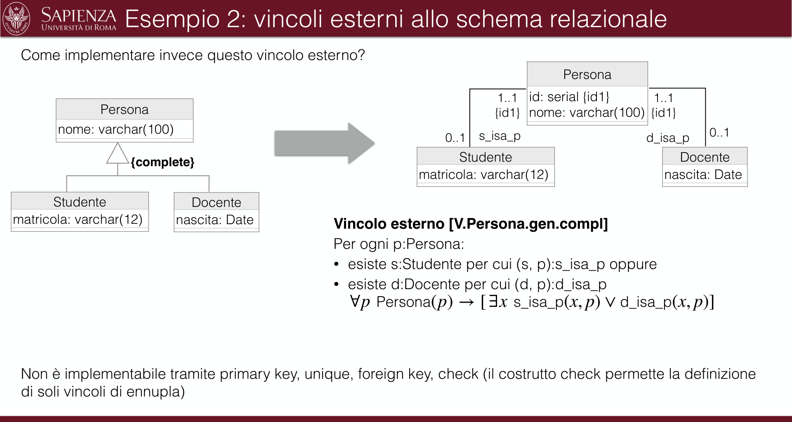

               Esempio 1: progettaz. di vincoli esterni mediante trigger e politiche di accesso
                                              Una strategia più avanzata per il progetto del vincolo V.Persona.compl
               Persona
               id: serial {id1}
               nome: varchar(100)
          1..1
          {id1}
                                              1. Politiche di accesso ai dati: non permettere ad alcun utente di cambiare
                                              gli id artificiali
    s_isa_p
    d_isa_p
    0..1
    0..1
                                              2. Trigger V_Persona_gen_compl_1_persona:
                                                • quando deve scattare: subito dopo INSERT(new) in Persona
                      Docente
                      nascita: Date
 Studente
 matricola: varchar(12)
                                                • controllo da effettuare: new.id deve occorrere in Studente(persona) o
                                                Docente(persona):
                                                  se NOT EXISTS (
                                                  SELECT persona FROM Studente WHERE persona = new.id
                                                  UNION
                                                  SELECT persona FROM Docente WHERE persona = new.id
                                                  ) solleva eccezione, altrimenti permetti l’operazione.
 Vincolo esterno [V.Persona.gen.compl]
 ∀p Persona(p) →[∃x s_isa_p(x, p) ∨d_isa_p(x, p)]
                                              3. Trigger V_Persona_gen_compl_2_[studente | docente]:
Schema relazionale della base dati
                                                • quando deve scattare: subito dopo DELETE(old) in Studente o Docente
                                                • controllo da effettuare: se old.id è in Persona, deve occorrere in
                                                Docente(persona) o Studente(persona)
• Persona(id:serial, nome:varchar(100))
• Studente(persona:integer, matricola:varchar(12))
// accorpa s_isa_p
foreign key persona references Persona(id)
                                                  se EXISTS( SELECT *
                                               FROM  (Persona p LEFT OUTER JOIN Studente s ON p.id = s.persona)

                                               LEFT OUTER JOIN Docente d ON p.id = d.persona
                                               WHERE  p.id = old.persona
• Docente(persona:integer, nascita:date)
// accorpa d_isa_p
foreign key persona references Persona(id)
                                                  AND (s.persona IS NULL) AND (d.persona IS NULL)
                                                  ) allora solleva eccezione, altrimenti permetti l’operazione.
                                              Nota: grazie ad 1., non dobbiamo intercettare gli update (innocui).

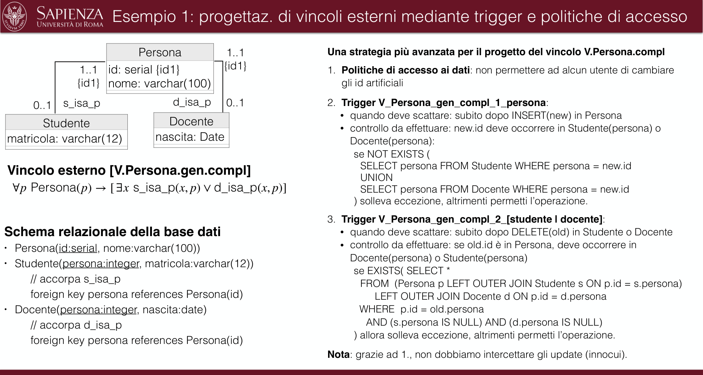

                Esempio 1: progettazione di vincoli esterni mediante trigger (cont.)
  Implementazione:
  -- 1. Politiche di accesso ai dati: non permettere ad alcun utente di cambiare gli id artificiali
  REVOKE UPDATE (id) ON Persona FROM PUBLIC;
  REVOKE UPDATE (persona) ON Studente FROM PUBLIC;
  REVOKE UPDATE (persona) ON Docente FROM PUBLIC;

                Esempio 1: progettazione di vincoli esterni mediante trigger (cont.)
  Implementazione:
  -- 2. Trigger compl_1 per INSERT into Persona
  create or replace function V_Persona_gen_compl_1() returns trigger as $V_Persona_gen_compl_1$

  -- la funzione vedrà 'new' come argomento
  declare isError boolean := false;
  begin

  isError = NOT EXISTS (

  SELECT persona FROM Studente WHERE persona = new.id

  UNION ALL

  SELECT persona FROM Docente WHERE persona = new.id

  );

  if (isError) then raise exception 'Vincolo V_Persona_gen_compl_1 violato (persona.id=%)', new.id;

  end if;

  return new; -- lascia passare la ennupla; in realtà il valore di ritorno per i trigger ‘after’ è ignorato, non lo sarebbe per i trigger ‘before’
  end; $V_Persona_gen_compl_1$ language plpgsql;
  create constraint trigger V_Persona_gen_compl_1_persona
  after insert on Persona
  deferrable  -- affinché sia deferrable, il trigger deve essere di tipo ‘constraint’
  for each row execute procedure V_Persona_gen_compl_1();

                Esempio 1: progettazione di vincoli esterni mediante trigger (cont.)
  Implementazione:
  -- 3. Trigger compl_2 per DELETE from Studente or Docente
  create or replace function V_Persona_gen_compl_2() returns trigger as $V_Persona_gen_compl_2$

  -- la funzione vedrà 'old' come argomento
  declare 	 isError boolean := false;
  begin

  isError := EXISTS(

  SELECT * FROM (Persona p LEFT OUTER JOIN Studente s ON p.id = s.persona) LEFT OUTER JOIN Docente d ON p.id = d.persona

  WHERE p.id = old.persona AND (s.persona IS NULL) AND (d.persona IS NULL)

  );

  if (isError) then raise exception 'Vincolo V_Persona_isa_compl_2 violato (persona=%)', old.persona;

  end if;

  return old; — il valore di ritorno per i trigger ‘after’ è ignorato, non lo è per i trigger ‘before’
  end;$V_Persona_gen_compl_2$ language plpgsql;
  create constraint trigger V_Persona_gen_compl_2_studente
  after delete on Studente
  deferrable for each row execute procedure V_Persona_gen_compl_2();
  create constraint trigger V_Persona_gen_compl_2_docente
  after delete on Docente
  deferrable for each row execute procedure V_Persona_gen_compl_2();

                Esempio 1: progettazione di vincoli esterni mediante trigger (cont.)
  Test:
  Data la presenza dell’attributo id:serial in Persona, abbiamo bisogno di ottenere il valore per ‘id’ generato
  dal DBMS all’atto dell’inserimento di una ennupla in Persona (INSERT … RETURNING) e di salvarlo in una
  variabile locale.
  Questo può essere fatto usando un blocco di codice SQL anonimo:
  begin transaction;
  DO $$ — blocco di codice anonimo (senza dover creare una FUNCTION)
  declare _id integer;
  begin
  insert into Persona(nome) values ('Carlo') returning id into _id;
  insert into Studente(persona, matricola) values (_id, ‘uni-carlo-00123‘);
  end$$;
  commit;
  Esercizio: provare ad effettuare inserimenti o cancellazioni che violerebbero i vincoli.

               Progettazione di vincoli esterni mediante trigger e politiche di accesso
  Esercizio:
  Valutare attentamente come ottimizzare la strategia di controllo dei vincoli esterni dei progetti svolti,
  sfruttando il combinato disposto di:
    •
    Restrizioni nella possibilità di modifiche ai dati, mediante politiche di accesso (REVOKE)
    •
    Trigger che utilizzano function comuni (minimizzando il codice da scrivere)
  In particolare, il caso frequente di generalizzazione disjoint & complete si presta ad interessanti
  ottimizzazioni (da scoprire!)
  Osservazione 1: possiamo valutare l’opportunità di ridurre i gradi di libertà degli utenti quando
  inseriscono o modificano ennuple. Ad esempio, potrebbe essere ragionevole:
  1. impedire l’update di alcuni attributi (ad es., gli id artificiali, come abbiamo visto)
  2. impedire del tutto alcuni UPDATE, forzando gli utenti ad eseguire DELETE + INSERT (per
  operazioni non critiche)
  Osservazione 2: un sistema che implementa i vincoli esterni basandosi sulle restrizioni delle politiche
  di accesso è intrinsecamente più fragile di uno che garantisce che il vincolo sia soddisfatto a valle di
  qualsivoglia evento, anche quelli impediti (spesso è complicato impedire alcune operazioni a tutti gli
  utenti, anche agli amministratori). È bene che il progettista valuti caso per caso.
