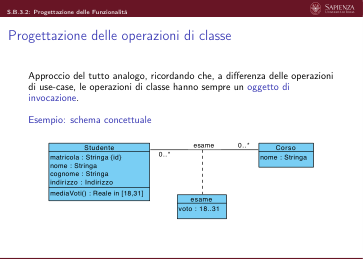
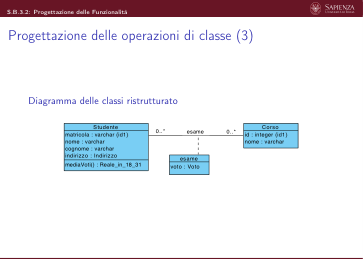
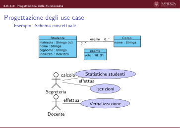

# B.3.2 - Progettazione delle funzionalità

> Fonte: `Slide B.3.2 - Progettazione delle funzionalità - BD2.pdf`
> Estratto con PyMuPDF (conserva legature e formule); tolte le righe ripetute di intestazione e pie' di pagina e le etichette sparse dei diagrammi, che sono ritagliati in `figure/` e richiamati nel punto in cui compaiono.

---

Slides B.3.2 (S.B.3.2)
                         Basi di dati
                         La fase di progettazione
                         Progettazione delle Funzionalità

 S.B.3.2: Progettazione delle Funzionalità
  Progettazione delle Funzionalità
       Lo schema concettuale contiene una specifica per operazione di classe o
       di use-case in termini di:
          ▶segnatura: nome dell’operazione, nome e tipo degli argomenti, tipo
          dell’eventuale valore di ritorno
          ▶precondizioni
          ▶postcondizioni.
       Durante la fase di progettazione, per ogni operazione, va definita una
       specifica realizzativa in termini di:
          ▶segnatura: nome dell’operazione, nome e dominio degli argomenti,
          dominio dell’eventuale valore di ritorno (i domini sono i domini
          supportati dal DBMS fatti corrispondere in fase di progettazione ai
          tipi concettuali)
          ▶algoritmo in pseudo-codice contenente eventuali comandi SQL per
             l’interazione con la base dati.

 S.B.3.2: Progettazione delle Funzionalità
  Progettazione delle operazioni di classe
       Approccio del tutto analogo, ricordando che, a differenza delle operazioni
       di use-case, le operazioni di classe hanno sempre un oggetto di
       invocazione.
       Esempio: schema concettuale
                                           esame
                       Studente
                                                                           Corso
             matricola : Stringa {id}
             nome : Stringa
             cognome : Stringa
             indirizzo : Indirizzo
                                                                       nome : Stringa
             mediaVoti() : Reale in [18,31]
                                                    esame
                                                 voto : 18..31

 S.B.3.2: Progettazione delle Funzionalità
  Progettazione delle operazioni di classe (2)
       Esempio: schema concettuale (continua)
       Specifica use-case Studente
         mediaVoti() : Reale in [18,31]
         precondizioni: L’istanza this è coinvolta in almeno una istanza dell’associazione esame:
                                           ∃c esame(this, c).
         postcondizioni:
         Modifica del Livello Estensionale dei Dati: Nessuna
         Valore di Ritorno: Detto V = {c, v | esame(this, c) ∧voto(this, c, v)},
                                                     P
                                                       (c,v)∈V v
                                            result =
                                                        |V |
       End

 S.B.3.2: Progettazione delle Funzionalità
  Progettazione delle operazioni di classe (3)
       Diagramma delle classi ristrutturato
                         Studente
                                                                        Corso
                                          esame
                 matricola : varchar {id1}
                 nome : varchar
                 cognome : varchar
                 indirizzo : Indirizzo
                                                                   id : integer {id1}
                                                                   nome : varchar
                                                 esame
                 mediaVoti() : Reale_in_18_31
                                              voto : Voto

 S.B.3.2: Progettazione delle Funzionalità
  Progettazione delle operazioni di classe (4)
       Progettazione della base dati
       Dominio Voto: si decide di definire un dominio utente Voto. Il dominio è
       basato sul dominio integer; i valori ammessi sono gli interi tra 18 e 31.
       Studente (matricola:varchar)
       Corso (codice:integer)
       esame (studente:varchar, corso:integer, voto:Voto)
          VincoloDB
          foreign key: studente references Studente(matricola)
          VincoloDB
          foreign key: corso references Corso(codice)

 S.B.3.2: Progettazione delle Funzionalità
  Progettazione delle operazioni di classe (5)
       Specifica realizzativa classe Studente
         mediaVoti() : Reale_in_18_31
         algoritmo:
           1. Memorizza in Q il risultato della seguente query SQL:
                select
                s . matricola ,
                avg ( e . voto ) as media
                from Studente
                s LEFT OUTER JOIN esame e
                on s . m a t r i c o l a = e . studente
                where s . m a t r i c o l a = PAR_1
                group by s . m a t r i c o l a
           dopo aver rimpiazzato ‘PAR_1’, con il valore dell’attributo matricola di this.
           2. Se Q è vuoto, genera l’errore ‘Lo studente non esiste’
           3. Altrimenti, se Q è (. . . , NULL), genera l’errore ‘Lo studente non ha superato alcun
           esame’
           4. Altrimenti restituisci il valore dell’attributo media dell’unica ennupla di Q.
       End

 S.B.3.2: Progettazione delle Funzionalità
  Dove implementare le operazioni di classe? (Cenni)
       Operazioni di classe:
          ▶Dipende dalla tecnologia per il back-end scelta in fase di
          progettazione
          ▶Ad esempio, in caso di back-end implementati con approccio
          object-oriented, è possibile creare class associate alle classi UML del
          diagramma ristrutturato (tutte o solo alcune) e imlementare le
          operazioni di classe come metodi di queste class
          ▶È anche possibile implementare le operazioni di classe nel DBMS
             utlizzando il costrutto CREATE FUNCTION, al fine di renderle
             disponibili a tutti i back-end che accedono alla base dati.
             Tali FUNCTION possono essere invocate con:
               SELECT myFunction ( argomenti ) ;
             o utilizzate in query più complesse.

 S.B.3.2: Progettazione delle Funzionalità
  Dove implementare le operazioni di classe? (Cenni) (2)
       Esempio:
        CREATE OR REPLACE FUNCTION Studente_mediaVoti (_matr varchar )
        r e t u r n s
        Reale_in_18_31 AS $BODY$
        DECLARE
        matr varchar := NULL;
        media numeric := NULL;
        BEGIN
          select
          s . m a t r i c o l a
          , avg ( e . voto ) INTO matr ,
          media
          from Studente
          s LEFT OUTER JOIN esame e
          on s . m a t r i c o l a = e . studente
          where s . m a t r i c o l a = _matr
          group by s . m a t r i c o l a ;
          IF
          ( matr
          IS NULL) THEN
          RAISE EXCEPTION ’ Error
          001 −Lo studente
          non
          e s i s t e ’ ;
          ELSE
            IF
            ( media
            IS NULL) THEN
            RAISE EXCEPTION ’ Error
            002 −Lo studente
            non ha esami ’ ;
            ELSE
        RETURN media ;
        END IF ;
        END IF ;
        END;
        $BODY$ LANGUAGE ’ p l p g s q l ’ ;

 S.B.3.2: Progettazione delle Funzionalità
  Progettazione degli use case
       Esempio: Schema concettuale
                            Studente
                                                                   Corso
                                            esame
                     matricola : Stringa {id}
                     nome : Stringa
                     cognome : Stringa
                     indirizzo : Indirizzo
                                                               nome : Stringa
                                                  esame
                                               voto : 18..31
                                               Statistiche studenti
                                 calcola
                                           effettua
                         Segreteria
                         Iscrizioni
                                   effettua
                                                 Verbalizzazione
                          Docente

 S.B.3.2: Progettazione delle Funzionalità
  Progettazione degli use case (2)
       Schema concettuale: Specifica concettuale di use-case
       Specifica use-case Verbalizzazione
         verbalizzaEsame(s : Studente, c : Corso, v : 18..31)
         precondizioni: L’istanza s non è coinvolta in alcuna istanza dell’associazione esame con
         l’istanza c:
         ¬∃c esame(s, c).
         postcondizioni:
         Modifica del Livello Estensionale dei Dati: Il livello estensionale dei dati al termine
         dell’esecuzione della funzione differisce da quello di partenza come segue:
         Elementi del dominio di interpretazione : invariati
         Variazioni nelle ennuple di predicati: esame(s, c), voto(s, c, v).
         Valore di Ritorno: nessuno.
       End

 S.B.3.2: Progettazione delle Funzionalità
  Progettazione degli use case (3)
       Specifica realizzativa di use-case
       Specifica realizzativa use-case Verbalizzazione
         verbalizzaEsame(s : varchar, c : integer, v : Voto)
         algoritmo:
           1. Esegui il seguente comando SQL:
           insert into esame(studente, corso, voto) values (PAR_1, PAR_2, PAR_3)
           dopo aver rimpiazzato ‘PAR_1’, ‘PAR_2’, ’PAR_3’ con i valori dei parametri attuali,
           rispettivamente, s, c, v.
           2. Se il comando precedente restituisce un errore di vincolo di chiave violato, allora genera
           l’errore ‘Lo studente di matricola s ha già superato l’esame per il corso di codice c’.
       End

 S.B.3.2: Progettazione delle Funzionalità
  Progettazione degli use case (4)
       Schema concettuale: Specifica concettuale di use-case
       Specifica use-case StatisticheStudenti
         mediaVoti(s : Studente) : reale in [18,31]
         precondizioni: L’istanza s è coinvolta in almeno un’istanza dell’associazione esame:
               ∃c esame(s, c).
         postcondizioni:
         Modifica del Livello Estensionale dei Dati: nessuna
         Valore di Ritorno: result è tale da soddisfare la formula:
                                         mediaVotiStudente(s, result).
       End

 S.B.3.2: Progettazione delle Funzionalità
  Progettazione degli use case (5)
       Specifica realizzativa di use-case
       Specifica realizzativa use-case StatisticheStudenti
         mediaVoti(s : varchar) : Reale_18_31
         algoritmo:
           1. Memorizza in result il risultato di:
               SELECT Studente_mediaVoti (PAR_1) ;
           dopo aver rimpiazzato ‘PAR_1’ con il valore del parametro attuale s.
           (La query restituisce un reale o solleva una eccezione.)
           2. Se la query ha lanciato una eccezione, rilancia l’errore e termina.
           3. Altrimenti, restituisci result.
       End

 S.B.3.2: Progettazione delle Funzionalità
  Progettazione degli use case (6)
       Schema concettuale: Specifica concettuale di use-case
       Specifica use-case StatisticheStudenti (continua)
         numMedioEsami() : reale ≥0
         precondizioni: Il livello estensionale dei dati definisce almeno una istanza di classe Studente:
         ∃s Studente(s).
         postcondizioni:
         Modifica del Livello Estensionale dei Dati: nessuna
         Valore di Ritorno: result è pari al numero di istanze di associazione esame definite nel
              livello estensionale diviso per il numero di istanze di entità Studente. Formalmente,
              siano:
                           E = {(s, c) | esame(s, c)}
                           e
                           S = {s | Studente(s)}
              gli insiemi, rispettivamente, di tutte le coppie (s, c) istanze dell’associazione esame e
              di tutte le istanze dell’entità Studente. Si ha: result =
              |E|
              |S|.
       End

 S.B.3.2: Progettazione delle Funzionalità
  Progettazione degli use case (7)
       Specifica realizzativa di use-case
       Specifica realizzativa use-case StatisticheStudenti (continua)
         numMedioEsami() : RealeNonNeg
         algoritmo:
           1. Esegui la seguente query SQL e memorizzane il risultato nella variabile Q:
                select
                e . numEsami/ s . numStudenti as numMedioEsami
                from ( select
                count (∗)
                as numEsami from esame ) e ,
                ( select
                count (∗)
                as numStudenti from Studente )
                s
           (La query restituisce un reale o un eccezione di ‘divisione per zero’.)
           2. Se il risultato della query è un eccezione di ‘divisione per zero’, generare l’errore ‘Non
           esistono studenti’ e termina.
           3. Altrimenti, restituisci Q.
       End
       Nota:
       Il dominio RealeNonNeg è stato scelto, all’inizio della Fase di Progettazione, come
       corrispondente del dominio concettuale reale ≥0.

 S.B.3.2: Progettazione delle Funzionalità
  Dove implementare le operazioni di use-case? (Cenni)
       Operazioni di use-case:
          ▶Dipende dalla tecnologia per il back-end scelta in fase di
          progettazione
          ▶In generale, nel livello più esterno del back-end, di modo che siano
          accessibili agli utenti del sistema (attori del diagramma concettuale)
          ▶Esempio: in applicazioni web RESTful, sono procedure accessibili
          tramite gli endpoint REST
          ▶Autenticazione utenti tramite, ad es., token OAuth2
          ▶L’architettura può essere più complessa e prevedere più livelli
             (multi-layered applications)

 S.B.3.2: Progettazione delle Funzionalità
  Dove implementare le operazioni di use-case? (Cenni) (2)
       Esempio:
       (back-end web RESTful in Flask, https://flask.palletsprojects.com)
        from
        f l a s k
        i m p o r t
        . . .
        from
        f l a s k _ r e s t f u l
        i m p o r t
        Resource
        . . .
        i m p o r t
        psycopg2 # D r i v e r
        Python
        per
        PostgreSQL
        . . .
        c l a s s
        MediaVoti ( Resource ) :
        # I n v o c a t o
        d a l
        f r o n t −end
        mediante
        chiamata HTTPS
        d i
        t i p o
        GET,
        ad
        es . :
        # GET
        h t t p s : / / app . s i t e / s t a t i s t i c h e s t u d e n t i / m e d i a v o t i/<m a t r i c o l a >
        d e f
        get ( s e l f ,
        m a t r i c o l a : s t r ) −> " t u p l e [ d i c t ,
        i n t ] " :
        t r y :
               with
               get_db ( )
               as
               db :
               with
               db . c u r s o r ( )
               as
               cur :
               cur . e x e c u t e (
                   "SELECT
                   Studente_mediaVoti(%s )
                   as
                   media " ,
                   ( m a t r i c o l a , )
                   ) # puo ’
                   s o l l e v a r e
                   e c c e z i o n i
                   r e s u l t
                   = cur . f e t c h o n e ( ) # l e g g i
                   l a
                   prima
                   ennupla
                   r e s t i t u i t a
                   r e t u r n # c r e a
                   o g g e t t o
                   JSON da
                   r e s t i t u i r e
                   {
            " m a t r i c o l a " :
            m a t r i c o l a ,
            " media " :
            r e s u l t [ " media " ]
            } ,
            200 # HTTP OK
            e x c e p t
            psycopg2 . D a t a ba s e E rr o r
            as
            e r r :
            i f
            ( c o d i c e
            a s s o c i a t o
            ad
            e r r == 001) :

 S.B.3.2: Progettazione delle Funzionalità
  Dove implementare le operazioni di use-case? (Cenni) (3)
        a b o r t ( c o d i c e
        HTTP,
        d e s c r i p t i o n ( "Lo
        s t u d e n t e
        non
        e s i s t e " ) )
        e l i f
        . . .
        e x c e p t
        E x c e p t i o n :
        a b o r t (500 ,
        d e s c r i p t i o n=" I n t e r n a l
        S e r v e r
        E r r o r " )
        . . .

 S.B.3.2: Progettazione delle Funzionalità
  Dove implementare le operazioni di use-case? (Cenni) (4)
        from
        f l a s k
        i m p o r t
        . . .
        from
        f l a s k _ r e s t f u l
        i m p o r t
        Resource
        . . .
        i m p o r t
        psycopg2 # D r i v e r
        Python
        per
        PostgreSQL
        . . .
        c l a s s
        VerbalizzaEsame ( Resource ) :
        # I n v o c a t o
        d a l
        f r o n t −end
        mediante
        chiamata HTTPS
        d i
        t i p o
        POST,
        ad
        es . :
        # POST
        h t t p s : / / app . s i t e / v e r b a l i z z a z i o n e / v e r b a l i z z a e s a m e
        # con
        body JSON {
        s t u d e n t e : s t r ,
        c o r s o : i n t ,
        voto : i n t
        }
        d e f
        p o s t ( s e l f ) −> " t u p l e [ d i c t ,
        i n t ] " :
        ( studente ,
        corso ,
        voto ) =
        l e g g i
        i l
        body
        d e l l a
        r i c h i e s t a
        POST
        t r y :
               with
               get_db ( )
               as
               db :
               with
               db . c u r s o r ( )
               as
               cur :
               cur . e x e c u t e (
        "INSERT INTO esame ( studente ,
        corso ,
        voto )
        v a l u e s
        (%s , %s , %s
        ) " ,
        ( studente ,
        corso ,
        voto )
        ) # puo ’
        s o l l e v a r e
        e c c e z i o n i
        . . .
        r e t u r n
        201 # HTTP CREATED
        e x c e p t
        psycopg2 . D a t a ba s e E rr o r
        as
        e r r :
        i f
        ( c o d i c e
        a s s o c i a t o
        ad
        e r r ==
        . . . ) :
        a b o r t ( c o d i c e
        HTTP,
        d e s c r i p t i o n ( "Lo
        s t u d e n t e
        non
        e s i s t e " ) )
        e l i f
        . . .
        e x c e p t
        E x c e p t i o n :
        a b o r t (500 ,
        d e s c r i p t i o n=" I n t e r n a l
        S e r v e r
        E r r o r " )
        . . .

 S.B.3.2: Progettazione delle Funzionalità
  Dove implementare le operazioni di use-case? (Cenni) (5)
